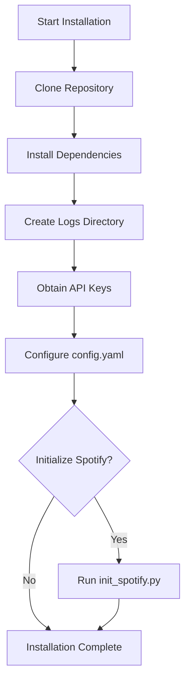
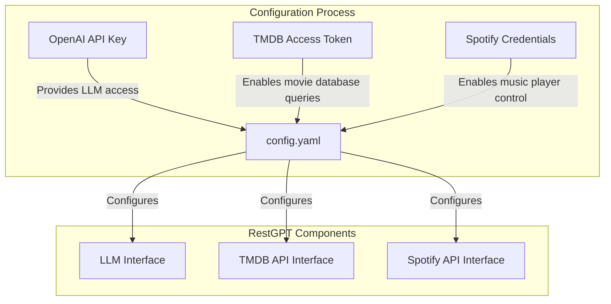
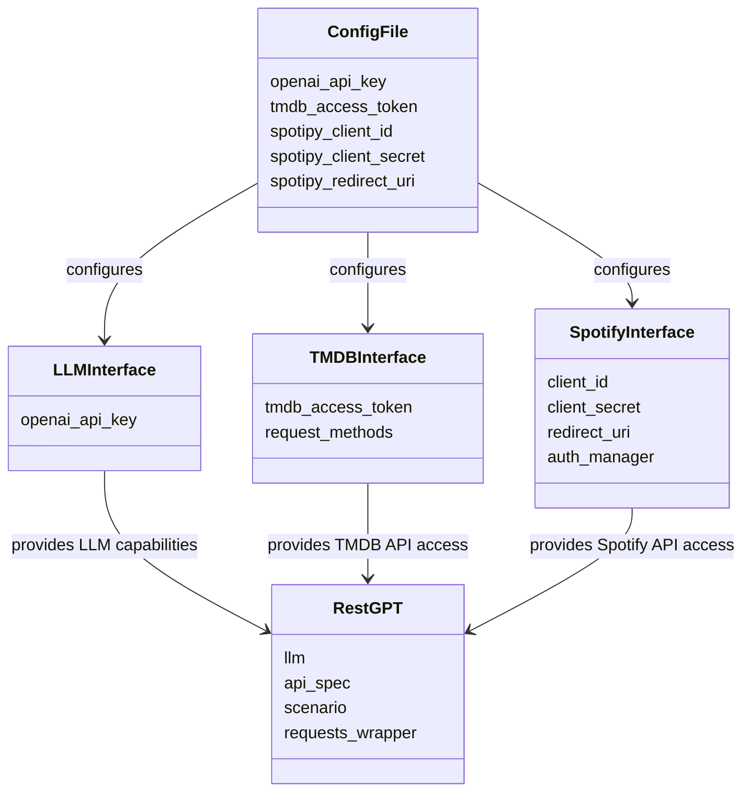

<!-- source: DeepWiki mcp.deepwiki.com · repo Yifan-Song793/RestGPT · page 2.1 Installation and Setup · fetched 2026-10-26 -->

# Installation and Setup

<details>
<summary>Relevant source files</summary>

The following files were used as context for generating this wiki page:

- [README.md](README.md)
- [config.yaml](config.yaml)

</details>


This document provides step-by-step instructions for installing RestGPT and configuring its dependencies. It covers the required packages, API key setup, and environment initialization. For information about how to run the system after installation, see [Running the System](#2.2).

## Prerequisites

Before installing RestGPT, ensure you have the following:

- Python 3.7+ installed
- Access to command line/terminal
- Internet connection for API access
- API keys for required services (detailed below)

## Installation Process



Sources: [README.md:61-71]()

### 1. Clone the Repository

Clone the RestGPT repository from GitHub:

```bash
git clone https://github.com/Yifan-Song793/RestGPT.git
cd RestGPT
```

### 2. Install Required Packages

Install the required Python packages using pip:

```bash
pip install langchain colorama tiktoken spotipy openai
```

This command installs:
- `langchain`: Framework for developing LLM-powered applications
- `colorama`: For colored terminal output
- `tiktoken`: OpenAI's tokenizer
- `spotipy`: Python client for Spotify API
- `openai`: Official OpenAI API client

Sources: [README.md:63-65]()

### 3. Create Required Directories

Create a `logs` directory in the project root for storing execution logs:

```bash
mkdir logs
```

Sources: [README.md:67]()

## API Key Configuration

RestGPT requires API keys for three different services. These keys need to be configured in the `config.yaml` file.



Sources: [README.md:69-71](), [config.yaml:1-7]()

### 1. Obtain API Keys

#### OpenAI API Key
1. Visit [OpenAI's platform](https://platform.openai.com)
2. Create an account or sign in
3. Navigate to the API section
4. Generate an API key

#### TMDB API Key
1. Visit [TMDB Developer Portal](https://developer.themoviedb.org/docs/getting-started)
2. Create an account or sign in
3. Request an API key by following their process
4. Save the access token

#### Spotify API Credentials
1. Visit [Spotify Developer Dashboard](https://developer.spotify.com/documentation/web-api)
2. Create an account or sign in
3. Create a new application
4. Obtain the Client ID and Client Secret
5. Set a redirect URI (e.g., `http://localhost:8888/callback`)

Sources: [README.md:69]()

### 2. Configure the config.yaml File

Edit the `config.yaml` file in the project root directory and add your API keys:

```yaml
openai_api_key: your_openai_api_key_here

tmdb_access_token: your_tmdb_access_token_here

spotipy_client_id: your_spotify_client_id_here
spotipy_client_secret: your_spotify_client_secret_here
spotipy_redirect_uri: your_spotify_redirect_uri_here
```

The configuration file structure directly maps to the API services used by RestGPT:

| Key | Description | Required For |
|-----|-------------|-------------|
| `openai_api_key` | Authentication key for OpenAI API | Core LLM functionality |
| `tmdb_access_token` | Authentication token for TMDB API | Movie database scenario |
| `spotipy_client_id` | Spotify application client ID | Spotify scenario |
| `spotipy_client_secret` | Spotify application client secret | Spotify scenario |
| `spotipy_redirect_uri` | URI for OAuth2 authentication redirection | Spotify scenario |

Sources: [config.yaml:1-7](), [README.md:71]()

## System Component Configuration Mapping



Sources: [README.md:16-29](), [config.yaml:1-7]()

## Optional: Spotify Environment Initialization

If you want to use the Spotify scenario with a clean environment, you can initialize it. However, be extremely cautious as this will remove all your existing Spotify data.

**⚠️ WARNING: This will remove all your data from Spotify! ⚠️**

Run the initialization script:

```bash
python init_spotify.py
```

This script prepares your Spotify account for use with RestGPT by resetting it to a clean state.

Sources: [README.md:73-79]()

## Verification

To verify your installation and configuration:

1. Run the basic RestGPT application:
```bash
python run.py
```

2. When prompted, select one of the available scenarios (TMDB or Spotify)
3. Enter a simple instruction to test functionality

If the system responds without errors, your installation and setup are complete and successful.

Sources: [README.md:83-89]()

## Troubleshooting

Here are some common issues and their solutions:

1. **API Key Errors**: Ensure all API keys are correctly entered in `config.yaml` without trailing spaces
2. **Missing Logs Directory**: Verify the `logs` directory exists in the project root
3. **Package Import Errors**: Confirm all dependencies are installed with `pip list`
4. **Spotify Authentication Issues**: Check that your redirect URI in the Spotify Developer Dashboard matches the one in `config.yaml`

If problems persist, check the log files in the `logs` directory for more detailed error messages.

---

