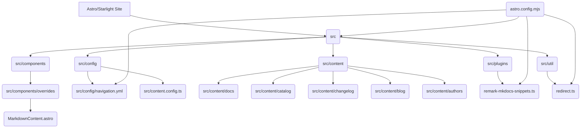
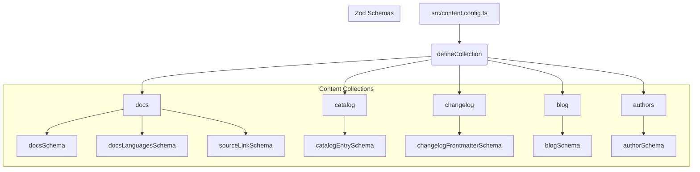
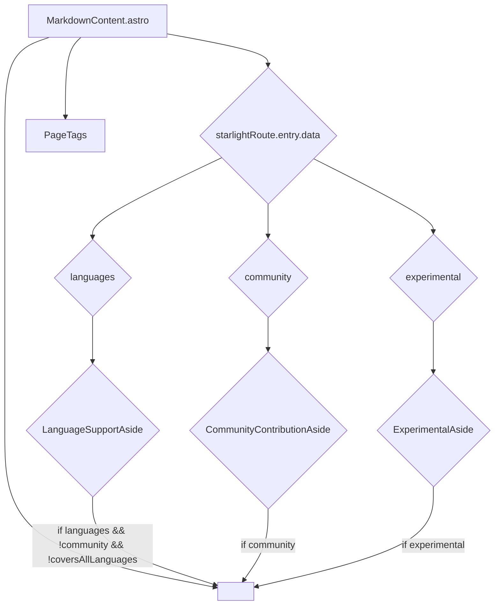

<!-- source: DeepWiki mcp.deepwiki.com · repo strands-agents/sdk-python · page 10.1 Site Architecture and Navigation · fetched 2026-10-26 -->

# 10.1. Site Architecture and Navigation

<details>
<summary>Relevant source files</summary>

The following files were used as context for generating this wiki page:

- [.agents/references/mdx-authoring.md](.agents/references/mdx-authoring.md)
- [site/AGENTS.md](site/AGENTS.md)
- [site/SITE-ARCHITECTURE.md](site/SITE-ARCHITECTURE.md)
- [site/astro.config.mjs](site/astro.config.mjs)
- [site/src/components/LanguageToggle.astro](site/src/components/LanguageToggle.astro)
- [site/src/components/Syntax.astro](site/src/components/Syntax.astro)
- [site/src/components/landing/AgentSetupCard.astro](site/src/components/landing/AgentSetupCard.astro)
- [site/src/components/landing/CodeBlock.astro](site/src/components/landing/CodeBlock.astro)
- [site/src/components/landing/HeroSection.astro](site/src/components/landing/HeroSection.astro)
- [site/src/components/landing/LangCodeBlock.astro](site/src/components/landing/LangCodeBlock.astro)
- [site/src/components/overrides/MarkdownContent.astro](site/src/components/overrides/MarkdownContent.astro)
- [site/src/config/changelog.ts](site/src/config/changelog.ts)
- [site/src/config/navigation.yml](site/src/config/navigation.yml)
- [site/src/content.config.ts](site/src/content.config.ts)
- [site/src/content/blog/introducing-strands-labs.mdx](site/src/content/blog/introducing-strands-labs.mdx)
- [site/src/content/catalog/strands-github-storage.yaml](site/src/content/catalog/strands-github-storage.yaml)
- [site/src/content/docs/contribute/contributing/extensions.mdx](site/src/content/docs/contribute/contributing/extensions.mdx)
- [site/src/content/docs/integrations/storage/github.mdx](site/src/content/docs/integrations/storage/github.mdx)
- [site/src/content/docs/labs/benchmark-harnesses.mdx](site/src/content/docs/labs/benchmark-harnesses.mdx)
- [site/src/content/docs/labs/harness-optimizer.mdx](site/src/content/docs/labs/harness-optimizer.mdx)
- [site/src/content/docs/labs/index.mdx](site/src/content/docs/labs/index.mdx)
- [site/src/content/docs/labs/pywebrtc-audio.mdx](site/src/content/docs/labs/pywebrtc-audio.mdx)
- [site/src/content/docs/labs/robots.mdx](site/src/content/docs/labs/robots.mdx)
- [site/src/content/docs/labs/strands-for-cosmos.mdx](site/src/content/docs/labs/strands-for-cosmos.mdx)
- [site/src/layouts/BlogLayout.astro](site/src/layouts/BlogLayout.astro)
- [site/src/layouts/BlogPostLayout.astro](site/src/layouts/BlogPostLayout.astro)
- [site/src/layouts/LandingLayout.astro](site/src/layouts/LandingLayout.astro)
- [site/src/pages/blog/authors/[author].astro](site/src/pages/blog/authors/[author].astro)
- [site/src/pages/blog/tags/[tag].astro](site/src/pages/blog/tags/[tag].astro)
- [site/src/pages/changelog/index.astro](site/src/pages/changelog/index.astro)
- [site/src/pages/index.astro](site/src/pages/index.astro)
- [site/src/plugins/remark-mkdocs-snippets.ts](site/src/plugins/remark-mkdocs-snippets.ts)
- [site/src/plugins/sitemap-lastmod.ts](site/src/plugins/sitemap-lastmod.ts)
- [site/src/util/integration-content.ts](site/src/util/integration-content.ts)
- [site/src/util/language-preference.ts](site/src/util/language-preference.ts)
- [site/src/util/redirect.ts](site/src/util/redirect.ts)
- [site/src/util/regex.ts](site/src/util/regex.ts)
- [site/src/util/structured-data.ts](site/src/util/structured-data.ts)
- [site/test/known-routes.json](site/test/known-routes.json)
- [site/test/languages-schema.test.ts](site/test/languages-schema.test.ts)
- [site/test/sitemap-lastmod.test.ts](site/test/sitemap-lastmod.test.ts)

</details>


This page details the architecture of the Strands Agents SDK documentation site, built using Astro and Starlight. It covers the site's structure, how navigation is managed, the various content collections, the Zod schemas used for content validation, the language faceting system, and the custom `MarkdownContent.astro` override.

## Astro/Starlight Site Structure

The documentation site leverages Astro as its static site generator and Starlight as the documentation theme. Key customizations have been implemented to align with the project's specific requirements, particularly regarding navigation and content organization.

The core structure of the site is organized as follows:


**Diagram: High-Level Site Architecture**
Sources: [site/AGENTS.md:57-100](), [site/astro.config.mjs:1-131]()

- **`src/components/overrides/`**: Contains Astro components that override Starlight's default components, such as `MarkdownContent.astro` [site/astro.config.mjs:100]().
- **`src/config/`**: Houses site-wide configuration files, notably `navigation.yml` [site/src/config/navigation.yml:1-12034]() for navigation and `content.config.ts` [site/src/content.config.ts:1-169]() for content collection schemas.
- **`src/content/`**: This directory is central to content management, organized into various content collections.
- **`src/plugins/`**: Contains custom Remark/Rehype plugins, like `remark-mkdocs-snippets.ts` [site/src/plugins/remark-mkdocs-snippets.ts](), for extending Markdown processing.
- **`src/util/`**: Provides utility functions, including those for handling redirects [site/src/util/redirect.ts:1-3630]() and link resolution.
- **`astro.config.mjs`**: The main Astro configuration file [site/astro.config.mjs:1-131]() that ties all these components and configurations together.

## Navigation Management with `navigation.yml`

The primary source of truth for the site's navigation structure is `site/src/config/navigation.yml` [site/src/config/navigation.yml:1-12034](). This YAML file defines the top navigation bar (`navbar`) and the hierarchical sidebar structure (`sidebar`).

```mermaid
graph TD
    A[navigation.yml] --> B{Navbar Configuration};
    A --> C{Sidebar Configuration};
    B --> B1[label: "Home", href: "/"];
    B --> B2[label: "Docs", href: "/docs/user-guide/quickstart/typescript/", basePath: "/docs/user-guide/"];
    C --> C1[label: "Docs", items: [...]];
    C1 --> C2[label: "Get Started", items: [...]];
    C2 --> C3[docs/user-guide/quickstart/overview];
    C2 --> C4[label: "Quickstart: Python", slug: "docs/user-guide/quickstart/python"];
    C2 --> C5[label: "Quickstart: TypeScript", slug: "docs/user-guide/quickstart/typescript"];
    C --> C6[label: "Concepts", items: [...]];
    C6 --> C7[docs/user-guide/concepts/agents/agent-loop];
    C6 --> C8[label: "Memory", collapsed: true, badge: {text: "New", variant: "tip"}, items: [...]];
```
**Diagram: `navigation.yml` Structure**
Sources: [site/src/config/navigation.yml:1-12034]()

- **`navbar`**: Defines the links displayed in the top navigation bar [site/src/config/navigation.yml:13-43](). Each entry includes a `label`, `href`, and optionally a `basePath` for active state highlighting, and `align` for positioning.
- **`sidebar`**: Specifies the hierarchical structure of the sidebar [site/src/config/navigation.yml:45-12034]().
    - It supports nested `items` for creating groups and sub-groups.
    - Leaf pages are referenced by their content collection slug (e.g., `docs/user-guide/quickstart/overview`).
    - Groups can have a `badge` property to display status (e.g., "New", "Experimental") on collapsed sections [site/src/config/navigation.yml:85-88](). Page-level badges are derived from page frontmatter.
    - The `collapsed: true` property can be added to groups to make them collapsed by default [site/src/config/navigation.yml:84](). This behavior is managed by the `src/route-middleware.ts` [site/SITE-ARCHITECTURE.md:22-23]().

The `site/src/sidebar.ts` [site/SITE-ARCHITECTURE.md:10-16]() module reads this `navigation.yml` and converts it into Starlight's expected sidebar format. This custom loading ensures that the site's navigation adheres to the predefined structure rather than relying solely on file system hierarchy.

## Content Collections and Zod Schemas

Astro's content collections are used to organize and validate different types of content on the site. The schemas for these collections are defined in `site/src/content.config.ts` [site/src/content.config.ts:1-169]() using Zod.


**Diagram: Content Collections and Zod Schemas**
Sources: [site/src/content.config.ts:1-169]()

### `docs` Collection

The `docs` collection [site/src/content.config.ts:169]() is for general documentation pages (Markdown/MDX files). It uses the `docsSchema` from Starlight, extended with custom fields:

- **`docsLanguagesSchema`**: Validates the `languages` frontmatter field [site/src/content.config.ts:10-25](). This field specifies which SDK languages (Python, TypeScript) a feature is available in. If a feature is available in all languages, the field should be omitted.
- **`sourceLinkSchema`**: Defines the structure for `sourceLinks` [site/src/content.config.ts:33-46](), which point to the implementation in the codebase. This includes `path`, optional `language`, and `repo`.
- **Other optional fields**: `community`, `experimental`, `integrationType`, `category`, `redirectFrom`, and `tags` [site/.agents/references/mdx-authoring.md:143-153](). These fields drive contextual banners and other site features.

### `catalog` Collection

The `catalog` collection [site/src/content.config.ts:169]() stores entries for integrations, defined in YAML files. Each entry is validated by `catalogEntrySchema` [site/src/content.config.ts:104-163]().

- **`name`**: Display name of the integration.
- **`description`**: A brief description.
- **`integrationType`**: Categorizes the integration (e.g., `model-provider`, `tool`, `session-manager`) [site/src/content.config.ts:111-121]().
- **`sdk`**: Specifies which SDK the integration belongs to (`agents` or `evals`) [site/src/content.config.ts:123]().
- **`languages`**: An object specifying Python and TypeScript support, including the `package` name for each [site/src/content.config.ts:127-132]().
- **`github`**: URL to the GitHub repository.
- **`docsPage`**: Optional link to a detailed documentation page within the site.
- **`docsUrl`**: Optional external URL for integration documentation.
- **`featured`**, **`badges`**, **`addedDate`**: Editorial fields for highlighting and display.

### `changelog` Collection

The `changelog` collection [site/src/content.config.ts:169]() contains release notes, validated by `changelogFrontmatterSchema` [site/src/content.config.ts:63-86]().

- **`sdk`**: The SDK for which the changelog entry applies (`harness` or `evals`).
- **`language`**: The specific language (`python` or `typescript`) for `harness` SDK releases.
- **`version`**, **`tag`**, **`date`**, **`releaseUrl`**, **`packageUrl`**: Release metadata.
- **`highlights`**: Optional summary of key changes.
- **`entries`**: An array of `changelogEntrySchema` [site/src/content.config.ts:49-60]() objects, detailing individual changes with `type`, `scope`, `title`, and links to `pr`/`commit`.
- **`newContributors`**: List of new contributors for the release.

### `blog` and `authors` Collections

- **`blog`**: For blog posts, using `blogSchema` [site/src/content.config.ts:165-169]() which includes `title`, `date`, `author`, `tags`, and `image`.
- **`authors`**: For author profiles, using `authorSchema` [site/src/content.config.ts:26-31]() with `name`, `role`, `bio`, and `avatar`.

## Language Faceting System

The site implements a language faceting system to indicate which SDKs (Python or TypeScript) a particular documentation page or feature supports. This is primarily driven by the `languages` frontmatter field in the `docs` collection.

- **`docsLanguagesSchema`**: This Zod schema [site/src/content.config.ts:10-25]() validates the `languages` frontmatter.
    - It accepts a single string or an array of strings (e.g., `languages: 'python'` or `languages: ['python', 'typescript']`).
    - A `superRefine` check ensures that if a feature is available in *all* supported SDKs, the `languages` field should be omitted entirely, rather than explicitly listing all of them [site/src/content.config.ts:14-25]().
- **`getLanguageSupport` function**: Located in `site/src/util/integration-content.ts` [site/src/util/integration-content.ts:63-80](), this utility function determines the Python and TypeScript support status based on the `languages` frontmatter. If `languages` is undefined or an empty array, it defaults to `python: true, typescript: true`.
- **`LanguageSupportAside.astro`**: This component [site/src/components/overrides/MarkdownContent.astro:29]() renders a contextual banner at the top of the page, indicating which languages are supported, based on the `languages` frontmatter. This banner is omitted if the page covers all languages or if it's a community page (as community pages list language support in the catalog table) [site/src/components/overrides/MarkdownContent.astro:27-29]().

## `MarkdownContent.astro` Override and Contextual Banners

The `site/src/components/overrides/MarkdownContent.astro` [site/src/components/overrides/MarkdownContent.astro:1-33]() component overrides Starlight's default Markdown content rendering. This override is crucial for injecting contextual banners based on the page's frontmatter.


**Diagram: `MarkdownContent.astro` Logic**
Sources: [site/src/components/overrides/MarkdownContent.astro:1-33]()

This component accesses the `starlightRoute.entry.data` [site/src/components/overrides/MarkdownContent.astro:10]() to retrieve frontmatter properties like `languages`, `community`, and `experimental`.

- **`ExperimentalAside`**: If `experimental: true` is set in the frontmatter, an "Experimental Feature" banner is displayed [site/src/components/overrides/MarkdownContent.astro:25]().
- **`CommunityContributionAside`**: If `community: true` is set, a "Community Contribution" banner is shown [site/src/components/overrides/MarkdownContent.astro:26]().
- **`LanguageSupportAside`**: If the `languages` frontmatter is present and does not cover all SDK languages, a banner indicating specific language support is rendered [site/src/components/overrides/MarkdownContent.astro:29](). This banner is suppressed for community pages, as language support is typically detailed in the community catalog table.
- **`IntegrationsBackLink`**: For pages within the `docs/integrations/` path, a "Back to Integrations" link is displayed, providing easy navigation back to the main integrations catalog [site/src/components/overrides/MarkdownContent.astro:24]().

These contextual banners provide immediate, relevant information to the user about the nature and status of the content they are viewing.

---

