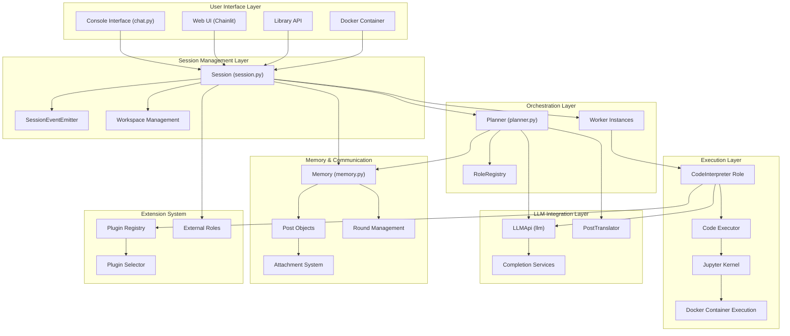
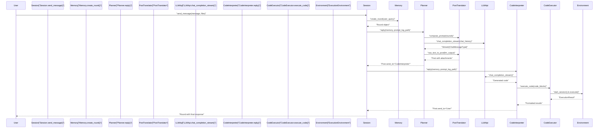
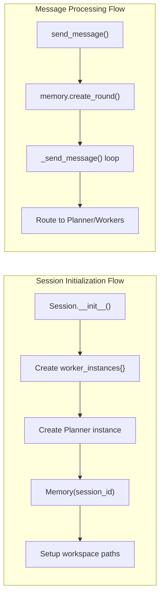
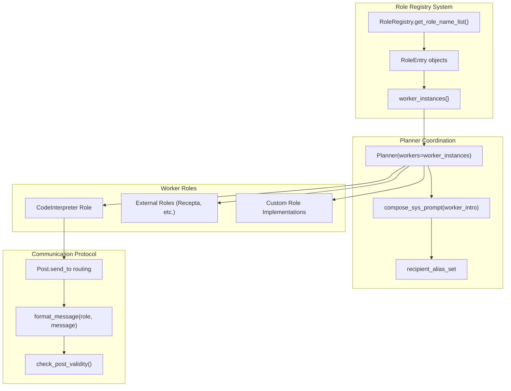
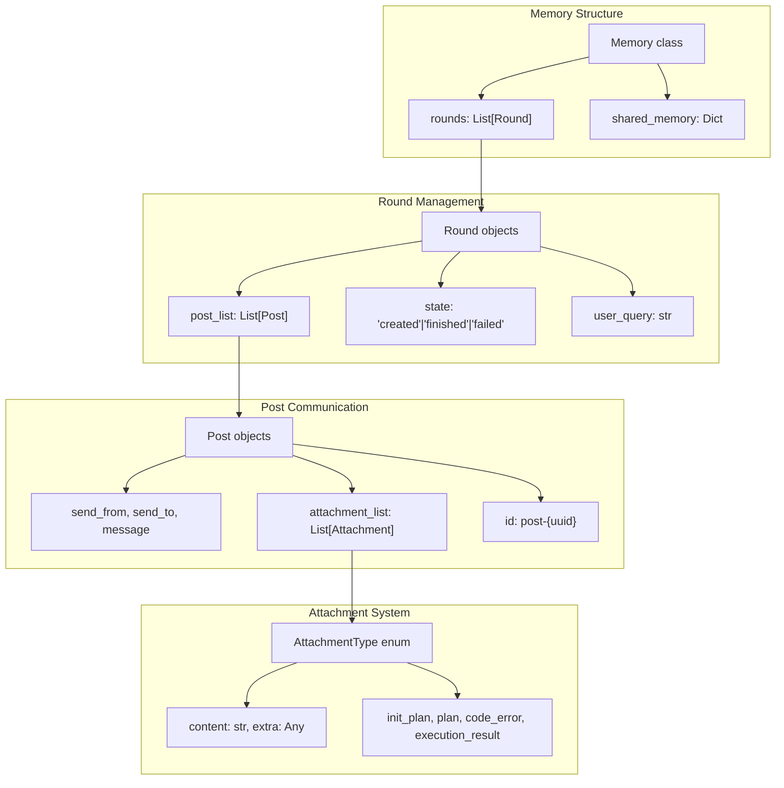
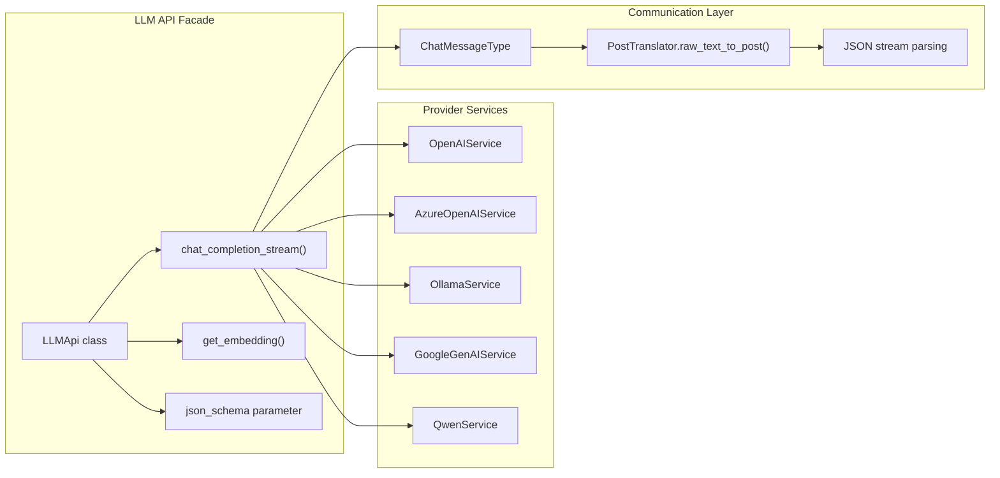
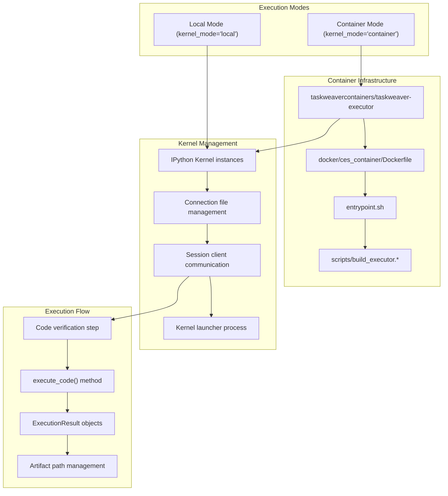
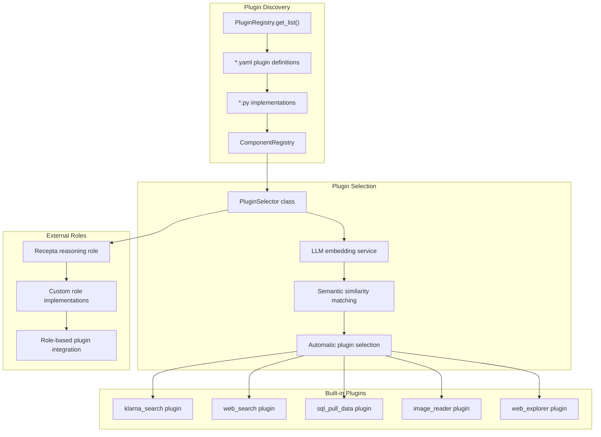
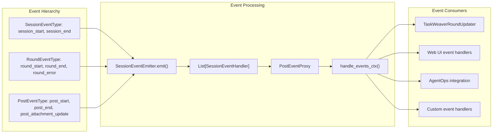

<!-- source: DeepWiki mcp.deepwiki.com · repo microsoft/TaskWeaver · page 2 System Architecture · fetched 2026-10-26 -->

# System Architecture

Relevant source files

The following files were used as context for generating this wiki page:

- [README.md](README.md)
- [taskweaver/chat/console/chat.py](taskweaver/chat/console/chat.py)
- [taskweaver/memory/attachment.py](taskweaver/memory/attachment.py)
- [taskweaver/module/event_emitter.py](taskweaver/module/event_emitter.py)
- [taskweaver/planner/planner.py](taskweaver/planner/planner.py)
- [taskweaver/planner/planner_prompt.yaml](taskweaver/planner/planner_prompt.yaml)
- [taskweaver/session/session.py](taskweaver/session/session.py)
- [website/docs/FAQ.md](website/docs/FAQ.md)
- [website/docs/advanced/observability.md](website/docs/advanced/observability.md)
- [website/docs/code_execution.md](website/docs/code_execution.md)
- [website/docs/llms/Keywords-AI.md](website/docs/llms/Keywords-AI.md)
- [website/sidebars.js](website/sidebars.js)

## Purpose and Scope

This document provides a comprehensive overview of TaskWeaver's system architecture, including its core components, data flow patterns, and integration points. It covers the fundamental design principles that enable TaskWeaver to function as a code-first agent framework, transforming natural language requests into executable code through a multi-role orchestration system.

For specific implementation details of individual components, see [Core Components](#3). For deployment and infrastructure considerations, see [Deployment and Infrastructure](#12). For user interaction patterns, see [User Interfaces](#7).

## Architectural Overview

TaskWeaver implements a multi-layered architecture centered around a role-based orchestration model. The system transforms user requests through a pipeline involving planning, code generation, execution, and response synthesis.

### High-Level System Architecture

Sources: [taskweaver/session/session.py:44-127](), [taskweaver/planner/planner.py:46-92](), [taskweaver/module/event_emitter.py:231-300]()

### Core Data Flow Architecture

The following diagram illustrates how data flows through the system during a typical user interaction, showing the actual method calls and data structures used:

Sources: [taskweaver/session/session.py:162-276](), [taskweaver/planner/planner.py:237-371](), [taskweaver/memory/memory.py]()

## Component Architecture Details

### Session Management Core

The `Session` class serves as the primary orchestrator, managing the complete lifecycle of user interactions and coordinating between all system components.

| Component | Class/Module | Responsibility |
|-----------|--------------|----------------|
| Session Manager | `Session` | Orchestrates user interactions, manages worker instances |
| Event System | `SessionEventEmitter` | Real-time event broadcasting and handling |
| Workspace | `Workspace.get_session_dir()` | File system isolation per session |
| Memory Management | `Memory(session_id)` | Conversation history and state persistence |

Sources: [taskweaver/session/session.py:44-127](), [taskweaver/session/session.py:162-276]()

### Role-Based Orchestration System

TaskWeaver implements a flexible role system where the `Planner` coordinates with specialized worker roles. The system supports dynamic role registration and multi-role conversations.

Sources: [taskweaver/planner/planner.py:68-82](), [taskweaver/session/session.py:94-120](), [taskweaver/role/role.py]()

### Memory and Communication Architecture

The memory system manages conversation state through `Round` and `Post` objects, with a sophisticated attachment system for structured data exchange.

Sources: [taskweaver/memory/memory.py](), [taskweaver/memory/post.py](), [taskweaver/memory/attachment.py:10-52]()

### LLM Integration Layer

TaskWeaver abstracts LLM interactions through a unified API that supports multiple providers while maintaining consistent interface patterns.

| Provider Support | Implementation | Configuration Key |
|------------------|----------------|-------------------|
| OpenAI | `OpenAIService` | `llm.api_type="openai"` |
| Azure OpenAI | `AzureOpenAIService` | `llm.api_type="azure"` |
| Local Models | `OllamaService` | `llm.api_type="ollama"` |
| Google | `GoogleGenAIService` | `llm.api_type="google"` |
| QWen | `QwenService` | `llm.api_type="qwen"` |

Sources: [taskweaver/llm/](), [taskweaver/planner/planner.py:284-325](), [taskweaver/role/post_translator.py]()

### Code Execution Architecture

The execution system provides secure, isolated code execution through Jupyter kernels, with support for both local and containerized environments.

Sources: [website/docs/code_execution.md:13-40](), [taskweaver/code_interpreter/](), [docker/ces_container/]()

### Plugin and Extension System

The plugin system enables extensibility through a registry-based architecture with automatic discovery and selection mechanisms.

Sources: [taskweaver/plugin/](), [project/plugins/](), [README.md:56-57]()

## Event-Driven Architecture

TaskWeaver implements a comprehensive event system that enables real-time monitoring and reactive programming patterns throughout the application lifecycle.

### Event System Structure

Sources: [taskweaver/module/event_emitter.py:14-52](), [taskweaver/chat/console/chat.py:68-148](), [website/docs/advanced/observability.md:37-41]()

## Security and Isolation

TaskWeaver implements multiple layers of security through execution isolation, code verification, and containerization:

- **Container Isolation**: Default `container` mode executes code in Docker containers
- **Session Isolation**: Each session has dedicated workspace directories  
- **Code Verification**: Pre-execution code analysis and validation
- **Permission Management**: Restricted file system access within execution environments
- **Network Isolation**: Optional network restriction for Docker containers

Sources: [website/docs/code_execution.md:23-25](), [taskweaver/session/session.py:74-82](), [website/docs/code_execution.md:102-161]()

---

