# Page: Overview

# Overview

<details>
<summary>Relevant source files</summary>

The following files were used as context for generating this wiki page:

- [README.md](README.md)
- [taskweaver/memory/attachment.py](taskweaver/memory/attachment.py)
- [taskweaver/planner/planner_prompt.yaml](taskweaver/planner/planner_prompt.yaml)
- [website/blog/authors.yml](website/blog/authors.yml)
- [website/blog/evaluation.md](website/blog/evaluation.md)
- [website/blog/experience.md](website/blog/experience.md)
- [website/blog/local_llm.md](website/blog/local_llm.md)
- [website/blog/plugin.md](website/blog/plugin.md)
- [website/blog/reasoning.md](website/blog/reasoning.md)
- [website/blog/role.md](website/blog/role.md)
- [website/docusaurus.config.js](website/docusaurus.config.js)

</details>


## Purpose and Scope

This document provides a comprehensive overview of TaskWeaver, a code-first agent framework designed for seamlessly planning and executing data analytics tasks. It covers the framework's core architecture, key concepts, and how the various components work together to enable intelligent task automation.

For detailed information about specific components, see:
- System Architecture ([#2](#2))
- Core Components ([#3](#3)) 
- LLM Integration ([#4](#4))
- Plugin System ([#6](#6))
- User Interfaces ([#7](#7))

## What is TaskWeaver

TaskWeaver is a **code-first** agent framework that interprets user requests through code snippets and efficiently coordinates plugins to execute data analytics tasks in a stateful manner. Unlike traditional agent frameworks that only track chat history with LLMs in text, TaskWeaver preserves both the **chat history** and the **code execution history**, including in-memory data structures like DataFrames.

The framework's philosophy treats programming languages as the de facto communication medium for cyber-physical systems, similar to how natural language serves human communication. This approach enables TaskWeaver to handle complex data structures and maintain state across multiple interactions.

**Sources:** [README.md:14-18](), [website/blog/role.md:8-13]()

## Core Architecture

TaskWeaver's architecture is built around several key layers that work together to provide a comprehensive agent framework:

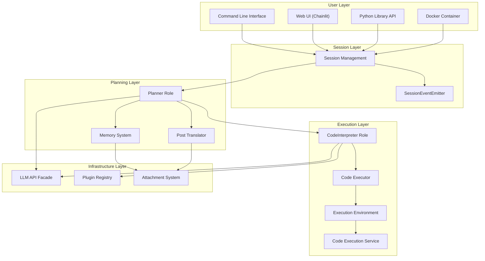

**Sources:** [README.md:20-22](), [taskweaver/memory/attachment.py:10-52]()

## Key Concepts

### Code-First Approach

TaskWeaver's code-first design means that user requests are converted into executable code snippets rather than being processed purely through natural language. This approach provides several advantages:

- **Rich Data Structures**: Work directly with Python objects like DataFrames instead of string representations
- **Stateful Execution**: Maintain variables and state across multiple interactions within a session
- **Expressiveness**: Handle complex data analytics tasks that are naturally represented in code

**Sources:** [README.md:14-18](), [website/blog/role.md:8-16]()

### Roles and Multi-Agent System

TaskWeaver implements a role-based architecture where different agents specialize in specific tasks:

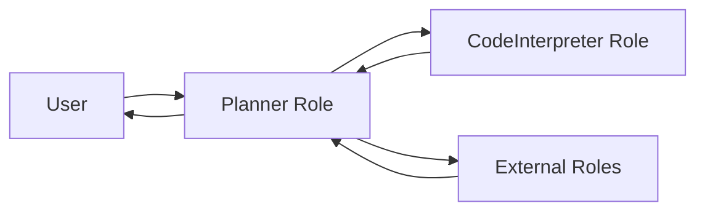

- **Planner**: Central orchestrator that decomposes tasks, manages workflows, and coordinates other roles
- **CodeInterpreter**: Generates and executes Python code based on task requirements
- **External Roles**: Specialized roles for specific domains (e.g., WebExplorer, ImageReader)

All roles communicate exclusively through the Planner, ensuring controlled conversation flow and coordination.

**Sources:** [taskweaver/planner/planner_prompt.yaml:18-37](), [website/blog/role.md:70-88]()

### Plugin System

Plugins extend TaskWeaver's functionality by wrapping custom algorithms and tools into callable functions:

| Component | Purpose | File Location |
|-----------|---------|---------------|
| `Plugin` base class | Foundation for all plugins | Plugin implementation files |
| Plugin YAML configs | Define function signatures and metadata | `project/plugins/*.yaml` |
| `PluginRegistry` | Manages plugin loading and selection | Core framework |

Plugins can maintain state across calls and have their own configurations, making them more powerful than simple stateless functions.

**Sources:** [website/blog/plugin.md:10-27](), [website/blog/plugin.md:87-101]()

### Memory and Communication

TaskWeaver uses a sophisticated memory and communication system built around `Post` objects and `Attachment` types:

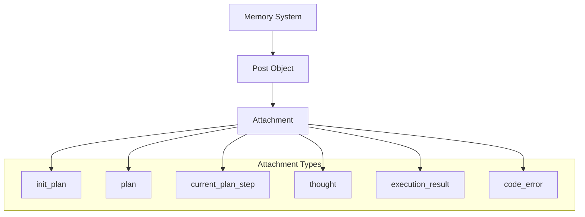

Each interaction creates `Post` objects containing structured `Attachment` data that preserves both conversation context and execution state.

**Sources:** [taskweaver/memory/attachment.py:10-52](), [taskweaver/memory/attachment.py:54-129]()

## How It Works Together

The following diagram illustrates a typical task execution flow, showing how components interact using actual code entities:

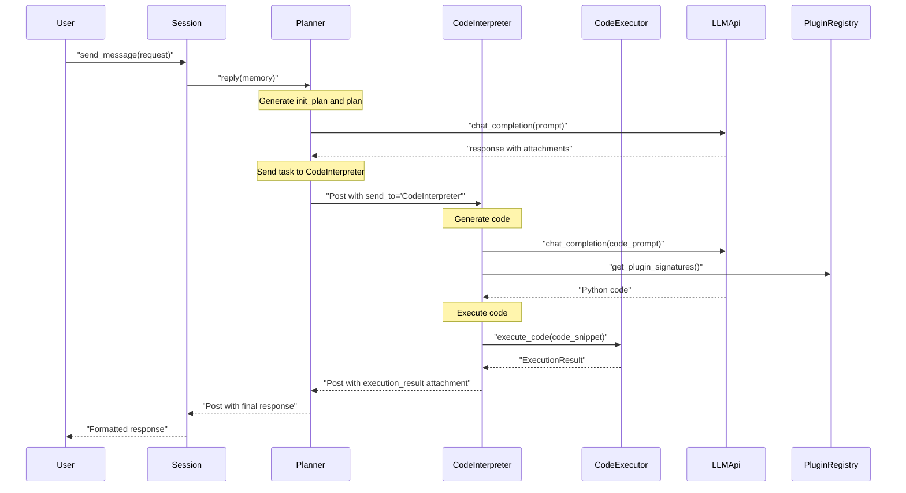

This flow demonstrates how:
1. User requests flow through the `Session` to the `Planner`
2. The `Planner` uses `LLMApi` to generate structured plans with `init_plan` and `plan` attachments
3. Tasks are delegated to `CodeInterpreter` via `Post` objects with `send_to` fields
4. Code execution happens through `CodeExecutor` with results captured in `execution_result` attachments
5. All communication maintains structured context through the `Attachment` system

**Sources:** [taskweaver/planner/planner_prompt.yaml:67-75](), [taskweaver/memory/attachment.py:18-31]()

## Key Features

TaskWeaver provides several distinctive capabilities that make it suitable for complex data analytics tasks:

| Feature | Description | Benefit |
|---------|-------------|---------|
| **Task Decomposition** | Breaks complex tasks into manageable subtasks with dependency tracking | Handles multi-step workflows reliably |
| **Reflective Execution** | Reviews and adjusts execution based on results | Improves task completion accuracy |
| **Stateful Sessions** | Maintains variables and context across interactions | Enables iterative data exploration |
| **Code Verification** | Validates generated code before execution | Reduces runtime errors and security risks |
| **Plugin Orchestration** | Coordinates custom algorithms and tools | Extends functionality for domain-specific needs |
| **Rich Data Handling** | Works with complex Python objects directly | Better than string-based data manipulation |

**Sources:** [README.md:51-64]()

## Getting Started

TaskWeaver can be used in multiple ways depending on your needs:

- **Command Line Interface**: Direct interaction via `python -m taskweaver -p ./project/`
- **Web UI**: Browser-based interface using Chainlit for demonstration and exploration
- **Python Library**: Integration into existing applications as a library
- **Docker Container**: Containerized deployment with isolated execution environment

The framework uses container mode by default for secure code execution, though local execution is also supported for development scenarios.

**Sources:** [README.md:116-141]()

---

# Page: System Architecture

# System Architecture

<details>
<summary>Relevant source files</summary>

The following files were used as context for generating this wiki page:

- [README.md](README.md)
- [taskweaver/chat/console/chat.py](taskweaver/chat/console/chat.py)
- [taskweaver/memory/attachment.py](taskweaver/memory/attachment.py)
- [taskweaver/module/event_emitter.py](taskweaver/module/event_emitter.py)
- [taskweaver/planner/planner.py](taskweaver/planner/planner.py)
- [taskweaver/planner/planner_prompt.yaml](taskweaver/planner/planner_prompt.yaml)
- [taskweaver/session/session.py](taskweaver/session/session.py)
- [website/docs/FAQ.md](website/docs/FAQ.md)
- [website/docs/advanced/observability.md](website/docs/advanced/observability.md)
- [website/docs/code_execution.md](website/docs/code_execution.md)
- [website/docs/llms/Keywords-AI.md](website/docs/llms/Keywords-AI.md)
- [website/sidebars.js](website/sidebars.js)

</details>


## Purpose and Scope

This document provides a comprehensive overview of TaskWeaver's system architecture, including its core components, data flow patterns, and integration points. It covers the fundamental design principles that enable TaskWeaver to function as a code-first agent framework, transforming natural language requests into executable code through a multi-role orchestration system.

For specific implementation details of individual components, see [Core Components](#3). For deployment and infrastructure considerations, see [Deployment and Infrastructure](#12). For user interaction patterns, see [User Interfaces](#7).

## Architectural Overview

TaskWeaver implements a multi-layered architecture centered around a role-based orchestration model. The system transforms user requests through a pipeline involving planning, code generation, execution, and response synthesis.

### High-Level System Architecture

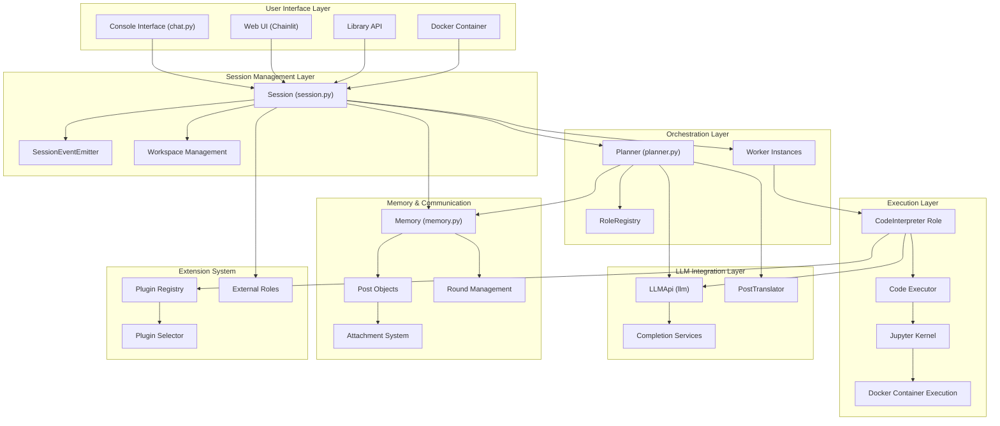

Sources: [taskweaver/session/session.py:44-127](), [taskweaver/planner/planner.py:46-92](), [taskweaver/module/event_emitter.py:231-300]()

### Core Data Flow Architecture

The following diagram illustrates how data flows through the system during a typical user interaction, showing the actual method calls and data structures used:

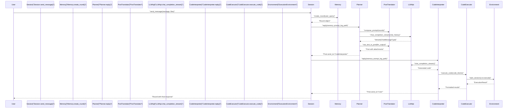

Sources: [taskweaver/session/session.py:162-276](), [taskweaver/planner/planner.py:237-371](), [taskweaver/memory/memory.py]()

## Component Architecture Details

### Session Management Core

The `Session` class serves as the primary orchestrator, managing the complete lifecycle of user interactions and coordinating between all system components.

| Component | Class/Module | Responsibility |
|-----------|--------------|----------------|
| Session Manager | `Session` | Orchestrates user interactions, manages worker instances |
| Event System | `SessionEventEmitter` | Real-time event broadcasting and handling |
| Workspace | `Workspace.get_session_dir()` | File system isolation per session |
| Memory Management | `Memory(session_id)` | Conversation history and state persistence |

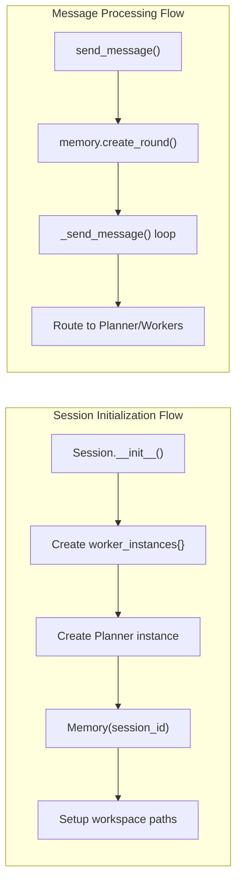

Sources: [taskweaver/session/session.py:44-127](), [taskweaver/session/session.py:162-276]()

### Role-Based Orchestration System

TaskWeaver implements a flexible role system where the `Planner` coordinates with specialized worker roles. The system supports dynamic role registration and multi-role conversations.

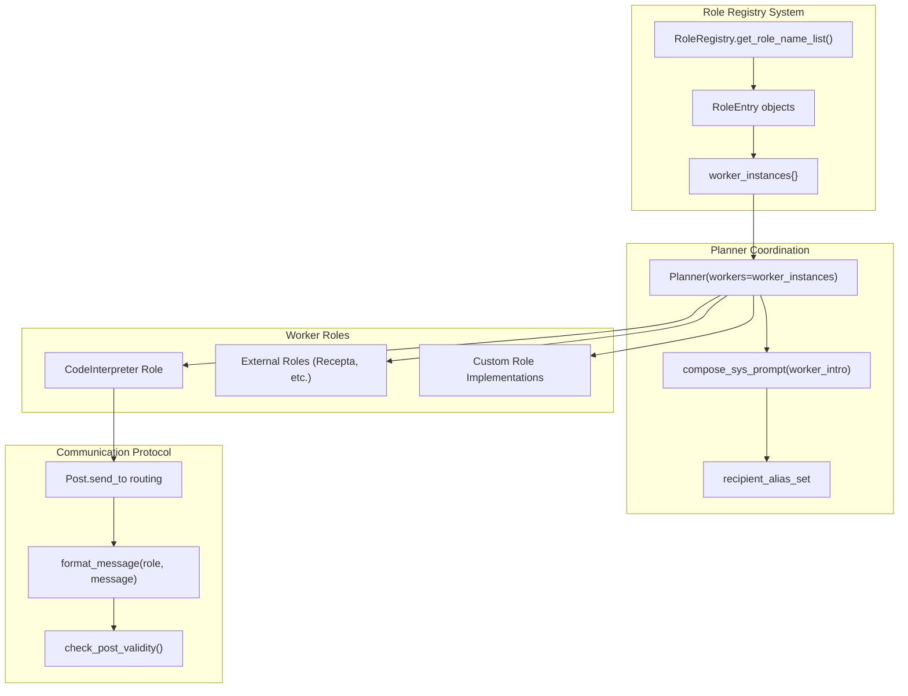

Sources: [taskweaver/planner/planner.py:68-82](), [taskweaver/session/session.py:94-120](), [taskweaver/role/role.py]()

### Memory and Communication Architecture

The memory system manages conversation state through `Round` and `Post` objects, with a sophisticated attachment system for structured data exchange.

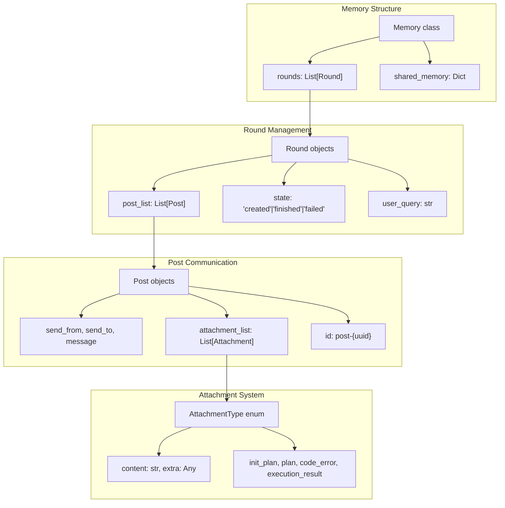

Sources: [taskweaver/memory/memory.py](), [taskweaver/memory/post.py](), [taskweaver/memory/attachment.py:10-52]()

### LLM Integration Layer

TaskWeaver abstracts LLM interactions through a unified API that supports multiple providers while maintaining consistent interface patterns.

| Provider Support | Implementation | Configuration Key |
|------------------|----------------|-------------------|
| OpenAI | `OpenAIService` | `llm.api_type="openai"` |
| Azure OpenAI | `AzureOpenAIService` | `llm.api_type="azure"` |
| Local Models | `OllamaService` | `llm.api_type="ollama"` |
| Google | `GoogleGenAIService` | `llm.api_type="google"` |
| QWen | `QwenService` | `llm.api_type="qwen"` |

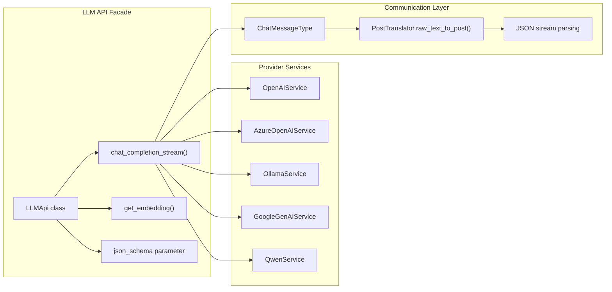

Sources: [taskweaver/llm/](), [taskweaver/planner/planner.py:284-325](), [taskweaver/role/post_translator.py]()

### Code Execution Architecture

The execution system provides secure, isolated code execution through Jupyter kernels, with support for both local and containerized environments.

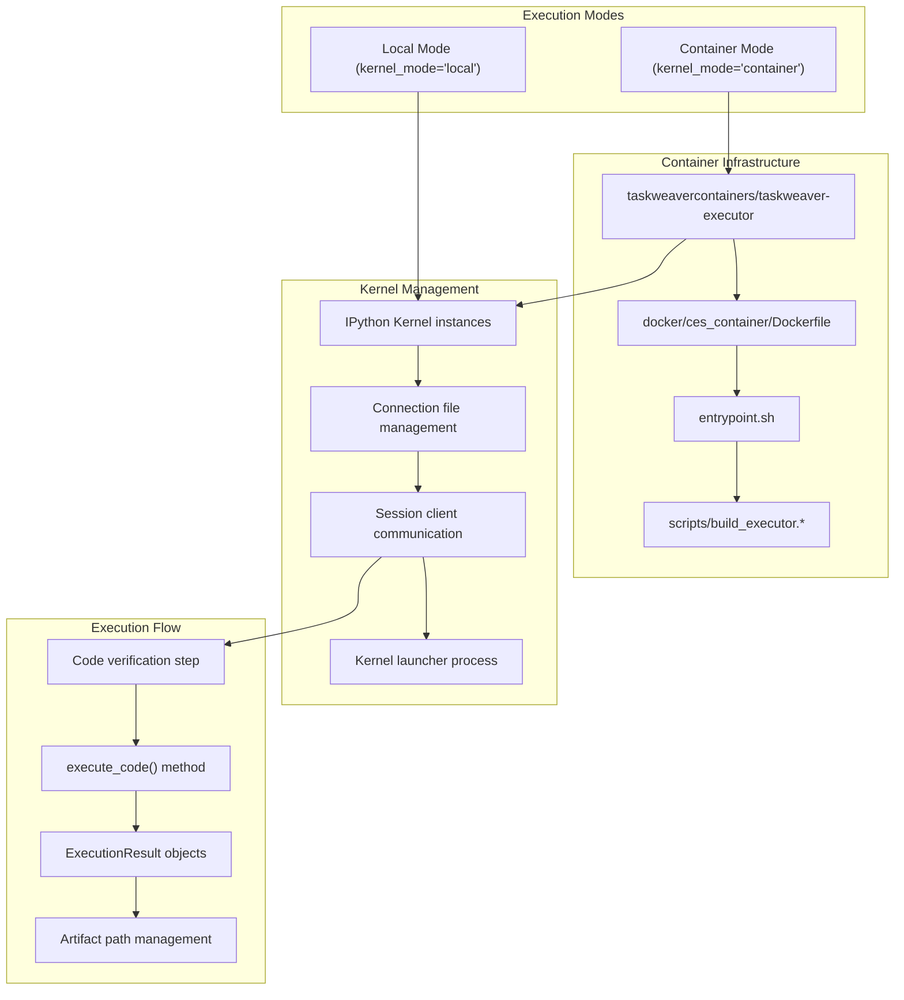

Sources: [website/docs/code_execution.md:13-40](), [taskweaver/code_interpreter/](), [docker/ces_container/]()

### Plugin and Extension System

The plugin system enables extensibility through a registry-based architecture with automatic discovery and selection mechanisms.

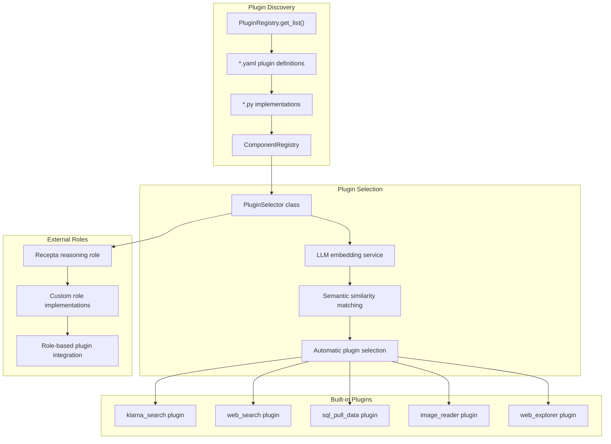

Sources: [taskweaver/plugin/](), [project/plugins/](), [README.md:56-57]()

## Event-Driven Architecture

TaskWeaver implements a comprehensive event system that enables real-time monitoring and reactive programming patterns throughout the application lifecycle.

### Event System Structure

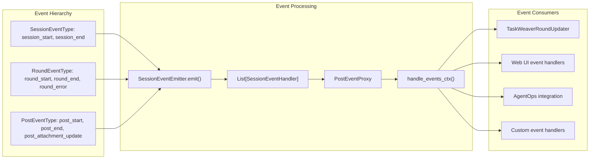

Sources: [taskweaver/module/event_emitter.py:14-52](), [taskweaver/chat/console/chat.py:68-148](), [website/docs/advanced/observability.md:37-41]()

## Security and Isolation

TaskWeaver implements multiple layers of security through execution isolation, code verification, and containerization:

- **Container Isolation**: Default `container` mode executes code in Docker containers
- **Session Isolation**: Each session has dedicated workspace directories  
- **Code Verification**: Pre-execution code analysis and validation
- **Permission Management**: Restricted file system access within execution environments
- **Network Isolation**: Optional network restriction for Docker containers

Sources: [website/docs/code_execution.md:23-25](), [taskweaver/session/session.py:74-82](), [website/docs/code_execution.md:102-161]()

---

# Page: Core Components

# Core Components

<details>
<summary>Relevant source files</summary>

The following files were used as context for generating this wiki page:

- [README.md](README.md)
- [taskweaver/chat/console/chat.py](taskweaver/chat/console/chat.py)
- [taskweaver/memory/attachment.py](taskweaver/memory/attachment.py)
- [taskweaver/module/event_emitter.py](taskweaver/module/event_emitter.py)
- [taskweaver/planner/planner.py](taskweaver/planner/planner.py)
- [taskweaver/planner/planner_prompt.yaml](taskweaver/planner/planner_prompt.yaml)
- [taskweaver/session/session.py](taskweaver/session/session.py)

</details>


This document provides an overview of the essential components that form TaskWeaver's core functionality. These components work together to enable the code-first agent framework's ability to plan, execute, and coordinate data analytics tasks.

For detailed information about specific subsystems, see [Planner](#3.1), [Session Management](#3.2), [Memory and Communication System](#3.3), and [Code Interpreter](#3.4). For LLM integration details, see [LLM Integration](#4). For code execution specifics, see [Code Execution Service](#5).

## Component Architecture Overview

The core of TaskWeaver consists of five primary components that handle different aspects of the agent framework's operation:

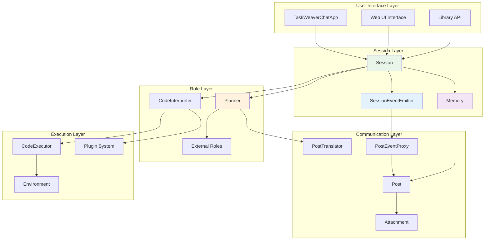

**Core Component Interaction Flow**

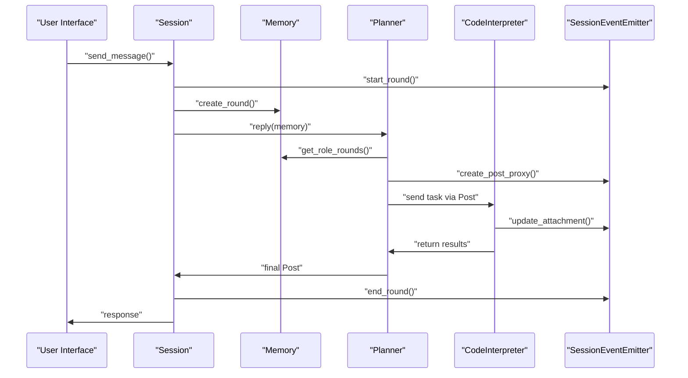

Sources: [taskweaver/session/session.py:44-364](), [taskweaver/planner/planner.py:46-372](), [taskweaver/module/event_emitter.py:231-300](), [taskweaver/memory/attachment.py:54-130]()

## Session Management

The `Session` class serves as the central coordinator for all TaskWeaver operations, managing the lifecycle of user interactions and orchestrating communication between different roles.

### Session Components

| Component | Class | Purpose |
|-----------|-------|---------|
| Session Core | `Session` | Main session orchestration and state management |
| Configuration | `AppSessionConfig` | Session-level configuration and role management |
| Metadata | `SessionMetadata` | Session information storage |
| Event Handling | `SessionEventEmitter` | Event-driven communication system |

### Session Initialization

The session initialization process involves several key steps handled in the `Session.__init__()` method:

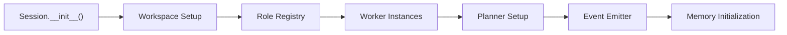

The session manages role instances through the `worker_instances` dictionary and validates role configuration in [taskweaver/session/session.py:96-119](). The planner is initialized with access to all worker instances in [taskweaver/session/session.py:111-118]().

Sources: [taskweaver/session/session.py:44-127](), [taskweaver/session/session.py:18-35]()

## Communication System

TaskWeaver's communication system is built around the `Post` and `Attachment` model, enabling structured information exchange between components.

### Communication Architecture

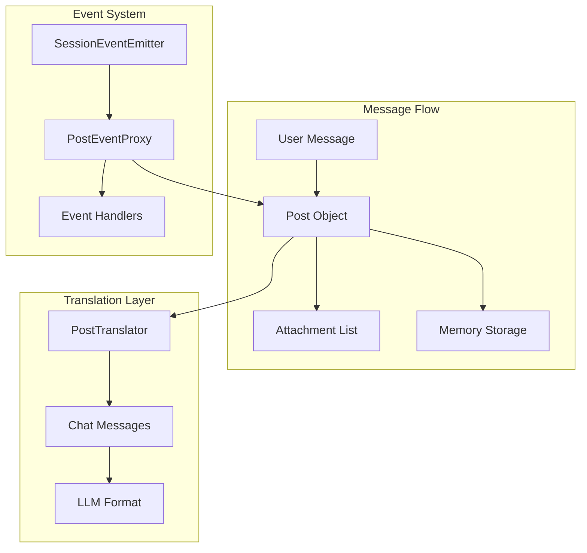

### Attachment Types

The system uses strongly-typed attachments defined in `AttachmentType` enum to categorize different kinds of content:

| Category | Attachment Types | Purpose |
|----------|------------------|---------|
| Planning | `init_plan`, `plan`, `current_plan_step`, `plan_reasoning` | Planner task decomposition |
| Code Generation | `thought`, `reply_type`, `reply_content` | CodeInterpreter responses |
| Code Execution | `execution_status`, `execution_result`, `artifact_paths` | Execution results |
| Verification | `verification`, `code_error`, `revise_message` | Code validation |
| Shared Memory | `shared_memory_entry` | Cross-component data sharing |

The `PostEventProxy` class provides a streaming interface for building posts incrementally in [taskweaver/module/event_emitter.py:126-229]().

Sources: [taskweaver/memory/attachment.py:10-53](), [taskweaver/module/event_emitter.py:126-229](), [taskweaver/planner/planner.py:71-71]()

## Event-Driven Architecture

TaskWeaver implements a comprehensive event system that enables real-time communication and status updates across all components.

### Event Hierarchy

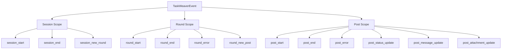

### Event Flow Implementation

The event system is implemented through three main classes:
- `SessionEventEmitter` - Central event dispatcher in [taskweaver/module/event_emitter.py:231-300]()
- `PostEventProxy` - Post-specific event proxy in [taskweaver/module/event_emitter.py:126-229]()
- `SessionEventHandlerBase` - Base class for event handlers in [taskweaver/module/event_emitter.py:61-124]()

The console interface demonstrates event handling implementation in `TaskWeaverRoundUpdater` class [taskweaver/chat/console/chat.py:68-408]().

Sources: [taskweaver/module/event_emitter.py:15-53](), [taskweaver/module/event_emitter.py:231-300](), [taskweaver/chat/console/chat.py:68-148]()

## Role System Integration

The core components integrate with TaskWeaver's role system through standardized interfaces and dependency injection.

### Role Integration Pattern

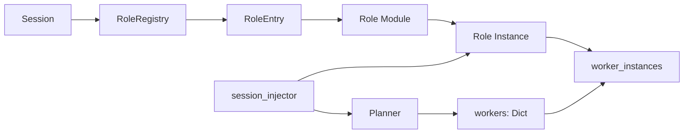

The session creates and manages role instances through dependency injection in [taskweaver/session/session.py:94-119](), binding each role instance to the session injector for proper lifecycle management.

Role instances are stored in the `worker_instances` dictionary and accessed by alias, enabling the planner to coordinate with different specialized roles based on their capabilities.

Sources: [taskweaver/session/session.py:94-119](), [taskweaver/planner/planner.py:57-69]()

## Memory Integration

The core components integrate closely with TaskWeaver's memory system to maintain conversation state and enable context-aware operations.

### Memory Structure

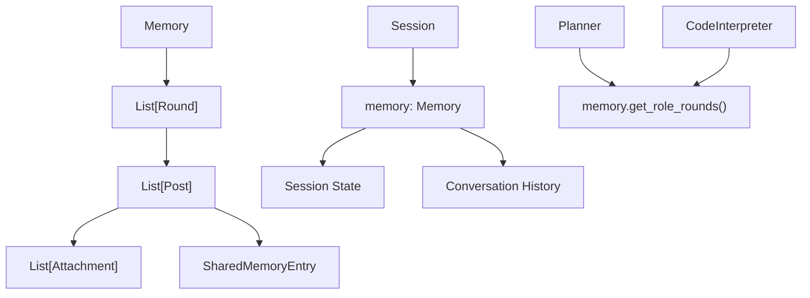

Memory is initialized in the session constructor [taskweaver/session/session.py:87-87]() and used throughout the conversation flow to maintain state and provide context to roles.

The planner accesses memory through `memory.get_role_rounds(role=self.alias)` in [taskweaver/planner/planner.py:244-244]() to retrieve conversation history for prompt composition.

Sources: [taskweaver/session/session.py:87-87](), [taskweaver/planner/planner.py:244-244](), [taskweaver/memory/attachment.py:47-48]()

---

# Page: Planner

# Planner

<details>
<summary>Relevant source files</summary>

The following files were used as context for generating this wiki page:

- [taskweaver/chat/console/chat.py](taskweaver/chat/console/chat.py)
- [taskweaver/module/event_emitter.py](taskweaver/module/event_emitter.py)
- [taskweaver/planner/planner.py](taskweaver/planner/planner.py)
- [taskweaver/role/translator.py](taskweaver/role/translator.py)
- [taskweaver/session/session.py](taskweaver/session/session.py)
- [tests/unit_tests/test_planner.py](tests/unit_tests/test_planner.py)
- [tests/unit_tests/test_translator.py](tests/unit_tests/test_translator.py)
- [website/blog/authors.yml](website/blog/authors.yml)
- [website/blog/evaluation.md](website/blog/evaluation.md)
- [website/blog/experience.md](website/blog/experience.md)
- [website/blog/local_llm.md](website/blog/local_llm.md)
- [website/blog/plugin.md](website/blog/plugin.md)
- [website/blog/reasoning.md](website/blog/reasoning.md)
- [website/blog/role.md](website/blog/role.md)
- [website/docusaurus.config.js](website/docusaurus.config.js)

</details>


The Planner is TaskWeaver's central orchestrator responsible for task decomposition, workflow management, and coordination of other roles in the system. It receives user requests, breaks them down into executable steps, tracks progress, and manages the overall conversation flow. For information about code execution, see [Code Execution Service](#5). For details about memory and communication, see [Memory and Communication System](#3.3).

## Architecture Overview

The Planner operates as the primary decision-making component that sits between the user and execution roles, managing the entire task lifecycle from initial planning to completion.

### Core Planner Architecture

```mermaid
graph TB
    subgraph "Planner Core"
        PlannerClass["Planner"]
        PlannerConfig["PlannerConfig"]
        PostTranslator["PostTranslator"]
        PromptData["prompt_data"]
    end
    
    subgraph "LLM Integration"
        LLMApi["LLMApi"]
        ChatCompletion["chat_completion_stream"]
        JSONSchema["response_json_schema"]
    end
    
    subgraph "Memory System"
        Memory["Memory"]
        Post["Post"]
        Round["Round"]
        SharedMemory["SharedMemoryEntry"]
    end
    
    subgraph "Worker Roles"
        CodeInterpreter["CodeInterpreter"]
        ExternalRoles["External Roles"]
        WorkerDict["workers: Dict[str, Role]"]
    end
    
    subgraph "Experience & Examples"
        ExperienceGen["ExperienceGenerator"]
        RoundCompressor["RoundCompressor"]
        Examples["examples"]
    end
    
    PlannerClass --> PlannerConfig
    PlannerClass --> PostTranslator
    PlannerClass --> LLMApi
    PlannerClass --> Memory
    PlannerClass --> WorkerDict
    PlannerClass --> ExperienceGen
    
    LLMApi --> ChatCompletion
    LLMApi --> JSONSchema
    
    Memory --> Post
    Memory --> Round
    Post --> SharedMemory
    
    WorkerDict --> CodeInterpreter
    WorkerDict --> ExternalRoles
    
    PlannerClass --> PromptData
    PlannerClass --> Examples
    PlannerClass --> RoundCompressor
```

Sources: [taskweaver/planner/planner.py:46-92](), [taskweaver/session/session.py:111-118]()

## Planning Process Flow

The Planner follows a structured workflow for processing user requests and managing task execution.

### Task Processing Workflow

```mermaid
sequenceDiagram
    participant User
    participant Session
    participant Planner
    participant PostTranslator
    participant LLMApi
    participant Worker as "Worker Role"
    participant Memory
    
    User->>Session: "send_message(user_request)"
    Session->>Planner: "reply(memory)"
    
    Note over Planner: Compose Prompt Phase
    Planner->>Memory: "get_role_rounds(role=self.alias)"
    Planner->>Planner: "compose_prompt(rounds)"
    Planner->>Planner: "compose_sys_prompt(context)"
    
    Note over Planner: LLM Generation Phase  
    Planner->>LLMApi: "chat_completion_stream(chat_history, json_schema)"
    LLMApi-->>Planner: "llm_output stream"
    
    Note over Planner: Response Processing Phase
    Planner->>PostTranslator: "raw_text_to_post(llm_output, post_proxy)"
    PostTranslator-->>Planner: "validated Post"
    
    Note over Planner: Task Delegation Phase
    alt send_to != "User"
        Planner->>Worker: "Post with task details"
        Worker-->>Planner: "execution result Post"
        Planner->>Planner: "continue planning loop"
    else send_to == "User" 
        Planner->>Session: "final response Post"
        Session->>User: "response message"
    end
```

Sources: [taskweaver/planner/planner.py:237-371](), [taskweaver/session/session.py:174-202]()

## Core Components

### Planner Class Structure

The `Planner` class extends the base `Role` class and implements the core planning functionality through several key methods and properties.

| Component | Purpose | Key Methods/Properties |
|-----------|---------|----------------------|
| `PlannerConfig` | Configuration management | `prompt_file_path`, `prompt_compression`, `llm_alias` |
| `Planner` | Main orchestrator class | `reply()`, `compose_prompt()`, `compose_sys_prompt()` |
| `PostTranslator` | Communication formatting | `raw_text_to_post()`, `post_to_raw_text()` |
| Response Schema | LLM output validation | `response_json_schema`, `check_post_validity()` |

Sources: [taskweaver/planner/planner.py:24-44](), [taskweaver/planner/planner.py:46-92]()

### Planning State Management

The Planner maintains detailed state about task progress through structured attachments in Post objects:

```mermaid
graph LR
    subgraph "Planning Attachments"
        InitPlan["init_plan"]
        Plan["plan"] 
        CurrentStep["current_plan_step"]
        SharedMem["shared_memory_entry"]
    end
    
    subgraph "Plan Evolution"
        InitPlan --> Plan
        Plan --> CurrentStep
        CurrentStep --> SharedMem
    end
    
    subgraph "Content Examples"
        InitPlan -.-> IP["1. load data<br/>2. process data<br/>3. report results"]
        Plan -.-> P["1. instruct CodeInterpreter<br/>2. report to user"]
        CurrentStep -.-> CS["1. instruct CodeInterpreter"]
    end
```

Sources: [taskweaver/planner/planner.py:271-277](), [taskweaver/planner/planner.py:327-337]()

## Prompt Engineering and LLM Integration

### System Prompt Construction

The Planner dynamically constructs system prompts that include worker descriptions, environment context, and response schemas:

```mermaid
graph TD
    subgraph "Prompt Components"
        InstructionTemplate["instruction_template"]
        WorkerIntro["worker_intro"]
        EnvContext["environment_context"] 
        ResponseSchema["response_json_schema"]
    end
    
    subgraph "Dynamic Content"
        Workers["self.workers"]
        CurrentTime["current_time"]
        Examples["self.examples"]
        Experience["experience"]
    end
    
    subgraph "Final Prompt"
        SysPrompt["system prompt"]
        ConvHistory["conversation history"]
        Summary["compressed summary"]
    end
    
    InstructionTemplate --> SysPrompt
    WorkerIntro --> SysPrompt
    EnvContext --> SysPrompt
    ResponseSchema --> SysPrompt
    
    Workers --> WorkerIntro
    CurrentTime --> EnvContext
    Examples --> ConvHistory
    Experience --> SysPrompt
    
    SysPrompt --> ConvHistory
    Summary --> ConvHistory
```

Sources: [taskweaver/planner/planner.py:94-110](), [taskweaver/planner/planner.py:197-235]()

### Response Validation and Error Handling

The Planner implements robust validation to ensure LLM responses contain required fields and follow the expected format:

```python
def check_post_validity(post: Post):
    missing_elements: List[str] = []
    validation_errors: List[str] = []
    
    # Required fields validation
    if not post.send_to or post.send_to == "Unknown":
        missing_elements.append("send_to")
    if not post.message or post.message.strip() == "":
        missing_elements.append("message")
        
    # Required attachments validation  
    attachment_types = [attachment.type for attachment in post.attachment_list]
    if AttachmentType.init_plan not in attachment_types:
        missing_elements.append("init_plan")
    # ... additional validations
```

Sources: [taskweaver/planner/planner.py:260-280](), [taskweaver/planner/planner.py:339-361]()

## Integration with Core Systems

### Session Management Integration

The Planner integrates tightly with the Session system for lifecycle management and conversation routing:

```mermaid
graph LR
    subgraph "Session Layer"
        Session["Session"]
        SessionConfig["AppSessionConfig"] 
        WorkerInstances["worker_instances"]
    end
    
    subgraph "Planner Integration"
        PlannerInstance["Planner instance"]
        Workers["workers: Dict[str, Role]"]
        EventEmitter["SessionEventEmitter"]
    end
    
    subgraph "Message Flow"
        UserPost["User Post"]
        PlannerReply["Planner reply()"]
        WorkerPost["Worker Post"]
    end
    
    Session --> PlannerInstance
    SessionConfig --> PlannerInstance
    WorkerInstances --> Workers
    
    UserPost --> PlannerReply
    PlannerReply --> WorkerPost
    WorkerPost --> PlannerReply
    
    EventEmitter --> PlannerInstance
```

Sources: [taskweaver/session/session.py:111-118](), [taskweaver/session/session.py:183-200]()

### Memory and Experience Integration  

The Planner leverages the memory system for conversation history and experience-based learning:

| Integration Point | Purpose | Implementation |
|------------------|---------|---------------|
| `Memory.get_role_rounds()` | Retrieve conversation history | [taskweaver/planner/planner.py:244]() |
| `ExperienceGenerator` | Learn from past interactions | [taskweaver/planner/planner.py:89]() |
| `RoundCompressor` | Manage prompt length | [taskweaver/planner/planner.py:219-226]() |
| `SharedMemoryEntry` | Cross-role information sharing | [taskweaver/planner/planner.py:332-337]() |

Sources: [taskweaver/planner/planner.py:252-253](), [taskweaver/planner/planner.py:218-232]()

## Configuration and Customization

### PlannerConfig Options

The `PlannerConfig` class provides several configuration options for customizing Planner behavior:

```yaml
# Core configuration options
prompt_file_path: "path/to/planner_prompt.yaml"
prompt_compression: false
compression_prompt_path: "path/to/compression_prompt.yaml" 
llm_alias: "custom_llm_endpoint"

# Experience and learning
use_experience: true
experience_dir: "experience"

# Advanced features  
max_self_ask_num: 3
```

Sources: [taskweaver/planner/planner.py:24-44](), [taskweaver/planner/planner.py:84-85]()

### Prompt Template Structure

The Planner uses YAML-based prompt templates that define the instruction format and response schema:

```yaml
instruction_template: |
  You are the Planner who can coordinate Workers to finish the user task.
  # ... detailed instructions
  
response_json_schema: |
  {
    "type": "object",
    "properties": {
      "response": {
        "type": "object", 
        "properties": {
          "init_plan": {"type": "string"},
          "plan": {"type": "string"},
          "current_plan_step": {"type": "string"},
          "send_to": {"type": "string"},
          "message": {"type": "string"}
        },
        "required": ["init_plan", "plan", "current_plan_step", "send_to", "message"]
      }
    }
  }
```

Sources: [taskweaver/planner/planner.py:73-81](), [taskweaver/planner/planner.py:284-289]()

---

# Page: Session Management

# Session Management

<details>
<summary>Relevant source files</summary>

The following files were used as context for generating this wiki page:

- [.gitignore](.gitignore)
- [playground/UI/.chainlit/config.toml](playground/UI/.chainlit/config.toml)
- [playground/UI/app.py](playground/UI/app.py)
- [playground/UI/public/style_v1.css](playground/UI/public/style_v1.css)
- [taskweaver/chat/console/chat.py](taskweaver/chat/console/chat.py)
- [taskweaver/module/event_emitter.py](taskweaver/module/event_emitter.py)
- [taskweaver/planner/planner.py](taskweaver/planner/planner.py)
- [taskweaver/session/session.py](taskweaver/session/session.py)
- [website/docs/usage/webui.md](website/docs/usage/webui.md)

</details>


## Purpose and Scope

This document covers TaskWeaver's session management system, which orchestrates conversation rounds, manages state, and coordinates communication between users and TaskWeaver's internal roles. Session management is responsible for the lifecycle of user interactions, message routing, event handling, and maintaining conversation context.

For information about the Planner's role orchestration within sessions, see [Planner](#3.1). For details about memory storage and communication protocols, see [Memory and Communication System](#3.3).

## Session Architecture

TaskWeaver's session management centers around the `Session` class, which acts as the primary coordinator for all user interactions. Each session maintains its own isolated workspace, memory, and set of role instances.

### Core Session Components

```mermaid
graph TB
    subgraph "Session Management Layer"
        Session["Session"]
        AppSessionConfig["AppSessionConfig"]
        SessionMetadata["SessionMetadata"]
    end
    
    subgraph "Communication & Events"
        SessionEventEmitter["SessionEventEmitter"]
        PostEventProxy["PostEventProxy"]
        EventHandlers["SessionEventHandler[]"]
    end
    
    subgraph "State Management"
        Memory["Memory"]
        Workspace["Workspace"]
        SessionVars["session_var: Dict[str, str]"]
    end
    
    subgraph "Role Management"
        Planner["Planner"]
        WorkerInstances["worker_instances: Dict[str, Role]"]
        RoleRegistry["RoleRegistry"]
    end
    
    subgraph "User Interfaces"
        WebUI["ChainLit Web UI"]
        ConsoleUI["Console Interface"]
        DirectAPI["Direct API Calls"]
    end
    
    Session --> SessionEventEmitter
    Session --> Memory
    Session --> Workspace
    Session --> Planner
    Session --> WorkerInstances
    Session --> SessionVars
    
    SessionEventEmitter --> PostEventProxy
    SessionEventEmitter --> EventHandlers
    
    WebUI --> Session
    ConsoleUI --> Session
    DirectAPI --> Session
    
    AppSessionConfig --> Session
    SessionMetadata --> Session
    RoleRegistry --> WorkerInstances
```

**Sources:** [taskweaver/session/session.py:44-127](), [taskweaver/module/event_emitter.py:231-300]()

## Session Lifecycle

### Session Initialization

The session initialization process involves several critical steps that set up the execution environment and role instances:

```mermaid
sequenceDiagram
    participant App as "TaskWeaverApp"
    participant Session as "Session"
    participant Workspace as "Workspace"
    participant RoleRegistry as "RoleRegistry"
    participant EventEmitter as "SessionEventEmitter"
    participant Memory as "Memory"
    
    App->>Session: "__init__(session_id, workspace, ...)"
    Session->>Workspace: "get_session_dir(session_id)"
    Session->>Session: "_init() - create directories"
    Session->>Memory: "Memory(session_id)"
    Session->>EventEmitter: "session_injector.get(SessionEventEmitter)"
    
    loop "for role_name in config.roles"
        Session->>RoleRegistry: "get(role_name)"
        Session->>Session: "create role instance"
        Session->>Session: "worker_instances[alias] = role"
    end
    
    alt "planner in roles"
        Session->>Session: "create Planner with workers"
    end
```

**Sources:** [taskweaver/session/session.py:45-127](), [taskweaver/session/session.py:128-142]()

### Session Termination

When a session ends, resources must be properly cleaned up:

```mermaid
graph LR
    Stop["session.stop()"] --> CloseWorkers["Close worker instances"]
    CloseWorkers --> LogDump["Dump final log files"]
    LogDump --> Cleanup["Resource cleanup"]
```

**Sources:** [taskweaver/session/session.py:348-357]()

## Message Routing and Round Management

### Round-Based Communication

TaskWeaver organizes conversations into rounds, where each round represents a complete user request and response cycle. The session manages the complex routing of messages between different roles.

```mermaid
graph TB
    subgraph "Round Lifecycle"
        UserMessage["User Message"] --> CreateRound["memory.create_round()"]
        CreateRound --> StartRound["event_emitter.start_round()"]
        StartRound --> MessageRouting["Message Routing Logic"]
        
        MessageRouting --> PlannerMode{"Planner Mode?"}
        PlannerMode -->|Yes| PlannerFlow["Planner → Worker → User"]
        PlannerMode -->|No| DirectFlow["Direct Worker → User"]
        
        PlannerFlow --> EndRound["event_emitter.end_round()"]
        DirectFlow --> EndRound
    end
    
    subgraph "Internal Chat Loop"
        SendMessage["_send_message()"] --> RecipientCheck{"Recipient?"}
        RecipientCheck -->|Planner| PlannerReply["planner.reply()"]
        RecipientCheck -->|Worker| WorkerReply["worker.reply()"]
        RecipientCheck -->|User| AddToRound["chat_round.add_post()"]
        
        PlannerReply --> CheckSendTo{"post.send_to == 'User'?"}
        WorkerReply --> CheckSendTo
        CheckSendTo -->|No| InternalChatCheck["internal_chat_num < max?"]
        CheckSendTo -->|Yes| AddToRound
        InternalChatCheck -->|Yes| SendMessage
        InternalChatCheck -->|No| ErrorLimit["Exception: limit exceeded"]
    end
```

**Sources:** [taskweaver/session/session.py:162-276](), [taskweaver/session/session.py:204-246]()

### Message Routing Logic

The session implements sophisticated message routing to handle both planner-based and direct worker communication:

| Mode | Description | Message Flow |
|------|-------------|--------------|
| **Planner Mode** | Default mode with task orchestration | User → Planner → Worker(s) → User |
| **No-Planner Mode** | Direct worker communication | User → Worker → User |

**Sources:** [taskweaver/session/session.py:205-246]()

## Event System Integration

### Event-Driven Communication

TaskWeaver's session management relies heavily on an event system for real-time updates and UI integration:

```mermaid
graph TB
    subgraph "Event Types"
        SessionEvents["SessionEventType<br/>- session_start<br/>- session_end<br/>- session_new_round"]
        RoundEvents["RoundEventType<br/>- round_start<br/>- round_end<br/>- round_error<br/>- round_new_post"]
        PostEvents["PostEventType<br/>- post_start/end<br/>- post_status_update<br/>- post_message_update<br/>- post_attachment_update"]
    end
    
    subgraph "Event Flow"
        SessionEventEmitter["SessionEventEmitter"] --> EventHandlers["Event Handlers"]
        EventHandlers --> WebUIUpdater["ChainLitMessageUpdater"]
        EventHandlers --> ConsoleUpdater["TaskWeaverRoundUpdater"]
        
        PostEventProxy["PostEventProxy"] --> SessionEventEmitter
    end
    
    subgraph "Event Context"
        Session["Session"] --> EventContext["handle_events_ctx()"]
        EventContext --> UserHandler["User-provided Handler"]
    end
```

**Sources:** [taskweaver/module/event_emitter.py:15-53](), [taskweaver/module/event_emitter.py:126-229]()

### PostEventProxy for Streaming Updates

The `PostEventProxy` enables real-time streaming of post content during generation:

```mermaid
sequenceDiagram
    participant Role as "Role (Planner/Worker)"
    participant Proxy as "PostEventProxy"
    participant Emitter as "SessionEventEmitter"
    participant UI as "UI Handler"
    
    Role->>Proxy: "create_post_proxy(send_from)"
    Proxy->>Emitter: "emit(post_start)"
    Emitter->>UI: "handle_post(post_start)"
    
    loop "During content generation"
        Role->>Proxy: "update_status(status)"
        Role->>Proxy: "update_message(chunk)"
        Role->>Proxy: "update_attachment(content, type)"
        
        Proxy->>Emitter: "emit updates"
        Emitter->>UI: "handle_post updates"
    end
    
    Role->>Proxy: "end()"
    Proxy->>Emitter: "emit(post_end)"
    Emitter->>UI: "handle_post(post_end)"
```

**Sources:** [taskweaver/module/event_emitter.py:126-229](), [taskweaver/planner/planner.py:255-257]()

## Session State Management

### Session Variables and Context

Each session maintains isolated state including variables, workspace, and execution context:

```mermaid
graph LR
    subgraph "Session State"
        SessionID["session_id: str"]
        RoundIndex["round_index: int"]
        SessionVars["session_var: Dict[str, str]"]
        InternalChatNum["internal_chat_num: int"]
        
        WorkspacePath["workspace: str"]
        ExecutionCWD["execution_cwd: str"]
        
        Memory["Memory"]
        WorkerInstances["worker_instances: Dict[str, Role]"]
    end
    
    subgraph "State Operations"
        UpdateVars["update_session_var()"] --> SessionVars
        UploadFile["_upload_file()"] --> ExecutionCWD
        SendMessage["send_message()"] --> Memory
        SendMessage --> RoundIndex
    end
```

**Sources:** [taskweaver/session/session.py:72-90](), [taskweaver/session/session.py:143-159]()

### File Upload and Management

Sessions handle file uploads and manage them within the execution workspace:

| Method | Purpose | File Handling |
|--------|---------|---------------|
| `_upload_file()` | Upload files to session workspace | Copies files to `execution_cwd` |
| `send_message()` | Process message with files | Handles file metadata and content |
| `_get_full_path()` | Resolve workspace paths | Ensures proper path resolution |

**Sources:** [taskweaver/session/session.py:318-346]()

## User Interface Integration

### Web UI Session Management

The Chainlit-based web UI manages sessions through a global session dictionary:

```mermaid
graph TB
    subgraph "Web UI Session Flow"
        ChatStart["@cl.on_chat_start"] --> CreateSession["app.get_session()"]
        CreateSession --> StoreSession["app_session_dict[user_id] = session"]
        
        ChatMessage["@cl.on_message"] --> RetrieveSession["app_session_dict[user_id]"]
        RetrieveSession --> SendMessage["session.send_message()"]
        SendMessage --> UpdaterHandler["ChainLitMessageUpdater"]
        
        ChatEnd["@cl.on_chat_end"] --> StopSession["session.stop()"]
        StopSession --> RemoveSession["app_session_dict.pop(user_id)"]
    end
    
    subgraph "Event Handling"
        UpdaterHandler --> FormatPost["format_post_body()"]
        UpdaterHandler --> StreamToken["cl.Step.stream_token()"]
        UpdaterHandler --> DisplayFiles["file_display()"]
    end
```

**Sources:** [playground/UI/app.py:380-394](), [playground/UI/app.py:396-457]()

### Console Interface Session Management

The console interface uses a different session management approach with threading:

```mermaid
graph TB
    subgraph "Console Session Management"
        ChatApp["TaskWeaverChatApp"] --> GetSession["app.get_session()"]
        GetSession --> UserInput["user_input_message()"]
        UserInput --> ProcessInput["_process_user_input()"]
        
        ProcessInput --> HandleMessage["_handle_message()"]
        HandleMessage --> RoundUpdater["TaskWeaverRoundUpdater"]
        RoundUpdater --> ExecutionThread["execution thread"]
        RoundUpdater --> AnimationThread["animation thread"]
    end
    
    subgraph "Threading Model"
        ExecutionThread --> SessionSendMessage["session.send_message()"]
        AnimationThread --> TerminalUpdate["terminal updates"]
        ExecutionThread --> SetExitEvent["exit_event.set()"]
        AnimationThread --> WaitExitEvent["exit_event.wait()"]
    end
```

**Sources:** [taskweaver/chat/console/chat.py:410-527](), [taskweaver/chat/console/chat.py:68-408]()

## Session Configuration

### AppSessionConfig Options

The session behavior is controlled through configuration parameters:

| Configuration | Default | Description |
|---------------|---------|-------------|
| `max_internal_chat_round_num` | 10 | Maximum internal messages between roles |
| `experience_dir` | `{app_base_path}/experience` | Directory for storing experiences |
| `roles` | `["planner", "code_interpreter"]` | List of roles to instantiate |

**Sources:** [taskweaver/session/session.py:18-35]()

### Session Metadata

Each session maintains metadata for identification and workspace management:

```python
@dataclass
class SessionMetadata:
    session_id: str
    workspace: str
    execution_cwd: str
```

**Sources:** [taskweaver/session/session.py:37-42]()

The session management system provides the foundation for TaskWeaver's interactive capabilities, coordinating between user interfaces, role instances, and the underlying execution environment while maintaining proper state isolation and event-driven updates.

---

# Page: Memory and Communication System

# Memory and Communication System

<details>
<summary>Relevant source files</summary>

The following files were used as context for generating this wiki page:

- [taskweaver/chat/console/chat.py](taskweaver/chat/console/chat.py)
- [taskweaver/memory/compression.py](taskweaver/memory/compression.py)
- [taskweaver/memory/experience.py](taskweaver/memory/experience.py)
- [taskweaver/module/event_emitter.py](taskweaver/module/event_emitter.py)
- [taskweaver/module/tracing.py](taskweaver/module/tracing.py)
- [taskweaver/planner/planner.py](taskweaver/planner/planner.py)
- [taskweaver/role/translator.py](taskweaver/role/translator.py)
- [taskweaver/session/session.py](taskweaver/session/session.py)
- [tests/unit_tests/test_planner.py](tests/unit_tests/test_planner.py)
- [tests/unit_tests/test_tracing.py](tests/unit_tests/test_tracing.py)
- [tests/unit_tests/test_translator.py](tests/unit_tests/test_translator.py)

</details>


## Purpose and Scope

The Memory and Communication System is the central nervous system of TaskWeaver, responsible for storing conversation history, managing inter-component communication, and facilitating real-time event propagation. This system bridges natural language interactions with structured data exchange between TaskWeaver's roles (Planner, CodeInterpreter, etc.).

For information about the Planner's orchestration logic, see [Planner](#3.1). For session lifecycle management, see [Session Management](#3.2). For code execution context, see [Code Execution Service](#5).

## Core Architecture

The Memory and Communication System consists of three interconnected subsystems:

```mermaid
graph TB
    subgraph "Memory Subsystem"
        Memory["Memory"]
        Round["Round"]
        Post["Post"]
        Attachment["Attachment"]
        SharedMemoryEntry["SharedMemoryEntry"]
    end
    
    subgraph "Communication Subsystem"
        PostTranslator["PostTranslator"]
        PostEventProxy["PostEventProxy"]
        AttachmentType["AttachmentType"]
    end
    
    subgraph "Event Subsystem"
        SessionEventEmitter["SessionEventEmitter"]
        TaskWeaverEvent["TaskWeaverEvent"]
        SessionEventHandler["SessionEventHandler"]
    end
    
    Memory --> Round
    Round --> Post
    Post --> Attachment
    Post --> SharedMemoryEntry
    
    PostTranslator --> Post
    PostEventProxy --> Post
    PostEventProxy --> SessionEventEmitter
    
    SessionEventEmitter --> TaskWeaverEvent
    TaskWeaverEvent --> SessionEventHandler
    
    style Memory fill:#e8f5e8
    style Post fill:#fff3e0
    style SessionEventEmitter fill:#e3f2fd
```

**Memory Architecture Overview**

Sources: [taskweaver/memory/](#), [taskweaver/module/event_emitter.py:1-300](), [taskweaver/role/translator.py:1-301]()

## Memory Subsystem

### Memory and Round Management

The `Memory` class serves as the primary container for conversation history, organizing interactions into sequential `Round` objects. Each round represents a complete user-system interaction cycle.

```mermaid
graph TB
    subgraph "Memory Structure"
        Memory["Memory<br/>session_id: str"]
        Conversation["Conversation<br/>rounds: List[Round]"]
        Round1["Round<br/>id: str<br/>user_query: str<br/>state: str"]
        Round2["Round<br/>id: str<br/>user_query: str<br/>state: str"]
        RoundN["Round<br/>..."]
    end
    
    subgraph "Round Contents"
        PostList["post_list: List[Post]"]
        UserPost["Post<br/>send_from: 'User'<br/>send_to: 'Planner'"]
        PlannerPost["Post<br/>send_from: 'Planner'<br/>send_to: 'CodeInterpreter'"]
        InterpreterPost["Post<br/>send_from: 'CodeInterpreter'<br/>send_to: 'Planner'"]
        FinalPost["Post<br/>send_from: 'Planner'<br/>send_to: 'User'"]
    end
    
    Memory --> Conversation
    Conversation --> Round1
    Conversation --> Round2
    Conversation --> RoundN
    
    Round1 --> PostList
    PostList --> UserPost
    PostList --> PlannerPost
    PostList --> InterpreterPost
    PostList --> FinalPost
```

**Memory and Round Structure**

Sources: [taskweaver/session/session.py:86-87](), [taskweaver/session/session.py:166-167](), [tests/unit_tests/test_planner.py:155-172]()

### Post and Attachment System

`Post` objects are the fundamental communication units between TaskWeaver components. Each post contains a message and optional attachments that carry structured data.

| Attachment Type | Purpose | Example Content |
|----------------|---------|-----------------|
| `init_plan` | Initial task decomposition | "1. load data\n2. analyze\n3. report" |
| `plan` | Current execution plan | "1. instruct CodeInterpreter\n2. report results" |
| `current_plan_step` | Active step | "1. instruct CodeInterpreter to load data" |
| `thought` | Reasoning process | "I need to analyze the data first" |
| `python` | Code to execute | "import pandas as pd\ndf = pd.read_csv('data.csv')" |
| `execution_result` | Code output | "DataFrame loaded with 1000 rows" |
| `shared_memory_entry` | Cross-round state | SharedMemoryEntry object |

```mermaid
graph LR
    subgraph "Post Structure"
        Post["Post<br/>id: str<br/>message: str<br/>send_from: RoleName<br/>send_to: RoleName"]
        AttachmentList["attachment_list: List[Attachment]"]
    end
    
    subgraph "Attachment Types"
        InitPlan["init_plan<br/>Task decomposition"]
        Plan["plan<br/>Execution strategy"]
        CurrentStep["current_plan_step<br/>Active step"]
        Thought["thought<br/>Reasoning"]
        Python["python<br/>Code content"]
        Result["execution_result<br/>Code output"]
        SharedMem["shared_memory_entry<br/>Cross-round state"]
    end
    
    Post --> AttachmentList
    AttachmentList --> InitPlan
    AttachmentList --> Plan
    AttachmentList --> CurrentStep
    AttachmentList --> Thought
    AttachmentList --> Python
    AttachmentList --> Result
    AttachmentList --> SharedMem
```

**Post and Attachment Architecture**

Sources: [taskweaver/memory/attachment.py:](#), [tests/unit_tests/test_planner.py:89-123](), [taskweaver/planner/planner.py:327-337]()

### Shared Memory System

The `SharedMemoryEntry` system enables cross-round state persistence, allowing information to flow between different conversation rounds.

```mermaid
graph TB
    subgraph "Shared Memory Scope"
        RoundScope["Round Scope<br/>type: 'plan'<br/>scope: 'round'"]
        SessionScope["Session Scope<br/>type: 'context'<br/>scope: 'session'"]
        GlobalScope["Global Scope<br/>type: 'knowledge'<br/>scope: 'global'"]
    end
    
    subgraph "Memory Entry Creation"
        SharedMemoryEntry["SharedMemoryEntry.create()<br/>type: str<br/>scope: str<br/>content: str"]
        Attachment["Attachment<br/>type: shared_memory_entry<br/>extra: SharedMemoryEntry"]
    end
    
    SharedMemoryEntry --> RoundScope
    SharedMemoryEntry --> SessionScope
    SharedMemoryEntry --> GlobalScope
    SharedMemoryEntry --> Attachment
```

**Shared Memory Architecture**

Sources: [taskweaver/planner/planner.py:329-337](), [taskweaver/memory/memory.py:](#), [tests/unit_tests/test_planner.py:90-101]()

## Communication Subsystem

### PostTranslator System

The `PostTranslator` class bridges the gap between raw LLM text output and structured `Post` objects, handling streaming JSON parsing and incremental post construction.

```mermaid
flowchart TD
    subgraph "LLM Output Processing"
        LLMStream["LLM Stream<br/>Iterable[ChatMessageType]"]
        JSONParser["JSON Stream Parser<br/>parse_llm_output_stream_v2()"]
        TypeParser["Type Parser<br/>(type_str, value, is_end)"]
    end
    
    subgraph "Post Construction"
        PostProxy["PostEventProxy<br/>update_message()<br/>update_attachment()<br/>update_send_to()"]
        PostObject["Post Object<br/>message: str<br/>attachments: List[Attachment]<br/>send_to: RoleName"]
    end
    
    subgraph "Event Emission"
        EventEmitter["SessionEventEmitter<br/>emit events"]
        EventHandler["SessionEventHandler<br/>handle events"]
    end
    
    LLMStream --> JSONParser
    JSONParser --> TypeParser
    TypeParser --> PostProxy
    PostProxy --> PostObject
    PostProxy --> EventEmitter
    EventEmitter --> EventHandler
```

**PostTranslator Processing Flow**

The translator supports both streaming and batch processing modes:

```mermaid
graph LR
    subgraph "Parsing Modes"
        V1Parser["parse_llm_output_stream()<br/>ijson-based"]
        V2Parser["parse_llm_output_stream_v2()<br/>custom JSON parser"]
        BatchParser["parse_llm_output()<br/>complete JSON"]
    end
    
    subgraph "Output Types"
        MessageType["message<br/>Main content"]
        SendToType["send_to<br/>Recipient role"]
        AttachmentTypes["AttachmentType enum<br/>Structured data"]
    end
    
    V1Parser --> MessageType
    V2Parser --> MessageType
    BatchParser --> MessageType
    
    V1Parser --> SendToType
    V2Parser --> SendToType
    BatchParser --> SendToType
    
    V1Parser --> AttachmentTypes
    V2Parser --> AttachmentTypes
    BatchParser --> AttachmentTypes
```

**PostTranslator Parsing Architecture**

Sources: [taskweaver/role/translator.py:34-133](), [taskweaver/role/translator.py:255-294](), [tests/unit_tests/test_translator.py:63-71]()

### Real-time Communication Flow

The communication system enables real-time streaming updates during LLM response generation:

```mermaid
sequenceDiagram
    participant LLM as "LLM API"
    participant Translator as "PostTranslator"
    participant Proxy as "PostEventProxy"
    participant Emitter as "SessionEventEmitter"
    participant Handler as "SessionEventHandler"
    
    LLM->>Translator: stream tokens
    Translator->>Translator: parse JSON incrementally
    Translator->>Proxy: update_attachment(content, type, is_end=False)
    Proxy->>Emitter: emit PostEventType.post_attachment_update
    Emitter->>Handler: handle(TaskWeaverEvent)
    Handler->>Handler: update UI/display
    
    Note over Translator,Proxy: Continues until is_end=True
    
    Translator->>Proxy: update_send_to(recipient)
    Proxy->>Emitter: emit PostEventType.post_send_to_update
    Translator->>Proxy: end()
    Proxy->>Emitter: emit PostEventType.post_end
```

**Real-time Communication Sequence**

Sources: [taskweaver/role/translator.py:76-109](), [taskweaver/module/event_emitter.py:166-202](), [taskweaver/chat/console/chat.py:103-149]()

## Event Subsystem

### Event Architecture

The event system provides a comprehensive framework for monitoring and reacting to system state changes across three scopes: session, round, and post.

```mermaid
graph TB
    subgraph "Event Hierarchy"
        TaskWeaverEvent["TaskWeaverEvent<br/>scope: EventScope<br/>type: Union[SessionEventType, RoundEventType, PostEventType]<br/>round_id: Optional[str]<br/>post_id: Optional[str]<br/>msg: str<br/>extra: Any"]
    end
    
    subgraph "Event Scopes"
        SessionEvents["SessionEventType<br/>session_start<br/>session_end<br/>session_new_round"]
        RoundEvents["RoundEventType<br/>round_start<br/>round_end<br/>round_error<br/>round_new_post"]
        PostEvents["PostEventType<br/>post_start<br/>post_end<br/>post_error<br/>post_status_update<br/>post_message_update<br/>post_attachment_update<br/>post_send_to_update"]
    end
    
    subgraph "Event Handlers"
        BaseHandler["SessionEventHandlerBase<br/>handle_session()<br/>handle_round()<br/>handle_post()"]
        ConsoleHandler["TaskWeaverRoundUpdater<br/>Real-time console updates"]
        CustomHandler["Custom Handlers<br/>User-defined logic"]
    end
    
    TaskWeaverEvent --> SessionEvents
    TaskWeaverEvent --> RoundEvents
    TaskWeaverEvent --> PostEvents
    
    SessionEvents --> BaseHandler
    RoundEvents --> BaseHandler
    PostEvents --> BaseHandler
    
    BaseHandler --> ConsoleHandler
    BaseHandler --> CustomHandler
```

**Event System Architecture**

### PostEventProxy Pattern

The `PostEventProxy` implements a builder pattern for constructing posts while emitting real-time events:

```mermaid
stateDiagram-v2
    [*] --> Created: PostEventProxy()
    Created --> UpdatingStatus: update_status()
    Created --> UpdatingMessage: update_message()
    Created --> UpdatingAttachment: update_attachment()
    Created --> UpdatingSendTo: update_send_to()
    
    UpdatingStatus --> UpdatingMessage: update_message()
    UpdatingStatus --> UpdatingAttachment: update_attachment()
    UpdatingStatus --> UpdatingSendTo: update_send_to()
    
    UpdatingMessage --> UpdatingAttachment: update_attachment()
    UpdatingMessage --> UpdatingSendTo: update_send_to()
    
    UpdatingAttachment --> UpdatingMessage: update_message()
    UpdatingAttachment --> UpdatingSendTo: update_send_to()
    UpdatingAttachment --> UpdatingAttachment: update_attachment()
    
    UpdatingSendTo --> Completed: end()
    UpdatingMessage --> Completed: end()
    UpdatingAttachment --> Completed: end()
    
    Created --> Error: error()
    UpdatingStatus --> Error: error()
    UpdatingMessage --> Error: error()
    UpdatingAttachment --> Error: error()
    UpdatingSendTo --> Error: error()
    
    Error --> [*]
    Completed --> [*]
```

**PostEventProxy State Machine**

Sources: [taskweaver/module/event_emitter.py:126-229](), [taskweaver/module/event_emitter.py:45-53](), [taskweaver/chat/console/chat.py:68-149]()

## Advanced Memory Features

### Round Compression

The `RoundCompressor` manages long conversations by summarizing older rounds while retaining recent context:

```mermaid
graph TB
    subgraph "Compression Strategy"
        InputRounds["Input Rounds<br/>rounds: List[Round]"]
        CompressTarget["Rounds to Compress<br/>rounds_to_compress: int"]
        RetainTarget["Rounds to Retain<br/>rounds_to_retain: int"]
    end
    
    subgraph "Compression Process"
        Formatter["rounds_formatter()<br/>Convert rounds to text"]
        LLMSummarizer["LLM Summarization<br/>prompt_template + rounds"]
        Summary["Compressed Summary<br/>str"]
    end
    
    subgraph "Output"
        FinalSummary["Previous + New Summary"]
        RetainedRounds["Recent Rounds<br/>List[Round]"]
    end
    
    InputRounds --> CompressTarget
    InputRounds --> RetainTarget
    CompressTarget --> Formatter
    Formatter --> LLMSummarizer
    LLMSummarizer --> Summary
    Summary --> FinalSummary
    RetainTarget --> RetainedRounds
```

**Round Compression Architecture**

Sources: [taskweaver/memory/compression.py:44-75](), [taskweaver/planner/planner.py:218-226]()

### Experience System

The experience system enables TaskWeaver to learn from past successful interactions and apply that knowledge to new tasks:

```mermaid
graph LR
    subgraph "Experience Lifecycle"
        RawExperience["Raw Experience<br/>Conversation YAML"]
        ExperienceGenerator["ExperienceGenerator<br/>summarize_experience()"]
        SummarizedExp["Summarized Experience<br/>experience_text: str"]
        EmbeddingService["LLM Embedding Service<br/>get_embedding()"]
        StoredExp["Stored Experience<br/>embedding: List[float]"]
    end
    
    subgraph "Experience Retrieval"
        UserQuery["User Query<br/>str"]
        QueryEmbedding["Query Embedding<br/>get_embedding()"]
        SimilaritySearch["Cosine Similarity<br/>retrieve_experience()"]
        RelevantExp["Retrieved Experiences<br/>List[Tuple[Experience, float]]"]
    end
    
    RawExperience --> ExperienceGenerator
    ExperienceGenerator --> SummarizedExp
    SummarizedExp --> EmbeddingService
    EmbeddingService --> StoredExp
    
    UserQuery --> QueryEmbedding
    QueryEmbedding --> SimilaritySearch
    StoredExp --> SimilaritySearch
    SimilaritySearch --> RelevantExp
```

**Experience System Architecture**

Sources: [taskweaver/memory/experience.py:59-295](), [taskweaver/memory/experience.py:267-295](), [taskweaver/planner/planner.py:252]()

## Integration with Core Components

### Session Integration

The memory and communication system integrates tightly with the session management layer:

```mermaid
graph TB
    subgraph "Session Layer"
        Session["Session<br/>session_id: str<br/>memory: Memory"]
        SessionMetadata["SessionMetadata<br/>workspace: str<br/>execution_cwd: str"]
    end
    
    subgraph "Memory Integration"
        Memory["Memory<br/>session_id: str"]
        RoundCreation["memory.create_round()<br/>user_query: str"]
        PostAddition["round.add_post()<br/>post: Post"]
    end
    
    subgraph "Event Integration"
        EventEmitter["SessionEventEmitter<br/>start_round()<br/>end_round()"]
        PostProxy["PostEventProxy<br/>create_post_proxy()"]
    end
    
    Session --> Memory
    Session --> SessionMetadata
    Session --> EventEmitter
    
    Memory --> RoundCreation
    RoundCreation --> PostAddition
    
    EventEmitter --> PostProxy
    PostProxy --> PostAddition
```

**Session-Memory Integration**

### Planner Integration

The Planner leverages the memory system for conversation history and the communication system for structured responses:

```mermaid
sequenceDiagram
    participant Session as "Session"
    participant Memory as "Memory"
    participant Planner as "Planner"
    participant Translator as "PostTranslator"
    participant Proxy as "PostEventProxy"
    
    Session->>Memory: get_role_rounds(role="Planner")
    Memory-->>Session: List[Round]
    Session->>Planner: reply(memory)
    Planner->>Memory: compose_prompt(rounds)
    Memory-->>Planner: List[ChatMessageType]
    Planner->>Translator: raw_text_to_post(llm_output, post_proxy)
    Translator->>Proxy: update_attachment(type=init_plan)
    Translator->>Proxy: update_attachment(type=plan)
    Translator->>Proxy: update_attachment(type=current_plan_step)
    Translator->>Proxy: update_send_to(recipient)
    Proxy-->>Planner: Post
```

**Planner-Memory Communication Flow**

Sources: [taskweaver/session/session.py:183-200](), [taskweaver/planner/planner.py:237-371](), [taskweaver/planner/planner.py:321-325]()

The Memory and Communication System serves as the backbone for all TaskWeaver interactions, providing persistent storage, structured communication, and real-time event propagation that enables the coordinated operation of all system components.

---

# Page: Code Interpreter

# Code Interpreter

<details>
<summary>Relevant source files</summary>

The following files were used as context for generating this wiki page:

- [taskweaver/code_interpreter/__init__.py](taskweaver/code_interpreter/__init__.py)
- [taskweaver/code_interpreter/code_executor.py](taskweaver/code_interpreter/code_executor.py)
- [taskweaver/code_interpreter/code_interpreter/code_generator.py](taskweaver/code_interpreter/code_interpreter/code_generator.py)
- [taskweaver/code_interpreter/code_interpreter/code_interpreter.py](taskweaver/code_interpreter/code_interpreter/code_interpreter.py)
- [taskweaver/code_interpreter/code_interpreter_cli_only/code_interpreter_cli_only.py](taskweaver/code_interpreter/code_interpreter_cli_only/code_interpreter_cli_only.py)
- [taskweaver/code_interpreter/code_interpreter_plugin_only/code_interpreter_plugin_only.py](taskweaver/code_interpreter/code_interpreter_plugin_only/code_interpreter_plugin_only.py)
- [taskweaver/code_interpreter/code_verification.py](taskweaver/code_interpreter/code_verification.py)
- [taskweaver/logging/__init__.py](taskweaver/logging/__init__.py)
- [taskweaver/memory/post.py](taskweaver/memory/post.py)
- [tests/unit_tests/test_code_generator.py](tests/unit_tests/test_code_generator.py)
- [tests/unit_tests/test_code_verification.py](tests/unit_tests/test_code_verification.py)

</details>


The Code Interpreter is TaskWeaver's core component responsible for translating natural language requests into executable Python code and managing the entire code generation-to-execution pipeline. It bridges the gap between the Planner's task decomposition and actual code execution, serving as TaskWeaver's primary computational engine.

For information about the overall task orchestration, see [Planner](#3.1). For details about the underlying execution environment and containerization, see [Code Execution Service](#5).

## Architecture Overview

The Code Interpreter operates as a composite Role that integrates multiple specialized components to handle the complete code lifecycle:

### Core Components Diagram

```mermaid
graph TB
    subgraph "CodeInterpreter Role"
        CI[CodeInterpreter]
        CG[CodeGenerator]
        CE[CodeExecutor]
        CV[CodeVerification]
    end
    
    subgraph "LLM Integration"
        LLMApi[LLMApi]
        PostTranslator[PostTranslator]
    end
    
    subgraph "Plugin System"
        PluginRegistry[PluginRegistry]
        PluginSelector[PluginSelector]
    end
    
    subgraph "Execution Environment"
        Manager[Manager]
        SessionClient[SessionClient]
        IPKernel[IPKernel]
    end
    
    subgraph "Memory System"
        Memory[Memory]
        PostProxy[PostEventProxy]
    end
    
    CI --> CG
    CI --> CE
    CI --> CV
    CG --> LLMApi
    CG --> PostTranslator
    CG --> PluginSelector
    PluginSelector --> PluginRegistry
    CE --> Manager
    Manager --> SessionClient
    SessionClient --> IPKernel
    CI --> Memory
    CI --> PostProxy
```

Sources: [taskweaver/code_interpreter/code_interpreter/code_interpreter.py:84-116](), [taskweaver/code_interpreter/code_interpreter/code_generator.py:52-97](), [taskweaver/code_interpreter/code_executor.py:42-66]()

### Component Responsibilities

| Component | Primary Responsibility | Key Classes |
|-----------|----------------------|-------------|
| **CodeGenerator** | LLM-based code generation with context awareness | `CodeGenerator`, `CodeGeneratorConfig` |
| **CodeExecutor** | Code execution and artifact management | `CodeExecutor` |
| **CodeVerification** | Security and safety validation of generated code | `FunctionCallValidator` |
| **PluginSelector** | Automatic plugin selection based on query context | `PluginSelector`, `SelectedPluginPool` |

## Code Generation Process

The `CodeGenerator` class implements a sophisticated LLM-based code generation system that produces Python code tailored to user requests:

### Generation Pipeline

```mermaid
sequenceDiagram
    participant Planner
    participant CodeGenerator
    participant LLMApi
    participant PluginSelector
    participant PostProxy
    
    Planner->>CodeGenerator: "reply(memory, post_proxy)"
    CodeGenerator->>CodeGenerator: "extract rounds from memory"
    
    alt "Auto Plugin Selection Enabled"
        CodeGenerator->>PluginSelector: "plugin_select(query, topk)"
        PluginSelector-->>CodeGenerator: "selected plugins"
    end
    
    CodeGenerator->>CodeGenerator: "compose_prompt(rounds, plugins)"
    CodeGenerator->>LLMApi: "chat_completion_stream(prompt)"
    LLMApi-->>CodeGenerator: "streamed LLM response"
    CodeGenerator->>PostProxy: "post_translator.raw_text_to_post()"
    PostProxy-->>CodeGenerator: "structured post with code"
```

Sources: [taskweaver/code_interpreter/code_interpreter/code_generator.py:321-410]()

### Prompt Engineering Features

The `CodeGenerator` employs several advanced prompt engineering techniques:

- **Context Summarization**: Uses `RoundCompressor` for managing long conversation histories
- **Plugin Integration**: Dynamically includes relevant plugin documentation in prompts
- **Experience Learning**: Leverages `ExperienceGenerator` for learning from past executions
- **Planning Enrichment**: Incorporates shared memory entries from planning phase

Sources: [taskweaver/code_interpreter/code_interpreter/code_generator.py:146-187](), [taskweaver/code_interpreter/code_interpreter/code_generator.py:305-320]()

### Auto Plugin Selection

When enabled, the system automatically selects relevant plugins based on semantic similarity:

```mermaid
graph LR
    Query[User Query] --> Embeddings[Query Embeddings]
    PluginPool[Plugin Pool] --> PluginEmbeddings[Plugin Embeddings]
    Embeddings --> Similarity[Similarity Calculation]
    PluginEmbeddings --> Similarity
    Similarity --> TopK[Top-K Selection]
    TopK --> SelectedPool[SelectedPluginPool]
    SelectedPool --> CodeGeneration[Code Generation]
```

Sources: [taskweaver/code_interpreter/code_interpreter/code_generator.py:89-94](), [taskweaver/code_interpreter/code_interpreter/code_generator.py:305-320]()

## Code Execution Process

The `CodeExecutor` manages the complete execution lifecycle, from code preparation to result formatting:

### Execution Flow

```mermaid
sequenceDiagram
    participant CodeInterpreter
    participant CodeExecutor
    participant Manager
    participant SessionClient
    participant IPKernel
    
    CodeInterpreter->>CodeExecutor: "execute_code(exec_id, code)"
    CodeExecutor->>CodeExecutor: "start() - initialize session"
    CodeExecutor->>CodeExecutor: "load_plugin() - if not loaded"
    CodeExecutor->>SessionClient: "update_session_var(variables)"
    CodeExecutor->>SessionClient: "execute_code(exec_id, code)"
    SessionClient->>IPKernel: "execute in kernel"
    IPKernel-->>SessionClient: "ExecutionResult"
    SessionClient-->>CodeExecutor: "result with artifacts"
    CodeExecutor->>CodeExecutor: "format_code_output(result)"
    CodeExecutor-->>CodeInterpreter: "formatted result"
```

Sources: [taskweaver/code_interpreter/code_executor.py:68-111]()

### Artifact Management

The execution system handles various types of artifacts generated during code execution:

| Artifact Type | File Extension | Description |
|---------------|----------------|-------------|
| `file` | Various | Generic file artifacts |
| `image` | `.png`, `.jpg`, `.gif`, `.svg` | Image outputs from visualizations |
| `chart` | `.json` | Chart data and configurations |

Artifacts are automatically saved to the workspace directory and made available via URI references.

Sources: [taskweaver/code_interpreter/code_executor.py:17-40](), [taskweaver/code_interpreter/code_executor.py:85-103]()

## Code Verification System

The verification system provides security controls through the `FunctionCallValidator` class:

### Verification Components

```mermaid
graph TD
    CodeSnippet[Code Snippet] --> MagicSeparation[separate_magics_and_code]
    MagicSeparation --> PythonCode[Python Code]
    MagicSeparation --> Magics[Magic Commands]
    MagicSeparation --> PackageInstalls[Package Installs]
    
    PythonCode --> ASTParsing[AST Parsing]
    ASTParsing --> FunctionCallValidator
    
    subgraph "FunctionCallValidator"
        ModuleCheck[Module Import Check]
        FunctionCheck[Function Call Check]
        VariableCheck[Variable Assignment Check]
    end
    
    FunctionCallValidator --> ValidationErrors[Validation Errors]
    Magics --> MagicValidation[Magic Command Validation]
    MagicValidation --> ValidationErrors
```

Sources: [taskweaver/code_interpreter/code_verification.py:8-131](), [taskweaver/code_interpreter/code_verification.py:142-176]()

### Security Controls

The verification system supports multiple security policies:

- **Module Restrictions**: Allowlist/blocklist for Python module imports
- **Function Restrictions**: Control over callable functions 
- **Variable Restrictions**: Control over variable assignments
- **Magic Command Filtering**: Blocks potentially dangerous Jupyter magic commands

Sources: [taskweaver/code_interpreter/code_verification.py:178-214]()

## Code Interpreter Variants

TaskWeaver provides specialized variants of the Code Interpreter for different use cases:

### Variant Comparison

| Variant | Code Generation | Execution Target | Use Case |
|---------|----------------|------------------|----------|
| **CodeInterpreter** | Full Python code via LLM | Python kernel | General-purpose data analysis and computation |
| **CodeInterpreterPluginOnly** | Plugin function calls only | Plugin functions | Restricted environments, specific workflows |
| **CodeInterpreterCLIOnly** | CLI commands | Shell execution | System administration, file operations |

### Plugin-Only Variant

The `CodeInterpreterPluginOnly` restricts code generation to plugin function calls:

```mermaid
sequenceDiagram
    participant User
    participant CodeInterpreterPluginOnly
    participant CodeGeneratorPluginOnly
    participant CodeExecutor
    
    User->>CodeInterpreterPluginOnly: "query"
    CodeInterpreterPluginOnly->>CodeGeneratorPluginOnly: "generate function calls"
    CodeGeneratorPluginOnly-->>CodeInterpreterPluginOnly: "JSON function list"
    CodeInterpreterPluginOnly->>CodeInterpreterPluginOnly: "convert to Python calls"
    CodeInterpreterPluginOnly->>CodeExecutor: "execute function calls"
    CodeExecutor-->>CodeInterpreterPluginOnly: "results"
```

Sources: [taskweaver/code_interpreter/code_interpreter_plugin_only/code_interpreter_plugin_only.py:31-162]()

## Configuration Options

The Code Interpreter supports extensive configuration through `CodeInterpreterConfig`:

### Core Configuration

```yaml
code_interpreter:
  use_local_uri: true                    # Use local file URIs for artifacts
  max_retry_count: 3                     # Maximum retry attempts for failed executions
  code_verification_on: false            # Enable code verification
  code_prefix: ""                        # Prefix to add to all executed code

  # Security settings
  allowed_modules: 
    - pandas
    - matplotlib
    - numpy
    - sklearn
  blocked_functions:
    - eval
    - exec
    - open
```

### Code Generator Configuration

```yaml
code_generator:
  role_name: "ProgramApe"                # Name used in prompts
  load_plugin: true                      # Include plugin documentation
  prompt_compression: false              # Enable conversation compression
  enable_auto_plugin_selection: false   # Enable automatic plugin selection
  auto_plugin_selection_topk: 3         # Number of plugins to select
  llm_alias: ""                          # Specific LLM to use
```

Sources: [taskweaver/code_interpreter/code_interpreter/code_interpreter.py:19-61](), [taskweaver/code_interpreter/code_interpreter/code_generator.py:23-50]()

## Error Handling and Recovery

The Code Interpreter implements robust error handling with automatic retry mechanisms:

### Retry Logic Flow

```mermaid
graph TD
    CodeGeneration[Code Generation] --> Verification{Code Verification}
    Verification -->|Pass| Execution[Code Execution]
    Verification -->|Fail| RetryCheck{Retry Count < Max?}
    Execution --> ExecutionResult{Execution Success?}
    ExecutionResult -->|Success| Complete[Complete]
    ExecutionResult -->|Fail| RetryCheck
    RetryCheck -->|Yes| ErrorMessage[Generate Error Message]
    RetryCheck -->|No| FinalFailure[Return Failure]
    ErrorMessage --> CodeGeneration
```

The system provides specific error messages for different failure types:
- Code verification failures trigger `format_code_correction_message()`
- Output format failures trigger `format_output_revision_message()`
- Execution failures include detailed error information and logs

Sources: [taskweaver/code_interpreter/code_interpreter/code_interpreter.py:171-294](), [taskweaver/code_interpreter/code_interpreter/code_generator.py:425-439]()

---

# Page: LLM Integration

# LLM Integration

<details>
<summary>Relevant source files</summary>

The following files were used as context for generating this wiki page:

- [requirements.txt](requirements.txt)
- [taskweaver/code_interpreter/code_interpreter/code_generator_prompt.yaml](taskweaver/code_interpreter/code_interpreter/code_generator_prompt.yaml)
- [taskweaver/llm/__init__.py](taskweaver/llm/__init__.py)
- [taskweaver/llm/azure_ml.py](taskweaver/llm/azure_ml.py)
- [taskweaver/llm/base.py](taskweaver/llm/base.py)
- [taskweaver/llm/google_genai.py](taskweaver/llm/google_genai.py)
- [taskweaver/llm/mock.py](taskweaver/llm/mock.py)
- [taskweaver/llm/ollama.py](taskweaver/llm/ollama.py)
- [taskweaver/llm/openai.py](taskweaver/llm/openai.py)
- [taskweaver/llm/placeholder.py](taskweaver/llm/placeholder.py)
- [taskweaver/llm/qwen.py](taskweaver/llm/qwen.py)
- [taskweaver/llm/sentence_transformer.py](taskweaver/llm/sentence_transformer.py)
- [taskweaver/llm/zhipuai.py](taskweaver/llm/zhipuai.py)
- [taskweaver/memory/plugin.py](taskweaver/memory/plugin.py)
- [tests/unit_tests/test_embedding.py](tests/unit_tests/test_embedding.py)
- [tests/unit_tests/test_plugin.py](tests/unit_tests/test_plugin.py)
- [tests/unit_tests/test_plugin_selector.py](tests/unit_tests/test_plugin_selector.py)

</details>


## Purpose and Scope

This document covers TaskWeaver's LLM (Large Language Model) integration system, which provides a unified abstraction layer for interacting with multiple LLM providers and embedding services. The system enables TaskWeaver components to use different LLM providers through consistent interfaces without being coupled to specific implementations.

For information about how LLMs are used within specific TaskWeaver components, see [Planner](#3.1) and [Code Interpreter](#3.4). For deployment and configuration details, see [Configuration and Verification](#9).

## Architecture Overview

TaskWeaver's LLM integration follows a provider pattern with clear separation between interfaces, configuration, and implementations. The system supports both completion services (chat/text generation) and embedding services through standardized APIs.

### LLM Integration Architecture

```mermaid
graph TB
    subgraph "Consumer Components"
        Planner["Planner"]
        CodeInterpreter["CodeInterpreter"]
        PluginSelector["PluginSelector"]
    end
    
    subgraph "LLM API Layer"
        LLMApi["LLMApi"]
        CompletionService["CompletionService"]
        EmbeddingService["EmbeddingService"]
    end
    
    subgraph "Provider Implementations"
        OpenAIService["OpenAIService"]
        OllamaService["OllamaService"]
        GoogleGenAIService["GoogleGenAIService"]
        QWenService["QWenService"]
        ZhipuAIService["ZhipuAIService"]
        MockApiService["MockApiService"]
        SentenceTransformerService["SentenceTransformerService"]
    end
    
    subgraph "Configuration"
        LLMModuleConfig["LLMModuleConfig"]
        LLMServiceConfig["LLMServiceConfig"]
        ExtLLMModuleConfig["ExtLLMModuleConfig"]
    end
    
    %% Consumer connections
    Planner --> LLMApi
    CodeInterpreter --> LLMApi
    PluginSelector --> LLMApi
    
    %% API layer connections
    LLMApi --> CompletionService
    LLMApi --> EmbeddingService
    
    %% Implementation connections
    CompletionService --> OpenAIService
    CompletionService --> OllamaService
    CompletionService --> GoogleGenAIService
    CompletionService --> QWenService
    CompletionService --> ZhipuAIService
    CompletionService --> MockApiService
    
    EmbeddingService --> OpenAIService
    EmbeddingService --> OllamaService
    EmbeddingService --> SentenceTransformerService
    EmbeddingService --> MockApiService
    
    %% Configuration connections
    LLMModuleConfig --> LLMApi
    LLMServiceConfig --> OpenAIService
    LLMServiceConfig --> OllamaService
    ExtLLMModuleConfig --> LLMApi
```

Sources: [taskweaver/llm/__init__.py:44-134](), [taskweaver/llm/base.py:30-120]()

## LLM API Facade

The `LLMApi` class serves as the main entry point for LLM operations, providing a unified interface that abstracts provider-specific implementations and manages service instantiation.

### Provider Mapping and Initialization

```mermaid
graph LR
    subgraph "Provider Configuration Map"
        ConfigMap["llm_completion_config_map"]
        OpenAIKey["'openai'"]
        AzureKey["'azure'"] 
        OllamaKey["'ollama'"]
        GoogleKey["'google_genai'"]
        QWenKey["'qwen'"]
        ZhipuKey["'zhipuai'"]
        GroqKey["'groq'"]
        AnthropicKey["'anthropic'"]
    end
    
    subgraph "Service Classes"
        OpenAIService["OpenAIService"]
        OllamaService["OllamaService"] 
        GoogleGenAIService["GoogleGenAIService"]
        QWenService["QWenService"]
        ZhipuAIService["ZhipuAIService"]
        GroqService["GroqService"]
        AnthropicService["AnthropicService"]
    end
    
    %% Mapping connections
    OpenAIKey --> OpenAIService
    AzureKey --> OpenAIService
    OllamaKey --> OllamaService
    GoogleKey --> GoogleGenAIService
    QWenKey --> QWenService
    ZhipuKey --> ZhipuAIService
    GroqKey --> GroqService
    AnthropicKey --> AnthropicService
    
    ConfigMap --> OpenAIKey
    ConfigMap --> AzureKey
    ConfigMap --> OllamaKey
```

The `LLMApi` constructor uses the `api_type` configuration to select appropriate service implementations. It supports both primary LLM services and additional external LLM models through the `ExtLLMModuleConfig`.

Key methods provided by `LLMApi`:

| Method | Purpose | Return Type |
|--------|---------|-------------|
| `chat_completion()` | Synchronous chat completion | `ChatMessageType` |
| `chat_completion_stream()` | Streaming chat completion | `Generator[ChatMessageType, None, None]` |
| `get_embedding()` | Single string embedding | `List[float]` |
| `get_embedding_list()` | Batch string embeddings | `List[List[float]]` |

Sources: [taskweaver/llm/__init__.py:27-134](), [taskweaver/llm/__init__.py:135-206]()

## Service Abstractions

TaskWeaver defines two primary service interfaces that all LLM providers must implement:

### CompletionService Interface

The `CompletionService` abstract base class defines the contract for text generation services:

```python
@abc.abstractmethod
def chat_completion(
    self,
    messages: List[ChatMessageType],
    stream: bool = True,
    temperature: Optional[float] = None,
    max_tokens: Optional[int] = None,
    top_p: Optional[float] = None,
    stop: Optional[List[str]] = None,
    **kwargs: Any,
) -> Generator[ChatMessageType, None, None]:
```

### EmbeddingService Interface

The `EmbeddingService` abstract base class defines the contract for embedding generation:

```python
@abc.abstractmethod
def get_embeddings(self, strings: List[str]) -> List[List[float]]:
```

Sources: [taskweaver/llm/base.py:79-120]()

## Provider Implementations

TaskWeaver supports multiple LLM providers through dedicated service implementations. Each provider handles authentication, API communication, and response formatting specific to that service.

### Provider Implementation Matrix

```mermaid
graph TB
    subgraph "Cloud Providers"
        OpenAI["OpenAIService<br/>• OpenAI API<br/>• Azure OpenAI<br/>• Azure AD auth"]
        Google["GoogleGenAIService<br/>• Google Gemini<br/>• Safety settings"]
        QWen["QWenService<br/>• Alibaba QWen<br/>• DashScope API"]
        ZhipuAI["ZhipuAIService<br/>• ZhipuAI GLM<br/>• Tool calling"]
        AzureML["AzureMLService<br/>• Azure ML endpoints<br/>• Bearer token auth"]
    end
    
    subgraph "Local/Self-hosted"
        Ollama["OllamaService<br/>• Local Ollama<br/>• Chat & completion<br/>• Custom endpoints"]
        SentenceTransformer["SentenceTransformerService<br/>• Local embeddings<br/>• Hugging Face models"]
    end
    
    subgraph "Testing/Development"
        Mock["MockApiService<br/>• Fixed responses<br/>• Record/playback<br/>• Cache system"]
        Placeholder["PlaceholderService<br/>• Error placeholders<br/>• Unsupported features"]
    end
    
    subgraph "Service Types"
        CompletionOnly["Completion Only"]
        EmbeddingOnly["Embedding Only"] 
        Both["Both Services"]
    end
    
    %% Service type connections
    OpenAI --> Both
    Google --> Both
    QWen --> Both
    ZhipuAI --> Both
    Ollama --> Both
    Mock --> Both
    AzureML --> CompletionOnly
    SentenceTransformer --> EmbeddingOnly
    Placeholder --> EmbeddingOnly
```

### OpenAI Service Implementation

The `OpenAIService` supports multiple OpenAI-compatible endpoints and authentication methods:

- **Standard OpenAI**: API key authentication
- **Azure OpenAI**: API key with versioned endpoints  
- **Azure AD**: Interactive login, device flow, or service principal authentication

The service handles streaming responses, tool calling, and constrained generation features.

Sources: [taskweaver/llm/openai.py:19-434]()

### Local LLM Support

The `OllamaService` enables integration with locally-hosted models through the Ollama API:

- Supports both `/api/chat` (newer) and `/api/generate` (fallback) endpoints
- Configurable base URL for custom Ollama installations
- JSON response format support for structured outputs

Sources: [taskweaver/llm/ollama.py:16-204]()

## Configuration System

The LLM integration uses a hierarchical configuration system that allows for flexible provider setup and parameter tuning.

### Configuration Hierarchy

```mermaid
graph TD
    subgraph "Base Configuration"
        LLMModuleConfig["LLMModuleConfig<br/>• api_type<br/>• embedding_api_type<br/>• model<br/>• api_key"]
    end
    
    subgraph "Service-Specific Configs"
        OpenAIConfig["OpenAIServiceConfig<br/>• api_version<br/>• aad_auth_mode<br/>• temperature<br/>• max_tokens"]
        OllamaConfig["OllamaServiceConfig<br/>• api_base<br/>• response_format"]
        GoogleConfig["GoogleGenAIServiceConfig<br/>• safety_settings<br/>• top_k"]
    end
    
    subgraph "Extended LLM Support"
        ExtLLMConfig["ExtLLMModuleConfig<br/>• ext_llm_config_mapping<br/>• Multiple model configs"]
    end
    
    LLMModuleConfig --> OpenAIConfig
    LLMModuleConfig --> OllamaConfig  
    LLMModuleConfig --> GoogleConfig
    LLMModuleConfig --> ExtLLMConfig
```

### Configuration Parameters

| Parameter | Purpose | Default | Providers |
|-----------|---------|---------|-----------|
| `api_type` | Primary LLM provider | `"openai"` | All |
| `embedding_api_type` | Embedding provider | `"sentence_transformers"` | Embedding services |
| `model` | Model name/ID | Provider-specific | All |
| `temperature` | Response randomness | `0.0` | Most providers |
| `max_tokens` | Response length limit | `1024` | Most providers |
| `use_mock` | Enable mock layer | `false` | Testing |

Sources: [taskweaver/llm/base.py:30-64](), [taskweaver/llm/openai.py:19-111]()

## Advanced Features

### Stream Smoothing

The `LLMApi` includes a sophisticated stream smoothing mechanism that normalizes response timing across different providers to improve user experience:

```python
def _stream_smoother(
    self,
    stream_init: Callable[[], Generator[ChatMessageType, None, None]],
) -> Generator[ChatMessageType, None, None]:
```

The smoother:
- Buffers incoming chunks from the LLM provider
- Calculates adaptive output speed based on input rate
- Provides consistent chunk timing regardless of provider behavior
- Handles interruption and cleanup gracefully

Sources: [taskweaver/llm/__init__.py:207-388]()

### Mock and Testing Infrastructure

The `MockApiService` provides comprehensive testing capabilities:

#### Mock Service Modes

```mermaid
graph LR
    subgraph "Mock Modes"
        Fixed["fixed<br/>Static responses"]
        RecordOnly["record_only<br/>Capture real responses"]
        PlaybackOnly["playback_only<br/>Use cached responses"]
        PlaybackOrRecord["playback_or_record<br/>Hybrid mode"]
    end
    
    subgraph "Cache System"
        MockCache["MockCacheStore<br/>• YAML persistence<br/>• MD5 query hashing<br/>• TTL support"]
    end
    
    Fixed --> MockCache
    RecordOnly --> MockCache
    PlaybackOnly --> MockCache
    PlaybackOrRecord --> MockCache
```

The mock service enables:
- **Fixed responses**: Predetermined outputs for testing
- **Record/playback**: Capture real LLM interactions for reproducible tests
- **Caching**: Persistent storage of LLM responses with query matching
- **Delay simulation**: Configurable response timing for UI testing

Sources: [taskweaver/llm/mock.py:33-353]()

### Function Calling and Tools Support

Several providers support structured function calling for plugin integration:

- **OpenAI**: Native tools/function calling support
- **ZhipuAI**: Compatible tools implementation  
- **Plugin integration**: Automatic tool schema generation from plugin specifications

The system automatically converts plugin definitions to tool schemas compatible with function-calling APIs.

Sources: [taskweaver/llm/openai.py:174-236](), [taskweaver/memory/plugin.py:240-279]()

## Error Handling and Resilience

The LLM integration includes comprehensive error handling for common failure scenarios:

### Provider-Specific Error Handling

Each service implementation includes specific error handling for API failures:

```python
except openai.APITimeoutError as e:
    raise Exception(f"OpenAI API request timed out: {e}")
except openai.APIConnectionError as e:
    raise Exception(f"OpenAI API request failed to connect: {e}")
except openai.BadRequestError as e:
    raise Exception(f"OpenAI API request was invalid: {e}")
```

### Fallback Mechanisms

- **Ollama service**: Automatic fallback from chat to completion API
- **Mock service**: Graceful degradation when cache misses occur
- **Placeholder services**: Clear error messages for unsupported features

Sources: [taskweaver/llm/openai.py:274-294](), [taskweaver/llm/ollama.py:63-82](), [taskweaver/llm/placeholder.py:1-36]()

---

# Page: Code Execution Service

# Code Execution Service

<details>
<summary>Relevant source files</summary>

The following files were used as context for generating this wiki page:

- [.gitattributes](.gitattributes)
- [docker/ces_container/Dockerfile](docker/ces_container/Dockerfile)
- [docker/ces_container/entrypoint.sh](docker/ces_container/entrypoint.sh)
- [project/examples/planner_examples/example-planner-echo.yaml](project/examples/planner_examples/example-planner-echo.yaml)
- [project/examples/planner_examples/example-planner-recepta.yaml](project/examples/planner_examples/example-planner-recepta.yaml)
- [scripts/build_executor.ps1](scripts/build_executor.ps1)
- [taskweaver/ces/__init__.py](taskweaver/ces/__init__.py)
- [taskweaver/ces/environment.py](taskweaver/ces/environment.py)
- [taskweaver/ces/kernel/ctx_magic.py](taskweaver/ces/kernel/ctx_magic.py)
- [taskweaver/ces/kernel/ext.py](taskweaver/ces/kernel/ext.py)
- [taskweaver/ces/kernel/launcher.py](taskweaver/ces/kernel/launcher.py)
- [taskweaver/ces/manager/sub_proc.py](taskweaver/ces/manager/sub_proc.py)
- [taskweaver/ces/runtime/executor.py](taskweaver/ces/runtime/executor.py)
- [taskweaver/ext_role/recepta/__init__.py](taskweaver/ext_role/recepta/__init__.py)
- [taskweaver/ext_role/recepta/recepta.py](taskweaver/ext_role/recepta/recepta.py)
- [taskweaver/ext_role/recepta/recepta.role.yaml](taskweaver/ext_role/recepta/recepta.role.yaml)
- [taskweaver/module/execution_service.py](taskweaver/module/execution_service.py)
- [tests/unit_tests/test_environment.py](tests/unit_tests/test_environment.py)

</details>


The Code Execution Service (CES) is TaskWeaver's isolated code execution environment that provides secure, sandboxed Python code execution capabilities. It manages IPython kernels, handles plugin loading, and maintains execution state across user sessions. The service supports both local and containerized execution modes for flexibility and security.

For information about how the Code Execution Service integrates with the broader TaskWeaver architecture, see [System Architecture](#2). For details about plugin development and management, see [Plugin System](#6).

## Architecture Overview

The Code Execution Service follows a manager-client pattern with pluggable execution environments:

```mermaid
graph TB
    subgraph "CES Factory Layer"
        Factory["code_execution_service_factory"]
    end
    
    subgraph "Management Layer"
        DeferredManager["DeferredManager"]
        SubProcessManager["SubProcessManager"]
    end
    
    subgraph "Client Layer"
        SubProcessClient["SubProcessClient"]
    end
    
    subgraph "Execution Environment"
        Environment["Environment"]
        EnvSession["EnvSession"]
        EnvExecution["EnvExecution"]
    end
    
    subgraph "Kernel Infrastructure"
        KernelSpecProvider["KernelSpecProvider"]
        TaskWeaverMultiKernelManager["TaskWeaverMultiKernelManager"]
        IPKernelApp["IPKernelApp"]
    end
    
    subgraph "Execution Modes"
        LocalMode["Local Mode<br/>Direct kernel launch"]
        ContainerMode["Container Mode<br/>Docker-based isolation"]
    end
    
    subgraph "Runtime Components"
        Executor["Executor"]
        TaskWeaverContextMagic["TaskWeaverContextMagic"]
        TaskWeaverPluginMagic["TaskWeaverPluginMagic"]
    end
    
    Factory --> DeferredManager
    DeferredManager --> SubProcessManager
    SubProcessManager --> SubProcessClient
    SubProcessClient --> Environment
    Environment --> EnvSession
    EnvSession --> EnvExecution
    
    Environment --> KernelSpecProvider
    Environment --> TaskWeaverMultiKernelManager
    TaskWeaverMultiKernelManager --> IPKernelApp
    
    Environment --> LocalMode
    Environment --> ContainerMode
    
    IPKernelApp --> Executor
    IPKernelApp --> TaskWeaverContextMagic
    IPKernelApp --> TaskWeaverPluginMagic
    
    style Environment fill:#f9f,stroke:#333,stroke-width:2px
    style Executor fill:#bbf,stroke:#333,stroke-width:2px
```

*Sources: taskweaver/ces/__init__.py, taskweaver/ces/environment.py, taskweaver/ces/manager/sub_proc.py, taskweaver/ces/kernel/launcher.py*

## Service Factory and Configuration

The CES uses a factory pattern for initialization through the `code_execution_service_factory` function:

```mermaid
graph LR
    ExecutionServiceConfig["ExecutionServiceConfig"]
    ExecutionServiceModule["ExecutionServiceModule"]
    DeferredManager["DeferredManager"]
    SubProcessManager["SubProcessManager"]
    Environment["Environment"]
    
    ExecutionServiceConfig --> ExecutionServiceModule
    ExecutionServiceModule --> DeferredManager
    DeferredManager --> SubProcessManager
    SubProcessManager --> Environment
    
    ExecutionServiceConfig -.-> ConfigOptions["env_dir<br/>kernel_mode<br/>custom_image"]
```

The configuration supports key parameters:

| Parameter | Default | Description |
|-----------|---------|-------------|
| `env_dir` | `{app_base_path}/env` | Directory for execution environments |
| `kernel_mode` | `"container"` | Execution mode: `"local"` or `"container"` |
| `custom_image` | `None` | Custom Docker image for container mode |

*Sources: taskweaver/module/execution_service.py:11-36, taskweaver/ces/__init__.py:8-23*

## Environment Management

### Environment Class

The `Environment` class [taskweaver/ces/environment.py:113-178]() is the core component managing kernel lifecycle and execution:

```mermaid
graph TB
    subgraph "Environment Class"
        Environment["Environment"]
        
        subgraph "Session Management"
            SessionDict["session_dict: Dict[str, EnvSession]"]
            ClientDict["client_dict: Dict[str, BlockingKernelClient]"]
        end
        
        subgraph "Execution Modes"
            LocalExecution["Local Mode<br/>TaskWeaverMultiKernelManager"]
            ContainerExecution["Container Mode<br/>Docker Client"]
        end
        
        subgraph "Session Operations"
            StartSession["start_session()"]
            StopSession["stop_session()"]
            ExecuteCode["execute_code()"]
            LoadPlugin["load_plugin()"]
        end
    end
    
    Environment --> SessionDict
    Environment --> ClientDict
    Environment --> LocalExecution
    Environment --> ContainerExecution
    Environment --> StartSession
    Environment --> StopSession
    Environment --> ExecuteCode
    Environment --> LoadPlugin
```

*Sources: taskweaver/ces/environment.py:113-178*

### Session Lifecycle

Each execution session follows a defined lifecycle managed by `EnvSession`:

```mermaid
stateDiagram-v2
    [*] --> pending: start_session()
    pending --> ready: kernel_started
    ready --> running: execute_code()
    running --> ready: execution_complete
    ready --> stopped: stop_session()
    running --> error: execution_error
    error --> stopped: stop_session()
    stopped --> [*]
```

Session state is tracked through the `EnvSession` dataclass [taskweaver/ces/environment.py:58-73]():

| Field | Type | Description |
|-------|------|-------------|
| `session_id` | `str` | Unique session identifier |
| `kernel_status` | `Literal` | Current kernel state |
| `kernel_id` | `str` | IPython kernel identifier |
| `execution_count` | `int` | Number of executions performed |
| `session_dir` | `str` | Session workspace directory |
| `session_var` | `Dict[str, str]` | Session variables |
| `plugins` | `Dict[str, EnvPlugin]` | Loaded plugins |

*Sources: taskweaver/ces/environment.py:58-73, taskweaver/ces/environment.py:187-310*

## Execution Modes

### Local Mode

Local mode [taskweaver/ces/environment.py:200-236]() runs IPython kernels directly on the host system:

```mermaid
graph LR
    subgraph "Local Mode Components"
        TaskWeaverMultiKernelManager["TaskWeaverMultiKernelManager"]
        KernelSpecProvider["KernelSpecProvider"]
        IPKernelApp["IPKernelApp + TaskWeaver Extensions"]
    end
    
    subgraph "Environment Variables"
        EnvVars["TASKWEAVER_ENV_ID<br/>TASKWEAVER_SESSION_ID<br/>TASKWEAVER_SESSION_DIR<br/>PYTHONPATH"]
    end
    
    TaskWeaverMultiKernelManager --> KernelSpecProvider
    KernelSpecProvider --> IPKernelApp
    EnvVars --> IPKernelApp
```

*Sources: taskweaver/ces/environment.py:200-236, taskweaver/ces/environment.py:75-91*

### Container Mode

Container mode [taskweaver/ces/environment.py:237-308]() provides Docker-based isolation using the `taskweavercontainers/taskweaver-executor` image:

```mermaid
graph TB
    subgraph "Container Infrastructure"
        DockerClient["docker.from_env()"]
        DefaultImage["taskweavercontainers/taskweaver-executor:latest"]
        CustomImage["custom_image (optional)"]
    end
    
    subgraph "Container Configuration"
        Volumes["Volume Mounts<br/>/app/ces/ → session_dir/ces<br/>/app/cwd → session_dir/cwd"]
        Ports["Port Mapping<br/>12345-12349 → random host ports"]
        Environment["Container Environment<br/>TASKWEAVER_KERNEL_MODE=container<br/>TASKWEAVER_SESSION_ID<br/>TASKWEAVER_UID/GID"]
    end
    
    subgraph "Connection Management"
        ConnectionFile["Connection File<br/>conn-{session_id}-{kernel_id}.json"]
        PortsFile["ports.json<br/>Host port mappings"]
    end
    
    DockerClient --> DefaultImage
    DockerClient --> CustomImage
    DefaultImage --> Volumes
    CustomImage --> Volumes
    Volumes --> Ports
    Ports --> Environment
    Environment --> ConnectionFile
    ConnectionFile --> PortsFile
```

*Sources: taskweaver/ces/environment.py:237-308, docker/ces_container/Dockerfile, docker/ces_container/entrypoint.sh*

## Kernel Integration

### Kernel Launcher

The kernel launcher [taskweaver/ces/kernel/launcher.py]() initializes IPython kernels with TaskWeaver extensions:

```mermaid
graph TB
    subgraph "Kernel Initialization"
        Launcher["launcher.py"]
        IPKernelApp["IPKernelApp"]
        ZMQInteractiveShell["ZMQInteractiveShell"]
    end
    
    subgraph "TaskWeaver Extensions"
        ContextMagic["taskweaver.ces.kernel.ctx_magic"]
        DisplayHook["TaskWeaverZMQShellDisplayHook"]
        ConfigFile["config.py"]
    end
    
    subgraph "Environment Detection"
        KernelMode["TASKWEAVER_KERNEL_MODE"]
        LocalConfig["Direct IPKernel configuration"]
        ContainerConfig["Environment-based configuration"]
    end
    
    Launcher --> IPKernelApp
    IPKernelApp --> ZMQInteractiveShell
    IPKernelApp --> ContextMagic
    ZMQInteractiveShell --> DisplayHook
    IPKernelApp --> ConfigFile
    
    KernelMode --> LocalConfig
    KernelMode --> ContainerConfig
    LocalConfig --> IPKernelApp
    ContainerConfig --> IPKernelApp
```

*Sources: taskweaver/ces/kernel/launcher.py, taskweaver/ces/kernel/ext.py*

### Magic Commands

TaskWeaver extends IPython with custom magic commands through `TaskWeaverContextMagic` and `TaskWeaverPluginMagic`:

| Magic Command | Type | Purpose |
|---------------|------|---------|
| `%_taskweaver_session_init` | Line | Initialize TaskWeaver context |
| `%%_taskweaver_update_session_var` | Cell | Update session variables |
| `%_taskweaver_check_session_var` | Line | Display session variables |
| `%_taskweaver_exec_pre_check` | Line | Pre-execution setup |
| `%_taskweaver_exec_post_check` | Line | Post-execution cleanup |
| `%%_taskweaver_plugin_register` | Cell | Register plugin code |
| `%%_taskweaver_plugin_load` | Cell | Load plugin with configuration |
| `%_taskweaver_plugin_test` | Line | Test plugin functionality |
| `%_taskweaver_plugin_unload` | Line | Unload plugin |

*Sources: taskweaver/ces/kernel/ctx_magic.py:19-155*

## Runtime Execution

### Executor Class

The `Executor` class [taskweaver/ces/runtime/executor.py:139-236]() manages plugin lifecycle and execution context:

```mermaid
graph TB
    subgraph "Executor State"
        SessionVar["session_var: Dict[str, str]"]
        PluginRegistry["plugin_registry: Dict[str, RuntimePlugin]"]
        ExecutionCounter["cur_execution_count: int"]
        Context["ctx: ExecutorPluginContext"]
    end
    
    subgraph "Plugin Management"
        RegisterPlugin["register_plugin()"]
        ConfigPlugin["config_plugin()"]
        GetInstance["get_plugin_instance()"]
        TestPlugin["test_plugin()"]
    end
    
    subgraph "Execution Management"
        PreExecution["pre_execution()"]
        PostExecution["get_post_execution_state()"]
        LoadLib["load_lib()"]
    end
    
    SessionVar --> Context
    PluginRegistry --> RegisterPlugin
    PluginRegistry --> ConfigPlugin
    PluginRegistry --> GetInstance
    PluginRegistry --> TestPlugin
    
    ExecutionCounter --> PreExecution
    ExecutionCounter --> PostExecution
    Context --> LoadLib
```

*Sources: taskweaver/ces/runtime/executor.py:139-236*

### Code Execution Flow

The code execution process follows a structured pipeline:

```mermaid
sequenceDiagram
    participant Client as "SubProcessClient"
    participant Env as "Environment"
    participant Kernel as "IPython Kernel"
    participant Executor as "Executor"
    participant Magic as "Magic Commands"
    
    Client->>Env: execute_code(session_id, code, exec_id)
    Env->>Env: increment execution_count
    Env->>Magic: %_taskweaver_exec_pre_check
    Magic->>Executor: pre_execution(exec_idx, exec_id)
    Executor->>Executor: reset context state
    
    Note over Env: Update session variables if needed
    Env->>Magic: %%_taskweaver_update_session_var
    Magic->>Executor: update_session_var()
    
    Env->>Kernel: execute user code
    Kernel-->>Env: execution messages (stdout, stderr, results)
    
    Env->>Magic: %_taskweaver_exec_post_check
    Magic->>Executor: get_post_execution_state()
    Executor-->>Magic: artifacts, logs, output
    Magic-->>Env: execution metadata
    
    Env->>Env: parse_exec_result()
    Env-->>Client: ExecutionResult
```

*Sources: taskweaver/ces/environment.py:312-343, taskweaver/ces/kernel/ctx_magic.py:50-61*

## Container Infrastructure

### Docker Image Build

The executor container is built using a multi-stage process:

```mermaid
graph TB
    subgraph "Build Process"
        BaseImage["python:3.10-slim"]
        Requirements["requirements.txt"]
        TaskWeaverCode["taskweaver/ces<br/>taskweaver/plugin<br/>taskweaver/module"]
        Entrypoint["entrypoint.sh"]
    end
    
    subgraph "Runtime Configuration"
        PythonPath["PYTHONPATH=/app"]
        WorkDir["WORKDIR /app"]
        EntrypointExec["ENTRYPOINT ['/app/entrypoint.sh']"]
    end
    
    subgraph "User Management"
        UserCreation["useradd taskweaver"]
        Permissions["chown -R taskweaver:taskweaver /app"]
        VirtualEnv["python -m venv --system-site-packages"]
    end
    
    BaseImage --> Requirements
    Requirements --> TaskWeaverCode
    TaskWeaverCode --> Entrypoint
    Entrypoint --> PythonPath
    PythonPath --> WorkDir
    WorkDir --> EntrypointExec
    
    EntrypointExec --> UserCreation
    UserCreation --> Permissions
    Permissions --> VirtualEnv
```

*Sources: docker/ces_container/Dockerfile, docker/ces_container/entrypoint.sh, scripts/build_executor.ps1*

### Container Security

The container implements security measures through user isolation and environment configuration:

| Security Feature | Implementation | Purpose |
|------------------|----------------|---------|
| Non-root execution | `useradd -u $USER_ID taskweaver` | Prevent privilege escalation |
| Volume isolation | Bind mounts for `/app/ces` and `/app/cwd` | Limit filesystem access |
| Port isolation | Dynamic port mapping | Prevent port conflicts |
| UID/GID mapping | `TASKWEAVER_UID`/`TASKWEAVER_GID` | File permission consistency |

*Sources: docker/ces_container/entrypoint.sh:3-13, taskweaver/ces/environment.py:250-254*

## Client Interface

### SubProcessClient

The `SubProcessClient` class [taskweaver/ces/manager/sub_proc.py:9-52]() provides the primary interface to the execution service:

```mermaid
graph LR
    subgraph "SubProcessClient Interface"
        Start["start()"]
        Stop["stop()"]
        ExecuteCode["execute_code()"]
        LoadPlugin["load_plugin()"]
        TestPlugin["test_plugin()"]
        UpdateSessionVar["update_session_var()"]
    end
    
    subgraph "Environment Delegation"
        EnvStartSession["env.start_session()"]
        EnvStopSession["env.stop_session()"]
        EnvExecuteCode["env.execute_code()"]
        EnvLoadPlugin["env.load_plugin()"]
        EnvTestPlugin["env.test_plugin()"]
        EnvUpdateSessionVar["env.update_session_var()"]
    end
    
    Start --> EnvStartSession
    Stop --> EnvStopSession
    ExecuteCode --> EnvExecuteCode
    LoadPlugin --> EnvLoadPlugin
    TestPlugin --> EnvTestPlugin
    UpdateSessionVar --> EnvUpdateSessionVar
```

*Sources: taskweaver/ces/manager/sub_proc.py:9-52*

## Testing and Validation

The CES includes comprehensive testing for both local and container modes:

```mermaid
graph TB
    subgraph "Test Categories"
        LocalTests["Local Mode Tests"]
        ContainerTests["Container Mode Tests"]
        SessionVarTests["Session Variable Tests"]
    end
    
    subgraph "Test Operations"
        StartSession["start_session()"]
        ExecuteCode["execute_code()"]
        StopSession["stop_session()"]
        FileOperations["File I/O operations"]
        PluginManagement["Plugin loading/unloading"]
    end
    
    subgraph "Validation Points"
        DirectoryCreation["Session directories created"]
        ConnectionFiles["Kernel connection files"]
        PortMappings["Container port mappings"]
        CodeExecution["Code execution results"]
        SessionPersistence["Session variable persistence"]
    end
    
    LocalTests --> StartSession
    ContainerTests --> StartSession
    SessionVarTests --> StartSession
    
    StartSession --> ExecuteCode
    ExecuteCode --> StopSession
    StopSession --> FileOperations
    FileOperations --> PluginManagement
    
    PluginManagement --> DirectoryCreation
    DirectoryCreation --> ConnectionFiles
    ConnectionFiles --> PortMappings
    PortMappings --> CodeExecution
    CodeExecution --> SessionPersistence
```

*Sources: tests/unit_tests/test_environment.py:88-191*

---

# Page: Plugin System

# Plugin System

<details>
<summary>Relevant source files</summary>

The following files were used as context for generating this wiki page:

- [project/plugins/README.md](project/plugins/README.md)
- [taskweaver/ext_role/web_explorer/README.md](taskweaver/ext_role/web_explorer/README.md)
- [taskweaver/ext_role/web_search/README.md](taskweaver/ext_role/web_search/README.md)
- [taskweaver/memory/plugin.py](taskweaver/memory/plugin.py)
- [taskweaver/misc/component_registry.py](taskweaver/misc/component_registry.py)
- [taskweaver/plugin/base.py](taskweaver/plugin/base.py)
- [tests/unit_tests/test_embedding.py](tests/unit_tests/test_embedding.py)
- [tests/unit_tests/test_plugin.py](tests/unit_tests/test_plugin.py)
- [tests/unit_tests/test_plugin_selector.py](tests/unit_tests/test_plugin_selector.py)
- [website/blog/authors.yml](website/blog/authors.yml)
- [website/blog/evaluation.md](website/blog/evaluation.md)
- [website/blog/experience.md](website/blog/experience.md)
- [website/blog/local_llm.md](website/blog/local_llm.md)
- [website/blog/plugin.md](website/blog/plugin.md)
- [website/blog/reasoning.md](website/blog/reasoning.md)
- [website/blog/role.md](website/blog/role.md)
- [website/docusaurus.config.js](website/docusaurus.config.js)

</details>


This document covers TaskWeaver's plugin architecture, which enables extending agent capabilities through reusable code components. The plugin system provides a framework for defining, registering, selecting, and executing custom functionality within the code execution environment.

For information about external roles that complement plugins, see [External Roles](6.1). For details about code execution where plugins are invoked, see [Code Execution Service](5).

## Plugin Architecture Overview

TaskWeaver's plugin system bridges natural language requests with executable code through a layered architecture that manages plugin metadata, selection, and execution.

### Core Plugin Architecture

```mermaid
graph TB
    subgraph "Plugin Definition Layer"
        PluginYAML["Plugin YAML Config"]
        PluginImpl["Python Implementation"]
        PluginBase["Plugin Base Class"]
    end
    
    subgraph "Plugin Management Layer"
        PluginEntry["PluginEntry"]
        PluginSpec["PluginSpec"]
        PluginParameter["PluginParameter"]
        PluginMetaData["PluginMetaData"]
    end
    
    subgraph "Plugin Registry Layer"
        PluginRegistry["PluginRegistry"]
        ComponentRegistry["ComponentRegistry"]
        PluginModuleConfig["PluginModuleConfig"]
    end
    
    subgraph "Plugin Selection Layer"
        PluginSelector["PluginSelector"]
        EmbeddingService["LLM Embedding Service"]
        PluginEmbeddings["Plugin Embeddings"]
    end
    
    subgraph "Plugin Execution Layer"
        CodeInterpreter["CodeInterpreter"]
        PluginContext["PluginContext"]
        CodeExecutor["Code Executor"]
    end
    
    %% Definition Layer Connections
    PluginYAML --> PluginEntry
    PluginImpl --> PluginBase
    PluginBase --> PluginContext
    
    %% Management Layer Connections
    PluginEntry --> PluginSpec
    PluginEntry --> PluginMetaData
    PluginSpec --> PluginParameter
    PluginEntry --> PluginRegistry
    
    %% Registry Layer Connections
    PluginRegistry --> ComponentRegistry
    PluginModuleConfig --> PluginRegistry
    
    %% Selection Layer Connections
    PluginRegistry --> PluginSelector
    PluginSelector --> EmbeddingService
    PluginSelector --> PluginEmbeddings
    PluginMetaData --> PluginEmbeddings
    
    %% Execution Layer Connections
    PluginSelector --> CodeInterpreter
    PluginRegistry --> CodeInterpreter
    CodeInterpreter --> PluginContext
    PluginContext --> CodeExecutor
```

**Sources:** [taskweaver/memory/plugin.py:14-325](), [taskweaver/plugin/base.py:9-44](), [taskweaver/misc/component_registry.py:14-95]()

### Plugin Data Flow

```mermaid
sequenceDiagram
    participant User
    participant Planner
    participant PluginSelector
    participant PluginRegistry
    participant CodeInterpreter
    participant Plugin
    participant CodeExecutor
    
    User->>Planner: "Natural language request"
    Planner->>CodeInterpreter: "Task delegation"
    CodeInterpreter->>PluginSelector: "plugin_select(query, top_k)"
    PluginSelector->>PluginRegistry: "get_registry()"
    PluginRegistry-->>PluginSelector: "Available plugins"
    PluginSelector->>PluginSelector: "Embedding similarity matching"
    PluginSelector-->>CodeInterpreter: "Selected PluginEntry list"
    CodeInterpreter->>CodeInterpreter: "Generate code with plugin calls"
    CodeInterpreter->>CodeExecutor: "execute_code()"
    CodeExecutor->>Plugin: "__call__(*args, **kwargs)"
    Plugin-->>CodeExecutor: "Plugin result"
    CodeExecutor-->>CodeInterpreter: "Execution result"
    CodeInterpreter-->>Planner: "Formatted response"
    Planner-->>User: "Final response"
```

**Sources:** [tests/unit_tests/test_plugin_selector.py:30-40](), [taskweaver/memory/plugin.py:282-297]()

## Plugin Components

### PluginEntry

The `PluginEntry` class represents a complete plugin definition, combining specification, implementation, and metadata.

| Property | Type | Description |
|----------|------|-------------|
| `name` | `str` | Plugin identifier |
| `plugin_only` | `bool` | Function calling mode flag |
| `impl` | `str` | Python implementation reference |
| `spec` | `PluginSpec` | Plugin specification |
| `config` | `Dict[str, Any]` | Plugin configuration |
| `required` | `bool` | Required plugin flag |
| `enabled` | `bool` | Plugin activation status |
| `meta_data` | `PluginMetaData` | Plugin metadata |

The `PluginEntry.from_yaml_file()` method loads plugin definitions from YAML configurations:

```python
@staticmethod
def from_yaml_file(path: str) -> Optional["PluginEntry"]:
    content = read_yaml(path)
    yaml_file_name = os.path.basename(path)
    meta_file_path = os.path.join(
        os.path.dirname(path),
        ".meta",
        f"meta_{yaml_file_name}",
    )
```

**Sources:** [taskweaver/memory/plugin.py:174-225]()

### PluginSpec

The `PluginSpec` class defines the plugin's interface specification, including parameters and return values.

| Property | Type | Description |
|----------|------|-------------|
| `name` | `str` | Plugin function name |
| `description` | `str` | Plugin functionality description |
| `examples` | `str` | Usage examples |
| `args` | `List[PluginParameter]` | Function parameters |
| `returns` | `List[PluginParameter]` | Return value specifications |

The `format_prompt()` method generates LLM-compatible function signatures:

```python
def format_prompt(self) -> str:
    def normalize_type(t: str) -> str:
        if t.lower() == "string":
            return "str"
        if t.lower() == "integer":
            return "int"
        return t
```

**Sources:** [taskweaver/memory/plugin.py:83-171]()

### PluginParameter

The `PluginParameter` class represents individual plugin parameters and return values.

| Property | Type | Description |
|----------|------|-------------|
| `name` | `str` | Parameter name |
| `type` | `str` | Parameter type |
| `required` | `bool` | Required parameter flag |
| `description` | `str` | Parameter description |

**Sources:** [taskweaver/memory/plugin.py:43-80]()

## Plugin Registry and Management

### PluginRegistry

The `PluginRegistry` extends `ComponentRegistry[PluginEntry]` to manage plugin discovery and loading.

```mermaid
graph TB
    subgraph "Plugin Registry Implementation"
        ComponentRegistry["ComponentRegistry[PluginEntry]"]
        PluginRegistry["PluginRegistry"]
        PluginModuleConfig["PluginModuleConfig"]
        PluginModule["PluginModule"]
    end
    
    subgraph "Plugin File System"
        BasePluginPath["base_path: plugins/"]
        YAMLFiles["*.yaml files"]
        MetaFiles[".meta/ directory"]
        PythonImpl["Python implementations"]
    end
    
    subgraph "Plugin Loading Process"
        LoadComponent["_load_component()"]
        FromYamlFile["PluginEntry.from_yaml_file()"]
        ValidatePlugin["Plugin validation"]
        EnabledCheck["enabled flag check"]
    end
    
    ComponentRegistry --> PluginRegistry
    PluginModuleConfig --> PluginModule
    PluginModule --> PluginRegistry
    
    PluginRegistry --> BasePluginPath
    BasePluginPath --> YAMLFiles
    YAMLFiles --> MetaFiles
    YAMLFiles --> PythonImpl
    
    PluginRegistry --> LoadComponent
    LoadComponent --> FromYamlFile
    FromYamlFile --> ValidatePlugin
    ValidatePlugin --> EnabledCheck
```

The `_load_component()` method handles individual plugin loading:

```python
def _load_component(self, path: str) -> Tuple[str, PluginEntry]:
    entry: Optional[PluginEntry] = PluginEntry.from_yaml_file(path)
    if entry is None:
        raise Exception(f"failed to loading plugin from {path}")
    if not entry.enabled:
        raise ComponentDisabledException(f"plugin {entry.name} is disabled")
    return entry.name, entry
```

**Sources:** [taskweaver/memory/plugin.py:282-325](), [taskweaver/misc/component_registry.py:14-95]()

### Plugin Module Configuration

The `PluginModuleConfig` manages plugin system configuration:

```python
class PluginModuleConfig(ModuleConfig):
    def _configure(self) -> None:
        self._set_name("plugin")
        app_dir = self.src.app_base_path
        self.base_path = self._get_path(
            "base_path",
            os.path.join(
                app_dir,
                "plugins",
            ),
        )
```

**Sources:** [taskweaver/memory/plugin.py:299-325]()

## Plugin Selection and Embeddings

### Plugin Selection Architecture

```mermaid
graph TB
    subgraph "Plugin Selection Process"
        UserQuery["User Query"]
        PluginSelector["PluginSelector"]
        LLMEmbedding["LLM Embedding Service"]
        PluginEmbeddings["Plugin Embeddings"]
        SimilarityRanking["Similarity Ranking"]
        TopKSelection["Top-K Selection"]
    end
    
    subgraph "Plugin Metadata"
        PluginMetaData["PluginMetaData"]
        EmbeddingVector["embedding: List[float]"]
        EmbeddingModel["embedding_model: str"]
        PluginMD5["md5hash: str"]
    end
    
    subgraph "Embedding Services"
        SentenceTransformer["SentenceTransformerService"]
        OpenAIEmbedding["OpenAI Embedding"]
        OllamaEmbedding["Ollama Embedding"]
        QWenEmbedding["QWen Embedding"]
    end
    
    UserQuery --> PluginSelector
    PluginSelector --> LLMEmbedding
    LLMEmbedding --> SentenceTransformer
    LLMEmbedding --> OpenAIEmbedding
    LLMEmbedding --> OllamaEmbedding
    LLMEmbedding --> QWenEmbedding
    
    PluginSelector --> PluginEmbeddings
    PluginEmbeddings --> PluginMetaData
    PluginMetaData --> EmbeddingVector
    PluginMetaData --> EmbeddingModel
    PluginMetaData --> PluginMD5
    
    PluginSelector --> SimilarityRanking
    SimilarityRanking --> TopKSelection
```

The plugin selection test demonstrates embedding-based selection:

```python
def test_plugin_selector():
    app_config = AppConfigSource(
        config={
            "plugin.base_path": os.path.join(os.path.dirname(os.path.abspath(__file__)), "data/plugins"),
            "llm.embedding_api_type": "sentence_transformers",
            "llm.embedding_model": "all-mpnet-base-v2",
            "code_generator.enable_auto_plugin_selection": True,
        },
    )
    plugin_selector = app_injector.get(PluginSelector)
    plugin_selector.refresh()
    plugin_selector.load_plugin_embeddings()

    query1 = "detect abnormal data points in ./data.csv."
    selected_plugins = plugin_selector.plugin_select(query1, top_k=3)
    assert any([p.name == "anomaly_detection" for p in selected_plugins])
```

**Sources:** [tests/unit_tests/test_plugin_selector.py:13-40](), [tests/unit_tests/test_embedding.py:15-121]()

### PluginMetaData Structure

The `PluginMetaData` class stores plugin embeddings and metadata:

| Property | Type | Description |
|----------|------|-------------|
| `name` | `str` | Plugin name |
| `embedding` | `List[float]` | Embedding vector |
| `embedding_model` | `str` | Embedding model used |
| `path` | `str` | Metadata file path |
| `md5hash` | `str` | Plugin content hash |

**Sources:** [taskweaver/memory/plugin.py:14-40]()

## Plugin Base Class and Context

### Plugin Base Implementation

```mermaid
graph TB
    subgraph "Plugin Base Architecture"
        PluginABC["Plugin ABC"]
        PluginName["name: str"]
        PluginContext["ctx: PluginContext"]
        PluginConfig["config: Dict[str, Any]"]
        CallMethod["__call__(*args, **kwargs)"]
    end
    
    subgraph "Plugin Context Services"
        LogMethod["log(level, message)"]
        EnvMethod["get_env(variable_name)"]
        LogErrorLevel["LogErrorLevel"]
        ContextEnv["Environment Variables"]
    end
    
    subgraph "Concrete Plugin Implementations"
        AnomalyDetection["anomaly_detection"]
        KlarnaSearch["klarna_search"]
        PaperSummary["paper_summary"]
        SqlPullData["sql_pull_data"]
    end
    
    PluginABC --> PluginName
    PluginABC --> PluginContext
    PluginABC --> PluginConfig
    PluginABC --> CallMethod
    
    PluginContext --> LogMethod
    PluginContext --> EnvMethod
    LogMethod --> LogErrorLevel
    EnvMethod --> ContextEnv
    
    PluginABC --> AnomalyDetection
    PluginABC --> KlarnaSearch
    PluginABC --> PaperSummary
    PluginABC --> SqlPullData
```

The `Plugin` base class defines the plugin interface:

```python
class Plugin(ABC):
    def __init__(self, name: str, ctx: PluginContext, config: Dict[str, Any]) -> None:
        super().__init__()
        self.name: str = name
        self.ctx: PluginContext = ctx
        self.config: Dict[str, Any] = config

    @abstractmethod
    def __call__(self, *args: Any, **kwargs: Any) -> Any:
        """entry point for the execution of the plugin function"""

    def log(self, level: LogErrorLevel, message: str) -> None:
        """log a message from the plugin"""
        self.ctx.log(level, "Plugin-" + self.name, message)

    def get_env(self, variable_name: str) -> str:
        """get an environment variable from the context"""
        return self.ctx.get_env(self.name, variable_name)
```

**Sources:** [taskweaver/plugin/base.py:9-44]()

## Plugin Examples and Structure

### Available Plugin Types

Based on the plugin documentation, TaskWeaver includes several built-in plugins:

| Plugin Name | Purpose | Dependencies | Enabled by Default |
|-------------|---------|--------------|-------------------|
| `klarna_search` | Product search via Klarna API | None | Yes |
| `paper_summary` | PDF research paper summarization | Langchain | No |
| `sql_pull_data` | Natural language to SQL conversion | Langchain | No |
| `web_search` | Web search capabilities | API keys | Varies |
| `anomaly_detection` | Time series anomaly detection | None | Yes |

**Plugin Configuration Example (sql_pull_data):**

The `sql_pull_data` plugin demonstrates advanced plugin configuration:

```yaml
# Plugin requires Langchain installation
# Database profiling: table names, schema, sample data
# Natural language to SQL conversion
# GPT model configuration required in plugin YAML
```

**Sources:** [project/plugins/README.md:1-27]()

### Plugin Development Structure

```mermaid
graph TB
    subgraph "Plugin Development Files"
        PluginYAML["plugin_name.yaml"]
        PluginPython["plugin_name.py"]
        MetaFile[".meta/meta_plugin_name.yaml"]
        PluginConfig["Plugin Configuration"]
    end
    
    subgraph "YAML Structure"
        PluginName["name: plugin_name"]
        PluginDesc["description: functionality"]
        PluginParams["parameters: List[PluginParameter]"]
        PluginReturns["returns: List[PluginParameter]"]
        PluginExamples["examples: usage_examples"]
        PluginConfigs["configurations: Dict"]
        PluginEnabled["enabled: bool"]
        PluginRequired["required: bool"]
    end
    
    subgraph "Python Implementation"
        RegisterDecorator["@register_plugin"]
        PluginClass["class PluginName(Plugin)"]
        CallImplementation["def __call__(self, *args, **kwargs)"]
        PluginLogic["Plugin business logic"]
    end
    
    PluginYAML --> PluginName
    PluginYAML --> PluginDesc
    PluginYAML --> PluginParams
    PluginYAML --> PluginReturns
    PluginYAML --> PluginExamples
    PluginYAML --> PluginConfigs
    PluginYAML --> PluginEnabled
    PluginYAML --> PluginRequired
    
    PluginPython --> RegisterDecorator
    PluginPython --> PluginClass
    PluginClass --> CallImplementation
    CallImplementation --> PluginLogic
    
    MetaFile --> PluginConfig
```

**Sources:** [website/blog/plugin.md:10-130](), [taskweaver/memory/plugin.py:185-224]()

## Plugin Integration with Code Execution

### Code Generation and Plugin Integration

The plugin system integrates with the code generation process through function signatures and examples:

```python
# Plugin prompt formatting for LLM code generation
def format_prompt(self) -> str:
    examples = format_examples(self.examples)
    examples = f"# Examples:\n# {examples}\n" if examples else ""
    param_list = ",".join([format_arg_val(p) for p in self.args])
    return f"# {self.description}\n{examples}" f"def {self.name}({param_list}) -> {return_type}:...\n"

# Function calling format for plugin_only plugins
def format_function_calling(self) -> PromptToolType:
    assert self.plugin_only is True, "Only `plugin_only` plugins can be called in this way."
    function: PromptToolType = {
        "type": "function",
        "function": {
            "name": self.name,
            "description": self.spec.description,
            "parameters": {
                "type": "object",
                "properties": param_dict,
                "required": required_params,
            },
        },
    }
```

**Sources:** [taskweaver/memory/plugin.py:117-171](), [taskweaver/memory/plugin.py:240-280]()

### Plugin Lifecycle in Code Execution

1. **Plugin Discovery**: `PluginRegistry` scans the plugins directory for YAML files
2. **Plugin Loading**: `PluginEntry.from_yaml_file()` creates plugin entries
3. **Plugin Selection**: `PluginSelector.plugin_select()` chooses relevant plugins
4. **Code Generation**: LLM generates code with plugin function calls
5. **Plugin Instantiation**: Plugins are instantiated in the execution environment
6. **Plugin Execution**: Plugin `__call__()` methods are invoked
7. **Result Processing**: Plugin outputs are integrated into the execution flow

**Sources:** [taskweaver/memory/plugin.py:290-297](), [website/blog/plugin.md:102-125]()

---

# Page: External Roles

# External Roles

<details>
<summary>Relevant source files</summary>

The following files were used as context for generating this wiki page:

- [project/examples/planner_examples/example-planner-echo.yaml](project/examples/planner_examples/example-planner-echo.yaml)
- [project/examples/planner_examples/example-planner-recepta.yaml](project/examples/planner_examples/example-planner-recepta.yaml)
- [taskweaver/ces/runtime/executor.py](taskweaver/ces/runtime/executor.py)
- [taskweaver/ext_role/image_reader/__init__.py](taskweaver/ext_role/image_reader/__init__.py)
- [taskweaver/ext_role/image_reader/image_reader.py](taskweaver/ext_role/image_reader/image_reader.py)
- [taskweaver/ext_role/image_reader/image_reader.role.yaml](taskweaver/ext_role/image_reader/image_reader.role.yaml)
- [taskweaver/ext_role/recepta/__init__.py](taskweaver/ext_role/recepta/__init__.py)
- [taskweaver/ext_role/recepta/recepta.py](taskweaver/ext_role/recepta/recepta.py)
- [taskweaver/ext_role/recepta/recepta.role.yaml](taskweaver/ext_role/recepta/recepta.role.yaml)
- [taskweaver/llm/util.py](taskweaver/llm/util.py)
- [website/blog/authors.yml](website/blog/authors.yml)
- [website/blog/evaluation.md](website/blog/evaluation.md)
- [website/blog/experience.md](website/blog/experience.md)
- [website/blog/local_llm.md](website/blog/local_llm.md)
- [website/blog/plugin.md](website/blog/plugin.md)
- [website/blog/reasoning.md](website/blog/reasoning.md)
- [website/blog/role.md](website/blog/role.md)
- [website/docusaurus.config.js](website/docusaurus.config.js)

</details>


External roles extend TaskWeaver's capabilities beyond code generation by providing specialized functionality that doesn't naturally fit into the code-first paradigm. This document covers the built-in external roles, their architecture, and how to develop custom external roles.

For information about the core role system architecture, see [Core Components](#3). For details about the main Planner role, see [Planner](#3.1).

## Role System Overview

External roles are specialized components that handle tasks not naturally represented as code snippets. While TaskWeaver's core philosophy is code-first, certain tasks like reading images, accessing external knowledge bases, or supporting reasoning processes are better handled by dedicated roles rather than forcing them through code generation.

```mermaid
graph TB
    subgraph "Role Communication Architecture"
        User["User"]
        Planner["Planner"]
        CodeInterpreter["CodeInterpreter"] 
        
        subgraph "External Roles"
            ImageReader["ImageReader"]
            Recepta["Recepta"]
            CustomRole["Custom Roles"]
        end
    end
    
    User --> Planner
    Planner --> CodeInterpreter
    Planner --> ImageReader
    Planner --> Recepta
    Planner --> CustomRole
    
    CodeInterpreter --> Planner
    ImageReader --> Planner
    Recepta --> Planner
    CustomRole --> Planner
    
    Planner --> User
```

**Role Communication Principles:**
- All roles communicate exclusively with the Planner (star topology)
- Communication occurs through `Post` objects containing natural language messages
- Roles cannot directly communicate with each other
- The Planner orchestrates multi-role workflows

Sources: [website/blog/role.md:70-104](), [taskweaver/role/role.py](), [taskweaver/memory/post.py]()

## Built-in External Roles

### ImageReader Role

The `ImageReader` role processes image-related requests by extracting image paths from messages and converting them into structured attachments that other components can consume.

```mermaid
graph LR
    subgraph "ImageReader Workflow"
        Input["Input Message with Image Path"]
        LLMExtraction["LLM Extraction of Image Path"]
        PathValidation["Path Validation"]
        
        subgraph "Image Processing"
            LocalImage["Local Image → Base64 Data URL"]
            RemoteImage["Remote Image → URL Reference"]
        end
        
        AttachmentCreation["Attachment Creation"]
        Output["Post with Image Attachment"]
    end
    
    Input --> LLMExtraction
    LLMExtraction --> PathValidation
    PathValidation --> LocalImage
    PathValidation --> RemoteImage
    LocalImage --> AttachmentCreation
    RemoteImage --> AttachmentCreation
    AttachmentCreation --> Output
```

**ImageReader Implementation Details:**
- **Class**: `ImageReader` inherits from `Role`
- **Configuration**: `ImageReaderConfig` extends `RoleConfig`
- **LLM Integration**: Uses `LLMApi` to extract image paths from natural language
- **Image Processing**: Converts local images to base64 data URLs using `local_image_to_data_url()`
- **Attachment Types**: Creates `AttachmentType.image_url` attachments

**Key Methods:**
- `reply(memory: Memory) -> Post`: Main processing method
- `local_image_to_data_url(image_path)`: Converts local images to data URLs

Sources: [taskweaver/ext_role/image_reader/image_reader.py:45-119](), [taskweaver/ext_role/image_reader/image_reader.role.yaml:1-6]()

### Recepta Role

The `Recepta` role serves as a reasoning facilitator, allowing the Planner to document thought processes without requiring code generation or interaction with other workers.

```mermaid
sequenceDiagram
    participant Planner
    participant Recepta
    participant CodeInterpreter
    
    Note over Planner: Task requires reasoning, not code
    Planner->>Recepta: "Thought: reasoning process..."
    Recepta->>Planner: "Got it. Now, please go ahead!"
    
    Note over Planner: Continue reasoning
    Planner->>Recepta: "Result: conclusion..."
    Recepta->>Planner: "Got it. Now, please go ahead!"
    
    Note over Planner: Finally needs code generation
    Planner->>CodeInterpreter: "Generate code for X"
    CodeInterpreter->>Planner: "Code result"
```

**Recepta Characteristics:**
- **Purpose**: Enables Planner reasoning without forced code generation
- **Response Pattern**: Always replies with "Got it. Now, please go ahead!"
- **Use Cases**: Text processing, information extraction, logical reasoning tasks
- **Configuration**: Minimal configuration via `ReceptaConfig`

**Benefits of Recepta:**
- Reduces unnecessary LLM calls for code generation
- Maintains task decomposition and tracking
- Improves efficiency for reasoning-heavy tasks
- Preserves conversation flow

Sources: [taskweaver/ext_role/recepta/recepta.py:16-44](), [website/blog/reasoning.md:376-474](), [taskweaver/ext_role/recepta/recepta.role.yaml:1-8]()

## External Role Development

### Base Role Architecture

All external roles inherit from the `Role` base class and implement the core `reply` method:

```mermaid
classDiagram
    class Role {
        +alias: str
        +config: RoleConfig
        +logger: TelemetryLogger
        +tracing: Tracing
        +event_emitter: SessionEventEmitter
        +reply(memory: Memory) → Post
    }
    
    class ImageReader {
        +llm_api: LLMApi
        +session_metadata: SessionMetadata
        +reply(memory: Memory) → Post
    }
    
    class Recepta {
        +reply(memory: Memory) → Post
    }
    
    class CustomRole {
        +reply(memory: Memory) → Post
        +custom_logic()
    }
    
    Role <|-- ImageReader
    Role <|-- Recepta
    Role <|-- CustomRole
```

**Required Components for Custom Roles:**

| Component | Purpose | Required |
|-----------|---------|----------|
| `RoleConfig` subclass | Configuration management | Yes |
| `reply()` method | Main processing logic | Yes |
| YAML configuration file | Role metadata and intro | Yes |
| Dependency injection setup | Integration with TaskWeaver | Yes |

Sources: [taskweaver/role/role.py](), [taskweaver/ext_role/image_reader/image_reader.py:40-61]()

### Role Configuration Files

External roles require YAML configuration files defining their metadata and introduction:

```yaml
# Example role configuration structure
alias: RoleName
module: taskweaver.ext_role.role_name.role_name.RoleClassName
intro: |-
  - Role description line 1
  - Role description line 2
  - Usage guidelines
```

**Configuration Fields:**
- `alias`: Role identifier used in communication
- `module`: Python module path to role implementation
- `intro`: Multi-line description for the Planner's understanding

Sources: [taskweaver/ext_role/image_reader/image_reader.role.yaml:1-6](), [taskweaver/ext_role/recepta/recepta.role.yaml:1-8]()

## Role Lifecycle and Integration

### Role Loading and Registration

```mermaid
graph TD
    subgraph "Role Loading Process"
        Discovery["Role Discovery in ext_role/"]
        YAMLParsing["YAML Configuration Parsing"]
        ModuleLoading["Python Module Loading"]
        Registration["Role Registration"]
        Injection["Dependency Injection"]
        Ready["Role Ready for Use"]
    end
    
    Discovery --> YAMLParsing
    YAMLParsing --> ModuleLoading
    ModuleLoading --> Registration
    Registration --> Injection
    Injection --> Ready
```

**Role Integration Points:**
- **Directory Structure**: Roles located in `taskweaver/ext_role/` subdirectories
- **Module Discovery**: Automatic scanning of role directories
- **Configuration Management**: YAML-based configuration loading
- **Dependency Injection**: Integration with TaskWeaver's IoC container
- **Session Integration**: Roles available throughout session lifecycle

### Communication Protocol

External roles communicate with the Planner through structured `Post` objects:

```mermaid
graph LR
    subgraph "Post Communication Flow"
        Memory["Memory Context"]
        PostCreation["Post Creation via PostProxy"]
        MessageUpdate["Message Updates"]
        AttachmentHandling["Attachment Processing"]
        PostReturn["Post Return to Planner"]
    end
    
    Memory --> PostCreation
    PostCreation --> MessageUpdate
    MessageUpdate --> AttachmentHandling
    AttachmentHandling --> PostReturn
```

**Communication Components:**
- `PostEventProxy`: Facilitates post creation and updates
- `Memory`: Provides conversation context and history
- `Attachment`: Structured data transfer mechanism
- `Post`: Final communication object

Sources: [taskweaver/memory/post.py](), [taskweaver/module/event_emitter.py](), [taskweaver/memory/attachment.py]()

## Configuration and Deployment

### Session Role Configuration

External roles are activated by configuring the session role list:

```json
{
  "session.roles": [
    "planner",
    "code_interpreter", 
    "image_reader",
    "recepta"
  ]
}
```

**Role Activation:**
- Roles must be explicitly listed in `session.roles` configuration
- Order in the list doesn't affect functionality
- Disabled roles are ignored during session initialization

### Role-Specific Configuration

Individual roles can have custom configuration parameters:

```json
{
  "image_reader.parameter_name": "value",
  "recepta.decorator": "custom_decorator"
}
```

Sources: [taskweaver/ext_role/recepta/recepta.py:12-14](), [website/blog/reasoning.md:476-483]()

---

# Page: User Interfaces

# User Interfaces

<details>
<summary>Relevant source files</summary>

The following files were used as context for generating this wiki page:

- [.gitignore](.gitignore)
- [playground/UI/.chainlit/config.toml](playground/UI/.chainlit/config.toml)
- [playground/UI/app.py](playground/UI/app.py)
- [playground/UI/public/style_v1.css](playground/UI/public/style_v1.css)
- [taskweaver/chat/console/chat.py](taskweaver/chat/console/chat.py)
- [taskweaver/module/event_emitter.py](taskweaver/module/event_emitter.py)
- [taskweaver/planner/planner.py](taskweaver/planner/planner.py)
- [taskweaver/session/session.py](taskweaver/session/session.py)
- [website/docs/usage/webui.md](website/docs/usage/webui.md)

</details>


This page documents the different user interfaces available for interacting with TaskWeaver. TaskWeaver offers multiple ways to access its functionality, each designed for different use cases and environments. For specific configuration details about individual interfaces, see [Console Interface](#7.1) and [Web UI](#7.2).

## Overview of Available Interfaces

TaskWeaver provides three primary methods of interaction:

1. **Console CLI** - A command-line interface for direct terminal interaction
2. **Web UI** - A browser-based graphical interface built with Chainlit
3. **Library API** - Programmatic integration for embedding TaskWeaver in other applications

## Interface Architecture

TaskWeaver Interface Architecture

```mermaid
graph TD
    subgraph "User Interface Layer"
        TaskWeaverChatApp["TaskWeaverChatApp\n(Console CLI)"]
        ChainLitUI["ChainLitMessageUpdater\n(Web UI)"]
        TaskWeaverApp_API["TaskWeaverApp\n(Library API)"]
    end

    subgraph "Session Management"
        TaskWeaverApp["TaskWeaverApp"]
        Session["Session"]
        SessionEventEmitter["SessionEventEmitter"]
        PostEventProxy["PostEventProxy"]
    end

    subgraph "Core Components"
        Memory["Memory"]
        Planner["Planner"]
        Workers["Worker Instances\n(CodeInterpreter, etc.)"]
    end

    TaskWeaverChatApp --> |"app.get_session()"| TaskWeaverApp
    ChainLitUI --> |"app.get_session()"| TaskWeaverApp
    TaskWeaverApp_API --> |"Direct access"| TaskWeaverApp
    
    TaskWeaverApp --> |"Creates"| Session
    Session --> |"Manages"| Memory
    Session --> |"Contains"| Planner
    Session --> |"Contains"| Workers
    
    Session --> |"Uses"| SessionEventEmitter
    SessionEventEmitter --> |"Creates"| PostEventProxy
    
    PostEventProxy --> |"Emits events to"| TaskWeaverChatApp
    PostEventProxy --> |"Emits events to"| ChainLitUI
    PostEventProxy --> |"Emits events to"| TaskWeaverApp_API
```

Sources: [taskweaver/chat/console/chat.py:414-415](), [playground/UI/app.py:34-36](), [taskweaver/session/session.py:44-127]()

## Console CLI

The Console CLI provides a terminal-based interface for interacting with TaskWeaver. It supports rich text formatting, command handling, and file operations.

### Features

- Command-driven interface with history support
- File attachment handling 
- Session management commands
- Progress visualization and status updates
- Formatted message display

### Core Components

```mermaid
classDiagram
    class TaskWeaverChatApp {
        +__init__(app_dir)
        +run()
        +_process_user_input(user_input)
        +_reset_session(first_session)
        +_handle_message(input_message)
    }
    
    class TaskWeaverRoundUpdater {
        +handle_round(type, msg, extra, round_id)
        +handle_post(type, msg, extra, post_id, round_id)
        +handle_message(session, message, files)
        +_animate_thread()
    }
    
    class SessionEventHandlerBase {
        +handle_session(type, msg, extra)
        +handle_round(type, msg, extra, round_id)
        +handle_post(type, msg, extra, post_id, round_id)
    }
    
    SessionEventHandlerBase <|-- TaskWeaverChatApp
    SessionEventHandlerBase <|-- TaskWeaverRoundUpdater
    TaskWeaverChatApp --> TaskWeaverRoundUpdater : uses
```

Sources: [taskweaver/chat/console/chat.py:410-526](), [taskweaver/chat/console/chat.py:68-408]()

### Usage 

The Console CLI is invoked through the `chat_taskweaver()` function in [taskweaver/chat/console/chat.py:525-526](), which initializes a `TaskWeaverChatApp` instance and runs it. Users interact with the CLI by typing messages and commands processed in `_process_user_input()`.

Key commands include:
- `/help` or `/h` or `/?` - Display help information
- `/load <file>` or `/file <file>` or `/img <file>` - Load a file as an attachment
- `/reset` - Reset the current session
- `/clear` - Clear the console
- `/exit` or `/bye` or `/quit` - Exit the chat console
- `/save` - Save the chat history for experience extraction
- `/info` - Display session information

Sources: [taskweaver/chat/console/chat.py:431-456](), [taskweaver/chat/console/chat.py:461-475]()

## Web UI

TaskWeaver provides a browser-based interface built with Chainlit. This graphical interface makes it easier to interact with TaskWeaver and visualize results.

### Implementation

The Web UI is implemented in the playground directory and uses Chainlit to provide an interactive chat interface. The Chainlit application is configured in `playground/UI/app.py`.

Web UI Event Flow

```mermaid
sequenceDiagram
    participant User
    participant cl as "cl.on_message"
    participant ChainLitMessageUpdater
    participant Session
    participant PostEventProxy
    participant Planner
    
    User->>cl: Send message via Chainlit
    cl->>Session: session.send_message(message, files, event_handler)
    Session->>ChainLitMessageUpdater: Register as event handler
    activate ChainLitMessageUpdater
    
    Session->>Session: _send_text_message()
    Session->>Planner: planner.reply(memory)
    Planner->>PostEventProxy: Create post proxy
    
    loop Event Processing
        PostEventProxy->>ChainLitMessageUpdater: handle_post(PostEventType)
        ChainLitMessageUpdater->>cl: cl.Step.stream_token()
        ChainLitMessageUpdater->>cl: format_post_body()
    end
    
    Planner-->>Session: Return reply_post
    Session-->>ChainLitMessageUpdater: Round completion
    ChainLitMessageUpdater-->>cl: Final UI update
    deactivate ChainLitMessageUpdater
    cl-->>User: Display formatted response
```

Sources: [playground/UI/app.py:396-456](), [playground/UI/app.py:129-218](), [taskweaver/session/session.py:277-316]()

### Key Components

The `ChainLitMessageUpdater` class in [playground/UI/app.py:129-218]() handles UI updates based on TaskWeaver session events:

| Method | Purpose | Event Types Handled |
|--------|---------|-------------------|
| `handle_round()` | Processes round-level events | `round_error` |
| `handle_post()` | Processes post-level events | `post_start`, `post_end`, `post_attachment_update`, `post_message_update`, `post_status_update` |
| `format_post_body()` | Formats content for display | All attachment types with streaming support |
| `format_attachment()` | Formats different attachment types | `plan`, `init_plan`, `execution_result`, `reply_content` |
| `format_message()` | Formats messages with code highlighting | Markdown with code block parsing |

The UI is styled using custom CSS in [playground/UI/public/style_v1.css:1-193](), which provides:
- `.tw-atta` - Attachment container styling
- `.tw-plan` - Plan visualization with numbered steps
- `.tw-status` - Status indicator with animation
- `.tw-end-cursor` - Blinking cursor for streaming text

Sources: [playground/UI/app.py:129-218](), [playground/UI/app.py:253-377](), [playground/UI/public/style_v1.css:17-193]()

### Configuration

The Web UI is configured through `playground/UI/.chainlit/config.toml`, which specifies:

- UI settings (name, theme, etc.)
- Feature toggles
- Session handling
- Visual customization

Sources: [playground/UI/.chainlit/config.toml:1-85]()

### Usage

To use the Web UI:

1. Install Chainlit: `pip install -U "chainlit<1.1.300"`
2. Navigate to the UI directory: `cd playground/UI/`
3. Run the Chainlit application: `chainlit run app.py`
4. Access the UI at `http://localhost:8000`

The Web UI supports:
- Text conversation with TaskWeaver
- File uploads
- Visualization of code execution results
- Displaying generated images and tables

Sources: [website/docs/usage/webui.md:1-36]()

## Library API

TaskWeaver can be embedded as a Python library in other applications through the `TaskWeaverApp` class, providing programmatic access to all TaskWeaver functionality.

### Core Usage Pattern

Library API Integration Pattern

```mermaid
graph TD
    subgraph "User Application"
        UserApp["Python Application"]
        CustomHandler["Custom EventHandler"]
    end
    
    subgraph "TaskWeaver Library"
        TaskWeaverApp["TaskWeaverApp"]
        Session["Session"]
        SessionEventEmitter["SessionEventEmitter"]
        Round["Round"]
    end
    
    UserApp --> |"1. app = TaskWeaverApp(app_dir)"| TaskWeaverApp
    TaskWeaverApp --> |"2. session = app.get_session()"| Session
    UserApp --> |"3. session.send_message()"| Session
    Session --> |"4. Creates"| Round
    Session --> |"5. Emits events via"| SessionEventEmitter
    SessionEventEmitter --> |"6. Events to"| CustomHandler
    Session --> |"7. Returns"| Round
    Round --> |"8. Contains response"| UserApp
```

### Key Components for Integration

| Component | Class | Purpose |
|-----------|-------|---------|
| Main Entry Point | `TaskWeaverApp` | Application initialization and session management |
| Session Management | `Session` | Manages conversation state and message processing |
| Event Handling | `SessionEventHandlerBase` | Base class for custom event handlers |
| Response Container | `Round` | Contains conversation round with posts and attachments |
| Event System | `SessionEventEmitter` | Emits real-time events during processing |

### Basic Usage Example

The following pattern is used by both the Console CLI and Web UI:

```python
from taskweaver.app.app import TaskWeaverApp

# Initialize TaskWeaver
app = TaskWeaverApp(app_dir="project_path", use_local_uri=True)

# Get a session
session = app.get_session()

# Send a message and get response
round_result = session.send_message(
    message="Your request here",
    files=[{"name": "file.csv", "path": "/path/to/file.csv"}],
    event_handler=custom_handler  # Optional
)

# Access the response
final_post = round_result.post_list[-1]
response_message = final_post.message
```

### Custom Event Handler Implementation

To receive real-time updates during processing, implement a custom event handler:

```python
from taskweaver.module.event_emitter import SessionEventHandlerBase

class MyEventHandler(SessionEventHandlerBase):
    def handle_post(self, type, msg, extra, post_id, round_id, **kwargs):
        if type == PostEventType.post_message_update:
            print(f"Streaming message: {msg}")
        elif type == PostEventType.post_attachment_update:
            print(f"Attachment update: {extra['type']}")
```

Sources: [taskweaver/chat/console/chat.py:414-418](), [playground/UI/app.py:34-36](), [taskweaver/session/session.py:277-316](), [taskweaver/module/event_emitter.py:61-124]()

## File Upload and Attachment Support

All TaskWeaver interfaces support file attachments and uploads, which are processed through the session's file handling system.

### File Upload Flow

File Processing in TaskWeaver Interfaces

```mermaid
sequenceDiagram
    participant User
    participant Interface["Any Interface"]
    participant Session
    participant FileSystem["execution_cwd"]
    participant Worker["Worker Role"]
    
    User->>Interface: Upload file or specify path
    Interface->>Session: send_message(files=[{name, path, content}])
    Session->>Session: _upload_file()
    Session->>FileSystem: Copy to execution_cwd
    Session->>Worker: Process with file available
    Worker->>FileSystem: Access file in cwd
    Worker-->>Session: Return results
    Session-->>Interface: Response with file references
    Interface-->>User: Display results
```

### File Handling Implementation

The file upload process is handled in `Session._upload_file()` at [taskweaver/session/session.py:318-332]():

| Interface | File Upload Method | Supported Types |
|-----------|-------------------|-----------------|
| **Console CLI** | `/load <path>` command | All file types via local path |
| **Web UI** | Drag-and-drop or file picker | Images, documents, data files |
| **Library API** | `files` parameter in `send_message()` | Programmatic file objects |

Each interface converts files to a common format with `name`, `path`, and optional `content` fields before passing to the session.

Sources: [taskweaver/session/session.py:296-332](), [playground/UI/app.py:396-456](), [taskweaver/chat/console/chat.py:480-494]()

## Interface Feature Comparison

The following table compares features across the different interfaces:

| Feature | Console CLI | Web UI | Library API |
|---------|------------|--------|------------|
| Text interaction | ✅ | ✅ | ✅ |
| File attachments | ✅ | ✅ | ✅ |
| Image display | ❌ | ✅ | ✅ |
| Interactive components | ❌ | ✅ | ✅ |
| Progress visualization | ✅ (text-based) | ✅ (graphical) | ✅ (programmable) |
| Session management | ✅ | ✅ | ✅ |
| Custom event handling | Limited | Limited | Full control |
| Environment | Terminal | Browser | Programmatic |
| Deployment complexity | Low | Medium | Varies |
| User experience | Command-based | Graphical | Programmatic |

Sources: [taskweaver/chat/console/chat.py:410-526](), [playground/UI/app.py:129-379](), [taskweaver/session/session.py:44-364]()

## Integration with TaskWeaver Architecture

The user interfaces are integrated into the overall TaskWeaver architecture as follows:

Complete Interface Integration with TaskWeaver Core

```mermaid
graph TD
    subgraph "User Interface Classes"
        TaskWeaverChatApp["TaskWeaverChatApp"]
        ChainLitMessageUpdater["ChainLitMessageUpdater"]
        DirectAPI["Direct TaskWeaverApp Usage"]
    end

    subgraph "Session and Memory Layer"
        TaskWeaverApp_Core["TaskWeaverApp"]
        Session["Session"]
        Memory["Memory"]
        Round["Round"]
        Post["Post"]
        Attachment["Attachment"]
    end

    subgraph "Event and Communication"
        SessionEventEmitter["SessionEventEmitter"]
        PostEventProxy["PostEventProxy"]
        PostTranslator["PostTranslator"]
    end

    subgraph "Task Execution Core"
        Planner["Planner"]
        WorkerInstances["worker_instances"]
        CodeInterpreter["CodeInterpreter"]
        LLMApi["LLMApi"]
    end

    TaskWeaverChatApp --> TaskWeaverApp_Core
    ChainLitMessageUpdater --> TaskWeaverApp_Core
    DirectAPI --> TaskWeaverApp_Core
    
    TaskWeaverApp_Core --> Session
    Session --> Memory
    Session --> SessionEventEmitter
    Memory --> Round
    Round --> Post
    Post --> Attachment
    
    SessionEventEmitter --> PostEventProxy
    PostEventProxy --> TaskWeaverChatApp
    PostEventProxy --> ChainLitMessageUpdater
    
    Session --> Planner
    Session --> WorkerInstances
    Planner --> PostTranslator
    Planner --> LLMApi
    WorkerInstances --> CodeInterpreter
    
    Post --> PostTranslator
```

Sources: [taskweaver/chat/console/chat.py:410-418](), [playground/UI/app.py:129-218](), [taskweaver/session/session.py:44-127](), [taskweaver/module/event_emitter.py:231-299]()

Each user interface ultimately interacts with the core Session management system, which coordinates the task planning and execution process. The interfaces provide different ways to submit requests, monitor progress, and receive results, but they all leverage the same underlying capabilities of the TaskWeaver system.

---

# Page: Console Interface

# Console Interface

<details>
<summary>Relevant source files</summary>

The following files were used as context for generating this wiki page:

- [taskweaver/chat/console/chat.py](taskweaver/chat/console/chat.py)
- [taskweaver/module/event_emitter.py](taskweaver/module/event_emitter.py)
- [taskweaver/planner/planner.py](taskweaver/planner/planner.py)
- [taskweaver/session/session.py](taskweaver/session/session.py)
- [website/docs/FAQ.md](website/docs/FAQ.md)
- [website/docs/advanced/observability.md](website/docs/advanced/observability.md)
- [website/docs/code_execution.md](website/docs/code_execution.md)
- [website/docs/llms/Keywords-AI.md](website/docs/llms/Keywords-AI.md)
- [website/sidebars.js](website/sidebars.js)

</details>


The Console Interface provides a command-line interface for interacting with TaskWeaver through terminal-based conversations. This interface enables users to send messages, upload files, manage sessions, and receive real-time updates during task execution through a text-based UI with rich formatting and interactive features.

For information about the web-based user interface, see [Web UI](#7.2). For details about TaskWeaver's overall session management system, see [Session Management](#3.2).

## Architecture Overview

The console interface is built around two main components that work together to provide a seamless command-line experience: the main chat application and the real-time update handler.

```mermaid
graph TB
    subgraph "Console Interface Components"
        ChatApp["TaskWeaverChatApp"]
        RoundUpdater["TaskWeaverRoundUpdater"] 
        UserInput["user_input_message()"]
        MessageHandlers["Message Processing"]
    end
    
    subgraph "Core TaskWeaver System"
        TaskWeaverApp["TaskWeaverApp"]
        Session["Session"]
        EventEmitter["SessionEventEmitter"]
        Planner["Planner"]
        CodeInterpreter["Code Interpreter"]
    end
    
    subgraph "External Dependencies"
        PromptToolkit["prompt_toolkit"]
        Click["click (CLI styling)"]
        Colorama["colorama (terminal colors)"]
        History["FileHistory"]
    end
    
    UserInput --> PromptToolkit
    UserInput --> History
    ChatApp --> TaskWeaverApp
    ChatApp --> Session
    ChatApp --> RoundUpdater
    RoundUpdater --> EventEmitter
    MessageHandlers --> Click
    MessageHandlers --> Colorama
    
    Session --> Planner
    Session --> CodeInterpreter
    EventEmitter --> RoundUpdater
```

Sources: [taskweaver/chat/console/chat.py:410-530](), [taskweaver/chat/console/chat.py:68-202]()

## Main Console Application

The `TaskWeaverChatApp` class serves as the primary entry point for the console interface, managing the overall application lifecycle and user interaction loop.

### Core Application Structure

```mermaid
graph TB
    subgraph "TaskWeaverChatApp Lifecycle"
        Init["__init__()"]
        Run["run()"]
        ProcessInput["_process_user_input()"]
        HandleMessage["_handle_message()"]
        ResetSession["_reset_session()"]
    end
    
    subgraph "Command Processing"
        ExitCmd["/exit, /bye, /quit"]
        HelpCmd["/help, /h, /?"]
        ClearCmd["/clear"]
        ResetCmd["/reset"]
        LoadCmd["/load, /file, /img, /image"]
        SaveCmd["/save"]
        InfoCmd["/info"]
    end
    
    subgraph "System Integration"
        App["TaskWeaverApp"]
        SessionObj["Session Object"]
        PendingFiles["pending_files[]"]
    end
    
    Init --> App
    App --> SessionObj
    Run --> ProcessInput
    ProcessInput --> ExitCmd
    ProcessInput --> HelpCmd
    ProcessInput --> ClearCmd
    ProcessInput --> ResetCmd
    ProcessInput --> LoadCmd
    ProcessInput --> SaveCmd
    ProcessInput --> InfoCmd
    ProcessInput --> HandleMessage
    
    LoadCmd --> PendingFiles
    HandleMessage --> SessionObj
    ResetCmd --> ResetSession
    ResetSession --> SessionObj
```

Sources: [taskweaver/chat/console/chat.py:410-430](), [taskweaver/chat/console/chat.py:425-460]()

### Command System Implementation

The console interface supports a comprehensive set of slash commands for various operations:

| Command | Function | Implementation |
|---------|----------|----------------|
| `/exit`, `/bye`, `/quit` | Exit application | [taskweaver/chat/console/chat.py:434-435]() |
| `/help`, `/h`, `/?` | Show help message | [taskweaver/chat/console/chat.py:436-438]() |
| `/clear` | Clear console screen | [taskweaver/chat/console/chat.py:439-441]() |
| `/reset` | Reset current session | [taskweaver/chat/console/chat.py:442-444]() |
| `/load`, `/file`, `/img`, `/image` | Load file for upload | [taskweaver/chat/console/chat.py:445-448]() |
| `/save` | Save chat history | [taskweaver/chat/console/chat.py:449-451]() |
| `/info` | Display session info | [taskweaver/chat/console/chat.py:452-455]() |

Sources: [taskweaver/chat/console/chat.py:431-457]()

## Real-Time Update Handler

The `TaskWeaverRoundUpdater` class implements `SessionEventHandlerBase` to provide real-time visual feedback during conversation rounds through an animated interface.

### Event Processing Architecture

```mermaid
graph TB
    subgraph "Event Handling Flow"
        SessionEvents["SessionEventType"]
        RoundEvents["RoundEventType"] 
        PostEvents["PostEventType"]
        
        HandleSession["handle_session()"]
        HandleRound["handle_round()"]
        HandlePost["handle_post()"]
    end
    
    subgraph "Update Processing"
        PendingUpdates["pending_updates[]"]
        AnimateThread["_animate_thread()"]
        UpdateCondition["update_cond (threading.Condition)"]
        ExitEvent["exit_event (threading.Event)"]
    end
    
    subgraph "Visual Components"
        StatusUpdate["post_status_update"]
        AttachmentUpdate["post_attachment_update"] 
        MessageUpdate["post_message_update"]
        SendToUpdate["post_send_to_update"]
    end
    
    PostEvents --> HandlePost
    HandlePost --> StatusUpdate
    HandlePost --> AttachmentUpdate
    HandlePost --> MessageUpdate
    HandlePost --> SendToUpdate
    
    StatusUpdate --> PendingUpdates
    AttachmentUpdate --> PendingUpdates
    MessageUpdate --> PendingUpdates
    SendToUpdate --> PendingUpdates
    
    PendingUpdates --> AnimateThread
    AnimateThread --> UpdateCondition
    ExitEvent --> AnimateThread
```

Sources: [taskweaver/chat/console/chat.py:68-149](), [taskweaver/chat/console/chat.py:203-408]()

### Animation and Display System

The console interface provides rich visual feedback through a sophisticated animation system that displays real-time progress:

```mermaid
graph LR
    subgraph "Display Components"
        StatusLine["Status Line with Animation"]
        RoleDisplay["Role Progress Display"]
        MessageBuffer["Message Content Buffer"]
        AttachmentDisplay["Attachment Content Display"]
    end
    
    subgraph "Styling Functions"
        StyleLine["style_line() - blue"]
        StyleRole["style_role() - bright_yellow"]
        StyleKey["style_key() - bright_cyan"]
        StyleMsg["style_msg() - bright_black"]
        StyleMsgMain["style_msg_main() - white"]
    end
    
    subgraph "Animation Elements"
        AniFrame["get_ani_frame() - <=💡=>"]
        ClearLine["clear_line() - ANSI escape"]
        WrapMessage["wrap_message() - TextWrapper"]
    end
    
    StatusLine --> StyleLine
    RoleDisplay --> StyleRole
    MessageBuffer --> StyleMsg
    AttachmentDisplay --> StyleMsgMain
    
    StatusLine --> AniFrame
    StatusLine --> ClearLine
    MessageBuffer --> WrapMessage
```

Sources: [taskweaver/chat/console/chat.py:213-284](), [taskweaver/chat/console/chat.py:276-408]()

## User Input Management

The console interface uses `prompt_toolkit` for enhanced user input handling with features like command history, auto-completion, and keyboard interrupt handling.

### Input Processing Flow

```mermaid
graph TB
    subgraph "Input Components"
        PromptSession["PromptSession[str]"]
        FileHistory["FileHistory('~/.taskweaver-history')"]
        FormattedText["FormattedText with styling"]
        KeyboardHandler["KeyboardInterrupt handling"]
    end
    
    subgraph "Input Features"
        Multiline["multiline=False"]
        CompleteTyping["complete_while_typing=True"]
        CompleteThread["complete_in_thread=True"]
        HistorySearch["enable_history_search=True"]
    end
    
    subgraph "User Experience"
        Prompt["Human ▶ prompt"]
        HistoryPersist["Persistent command history"]
        ExitGraceful["Graceful exit on Ctrl+C"]
    end
    
    PromptSession --> FileHistory
    PromptSession --> FormattedText
    PromptSession --> KeyboardHandler
    
    PromptSession --> Multiline
    PromptSession --> CompleteTyping
    PromptSession --> CompleteThread
    PromptSession --> HistorySearch
    
    FormattedText --> Prompt
    FileHistory --> HistoryPersist
    KeyboardHandler --> ExitGraceful
```

Sources: [taskweaver/chat/console/chat.py:33-66]()

## Session Integration

The console interface integrates deeply with TaskWeaver's session management system, handling file uploads, session variables, and conversation state.

### Session Interaction Pattern

```mermaid
sequenceDiagram
    participant User
    participant ChatApp as "TaskWeaverChatApp"
    participant Session as "Session"
    participant Updater as "TaskWeaverRoundUpdater"
    participant EventEmitter as "SessionEventEmitter"
    
    User->>ChatApp: "Input message"
    ChatApp->>ChatApp: "_process_user_input()"
    
    alt Command Processing
        ChatApp->>ChatApp: "Handle slash commands"
    else Message Processing
        ChatApp->>Updater: "Create TaskWeaverRoundUpdater"
        ChatApp->>Updater: "handle_message()"
        Updater->>Session: "send_message()"
        Session->>EventEmitter: "Emit events during processing"
        EventEmitter->>Updater: "Event notifications"
        Updater->>Updater: "_animate_thread() updates display"
        Session-->>Updater: "Return final result"
        Updater-->>ChatApp: "Return formatted response"
    end
    
    ChatApp->>User: "Display result"
```

Sources: [taskweaver/chat/console/chat.py:150-201](), [taskweaver/session/session.py:277-316]()

## File Upload and Management

The console interface supports file upload through the `/load` command system, managing pending files that are attached to the next message sent to the session.

### File Handling Architecture

```mermaid
graph TB
    subgraph "File Upload Process"
        LoadCommand["/load <file_path>"]
        FileValidation["os.path.exists() check"]
        PendingFiles["pending_files[] storage"]
        SessionUpload["Session file upload"]
    end
    
    subgraph "File Processing"
        RealPath["os.path.realpath()"]
        BaseName["os.path.basename()"]
        FileDict["{'name': file_name, 'path': file_path}"]
        UploadOnSend["Attach to next message"]
    end
    
    subgraph "Integration Points"
        HandleMessage["_handle_message()"]
        SessionSendMessage["session.send_message()"]
        FileParameter["files parameter"]
    end
    
    LoadCommand --> FileValidation
    FileValidation --> RealPath
    RealPath --> BaseName
    BaseName --> FileDict
    FileDict --> PendingFiles
    
    PendingFiles --> HandleMessage
    HandleMessage --> SessionSendMessage
    SessionSendMessage --> FileParameter
```

Sources: [taskweaver/chat/console/chat.py:480-494](), [taskweaver/chat/console/chat.py:509-519]()

## Error Handling and User Feedback

The console interface provides comprehensive error handling and user feedback through styled message functions and graceful error recovery.

### Error Management System

| Error Type | Handler | Display Function |
|------------|---------|------------------|
| Empty input | Input validation | [taskweaver/chat/console/chat.py:427-429]() |
| Unknown commands | Command parsing | [taskweaver/chat/console/chat.py:456-457]() |
| File not found | File validation | [taskweaver/chat/console/chat.py:485-487]() |
| Session errors | Event handling | [taskweaver/chat/console/chat.py:98-102]() |
| Keyboard interrupt | Input handling | [taskweaver/chat/console/chat.py:185-190]() |

The interface uses `click` for styled terminal output with consistent color schemes and formatting:

```mermaid
graph LR
    subgraph "Message Types"
        ErrorMsg["error_message() - red"]
        PlainMsg["plain_message() - bright_black"]
        SystemMsg["_system_message() - bright_black"]
        AssistantMsg["_assistant_message() - yellow bg"]
    end
    
    subgraph "Styling System"
        ClickStyle["click.style()"]
        ClickSecho["click.secho()"]
        ColorFormatting["Foreground/Background colors"]
    end
    
    ErrorMsg --> ClickStyle
    PlainMsg --> ClickStyle
    SystemMsg --> ClickSecho
    AssistantMsg --> ClickStyle
    
    ClickStyle --> ColorFormatting
    ClickSecho --> ColorFormatting
```

Sources: [taskweaver/chat/console/chat.py:19-31](), [taskweaver/chat/console/chat.py:506-523]()

---

# Page: Web UI

# Web UI

<details>
<summary>Relevant source files</summary>

The following files were used as context for generating this wiki page:

- [.gitignore](.gitignore)
- [playground/UI/.chainlit/config.toml](playground/UI/.chainlit/config.toml)
- [playground/UI/app.py](playground/UI/app.py)
- [playground/UI/public/style_v1.css](playground/UI/public/style_v1.css)
- [website/docs/FAQ.md](website/docs/FAQ.md)
- [website/docs/advanced/observability.md](website/docs/advanced/observability.md)
- [website/docs/code_execution.md](website/docs/code_execution.md)
- [website/docs/llms/Keywords-AI.md](website/docs/llms/Keywords-AI.md)
- [website/docs/usage/webui.md](website/docs/usage/webui.md)
- [website/sidebars.js](website/sidebars.js)

</details>


The Web UI provides a browser-based interface for interacting with TaskWeaver. It offers an interactive chat experience, file upload capabilities, and visual rendering of code execution results, plans, and other outputs. This document describes the architecture, components, and usage of the TaskWeaver Web UI.

For information about the command-line interface, see [Console Interface](#7.1).

## Overview

The TaskWeaver Web UI is built using Chainlit, a Python framework for creating chat-based interfaces. It provides a more user-friendly alternative to the console interface, with support for rich content display including images, tables, code blocks, and downloadable files.

```mermaid
flowchart TD
    subgraph "Web UI Components"
        UI["Chainlit UI"]
        App["TaskWeaver Web App\n(app.py)"]
        Config["UI Configuration\n(config.toml)"]
        Styling["CSS Styling\n(style_v1.css)"]
        EventHandler["ChainLitMessageUpdater"]
    end

    subgraph "TaskWeaver Core"
        TaskWeaverApp["TaskWeaver App"]
        Session["Session Manager"]
        Planner["Planner"]
        CodeInterpreter["Code Interpreter"]
    end

    UI --> App
    App --> Config
    App --> Styling
    App --> EventHandler
    App --> TaskWeaverApp
    EventHandler --> Session
    Session --> Planner
    Session --> CodeInterpreter
```

Sources: [playground/UI/app.py:13-34](), [playground/UI/.chainlit/config.toml:36-60]()

## Architecture

The Web UI connects to the TaskWeaver system through session management and event handling mechanisms. It translates TaskWeaver's outputs into properly formatted HTML with styling appropriate for web display.

```mermaid
sequenceDiagram
    participant User as "User (Browser)"
    participant WebUI as "Web UI (Chainlit)"
    participant Session as "TaskWeaver Session"
    participant Planner as "Planner"
    participant CodeExecutor as "Code Executor"
    
    User->>WebUI: Send message/query
    WebUI->>Session: send_message()
    activate Session
    
    Session->>Planner: handle query
    activate Planner
    
    Planner->>Planner: Generate plan
    
    loop For each plan step
        alt Requires code execution
            Planner->>CodeExecutor: Execute code
            CodeExecutor-->>Planner: Return results
            Planner-->>WebUI: Stream execution progress
            WebUI-->>User: Display live updates
        else Reasoning step
            Planner->>Planner: Process step
            Planner-->>WebUI: Stream reasoning
            WebUI-->>User: Display live updates
        end
    end
    
    Planner-->>Session: Provide final response
    deactivate Planner
    
    Session-->>WebUI: Return complete response
    deactivate Session
    
    WebUI-->>User: Render formatted response
```

Sources: [playground/UI/app.py:396-457]()

## Key Components

### ChainLitMessageUpdater

The `ChainLitMessageUpdater` is the core component that bridges TaskWeaver's event system with the Chainlit UI. It handles:

- Post start/end events
- Attachment updates
- Message formatting
- Live updates as TaskWeaver processes the request

It translates TaskWeaver's internal representations into properly formatted HTML with specific styling for different types of content (code, plans, execution results).

Sources: [playground/UI/app.py:129-377]()

### Session Management

Each user connecting to the Web UI gets assigned a unique session. The system maintains a dictionary mapping user IDs to TaskWeaver sessions, allowing multiple users to interact with the system simultaneously without interference.

```mermaid
flowchart TD
    subgraph "User Session Management"
        U1["User 1 Browser"]
        U2["User 2 Browser"]
        U3["User 3 Browser"]
        SessionDict["app_session_dict"]
        S1["TaskWeaver Session 1"]
        S2["TaskWeaver Session 2"]
        S3["TaskWeaver Session 3"]
    end

    U1 -->|"session_id_1"| SessionDict
    U2 -->|"session_id_2"| SessionDict
    U3 -->|"session_id_3"| SessionDict
    
    SessionDict -->|"lookup"| S1
    SessionDict -->|"lookup"| S2
    SessionDict -->|"lookup"| S3
```

Sources: [playground/UI/app.py:36-36](), [playground/UI/app.py:380-394]()

### Message Processing

When a user sends a message, the system:

1. Creates a new processing step for visual tracking
2. Passes the message to the TaskWeaver session
3. Processes any file uploads
4. Streams updates as TaskWeaver processes the request
5. Formats and renders the final response

The UI displays intermediate results and execution progress in real-time, providing a more interactive experience than the console interface.

Sources: [playground/UI/app.py:396-457]()

### File and Image Handling

The Web UI supports uploading files which can be used by TaskWeaver's plugins and code execution. It also properly renders generated artifacts including:

- Images
- CSV files (displayed as tables)
- Audio files
- Downloadable result files

```mermaid
flowchart TD
    subgraph "File Processing Flow"
        Upload["User File Upload"]
        Message["User Message"]
        TaskWeaver["TaskWeaver Processing"]
        Results["Execution Results"]
        FileDetect["File Path Detection"]
        Display["Result Display"]
    end
    
    Upload --> TaskWeaver
    Message --> TaskWeaver
    TaskWeaver --> Results
    Results --> FileDetect
    
    FileDetect --> |"Image (.png, .jpg, etc.)"| Display
    FileDetect --> |"CSV"| Display
    FileDetect --> |"Audio (.mp3, .wav)"| Display
    FileDetect --> |"Other Files"| Display
```

Sources: [playground/UI/app.py:69-114](), [playground/UI/app.py:427-451]()

## Content Formatting

The UI formats different types of content in specialized ways:

### Plan Display

Plans are displayed as numbered steps with connecting lines, making it easy to follow the sequence of operations TaskWeaver intends to perform.

### Code Blocks

Code blocks are syntax-highlighted and formatted for readability. Python code is particularly well-formatted as it's the primary language for TaskWeaver's code execution.

### Execution Results

Results from code execution are displayed in formatted blocks, with special handling for tabular data, images, and other output types.

Sources: [playground/UI/public/style_v1.css:16-192](), [playground/UI/app.py:252-290]()

## Usage Instructions

To start the Web UI:

1. Ensure TaskWeaver is properly installed and configured
2. Install Chainlit: `pip install -U "chainlit<1.1.300"`
3. Navigate to the UI directory: `cd playground/UI/`
4. Run the app: `chainlit run app.py`
5. Open a browser and go to http://localhost:8000

Note that this Web UI is intended for development and testing purposes. For production use, additional security measures would be needed.

Sources: [website/docs/usage/webui.md:1-36]()

## Security Considerations

The Web UI is designed as a development and testing tool, not a production-ready interface. When using it:

- Be cautious about exposing the port to public networks
- Consider that the interface doesn't include built-in authentication
- Remember that file uploads are stored in the session's working directory

For production deployments, additional security measures such as authentication, access control, and secure file handling would need to be implemented.

Sources: [website/docs/usage/webui.md:3-8]()

## Configuration Options

The Web UI can be customized through the Chainlit configuration file located at `.chainlit/config.toml`. Key configuration options include:

| Configuration | Description | Default |
|---------------|-------------|---------|
| `name` | Name displayed in the UI | "TaskWeaver" |
| `show_readme_as_default` | Show readme when conversation is empty | true |
| `default_collapse_content` | Collapse large content | false |
| `unsafe_allow_html` | Allow HTML rendering in messages | true |
| `spontaneous_file_upload.enabled` | Allow file uploads | true |
| `custom_css` | Path to custom CSS | "/public/style_v1.css" |

Sources: [playground/UI/.chainlit/config.toml:36-60]()

## Integration with TaskWeaver Core

The Web UI connects to TaskWeaver's core system through the following mechanism:

```mermaid
flowchart TD
    subgraph "Web UI Layer"
        CL["Chainlit App"]
        EU["Event Updater"]
    end
    
    subgraph "TaskWeaver Core"
        TA["TaskWeaver App"]
        S["Session"]
        EE["Event Emitter"]
        P["Planner"]
        CI["Code Interpreter"]
    end
    
    CL -->|"Initialize"| TA
    CL -->|"Create"| EU
    CL -->|"send_message()"| S
    
    S -->|"Emit events"| EE
    EE -->|"Post events"| EU
    EE -->|"Round events"| EU
    
    EU -->|"Update UI"| CL
    
    S -->|"Process query"| P
    P -->|"Execute code"| CI
```

The Web UI initializes a TaskWeaver app instance and creates sessions for each user. It passes messages from the user to the appropriate session and registers an event handler to receive updates as the session processes the request. These updates are used to provide real-time feedback in the UI.

Sources: [playground/UI/app.py:24-36](), [playground/UI/app.py:129-219]()

---

# Page: JSON Processing and Utilities

# JSON Processing and Utilities

<details>
<summary>Relevant source files</summary>

The following files were used as context for generating this wiki page:

- [taskweaver/role/translator.py](taskweaver/role/translator.py)
- [taskweaver/utils/json_parser.py](taskweaver/utils/json_parser.py)
- [tests/unit_tests/test_json_parser.py](tests/unit_tests/test_json_parser.py)
- [tests/unit_tests/test_planner.py](tests/unit_tests/test_planner.py)
- [tests/unit_tests/test_translator.py](tests/unit_tests/test_translator.py)

</details>


This document covers TaskWeaver's JSON processing infrastructure, which provides streaming JSON parsing capabilities and utilities for converting between LLM outputs and structured Post objects. The system is primarily designed to handle real-time JSON parsing of LLM responses as they are received, enabling progressive parsing and early termination of processing when needed.

For information about the Memory and Communication System that uses these JSON utilities, see [Memory and Communication System](#3.3). For details about LLM Integration that produces the JSON responses being parsed, see [LLM Integration](#4).

## Architecture Overview

TaskWeaver's JSON processing system consists of two main components: a custom streaming JSON parser and a Post translator that converts between raw LLM text and structured Post objects.

### JSON Processing Data Flow

```mermaid
flowchart TD
    LLMOutput["LLM Response Stream"]
    StreamFilter["stream_filter()"]
    JsonParser["parse_json_stream()"]
    ParserEvents["ParserEvent Objects"]
    PostTranslator["PostTranslator"]
    PostProxy["PostEventProxy"]
    PostObject["Post Object"]
    
    LLMOutput --> StreamFilter
    StreamFilter --> JsonParser
    JsonParser --> ParserEvents
    ParserEvents --> PostTranslator
    PostTranslator --> PostProxy
    PostProxy --> PostObject
    
    JsonParser --> ParseJsonFunction["parse_json()"]
    ParseJsonFunction --> CompleteObject["Complete JSON Object"]
```

Sources: [taskweaver/role/translator.py:45-75](), [taskweaver/utils/json_parser.py:80-86]()

## Streaming JSON Parser

The core JSON parsing functionality is implemented in the `StreamJsonParser` which provides incremental JSON parsing capabilities for handling streaming data from LLMs.

### Parser Event System

```mermaid
classDiagram
    class ParserEvent {
        +prefix: str
        +event: ParserEventType
        +value: Any
        +value_str: str
        +is_end: bool
    }
    
    class ParserEventType {
        <<enumeration>>
        start_map
        end_map
        start_array
        end_array
        map_key
        null
        boolean
        number
        string
        ws
        skip
    }
    
    class StreamJsonParserError {
        +Exception
    }
    
    ParserEvent --> ParserEventType
    
    class parse_json_stream {
        +token_stream: Iterable[str]
        +skip_ws: bool
        +ijson_prefix: bool
        +skip_after_root: bool
        +include_all_values: bool
        +returns: Iterable[ParserEvent]
    }
    
    parse_json_stream --> ParserEvent
```

Sources: [taskweaver/utils/json_parser.py:28-34](), [taskweaver/utils/json_parser.py:6-21](), [taskweaver/utils/json_parser.py:80-86]()

### Parser State Management

The streaming parser maintains internal state using a stack-based approach to track the current parsing context:

| State Type | Purpose | State Data |
|------------|---------|------------|
| `root` | Root parsing state | `(has_root_elem, has_skip_cnt)` |
| `object` | Inside JSON object | None |
| `object_value` | Parsing object value | `(key, value_to_begin, value_to_end)` |
| `array` | Inside JSON array | `(idx, value_begins, require_value)` |
| `string` | Parsing string value | `(in_escape, escape_buf, value_buf, is_obj_key)` |
| `number` | Parsing numeric value | `(buf, in_exp, in_frac, in_exp_sign)` |
| `literal` | Parsing literal (true/false/null) | `(buf, ev, literal, value)` |
| `ws` | Parsing whitespace | None |

Sources: [taskweaver/utils/json_parser.py:36-45](), [taskweaver/utils/json_parser.py:89-96]()

### Key Parser Functions

```mermaid
flowchart TD
    parse_json_stream["parse_json_stream()"]
    parse_json["parse_json()"]
    reduce_events["reduce_events()"]
    
    subgraph "Internal Parser Functions"
        parse_ws["parse_ws()"]
        parse_str_begin["parse_str_begin()"]
        parse_value_begin["parse_value_begin()"]
        parse_obj_begin["parse_obj_begin()"]
        parse_array_begin["parse_array_begin()"]
        parse_number["parse_number()"]
        parse_literal_value["parse_literal_value()"]
    end
    
    parse_json_stream --> reduce_events
    parse_json_stream --> parse_ws
    parse_json_stream --> parse_str_begin
    parse_json_stream --> parse_value_begin
    parse_json --> parse_json_stream
    
    parse_value_begin --> parse_obj_begin
    parse_value_begin --> parse_array_begin
    parse_value_begin --> parse_number
    parse_value_begin --> parse_literal_value
```

Sources: [taskweaver/utils/json_parser.py:465-488](), [taskweaver/utils/json_parser.py:48-73](), [taskweaver/utils/json_parser.py:125-430]()

## Post Translator

The `PostTranslator` class bridges the gap between raw LLM output and structured TaskWeaver Post objects, using the streaming JSON parser to process responses incrementally.

### Translation Architecture

```mermaid
sequenceDiagram
    participant LLM as "LLM Response"
    participant Filter as "stream_filter()"
    participant Parser as "JSON Parser"
    participant Translator as "PostTranslator"
    participant Proxy as "PostEventProxy"
    participant Post as "Post Object"
    
    LLM->>Filter: ChatMessageType stream
    Filter->>Parser: String tokens
    Parser->>Translator: ParserEvent stream
    
    loop For each parser event
        Translator->>Translator: Process event type
        alt message event
            Translator->>Proxy: update_message()
        else send_to event
            Translator->>Proxy: update_send_to()
        else attachment event
            Translator->>Proxy: update_attachment()
        end
    end
    
    Proxy->>Post: Finalized Post object
```

Sources: [taskweaver/role/translator.py:34-132](), [taskweaver/role/translator.py:255-300]()

### Parser Version Comparison

The `PostTranslator` supports two parsing approaches:

| Feature | V1 Parser (ijson) | V2 Parser (custom) |
|---------|-------------------|-------------------|
| **Implementation** | `parse_llm_output_stream()` | `parse_llm_output_stream_v2()` |
| **Dependencies** | External ijson library | Built-in streaming parser |
| **Event Granularity** | Complete values only | Character-by-character |
| **Early Termination** | Limited | Full support |
| **Complex Objects** | Basic support | Advanced handling |
| **Performance** | Standard | Optimized for streaming |

Sources: [taskweaver/role/translator.py:187-254](), [taskweaver/role/translator.py:255-300]()

### Post Structure Translation

```mermaid
classDiagram
    class LLMOutput {
        +response: dict
        +message: str
        +send_to: str
        +attachments: dict
    }
    
    class PostTranslator {
        +raw_text_to_post()
        +post_to_raw_text()
        +parse_llm_output_stream()
        +parse_llm_output_stream_v2()
    }
    
    class Post {
        +message: str
        +send_to: str
        +send_from: str
        +attachment_list: List[Attachment]
    }
    
    class Attachment {
        +type: AttachmentType
        +content: str
        +id: str
    }
    
    class AttachmentType {
        <<enumeration>>
        thought
        python
        execution_result
        execution_status
        reply_type
        reply_content
    }
    
    LLMOutput --> PostTranslator
    PostTranslator --> Post
    Post --> Attachment
    Attachment --> AttachmentType
```

Sources: [taskweaver/role/translator.py:134-163](), [taskweaver/memory/attachment.py](), [taskweaver/memory/post.py]()

## Usage Patterns

### Early Stop Processing

The JSON processing system supports early termination of parsing when specific conditions are met:

```python
def early_stop(type: AttachmentType, text: str) -> bool:
    if type in [AttachmentType.reply_content]:
        return True
    return False
```

This pattern is commonly used when only specific attachment types are needed, allowing the system to stop processing as soon as the required data is available.

Sources: [tests/unit_tests/test_translator.py:134-147]()

### Streaming Response Handling

The system processes LLM responses incrementally:

1. **Stream Filtering**: Tracks token usage and logs complete output
2. **Event Generation**: Converts tokens to parser events  
3. **Incremental Updates**: Updates Post objects as data arrives
4. **Validation**: Applies validation functions to completed posts

Sources: [taskweaver/role/translator.py:46-66](), [taskweaver/role/translator.py:77-132]()

### Error Handling

The JSON parser provides robust error handling for malformed or incomplete JSON:

| Error Type | Handling Strategy |
|------------|------------------|
| `StreamJsonParserError` | Logged with context information |
| Incomplete JSON | Detected via state stack validation |
| Invalid escape sequences | Specific error messages for debugging |
| Unexpected tokens | State-aware error reporting |

Sources: [taskweaver/utils/json_parser.py:24-25](), [taskweaver/utils/json_parser.py:452-456](), [taskweaver/role/translator.py:290-293]()

## Integration with TaskWeaver Components

### Memory System Integration

The JSON utilities integrate closely with TaskWeaver's memory system through the Post and Attachment objects:

```mermaid
graph LR
    subgraph "JSON Processing"
        JsonParser["StreamJsonParser"]
        PostTranslator["PostTranslator"]
    end
    
    subgraph "Memory System"
        Post["Post Objects"]
        Attachment["Attachment Objects"]
        Memory["Memory Store"]
    end
    
    subgraph "LLM Integration"
        LLMResponse["LLM Response Stream"]
        ChatMessage["ChatMessageType"]
    end
    
    LLMResponse --> ChatMessage
    ChatMessage --> PostTranslator
    JsonParser --> PostTranslator
    PostTranslator --> Post
    Post --> Attachment
    Post --> Memory
```

Sources: [taskweaver/role/translator.py:8-14](), [taskweaver/memory/post.py](), [taskweaver/memory/attachment.py]()

### Event System Integration

The JSON processing system integrates with TaskWeaver's event emission system through `PostEventProxy`:

```python
post_proxy = event_emitter.create_post_proxy("CodeInterpreter")
translator.raw_text_to_post(
    llm_output=llm_response,
    post_proxy=post_proxy,
    early_stop=early_stop_func,
    use_v2_parser=True
)
```

Sources: [taskweaver/role/translator.py:37](), [tests/unit_tests/test_translator.py:142-148]()

## Testing and Validation

The JSON processing system includes comprehensive test coverage for various scenarios:

### Test Categories

| Test Type | Coverage | Test Files |
|-----------|----------|------------|
| **Parser Correctness** | Valid JSON objects, arrays, primitives | `test_json_parser.py` |
| **Error Handling** | Malformed JSON, incomplete streams | `test_json_parser.py` |
| **Translation** | LLM output to Post conversion | `test_translator.py` |
| **Streaming** | Incremental parsing, early termination | `test_translator.py` |
| **Integration** | End-to-end planner workflows | `test_planner.py` |

Sources: [tests/unit_tests/test_json_parser.py:53-126](), [tests/unit_tests/test_translator.py:63-231](), [tests/unit_tests/test_planner.py:174-213]()

---

# Page: Configuration and Verification

# Configuration and Verification

<details>
<summary>Relevant source files</summary>

The following files were used as context for generating this wiki page:

- [taskweaver/code_interpreter/__init__.py](taskweaver/code_interpreter/__init__.py)
- [taskweaver/code_interpreter/code_verification.py](taskweaver/code_interpreter/code_verification.py)
- [tests/unit_tests/test_code_verification.py](tests/unit_tests/test_code_verification.py)
- [website/docs/FAQ.md](website/docs/FAQ.md)
- [website/docs/advanced/observability.md](website/docs/advanced/observability.md)
- [website/docs/code_execution.md](website/docs/code_execution.md)
- [website/docs/llms/Keywords-AI.md](website/docs/llms/Keywords-AI.md)
- [website/sidebars.js](website/sidebars.js)

</details>


This document covers TaskWeaver's configuration system and code verification capabilities, including security settings, execution environment configuration, and the verification process that ensures safe code execution. For information about the core session management and memory systems, see [Session Management](#3.2) and [Memory and Communication System](#3.3). For details about the plugin system configuration, see [Plugin System](#6).

## Configuration System Overview

TaskWeaver uses a centralized configuration system that controls various aspects of the framework's behavior, from LLM integration to code execution security. The primary configuration is managed through JSON files, with runtime verification ensuring safe code execution.

**Configuration Architecture**

```mermaid
graph TB
    subgraph "Configuration Sources"
        ConfigFile["taskweaver_config.json"]
        EnvVars["Environment Variables"]
        RuntimeConfig["Runtime Configuration"]
    end
    
    subgraph "Configuration Categories"
        LLMConfig["LLM Configuration"]
        ExecConfig["Execution Configuration"]
        SecurityConfig["Security Configuration"]
        PluginConfig["Plugin Configuration"]
    end
    
    subgraph "Verification Components"
        CodeVerification["Code Verification System"]
        FunctionValidator["FunctionCallValidator"]
        SecurityValidator["Security Validator"]
    end
    
    subgraph "Execution Layer"
        CodeInterpreter["CodeInterpreter"]
        ExecutionService["Execution Service"]
        KernelMode["Kernel Mode (local/container)"]
    end
    
    ConfigFile --> LLMConfig
    ConfigFile --> ExecConfig
    ConfigFile --> SecurityConfig
    ConfigFile --> PluginConfig
    
    SecurityConfig --> CodeVerification
    CodeVerification --> FunctionValidator
    CodeVerification --> SecurityValidator
    
    ExecConfig --> ExecutionService
    ExecutionService --> KernelMode
    
    CodeInterpreter --> CodeVerification
    CodeInterpreter --> ExecutionService
    
    style CodeVerification fill:#f9f9f9
    style SecurityConfig fill:#f9f9f9
    style FunctionValidator fill:#e8f5e8
```

Sources: [taskweaver/code_interpreter/code_verification.py:1-214](), [website/docs/code_execution.md:29-40]()

## Code Verification System

The code verification system provides security controls by analyzing generated code before execution using AST-based validation. It supports granular control over allowed modules, functions, and variables.

**Core Verification Components**

| Component | Purpose | Configuration Options |
|-----------|---------|---------------------|
| `FunctionCallValidator` | AST-based code analysis | `allowed_functions`, `blocked_functions` |
| Module Validator | Import statement validation | `allowed_modules`, `blocked_modules` |
| Variable Validator | Variable assignment control | `allowed_variables` |
| Magic Command Filter | Jupyter magic command handling | Automatic separation and filtering |

**Verification Process Flow**

```mermaid
sequenceDiagram
    participant CI as "CodeInterpreter"
    participant CV as "code_snippet_verification"
    participant SMC as "separate_magics_and_code"
    participant FCV as "FunctionCallValidator"
    participant AST as "ast.parse"
    
    CI->>CV: "code_snippet_verification(code, config)"
    CV->>SMC: "separate_magics_and_code(input_code)"
    SMC-->>CV: "magics, python_code, packages"
    
    Note over CV: "Check if code_verification_on"
    alt "Verification enabled"
        CV->>AST: "ast.parse(python_code)"
        AST-->>CV: "syntax_tree"
        
        CV->>FCV: "FunctionCallValidator(config)"
        FCV->>FCV: "visit(syntax_tree)"
        
        Note over FCV: "Validate imports, function calls, variables"
        
        FCV-->>CV: "validation_errors[]"
        CV-->>CI: "errors or None"
    else "Verification disabled"
        CV-->>CI: "None"
    end
```

Sources: [taskweaver/code_interpreter/code_verification.py:178-214](), [taskweaver/code_interpreter/code_verification.py:8-131]()

## Security Configuration Options

The verification system supports multiple security models through configuration parameters that can be set in the TaskWeaver configuration file.

**Module Access Control**

```json
{
  "code_verification": {
    "code_verification_on": true,
    "allowed_modules": ["pandas", "numpy", "matplotlib"],
    "blocked_modules": ["os", "subprocess", "sys"]
  }
}
```

**Function Access Control**

```json
{
  "code_verification": {
    "allowed_functions": ["print", "len", "range", "sum"],
    "blocked_functions": ["exec", "eval", "__import__"]
  }
}
```

**Variable Control**

```json
{
  "code_verification": {
    "allowed_variables": ["data", "result", "temp_var"]
  }
}
```

**Validation Logic Implementation**

The `FunctionCallValidator` class implements the core validation logic using the visitor pattern on Python AST nodes:

| Validation Method | AST Node Type | Purpose |
|------------------|---------------|---------|
| `visit_Import` | `ast.Import` | Validates `import module` statements |
| `visit_ImportFrom` | `ast.ImportFrom` | Validates `from module import` statements |
| `visit_Call` | `ast.Call` | Validates function call expressions |
| `visit_Assign` | `ast.Assign` | Validates variable assignments |

Sources: [taskweaver/code_interpreter/code_verification.py:44-101](), [taskweaver/code_interpreter/code_verification.py:110-127](), [tests/unit_tests/test_code_verification.py:4-42]()

## Execution Environment Configuration

TaskWeaver supports two execution modes with different security and isolation characteristics, configurable through the `execution_service.kernel_mode` parameter.

**Execution Mode Configuration**

```mermaid
graph LR
    subgraph "Configuration"
        KernelMode["execution_service.kernel_mode"]
        ConfigFile["taskweaver_config.json"]
    end
    
    subgraph "Local Mode"
        LocalExec["Local Process Execution"]
        HostAccess["Direct Host Access"]
        SecurityRisk["Higher Security Risk"]
    end
    
    subgraph "Container Mode" 
        DockerExec["Docker Container Execution"]
        Isolation["Process Isolation"]
        SecurityBenefit["Enhanced Security"]
        DockerImage["taskweavercontainers/taskweaver-executor"]
    end
    
    ConfigFile --> KernelMode
    KernelMode -->|"local"| LocalExec
    KernelMode -->|"container"| DockerExec
    
    LocalExec --> HostAccess
    LocalExec --> SecurityRisk
    
    DockerExec --> DockerImage
    DockerExec --> Isolation
    DockerExec --> SecurityBenefit
    
    style DockerExec fill:#e8f5e8
    style SecurityBenefit fill:#e8f5e8
```

**Mode Comparison**

| Aspect | Local Mode | Container Mode (Default) |
|--------|------------|-------------------------|
| Security | Limited isolation | Full process isolation |
| Setup | No additional setup | Requires Docker installation |
| Performance | Faster startup | Slower startup due to container |
| File Access | Full host filesystem | Mapped workspace directory only |
| Network | Full network access | Configurable network restrictions |

Sources: [website/docs/code_execution.md:13-26](), [website/docs/code_execution.md:29-40]()

## Magic Command Handling

The verification system separates Python code from Jupyter magic commands and handles them differently based on security policies.

**Magic Command Separation Process**

```mermaid
flowchart TD
    InputCode["Input Code String"]
    SeparateFunc["separate_magics_and_code()"]
    
    subgraph "Pattern Matching"
        LineMagic["Line Magic Pattern<br/>^\s*%\s*[a-zA-Z_]\w*"]
        CellMagic["Cell Magic Pattern<br/>^\s*%%\s*[a-zA-Z_]\w*"]
        ShellCmd["Shell Command Pattern<br/>^\s*!"]
    end
    
    subgraph "Classification"
        PackageInstall["Package Install Commands<br/>(pip install, conda install)"]
        OtherMagics["Other Magic Commands"]
        PythonCode["Pure Python Code"]
    end
    
    subgraph "Output"
        MagicsList["magics[]"]
        PythonCodeStr["python_code_str"]
        PackagesList["package_install_commands[]"]
    end
    
    InputCode --> SeparateFunc
    SeparateFunc --> LineMagic
    SeparateFunc --> CellMagic
    SeparateFunc --> ShellCmd
    
    LineMagic --> PackageInstall
    LineMagic --> OtherMagics
    ShellCmd --> PackageInstall
    ShellCmd --> OtherMagics
    
    PackageInstall --> PackagesList
    OtherMagics --> MagicsList
    PythonCode --> PythonCodeStr
```

Sources: [taskweaver/code_interpreter/code_verification.py:142-175](), [tests/unit_tests/test_code_verification.py:226-249]()

## Configuration File Structure

TaskWeaver uses JSON configuration files with hierarchical structure for organizing different configuration categories.

**Core Configuration Sections**

```json
{
  "llm": {
    "api_type": "openai",
    "api_key": "your_api_key",
    "model": "gpt-4"
  },
  "execution_service": {
    "kernel_mode": "container",
    "code_verification_on": true
  },
  "code_verification": {
    "allowed_modules": ["pandas", "numpy"],
    "blocked_functions": ["exec", "eval"]
  },
  "plugin": {
    "enabled": true,
    "plugin_dir": "./plugins"
  }
}
```

**Configuration Categories and Parameters**

| Category | Key Parameters | Purpose |
|----------|---------------|---------|
| `llm` | `api_type`, `api_key`, `model` | LLM provider configuration |
| `execution_service` | `kernel_mode`, `code_verification_on` | Code execution settings |
| `code_verification` | `allowed_modules`, `blocked_functions` | Security verification rules |
| `plugin` | `enabled`, `plugin_dir` | Plugin system configuration |

Sources: [website/docs/code_execution.md:32-40](), [website/docs/llms/Keywords-AI.md:22-28]()

## Error Handling and Validation Messages

The verification system provides detailed error messages for debugging configuration issues and code validation failures.

**Validation Error Types**

```mermaid
graph TD
    subgraph "Syntax Errors"
        SyntaxError["SyntaxError Exception"]
        ErrorMsg1["Syntax error: {error_details}"]
    end
    
    subgraph "Module Validation Errors"
        ModuleError["Module Import Violation"]
        ErrorMsg2["Importing module 'module_name' is not allowed"]
    end
    
    subgraph "Function Validation Errors"
        FunctionError["Function Call Violation"]
        ErrorMsg3["Function 'function_name' is not allowed"]
    end
    
    subgraph "Variable Validation Errors"
        VariableError["Variable Assignment Violation"]
        ErrorMsg4["Assigning to variable_name is not allowed"]
    end
    
    subgraph "Magic Command Errors"
        MagicError["Disallowed Magic Commands"]
        ErrorMsg5["Magic commands except package install are not allowed"]
    end
    
    SyntaxError --> ErrorMsg1
    ModuleError --> ErrorMsg2
    FunctionError --> ErrorMsg3
    VariableError --> ErrorMsg4
    MagicError --> ErrorMsg5
    
    style ErrorMsg1 fill:#ffe6e6
    style ErrorMsg2 fill:#ffe6e6
    style ErrorMsg3 fill:#ffe6e6
    style ErrorMsg4 fill:#ffe6e6
    style ErrorMsg5 fill:#ffe6e6
```

**Error Correction Workflow**

The system provides guidance for fixing validation errors through the `format_code_correction_message()` function, which generates user-friendly messages explaining how to resolve verification failures.

Sources: [taskweaver/code_interpreter/code_verification.py:56-59](), [taskweaver/code_interpreter/code_verification.py:133-139](), [tests/unit_tests/test_code_verification.py:247-249]()

## Troubleshooting Configuration Issues

Common configuration-related issues and their solutions are documented to help users resolve setup problems.

**Common Issues and Solutions**

| Issue | Error Message | Solution |
|-------|--------------|----------|
| Docker Connection | "Failed to connect to docker.daemon" | Set `kernel_mode` to `local` or install Docker |
| Plugin Loading | "failed to loading component from <name>.yaml" | Fix YAML syntax errors in plugin configuration |
| LLM Schema Validation | "Planner failed to generate send_to, message" | Use more powerful LLM model (GPT-3.5/GPT-4) |
| Event Loop Conflict | "This event loop is already running" | Avoid running in Jupyter Notebook environment |
| File Permissions | "Permissions assignment failed for secure file" | Set `JUPYTER_ALLOW_INSECURE_WRITES=true` for container |

**Configuration Validation Process**

The system validates configuration at startup and provides specific error messages for misconfigurations, helping users identify and fix issues quickly.

Sources: [website/docs/FAQ.md:19-24](), [website/docs/FAQ.md:26-31](), [website/docs/FAQ.md:67-74](), [website/docs/FAQ.md:128-137]()

---

# Page: Evaluation and Testing

# Evaluation and Testing

<details>
<summary>Relevant source files</summary>

The following files were used as context for generating this wiki page:

- [auto_eval/evaluator.py](auto_eval/evaluator.py)
- [auto_eval/taskweaver_eval.py](auto_eval/taskweaver_eval.py)
- [taskweaver/code_interpreter/code_interpreter_cli_only/code_generator_cli_only.py](taskweaver/code_interpreter/code_interpreter_cli_only/code_generator_cli_only.py)
- [website/blog/authors.yml](website/blog/authors.yml)
- [website/blog/evaluation.md](website/blog/evaluation.md)
- [website/blog/experience.md](website/blog/experience.md)
- [website/blog/local_llm.md](website/blog/local_llm.md)
- [website/blog/plugin.md](website/blog/plugin.md)
- [website/blog/reasoning.md](website/blog/reasoning.md)
- [website/blog/role.md](website/blog/role.md)
- [website/docusaurus.config.js](website/docusaurus.config.js)

</details>


This document covers TaskWeaver's automated evaluation framework, which provides comprehensive testing capabilities for agent performance assessment. The framework implements a conversational evaluation methodology that treats agents as interactive partners rather than simple input-output functions.

For information about observability and monitoring during runtime, see [Observability and Tracing](#11). For configuration and verification of system components, see [Configuration and Verification](#9).

## Evaluation Philosophy

TaskWeaver's evaluation framework addresses the limitations of traditional agent testing by implementing a conversational evaluation approach. Instead of treating agents as pure functions that map input to output, the framework recognizes that agents are interactive systems that may require clarification, ask follow-up questions, and exhibit different but equally valid behavioral patterns.

```mermaid
graph TB
    subgraph "Traditional Evaluation"
        Input1["User Input"] --> Agent1["Agent as Function"]
        Agent1 --> Output1["Expected Output"]
        Output1 --> Match1["Keyword Matching"]
    end
    
    subgraph "TaskWeaver Evaluation"
        TaskDesc["Task Description"] --> Examiner["VirtualUser Examiner"]
        Examiner --> Conversation["Multi-Round Conversation"]
        Conversation --> Agent2["TaskWeaver Agent"]
        Agent2 --> Conversation
        Conversation --> Judge["Evaluator Judge"]
        Judge --> ScoringPoints["ScoringPoint Analysis"]
        ScoringPoints --> FinalScore["Normalized Score"]
    end
    
    style TaskDesc fill:#e8f5e8
    style Examiner fill:#fff3e0
    style Judge fill:#ffeb3b
```

**Conversational Evaluation Workflow**

Sources: [auto_eval/evaluator.py:1-269](), [website/blog/evaluation.md:1-150]()

## Core Components

### VirtualUser Class

The `VirtualUser` serves as an automated examiner that conducts conversations with agents under test. It manages the conversation flow and determines when to stop based on predefined criteria.

```mermaid
classDiagram
    class VirtualUser {
        +task_description: str
        +llm_model: LLM
        +max_rounds: int
        +stop_keyword: str
        +talk_with_agent() List[Message]
        +get_reply_from_vuser() str
        +get_reply_from_agent() str
    }
    
    class TaskWeaverVirtualUser {
        +app: TaskWeaverApp
        +session: Session
        +session_id: str
        +get_reply_from_agent() str
        +close() void
    }
    
    VirtualUser <|-- TaskWeaverVirtualUser
```

**VirtualUser Class Hierarchy**

The `TaskWeaverVirtualUser` implements TaskWeaver-specific conversation handling:

- Initializes a `TaskWeaverApp` with specified configuration
- Manages session lifecycle and message routing
- Extracts final responses from conversation rounds
- Supports verbose mode for detailed conversation logging

Sources: [auto_eval/evaluator.py:80-142](), [auto_eval/taskweaver_eval.py:19-51]()

### Evaluator Class

The `Evaluator` acts as a judge that assesses agent performance based on conversation history and predefined scoring criteria.

```mermaid
graph LR
    subgraph "Evaluation Methods"
        LLMEval["LLM-Based Evaluation"]
        CodeEval["Code-Based Evaluation"]
    end
    
    subgraph "Evaluation Inputs"
        TaskDesc["task_description"]
        ChatHistory["chat_history"]
        ScoringPoint["ScoringPoint"]
        WorkingDir["working_directory"]
    end
    
    subgraph "Evaluation Output"
        Score["Raw Score"]
        NormalizedScore["Normalized Score"]
        Reason["Evaluation Reason"]
    end
    
    TaskDesc --> LLMEval
    ChatHistory --> LLMEval
    ScoringPoint --> LLMEval
    ScoringPoint --> CodeEval
    WorkingDir --> CodeEval
    
    LLMEval --> Score
    CodeEval --> Score
    Score --> NormalizedScore
    LLMEval --> Reason
```

**Evaluation Methods and Data Flow**

Sources: [auto_eval/evaluator.py:144-269]()

### ScoringPoint Configuration

The `ScoringPoint` dataclass defines evaluation criteria with flexible scoring mechanisms:

| Field | Type | Description |
|-------|------|-------------|
| `score_point` | str | Description of the evaluation criterion |
| `weight` | float | Relative importance of this criterion |
| `eval_code` | Optional[str] | Python code for automated verification |

**Code-Based Evaluation Example:**
```yaml
scoring_points:
  - score_point: "The two files 'a.txt' and 'b.txt' should contain the same number"
    weight: 1
    eval_code: |-
      content_a = open('a.txt', 'r').read().strip()
      content_b = open('b.txt', 'r').read().strip()
      assert content_a == content_b, f"content of a.txt: {content_a}, content of b.txt: {content_b}"
```

Sources: [auto_eval/evaluator.py:20-25](), [website/blog/evaluation.md:87-106]()

## Evaluation Workflow

### Single Case Evaluation

The complete evaluation process for a single test case follows this sequence:

```mermaid
sequenceDiagram
    participant User
    participant EvalFramework as "Evaluation Framework"
    participant VUser as "VirtualUser"
    participant Agent as "TaskWeaver Agent"
    participant Evaluator
    
    User->>EvalFramework: auto_evaluate_for_taskweaver(case_dir)
    EvalFramework->>EvalFramework: load_task_case(metadata)
    EvalFramework->>VUser: TaskWeaverVirtualUser(task_desc, app_dir)
    EvalFramework->>Agent: Initialize with config
    
    VUser->>VUser: talk_with_agent()
    loop Multi-Round Conversation
        VUser->>Agent: send_message(query)
        Agent->>VUser: response
        VUser->>VUser: check stop_keyword
    end
    
    EvalFramework->>Evaluator: evaluate(task_desc, chat_history, scoring_points)
    loop For Each ScoringPoint
        Evaluator->>Evaluator: score(scoring_point)
        alt Code-Based Evaluation
            Evaluator->>Evaluator: eval_via_code()
        else LLM-Based Evaluation  
            Evaluator->>Evaluator: LLM evaluation
        end
    end
    
    Evaluator->>EvalFramework: (score, normalized_score)
    EvalFramework->>User: Return results
```

**Single Case Evaluation Sequence**

Sources: [auto_eval/taskweaver_eval.py:53-109]()

### Batch Evaluation

For systematic testing across multiple cases, the framework supports batch evaluation with result persistence:

```mermaid
graph TD
    ResultFile["result_file_path.csv"]
    EvalRoot["eval_case_root/"]
    
    subgraph "Case Discovery"
        ListDirs["os.listdir(eval_case_root)"]
        FilterEvaluated["Filter evaluated cases"]
    end
    
    subgraph "Case Processing"
        LoadCase["load_task_case()"]
        RunEval["auto_evaluate_for_taskweaver()"]
        SaveResults["Append to CSV"]
    end
    
    subgraph "Optional Features"
        Sleep["sleep_time between cases"]
        Flush["flush_result_file option"]
    end
    
    ResultFile --> FilterEvaluated
    EvalRoot --> ListDirs
    ListDirs --> FilterEvaluated
    FilterEvaluated --> LoadCase
    LoadCase --> RunEval
    RunEval --> SaveResults
    SaveResults --> Sleep
```

**Batch Evaluation Process Flow**

Sources: [auto_eval/taskweaver_eval.py:112-156]()

## Test Case Configuration

### Evaluation Case Structure

Each evaluation case is defined by a YAML configuration file containing task metadata and evaluation criteria:

```yaml
version: "1.0"
task_description: |-
  The task has many rounds. The initial total sum is 0. 
  Starting from round 1 to round 50, you should ask the agent to add the current round number to the total sum.
  
app_dir: "./project"
config_var:
  llm.model: "gpt-4"
  
dependencies:
  - package: pandas>=1.0.0
  - package: numpy>=1.20.0
  
data_files:
  - "sample_data.csv"
  - "test_folder/"
  
pre_command:
  - "pip install required-package"
  
scoring_points:
  - score_point: "The agent succeeds in 10 rounds, the sum should be 55."
    weight: 1
  - score_point: "The agent succeeds in 50 rounds, the sum should be 1275."
    weight: 5

max_rounds: 50
verbose: false
```

### Configuration Fields

| Field | Type | Description |
|-------|------|-------------|
| `app_dir` | str | TaskWeaver application directory |
| `config_var` | dict | Agent configuration overrides |
| `dependencies` | list | Required package versions |
| `data_files` | list | Files copied to working directory |
| `pre_command` | list | Setup commands executed before evaluation |
| `scoring_points` | list | Evaluation criteria with weights |
| `max_rounds` | int | Maximum conversation rounds |
| `verbose` | bool | Enable detailed conversation logging |

Sources: [auto_eval/taskweaver_eval.py:56-65](), [website/blog/evaluation.md:107-116]()

## LLM Integration for Evaluation

### Supported LLM Providers

The evaluation framework supports multiple LLM providers for both agent execution and evaluation:

```mermaid
graph LR
    subgraph "LLM Configuration"
        ConfigFile["evaluator_config.json"]
        EnvVars["Environment Variables"]
    end
    
    subgraph "Supported Providers"
        OpenAI["OpenAI"]
        Azure["Azure OpenAI"]
        GoogleAI["Google AI"]
        AzureML["Azure ML Endpoint"]
    end
    
    subgraph "Evaluation Usage"
        VUserLLM["VirtualUser LLM"]
        EvaluatorLLM["Evaluator LLM"]
    end
    
    ConfigFile --> OpenAI
    ConfigFile --> Azure
    ConfigFile --> GoogleAI
    ConfigFile --> AzureML
    EnvVars --> OpenAI
    EnvVars --> Azure
    
    OpenAI --> VUserLLM
    Azure --> VUserLLM
    OpenAI --> EvaluatorLLM
    Azure --> EvaluatorLLM
```

**LLM Provider Integration**

The `config_llm()` function handles provider-specific initialization based on the `llm.api_type` configuration:

- **OpenAI**: Requires `llm.api_key` and `llm.model`
- **Azure OpenAI**: Requires `llm.api_base`, `llm.api_key`, `llm.api_version`, `llm.model`
- **Google AI**: Requires `GOOGLE_API_KEY` environment variable and `llm.model`
- **Azure ML**: Requires `llm.api_base` and `llm.api_key`

Sources: [auto_eval/evaluator.py:43-77]()

### Prompt Templates

The evaluation system uses structured prompt templates for consistent LLM interaction:

**VirtualUser Prompt Structure:**
- `instruction_template`: System instructions for examiner behavior
- `kick_off_message`: Initial conversation starter
- `stop_keyword`: Conversation termination signal

**Evaluator Prompt Structure:**
- `instruction_template`: Evaluation guidelines and response format
- `response_schema`: JSON schema for structured evaluation responses

Sources: [auto_eval/evaluator.py:16-17](), [auto_eval/evaluator.py:82-99]()

## Running Evaluations

### Command Line Interface

The evaluation framework provides a command-line interface for both single case and batch evaluation:

```bash
# Single case evaluation
python auto_eval/taskweaver_eval.py -m single -p /path/to/case_dir

# Batch evaluation
python auto_eval/taskweaver_eval.py -m batch -p /path/to/cases_root -r results.csv

# Batch evaluation with options
python auto_eval/taskweaver_eval.py -m batch -p /path/to/cases_root -r results.csv --fresh --sleep 10
```

### CLI Arguments

| Argument | Description |
|----------|-------------|
| `-m, --mode` | Evaluation mode: `single` or `batch` |
| `-p, --path` | Path to case file or directory |
| `-r, --result` | Result file path for batch mode |
| `-t, --threshold` | Interrupt threshold for multi-round chat |
| `-f, --fresh` | Flush existing result file |
| `-s, --sleep` | Sleep time between evaluations (seconds) |

Sources: [auto_eval/taskweaver_eval.py:158-216]()

### Working Directory Management

The evaluation framework automatically manages working directories and file copying:

```mermaid
graph TD
    CaseDir["eval_case_dir"]
    AppDir["app_dir"]
    WorkingDir["working_directory"]
    DataFiles["data_files"]
    
    CaseDir --> DataFiles
    AppDir --> WorkingDir
    DataFiles --> WorkingDir
    
    WorkingDir --> SessionDir["workspace/sessions/{session_id}/cwd"]
    
    subgraph "File Operations"
        CopyFiles["shutil.copy() for files"]
        CopyDirs["shutil.copytree() for directories"]
    end
    
    DataFiles --> CopyFiles
    DataFiles --> CopyDirs
    CopyFiles --> SessionDir
    CopyDirs --> SessionDir
```

**Working Directory Setup**

The working directory is constructed as: `{app_dir}/workspace/sessions/{session_id}/cwd`

All data files specified in the case configuration are automatically copied to this directory before evaluation begins.

Sources: [auto_eval/taskweaver_eval.py:84-94]()

## Extending the Evaluation Framework

### Adapting for Other Agents

The evaluation framework is designed to be extensible for other agent systems. To adapt it for a different agent, implement the `VirtualUser` interface:

```python
class CustomAgentVirtualUser(VirtualUser):
    def __init__(self, task_description: str, agent_config: dict):
        super().__init__(task_description)
        # Initialize your agent here
        self.agent = CustomAgent(config=agent_config)
    
    def get_reply_from_agent(self, message: str, verbose: bool = False) -> str:
        # Implement agent-specific message handling
        response = self.agent.send_message(message)
        return response.content
    
    def close(self):
        # Cleanup agent resources
        self.agent.shutdown()
```

Key requirements for agent integration:
- Instantiate as a Python object with configuration
- Provide a working directory for file operations
- Support conversational message exchange
- Handle session lifecycle management

Sources: [website/blog/evaluation.md:123-149]()

### Custom Scoring Mechanisms

The framework supports both LLM-based and code-based evaluation. For specialized evaluation needs, extend the code-based evaluation approach:

```python
# Example: Custom file validation
eval_code: |-
    import json
    import os
    
    # Validate JSON output format
    output_file = "agent_output.json"
    assert os.path.exists(output_file), "Output file not found"
    
    with open(output_file, 'r') as f:
        data = json.load(f)
    
    assert "results" in data, "Missing results field"
    assert len(data["results"]) > 0, "Empty results"
```

Code-based evaluation provides precise, deterministic scoring for scenarios where LLM evaluation may be insufficient or inconsistent.

Sources: [auto_eval/evaluator.py:183-227]()

---

# Page: Observability and Tracing

# Observability and Tracing

<details>
<summary>Relevant source files</summary>

The following files were used as context for generating this wiki page:

- [taskweaver/memory/compression.py](taskweaver/memory/compression.py)
- [taskweaver/memory/experience.py](taskweaver/memory/experience.py)
- [taskweaver/module/tracing.py](taskweaver/module/tracing.py)
- [tests/unit_tests/test_tracing.py](tests/unit_tests/test_tracing.py)
- [website/docs/FAQ.md](website/docs/FAQ.md)
- [website/docs/advanced/observability.md](website/docs/advanced/observability.md)
- [website/docs/code_execution.md](website/docs/code_execution.md)
- [website/docs/llms/Keywords-AI.md](website/docs/llms/Keywords-AI.md)
- [website/sidebars.js](website/sidebars.js)

</details>


This document covers TaskWeaver's observability and tracing capabilities, including OpenTelemetry integration for distributed tracing and metrics collection, and AgentOps integration for agent-specific monitoring. These systems provide insights into task execution, LLM interactions, and overall system performance.

For LLM-specific configuration and integration details, see [LLM Integration](#4). For deployment and infrastructure monitoring, see [Deployment and Infrastructure](#12).

## Overview

TaskWeaver provides two primary observability mechanisms:

1. **OpenTelemetry Integration** - Standards-based distributed tracing and metrics collection
2. **AgentOps Integration** - Agent-specific monitoring and analytics platform

These systems work together to provide comprehensive visibility into TaskWeaver's execution flow, from high-level task planning through code generation and execution.

```mermaid
graph TB
    subgraph "TaskWeaver Core Components"
        Planner["Planner"]
        CodeInterpreter["CodeInterpreter"]
        RoundCompressor["RoundCompressor"]
        ExperienceGenerator["ExperienceGenerator"]
        LLMApi["LLM API"]
    end
    
    subgraph "Tracing Infrastructure"
        TracingModule["Tracing Module"]
        TracingConfig["TracingConfig"]
        TracingDecorators["@tracing_decorator"]
    end
    
    subgraph "OpenTelemetry Stack"
        OTLPExporter["OTLP Exporter"]
        ConsoleExporter["Console Exporter"]
        SpanProcessor["Span Processor"]
        MetricReader["Metric Reader"]
    end
    
    subgraph "External Observability"
        AgentOps["AgentOps Platform"]
        OTLPCollector["OTLP Collector"]
        Jaeger["Jaeger/Other Backend"]
    end
    
    Planner --> TracingDecorators
    CodeInterpreter --> TracingDecorators
    RoundCompressor --> TracingDecorators
    ExperienceGenerator --> TracingDecorators
    LLMApi --> TracingModule
    
    TracingDecorators --> TracingModule
    TracingModule --> TracingConfig
    TracingModule --> OTLPExporter
    TracingModule --> ConsoleExporter
    
    OTLPExporter --> SpanProcessor
    ConsoleExporter --> SpanProcessor
    MetricReader --> SpanProcessor
    
    OTLPExporter --> OTLPCollector
    OTLPCollector --> Jaeger
    
    TracingModule --> AgentOps
```

**TaskWeaver Observability Architecture**

Sources: [taskweaver/module/tracing.py:1-230](), [website/docs/advanced/observability.md:1-60](), [taskweaver/memory/compression.py:44-121](), [taskweaver/memory/experience.py:106-143]()

## OpenTelemetry Integration

TaskWeaver's core tracing system is built on OpenTelemetry standards, providing distributed tracing capabilities and metrics collection for monitoring system performance and behavior.

### Core Tracing Components

The tracing system is implemented in the `Tracing` class with the following key components:

| Component | Purpose | File Location |
|-----------|---------|---------------|
| `TracingConfig` | Configuration management for tracing settings | [taskweaver/module/tracing.py:13-21]() |
| `Tracing` | Main tracing implementation with OpenTelemetry integration | [taskweaver/module/tracing.py:31-157]() |
| `tracing_decorator` | Method decorator for automatic span creation | [taskweaver/module/tracing.py:209-222]() |
| `DummyTracer` | No-op tracer when tracing is disabled | [taskweaver/module/tracing.py:159-177]() |

### Span and Metrics Management

```mermaid
graph LR
    subgraph "Span Lifecycle"
        SpanStart["Span Start"]
        SpanAttributes["Set Attributes"]
        SpanStatus["Set Status"]
        SpanException["Record Exception"]
        SpanEnd["Span End"]
    end
    
    subgraph "Metrics Collection"
        TokenCounter["Token Counter"]
        PromptSize["Prompt Size Metrics"]
        MetricLabels["Metric Labels"]
    end
    
    subgraph "Tracing Methods"
        SetSpanAttribute["set_span_attribute()"]
        SetSpanStatus["set_span_status()"]
        SetSpanException["set_span_exception()"]
        AddPromptSize["add_prompt_size()"]
        CountTokens["count_tokens()"]
    end
    
    SpanStart --> SpanAttributes
    SpanAttributes --> SpanStatus
    SpanStatus --> SpanException
    SpanException --> SpanEnd
    
    TokenCounter --> PromptSize
    PromptSize --> MetricLabels
    
    SetSpanAttribute --> SpanAttributes
    SetSpanStatus --> SpanStatus
    SetSpanException --> SpanException
    AddPromptSize --> PromptSize
    CountTokens --> TokenCounter
```

**OpenTelemetry Span and Metrics Flow**

The system provides static methods for span management:

- `Tracing.set_span_attribute(key, value)` - Adds metadata to current span
- `Tracing.set_span_status(status_code, message)` - Sets span completion status
- `Tracing.set_span_exception(exception)` - Records exception information
- `Tracing.add_prompt_size(size, labels)` - Tracks LLM token usage
- `Tracing.count_tokens(data)` - Counts tokens in text data

Sources: [taskweaver/module/tracing.py:111-157]()

### Configuration Options

The `TracingConfig` class provides the following configuration parameters:

| Parameter | Default Value | Description |
|-----------|---------------|-------------|
| `enabled` | `False` | Enable/disable tracing functionality |
| `endpoint` | `http://127.0.0.1:4317` | OTLP collector endpoint |
| `service_name` | `taskweaver.otlp.tracer` | Service identifier in traces |
| `exporter` | `otlp` | Exporter type (`otlp` or `console`) |
| `tokenizer_target_model` | `gpt-4` | Model for token counting |

Configuration is typically set in `taskweaver_config.json`:

```json
{
  "tracing.enabled": true,
  "tracing.endpoint": "http://localhost:4317",
  "tracing.service_name": "my-taskweaver-service",
  "tracing.exporter": "otlp"
}
```

Sources: [taskweaver/module/tracing.py:13-21]()

## Tracing Implementation Patterns

### Automatic Tracing with Decorators

TaskWeaver uses the `@tracing_decorator` pattern extensively throughout the codebase for automatic span creation:

```mermaid
graph TB
    subgraph "Decorated Methods"
        CompressRounds["RoundCompressor.compress_rounds()"]
        SummarizeExp["ExperienceGenerator.summarize_experience()"]
        LoadExp["ExperienceGenerator.load_experience()"]
        RetrieveExp["ExperienceGenerator.retrieve_experience()"]
    end
    
    subgraph "Tracing Decorator Flow"
        DecoratorEntry["@tracing_decorator"]
        SpanCreation["Create Span"]
        SpanNaming["Set Span Name"]
        MethodExecution["Execute Method"]
        SpanCompletion["Complete Span"]
    end
    
    subgraph "Span Attributes"
        PromptData["Prompt Content"]
        PromptSize["Prompt Token Count"]
        OutputSize["Output Token Count"]
        ChatSummary["Chat Summary"]
        ErrorInfo["Exception Details"]
    end
    
    CompressRounds --> DecoratorEntry
    SummarizeExp --> DecoratorEntry
    LoadExp --> DecoratorEntry
    RetrieveExp --> DecoratorEntry
    
    DecoratorEntry --> SpanCreation
    SpanCreation --> SpanNaming
    SpanNaming --> MethodExecution
    MethodExecution --> SpanCompletion
    
    MethodExecution --> PromptData
    MethodExecution --> PromptSize
    MethodExecution --> OutputSize
    MethodExecution --> ChatSummary
    MethodExecution --> ErrorInfo
```

**Tracing Decorator Implementation Flow**

The decorator automatically generates span names using the pattern `{ClassName}.{method_name}`, as implemented in [taskweaver/module/tracing.py:216-219]().

### LLM Interaction Tracing

The system provides detailed tracing for LLM interactions, particularly in the `RoundCompressor` and `ExperienceGenerator` components:

```python
# Example from RoundCompressor._summarize()
prompt_size = self.tracing.count_tokens(json.dumps(prompt))
self.tracing.add_prompt_size(size=prompt_size, labels={"direction": "input"})
self.tracing.set_span_attribute("prompt", json.dumps(prompt, indent=2))
self.tracing.set_span_attribute("prompt_size", prompt_size)

# After LLM response
output_size = self.tracing.count_tokens(new_summary)
self.tracing.set_span_attribute("output_size", output_size)
self.tracing.add_prompt_size(size=output_size, labels={"direction": "output"})
```

Sources: [taskweaver/memory/compression.py:94-114](), [taskweaver/memory/experience.py:124-141]()

## AgentOps Integration

TaskWeaver integrates with the AgentOps platform for agent-specific monitoring and analytics, providing higher-level insights into agent behavior and performance.

### Integration Setup

AgentOps integration requires the following steps:

1. **Install AgentOps Package**
   ```bash
   pip install agentops
   ```

2. **Initialize AgentOps Client**
   ```python
   import agentops
   agentops.init(api_key="your_api_key")
   ```

3. **Configure TaskWeaver Event Handler**
   ```python
   from agentops.providers.taskweaver import TaskWeaverEventHandler
   handler = TaskWeaverEventHandler()
   ```

### Event Tracking Capabilities

AgentOps provides tracking for:

- **LLM Calls** - Automatically tracked when AgentOps client is initialized
- **Agent Events** - Tracked through `TaskWeaverEventHandler`
- **Session Management** - Complete session lifecycle monitoring
- **Performance Metrics** - Execution times and resource usage

### Usage Modes and Limitations

| Usage Mode | LLM Tracking | Event Tracking | Notes |
|------------|--------------|----------------|-------|
| Library Mode | ✅ Full | ✅ Full | Complete observability when handler is configured |
| Web UI Mode | ✅ Full | ✅ Full | Complete observability when handler is configured |
| Terminal Mode | ✅ Full | ❌ Limited | Only LLM calls tracked automatically |

Sources: [website/docs/advanced/observability.md:1-60]()

## Exporter Configuration

TaskWeaver supports multiple tracing exporters for different deployment scenarios:

```mermaid
graph LR
    subgraph "Exporter Types"
        OTLPExporter["OTLP Exporter"]
        ConsoleExporter["Console Exporter"]
    end
    
    subgraph "OTLP Destinations"
        JaegerCollector["Jaeger Collector"]
        PrometheusCollector["Prometheus Collector"]
        CustomCollector["Custom OTLP Collector"]
    end
    
    subgraph "Console Destinations"
        StdOut["Standard Output"]
        LogFiles["Log Files"]
    end
    
    subgraph "Configuration"
        ConfigOTLP["tracing.exporter: 'otlp'"]
        ConfigConsole["tracing.exporter: 'console'"]
        EndpointConfig["tracing.endpoint"]
    end
    
    ConfigOTLP --> OTLPExporter
    ConfigConsole --> ConsoleExporter
    EndpointConfig --> OTLPExporter
    
    OTLPExporter --> JaegerCollector
    OTLPExporter --> PrometheusCollector
    OTLPExporter --> CustomCollector
    
    ConsoleExporter --> StdOut
    ConsoleExporter --> LogFiles
```

**Tracing Exporter Configuration Options**

The exporter type is configured via the `tracing.exporter` parameter:

- `otlp` - Exports to OTLP-compatible collectors (production use)
- `console` - Exports to console output (development/debugging)

Sources: [taskweaver/module/tracing.py:76-83]()

## Testing and Validation

The tracing system includes comprehensive test coverage to ensure reliability:

```mermaid
graph TB
    subgraph "Test Scenarios"
        DisabledTest["test_tracing_disabled()"]
        EnabledTest["test_tracing_enabled()"]
    end
    
    subgraph "Test Operations"
        SpanAttributeTest["Span Attribute Setting"]
        SpanStatusTest["Span Status Management"]
        ExceptionTest["Exception Recording"]
        DecoratorTest["Decorator Functionality"]
    end
    
    subgraph "Test Modes"
        DummyMode["Dummy Tracer Mode"]
        ConsoleMode["Console Exporter Mode"]
        MockMode["Mock Tracer Mode"]
    end
    
    DisabledTest --> DummyMode
    EnabledTest --> ConsoleMode
    
    SpanAttributeTest --> DisabledTest
    SpanAttributeTest --> EnabledTest
    SpanStatusTest --> DisabledTest
    SpanStatusTest --> EnabledTest
    ExceptionTest --> DisabledTest
    ExceptionTest --> EnabledTest
    DecoratorTest --> DisabledTest
    DecoratorTest --> EnabledTest
    
    DummyMode --> MockMode
```

**Tracing Test Coverage Architecture**

The test suite validates both disabled and enabled tracing modes, ensuring the system gracefully handles all configuration scenarios without impacting core functionality.

Sources: [tests/unit_tests/test_tracing.py:1-89]()

---

# Page: Deployment and Infrastructure

# Deployment and Infrastructure

<details>
<summary>Relevant source files</summary>

The following files were used as context for generating this wiki page:

- [.gitattributes](.gitattributes)
- [.github/workflows/deploy-website.yaml](.github/workflows/deploy-website.yaml)
- [.github/workflows/pytest.yml](.github/workflows/pytest.yml)
- [docker/ces_container/Dockerfile](docker/ces_container/Dockerfile)
- [docker/ces_container/entrypoint.sh](docker/ces_container/entrypoint.sh)
- [scripts/build_executor.ps1](scripts/build_executor.ps1)
- [taskweaver/ces/kernel/ctx_magic.py](taskweaver/ces/kernel/ctx_magic.py)
- [taskweaver/ces/kernel/ext.py](taskweaver/ces/kernel/ext.py)
- [taskweaver/ces/kernel/launcher.py](taskweaver/ces/kernel/launcher.py)
- [tests/unit_tests/test_environment.py](tests/unit_tests/test_environment.py)
- [website/package-lock.json](website/package-lock.json)
- [website/package.json](website/package.json)

</details>


## Purpose and Scope

This document covers TaskWeaver's deployment options, infrastructure components, and CI/CD workflows. It focuses on the containerized execution environment, build processes, and deployment configurations that enable TaskWeaver to run in various environments from local development to production deployments.

For information about the core execution environment and kernel management, see [Code Execution Service](#5).

## Deployment Modes

TaskWeaver supports two primary deployment modes for code execution, configured through the `TASKWEAVER_KERNEL_MODE` environment variable:

### Local Mode
In local mode, TaskWeaver executes code directly on the host system using local Python environments. This mode is suitable for development and testing scenarios.

### Container Mode
Container mode isolates code execution within Docker containers, providing enhanced security and environment consistency. This is the recommended mode for production deployments.

**Deployment Mode Architecture**

```mermaid
graph TD
    subgraph "Environment_Configuration"
        KernelMode["TASKWEAVER_KERNEL_MODE"]
        LocalEnv["EnvMode.Local"]
        ContainerEnv["EnvMode.Container"]
    end
    
    subgraph "Local_Deployment"
        LocalKernel["IPKernelApp"]
        LocalSession["Local Session"]
        HostPython["Host Python Environment"]
    end
    
    subgraph "Container_Deployment"
        DockerContainer["Docker Container"]
        ContainerKernel["Containerized IPKernelApp"]
        IsolatedEnv["Isolated Environment"]
        ExecutorImage["taskweavercontainers/taskweaver-executor"]
    end
    
    subgraph "Launcher_Logic"
        LauncherPy["launcher.py"]
        ConfigureEnv["configure_with_env()"]
        StartApp["start_app()"]
    end
    
    KernelMode --> LocalEnv
    KernelMode --> ContainerEnv
    
    LocalEnv --> LocalKernel
    LocalKernel --> LocalSession
    LocalSession --> HostPython
    
    ContainerEnv --> DockerContainer
    DockerContainer --> ContainerKernel
    ContainerKernel --> IsolatedEnv
    DockerContainer --> ExecutorImage
    
    LauncherPy --> ConfigureEnv
    ConfigureEnv --> StartApp
    StartApp --> LocalKernel
    StartApp --> ContainerKernel
```

Sources: [taskweaver/ces/kernel/launcher.py:6-91](), [tests/unit_tests/test_environment.py:88-192]()

## Container Infrastructure

TaskWeaver's containerized execution relies on a purpose-built Docker image that provides an isolated, reproducible environment for code execution.

### Docker Image Components

**Container Build Architecture**

```mermaid
graph TB
    subgraph "Build_Process"
        BuildScript["build_executor.ps1"]
        Dockerfile["ces_container/Dockerfile"]
        ContextPath["Project Root Context"]
    end
    
    subgraph "Base_Image"
        PythonSlim["python:3.10-slim"]
        Requirements["requirements.txt"]
        PipInstall["pip install"]
    end
    
    subgraph "TaskWeaver_Components"
        CESModule["taskweaver/ces"]
        PluginModule["taskweaver/plugin"]
        ModuleCore["taskweaver/module"]
        InitPy["taskweaver/__init__.py"]
    end
    
    subgraph "Runtime_Setup"
        EntrypointSh["entrypoint.sh"]
        UserSetup["UID/GID Configuration"]
        VenvSetup["Virtual Environment"]
        KernelLaunch["Kernel Launcher"]
    end
    
    subgraph "Final_Image"
        ExecutorImage["taskweavercontainers/taskweaver-executor:0.3"]
        LatestTag["taskweavercontainers/taskweaver-executor:latest"]
    end
    
    BuildScript --> Dockerfile
    Dockerfile --> ContextPath
    
    PythonSlim --> Requirements
    Requirements --> PipInstall
    
    CESModule --> EntrypointSh
    PluginModule --> EntrypointSh
    ModuleCore --> EntrypointSh
    InitPy --> EntrypointSh
    
    EntrypointSh --> UserSetup
    UserSetup --> VenvSetup
    VenvSetup --> KernelLaunch
    
    KernelLaunch --> ExecutorImage
    ExecutorImage --> LatestTag
```

Sources: [docker/ces_container/Dockerfile:1-25](), [scripts/build_executor.ps1:1-28](), [docker/ces_container/entrypoint.sh:1-15]()

### Container Runtime Configuration

The container execution environment is configured through environment variables and supports user/group ID mapping for security:

| Environment Variable | Purpose | Default Value |
|---------------------|---------|---------------|
| `TASKWEAVER_UID` | Container user ID | 10002 |
| `TASKWEAVER_GID` | Container group ID | 10002 |
| `TASKWEAVER_CES_DIR` | CES directory path | `./ces` |
| `TASKWEAVER_CWD` | Working directory | Current directory |
| `TASKWEAVER_SESSION_ID` | Session identifier | `session_id` |
| `TASKWEAVER_KERNEL_ID` | Kernel identifier | `kernel_id` |

The entrypoint script creates a non-root user, sets up a virtual environment with system site packages, and launches the TaskWeaver kernel.

Sources: [docker/ces_container/entrypoint.sh:3-14](), [taskweaver/ces/kernel/launcher.py:10-52]()

## CI/CD Pipelines

TaskWeaver employs GitHub Actions for continuous integration and deployment workflows covering both testing and documentation deployment.

### Testing Pipeline

**CI/CD Testing Flow**

```mermaid
graph LR
    subgraph "Trigger_Events"
        PushMain["Push to main"]
        PullRequest["Pull Request"]
    end
    
    subgraph "Python_Testing_Job"
        UbuntuRunner["ubuntu-latest"]
        Python311["Python 3.11"]
        SetupPython["actions/setup-python@v5"]
    end
    
    subgraph "Test_Execution"
        InstallDeps["pip install taskweaver"]
        PytestInstall["pip install pytest pytest-cov"]
        RunTests["pytest tests/unit_tests"]
        GenerateReports["JUnit XML + Coverage"]
    end
    
    subgraph "Artifacts"
        TestResults["pytest-results-3.11"]
        CoverageXML["coverage.xml"]
        CoverageHTML["coverage.html"]
    end
    
    PushMain --> UbuntuRunner
    PullRequest --> UbuntuRunner
    UbuntuRunner --> Python311
    Python311 --> SetupPython
    
    SetupPython --> InstallDeps
    InstallDeps --> PytestInstall
    PytestInstall --> RunTests
    RunTests --> GenerateReports
    
    GenerateReports --> TestResults
    GenerateReports --> CoverageXML
    GenerateReports --> CoverageHTML
```

Sources: [.github/workflows/pytest.yml:1-44]()

### Website Deployment Pipeline

The website deployment pipeline builds and deploys the Docusaurus documentation site to GitHub Pages:

**Documentation Deployment Flow**

```mermaid
graph LR
    subgraph "Trigger_Conditions"
        WebsiteChange["website/* changes"]
        WorkflowChange[".github/workflows/deploy-website.yml changes"]
        ManualTrigger["workflow_dispatch"]
        MergeGroup["merge_group"]
    end
    
    subgraph "Build_Environment"
        UbuntuLatest["ubuntu-latest"]
        NodeJS20["Node.js 20.x"]
        SetupNode["actions/setup-node@v4"]
    end
    
    subgraph "Build_Process"
        YarnLock["yarn.lock check"]
        PackageLock["package-lock.json check"]
        NpmInstall["npm install strategy"]
        DocusaurusBuild["docusaurus build"]
    end
    
    subgraph "Deployment"
        GHPages["peaceiris/actions-gh-pages@v4"]
        PublishDir["./website/build"]
        GitHubToken["GITHUB_TOKEN"]
    end
    
    WebsiteChange --> UbuntuLatest
    WorkflowChange --> UbuntuLatest
    ManualTrigger --> UbuntuLatest
    MergeGroup --> UbuntuLatest
    
    UbuntuLatest --> NodeJS20
    NodeJS20 --> SetupNode
    
    SetupNode --> YarnLock
    YarnLock --> PackageLock
    PackageLock --> NpmInstall
    NpmInstall --> DocusaurusBuild
    
    DocusaurusBuild --> GHPages
    GHPages --> PublishDir
    PublishDir --> GitHubToken
```

Sources: [.github/workflows/deploy-website.yaml:1-44](), [website/package.json:1-54]()

## Environment Configuration

TaskWeaver's execution environment is highly configurable through environment variables and runtime parameters that control kernel behavior, networking, and session management.

### Kernel Configuration Variables

The kernel launcher reads configuration from environment variables to support both local and containerized deployment scenarios:

| Variable | Purpose | Container Mode | Local Mode |
|----------|---------|----------------|------------|
| `TASKWEAVER_KERNEL_MODE` | Execution mode | `container` | `local` |
| `TASKWEAVER_CES_DIR` | CES directory | Container mount | Local path |
| `TASKWEAVER_CWD` | Working directory | Container workdir | Host workdir |
| `TASKWEAVER_PORT_START` | Port range start | 12345 | 12345 |
| `TASKWEAVER_KERNEL_IP` | Kernel IP binding | 0.0.0.0 | 0.0.0.0 |
| `TASKWEAVER_ENV_ID` | Environment ID | Runtime value | `local` |
| `TASKWEAVER_SESSION_DIR` | Session directory | Container mount | Host path |

### Magic Command Integration

The kernel provides magic commands for runtime configuration and plugin management through the `TaskWeaverContextMagic` and `TaskWeaverPluginMagic` classes:

**Magic Command Architecture**

```mermaid
graph TD
    subgraph "IPython_Extension"
        LoadExtension["load_ipython_extension()"]
        InteractiveShell["InteractiveShell"]
        MagicsRegistration["register_magics()"]
    end
    
    subgraph "Context_Magic_Commands"
        SessionInit["%_taskweaver_session_init"]
        UpdateSessionVar["%_taskweaver_update_session_var"]
        CheckSessionVar["%_taskweaver_check_session_var"]
        ConvertPath["%_taskweaver_convert_path"]
        ExecPreCheck["%_taskweaver_exec_pre_check"]
        ExecPostCheck["%_taskweaver_exec_post_check"]
    end
    
    subgraph "Plugin_Magic_Commands"
        PluginRegister["%_taskweaver_plugin_register"]
        PluginTest["%_taskweaver_plugin_test"]
        PluginLoad["%_taskweaver_plugin_load"]
        PluginUnload["%_taskweaver_plugin_unload"]
    end
    
    subgraph "Executor_Backend"
        ExecutorClass["Executor"]
        SessionVarDict["session_var"]
        PluginRegistry["plugin registry"]
        LoadLib["load_lib()"]
    end
    
    LoadExtension --> InteractiveShell
    InteractiveShell --> MagicsRegistration
    
    SessionInit --> ExecutorClass
    UpdateSessionVar --> SessionVarDict
    CheckSessionVar --> SessionVarDict
    ConvertPath --> ExecutorClass
    ExecPreCheck --> ExecutorClass
    ExecPostCheck --> ExecutorClass
    
    PluginRegister --> PluginRegistry
    PluginTest --> PluginRegistry
    PluginLoad --> PluginRegistry
    PluginUnload --> PluginRegistry
    
    ExecutorClass --> LoadLib
    ExecutorClass --> SessionVarDict
    ExecutorClass --> PluginRegistry
```

Sources: [taskweaver/ces/kernel/ctx_magic.py:136-156](), [taskweaver/ces/kernel/launcher.py:10-52]()

## Infrastructure Requirements

### System Dependencies

TaskWeaver requires the following infrastructure components for optimal operation:

- **Python Runtime**: Python 3.10+ for container mode, Python 3.11+ for local development
- **Docker Engine**: Required for container-based execution mode
- **Node.js**: Version 18.0+ for website building and development
- **Network Ports**: Configurable port range starting from 12345 for kernel communication

### Security Considerations

Container mode provides several security benefits:

1. **Process Isolation**: Code execution is isolated within containers
2. **User Mapping**: Non-root execution with configurable UID/GID mapping
3. **Network Isolation**: Controlled port exposure and network access
4. **File System Isolation**: Containerized file system with selective mounting

### Testing Infrastructure

The test suite includes infrastructure validation for both deployment modes:

- **Local Mode Tests**: Verify kernel startup, session management, and code execution
- **Container Mode Tests**: Validate Docker container functionality and package installation
- **CI/CD Integration**: Automated testing on Ubuntu with Python 3.11

Sources: [tests/unit_tests/test_environment.py:88-192](), [.github/workflows/pytest.yml:11-44]()