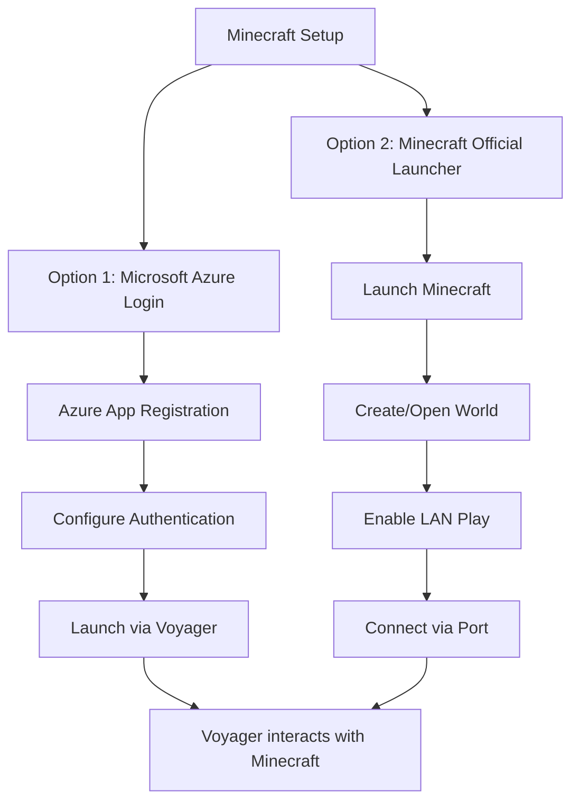
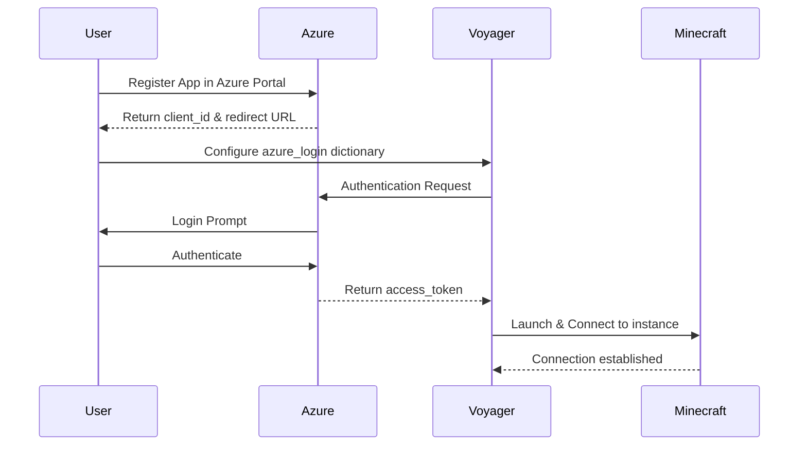
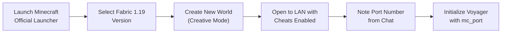
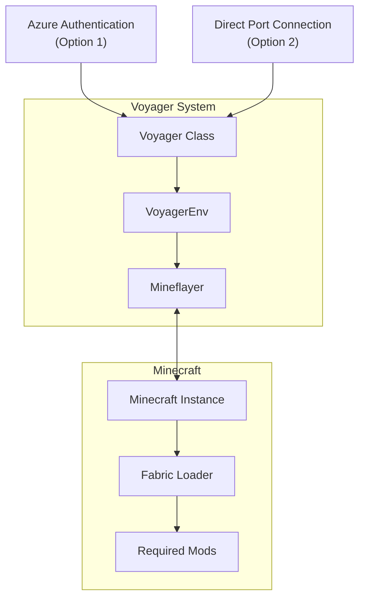

<!-- source: DeepWiki mcp.deepwiki.com · repo MineDojo/Voyager · page 2.1 Minecraft Setup · fetched 2026-10-26 -->

# Minecraft Setup

<details>
<summary>Relevant source files</summary>

The following files were used as context for generating this wiki page:

- [FAQ.md](FAQ.md)
- [installation/minecraft_instance_install.md](installation/minecraft_instance_install.md)

</details>


This page details the process of configuring and running a Minecraft instance specifically for use with the Voyager system. It covers the two available methods for connecting Voyager to Minecraft and the required configuration steps for each approach. For information on installing and configuring the required Fabric mods after setting up Minecraft, refer to [Fabric Mods Installation](#2.2).

## Prerequisites

Before setting up Minecraft for Voyager, ensure you have:

- An official [Minecraft](https://www.minecraft.net) game (version 1.19) installed
- Java installed on your system
- Completed the basic Voyager installation

Voyager uses `fabric-loader-0.14.18-1.19` for all experiments. If you don't have this version installed yet, you'll need to install it as part of the Fabric mods installation process.

## Setup Methods Overview

There are two methods to set up a Minecraft instance for use with Voyager:

| Method | Advantages | Use Case |
|--------|------------|----------|
| Microsoft Azure Login | - Automatic resumption after request timeouts<br>- Better handling of infinite loops<br>- More robust for long-running experiments | Recommended for most users and extended Voyager sessions |
| Minecraft Official Launcher | - Simpler setup<br>- No Azure account required<br>- Direct connection to running game | Quick testing or when Azure login is problematic |



Sources: [installation/minecraft_instance_install.md:1-7]()

## Option 1: Microsoft Azure Login (Recommended)

The Azure login method allows Voyager to automatically restart the Minecraft instance after request timeouts, which is particularly useful when GPT-4 writes code that might cause infinite loops or when running extended experiments.

### Setup Process



1. Sign in to [Azure Portal](https://portal.azure.com)
2. Navigate to Azure Active Directory
3. Select "App Registrations" and click "New registration"
4. Configure the application with:
   - A name of your choice
   - Supported account types: "Accounts in any organizational directory and personal Microsoft accounts"
   - Redirect URI Type: "Public client/native (mobile & desktop)"
   - Redirect URI Value: `https://127.0.0.1/auth-response`
5. After registration, note your "Application (client) ID"
6. (Optional) Create a client secret in "Certificates & Secrets" tab
7. Determine your Minecraft version by checking the folders in your Minecraft install location under `/versions`

### Configuration for Voyager

When initializing Voyager, provide your Azure login information:

```python
azure_login = {
    "client_id": "YOUR_CLIENT_ID_FROM_AZURE",
    "redirect_url": "https://127.0.0.1/auth-response",
    "secret_value": "YOUR_SECRET_VALUE_IF_CREATED",
    "version": "fabric-loader-0.14.18-1.19",  # or your Fabric version
}

voyager = Voyager(
    azure_login=azure_login,
    # other parameters...
)
```

Sources: [installation/minecraft_instance_install.md:6-31]()

## Option 2: Minecraft Official Launcher

This method uses a manually launched Minecraft instance that Voyager connects to via a local port.

### Setup Process



1. Open the Minecraft official launcher
2. Select `fabric-loader-0.14.18-1.19` (or your chosen Fabric version) and start the game
3. Select "Singleplayer" and create a new world (or open an existing one)
4. Configure the world:
   - Game Mode: Creative
   - Difficulty: Peaceful
5. After the world loads, press Esc and select "Open to LAN"
6. Enable cheats by selecting "Allow cheats: ON"
7. Click "Start LAN World"
8. Note the port number displayed in the chat (e.g., "Local game hosted on port 12345")

### Configuration for Voyager

Initialize Voyager with the port number:

```python
voyager = Voyager(
    mc_port=12345,  # Use the port number from your chat
    # other parameters...
)
```

Sources: [installation/minecraft_instance_install.md:33-42]()

## Connection Diagram



Sources: [installation/minecraft_instance_install.md:1-42]()

## Common Issues and Troubleshooting

### Connection Errors After Azure Login

If you see a connection refused or 404 error after logging in through the Azure link, this is normal. Copy the URL from your browser (containing `code=M.C....`) and paste it when prompted.

### KeyError: 'access_token' After Copying the Link

This may be resolved by changing the Redirect URI Type in your Azure app registration from "Public client/native" to "Web". Try both settings to determine which works for your configuration.

### Subprocess Mineflayer Failed to Start

This error can occur for several reasons:

1. **Check Node.js installation**: Verify your installation by running:
   ```bash
   cd voyager/env/mineflayer
   node index.js
   ```
   You should see "Server started on port {PORT}" if successful.

2. **Verify Fabric installation**: Ensure you can select the Fabric version in the Minecraft launcher.

3. **Port conflicts**: When running multiple Voyager instances, each requires a unique port:
   ```python
   voyager = Voyager(
       server_port=3001,  # Default is 3000
       # other parameters...
   )
   ```

Sources: [FAQ.md:1-36]()

## Next Steps

After successfully setting up your Minecraft instance for Voyager, proceed to [Fabric Mods Installation](#2.2) to install and configure the required Fabric mods that enable Voyager to properly interface with Minecraft.

---

