# Page: Overview

# Overview

<details>
<summary>Relevant source files</summary>

The following files were used as context for generating this wiki page:

- [README.md](README.md)
- [voyager/__init__.py](voyager/__init__.py)
- [voyager/voyager.py](voyager/voyager.py)

</details>


## Purpose and Scope

This document provides a technical overview of Voyager, an open-ended embodied lifelong learning agent for Minecraft powered by Large Language Models (LLMs). It explains the core architecture, key components, and operating principles of the system. This overview focuses on explaining how Voyager autonomously explores Minecraft, acquires diverse skills, and makes discoveries without human intervention.

For detailed installation instructions, see [Installation and Setup](#2).

Sources: [README.md:21-37](), [voyager/voyager.py:52-58]()

## What is Voyager?

Voyager is an LLM-powered embodied agent that operates in Minecraft through a continuous learning cycle. The system leverages GPT-4 to acquire skills, explore the world, and accomplish tasks without human intervention. Voyager is designed to demonstrate in-context lifelong learning capabilities by maintaining an ever-growing skill library of executable code.

The system consists of three key components:
1. An automatic curriculum that maximizes exploration
2. A skill library that stores and retrieves complex behaviors as executable code
3. An iterative prompting mechanism that incorporates environment feedback, error handling, and self-verification

Sources: [README.md:21-37](), [voyager/voyager.py:52-102]()

## System Architecture Overview

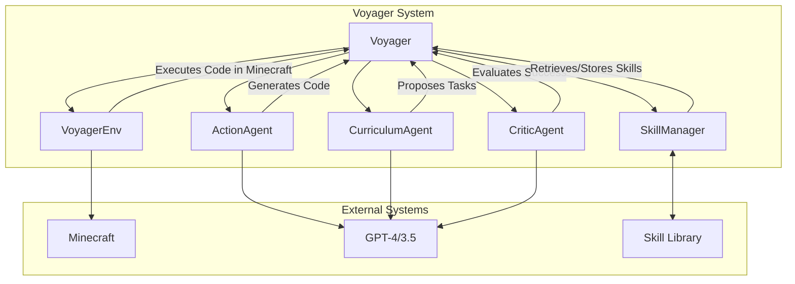

*High-level architecture of the Voyager system*

Sources: [voyager/voyager.py:16-17](), [voyager/voyager.py:104-154]()

## Core Components

### Voyager Class

The `Voyager` class serves as the central orchestrator of the entire system. It initializes and manages all the specialized agents, handles the learning loop, and coordinates interactions with the Minecraft environment. The main methods include:

- `learn()`: Runs the lifelong learning process
- `reset()`: Resets the agent state for a new task
- `step()`: Executes one step in the action-observation loop
- `rollout()`: Completes a full task execution cycle
- `inference()`: Executes a specific task using the learned skill library
- `decompose_task()`: Breaks down complex tasks into manageable sub-goals

Sources: [voyager/voyager.py:17-162](), [voyager/voyager.py:295-412]()

### Agent System

Voyager employs a multi-agent architecture where specialized agents handle different aspects of the learning and execution process:

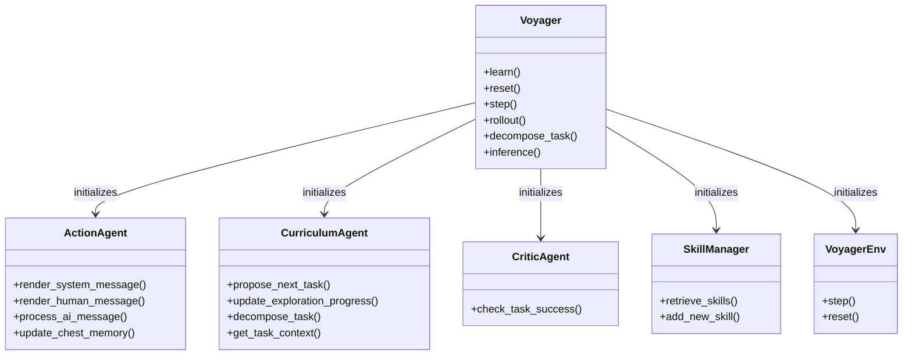

*Component relationships in the Voyager system*

Sources: [voyager/voyager.py:104-154]()

#### ActionAgent

The ActionAgent is responsible for generating executable JavaScript code to perform tasks in Minecraft. It leverages GPT models to translate high-level task descriptions into concrete implementations, handling the complexity of Minecraft's mechanics and physics.

Sources: [voyager/voyager.py:118-127](), [voyager/voyager.py:54]()

#### CurriculumAgent

The CurriculumAgent serves as the automatic curriculum generator, proposing new tasks based on the agent's current state, inventory, and exploration progress. It maintains records of completed and failed tasks to intelligently build on previous successes.

Sources: [voyager/voyager.py:128-139](), [voyager/voyager.py:55]()

#### CriticAgent

The CriticAgent evaluates whether tasks have been successfully completed by analyzing game events and environmental changes. It provides feedback that helps improve future attempts and determines when skills should be added to the skill library.

Sources: [voyager/voyager.py:140-145](), [voyager/voyager.py:56]()

#### SkillManager

The SkillManager handles the storage, retrieval, and organization of reusable skills. It maintains a vector database of skills that can be semantically queried to find relevant code for new tasks, facilitating knowledge transfer and reuse.

Sources: [voyager/voyager.py:146-153](), [voyager/voyager.py:57]()

## Learning and Task Execution

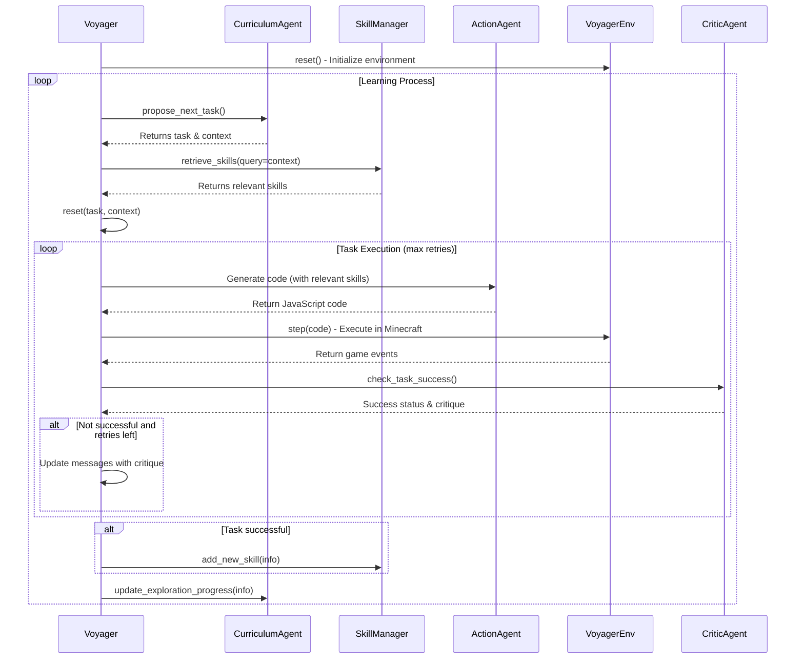

*Sequence diagram of Voyager's learning process*

Sources: [voyager/voyager.py:295-368](), [voyager/voyager.py:165-285]()

### Lifelong Learning Cycle

The lifelong learning cycle in Voyager follows these steps:

1. The CurriculumAgent proposes a new task based on current progress
2. The SkillManager retrieves relevant skills from its library
3. The ActionAgent generates JavaScript code to accomplish the task
4. The code is executed in the Minecraft environment via VoyagerEnv
5. The CriticAgent evaluates success or failure of the task
6. If successful, the new skill is added to the skill library
7. The cycle repeats with increasingly complex tasks

This process allows Voyager to continually build its knowledge and capabilities over time, with each new skill potentially becoming a building block for more complex behaviors.

Sources: [voyager/voyager.py:295-368]()

### Task Execution and Skill Acquisition

When executing a specific task, Voyager follows this process:

1. Reset agent state for the new task
2. Retrieve relevant skills from the skill library
3. Generate JavaScript code to accomplish the task
4. Execute the code in Minecraft
5. Evaluate success or failure
6. If failed and retries are available, regenerate code with critique
7. If successful, add the new skill to the library

This iterative approach allows Voyager to improve its solutions through feedback and gradually build a comprehensive library of reusable skills.

Sources: [voyager/voyager.py:165-285]()

## Data Flow

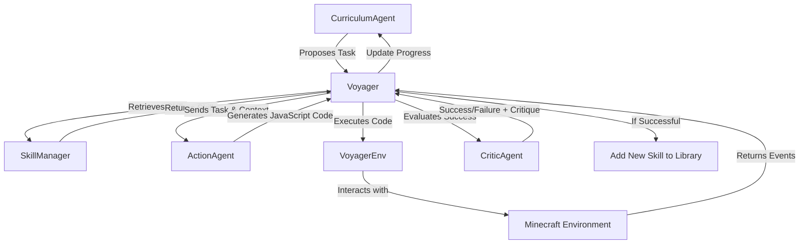

*Data flow in the Voyager system*

Sources: [voyager/voyager.py:104-154](), [voyager/voyager.py:295-368]()

## Key Features and Capabilities

1. **Automatic Curriculum Generation**: Proposes increasingly complex tasks based on current progress and environment state
2. **Skill Library Management**: Stores, retrieves, and composes reusable skills as executable code
3. **Iterative Prompting**: Incorporates feedback and self-verification for continuous improvement
4. **Task Decomposition**: Breaks complex tasks into manageable sub-goals
5. **Error Handling**: Manages execution errors and provides recovery mechanisms
6. **Checkpoint and Resume**: Supports saving progress and resuming learning from checkpoints

Sources: [README.md:21-37](), [voyager/voyager.py:295-368]()

## Usage Modes

Voyager supports two primary modes of operation:

1. **Learning Mode**: The agent continuously explores, learns new skills, and builds its skill library
   ```python
   voyager.learn()
   ```

2. **Inference Mode**: The agent uses its existing skill library to accomplish specific tasks
   ```python
   task = "Craft a diamond pickaxe"
   sub_goals = voyager.decompose_task(task)
   voyager.inference(sub_goals=sub_goals)
   ```

Sources: [README.md:94-96](), [README.md:138-143](), [voyager/voyager.py:295-368](), [voyager/voyager.py:380-412]()

For more detailed information about specific components, refer to:
- [Agents](#4) for details on the agent system
- [Skill System](#5) for information about the skill library and management
- [Environment Integration](#6) for details on Minecraft interaction
- [Usage and Examples](#7) for practical examples of using Voyager

Sources: [voyager/voyager.py:16-412](), [README.md:38-145]()

---

# Page: Installation and Setup

# Installation and Setup

<details>
<summary>Relevant source files</summary>

The following files were used as context for generating this wiki page:

- [FAQ.md](FAQ.md)
- [README.md](README.md)
- [requirements.txt](requirements.txt)
- [setup.py](setup.py)

</details>


This document provides comprehensive instructions for installing and configuring the Voyager system, an open-ended embodied agent powered by large language models for Minecraft. It covers the complete setup process including Python installation, Node.js dependencies, Minecraft configuration, and required API keys.

For detailed information about Minecraft-specific setup, see [Minecraft Setup](#2.1). For Fabric mods installation, see [Fabric Mods Installation](#2.2).

## System Requirements

Before installing Voyager, ensure your system meets the following requirements:

| Component | Minimum Requirement |
|-----------|---------------------|
| Python    | ≥ 3.9               |
| Node.js   | ≥ 16.13.0           |
| Operating System | Ubuntu 20.04, Windows 11, or macOS (tested) |
| OpenAI API | Active account with API key |
| Minecraft | Java Edition with Fabric support |

Sources: [README.md:40-41]()

## Installation Overview

The installation process for Voyager involves multiple components that work together to enable the agent's functionality in Minecraft.

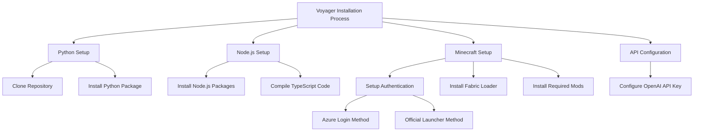

Sources: [README.md:40-72]()

## Python Installation

First, clone the Voyager repository and install the Python package:

```bash
git clone https://github.com/MineDojo/Voyager
cd Voyager
pip install -e .
```

This will install the Voyager package along with all required Python dependencies, including:

- tqdm
- langchain
- javascript
- openai
- chromadb
- tiktoken
- minecraft_launcher_lib

Sources: [README.md:44-48](), [requirements.txt:1-15]()

## Node.js Installation

After installing the Python package, you need to install the Node.js dependencies that enable communication with Minecraft:

```bash
cd voyager/env/mineflayer
npm install -g npx
npm install
cd mineflayer-collectblock
npx tsc
cd ..
npm install
```

This installs Mineflayer and compiles necessary TypeScript code for the collectblock utility.

Sources: [README.md:52-60]()

## Minecraft Authentication Setup

Voyager requires authentication to connect to Minecraft. The system supports two authentication methods:

### Method 1: Azure Login (Recommended)

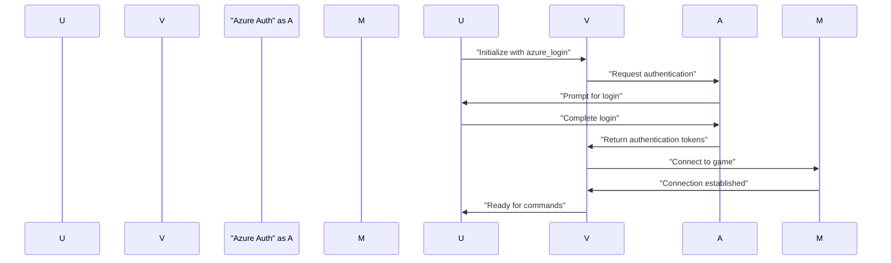

To authenticate using Azure Login, you'll need to:

1. Create a Microsoft Azure application registration
2. Configure the azure_login dictionary in your code:

```python
azure_login = {
    "client_id": "YOUR_CLIENT_ID",
    "redirect_url": "https://127.0.0.1/auth-response",
    "secret_value": "[OPTIONAL] YOUR_SECRET_VALUE",
    "version": "fabric-loader-0.14.18-1.19", # tested version
}
```

Sources: [README.md:65-87](), [FAQ.md:10-18]()

### Method 2: Direct Port Connection

Alternatively, you can use the Minecraft Official Launcher method with a direct port connection:

1. Launch Minecraft with the official launcher
2. Create and open a world to LAN
3. Note the port number displayed
4. Use `mc_port` parameter instead of `azure_login` when initializing Voyager

Sources: [FAQ.md:18]()

## OpenAI API Configuration

Voyager uses OpenAI's GPT-4 as its primary language model. You'll need to:

1. Obtain an API key from [OpenAI's platform](https://platform.openai.com/account/api-keys)
2. Provide this key when initializing Voyager:

```python
voyager = Voyager(
    azure_login=azure_login,
    openai_api_key="YOUR_API_KEY",
)
```

**Note**: While GPT-3.5 can be used, GPT-4 is strongly recommended for better code quality, reasoning ability, and context length handling.

Sources: [README.md:74-77](), [FAQ.md:48-50]()

## Running Voyager

After completing the installation and setup, you can run Voyager in different modes:

### Lifelong Learning Mode

```python
voyager = Voyager(
    azure_login=azure_login,
    openai_api_key=openai_api_key,
)
voyager.learn()
```

When using Azure Login for the first time:
1. The game will launch
2. Select "Singleplayer" and "Create New World"
3. Set Game Mode to "Creative" and Difficulty to "Peaceful"
4. Press "Esc" and "Open to LAN"
5. Select "Allow cheats: ON" and press "Start LAN World"

Sources: [README.md:90-104]()

### Resuming from a Checkpoint

```python
voyager = Voyager(
    azure_login=azure_login,
    openai_api_key=openai_api_key,
    ckpt_dir="YOUR_CKPT_DIR",
    resume=True,
)
```

Sources: [README.md:108-118]()

### Task Execution with a Learned Skill Library

```python
voyager = Voyager(
    azure_login=azure_login,
    openai_api_key=openai_api_key,
    skill_library_dir="./skill_library/trial1",
    ckpt_dir="YOUR_CKPT_DIR",
    resume=False,
)

# Decompose a specific task
task = "Craft a diamond pickaxe"
sub_goals = voyager.decompose_task(task=task)

# Execute the sub-goals
voyager.inference(sub_goals=sub_goals)
```

Sources: [README.md:122-143]()

## System Component Integration

The following diagram illustrates how the different components of Voyager interact after installation:

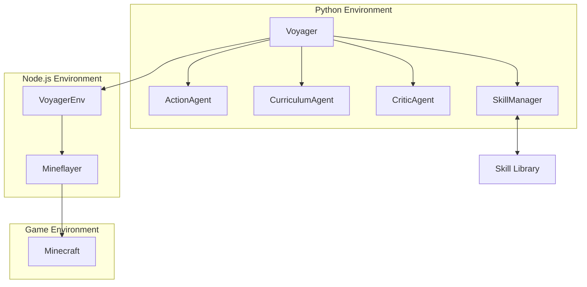

Sources: [README.md:40-72]()

## Common Installation Issues

| Issue | Solution |
|-------|----------|
| Connection error after Azure login | Normal behavior; copy the new URL containing `code=M.C....` |
| `KeyError: 'access_token'` | Try changing Redirect URI Type from "Public client/native" to "Web" in Azure app registration |
| `Subprocess Mineflayer failed to start` | Check Node.js installation, verify Fabric installation, or change the port if running multiple instances |
| Bot leaving and rejoining after tasks | Normal reset behavior; use `voyager.learn(reset_env=False)` to prevent this |

Sources: [FAQ.md:1-40]()

## Estimated Costs

Using Voyager with GPT-4 for approximately 160 iterations costs around 50 USD in OpenAI API usage. Monitor your API spending carefully.

Sources: [FAQ.md:52-54]()

---

# Page: Minecraft Setup

# Minecraft Setup

<details>
<summary>Relevant source files</summary>

The following files were used as context for generating this wiki page:

- [FAQ.md](FAQ.md)
- [installation/minecraft_instance_install.md](installation/minecraft_instance_install.md)

</details>


This page details the process of configuring and running a Minecraft instance specifically for use with the Voyager system. It covers the two available methods for connecting Voyager to Minecraft and the required configuration steps for each approach. For information on installing and configuring the required Fabric mods after setting up Minecraft, refer to [Fabric Mods Installation](#2.2).

## Prerequisites

Before setting up Minecraft for Voyager, ensure you have:

- An official [Minecraft](https://www.minecraft.net) game (version 1.19) installed
- Java installed on your system
- Completed the basic Voyager installation

Voyager uses `fabric-loader-0.14.18-1.19` for all experiments. If you don't have this version installed yet, you'll need to install it as part of the Fabric mods installation process.

## Setup Methods Overview

There are two methods to set up a Minecraft instance for use with Voyager:

| Method | Advantages | Use Case |
|--------|------------|----------|
| Microsoft Azure Login | - Automatic resumption after request timeouts<br>- Better handling of infinite loops<br>- More robust for long-running experiments | Recommended for most users and extended Voyager sessions |
| Minecraft Official Launcher | - Simpler setup<br>- No Azure account required<br>- Direct connection to running game | Quick testing or when Azure login is problematic |

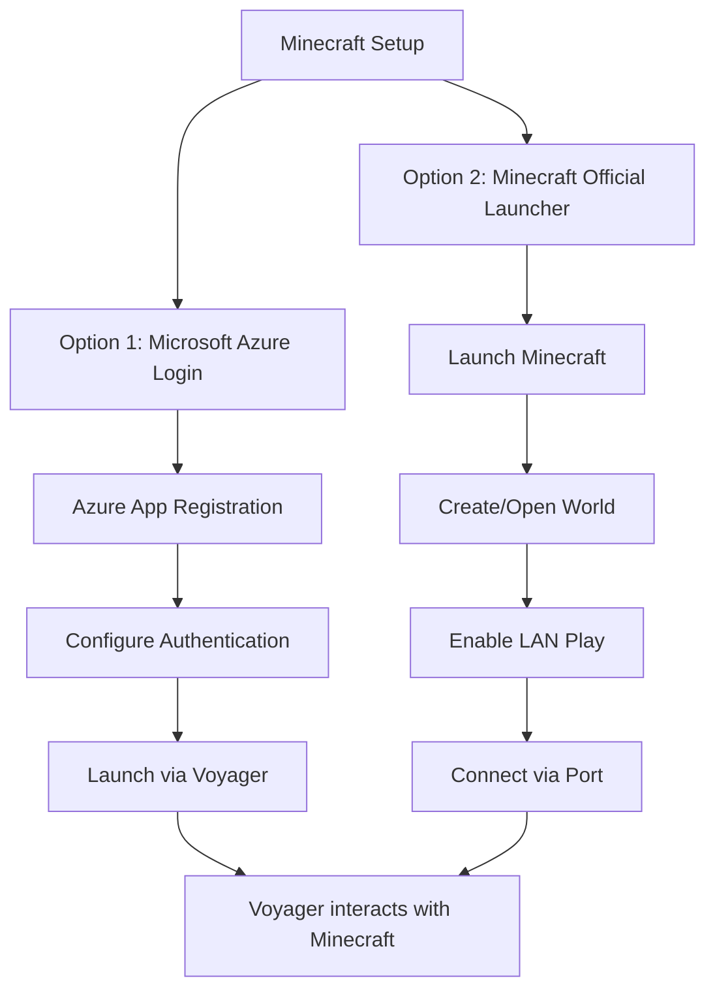

Sources: [installation/minecraft_instance_install.md:1-7]()

## Option 1: Microsoft Azure Login (Recommended)

The Azure login method allows Voyager to automatically restart the Minecraft instance after request timeouts, which is particularly useful when GPT-4 writes code that might cause infinite loops or when running extended experiments.

### Setup Process

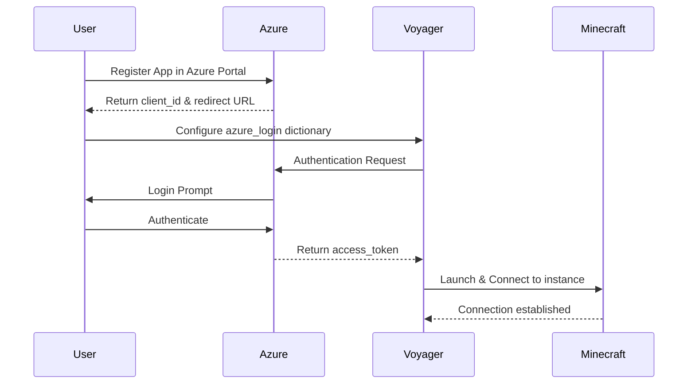

1. Sign in to [Azure Portal](https://portal.azure.com)
2. Navigate to Azure Active Directory
3. Select "App Registrations" and click "New registration"
4. Configure the application with:
   - A name of your choice
   - Supported account types: "Accounts in any organizational directory and personal Microsoft accounts"
   - Redirect URI Type: "Public client/native (mobile & desktop)"
   - Redirect URI Value: `https://127.0.0.1/auth-response`
5. After registration, note your "Application (client) ID"
6. (Optional) Create a client secret in "Certificates & Secrets" tab
7. Determine your Minecraft version by checking the folders in your Minecraft install location under `/versions`

### Configuration for Voyager

When initializing Voyager, provide your Azure login information:

```python
azure_login = {
    "client_id": "YOUR_CLIENT_ID_FROM_AZURE",
    "redirect_url": "https://127.0.0.1/auth-response",
    "secret_value": "YOUR_SECRET_VALUE_IF_CREATED",
    "version": "fabric-loader-0.14.18-1.19",  # or your Fabric version
}

voyager = Voyager(
    azure_login=azure_login,
    # other parameters...
)
```

Sources: [installation/minecraft_instance_install.md:6-31]()

## Option 2: Minecraft Official Launcher

This method uses a manually launched Minecraft instance that Voyager connects to via a local port.

### Setup Process

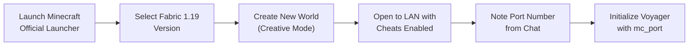

1. Open the Minecraft official launcher
2. Select `fabric-loader-0.14.18-1.19` (or your chosen Fabric version) and start the game
3. Select "Singleplayer" and create a new world (or open an existing one)
4. Configure the world:
   - Game Mode: Creative
   - Difficulty: Peaceful
5. After the world loads, press Esc and select "Open to LAN"
6. Enable cheats by selecting "Allow cheats: ON"
7. Click "Start LAN World"
8. Note the port number displayed in the chat (e.g., "Local game hosted on port 12345")

### Configuration for Voyager

Initialize Voyager with the port number:

```python
voyager = Voyager(
    mc_port=12345,  # Use the port number from your chat
    # other parameters...
)
```

Sources: [installation/minecraft_instance_install.md:33-42]()

## Connection Diagram

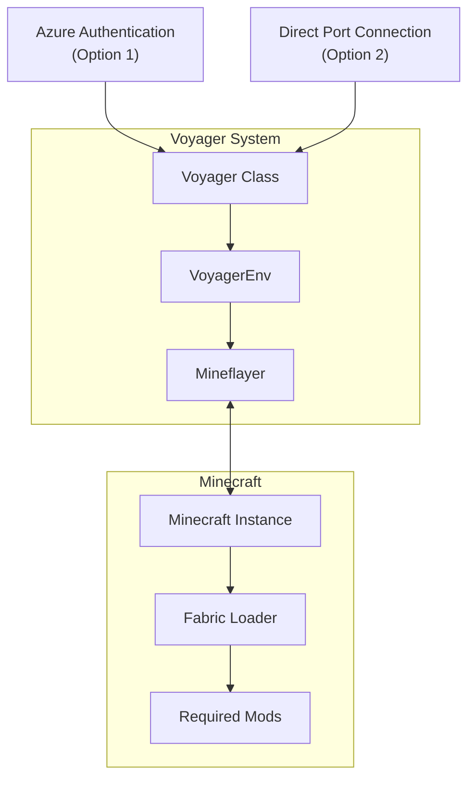

Sources: [installation/minecraft_instance_install.md:1-42]()

## Common Issues and Troubleshooting

### Connection Errors After Azure Login

If you see a connection refused or 404 error after logging in through the Azure link, this is normal. Copy the URL from your browser (containing `code=M.C....`) and paste it when prompted.

### KeyError: 'access_token' After Copying the Link

This may be resolved by changing the Redirect URI Type in your Azure app registration from "Public client/native" to "Web". Try both settings to determine which works for your configuration.

### Subprocess Mineflayer Failed to Start

This error can occur for several reasons:

1. **Check Node.js installation**: Verify your installation by running:
   ```bash
   cd voyager/env/mineflayer
   node index.js
   ```
   You should see "Server started on port {PORT}" if successful.

2. **Verify Fabric installation**: Ensure you can select the Fabric version in the Minecraft launcher.

3. **Port conflicts**: When running multiple Voyager instances, each requires a unique port:
   ```python
   voyager = Voyager(
       server_port=3001,  # Default is 3000
       # other parameters...
   )
   ```

Sources: [FAQ.md:1-36]()

## Next Steps

After successfully setting up your Minecraft instance for Voyager, proceed to [Fabric Mods Installation](#2.2) to install and configure the required Fabric mods that enable Voyager to properly interface with Minecraft.

---

# Page: Fabric Mods Installation

# Fabric Mods Installation

<details>
<summary>Relevant source files</summary>

The following files were used as context for generating this wiki page:

- [FAQ.md](FAQ.md)
- [installation/fabric_mods_install.md](installation/fabric_mods_install.md)

</details>


## Purpose and Scope

This document details the installation and configuration of the necessary Fabric mods required for Voyager to function correctly with Minecraft. Voyager depends on several specific mods to enable proper interaction with the Minecraft environment, including server pausing, improved respawn mechanics, and API access. For information about the general Minecraft setup process, see [Minecraft Setup](#2.1).

## Fabric Loader Installation

Voyager requires Fabric Loader version 0.14.18 with Minecraft version 1.19. The installation process varies slightly based on your operating system.

### Installation Process Diagram

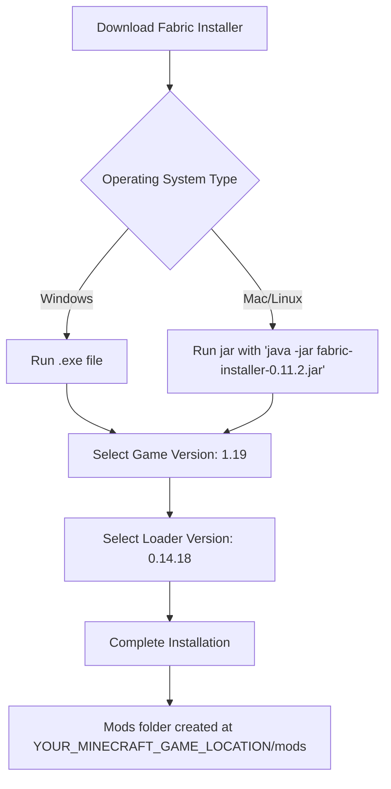

Sources: [installation/fabric_mods_install.md:3-4]()

## Required Mods Overview

Voyager requires five specific Fabric mods to function correctly:

| Mod Name | Version | Purpose |
|----------|---------|---------|
| Fabric API | 0.58.0+1.19 | Provides essential API functionality for other mods |
| Mod Menu | 4.0.4 | Allows management of installed mods |
| Complete Config | 2.1.0 | Configuration framework (dependency for Multi Server Pause) |
| Multi Server Pause | 1.19-0.1.1 | Pauses the server while waiting for LLM responses |
| Better Respawn | 1.19-2.0.0 | Improves respawn mechanics for the Voyager agent |

Sources: [installation/fabric_mods_install.md:5-9]()

## Mods Integration with Voyager

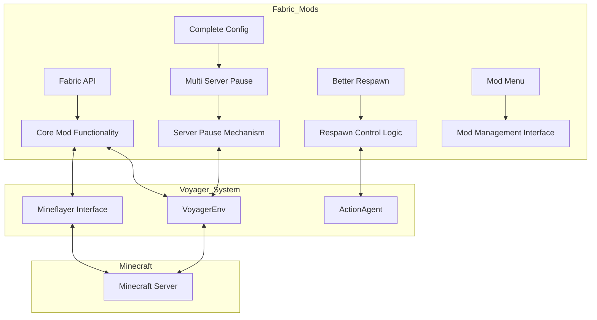

Sources: [installation/fabric_mods_install.md:9](), [FAQ.md:38-40]()

## Installation Steps

### Standard Mods Installation

Four of the five mods can be downloaded directly:

1. **Fabric API**: Download from [Modrinth](https://modrinth.com/mod/fabric-api/version/0.58.0+1.19)
2. **Mod Menu**: Download [version 4.0.4](https://cdn.modrinth.com/data/mOgUt4GM/versions/4.0.4/modmenu-4.0.4.jar)
3. **Complete Config**: Download from [CurseForge](https://www.curseforge.com/minecraft/mc-mods/completeconfig/download/3821056)
4. **Multi Server Pause**: Download from [CurseForge](https://www.curseforge.com/minecraft/mc-mods/multiplayer-server-pause-fabric/download/3822586)

Place all downloaded JAR files in the `YOUR_MINECRAFT_GAME_LOCATION/mods` folder.

Sources: [installation/fabric_mods_install.md:5-9]()

### Better Respawn Installation

The Better Respawn mod requires manual compilation:

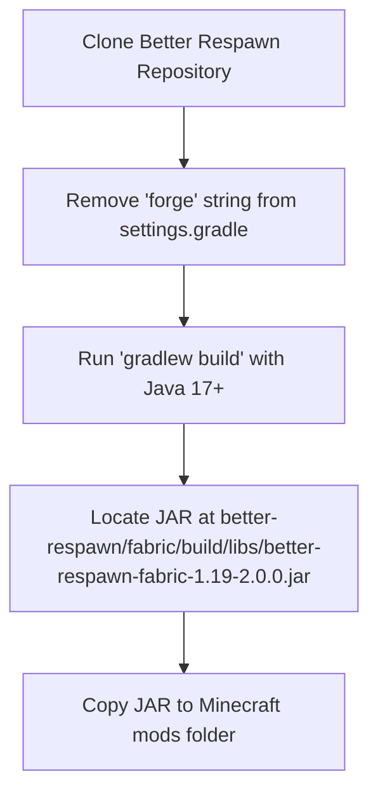

**Note**: You will need Java Runtime Environment v17+ specifically to build the Better Respawn mod. Some newer JRE versions may cause errors during the build process.

Sources: [installation/fabric_mods_install.md:10-13]()

## Configuration

### Better Respawn Configuration

After installing Better Respawn and launching Minecraft once:

1. Navigate to `YOUR_MINECRAFT_GAME_LOCATION/config/better-respawn`
2. Edit the properties file with the following settings:
   ```
   respawn_block_range=32
   max_respawn_distance=32
   min_respawn_distance=0
   ```

These settings control the agent's respawn behavior, ensuring it respawns within appropriate distances in the game environment.

Sources: [installation/fabric_mods_install.md:14-19]()

### Fabric Version Configuration

When using Voyager with Azure login, you must ensure the correct version is specified:

1. Locate the Fabric version folder at `YOUR_MINECRAFT_GAME_LOCATION/version`
2. Change the `version` parameter in the Azure login configuration to `fabric-loader-0.14.18-1.19`

Sources: [installation/fabric_mods_install.md:20]()

## Verification and Troubleshooting

### Installation Verification

After installation, verify that all mods are correctly installed:

1. Launch Minecraft with the Fabric profile
2. Access the Mod Menu to confirm all five mods are listed and active
3. Check that the Better Respawn configuration file exists with the correct settings

### Common Issues

| Issue | Solution |
|-------|----------|
| Mineflayer subprocess fails to start | Verify Fabric installation and mod placement |
| Missing mod dependencies | Ensure all five mods are installed correctly |
| Better Respawn build fails | Use Java 17 specifically, as newer versions may cause errors |
| Minecraft crashes on launch | Check for mod version compatibility with Minecraft 1.19 |

Sources: [FAQ.md:19-37]()

## Relationship to System Architecture

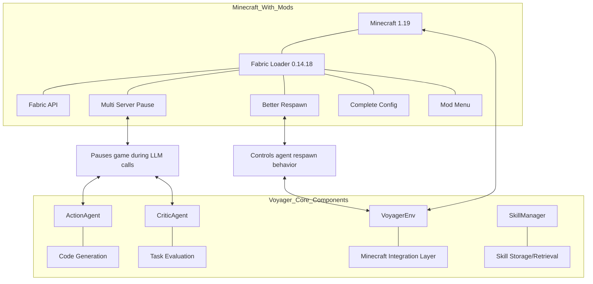

Sources: [installation/fabric_mods_install.md:3-20]()

This diagram illustrates how the Fabric mods integrate with both Minecraft and the Voyager system components. The Multi Server Pause mod is particularly crucial as it pauses the Minecraft server while Voyager's LLM components generate responses, preventing timeout issues during operation. The Better Respawn mod ensures the agent can resume operation effectively after a death in the game.

---

# Page: Core Architecture

# Core Architecture

<details>
<summary>Relevant source files</summary>

The following files were used as context for generating this wiki page:

- [README.md](README.md)
- [voyager/agents/__init__.py](voyager/agents/__init__.py)
- [voyager/voyager.py](voyager/voyager.py)

</details>


This page documents the core architecture of Voyager, an LLM-powered embodied lifelong learning agent for Minecraft. It provides a technical overview of the system's main components, their interactions, and the control flow that enables Voyager's learning capabilities. For installation instructions, see [Installation and Setup](#2), and for detailed explanations of individual agent components, see [Agents](#4).

## System Overview

Voyager is built on a multi-agent architecture that enables autonomous exploration, skill acquisition, and task execution in Minecraft. The system is designed around a central orchestrator that coordinates specialized agents, manages communication with the Minecraft environment, and implements a continuous learning process.

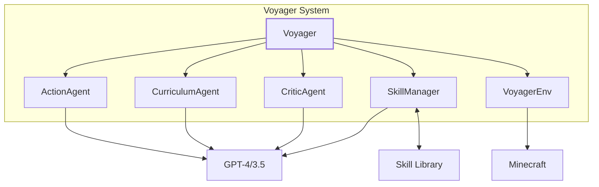

**System Components Diagram: Voyager Core Architecture**

Sources: [voyager/voyager.py:17-412](), [README.md:21-37]()

## Key Components and Their Roles

The Voyager system consists of five key components, each with a specific responsibility in the learning and task execution process:

| Component | Role | Implementation |
|-----------|------|----------------|
| **Voyager** | Central orchestrator that coordinates the entire system | [voyager/voyager.py:17-368]() |
| **ActionAgent** | Generates JavaScript code to perform tasks in Minecraft | [voyager/voyager.py:118-127]() |
| **CurriculumAgent** | Proposes new tasks and maintains learning progress | [voyager/voyager.py:128-139]() |
| **CriticAgent** | Evaluates task success and provides feedback | [voyager/voyager.py:140-145]() |
| **SkillManager** | Maintains a library of learned skills for reuse | [voyager/voyager.py:146-153]() |
| **VoyagerEnv** | Interfaces with the Minecraft environment | [voyager/voyager.py:104-109]() |

Sources: [voyager/voyager.py:17-153](), [voyager/agents/__init__.py:1-4]()

## Voyager Class Implementation

The `Voyager` class serves as the central orchestrator of the entire system. It initializes all components, manages their interactions, and implements the main learning loop.

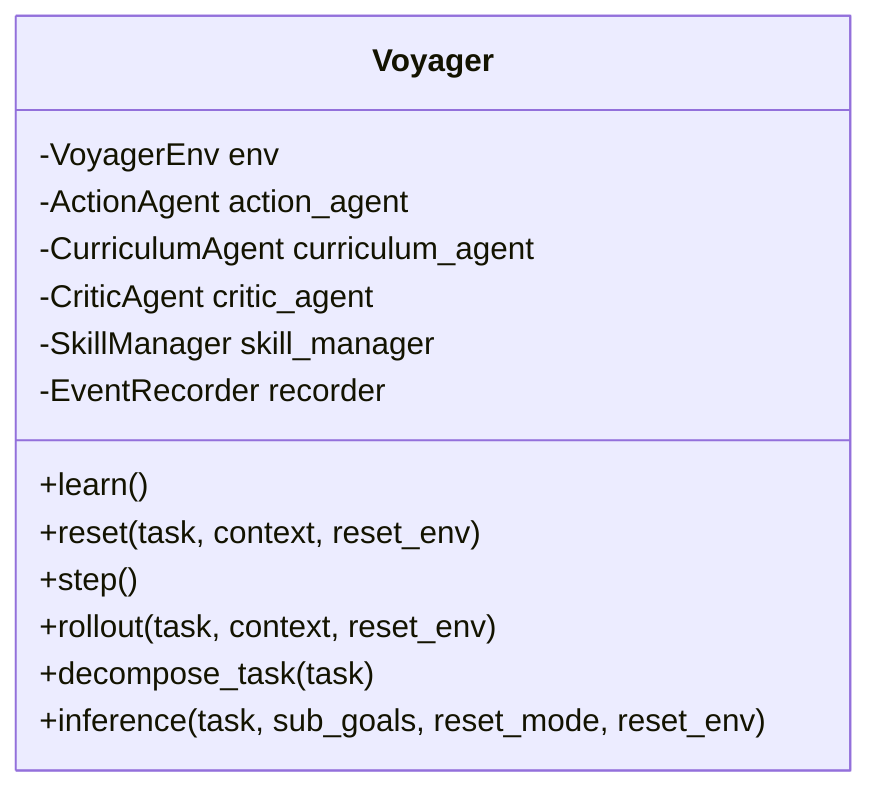

**Class Diagram: Voyager Main Class**

Sources: [voyager/voyager.py:17-102](), [voyager/voyager.py:165-412]()

The Voyager class has several core methods that implement the learning and task execution processes:

- `learn()`: Implements the continuous learning loop where new tasks are proposed and executed
- `reset()`: Prepares the agent for a new task
- `step()`: Executes a single step in the learning process
- `rollout()`: Executes a complete task until success or maximum retries
- `decompose_task()`: Breaks down a complex task into subtasks
- `inference()`: Executes a specific task using learned skills

Sources: [voyager/voyager.py:165-412]()

## Data Flow and Control Loop

Voyager implements a continuous learning loop that involves task proposal, skill retrieval, code generation, execution, evaluation, and skill storage. This learning process is the core of Voyager's ability to autonomously explore and master the Minecraft environment.

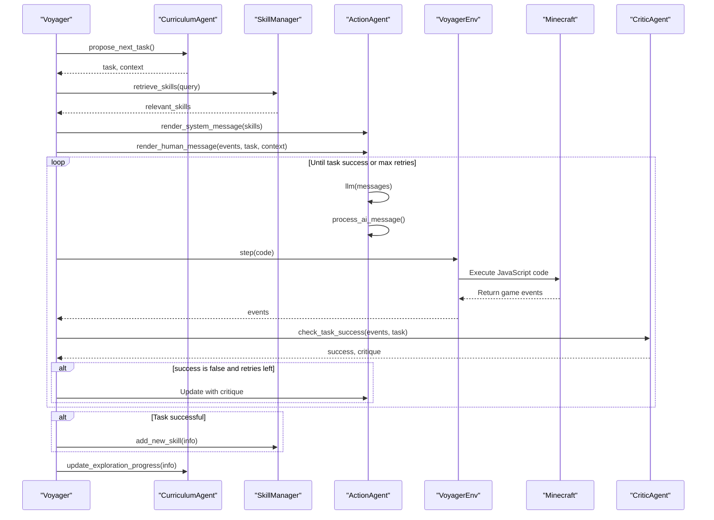

**Sequence Diagram: Voyager Learning Process**

Sources: [voyager/voyager.py:295-368](), [voyager/voyager.py:203-285]()

## Initialization and Configuration

The Voyager system requires several configuration parameters during initialization. These parameters control aspects such as model selection, retry limits, and checkpoint management.

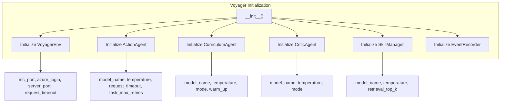

**Initialization Flow: Voyager System Setup**

Sources: [voyager/voyager.py:18-154]()

Key configuration parameters include:

- Model names and temperatures for each agent
- Task retry limits
- Environment timeouts and wait ticks
- Checkpoint directory for saving and resuming progress
- Skill library directory for loading pre-learned skills

Sources: [voyager/voyager.py:18-102]()

## Learning Process Implementation

The `learn()` method implements Voyager's continuous learning process. This involves proposing new tasks, executing them, evaluating the results, and storing successful skills for future use.

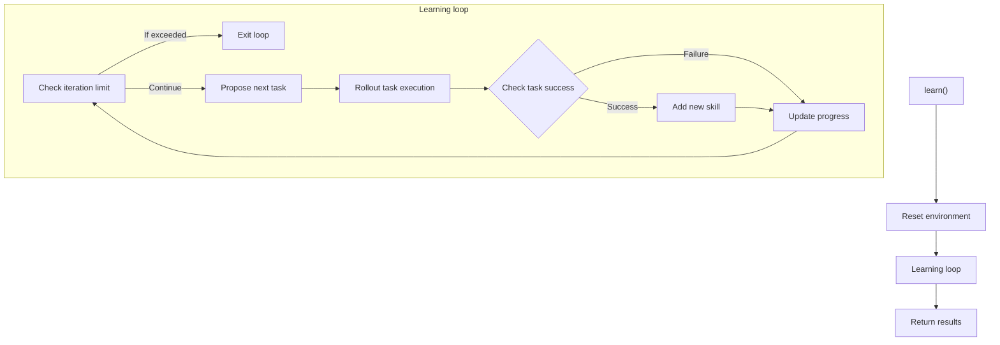

**Flowchart: Voyager Learning Process**

Sources: [voyager/voyager.py:295-368]()

The learning process continues until the maximum number of iterations is reached. During each iteration, the system:

1. Proposes a new task based on current progress
2. Retrieves relevant skills from the skill library
3. Generates code to execute the task
4. Executes the code in the Minecraft environment
5. Evaluates task success
6. Stores successful skills
7. Updates exploration progress

Sources: [voyager/voyager.py:295-368]()

## Task Execution Process

The `rollout()` and `step()` methods implement the task execution process. This involves resetting the agent with a specific task, executing steps until the task is completed or the maximum number of retries is reached, and returning the results.

```mermaid
flowchart TD
    start["rollout()"] --> reset["reset()"]
    reset --> step_loop["Step loop"]
    
    subgraph "Step loop"
        step["step()"] --> check_done{"done?"}
        check_done -->|Yes| exit["Exit loop"]
        check_done -->|No| step
    end
    
    step_loop --> return["Return results"]
    
    subgraph "step()"
        get_ai_message["Get AI message"] --> parse["Parse AI message"]
        parse --> execute["Execute code"]
        execute --> evaluate["Evaluate success"]
        evaluate --> update["Update messages"]
    end
```

**Flowchart: Voyager Task Execution Process**

Sources: [voyager/voyager.py:203-293]()

During each step, the ActionAgent:
1. Receives the current state and task
2. Generates JavaScript code to execute
3. Executes the code in the Minecraft environment
4. Processes the results and updates its state

Sources: [voyager/voyager.py:203-285]()

## Integration with Minecraft

Voyager integrates with Minecraft through the VoyagerEnv component, which provides an interface for executing JavaScript code in the game environment and receiving events and observations.

```mermaid
graph TD
    V["Voyager"] --> VE["VoyagerEnv"]
    VE --> MF["Mineflayer"]
    MF --> MC["Minecraft"]
    
    subgraph "Execution Flow"
        code["JavaScript Code"] --> ctrl_prims["Control Primitives"]
        ctrl_prims --> game_actions["Game Actions"]
    end
    
    subgraph "Observation Flow"
        game_events["Game Events"] --> obsrv["Observations"]
        obsrv --> agent_state["Agent State"]
    end
    
    game_actions --> MC
    MC --> game_events
```

**Integration Diagram: Voyager-Minecraft Communication**

Sources: [voyager/voyager.py:104-109](), [voyager/voyager.py:214-226]()

## Conclusion

The core architecture of Voyager comprises a central orchestrator (Voyager class) that coordinates multiple specialized agents (ActionAgent, CurriculumAgent, CriticAgent, and SkillManager) to enable autonomous learning and task execution in Minecraft. The system implements a continuous learning loop that involves task proposal, skill retrieval, code generation, execution, evaluation, and skill storage.

This modular architecture allows Voyager to:
1. Continuously explore and learn in the Minecraft environment
2. Develop and store reusable skills
3. Leverage learned skills to solve new tasks
4. Provide a framework for LLM-powered embodied agents in interactive environments

For more detailed information about individual components, refer to the [Agents](#4) page, and for information about the skill system, see the [Skill System](#5) page.

---

# Page: Agents

# Agents

<details>
<summary>Relevant source files</summary>

The following files were used as context for generating this wiki page:

- [voyager/agents/__init__.py](voyager/agents/__init__.py)
- [voyager/voyager.py](voyager/voyager.py)

</details>


The Agents module forms the core of Voyager's intelligent decision-making system. It consists of four specialized agent types that work together to enable autonomous exploration, learning, and execution of tasks in Minecraft. This page describes the agent architecture, the role of each agent type, and how they interact during the learning and execution processes.

For specific details about individual agents, see [Curriculum Agent](#4.1), [Action Agent](#4.2), [Critic Agent](#4.3), and [Skill Manager](#4.4).

## Agent Architecture

Voyager employs a multi-agent architecture where specialized agents handle different aspects of the learning and task execution process. Each agent leverages large language models (LLMs) to perform its specific function.

### Agent Class Structure

```mermaid
classDiagram
    class ActionAgent {
        +render_system_message(skills)
        +render_human_message(events, code, task, context, critique)
        +process_ai_message(message)
        +update_chest_memory(chests)
        +llm(messages)
    }
    
    class CurriculumAgent {
        +propose_next_task(events, chest_observation, max_retries)
        +update_exploration_progress(info)
        +decompose_task(task, events)
        +get_task_context(task)
    }
    
    class CriticAgent {
        +check_task_success(events, task, context, chest_observation, max_retries)
    }
    
    class SkillManager {
        +retrieve_skills(query)
        +add_new_skill(info)
    }
    
    Voyager --> ActionAgent
    Voyager --> CurriculumAgent
    Voyager --> CriticAgent
    Voyager --> SkillManager
```

Sources: [voyager/voyager.py:118-153](), [voyager/agents/__init__.py:1-4]()

## Agent Types

### CurriculumAgent

The CurriculumAgent determines what tasks Voyager should attempt next. It proposes new tasks based on the agent's current state, exploration progress, and environment observations. It tracks completed and failed tasks, and can decompose complex tasks into simpler sub-goals.

Key responsibilities:
- Propose new tasks tailored to current capabilities
- Track exploration progress
- Decompose complex tasks into subtasks
- Provide contextual information for task execution

### ActionAgent

The ActionAgent converts high-level tasks into executable JavaScript code for the Minecraft environment. It uses a language model to generate code based on the current task, context, and available skills from the skill library.

Key responsibilities:
- Generate executable JavaScript code
- Format messages for the language model
- Process responses from the language model
- Maintain memory of chest contents and inventory

### CriticAgent

The CriticAgent evaluates whether a task has been successfully completed by analyzing the events that occurred during execution. It provides critiques that help improve future attempts.

Key responsibilities:
- Determine if a task was successfully completed
- Provide detailed feedback on failures
- Guide the learning process through evaluation

### SkillManager

The SkillManager maintains a library of reusable skills acquired through successful task completions. It retrieves relevant skills for new tasks and stores new skills when tasks are successfully completed.

Key responsibilities:
- Store successful code solutions as reusable skills
- Retrieve relevant skills for new tasks
- Manage the skill library

Sources: [voyager/voyager.py:52-102]()

## Agent Interaction Flow

The agents interact through the main Voyager class, which coordinates their activities during the learning and execution processes.

```mermaid
flowchart TD
    V["Voyager"] -->|"learn()"| CA["CurriculumAgent"]
    CA -->|"propose_next_task()"| V
    V -->|"reset()"| AA["ActionAgent"]
    AA -->|"render_system_message()"| V
    V -->|"step()"| LLM["LLM"]
    LLM -->|"llm()"| V
    V -->|"process_ai_message()"| AA
    AA -->|"parsed_result"| V
    V -->|"step()"| ENV["VoyagerEnv"]
    ENV -->|"events"| V
    V -->|"check_task_success()"| CR["CriticAgent"]
    CR -->|"success, critique"| V
    V -->|"retrieve_skills()"| SM["SkillManager"]
    SM -->|"skills"| V
    V -->|"add_new_skill()"| SM
    V -->|"update_exploration_progress()"| CA
```

Sources: [voyager/voyager.py:164-285](), [voyager/voyager.py:295-368]()

## Learning Pipeline

The complete learning pipeline shows how information flows between agents during task execution:

```mermaid
flowchart LR
    CA["CurriculumAgent"] -->|"Proposes Task"| AA["ActionAgent"]
    AA -->|"Formats Messages"| LLM["Language Model"]
    LLM -->|"Generates Code"| ENV["VoyagerEnv"]
    ENV -->|"Executes in"| MC["Minecraft"]
    MC -->|"Returns Events"| CR["CriticAgent"]
    CR -->|"Evaluates Success"| SM["SkillManager"]
    SM <-->|"Stores/Retrieves"| SL["Skill Library"]
    SL -->|"Provides Skills"| AA
```

Sources: [voyager/voyager.py:295-368]()

## Agent Configuration Parameters

Each agent can be configured with specific parameters when initializing the Voyager system. The table below shows the key configuration parameters for each agent:

| Agent | Parameter | Default Value | Description |
|-------|-----------|---------------|-------------|
| ActionAgent | `model_name` | "gpt-4" | LLM used by the agent |
| ActionAgent | `temperature` | 0 | Temperature parameter for LLM |
| ActionAgent | `task_max_retries` | 4 | Maximum attempts per task |
| ActionAgent | `show_chat_log` | True | Display chat logs |
| ActionAgent | `show_execution_error` | True | Display execution errors |
| CurriculumAgent | `model_name` | "gpt-4" | LLM used by the agent |
| CurriculumAgent | `temperature` | 0 | Temperature parameter for LLM |
| CurriculumAgent | `qa_model_name` | "gpt-3.5-turbo" | LLM used for QA |
| CurriculumAgent | `qa_temperature` | 0 | Temperature for QA model |
| CurriculumAgent | `mode` | "auto" | "auto" or "manual" for curriculum |
| CriticAgent | `model_name` | "gpt-4" | LLM used by the agent |
| CriticAgent | `temperature` | 0 | Temperature parameter for LLM |
| CriticAgent | `mode` | "auto" | "auto" or "manual" for critic |
| SkillManager | `model_name` | "gpt-3.5-turbo" | LLM used by the agent |
| SkillManager | `temperature` | 0 | Temperature parameter for LLM |
| SkillManager | `retrieval_top_k` | 5 | Skills to retrieve per task |

Sources: [voyager/voyager.py:17-102]()

## Learning Process

The typical learning process in Voyager follows these steps:

1. The CurriculumAgent proposes a new task based on current progress and environment state
2. The SkillManager retrieves relevant skills from the skill library
3. The ActionAgent generates JavaScript code to accomplish the task
4. The code is executed in the Minecraft environment via VoyagerEnv
5. The CriticAgent evaluates whether the task was successfully completed
6. If successful, the code is stored as a new skill in the skill library
7. The CurriculumAgent updates exploration progress and proposes the next task

This process continues iteratively, allowing Voyager to learn new skills and accomplish increasingly complex tasks over time.

Sources: [voyager/voyager.py:295-368]()

## Task Execution Process

For executing specific tasks (rather than open-ended learning), Voyager uses a similar process but with a predefined task or set of sub-goals:

1. The task is either provided directly or decomposed into sub-goals by the CurriculumAgent
2. Each sub-goal is executed using the same process as in the learning mode
3. The system tracks progress through the sub-goals until the overall task is completed

Sources: [voyager/voyager.py:370-411]()

---

# Page: Curriculum Agent

# Curriculum Agent

<details>
<summary>Relevant source files</summary>

The following files were used as context for generating this wiki page:

- [voyager/agents/curriculum.py](voyager/agents/curriculum.py)
- [voyager/voyager.py](voyager/voyager.py)

</details>


The Curriculum Agent is a core component of the Voyager system that manages task proposal and knowledge acquisition. It determines what tasks the agent should tackle next in its learning process, tracks progress through completed and failed tasks, and provides contextual information to assist with task execution. This page documents the architecture, functionality, and implementation of the Curriculum Agent.

For information about other agents in Voyager, see [Agents](#4) and related pages on the [Action Agent](#4.2), [Critic Agent](#4.3), and [Skill Manager](#4.4).

## Architecture and Role

The Curriculum Agent serves as Voyager's task planner and knowledge manager, functioning as an automatic curriculum generator. It proposes increasingly complex tasks based on the agent's current state and previous achievements, enabling progressive skill acquisition in an open-ended environment.

```mermaid
flowchart TD
    subgraph "CurriculumAgent"
        CA["CurriculumAgent"] --> ProposeTask["propose_next_task()"]
        CA --> UpdateProgress["update_exploration_progress()"]
        CA --> TaskContext["get_task_context()"]
        CA --> DecomposeTask["decompose_task()"]
        
        subgraph "Knowledge System"
            QA["Question-Answering System"]
            QACache["QA Cache"]
            VectorDB["Vector Database"]
            QA --> QACache
            QACache --> VectorDB
        end
        
        CA --> QA
    end
    
    subgraph "External Interface"
        Voyager["Voyager"] --> CA
        CA --> LLM["Language Models"]
        CA --"Proposes"--> Task["Task + Context"]
        Voyager --"Provides"--> EnvState["Environment State"]
        Voyager --"Reports"--> TaskResults["Task Results"]
    end
```

Sources: [voyager/agents/curriculum.py:15-29](), [voyager/voyager.py:319-326]()

## Core Functionality

### Task Proposal System

The Curriculum Agent proposes tasks through one of two modes:

1. **Auto Mode**: Uses LLM reasoning to propose appropriate next tasks based on:
   - Current environment state
   - Agent's inventory and resources
   - Previously completed and failed tasks
   - Knowledge about the Minecraft world

2. **Manual Mode**: Allows a human operator to directly specify tasks and context

```mermaid
sequenceDiagram
    participant V as Voyager
    participant CA as CurriculumAgent
    participant LLM as "Language Model"
    
    V->>CA: Request next task with environment state
    
    alt Auto Mode
        CA->>CA: Check special conditions (inventory full, first task)
        CA->>CA: Prepare observation
        CA->>LLM: Request task proposal
        LLM->>CA: Return proposed task
        CA->>CA: Parse and validate response
        CA->>CA: Get task context
    else Manual Mode
        CA->>Human: Request task input
        Human->>CA: Enter task and context
        CA->>CA: Confirm with user
    end
    
    CA->>V: Return task & context
    
    Note over V,CA: Task execution occurs
    
    V->>CA: Update with task results
    CA->>CA: Record success/failure
    CA->>CA: Clean up task records
```

Sources: [voyager/agents/curriculum.py:240-327](), [voyager/voyager.py:319-326](), [voyager/voyager.py:356-362]()

### Task Tracking and Progress Management

The Curriculum Agent maintains records of:

- **Completed Tasks**: Successfully executed tasks
- **Failed Tasks**: Tasks that could not be completed after multiple attempts

When tasks are completed or failed, the agent:
1. Updates the appropriate list
2. Deduplicates entries
3. Removes completed tasks from the failed list (if they were previously failed)
4. Persists the updated lists to disk

Sources: [voyager/agents/curriculum.py:329-367]()

### Knowledge Acquisition

The Curriculum Agent employs a question-answering system to gather information about the Minecraft world:

1. **Question Generation**: Generates relevant questions about the current environment
2. **Answer Retrieval**: Either retrieves cached answers or queries the LLM for new information
3. **Context Building**: Constructs contextual information for task execution based on the answers

```mermaid
flowchart TD
    Events["Environment Events"] --> QASystem["Question-Answering System"]
    ChestObservation["Chest Observation"] --> QASystem
    
    subgraph "Question-Answering Process"
        QASystem --> AskQuestions["run_qa_step1_ask_questions()"]
        AskQuestions --> Questions["Generated Questions"]
        Questions --> CheckCache["Check Vector Database"]
        
        CheckCache --> CacheHit["Cache Hit"]
        CheckCache --> CacheMiss["Cache Miss"]
        
        CacheMiss --> QueryLLM["Answer Questions (LLM)"]
        QueryLLM --> StoreCache["Store in Cache"]
        
        CacheHit --> RetrieveAnswer["Retrieve Cached Answer"]
        
        StoreCache --> Answers["Answers"]
        RetrieveAnswer --> Answers
    end
    
    Answers --> ContextBuilding["Build Task Context"]
    ContextBuilding --> TaskContext["Task Context"]
```

Sources: [voyager/agents/curriculum.py:384-498]()

## Key Components

### Observation System

The Curriculum Agent processes environment observations, including:

- Biome information
- Time of day
- Nearby blocks and entities
- Agent's health and hunger
- Position and equipment
- Inventory contents
- Previously completed/failed tasks

The agent uses a "warm-up" mechanism to progressively reveal more information to the LLM as the agent completes more tasks, preventing information overload early in the learning process.

Sources: [voyager/agents/curriculum.py:134-238]()

### Question-Answering Cache

To avoid redundant LLM queries, the agent maintains:

- A vector database of previously asked questions
- A cache of question-answer pairs
- Similarity search to identify semantically equivalent questions

This system:
1. Checks if a semantically similar question exists in the cache
2. Returns the cached answer if found
3. Queries the LLM for new questions
4. Stores new questions and answers in the cache for future use

Sources: [voyager/agents/curriculum.py:57-71](), [voyager/agents/curriculum.py:384-415]()

### Task Decomposition

For complex tasks, the Curriculum Agent can break them down into a sequence of simpler subtasks:

1. Receives a high-level task from the user
2. Analyzes the current environment state
3. Decomposes the task into an ordered sequence of smaller tasks
4. Returns the decomposition for sequential execution

Sources: [voyager/agents/curriculum.py:369-382](), [voyager/voyager.py:370-378]()

## Implementation Details

### Initialization Parameters

| Parameter | Type | Description |
|-----------|------|-------------|
| `model_name` | string | Name of the LLM for task proposal (default: "gpt-3.5-turbo") |
| `temperature` | float | Temperature parameter for the main LLM (default: 0) |
| `qa_model_name` | string | Name of the LLM for Q&A (default: "gpt-3.5-turbo") |
| `qa_temperature` | float | Temperature parameter for the Q&A LLM (default: 0) |
| `request_timout` | int | Timeout for LLM requests in seconds (default: 120) |
| `ckpt_dir` | string | Directory for saving agent state |
| `resume` | bool | Whether to resume from saved state |
| `mode` | string | Operating mode: "auto" or "manual" |
| `warm_up` | dict | Configuration for progressive feature reveal |
| `core_inventory_items` | string | Regex pattern for critical inventory items |

Sources: [voyager/agents/curriculum.py:16-29]()

### State Management

The Curriculum Agent persists its state across sessions:

- Completed and failed tasks lists
- QA cache contents and vector database 
- Progress tracking information

When initialized with `resume=True`, the agent loads its previous state from disk, allowing for continuous learning across multiple sessions.

Sources: [voyager/agents/curriculum.py:46-90]()

### Warm-up System Configuration

The warm-up system controls which observations are provided to the LLM based on the number of completed tasks:

```python
default_warmup = {
    "context": 15,        # QA context after 15 tasks
    "biome": 10,          # Biome info after 10 tasks
    "time": 15,           # Time info after 15 tasks
    "nearby_blocks": 0,   # Always show nearby blocks
    "other_blocks": 10,   # Other blocks after 10 tasks
    "nearby_entities": 5, # Nearby entities after 5 tasks
    "health": 15,         # Health info after 15 tasks
    "hunger": 15,         # Hunger info after 15 tasks
    "position": 0,        # Always show position
    "equipment": 0,       # Always show equipment
    "inventory": 0,       # Always show inventory
    "optional_inventory_items": 7, # Show optional items after 7 tasks
    "chests": 0,          # Always show chests
    "completed_tasks": 0, # Always show completed tasks
    "failed_tasks": 0     # Always show failed tasks
}
```

This mechanism helps manage the complexity of information provided to the LLM, gradually increasing as the agent becomes more capable.

Sources: [voyager/agents/curriculum.py:92-109]()

### Special Task Handling

The Curriculum Agent has special handling for certain situations:

1. **First Task**: Always proposes "Mine 1 wood log" as the initial task
2. **Inventory Management**: When inventory is nearly full (≥33/36 slots):
   - Proposes placing a chest if one is in inventory
   - Proposes crafting a chest if none is available
   - Proposes depositing items in an existing chest

This ensures the agent can continue learning without being blocked by practical constraints.

Sources: [voyager/agents/curriculum.py:241-276]()

## Integration with Voyager

The Curriculum Agent is integrated into the Voyager system in two primary ways:

1. **Learning Loop**: In the continuous learning mode, the agent proposes increasingly complex tasks based on the agent's growing capabilities

2. **Task Execution**: For user-specified tasks, the agent decomposes them into manageable subtasks and provides necessary context

```mermaid
flowchart TD
    subgraph "Voyager System"
        V["Voyager"]
        AA["ActionAgent"]
        CA["CurriculumAgent"]
        CrA["CriticAgent"]
        SM["SkillManager"]
        
        V --> AA
        V --> CA
        V --> CrA
        V --> SM
        
        subgraph "Learning Loop"
            CA --"1. Proposes task"--> V
            V --"2. Executes task using"--> AA
            V --"3. Evaluates success with"--> CrA
            V --"4. Stores skills in"--> SM
            V --"5. Updates progress in"--> CA
        end
        
        subgraph "Task Execution"
            UserTask["User Task"] --> V
            V --"Requests decomposition"--> CA
            CA --"Returns subtasks"--> V
            V --"Executes subtasks using"--> AA
        end
    end
```

Sources: [voyager/voyager.py:295-368](), [voyager/voyager.py:380-412]()

## File Structure

The Curriculum Agent is primarily implemented in:

- `voyager/agents/curriculum.py`: Contains the CurriculumAgent class and all its methods
- `voyager/voyager.py`: Handles integration with the broader Voyager system

The agent stores its state in:

- `{ckpt_dir}/curriculum/completed_tasks.json`: List of completed tasks
- `{ckpt_dir}/curriculum/failed_tasks.json`: List of failed tasks
- `{ckpt_dir}/curriculum/qa_cache.json`: Cache of question-answer pairs
- `{ckpt_dir}/curriculum/vectordb/`: Directory containing the vector database for question similarity

Sources: [voyager/agents/curriculum.py:45-71](), [voyager/agents/curriculum.py:364-367]()

---

# Page: Action Agent

# Action Agent

<details>
<summary>Relevant source files</summary>

The following files were used as context for generating this wiki page:

- [voyager/agents/action.py](voyager/agents/action.py)
- [voyager/voyager.py](voyager/voyager.py)

</details>


The Action Agent is a core component of the Voyager system responsible for translating high-level tasks into executable JavaScript code for the Minecraft environment. It leverages large language models (LLMs) to generate code based on the current game state, task requirements, and available skills.

For information about other agents in the system, see [Curriculum Agent](#4.1), [Critic Agent](#4.3), and [Skill Manager](#4.4).

## Overview

```mermaid
flowchart TD
    subgraph "Action Agent System"
        AA["ActionAgent"]
        LLM["LLM (GPT-4/3.5)"]
        Parser["JavaScript Parser"]
        ChestMemory["Chest Memory"]
    end
    
    subgraph "External Components"
        VA["Voyager"]
        ENV["VoyagerEnv/Minecraft"]
        SM["SkillManager"]
        CA["CriticAgent"]
    end
    
    VA -->|"Task & Context"| AA
    AA -->|"System + Human Message"| LLM
    LLM -->|"AI Message (with code)"| Parser
    Parser -->|"Parsed JavaScript"| VA
    VA -->|"Execute Code"| ENV
    ENV -->|"Game Events"| VA
    VA -->|"Events"| AA
    AA -->|"Update"| ChestMemory
    SM -->|"Available Skills"| AA
    VA -->|"Check Success"| CA
    CA -->|"Critique"| AA
```

Sources: [voyager/agents/action.py:14-281](), [voyager/voyager.py:118-128]()

## Core Functionality

The Action Agent serves as the "brain" of code generation in Voyager. It performs the following key functions:

1. Receives tasks from the Voyager orchestrator
2. Processes game observations and context
3. Generates executable JavaScript code using LLMs
4. Handles errors and maintains memory of the world state
5. Incorporates feedback from the Critic Agent

```mermaid
sequenceDiagram
    participant Voyager
    participant ActionAgent
    participant LLM
    participant VoyagerEnv
    participant CriticAgent
    
    Voyager->>ActionAgent: render_system_message(skills)
    Voyager->>ActionAgent: render_human_message(events, task, context)
    ActionAgent->>LLM: Send system + human message
    LLM-->>ActionAgent: Return AI message with code
    ActionAgent->>ActionAgent: process_ai_message()
    ActionAgent-->>Voyager: Return parsed JavaScript code
    Voyager->>VoyagerEnv: Execute code
    VoyagerEnv-->>Voyager: Return events
    Voyager->>ActionAgent: update_chest_memory(events)
    Voyager->>CriticAgent: check_task_success(events, task)
    CriticAgent-->>Voyager: Return success/failure and critique
    Voyager->>ActionAgent: Update with new context and critique
```

Sources: [voyager/voyager.py:165-285](), [voyager/agents/action.py:201-256]()

## Implementation Details

### Initialization

The Action Agent is initialized with configuration parameters that determine its behavior, including the model name, temperature, and checkpoint directory.

```
ActionAgent(
    model_name="gpt-4",  # LLM to use
    temperature=0,       # Deterministic output
    request_timout=240,  # Timeout for API requests
    ckpt_dir="ckpt",     # Directory for checkpoints
    resume=False,        # Whether to resume from checkpoint
    chat_log=True,       # Show chat logs in prompts
    execution_error=True # Show execution errors in prompts
)
```

Sources: [voyager/agents/action.py:14-38](), [voyager/voyager.py:118-128]()

### Message Generation

The Action Agent generates two types of messages that are sent to the LLM:

1. **System Message**: Contains available skills and context for the LLM
2. **Human Message**: Contains game observations, previous code, task, and critique

#### System Message Structure

```mermaid
flowchart TD
    SM["render_system_message()"]
    BP["Base Primitives"]
    CS["Custom Skills"]
    RF["Response Format"]
    TM["Template"]
    
    SM -->|"Load"| TM
    SM -->|"Load"| BP["Base Primitives:<br>exploreUntil, mineBlock,<br>craftItem, placeItem,<br>smeltItem, killMob"]
    SM -->|"Include"| CS["Custom Skills:<br>from SkillManager"]
    SM -->|"Load"| RF
    TM -->|"Format with"| OUT["System Message"]
    BP -->|"Add to"| OUT
    CS -->|"Add to"| OUT
    RF -->|"Add to"| OUT
```

Sources: [voyager/agents/action.py:75-100]()

#### Human Message Structure

The human message contains a comprehensive observation of the game state, including:

- Previous code execution results
- Execution errors (if any)
- Chat logs
- Biome information
- Time of day
- Nearby blocks and entities
- Health and hunger status
- Player position
- Equipment and inventory
- Chest observations
- Task description
- Context information
- Critique from Critic Agent

Sources: [voyager/agents/action.py:102-199]()

### Processing LLM Response

```mermaid
flowchart TD
    AI["AI Message"]
    CP["Code Pattern Extraction"]
    BP["Babel Parser"]
    FE["Function Extraction"]
    MFI["Main Function Identification"]
    PC["Program Code Construction"]
    EC["Execution Code Generation"]
    ERR["Error Handling"]
    OUT["Output Dict or Error Message"]
    
    AI -->|"Extract code between ```js tags"| CP
    CP -->|"Parse with Babel"| BP
    BP -->|"Extract functions"| FE
    FE -->|"Find last async function"| MFI
    MFI -->|"Validate main function"| VAL["Validation<br>- Has async function<br>- Takes 'bot' parameter"]
    VAL -->|"Construct"| PC
    VAL -->|"Generate"| EC
    PC -->|"Add to"| OUT
    EC -->|"Add to"| OUT
    VAL -->|"If invalid"| ERR
    ERR -->|"Return error message"| OUT
```

Sources: [voyager/agents/action.py:201-256]()

## Chest Memory Management

The Action Agent maintains a memory of chest contents in the Minecraft world. This memory is used to inform decision-making when retrieving or storing items.

### Chest Memory Operations

- **Update Chest Memory**: Records the contents of chests discovered in the environment
- **Render Chest Observation**: Formats chest information for inclusion in prompts
- **Save/Load Chest Memory**: Persists chest memory between sessions

Sources: [voyager/agents/action.py:40-73](), [voyager/voyager.py:219-220]()

## Integration with Voyager

The Action Agent is a key component in the Voyager learning loop:

1. Voyager receives a task from the Curriculum Agent
2. Voyager retrieves relevant skills from the Skill Manager
3. Action Agent generates code to accomplish the task
4. Voyager executes the code in the Minecraft environment
5. Critic Agent evaluates success or failure
6. If successful, the solution may be added as a new skill
7. If unsuccessful, the Action Agent may retry with feedback

```mermaid
flowchart TD
    V["Voyager"]
    AA["ActionAgent"]
    CA["CurriculumAgent"]
    CR["CriticAgent"]
    SM["SkillManager"]
    ENV["VoyagerEnv"]
    
    CA -->|"Propose Task"| V
    V -->|"Retrieve Skills"| SM
    SM -->|"Return Skills"| V
    V -->|"Generate Code"| AA
    AA -->|"Return Code"| V
    V -->|"Execute Code"| ENV
    ENV -->|"Return Events"| V
    V -->|"Update Chest Memory"| AA
    V -->|"Evaluate Success"| CR
    CR -->|"Return Critique"| V
    
    subgraph "Action Agent Retry Loop"
        V -->|"If failed and retries left"| AA
    end
    
    V -->|"If successful"| SM
```

Sources: [voyager/voyager.py:287-293](), [voyager/voyager.py:200-285]()

## Configuration Parameters

| Parameter | Description | Default Value |
|-----------|-------------|---------------|
| `model_name` | LLM model to use for code generation | "gpt-4" |
| `temperature` | Temperature for LLM sampling | 0 |
| `request_timout` | Timeout for API requests in seconds | 240 |
| `ckpt_dir` | Directory for checkpoints | "ckpt" |
| `resume` | Whether to resume from checkpoint | False |
| `chat_log` | Include chat logs in prompts | True |
| `execution_error` | Include execution errors in prompts | True |
| `task_max_retries` | Maximum retries for a task | 4 |

Sources: [voyager/agents/action.py:14-38](), [voyager/voyager.py:27-33]()

## Technical Implementation

The Action Agent uses several JavaScript libraries for code parsing and validation:

- Babel Core (`@babel/core`): For parsing JavaScript code
- Babel Generator (`@babel/generator`): For generating JavaScript code from AST

The code parsing process follows these steps:

1. Extract code between JavaScript code block markers (```js)
2. Parse the code using Babel
3. Identify function declarations
4. Find the main async function (the last one in the file)
5. Validate that the main function takes a single "bot" parameter
6. Construct the final program and execution code

Sources: [voyager/agents/action.py:201-256]()

## Error Handling

The Action Agent implements robust error handling:

1. It attempts to parse the LLM response up to 3 times if errors occur
2. It captures and reports JavaScript syntax errors before execution
3. It incorporates execution errors into subsequent prompts
4. It maintains a chat log for debugging and context

Sources: [voyager/agents/action.py:201-256](), [voyager/agents/action.py:102-199]()

## Summary

The Action Agent is the code generation engine of Voyager, translating high-level tasks into executable JavaScript for Minecraft. It uses LLMs to generate code based on the current game state, available skills, and task requirements. The agent maintains memory of the world state, particularly chest contents, and incorporates feedback from previous attempts to improve performance on subsequent tries.

---

# Page: Critic Agent

# Critic Agent

<details>
<summary>Relevant source files</summary>

The following files were used as context for generating this wiki page:

- [voyager/voyager.py](voyager/voyager.py)

</details>


The Critic Agent is a core component of the Voyager system responsible for task success evaluation and feedback generation. It acts as a self-verification mechanism to assess whether tasks executed by the Action Agent were completed successfully in the Minecraft environment.

## Purpose and Role

The Critic Agent serves as an autonomous evaluator within Voyager's learning loop. When the Action Agent executes code in the Minecraft environment, the Critic Agent analyzes the resulting game state and determines if the intended task was accomplished. Additionally, it provides detailed critiques that explain why a task succeeded or failed, which are then used to guide the Action Agent in subsequent attempts.

```mermaid
flowchart TD
    subgraph "Voyager Learning Loop"
        A["Curriculum Agent"]-->|"Proposes task"| B["Voyager"]
        B-->|"Dispatches task"| C["Action Agent"]
        C-->|"Generates code"| D["Minecraft Environment"]
        D-->|"Returns events/observations"| E["Critic Agent"]
        E-->|"Success/Failure + Critique"| B
        B-->|"If successful"| F["Skill Manager"]
        F-->|"Stores new skill"| G["Skill Library"]
        B-->|"Progress update"| A
    end
```

**Diagram: Critic Agent in the Voyager Learning Loop**

Sources: [voyager/voyager.py:221-226](), [voyager/voyager.py:53-57]()

## Integration with Voyager System

The Critic Agent is initialized in the main Voyager class constructor and is called during the action execution step of the learning process. It receives environmental observations (events) after the Action Agent has executed code in Minecraft, and determines whether the task was successfully completed.

```mermaid
sequenceDiagram
    participant V as "Voyager"
    participant AA as "Action Agent"
    participant ME as "Minecraft Environment"
    participant CA as "Critic Agent"
    
    V->>AA: Send task and context
    AA->>ME: Execute generated code
    ME->>V: Return events and observations
    V->>CA: check_task_success(events, task, context)
    CA-->>V: success (boolean), critique (string)
    
    alt task successful
        V->>V: Add new skill to library
    else task failed
        V->>AA: Regenerate code with critique
    end
```

**Diagram: Task Evaluation Process Flow**

Sources: [voyager/voyager.py:221-226](), [voyager/voyager.py:253-257](), [voyager/voyager.py:354]()

## Implementation Details

### Core Methods

The primary method of the Critic Agent is `check_task_success`, which:

1. Takes events (observations from Minecraft), the current task, context, chest observations, and a maximum retry count
2. Analyzes the game state to determine if the task requirements have been met
3. Returns a success boolean and a detailed critique string

```
check_task_success(
    events,           # Game events and observations
    task,             # Current task description
    context,          # Additional task context
    chest_observation, # Nearby chest contents
    max_retries       # Maximum evaluation attempts
) -> (success, critique)
```

Sources: [voyager/voyager.py:221-226]()

### Mode of Operation

The Critic Agent can operate in two modes:

1. **Auto mode (default)**: Automatically evaluates task success using the LLM
2. **Manual mode**: Relies on human verification for task success

Sources: [voyager/voyager.py:43](), [voyager/voyager.py:144]()

## Configuration

The Critic Agent is configured when initializing the Voyager system with the following parameters:

| Parameter | Default Value | Description |
|-----------|---------------|-------------|
| `critic_agent_model_name` | "gpt-4" | The name of the language model to use |
| `critic_agent_temperature` | 0 | The temperature parameter for the model (lower means more deterministic) |
| `critic_agent_mode` | "auto" | Operating mode ("auto" or "manual") |
| `openai_api_request_timeout` | 240 | Timeout for API requests in seconds |

Sources: [voyager/voyager.py:41-43](), [voyager/voyager.py:140-145]()

## Evaluation Process

When evaluating task success, the Critic Agent's process looks like this:

```mermaid
flowchart TD
    A["check_task_success() called"] --> B["Analyze game events"]
    B --> C["Compare current state with task requirements"]
    C --> D["Generate critique explanation"]
    D --> E{{"Return success/failure and critique"}}
    
    subgraph "Critic Agent Internal Process"
        B
        C
        D
    end
```

**Diagram: Critic Agent Evaluation Process**

Sources: [voyager/voyager.py:221-226]()

## Usage in the Learning Loop

The Critic Agent's evaluations inform several key decisions in the Voyager learning process:

1. **Task Retry**: If a task fails but retry attempts remain, the critique is provided to the Action Agent to improve the next attempt
2. **Skill Creation**: If a task succeeds, the solution is added to the Skill Library for future use
3. **Curriculum Progress**: Task success/failure updates the Curriculum Agent's exploration progress

If the Critic Agent determines that a task has failed and the `reset_placed_if_failed` option is enabled, Voyager will revert block placements from the last step, allowing the agent to try again without permanent world changes.

Sources: [voyager/voyager.py:229-243](), [voyager/voyager.py:253-257](), [voyager/voyager.py:354](), [voyager/voyager.py:356]()

## Related Components

For more information about how the Critic Agent interacts with other components:
- The Action Agent that generates code: see [Action Agent](#4.2)
- The Curriculum Agent that proposes tasks: see [Curriculum Agent](#4.1) 
- The Skill Manager that stores successful solutions: see [Skill Manager](#4.4)

---

# Page: Skill Manager

# Skill Manager

<details>
<summary>Relevant source files</summary>

The following files were used as context for generating this wiki page:

- [voyager/agents/skill.py](voyager/agents/skill.py)
- [voyager/voyager.py](voyager/voyager.py)

</details>


## Overview

The Skill Manager component is responsible for storing, retrieving, and maintaining a library of reusable skills in the Voyager system. It functions as the system's procedural memory, enabling the agent to build upon past accomplishments by storing successful code implementations as reusable skills. This modular approach allows Voyager to compose complex behaviors from simpler building blocks, accelerating learning and problem-solving over time.

For information about how skills are structured and used in the broader system, see [Skill System](#5).

Sources: [voyager/agents/skill.py:13-51](), [voyager/voyager.py:146-153]()

## Architecture

The Skill Manager integrates with the rest of Voyager through a well-defined interface that supports skill storage and retrieval. Its position in the overall system architecture is illustrated below:

```mermaid
graph TD
    subgraph "Voyager"
        V["Voyager"]
        AA["ActionAgent"]
        CA["CurriculumAgent"]
        CR["CriticAgent"]
        SM["SkillManager"]
        VE["VoyagerEnv"]
    end
    
    V -->|"uses"| AA
    V -->|"uses"| CA
    V -->|"uses"| CR
    V -->|"uses"| SM
    V -->|"interacts with"| VE
    
    subgraph "Skill Storage"
        CODE["Code Directory"]
        DESC["Description Directory"]
        VECT["Vector Database"]
        JSON["skills.json"]
    end
    
    SM -->|"manages"| CODE
    SM -->|"manages"| DESC
    SM -->|"queries"| VECT
    SM -->|"reads/writes"| JSON
    
    VE -->|"executes skills"| MC["Minecraft"]
```

The Skill Manager's internal architecture includes several key components:

```mermaid
classDiagram
    class SkillManager {
        +llm: ChatOpenAI
        +control_primitives: List[str]
        +skills: Dict
        +retrieval_top_k: int
        +ckpt_dir: str
        +vectordb: Chroma
        +programs: str
        +add_new_skill(info)
        +generate_skill_description(program_name, program_code)
        +retrieve_skills(query)
    }

    class VectorDB {
        +similarity_search_with_score()
        +add_texts()
        +persist()
    }

    class SkillStorage {
        +code/
        +description/
        +vectordb/
        +skills.json
    }

    SkillManager --> VectorDB: uses
    SkillManager --> SkillStorage: manages
```

Sources: [voyager/agents/skill.py:13-51](), [voyager/voyager.py:146-153]()

## Initialization

The Skill Manager is initialized with several important parameters:

```python
def __init__(
    self,
    model_name="gpt-3.5-turbo",
    temperature=0,
    retrieval_top_k=5,
    request_timout=120,
    ckpt_dir="ckpt",
    resume=False,
):
```

Key parameters include:

| Parameter | Default | Description |
|-----------|---------|-------------|
| model_name | "gpt-3.5-turbo" | The LLM used for generating skill descriptions |
| temperature | 0 | Temperature parameter for the LLM (0 = most deterministic) |
| retrieval_top_k | 5 | Number of most relevant skills to retrieve |
| request_timeout | 120 | Timeout for LLM requests in seconds |
| ckpt_dir | "ckpt" | Directory for storing skill data |
| resume | False | Whether to resume from previously saved skills |

During initialization, the Skill Manager creates the necessary directory structure, loads control primitives, and initializes the vector database using OpenAI embeddings.

Sources: [voyager/agents/skill.py:13-51]()

## Skill Storage Structure

The Skill Manager maintains a structured storage system for skills:

```mermaid
graph TD
    subgraph "SkillManager Storage (ckpt_dir/skill)"
        CODE["code/"]
        DESC["description/"]
        VECT["vectordb/"]
        JSON["skills.json"]
    end
    
    CODE -->|"stores"| JS[".js files\n(skill implementations)"]
    DESC -->|"stores"| TXT[".txt files\n(skill descriptions)"]
    VECT -->|"contains"| EMB["Chroma DB\n(embeddings for retrieval)"]
    JSON -->|"maps"| MAP["skill_name → \n{code, description}"]
```

The storage system includes:

1. **Code Directory** (`code/`): Contains JavaScript files with skill implementations
2. **Description Directory** (`description/`): Contains text files with LLM-generated skill descriptions
3. **Vector Database Directory** (`vectordb/`): Contains the Chroma vector database for semantic retrieval
4. **Skills Metadata** (`skills.json`): Maps skill names to their code and descriptions

Sources: [voyager/agents/skill.py:28-32](), [voyager/agents/skill.py:92-100]()

## Key Operations

### Adding New Skills

When a task is successfully completed, the Skill Manager can add the implementation as a new reusable skill:

```mermaid
sequenceDiagram
    participant V as Voyager
    participant SM as SkillManager
    participant LLM as LLM
    participant VDB as VectorDB
    participant FS as FileSystem
    
    V->>SM: add_new_skill(info)
    SM->>LLM: generate_skill_description(name, code)
    LLM-->>SM: skill description
    SM->>VDB: add_texts(description)
    SM->>SM: skills[name] = {code, description}
    SM->>FS: Save code to code/name.js
    SM->>FS: Save description to description/name.txt
    SM->>FS: Update skills.json
    SM->>VDB: persist()
```

The process includes:
1. Generating a human-readable description of the skill using an LLM
2. Adding the skill description to the vector database
3. Storing the skill code and description in the corresponding directories
4. Updating the skills dictionary and persisting it to `skills.json`
5. Persisting the vector database

Sources: [voyager/agents/skill.py:61-100](), [voyager/voyager.py:353-354]()

### Retrieving Skills

The Skill Manager retrieves relevant skills based on a query (usually the current task and context):

```mermaid
sequenceDiagram
    participant V as Voyager
    participant SM as SkillManager
    participant VDB as VectorDB
    participant SK as SkillsDict
    
    V->>SM: retrieve_skills(query)
    SM->>VDB: similarity_search_with_score(query, k)
    VDB-->>SM: docs_and_scores
    loop For each doc, score
        SM->>SK: get skill[doc.metadata["name"]]
        SK-->>SM: skill code
    end
    SM-->>V: list of relevant skill codes
```

The retrieval process:
1. Performs a similarity search in the vector database
2. Retrieves the skill code for each matched skill
3. Returns a list of relevant skill codes to be used by the action agent

Sources: [voyager/agents/skill.py:114-127](), [voyager/voyager.py:184-185]()

### Generating Skill Descriptions

The Skill Manager uses an LLM to generate human-readable descriptions of skills:

```mermaid
sequenceDiagram
    participant SM as SkillManager
    participant LLM as LLM
    
    SM->>SM: generate_skill_description(program_name, program_code)
    SM->>LLM: Send program code and name with skill prompt
    LLM-->>SM: Generated description
    SM-->>SM: Format as JS function documentation
```

The description generation:
1. Sends the program code and name to the LLM with a specific prompt
2. Receives a descriptive explanation of what the skill does
3. Formats the description as a JavaScript comment within a function structure

Sources: [voyager/agents/skill.py:102-112]()

## Integration with Voyager

The Skill Manager is integrated with the Voyager system in two key ways:

1. **Skill Retrieval for Task Execution**: Before attempting a task, Voyager retrieves relevant skills based on the task and context.
2. **Skill Storage after Success**: When a task is successfully completed, Voyager adds the implementation as a new reusable skill.

```mermaid
sequenceDiagram
    participant V as Voyager
    participant SM as SkillManager
    participant AA as ActionAgent
    participant ENV as VoyagerEnv
    
    Note over V,ENV: Task Execution
    V->>SM: retrieve_skills(context)
    SM-->>V: relevant skills
    V->>AA: render_system_message(skills)
    V->>AA: render_human_message()
    
    Note over V,ENV: After Success
    V->>SM: add_new_skill(info)
    SM-->>V: Skill Added
```

The integration flow:
1. Before executing a task, Voyager retrieves relevant skills from the Skill Manager
2. These skills are included in the system message to the Action Agent
3. After successful task completion, Voyager adds the new skill to the Skill Manager

Sources: [voyager/voyager.py:184-185](), [voyager/voyager.py:250-251](), [voyager/voyager.py:353-354]()

## Control Primitives

The Skill Manager also maintains a collection of control primitives, which are basic functions that skills can use. These primitives are loaded during initialization and combined with skill code when executing tasks.

```mermaid
graph TD
    subgraph "Programs Property"
        CP["Control Primitives"]
        SK["Skill Code"]
        
        CP -->|"concatenated with"| PROG["Final Programs String"]
        SK -->|"concatenated with"| PROG
    end
    
    PROG -->|"executed by"| ENV["VoyagerEnv"]
```

The `programs` property:
1. Concatenates all skill code from the skills dictionary
2. Appends all control primitives
3. Returns the combined code for execution by the environment

Sources: [voyager/agents/skill.py:52-59](), [voyager/voyager.py:215-218]()

## Implementation Details

### Skill Format

Skills are stored as JavaScript async functions with the following structure:

```javascript
async function skillName(bot) {
    // Description generated by LLM explaining what the skill does
    // Implementation code...
}
```

This format allows skills to be easily composed and executed by the Minecraft bot.

Sources: [voyager/agents/skill.py:102-112]()

### Vector Database

The Skill Manager uses Chroma with OpenAI embeddings for semantic search:

1. Each skill description is embedded and stored in the vector database
2. During retrieval, the query is embedded and compared to the stored embeddings
3. The most similar skills (up to `retrieval_top_k`) are returned

Sources: [voyager/agents/skill.py:40-50](), [voyager/agents/skill.py:114-127]()

### Error Handling and Edge Cases

The Skill Manager handles several edge cases:

1. **Duplicate Skills**: If a skill with the same name already exists, it is overwritten in the vector database and a version number is appended to the filename
2. **Empty Skill Library**: If no skills are available, the retrieval function returns an empty list
3. **Database Synchronization**: The manager verifies that the vector database is in sync with the skills dictionary

Sources: [voyager/agents/skill.py:61-100](), [voyager/agents/skill.py:114-127]()

---

# Page: Skill System

# Skill System

<details>
<summary>Relevant source files</summary>

The following files were used as context for generating this wiki page:

- [skill_library/README.md](skill_library/README.md)
- [voyager/agents/skill.py](voyager/agents/skill.py)

</details>


## Purpose and Overview

The Skill System is a core component of Voyager that enables cumulative learning by storing, retrieving, and utilizing reusable skills that the agent acquires over time. It serves as Voyager's long-term memory, allowing the agent to build upon past experiences and solve increasingly complex tasks by leveraging previously learned capabilities.

For information about specific Skill Library implementations and community contributions, see [Skill Library](#5.1). For details about the implementation of the Skill Manager component, see [Skill Manager](#4.4).

Sources: [voyager/agents/skill.py:13-127](), [skill_library/README.md:1-44]()

## Key Components

The Skill System consists of several interconnected components:

```mermaid
graph TD
    A["SkillManager"] -->|"Manages"| B["Skill Library"]
    B -->|"Contains"| C["code/ directory"]
    B -->|"Contains"| D["description/ directory"]
    B -->|"Contains"| E["skills.json"]
    B -->|"Contains"| F["vectordb/ directory"]
    
    A -->|"Loads"| G["Control Primitives"]
    A -->|"Uses"| H["LLM (ChatOpenAI)"]
    A -->|"Uses"| I["Vector Embeddings (OpenAIEmbeddings)"]
    
    J["Voyager Agent"] -->|"Retrieves skills via"| A
    A -->|"Provides programs to"| J
```

### Skills and Programs

In Voyager, a skill is a reusable piece of JavaScript code that implements a specific capability. The Skill System distinguishes between two types of programs:

1. **Control Primitives**: Built-in, fundamental operations provided by the system
2. **Learned Skills**: Capabilities that Voyager has acquired through successful task completions

Together, these form the complete set of programs available to the agent through the `programs` property of the SkillManager.

Sources: [voyager/agents/skill.py:52-59]()

## Skill Storage and Representation

Each skill in the system is represented by:

```mermaid
classDiagram
    class "Skill Entry" {
        +String code
        +String description
    }
    
    class "SkillManager" {
        -Dict~String, SkillEntry~ skills
        -VectorDB vectordb
        -List~String~ control_primitives
        +programs()
        +add_new_skill(info)
        +retrieve_skills(query)
        +generate_skill_description(name, code)
    }
    
    "SkillManager" "1" --> "*" "Skill Entry": manages
```

The Skill Library has a structured directory organization:

```
skill/
├── code/               # JavaScript files for each skill
│   ├── skillName1.js
│   ├── skillName2.js
│   └── ...
├── description/        # Text descriptions of each skill
│   ├── skillName1.txt
│   ├── skillName2.txt
│   └── ...
├── skills.json         # Metadata for all skills
└── vectordb/          # Vector database for semantic retrieval
```

The `skills.json` file maintains a mapping of skill names to their code and descriptions. The vector database stores embeddings of skill descriptions to enable semantic retrieval.

Sources: [voyager/agents/skill.py:28-50](), [skill_library/README.md:20-42]()

## Skill Operations

### Skill Retrieval Process

When Voyager encounters a new task, it retrieves relevant skills from its library:

```mermaid
sequenceDiagram
    participant "Voyager" as V
    participant "SkillManager" as SM
    participant "Vector Database" as VDB
    
    V->>SM: retrieve_skills(query)
    SM->>SM: Determine k (min of retrieval_top_k and available skills)
    SM->>VDB: similarity_search_with_score(query, k)
    VDB-->>SM: Return similar skills with scores
    SM->>SM: Extract code for retrieved skills
    SM-->>V: Return list of skill code
```

The retrieval process uses semantic similarity to identify the most relevant skills for the current task. The system retrieves up to `retrieval_top_k` skills (default is 5), sorted by similarity to the query.

Sources: [voyager/agents/skill.py:114-127]()

### Adding New Skills

When Voyager successfully completes a task, the implementation can be added as a new skill:

```mermaid
sequenceDiagram
    participant "Voyager" as V
    participant "SkillManager" as SM
    participant "LLM" as LLM
    participant "Skill Library" as SL
    
    V->>SM: add_new_skill(info)
    Note over SM: Check if skill should be stored (skips deposit tasks)
    SM->>LLM: Generate skill description
    LLM-->>SM: Return description
    
    Note over SM: Check if skill already exists
    alt Skill exists
        SM->>SL: Delete existing entry from vectordb
        SM->>SM: Create versioned name (e.g., skillNameV2)
    end
    
    SM->>SL: Add text embedding to vectordb
    SM->>SM: Update skills dictionary
    SM->>SL: Save code file
    SM->>SL: Save description file
    SM->>SL: Update skills.json
    SM->>SL: Persist vectordb
```

The system skips adding skills for routine tasks like depositing items into chests. For existing skills, the system creates versioned backups, allowing the skill to evolve over time.

Sources: [voyager/agents/skill.py:61-100]()

### Generating Skill Descriptions

The SkillManager uses an LLM to generate human-readable descriptions of skills:

```mermaid
sequenceDiagram
    participant "SkillManager" as SM
    participant "ChatOpenAI" as LLM
    
    SM->>LLM: SystemMessage with skill prompt
    SM->>LLM: HumanMessage with code and function name
    LLM-->>SM: Generate description
    SM->>SM: Format as JavaScript comment in function template
```

The generated descriptions serve two purposes:
1. Making the skills human-readable
2. Providing semantic content for the vector database to enable retrieval

Sources: [voyager/agents/skill.py:102-112]()

## Integration with Voyager Learning Loop

The Skill System is a critical component of Voyager's iterative learning process:

```mermaid
graph TD
    A["CurriculumAgent"] -->|"1. Proposes task"| B["Voyager"]
    B -->|"2. Requests relevant skills"| C["SkillManager"]
    C -->|"3. Returns matched skills"| B
    B -->|"4. Provides task & skills"| D["ActionAgent"]
    D -->|"5. Generates code"| B
    B -->|"6. Executes in"| E["Minecraft"]
    E -->|"7. Returns events"| B
    B -->|"8. Evaluates task"| F["CriticAgent"]
    F -->|"9. Success/failure"| B
    
    B -->|"10. If successful"| G["add_new_skill()"]
    G -->|"11. Updates"| C
    
    B -->|"12. Updates progress"| A
```

This integration enables Voyager's cumulative learning capabilities:
1. The agent retrieves relevant skills for new tasks
2. Successful solutions become new skills
3. These skills are available for future, more complex tasks
4. Over time, the agent builds a rich library of capabilities

Sources: [voyager/agents/skill.py:13-127]()

## Using Skill Libraries

The Skill System supports using pre-learned skill libraries:

```mermaid
graph TD
    A["Skill Libraries"] -->|"Types"| B["Official Libraries"]
    A -->|"Types"| C["Community Contributions"]
    
    B -->|"Examples"| D["trial1, trial2, trial3"]
    C -->|"Examples"| E["Community GitHub Repositories"]
    
    F["Voyager"] -->|"Initialize with"| G["SkillManager"]
    G -->|"resume=True, ckpt_dir=PATH"| H["Existing Skill Library"]
```

To resume learning from an existing skill library, users can:
1. Set `resume=True` when initializing the SkillManager
2. Specify the checkpoint directory containing the skill library

This enables users to build upon existing progress rather than starting from scratch, including leveraging community-contributed skill libraries.

Sources: [voyager/agents/skill.py:33-37](), [skill_library/README.md:3-16]()

## Technical Implementation

The SkillManager class (`voyager/agents/skill.py`) provides the main implementation of the Skill System:

| Method/Property | Purpose |
|-----------------|---------|
| `__init__` | Initializes the SkillManager with model settings, directories, and loads control primitives |
| `programs` | Property that returns all available programs (concatenated skills and control primitives) |
| `add_new_skill` | Adds a new skill to the library with code, description, and vector embedding |
| `generate_skill_description` | Uses LLM to create a human-readable description of a skill |
| `retrieve_skills` | Finds relevant skills for a given query using semantic similarity |

The SkillManager uses:
- ChatOpenAI for generating skill descriptions
- OpenAIEmbeddings for creating vector embeddings
- Chroma vector database for storing and retrieving skills semantically

Sources: [voyager/agents/skill.py:13-127]()

## Contributing to the Skill Library

After running Voyager's learning process, users can contribute their skill libraries to the community:

1. The learning process creates a checkpoint directory with the skill library
2. Users can share the `skill/` directory from their checkpoint
3. Other users can use these shared libraries by setting the appropriate checkpoint directory

This collaborative approach allows the community to build upon each other's progress in teaching Voyager new capabilities.

Sources: [skill_library/README.md:18-44]()

---

# Page: Skill Library

# Skill Library

<details>
<summary>Relevant source files</summary>

The following files were used as context for generating this wiki page:

- [skill_library/README.md](skill_library/README.md)

</details>


The Skill Library is a critical component of the Voyager system that stores, organizes, and enables access to reusable programmatic skills that the agent learns during operation. This page details the structure, usage, and contribution process for the Skill Library. For information about how skills are managed programmatically, see [Skill Manager](#4.4).

## Purpose and Structure

The Skill Library serves as a persistent repository of learned behaviors in the form of executable JavaScript code. Rather than generating new code for every task, Voyager can retrieve and adapt previously learned skills, enabling cumulative learning and knowledge transfer across different tasks and environments.

```mermaid
graph TD
    A["Skill Library"] --> B["code/"]
    A --> C["description/"]
    A --> D["skills.json"]
    A --> E["vectordb/"]
    
    B -->|"Contains"| B1["JavaScript files (.js)"]
    C -->|"Contains"| C1["Text descriptions (.txt)"]
    D -->|"Contains"| D1["Skill metadata"]
    E -->|"Enables"| E1["Semantic search for skills"]
```

The Skill Library consists of four main components:

1. **Code Directory** (`code/`): Contains JavaScript files that implement individual skills, each stored as a separate `.js` file with a descriptive name (e.g., `catchThreeFishWithCheck.js`, `collectBamboo.js`).

2. **Description Directory** (`description/`): Contains text files that provide natural language descriptions of each skill, used for semantic search and helping the system understand when to apply a particular skill.

3. **Skills Metadata** (`skills.json`): A JSON file that maintains metadata about all skills in the library, including skill names, success rates, and other relevant information.

4. **Vector Database** (`vectordb/`): Stores embeddings of skill descriptions, enabling semantic retrieval of relevant skills based on the current task context.

Sources: [skill_library/README.md:31-41]()

## Interaction with Voyager System

The Skill Library interacts with the rest of the Voyager system primarily through the SkillManager component, which handles skill storage and retrieval:

```mermaid
sequenceDiagram
    participant V as "Voyager"
    participant SM as "SkillManager"
    participant SL as "Skill Library"
    
    V->>SM: "Request relevant skills for task"
    SM->>SL: "Query vector database"
    SL-->>SM: "Return matching skills"
    SM-->>V: "Provide skills code and descriptions"
    
    V->>SM: "Add new successful skill"
    SM->>SL: "Store code file"
    SM->>SL: "Store description file"
    SM->>SL: "Update skills.json"
    SM->>SL: "Update vector database"
```

When a new task is proposed by the CurriculumAgent, Voyager requests relevant skills from the SkillManager, which queries the Skill Library's vector database to find semantically similar skills. These skills are then provided to the ActionAgent to assist in code generation for the current task. After successful task completion, new skills can be added to the library for future use.

Sources: [skill_library/README.md:42-44]()

## Available Libraries

Voyager provides several pre-trained skill libraries that users can leverage:

### Official Libraries

These are the skill libraries developed by the Voyager team:

| Library | Description |
|---------|-------------|
| trial1  | First experimental skill set |
| trial2  | Improved skill set with broader coverage |
| trial3  | Latest official skill library |

### Community Contributions

Several community members have contributed their own skill libraries:

- daswer123/Voyager_checkpoint
- swen128/Voyager_checkpoint
- DeveloperHarris/voyager_checkpoint

Sources: [skill_library/README.md:3-13]()

## Using a Skill Library

To use an existing skill library in Voyager, you need to specify its location when initializing the system. This allows Voyager to load the skills and their descriptions for use during operation.

### Resuming from Community Contributions

To use a community-contributed skill library:

1. Clone or download the repository containing the skill library
2. Set `skill_library_dir` to the checkpoint directory inside the downloaded folder
3. Initialize Voyager with this parameter

```
skill_library_dir=COMMUNITY_CKPT_DIR
```

Where `COMMUNITY_CKPT_DIR` is the path to the skill directory inside the folder you downloaded.

Sources: [skill_library/README.md:15-16]()

## Contributing Your Own Skill Library

After running the Voyager learning process, a checkpoint directory is created containing the learned skills. To contribute this library:

1. Locate your checkpoint directory, which has a structure like:
   ```
   ./
   ├── action/
   │   └── chest_memory.json
   ├── curriculum/
   │   ├── completed_tasks.json
   │   ├── failed_tasks.json
   │   ├── qa_cache.json
   │   └── vectordb/
   ├── events/
   └── skill/
       ├── code/
       │   ├── catchThreeFishWithCheck.js
       │   ├── collectBamboo.js
       │   ├── ...
       ├── description/
       │   ├── catchThreeFishWithCheck.txt
       │   ├── collectBamboo.txt
       │   └── ...
       ├── skills.json
       └── vectordb/
   ```

2. Only the `YOUR_CKPT_DIR/skill` directory constitutes a skill library that can be shared.

3. Create a public repository containing your skill library and submit a pull request to add your library to the official list.

Sources: [skill_library/README.md:18-44]()

## Skill Library Integration

The following diagram illustrates how the Skill Library integrates with the wider Voyager system during the learning and execution process:

```mermaid
flowchart TD
    V["Voyager"] -->|"Receives task"| SM["SkillManager"]
    SM -->|"Queries"| SL["Skill Library"]
    SL -->|"Returns relevant skills"| SM
    SM -->|"Provides skills"| AA["ActionAgent"]
    AA -->|"Generates code using skills"| JS["JavaScript code"]
    JS -->|"Executed in"| MC["Minecraft Environment"]
    MC -->|"Events & observations"| CA["CriticAgent"]
    CA -->|"Evaluates success"| V
    V -->|"If successful"| NS["New Skill"]
    NS -->|"Added to"| SL
    
    subgraph "Skill Library Components"
        SL --- CD["code/"]
        SL --- DD["description/"]
        SL --- SJ["skills.json"]
        SL --- VD["vectordb/"]
    end
```

This diagram shows the circular nature of the skill acquisition and usage process. As Voyager successfully completes tasks, it adds new skills to the library, which can then be used to solve more complex tasks in the future.

Sources: [skill_library/README.md:31-44]()

## Technical Implementation

The Skill Library is implemented as a straightforward directory structure that contains the following elements:

1. **JavaScript Skill Implementation Files**:
   - Stored in the `code/` directory
   - Named descriptively (e.g., `catchThreeFishWithCheck.js`)
   - Contain executable JavaScript code that can be run in the Minecraft environment

2. **Natural Language Skill Descriptions**:
   - Stored in the `description/` directory
   - Named to match their corresponding JavaScript files (e.g., `catchThreeFishWithCheck.txt`)
   - Contain text descriptions generated by the LLM explaining what the skill does

3. **Skills Metadata File**:
   - `skills.json` file at the root of the skill library
   - Contains structured information about each skill

4. **Vector Database**:
   - Stored in the `vectordb/` directory
   - Contains embeddings of skill descriptions for efficient semantic retrieval

When a skill is needed, the system performs a semantic search using the vector database to find skills that are relevant to the current task. The retrieved skills are then provided to the ActionAgent, which can incorporate them into new code generation.

Sources: [skill_library/README.md:31-44]()

---

# Page: Control Primitives

# Control Primitives

<details>
<summary>Relevant source files</summary>

The following files were used as context for generating this wiki page:

- [voyager/agents/skill.py](voyager/agents/skill.py)
- [voyager/control_primitives/useChest.js](voyager/control_primitives/useChest.js)

</details>


Control Primitives in Voyager are fundamental, predefined JavaScript functions that provide basic interaction capabilities with the Minecraft environment. These primitives serve as building blocks for more complex skills, allowing the ActionAgent to compose them into sophisticated behaviors without having to implement basic functionality from scratch. This document focuses on the predefined control primitives in Voyager, with particular emphasis on chest interaction primitives as a representative example.

For information about how these primitives are used within the broader skill system, see [Skill System](#5) and [Skill Library](#5.1).

## Purpose and Role in the System

Control primitives form the foundation of Voyager's interaction capabilities. They serve several critical purposes:

1. **Abstraction of Basic Interactions**: They encapsulate common Minecraft interactions in reusable functions.
2. **Error Handling**: They implement robust error checking and recovery for basic operations.
3. **Standardization**: They provide a consistent interface for the LLM to use when generating code.
4. **Efficiency**: They reduce the amount of code the ActionAgent needs to generate for each task.

When the ActionAgent generates JavaScript code to perform a task, it combines these primitives with custom logic to create new skills. The SkillManager makes these primitives available during code generation.

```mermaid
flowchart TD
    A["Control Primitives"] --> B["SkillManager"]
    B --> C["ActionAgent"]
    C -->|"Generates Code Using"| D["Task-specific Skills"]
    A -->|"Incorporated Into"| D
    D -->|"Executed In"| E["Minecraft Environment"]
    
    style A stroke-width:2px
    style D stroke-width:2px
```

Sources: [voyager/agents/skill.py:32-58](voyager/agents/skill.py:32-58)

## Integration with Skill System

Control primitives are loaded by the SkillManager at initialization and made available alongside learned skills when the ActionAgent generates code for new tasks.

```mermaid
classDiagram
    class SkillManager {
        +control_primitives
        +skills
        +programs()
        +retrieve_skills(query)
        +add_new_skill(info)
    }
    
    class ActionAgent {
        -generates code
        -uses primitives and skills
    }
    
    class ControlPrimitives {
        +useChest.js
        +other primitive modules
    }
    
    SkillManager --* ControlPrimitives : loads
    ActionAgent --> SkillManager : uses
```

The `programs` property of the SkillManager combines both learned skills and control primitives, making them accessible as a single body of code for the ActionAgent to reference when generating new programs.

Sources: [voyager/agents/skill.py:32-33](voyager/agents/skill.py:32-33), [voyager/agents/skill.py:52-59](voyager/agents/skill.py:52-59)

## Chest Interaction Primitives

One of the most important sets of control primitives in Voyager are the chest interaction functions. These functions allow the agent to store and retrieve items, which is essential for inventory management in Minecraft.

### Core Chest Functions

The `useChest.js` file defines several key functions for interacting with chests:

| Function | Purpose | Parameters |
|----------|---------|------------|
| `getItemFromChest` | Retrieves items from a chest | `bot`, `chestPosition`, `itemsToGet` |
| `depositItemIntoChest` | Stores items in a chest | `bot`, `chestPosition`, `itemsToDeposit` |
| `checkItemInsideChest` | Opens and closes a chest to check contents | `bot`, `chestPosition` |
| `moveToChest` | Navigates to a chest | `bot`, `chestPosition` |
| `listItemsInChest` | Lists all items in a chest | `bot`, `chestBlock` |
| `closeChest` | Closes a chest and emits an event | `bot`, `chestBlock` |

Sources: [voyager/control_primitives/useChest.js:1-125](voyager/control_primitives/useChest.js:1-125)

### Chest Interaction Flow

The following diagram illustrates the typical flow of chest interactions using these primitives:

```mermaid
sequenceDiagram
    participant Bot as "Minecraft Bot"
    participant CP as "Control Primitives"
    participant MC as "Minecraft World"
    
    Bot->>CP: Call getItemFromChest()
    CP->>CP: moveToChest()
    CP->>MC: Navigate to chest
    CP->>MC: Open container
    CP->>MC: Find requested items
    CP->>MC: Withdraw items
    CP->>CP: closeChest()
    CP->>MC: List items
    CP->>Bot: Emit closeChest event
    CP->>MC: Close container
```

Sources: [voyager/control_primitives/useChest.js:1-29](voyager/control_primitives/useChest.js:1-29), [voyager/control_primitives/useChest.js:118-125](voyager/control_primitives/useChest.js:118-125)

### Detailed Function Behavior

#### Getting Items from a Chest

The `getItemFromChest` function performs these steps:
1. Validates that the chest position is a Vec3 object
2. Moves the bot to the chest using `moveToChest`
3. Opens the chest container
4. For each requested item:
   - Finds the item in the chest
   - Withdraws the specified quantity
5. Closes the chest

#### Depositing Items into a Chest

The `depositItemIntoChest` function follows a similar pattern:
1. Validates the chest position
2. Moves to the chest
3. Opens the chest container
4. For each item to deposit:
   - Finds the item in the bot's inventory
   - Deposits the specified quantity into the chest
5. Closes the chest

Sources: [voyager/control_primitives/useChest.js:1-59](voyager/control_primitives/useChest.js:1-59)

### Error Handling in Chest Primitives

The chest interaction primitives include robust error handling:

```mermaid
flowchart TD
    A["Function Call"] --> B{"Is chestPosition a Vec3?"}
    B -->|"No"| C["Throw Error/Return"]
    B -->|"Yes"| D["Move To Chest"]
    D --> E{"Is block a chest?"}
    E -->|"No"| F["Emit removeChest Event & Throw Error"]
    E -->|"Yes"| G["Perform Operation"]
    G --> H{"Operation Successful?"}
    H -->|"No"| I["Chat Error Message"]
    H -->|"Yes"| J["Complete Operation"]
    J --> K["Close Chest & Emit Event"]
```

Error handling includes:
- Validating parameters before operations
- Checking if the targeted block is actually a chest
- Handling cases where requested items don't exist
- Managing insufficient quantities
- Emitting events for inventory tracking

Sources: [voyager/control_primitives/useChest.js:2-6](voyager/control_primitives/useChest.js:2-6), [voyager/control_primitives/useChest.js:33-37](voyager/control_primitives/useChest.js:33-37), [voyager/control_primitives/useChest.js:87-92](voyager/control_primitives/useChest.js:87-92)

## Usage in the Skill System

The SkillManager includes all control primitives when providing code context to the ActionAgent. This happens through the `programs` property, which concatenates all skill code and control primitives into a single string:

```python
@property
def programs(self):
    programs = ""
    for skill_name, entry in self.skills.items():
        programs += f"{entry['code']}\n\n"
    for primitives in self.control_primitives:
        programs += f"{primitives}\n\n"
    return programs
```

This makes control primitives available as utility functions that can be called by the AI-generated code, similar to how learned skills are used.

Sources: [voyager/agents/skill.py:52-59](voyager/agents/skill.py:52-59)

## System Integration of Control Primitives

```mermaid
graph TD
    subgraph "Voyager System"
        VA["Voyager Agent"]
        AA["ActionAgent"]
        SM["SkillManager"]
        CM["CurriculumAgent"]
        CA["CriticAgent"]
    end
    
    subgraph "Code Generation"
        CP["Control Primitives"]
        SL["Skill Library"]
        GC["Generated Code"]
    end
    
    subgraph "Minecraft Environment"
        ME["Minecraft Engine"]
        MB["Minecraft Bot"]
        MW["Minecraft World"]
    end
    
    VA --> CM
    CM -->|"Proposes Task"| AA
    VA --> AA
    AA -->|"Requests Context"| SM
    SM -->|"Provides Skills & Primitives"| AA
    SM --* CP
    SM --* SL
    AA -->|"Generates"| GC
    GC -->|"Executes On"| MB
    MB -->|"Interacts With"| MW
    MB --> ME
    MW --> ME
    VA --> CA
    CA -->|"Evaluates"| GC
```

The above diagram illustrates how control primitives fit into the overall Voyager architecture. They're loaded by the SkillManager, provided to the ActionAgent during code generation, and then used in the generated code that runs on the Minecraft bot.

Sources: [voyager/agents/skill.py:32-33](voyager/agents/skill.py:32-33), [voyager/agents/skill.py:52-59](voyager/agents/skill.py:52-59)

## Conclusion

Control Primitives serve as the foundational building blocks of the Voyager skill system. They provide reliable, reusable functions for common Minecraft interactions, enabling the ActionAgent to focus on higher-level logic when generating code for new tasks. The chest interaction primitives represent just one set of these primitives but demonstrate their structure, error handling, and integration with the skill system.

By abstracting common operations into well-defined primitives, Voyager simplifies the code generation task for the LLM and ensures consistent, reliable behavior for basic operations in the Minecraft environment.

---

# Page: Environment Integration

# Environment Integration

<details>
<summary>Relevant source files</summary>

The following files were used as context for generating this wiki page:

- [installation/minecraft_instance_install.md](installation/minecraft_instance_install.md)
- [voyager/env/mineflayer/lib/observation/chests.js](voyager/env/mineflayer/lib/observation/chests.js)
- [voyager/voyager.py](voyager/voyager.py)

</details>


This page explains how Voyager integrates with and observes the Minecraft environment. It covers the VoyagerEnv component, which serves as the bridge between Voyager's agent systems and the Minecraft game world, allowing for bidirectional communication, observation collection, and action execution.

## Overview of Environment Integration

The environment integration system in Voyager provides a structured interface for the agent components to interact with Minecraft. This involves:

1. Establishing connections to Minecraft instances
2. Sending commands and code to be executed in the game
3. Collecting observations and events from the game
4. Processing these observations to inform agent decisions

This system is essential for Voyager's functionality as it creates the communication channel between the LLM-powered agents and the virtual world they operate in.

Sources: [voyager/voyager.py:7-9](), [voyager/voyager.py:104-110]()

## Environment Architecture

### VoyagerEnv Bridge

```mermaid
flowchart TB
    subgraph "Voyager Agent System"
        direction TB
        A["Voyager Class"]
        B["ActionAgent"]
        C["CurriculumAgent"]
        D["CriticAgent"]
        E["SkillManager"]
    end

    subgraph "Environment Integration"
        direction TB
        F["VoyagerEnv"]
    end

    subgraph "Minecraft Game World"
        direction TB
        G["Minecraft Instance"]
        H["Mineflayer Bot"]
    end

    A --> F
    F --> G
    G --> H

    A --> B
    A --> C
    A --> D
    A --> E

    F -->|"step(code, programs)"| H
    H -->|"observations & events"| F
    F -->|"reset(options)"| H
```

The VoyagerEnv class serves as the crucial bridge between Voyager's agent systems and the Minecraft game world. It handles initialization of the Minecraft connection, sending commands via JavaScript code, and collecting observation data from the game.

Sources: [voyager/voyager.py:8](), [voyager/voyager.py:104-109]()

### Environment Initialization Flow

```mermaid
sequenceDiagram
    participant V as Voyager
    participant VE as VoyagerEnv
    participant M as Minecraft

    V->>VE: initialize(mc_port, azure_login, server_port, request_timeout)
    V->>VE: reset(options={mode, wait_ticks})
    VE->>M: Connect to Minecraft instance
    VE->>M: Configure game settings
    M-->>VE: Initial observations
    VE-->>V: Return initial events
    
    loop Interaction Cycle
        V->>VE: step(code, programs)
        VE->>M: Execute JavaScript code
        M-->>VE: Return observations & events
        VE-->>V: Process & return events
    end
    
    V->>VE: close()
    VE->>M: Terminate connection
```

This diagram illustrates the initialization and interaction flow between Voyager and the Minecraft environment through VoyagerEnv.

Sources: [voyager/voyager.py:104-110](), [voyager/voyager.py:165-198](), [voyager/voyager.py:215-220]()

## Environment Configuration

VoyagerEnv is configured with the following key parameters when initialized in the Voyager class:

| Parameter | Description | Default |
|-----------|-------------|---------|
| `mc_port` | Minecraft game port | None |
| `azure_login` | Microsoft Azure login configuration | None |
| `server_port` | Mineflayer port | 3000 |
| `request_timeout` | Timeout for environment requests in seconds | 600 |
| `env_wait_ticks` | How many game ticks to wait after each step | 20 |

The environment can be initialized using either of two authentication methods:

1. **Azure Login Method** - Recommended for automatic resumption after timeouts
2. **Official Launcher Method** - Manual setup and port configuration

Sources: [voyager/voyager.py:18-25](), [voyager/voyager.py:104-110](), [installation/minecraft_instance_install.md:6-30]()

## Environment Interaction

### Step Function

The primary method for interacting with the Minecraft environment is the `step` method:

```mermaid
flowchart LR
    A["Voyager.step()"] -->|"Calls"| B["env.step(code, programs)"]
    B -->|"Executes"| C["JavaScript code in Minecraft"]
    C -->|"Returns"| D["Events & Observations"]
    D -->|"Processed by"| E["Agents"]
```

When Voyager needs to perform an action, it uses the `step` method to:

1. Execute JavaScript code in the Minecraft environment
2. Receive events and observations that resulted from the action
3. Process these events to inform agent decisions

Sources: [voyager/voyager.py:215-220](), [voyager/voyager.py:200-285]()

### Reset Function

The environment can be reset in different modes:

| Mode | Description |
|------|-------------|
| `hard` | Completely resets the environment, clearing inventory |
| `soft` | Preserves inventory and other player states |

The reset function accepts additional options like:
- `wait_ticks`: Number of game ticks to wait after reset
- `inventory`: Inventory items to restore
- `equipment`: Equipment to restore
- `position`: Position to restore

Sources: [voyager/voyager.py:165-198](), [voyager/voyager.py:340-347]()

## Observation System

```mermaid
flowchart TB
    subgraph "Minecraft Events"
        ME1["Block Interactions"]
        ME2["Entity Encounters"]
        ME3["Inventory Changes"]
        ME4["Player Status"]
        ME5["Chat Messages"]
    end

    subgraph "Observation Collection"
        OC["Mineflayer Observations"]
    end

    subgraph "Structured Observations"
        SO1["Inventory"]
        SO2["Status"]
        SO3["Voxels"]
        SO4["nearbyChests"]
    end

    subgraph "Agent Processing"
        AP1["ActionAgent"]
        AP2["CriticAgent"]
        AP3["CurriculumAgent"]
    end

    ME1 --> OC
    ME2 --> OC
    ME3 --> OC
    ME4 --> OC
    ME5 --> OC
    
    OC --> SO1
    OC --> SO2
    OC --> SO3
    OC --> SO4
    
    SO1 --> AP1
    SO2 --> AP1
    SO3 --> AP1
    SO4 --> AP1
    
    SO1 --> AP2
    SO2 --> AP2
    SO3 --> AP2
    SO4 --> AP2
    
    SO1 --> AP3
    SO2 --> AP3
    SO3 --> AP3
    SO4 --> AP3
```

Voyager collects various types of observations from the Minecraft environment, which are then processed and provided to the agent components for decision-making.

Sources: [voyager/voyager.py:220](), [voyager/env/mineflayer/lib/observation/chests.js:1-31]()

### Chest Observation

One specific type of observation is chest contents, implemented in the `Chests` class:

| Method | Purpose |
|--------|---------|
| `observe()` | Finds nearby chests and returns their contents |
| Event: `closeChest` | Updates chest contents when a chest is closed |
| Event: `removeChest` | Marks chest as invalid when removed |

The chest observation system:
1. Finds all chests within 16 blocks
2. Tracks their contents as "Unknown", actual items, or "Invalid"
3. Provides this information to agents for inventory management

This observation is used by the ActionAgent through its `update_chest_memory` method.

Sources: [voyager/env/mineflayer/lib/observation/chests.js:3-29](), [voyager/voyager.py:220]()

## Event Handling

Events in Voyager represent meaningful occurrences in the Minecraft environment. The system:

1. Collects events during each step
2. Records events using the EventRecorder
3. Processes events to extract relevant information
4. Provides events to agents for decision-making

```mermaid
flowchart LR
    A["Minecraft Events"] -->|"Collected by"| B["VoyagerEnv.step()"]
    B -->|"Recorded by"| C["EventRecorder"]
    B -->|"Processed by"| D["ActionAgent"]
    B -->|"Evaluated by"| E["CriticAgent"]
    B -->|"Analyzed by"| F["CurriculumAgent"]
```

Special handling exists for placed blocks in failed tasks:

1. If `reset_placed_if_failed` is enabled and a task fails
2. The system identifies blocks placed during the task
3. It removes those blocks to revert environment changes
4. It restores the player's inventory with those items

Sources: [voyager/voyager.py:229-244](), [voyager/voyager.py:221]()

## Integration with Agent System

The environment integration is tightly coupled with Voyager's agent system:

1. **ActionAgent**: Generates code to be executed in the environment and processes observations
2. **CriticAgent**: Evaluates success/failure based on environment observations
3. **CurriculumAgent**: Proposes tasks based on environment state
4. **SkillManager**: Provides programs that can be executed in the environment

For each action cycle:
1. The ActionAgent generates JavaScript code
2. VoyagerEnv executes this code in Minecraft
3. Events and observations are returned
4. Observations update the agent's understanding
5. The CriticAgent evaluates task success

Sources: [voyager/voyager.py:200-285](), [voyager/voyager.py:119-153]()

## Error Handling and Recovery

The environment integration includes mechanisms for handling errors and recovering from failures:

1. Request timeouts are configurable (default: 600 seconds)
2. When errors occur during rollout:
   - The environment is reset
   - Inventory, equipment, and position can be restored
   - Error information is displayed
3. Azure login method enables automatic resumption after timeouts

This ensures that Voyager can continue operating even when encountering errors in the Minecraft environment.

Sources: [voyager/voyager.py:333-351](), [installation/minecraft_instance_install.md:4-5]()

## Conclusion

The Environment Integration system in Voyager provides a robust interface between the agent components and the Minecraft game world. Through VoyagerEnv, Voyager can execute actions, collect observations, and process events from Minecraft, enabling the agents to make informed decisions and learn from their interactions with the environment.

For more information about the agent system that uses these environment observations, see [Agents](#4).

---

# Page: Usage and Examples

# Usage and Examples

<details>
<summary>Relevant source files</summary>

The following files were used as context for generating this wiki page:

- [README.md](README.md)
- [skill_library/README.md](skill_library/README.md)
- [voyager/voyager.py](voyager/voyager.py)

</details>


This page provides practical instructions and examples for operating Voyager, an LLM-powered embodied lifelong learning agent in Minecraft. It covers how to start Voyager in various modes, run task-specific operations, and utilize pre-trained skill libraries. For information about the core architecture and components, see [Core Architecture](#3), and for environment setup, refer to [Installation and Setup](#2).

## Basic Usage Patterns

Voyager offers two primary usage patterns:

1. **Learning Mode**: Voyager explores the Minecraft world autonomously, discovers new skills, and builds its skill library without human intervention
2. **Task Execution Mode**: Voyager uses previously learned skills to accomplish specific user-defined tasks

```mermaid
flowchart TD
    A["Initialize Voyager"] --> B{"Choose Mode"}
    B -->|"Learning Mode"| C["voyager.learn()"]
    B -->|"Task Execution Mode"| D["voyager.inference()"]
    
    C --> E["Autonomous Exploration"]
    E --> F["Skill Acquisition"]
    F --> G["Growing Skill Library"]
    
    D --> H["Task Decomposition"]
    H --> I["Sub-goal Execution"]
    I --> J["Task Completion"]
    
    style A stroke-width:2px
    style B stroke-width:2px
    style C stroke-width:2px
    style D stroke-width:2px
```

Sources: [voyager/voyager.py:287-294](), [voyager/voyager.py:370-379](), [voyager/voyager.py:380-411]()

## Initializing Voyager

To use Voyager, you first need to import and initialize the `Voyager` class with appropriate parameters:

```python
from voyager import Voyager

# Initialize with Azure Login (recommended)
voyager = Voyager(
    azure_login={
        "client_id": "YOUR_CLIENT_ID",
        "redirect_url": "https://127.0.0.1/auth-response",
        "secret_value": "[OPTIONAL] YOUR_SECRET_VALUE",
        "version": "fabric-loader-0.14.18-1.19",
    },
    openai_api_key="YOUR_OPENAI_API_KEY",
)

# Alternatively, initialize with Minecraft port
voyager = Voyager(
    mc_port=YOUR_PORT_NUMBER,
    openai_api_key="YOUR_OPENAI_API_KEY",
)
```

The `Voyager` class accepts many configuration parameters, including:

| Parameter | Description | Default Value |
|-----------|-------------|---------------|
| `mc_port` | Minecraft in-game port | `None` |
| `azure_login` | Minecraft login config | `None` |
| `server_port` | Mineflayer port | `3000` |
| `openai_api_key` | OpenAI API key | Required |
| `env_wait_ticks` | Ticks to wait at the end of each step | `20` |
| `max_iterations` | Maximum number of learning iterations | `160` |
| `action_agent_model_name` | Model for Action Agent | `"gpt-4"` |
| `curriculum_agent_model_name` | Model for Curriculum Agent | `"gpt-4"` |
| `critic_agent_model_name` | Model for Critic Agent | `"gpt-4"` |
| `skill_manager_model_name` | Model for Skill Manager | `"gpt-3.5-turbo"` |
| `ckpt_dir` | Checkpoint directory | `"ckpt"` |
| `skill_library_dir` | Skill library directory | `None` |
| `resume` | Whether to resume from checkpoint | `False` |

Sources: [voyager/voyager.py:18-156]()

### Azure Login Note

When using Azure Login for the first time:
1. Follow the command line instructions to generate a config file
2. Manually select a world and open it to LAN
3. Set Game Mode to "Creative" and Difficulty to "Peaceful"
4. Enable cheats when opening to LAN

Sources: [README.md:99-104]()

## Learning Mode

In Learning Mode, Voyager autonomously explores the Minecraft world, proposes tasks for itself, acquires diverse skills, and builds its skill library.

```python
# Start the lifelong learning process
voyager.learn()
```

The `learn()` method starts Voyager's autonomous learning loop, which continues until reaching the maximum number of iterations specified during initialization.

```mermaid
sequenceDiagram
    participant User
    participant Voyager
    participant CurriculumAgent as "CurriculumAgent"
    participant ActionAgent as "ActionAgent"
    participant CriticAgent as "CriticAgent" 
    participant SkillManager as "SkillManager"
    participant Minecraft
    
    User->>Voyager: voyager.learn()
    Voyager->>Minecraft: Reset environment
    
    loop Learning Process
        Voyager->>CurriculumAgent: Request next task
        CurriculumAgent-->>Voyager: Propose task & context
        Voyager->>SkillManager: Retrieve relevant skills
        SkillManager-->>Voyager: Return matching skills
        
        loop Task Execution (with retries)
            Voyager->>ActionAgent: Generate code with skills
            ActionAgent-->>Voyager: Return JavaScript code
            Voyager->>Minecraft: Execute code
            Minecraft-->>Voyager: Return events & observations
            Voyager->>CriticAgent: Evaluate success
            CriticAgent-->>Voyager: Success status & critique
            
            alt Not successful and retries left
                Voyager->>ActionAgent: Regenerate with critique
            end
        end
        
        alt Task successful
            Voyager->>SkillManager: Add new skill
        end
        
        Voyager->>CurriculumAgent: Update exploration progress
    end
    
    Voyager-->>User: Return results (completed/failed tasks, skills)
```

During learning, Voyager:
1. Proposes tasks through the Curriculum Agent
2. Retrieves relevant skills from the Skill Manager
3. Generates code through the Action Agent
4. Executes the code in Minecraft
5. Evaluates success through the Critic Agent
6. Stores successful skills in the Skill Library
7. Updates exploration progress and repeats

Sources: [voyager/voyager.py:295-368]()

## Task Execution Mode

In Task Execution Mode, Voyager uses previously learned skills to accomplish specific user-defined tasks:

```python
# Example 1: Execute a specific high-level task
task = "Craft a diamond pickaxe"
sub_goals = voyager.decompose_task(task=task)
voyager.inference(sub_goals=sub_goals)

# Example 2: Execute directly with the task
voyager.inference(task="Craft a diamond pickaxe")

# Example 3: Execute with manually defined sub-goals
sub_goals = [
    "Mine wood from a tree",
    "Craft a crafting table",
    "Craft wooden pickaxe",
    "Mine stone",
    "Craft stone pickaxe",
    "Mine iron ore",
    "Smelt iron ore",
    "Craft iron pickaxe",
    "Mine diamond ore",
    "Craft diamond pickaxe"
]
voyager.inference(sub_goals=sub_goals)
```

The task execution process involves:

```mermaid
flowchart TD
    A["User provides task"] --> B["voyager.decompose_task()"]
    B --> C["Task decomposed into sub-goals"]
    C --> D["voyager.inference()"]
    
    D --> E["For each sub-goal"]
    
    subgraph "Sub-goal Processing"
    E --> F["Retrieve relevant skills"]
    F --> G["Generate execution code"]
    G --> H["Execute in Minecraft"]
    H --> I["Evaluate success"]
    I --> J{"Success?"}
    J -->|"Yes"| K["Move to next sub-goal"]
    J -->|"No"| L["Try again (limited retries)"]
    L --> F
    end
    
    K --> M{"All sub-goals completed?"}
    M -->|"Yes"| N["Task completed"]
    M -->|"No"| E
    
    style A stroke-width:2px
    style D stroke-width:2px
    style N stroke-width:2px
```

The `inference()` method takes either a `task` parameter or a `sub_goals` list. If only a task is provided, it first calls `decompose_task()` to break it down into manageable sub-goals.

Sources: [voyager/voyager.py:370-411]()

## Checkpoint Management

Voyager can save its progress and resume learning from checkpoints:

```python
# Initialize Voyager to resume from a checkpoint
voyager = Voyager(
    azure_login=azure_login,
    openai_api_key=openai_api_key,
    ckpt_dir="YOUR_CHECKPOINT_DIRECTORY",
    resume=True,
)

# Resume learning
voyager.learn()
```

When resumed, Voyager maintains its:
- Completed and failed tasks history
- Skill library
- Chest memory
- Exploration progress

Sources: [voyager/voyager.py:295-368](), [README.md:107-118]()

## Using Skill Libraries

Voyager can leverage pre-trained skill libraries, including official ones and community contributions:

```python
# Load a pre-trained skill library
voyager = Voyager(
    azure_login=azure_login,
    openai_api_key=openai_api_key,
    skill_library_dir="./skill_library/trial1",  # Path to skill library
    ckpt_dir="NEW_CHECKPOINT_DIR",  # Different from skill library directory
    resume=False,  # Do not resume from the skill library
)

# Execute a task using the loaded skill library
task = "Craft a diamond pickaxe"
sub_goals = voyager.decompose_task(task=task)
voyager.inference(sub_goals=sub_goals)
```

### Available Skill Libraries

Voyager provides several official skill libraries:
- `skill_library/trial1`
- `skill_library/trial2`
- `skill_library/trial3`

Community contributions are also available:
- daswer123/Voyager_checkpoint
- swen128/Voyager_checkpoint
- DeveloperHarris/voyager_checkpoint

### Skill Library Structure

```
skill_library/
└── trial1/
    ├── code/
    │   ├── skill1.js
    │   ├── skill2.js
    │   └── ...
    ├── description/
    │   ├── skill1.txt
    │   ├── skill2.txt
    │   └── ...
    ├── skills.json
    └── vectordb/
```

Sources: [skill_library/README.md:1-45](), [README.md:121-146]()

## Advanced Usage Examples

### Custom Task Decomposition and Execution

You can decompose a task into sub-goals and then execute them:

```python
# Decompose a complex task
task = "Build a small house with a garden"
sub_goals = voyager.decompose_task(task=task)

# Print the sub-goals
print("Sub-goals:", sub_goals)

# Optionally modify the sub-goals
sub_goals.insert(2, "Collect flowers for garden")

# Execute the modified sub-goals
voyager.inference(sub_goals=sub_goals)
```

### Reset Options for Task Execution

The `inference()` method accepts a `reset_mode` parameter to control environment reset behavior:

```python
# Execute with hard reset (clears inventory)
voyager.inference(task="Craft stone tools", reset_mode="hard")

# Execute with soft reset (preserves inventory)
voyager.inference(task="Build a shelter", reset_mode="soft")
```

### Controlling Maximum Retries

You can set the maximum number of retries for each task during initialization:

```python
# Set a higher retry limit for difficult tasks
voyager = Voyager(
    azure_login=azure_login,
    openai_api_key=openai_api_key,
    action_agent_task_max_retries=8,  # Default is 4
)
```

Sources: [voyager/voyager.py:18-156](), [voyager/voyager.py:380-411]()

## Sample Usage Workflows

### Lifelong Learning Workflow

```python
from voyager import Voyager

# Initialize Voyager
voyager = Voyager(
    azure_login={
        "client_id": "YOUR_CLIENT_ID",
        "redirect_url": "https://127.0.0.1/auth-response",
        "version": "fabric-loader-0.14.18-1.19",
    },
    openai_api_key="YOUR_OPENAI_API_KEY",
    max_iterations=200,  # Increase max iterations
)

# Start lifelong learning
results = voyager.learn()

# Print results
print(f"Completed tasks: {results['completed_tasks']}")
print(f"Failed tasks: {results['failed_tasks']}")
print(f"Learned skills: {len(results['skills'])}")
```

### Task-Specific Execution Workflow

```python
from voyager import Voyager

# Initialize Voyager with a pre-trained skill library
voyager = Voyager(
    azure_login={
        "client_id": "YOUR_CLIENT_ID",
        "redirect_url": "https://127.0.0.1/auth-response",
        "version": "fabric-loader-0.14.18-1.19",
    },
    openai_api_key="YOUR_OPENAI_API_KEY",
    skill_library_dir="./skill_library/trial1",
)

# Define a complex task
task = "Build a small house with a chest inside containing iron tools"

# Decompose the task
sub_goals = voyager.decompose_task(task=task)
print(f"Task decomposed into {len(sub_goals)} sub-goals:")
for i, sg in enumerate(sub_goals):
    print(f"{i+1}. {sg}")

# Execute the task
voyager.inference(sub_goals=sub_goals)
```

Sources: [voyager/voyager.py:295-368](), [voyager/voyager.py:380-411](), [README.md:78-144]()

---

# Page: Troubleshooting

# Troubleshooting

<details>
<summary>Relevant source files</summary>

The following files were used as context for generating this wiki page:

- [FAQ.md](FAQ.md)
- [installation/fabric_mods_install.md](installation/fabric_mods_install.md)
- [installation/minecraft_instance_install.md](installation/minecraft_instance_install.md)

</details>


This page provides solutions to common issues encountered when setting up and running Voyager. It covers installation problems, runtime errors, connection issues, and performance considerations. For information about general usage of Voyager, see [Usage and Examples](#7).

## Common Installation Issues

### Minecraft and Fabric Setup

```mermaid
flowchart TD
    A["Installation Problem"] --> B{"Problem Type"}
    B -->|"Fabric Installation"| C["Check Fabric Version"]
    B -->|"Mods Installation"| D["Check Mods Folder"]
    B -->|"Authentication"| E["Check Azure/Launcher Setup"]
    
    C --> C1["Ensure Using Fabric 0.14.18 for MC 1.19"]
    C --> C2["Verify Loader in MC Versions Folder"]
    
    D --> D1["Verify All 5 Required Mods Present"]
    D --> D2["Check Mod Versions Match MC 1.19"]
    
    E --> E1["Azure Login Issues"]
    E --> E2["Official Launcher Issues"]
    
    E1 --> F1["Check Client ID"]
    E1 --> F2["Try Different Redirect URI Type"]
    
    E2 --> G1["Verify LAN World Setup"]
    E2 --> G2["Check Port Configuration"]
```

#### Missing or Incorrect Fabric Version

**Issue**: Voyager fails to connect to Minecraft or cannot find the correct Fabric version.

**Solution**:
1. Ensure you've installed Fabric Loader 0.14.18 for Minecraft 1.19
2. Verify the Fabric version appears in your Minecraft launcher under "Installations"
3. Check that the `version` parameter in your configuration matches exactly: `fabric-loader-0.14.18-1.19`

#### Missing Required Mods

**Issue**: Voyager crashes or behaves unexpectedly due to missing mods.

**Solution**:
1. Verify all 5 required mods are installed in your Minecraft mods folder:
   - Fabric API
   - Mod Menu
   - Complete Config
   - Multi Server Pause
   - Better Respawn
2. Ensure all mods are compatible with Minecraft 1.19
3. For Better Respawn, verify you've compiled it correctly and updated the config file

Sources: [installation/fabric_mods_install.md:1-22]()

### Authentication Problems

#### Azure Login Connection Error

**Issue**: Connection error after clicking on the Azure login link and logging into Microsoft account.

**Solution**:
- This is normal behavior. You'll get a connection refused or 404 error after login
- Copy the new URL from your browser (containing `code=M.C....`) and use it as instructed

#### KeyError: 'access_token' After Copying Link

**Issue**: Error `KeyError: 'access_token'` appears after copying the authentication link.

**Solution**:
1. Try changing the Redirect URI Type from "Public client/native" to "Web" in your Azure app registration
2. If that doesn't work, refer to the [minecraft-launcher-lib tutorial](https://minecraft-launcher-lib.readthedocs.io/en/stable/tutorial/microsoft_login.html)
3. If problems persist, consider using the Minecraft Official Launcher method instead

Sources: [FAQ.md:10-18]()

## Runtime Issues

### Mineflayer Connection Problems

```mermaid
flowchart TD
    A["Mineflayer Connection Error"] --> B{"Error Type"}
    B -->|"Subprocess Mineflayer failed to start"| C["Verify Node.js Setup"]
    B -->|"Port Conflict"| D["Change Server Port"]
    B -->|"Minecraft Connection"| E["Check Minecraft Instance"]
    
    C --> C1["Test Node.js Installation"]
    C --> C2["Check Dependencies"]
    
    D --> D1["Use Different Port"]
    D --> D2["Kill Existing Processes"]
    
    E --> E1["Verify Fabric Running"]
    E --> E2["Check LAN World Settings"]
```

#### Subprocess Mineflayer Failed to Start

**Issue**: Error message `Subprocess Mineflayer failed to start` when launching Voyager.

**Solution**:
1. Verify Node.js installation:
   ```bash
   cd voyager/env/mineflayer
   node index.js
   ```
   You should see "Server started on port {PORT}"
2. Ensure Fabric is installed correctly and selectable in the Minecraft launcher
3. If running multiple Voyager instances, use different ports:
   ```python
   voyager = Voyager(
       server_port=3001,  # default is 3000
       ...
   )
   ```

Sources: [FAQ.md:19-37]()

### Bot Behavior Issues

#### Bot Leaving and Rejoining After Each Task

**Issue**: The bot leaves and rejoins the game after completing each task.

**Solution**:
- This is default behavior to synchronize Mineflayer with Minecraft
- If you want to prevent this, use:
  ```python
  voyager.learn(reset_env=False)
  ```
- Consider increasing `env_wait_ticks` value to give Mineflayer more time to sync

#### Unable to See Bot's First-Person View

**Issue**: Cannot see what the bot is seeing in first-person.

**Solution**:
- This is a limitation of Mineflayer
- For recording bot actions, use [replay-mod](https://www.replaymod.com)
- Start recording before the bot plays, then come back to render the view later

Sources: [FAQ.md:38-45]()

## LLM Integration Issues

```mermaid
flowchart TD
    A["LLM Integration Issues"] --> B{"Problem Type"}
    B -->|"Performance Problems"| C["GPT-3.5 vs GPT-4"]
    B -->|"Cost Concerns"| D["Cost Management"]
    B -->|"Timeout Issues"| E["Handle API Timeouts"]
    
    C --> C1["Consider Using GPT-4"]
    C --> C2["Reduce Context Length"]
    
    D --> D1["Monitor API Usage"]
    D --> D2["Budget Planning"]
    
    E --> E1["Use Azure Login Method"]
    E --> E2["Check Network Stability"]
```

### Using GPT-3.5 Instead of GPT-4

**Issue**: Considering using GPT-3.5 for cost reasons but concerned about performance.

**Solution**:
- GPT-4 is highly recommended for Voyager
- GPT-3.5 has poorer code quality, reasoning ability, and a more limited context length
- If you must use GPT-3.5, configure with `skill_manager_retrieval_top_k` ≤ 2 to reduce context length

### API Costs and Budget Considerations

**Issue**: Concerns about the cost of running Voyager.

**Solution**:
- Approximately 160 iterations with GPT-4 costs around $50 USD
- Monitor your OpenAI API expenses closely
- When starting Voyager, observe the bot for a while to ensure it completes tasks successfully

Sources: [FAQ.md:48-54]()

## Environment Configuration Issues

```mermaid
flowchart TD
    A["Environment Configuration"] --> B{"Problem Area"}
    B -->|"Minecraft Settings"| C["Minecraft World Setup"]
    B -->|"System Performance"| D["System Requirements"]
    B -->|"Network Issues"| E["Network Configuration"]
    
    C --> C1["Game Mode: Creative"]
    C --> C2["Difficulty: Peaceful"]
    C --> C3["LAN: Allow Cheats ON"]
    
    D --> D1["Check CPU/Memory"]
    D --> D2["Java Version for Mods"]
    
    E --> E1["Firewall Settings"]
    E --> E2["Local Network Accessibility"]
```

### Minecraft World Setup

**Issue**: Voyager cannot interact properly with the Minecraft world.

**Solution**:
1. Ensure your world is set up correctly:
   - Game Mode: Creative
   - Difficulty: Peaceful
2. When using Official Launcher:
   - Ensure "Open to LAN" is enabled
   - "Allow cheats" must be ON
   - Note the port number from the chat log

### Java Version Issues for Mod Compilation

**Issue**: Errors when compiling Better Respawn mod.

**Solution**:
1. You need Java Runtime Environment v17+ to build the Better Respawn mod
2. Some newer JRE versions may cause errors during build
3. If encountering problems, download JRE v17 from the archive link provided in the installation instructions

Sources: [installation/fabric_mods_install.md:10-13](), [installation/minecraft_instance_install.md:35-42]()

## System Diagnosis Flowchart

```mermaid
flowchart TD
    A["Voyager Issue"] --> B{"Installation or Runtime?"}
    
    B -->|"Installation"| C{"Component?"}
    B -->|"Runtime"| D{"Component?"}
    
    C -->|"Minecraft"| C1["Check Minecraft Version (1.19)"]
    C -->|"Fabric"| C2["Verify Fabric Loader (0.14.18)"]
    C -->|"Mods"| C3["Check 5 Required Mods"]
    C -->|"Authentication"| C4["Azure or Official Launcher Setup"]
    
    D -->|"Mineflayer"| D1["Verify Node.js & Connection"]
    D -->|"Agent Behavior"| D2["Check Reset Settings"]
    D -->|"LLM Integration"| D3["API Key & Model Settings"]
    D -->|"Skill System"| D4["Check Skill Library Access"]
    
    C1 --> E["Reinstall/Update Minecraft"]
    C2 --> E
    C3 --> E
    C4 --> E

    D1 --> F["See Specific Error Solutions"]
    D2 --> F
    D3 --> F
    D4 --> F
```

## Component-Specific Troubleshooting

### Voyager Core System Issues

If the Voyager main system is not running correctly, check:

1. Python environment is properly set up with all dependencies
2. OpenAI API key is valid and has sufficient credits
3. Correct model is specified (GPT-4 recommended)
4. System paths are correctly configured

### Agent Subsystem Issues

If specific agents are not functioning properly:

1. **ActionAgent**: Verify JavaScript code generation is working
2. **CurriculumAgent**: Check task proposal and context gathering
3. **CriticAgent**: Ensure task success evaluation is running
4. **SkillManager**: Verify skill storage and retrieval functionality

Sources: [FAQ.md:1-54]()

## Voyager-Minecraft Communication Diagram

```mermaid
sequenceDiagram
    participant V as "Voyager System"
    participant M as "Mineflayer Bridge"
    participant MC as "Minecraft (Fabric)"
    
    Note over V,MC: Common Failure Points
    
    V->>M: Initialize Connection
    
    alt Connection Failure
        M->>V: "Subprocess Mineflayer failed to start"
        Note right of V: Check Node.js installation
        Note right of V: Verify port availability
    end
    
    M->>MC: Connect to Game
    
    alt Authentication Failure
        MC->>M: Authentication Error
        M->>V: Connection Failed
        Note right of V: Check Azure login settings
        Note right of V: Verify Minecraft account
    end
    
    V->>M: Send JavaScript Code
    M->>MC: Execute Commands
    
    alt Execution Failure
        MC->>M: Execution Error
        M->>V: Command Failed
        Note right of V: Check generated code
        Note right of V: Verify mod installation
    end
    
    MC->>M: Return Game Events
    M->>V: Return Observations
    
    alt Sync Issues
        Note over V,MC: Bot may need to rejoin
        V->>M: Reset Connection
        M->>MC: Rejoin Game
    end
```

Sources: [FAQ.md:19-37](), [FAQ.md:38-45]()