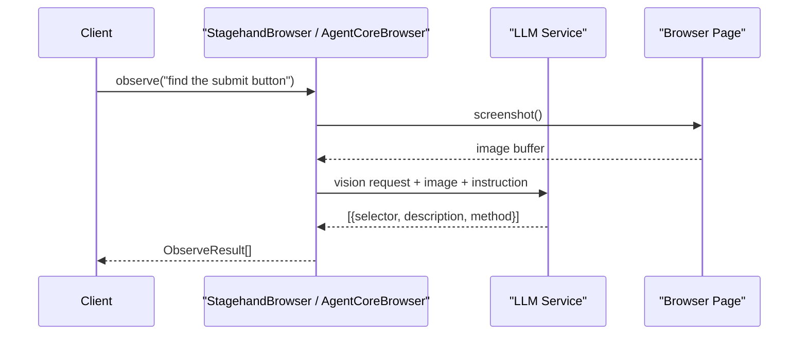
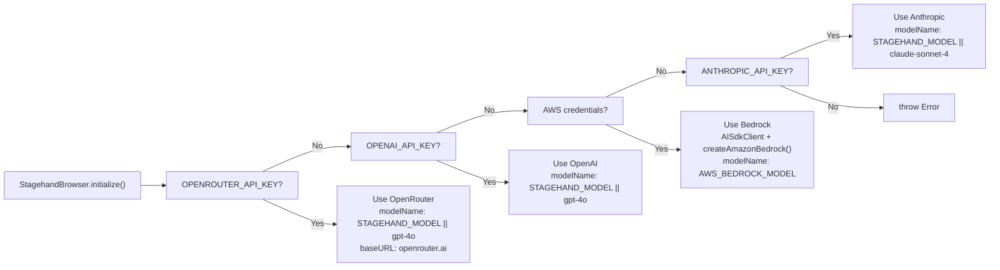
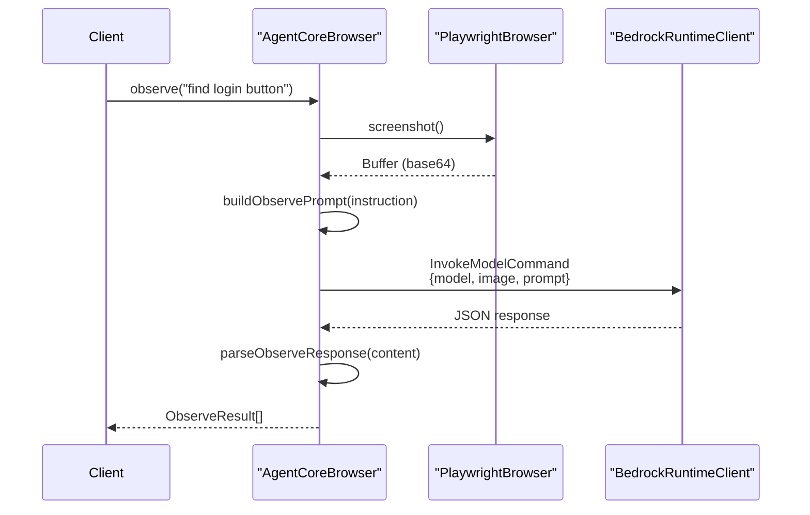
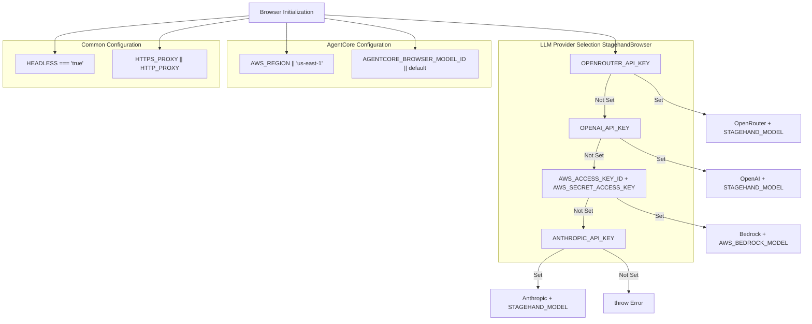

<!-- source: DeepWiki mcp.deepwiki.com · repo actionbook/actionbook · page 4 Browser Automation Layer · fetched 2026-10-26 -->

# Browser Automation Layer

<details>
<summary>Relevant source files</summary>

The following files were used as context for generating this wiki page:

- [.prettierignore](.prettierignore)
- [.prettierrc.json](.prettierrc.json)
- [CLAUDE.md](CLAUDE.md)
- [services/action-builder/scripts/login.ts](services/action-builder/scripts/login.ts)
- [services/action-builder/src/index.ts](services/action-builder/src/index.ts)
- [services/action-builder/src/optimizer/SelectorOptimizer.ts](services/action-builder/src/optimizer/SelectorOptimizer.ts)
- [services/common/browser-profile/package.json](services/common/browser-profile/package.json)
- [services/common/browser-profile/src/BrowserProfileManager.ts](services/common/browser-profile/src/BrowserProfileManager.ts)
- [services/common/browser/package.json](services/common/browser/package.json)
- [services/common/browser/src/adapters/browser-adapter.ts](services/common/browser/src/adapters/browser-adapter.ts)
- [services/common/browser/src/adapters/index.ts](services/common/browser/src/adapters/index.ts)
- [services/common/browser/src/implementations/agent-core-browser.ts](services/common/browser/src/implementations/agent-core-browser.ts)
- [services/common/browser/src/implementations/stagehand-browser.ts](services/common/browser/src/implementations/stagehand-browser.ts)
- [services/common/browser/src/types/browser.ts](services/common/browser/src/types/browser.ts)
- [services/common/browser/test/e2e/stagehand-browser.e2e.test.ts](services/common/browser/test/e2e/stagehand-browser.e2e.test.ts)
- [services/common/browser/test/unit/agent-core-browser.ut.test.ts](services/common/browser/test/unit/agent-core-browser.ut.test.ts)

</details>


## Purpose and Scope

The Browser Automation Layer provides a unified interface for browser automation across multiple backend implementations. This layer abstracts the differences between local Playwright-based automation (via Stagehand) and cloud-based AWS AgentCore automation, allowing services like Action Builder and Playbook Builder to interact with browsers through a consistent API regardless of the underlying implementation.

For information about how the browser layer integrates with recording workflows, see [Action Recording](#3.2.2). For details on the tools that use this layer, see [Recording Tools Reference](#3.2.3).

**Sources:** [services/common/browser/package.json:1-74](), [services/common/browser/src/adapters/browser-adapter.ts:1-24]()

---

## Architecture Overview

The browser automation layer uses a strategy pattern with `BrowserAdapter` as the interface. Two implementations provide different execution environments: `StagehandBrowser` for local development and `AgentCoreBrowser` for cloud deployment.

```mermaid
graph TB
    subgraph "Interface Layer"
        BrowserAdapter["«interface» BrowserAdapter<br/>initialize()<br/>navigate()<br/>observe()<br/>act()<br/>close()"]
    end
    
    subgraph "Local Implementation"
        StagehandBrowser["StagehandBrowser"]
        Stagehand["@browserbasehq/stagehand<br/>Stagehand class"]
        Playwright["playwright<br/>Local Chromium"]
        AISdkClient["AISdkClient<br/>Multi-provider LLM"]
        ProfileMgr["BrowserProfileManager<br/>userDataDir persistence"]
        
        StagehandBrowser --> Stagehand
        StagehandBrowser --> ProfileMgr
        Stagehand --> Playwright
        Stagehand --> AISdkClient
    end
    
    subgraph "Cloud Implementation"
        AgentCoreBrowser["AgentCoreBrowser"]
        PlaywrightBrowser["bedrock-agentcore<br/>PlaywrightBrowser"]
        BedrockClient["@aws-sdk/client-bedrock-runtime<br/>BedrockRuntimeClient"]
        
        AgentCoreBrowser --> PlaywrightBrowser
        AgentCoreBrowser --> BedrockClient
    end
    
    subgraph "LLM Provider Support"
        OpenRouter["OpenRouter API"]
        OpenAI["OpenAI API"]
        Anthropic["Anthropic API"]
        Bedrock["AWS Bedrock"]
    end
    
    BrowserAdapter <|.. StagehandBrowser
    BrowserAdapter <|.. AgentCoreBrowser
    
    AISdkClient -.-> OpenRouter
    AISdkClient -.-> OpenAI
    AISdkClient -.-> Anthropic
    AISdkClient -.-> Bedrock
    BedrockClient -.-> Bedrock
```

**Implementation Selection**

| Implementation | Use Case | Environment | LLM Provider |
|---------------|----------|-------------|--------------|
| `StagehandBrowser` | Local development, testing | Developer machine | OpenRouter, OpenAI, Anthropic, Bedrock |
| `AgentCoreBrowser` | Cloud deployment, scalability | AWS Lambda/ECS | AWS Bedrock (Claude) |

**Sources:** [services/common/browser/src/adapters/browser-adapter.ts:1-254](), [services/common/browser/src/implementations/stagehand-browser.ts:1-112](), [services/common/browser/src/implementations/agent-core-browser.ts:1-69]()

---

## BrowserAdapter Interface

The `BrowserAdapter` interface defines the unified API for all browser automation operations. It combines lifecycle management, navigation, AI-powered element discovery, and direct automation methods.

### Lifecycle Methods

```typescript
interface BrowserAdapter {
  initialize(): Promise<void>;
  close(): Promise<void>;
}
```

**`initialize()`** must be called before any other operations. For `StagehandBrowser`, this creates a Stagehand instance and configures the LLM client. For `AgentCoreBrowser`, this creates the AWS AgentCore client and Bedrock client.

**`close()`** releases browser resources. For `StagehandBrowser`, this closes the Playwright browser. For `AgentCoreBrowser`, this calls `stopSession()` on the AgentCore client.

**Sources:** [services/common/browser/src/adapters/browser-adapter.ts:39-52](), [services/common/browser/src/implementations/stagehand-browser.ts:133-174](), [services/common/browser/src/implementations/agent-core-browser.ts:93-140]()

### Navigation and Page Information

```typescript
interface BrowserAdapter {
  navigate(url: string, options?: NavigateOptions): Promise<void>;
  goBack(): Promise<void>;
  getUrl(): string;
  getTitle(): Promise<string>;
  getContent(): Promise<string>;
}
```

| Method | Description | Implementation Notes |
|--------|-------------|----------------------|
| `navigate()` | Navigate to URL with timeout and waitUntil options | StagehandBrowser: [stagehand-browser.ts:180-197](). AgentCoreBrowser: [agent-core-browser.ts:146-163]() |
| `goBack()` | Navigate back in browser history | StagehandBrowser uses `page.goBack()`. AgentCoreBrowser uses `client.back()` |
| `getUrl()` | Get current page URL (synchronous) | StagehandBrowser: `page.url()`. AgentCoreBrowser: tracks `currentUrl` state |
| `getTitle()` | Get page title | Both use `page.title()` or `evaluate('document.title')` |
| `getContent()` | Get full page HTML | Both use `page.evaluate(() => document.documentElement.outerHTML)` |

**Sources:** [services/common/browser/src/adapters/browser-adapter.ts:54-88](), [services/common/browser/src/implementations/stagehand-browser.ts:180-220](), [services/common/browser/src/implementations/agent-core-browser.ts:146-199]()

### AI Capabilities

The AI capabilities are the core differentiator of this layer. Both implementations provide `observe()` and `act()` methods, but with different underlying mechanisms.

#### observe(instruction: string, timeoutMs?: number): Promise<ObserveResult[]>

Analyzes the page using AI vision to find elements matching the natural language instruction.

**StagehandBrowser Flow:**
1. Calls `stagehand.observe(instruction)` which uses the configured LLM provider
2. Stagehand captures a screenshot and sends it to the LLM with element markers
3. Returns array of `ObserveResult` with XPath selectors
4. Includes retry logic for rate limit errors (3 retries with exponential backoff)

**AgentCoreBrowser Flow:**
1. Takes screenshot using `client.screenshot()`
2. Builds a custom prompt for Bedrock Claude with vision capabilities
3. Sends screenshot + instruction to Bedrock using `InvokeModelCommand`
4. Parses JSON response containing selector, description, method



**Sources:** [services/common/browser/src/adapters/browser-adapter.ts:146-161](), [services/common/browser/src/implementations/stagehand-browser.ts:334-396](), [services/common/browser/src/implementations/agent-core-browser.ts:396-475]()

#### act(instructionOrAction: string | ActionObject): Promise<unknown>

Executes an action using AI inference or direct selector.

**Natural Language Mode (string instruction):**
```typescript
await browser.act('click the submit button');
```
- Calls `observe()` to find the element
- Executes the suggested action

**Selector Mode (ActionObject):**
```typescript
await browser.act({
  selector: '#submit-btn',
  method: 'click',
  description: 'Submit button'
});
```
- Directly executes the action without AI inference
- Faster and more reliable when selector is known

**Supported Methods:** `click`, `type`, `fill`, `select`, `hover`, `press`, `scroll`, `wait`

**Sources:** [services/common/browser/src/adapters/browser-adapter.ts:163-195](), [services/common/browser/src/implementations/stagehand-browser.ts:407-502](), [services/common/browser/src/implementations/agent-core-browser.ts:482-584]()

### Element Inspection

#### getElementAttributesFromXPath(xpath: string): Promise<ElementAttributes | null>

Extracts comprehensive element metadata from an XPath selector for selector generation and validation.

**Extracted Attributes:**
- `tagName`: HTML tag name (lowercase)
- `id`, `className`: Standard attributes
- `dataTestId`: data-testid attribute
- `ariaLabel`: aria-label attribute
- `placeholder`, `name`: Form element attributes
- `textContent`: Truncated text content
- `dataAttributes`: All data-* attributes (filtered for state)
- `cssSelector`: Generated CSS selector (preferred over XPath)
- `optimizedXPath`: Simplified XPath without positional predicates

**Implementation Details:**

StagehandBrowser uses `page.evaluate()` to run JavaScript in the browser context. It handles iframe elements by detecting `iframe` in the XPath and iterating through `page.frames()`.

AgentCoreBrowser uses `client.evaluate()` to run a script that finds the element via `document.evaluate()`.

**Sources:** [services/common/browser/src/adapters/browser-adapter.ts:200-210](), [services/common/browser/src/implementations/stagehand-browser.ts:508-580](), [services/common/browser/src/implementations/agent-core-browser.ts:589-630]()

### Automation Helpers

```typescript
interface BrowserAdapter {
  wait(ms: number): Promise<void>;
  waitForSelector(selector: string, options?: WaitForSelectorOptions): Promise<void>;
  waitForText(text: string, timeout?: number): Promise<void>;
  scroll(direction: ScrollDirection, amount?: number): Promise<void>;
  scrollToBottom(waitAfterMs?: number): Promise<void>;
  screenshot(options?: ScreenshotOptions): Promise<Buffer>;
  autoClosePopups(): Promise<number>;
  getTokenStats?(): TokenStats | undefined;
}
```

**autoClosePopups()** attempts to detect and close common popup patterns (cookie banners, modals, overlays) using AI observation. Returns the number of popups closed.

**getTokenStats()** returns accumulated token usage for AI operations. Only implemented in `StagehandBrowser` (AgentCoreBrowser returns `undefined` since Bedrock billing is separate).

**Sources:** [services/common/browser/src/adapters/browser-adapter.ts:100-254](), [services/common/browser/src/implementations/stagehand-browser.ts:270-706](), [services/common/browser/src/implementations/agent-core-browser.ts:253-718]()

---

## StagehandBrowser Implementation

`StagehandBrowser` provides local Playwright-based automation with multi-provider LLM support via the Stagehand SDK. It's the primary implementation for development and testing.

### Class Structure

```typescript
export class StagehandBrowser implements BrowserAdapter {
  private stagehand: StagehandInstance | null = null;
  private page: Page | null = null;
  private config: BrowserConfig;
  private lastMetrics: StagehandMetricsSnapshot | null = null;
  private accumulatedInputTokens: number = 0;
  private accumulatedOutputTokens: number = 0;
}
```

**Sources:** [services/common/browser/src/implementations/stagehand-browser.ts:110-127]()

### LLM Provider Configuration

StagehandBrowser supports four LLM providers with automatic resolution based on environment variables:



**Environment Variables:**

| Variable | Purpose | Default |
|----------|---------|---------|
| `OPENROUTER_API_KEY` | OpenRouter API key (highest priority) | - |
| `OPENAI_API_KEY` | OpenAI API key | - |
| `AWS_ACCESS_KEY_ID`, `AWS_SECRET_ACCESS_KEY` | AWS Bedrock credentials | - |
| `ANTHROPIC_API_KEY` | Anthropic API key | - |
| `STAGEHAND_MODEL` | Override default model name | Provider-specific default |
| `AWS_REGION` | AWS region for Bedrock | `us-east-1` |
| `AWS_BEDROCK_MODEL` | Bedrock model ID | `anthropic.claude-3-5-sonnet-20241022-v2:0` |

**Proxy Support:** If `HTTPS_PROXY` or `HTTP_PROXY` is set, StagehandBrowser creates a proxy-enabled fetch function using `undici.ProxyAgent` for all HTTP requests (OpenAI, OpenRouter, Bedrock).

**Sources:** [services/common/browser/src/implementations/stagehand-browser.ts:743-822](), [services/common/browser/src/implementations/stagehand-browser.ts:877-894]()

### Browser Launch Options

```typescript
private buildBrowserLaunchOptions(): LocalBrowserLaunchOptions {
  const options: LocalBrowserLaunchOptions = {
    headless: this.config.headless,
  };

  if (this.config.proxy) {
    options.proxy = { server: this.config.proxy };
  }

  if (this.config.profile?.enabled) {
    const profileManager = new BrowserProfileManager({ baseDir: profileDir });
    options.userDataDir = profileManager.getProfilePath();
    options.preserveUserDataDir = true;
    options.args = ['--disable-blink-features=AutomationControlled', '--no-first-run'];
    options.ignoreDefaultArgs = ['--enable-automation'];
  }

  return options;
}
```

**Anti-Detection:** When profile is enabled, StagehandBrowser applies anti-detection arguments to make the browser appear less like an automated instance. This is important for sites that block automation.

**Sources:** [services/common/browser/src/implementations/stagehand-browser.ts:824-854]()

### Token Metrics Tracking

StagehandBrowser tracks token usage for AI operations by maintaining a snapshot of Stagehand's metrics before and after each `observe()` or `act()` call.

**Metrics Captured:**
- `observePromptTokens`, `observeCompletionTokens`: Input/output tokens for observe operations
- `actPromptTokens`, `actCompletionTokens`: Input/output tokens for act operations
- `observeReasoningTokens`, `actReasoningTokens`: Reasoning tokens (for models like o1)
- `observeCachedInputTokens`, `actCachedInputTokens`: Prompt caching hits
- `observeInferenceTimeMs`, `actInferenceTimeMs`: LLM inference latency

**Log Format:**
```
[LLM] ✓ | stagehand/observe | tokens: in=1234, out=56, cache_read=890, total=2180 | perf: latency=1234ms, inference=890ms, tps=45.2
```

**Sources:** [services/common/browser/src/implementations/stagehand-browser.ts:939-1052](), [services/common/browser/src/implementations/stagehand-browser.ts:710-718]()

### Error Handling and Retry Logic

StagehandBrowser implements automatic retry for rate limit errors in both `observe()` and `act()` methods:

1. Max 3 retries (4 total attempts)
2. Exponential backoff: 1s, 2s, 4s (capped at 30s)
3. Detection via error message: "too many tokens", "rate limit", "429"
4. Other errors (element not found, timeout) throw immediately without retry

**Custom Error Types:**

```typescript
export class ElementNotFoundError extends Error {
  constructor(message: string, public readonly selector?: string) { }
}

export class ActionExecutionError extends Error {
  constructor(message: string, public readonly action?: string, 
              public readonly originalError?: Error) { }
}
```

**Sources:** [services/common/browser/src/implementations/stagehand-browser.ts:69-91](), [services/common/browser/src/implementations/stagehand-browser.ts:334-396](), [services/common/browser/src/implementations/stagehand-browser.ts:407-494]()

---

## AgentCoreBrowser Implementation

`AgentCoreBrowser` provides cloud-based browser automation using AWS AgentCore Browser Tool and Bedrock Claude for AI capabilities. It's designed for serverless and containerized deployments.

### Class Structure

```typescript
export class AgentCoreBrowser implements BrowserAdapter {
  private client: AgentCoreBrowserClient | null = null;
  private bedrockClient: BedrockRuntimeClient | null = null;
  private initialized: boolean = false;
  private config: AgentCoreBrowserConfig;
  private currentUrl: string = 'about:blank';
}
```

**Configuration Options:**

```typescript
export interface AgentCoreBrowserConfig extends BrowserConfig {
  sessionTimeoutMinutes?: number;  // Default: 15, max: 480 (8 hours)
  region?: string;                 // Default: us-east-1
  bedrockModelId?: string;         // Default: us.anthropic.claude-3-5-sonnet-20241022-v2:0
}
```

**Sources:** [services/common/browser/src/implementations/agent-core-browser.ts:56-87]()

### Initialization

```typescript
async initialize(): Promise<void> {
  this.client = new PlaywrightBrowser({
    region: this.config.region,
  });

  this.bedrockClient = new BedrockRuntimeClient({
    region: this.config.region,
  });

  this.initialized = true;
}
```

AgentCore sessions are created lazily on first navigation, not during initialization. The session timeout is configured when calling navigation methods.

**Sources:** [services/common/browser/src/implementations/agent-core-browser.ts:93-124]()

### Bedrock Vision Integration

AgentCoreBrowser implements `observe()` using Bedrock Claude's vision capabilities rather than delegating to a higher-level SDK:



**Prompt Template Highlights:**

```
You are helping the user automate the browser by finding elements...

CRITICAL RULES:
- ONLY return elements that actually exist and match the instruction
- If no matching elements exist (e.g., no popup, no cookie banner, no modal), return []
- Do NOT invent or guess elements that are not clearly visible

Response format (if elements found):
[{"selector": "xpath=//button[@id='close']", "description": "Close button", "method": "click"}]

Response format (if NO elements found):
[]
```

This prompt design is critical for preventing false positives, particularly for `autoClosePopups()` which should return `[]` when no popups exist rather than inventing non-existent elements.

**Sources:** [services/common/browser/src/implementations/agent-core-browser.ts:396-475](), [services/common/browser/src/implementations/agent-core-browser.ts:773-795]()

### Response Parsing

AgentCoreBrowser handles Claude's potentially markdown-wrapped responses:

```typescript
private parseObserveResponse(content: string): ObserveResult[] {
  let jsonStr = content.trim();
  
  // Remove markdown code blocks if present
  const jsonMatch = jsonStr.match(/```(?:json)?\s*([\s\S]*?)```);
  if (jsonMatch) {
    jsonStr = jsonMatch[1].trim();
  }
  
  // Find JSON array
  const arrayMatch = jsonStr.match(/\[[\s\S]*\]);
  if (!arrayMatch) {
    return [];
  }
  
  const parsed = JSON.parse(arrayMatch[0]);
  
  // Filter out invalid items
  return parsed
    .filter(item => !!item.selector && !!item.description)
    .map(item => ({
      selector: item.selector,
      description: item.description,
      method: item.method || 'click',
      arguments: item.arguments,
    }));
}
```

**Sources:** [services/common/browser/src/implementations/agent-core-browser.ts:800-847]()

### SDK Method Signatures

AWS AgentCore's `PlaywrightBrowser` uses object parameters for all methods rather than positional arguments:

| Playwright API | AgentCore API |
|---------------|---------------|
| `page.goto(url, {waitUntil, timeout})` | `client.navigate({url, waitUntil, timeout})` |
| `page.click(selector)` | `client.click({selector})` |
| `page.fill(selector, value)` | `client.fill({selector, value})` |
| `page.waitForSelector(selector, {timeout, state})` | `client.waitForSelector({selector, timeout, state})` |
| `page.evaluate(script)` | `client.evaluate({script})` |

This affects all method implementations in AgentCoreBrowser.

**Sources:** [services/common/browser/src/implementations/agent-core-browser.ts:146-370]()

### XPath Normalization and Escaping

Both implementations normalize XPath selectors by removing the `xpath=` prefix. AgentCoreBrowser uses `JSON.stringify()` to safely escape strings for JavaScript interpolation:

```typescript
private escapeForJs(str: string): string {
  return JSON.stringify(str);  // Properly escapes quotes, backslashes, special chars
}

private buildElementScript(selector: string, action: string): string {
  const cleanSelector = selector.replace(/^xpath=/, '');
  if (this.isXPathSelector(selector)) {
    return `(() => { 
      const el = document.evaluate(${this.escapeForJs(cleanSelector)}, 
        document, null, XPathResult.FIRST_ORDERED_NODE_TYPE, null).singleNodeValue; 
      ${action} 
    })()`;
  }
  return `(() => { 
    const el = document.querySelector(${this.escapeForJs(cleanSelector)}); 
    ${action} 
  })()`;
}
```

**Sources:** [services/common/browser/src/implementations/agent-core-browser.ts:744-766](), [services/common/browser/test/unit/agent-core-browser.ut.test.ts:479-517]()

---

## Browser Profile Management

`BrowserProfileManager` provides persistent browser profile storage for maintaining login state across sessions. This enables "login once, reuse many times" workflows.

### Purpose and Benefits

Browser profiles store:
- Cookies (authentication tokens, session data)
- localStorage and sessionStorage
- IndexedDB data
- Browser history and cache

Without profiles, each browser session starts fresh and requires re-authentication. With profiles enabled, users can log in once using `pnpm login` and reuse the authenticated state in all subsequent runs.

**Sources:** [services/common/browser-profile/src/BrowserProfileManager.ts:74-99]()

### Class API

```typescript
export class BrowserProfileManager {
  constructor(config?: ProfileConfig);
  
  getProfilePath(): string;
  exists(): boolean;
  ensureDir(): void;
  clear(): void;
  cleanupStaleLocks(): void;
  getInfo(): ProfileInfo;
  getLaunchOptions(options?: {headless?: boolean; proxy?: {server: string}}): Record<string, unknown>;
}
```

**Default Profile Directory:** `.browser-profile` (relative to process.cwd())

**Anti-Detection Constants:**
```typescript
export const ANTI_DETECTION_ARGS = [
  '--disable-blink-features=AutomationControlled',
  '--no-first-run',
];

export const IGNORE_DEFAULT_ARGS = ['--enable-automation'];
```

**Sources:** [services/common/browser-profile/src/BrowserProfileManager.ts:100-238]()

### Lock File Cleanup

Chrome creates lock files (`SingletonLock`, `SingletonSocket`, `SingletonCookie`) to prevent multiple instances from using the same profile. If Chrome crashes, these files may remain and prevent subsequent launches. `cleanupStaleLocks()` removes these files before each launch.

**Sources:** [services/common/browser-profile/src/BrowserProfileManager.ts:151-166]()

### Usage with StagehandBrowser

```typescript
const profileManager = new BrowserProfileManager({ baseDir: '.browser-profile' });

const browser = new StagehandBrowser({
  profile: {
    enabled: true,
    profileDir: '.browser-profile',
  },
});
```

Internally, StagehandBrowser uses the profile manager to configure launch options:

```typescript
if (this.config.profile?.enabled) {
  const profileManager = new BrowserProfileManager({ baseDir: profileDir });
  const profilePath = profileManager.getProfilePath();
  
  profileManager.ensureDir();
  profileManager.cleanupStaleLocks();
  
  options.userDataDir = profilePath;
  options.preserveUserDataDir = true;
  options.args = ANTI_DETECTION_ARGS;
  options.ignoreDefaultArgs = IGNORE_DEFAULT_ARGS;
}
```

**Sources:** [services/common/browser/src/implementations/stagehand-browser.ts:834-851]()

### Login Script

The `login.ts` script provides an interactive CLI for manual login:

```bash
pnpm login                           # Open browser for manual login
pnpm login --url https://airbnb.com  # Open specific URL
pnpm login --clear                   # Clear existing profile and re-login
```

**Workflow:**
1. Creates/clears profile directory
2. Launches browser with profile enabled (headless=false)
3. User manually logs into websites
4. User presses Enter when finished
5. Profile is automatically saved on browser close

**Sources:** [services/action-builder/scripts/login.ts:1-149]()

---

## Configuration and Initialization

### Configuration Objects

```typescript
// Base browser config (used by both implementations)
export interface BrowserConfig {
  headless?: boolean;              // Default: process.env.HEADLESS === 'true'
  proxy?: string;                  // Default: process.env.HTTPS_PROXY || process.env.HTTP_PROXY
  profileDir?: string;             // Default: undefined (no profile)
  timeout?: number;                // Default: 60000
  storageStatePath?: string;       // Default: undefined
  profile?: {
    enabled: boolean;
    profileDir?: string;
  };
}

// AgentCore-specific config
export interface AgentCoreBrowserConfig extends BrowserConfig {
  sessionTimeoutMinutes?: number;  // Default: 15
  region?: string;                 // Default: us-east-1
  bedrockModelId?: string;         // Default: us.anthropic.claude-3-5-sonnet-20241022-v2:0
}
```

**Sources:** [services/common/browser/src/types/browser.ts:9-28](), [services/common/browser/src/implementations/agent-core-browser.ts:56-64]()

### Initialization Patterns

**StagehandBrowser:**

```typescript
const browser = new StagehandBrowser({
  headless: true,
  proxy: 'http://proxy:8080',
  profile: { enabled: true, profileDir: '.browser-profile' },
});

await browser.initialize();  // Creates Stagehand, resolves LLM config
await browser.navigate('https://example.com');
// ... use browser
await browser.close();
```

**AgentCoreBrowser:**

```typescript
const browser = new AgentCoreBrowser({
  region: 'us-west-2',
  sessionTimeoutMinutes: 30,
  bedrockModelId: 'us.anthropic.claude-3-5-sonnet-20241022-v2:0',
});

await browser.initialize();  // Creates clients, but session starts on first navigate
await browser.navigate('https://example.com');
// ... use browser
await browser.close();  // Calls stopSession()
```

**Sources:** [services/common/browser/src/implementations/stagehand-browser.ts:120-174](), [services/common/browser/src/implementations/agent-core-browser.ts:76-140]()

### Environment Variable Precedence



**Sources:** [services/common/browser/src/implementations/stagehand-browser.ts:743-822](), [services/common/browser/src/implementations/agent-core-browser.ts:76-87]()

---

## Common Patterns and Usage

### Basic Navigation and Observation

```typescript
const browser = new StagehandBrowser({ headless: true });
await browser.initialize();

// Navigate
await browser.navigate('https://example.com');

// AI-powered observation
const elements = await browser.observe('find all navigation links');
console.log(elements[0].selector);  // "xpath=//nav//a[1]"

// Extract attributes
const attrs = await browser.getElementAttributesFromXPath(elements[0].selector);
console.log(attrs?.cssSelector);  // "nav a.nav-link"

await browser.close();
```

**Sources:** [services/common/browser/test/e2e/stagehand-browser.e2e.test.ts:63-91](), [services/common/browser/test/e2e/stagehand-browser.e2e.test.ts:179-193]()

### Direct Action Execution

```typescript
// Method 1: Natural language (uses AI)
await browser.act('click the submit button');

// Method 2: Direct selector (faster, no AI inference)
await browser.act({
  selector: '#submit-btn',
  method: 'click',
  description: 'Submit button',
});

// Method 3: Form filling
await browser.act({
  selector: 'input[name="email"]',
  method: 'fill',
  description: 'Email input',
  arguments: ['user@example.com'],
});
```

**Sources:** [services/common/browser/test/e2e/stagehand-browser.e2e.test.ts:295-318](), [services/common/browser/test/unit/agent-core-browser.ut.test.ts:347-411]()

### Error Handling

```typescript
import { ElementNotFoundError, ActionExecutionError } from '@actionbookdev/browser';

try {
  await browser.act('click the non-existent button');
} catch (error) {
  if (error instanceof ElementNotFoundError) {
    console.log(`Element not found: ${error.selector}`);
  } else if (error instanceof ActionExecutionError) {
    console.log(`Action failed: ${error.action}`, error.originalError);
  }
}
```

**Sources:** [services/common/browser/src/implementations/stagehand-browser.ts:69-91]()

### Token Usage Tracking

```typescript
// Only available in StagehandBrowser
const stats = browser.getTokenStats();
if (stats) {
  console.log(`Input tokens: ${stats.input}`);
  console.log(`Output tokens: ${stats.output}`);
  console.log(`Total tokens: ${stats.total}`);
}

// AgentCoreBrowser returns undefined (Bedrock billing is separate)
```

**Sources:** [services/common/browser/src/implementations/stagehand-browser.ts:710-718](), [services/common/browser/src/implementations/agent-core-browser.ts:716-718]()

### Popup Handling

```typescript
// Attempt to close common popups (cookie banners, modals, etc.)
const closedCount = await browser.autoClosePopups();
console.log(`Closed ${closedCount} popups`);

// Returns 0 if no popups found (not an error)
```

The `autoClosePopups()` method uses the same instructions for both implementations:
- "click the close button on any popup or modal"
- "click accept or dismiss on cookie consent banner"
- "click close on any overlay dialog"

**Sources:** [services/common/browser/src/implementations/stagehand-browser.ts:675-706](), [services/common/browser/src/implementations/agent-core-browser.ts:675-710]()

### Implementation Comparison Table

| Feature | StagehandBrowser | AgentCoreBrowser |
|---------|------------------|------------------|
| **Execution** | Local Playwright | AWS AgentCore cloud service |
| **LLM Provider** | OpenRouter, OpenAI, Anthropic, Bedrock | AWS Bedrock only |
| **Profile Support** | Yes (via BrowserProfileManager) | No (sessions are ephemeral) |
| **Token Tracking** | Yes (detailed metrics) | No (Bedrock billing separate) |
| **Proxy Support** | Yes (all providers) | No (cloud-managed) |
| **Rate Limit Retry** | Yes (3 retries, exponential backoff) | No (manual handling required) |
| **Session Timeout** | Indefinite (local) | 15-480 minutes (configurable) |
| **Page Access** | `Page` (Stagehand V3 API) | `Page` (full Playwright API, internal) |
| **Model Selection** | Any supported model | Claude variants only |

**Sources:** [services/common/browser/src/implementations/stagehand-browser.ts:1-1117](), [services/common/browser/src/implementations/agent-core-browser.ts:1-849]()

---

## Testing Strategy

The browser layer includes both unit tests and E2E tests:

### Unit Tests

Focus on internal logic, parameter validation, and response parsing without requiring real browser/LLM:
- Configuration resolution
- Screenshot format conversion
- waitForSelector state mapping
- Scroll direction calculation
- XPath normalization
- Response parsing (parseObserveResponse)
- Error handling

**Sources:** [services/common/browser/test/unit/agent-core-browser.ut.test.ts:1-727]()

### E2E Tests

Test against real browsers and LLM services:
- Browser lifecycle (initialize, close)
- Navigation and page information
- Screenshot capture
- Element inspection
- AI operations (observe, act) - requires LLM credentials
- Popup handling

**Test Conditions:**
- Skip AgentCore tests if `BROWSER_TYPE !== 'agentcore'`
- Skip AI tests if no LLM credentials present
- Use `example.com` as test target (simple, stable)

**Sources:** [services/common/browser/test/e2e/stagehand-browser.e2e.test.ts:1-402]()

---

