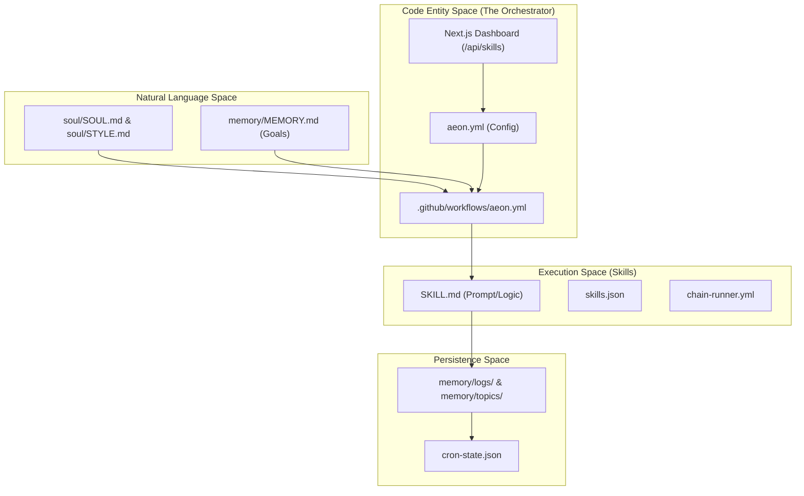
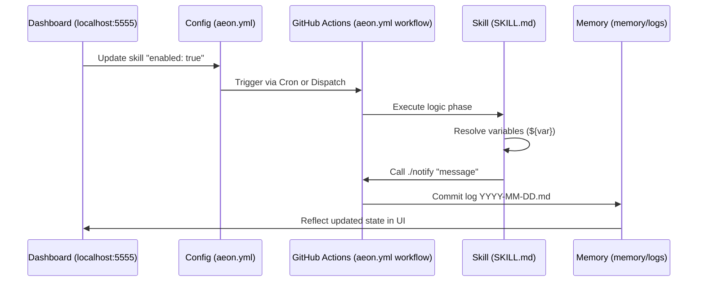

<!-- source: DeepWiki mcp.deepwiki.com · repo aaronjmars/aeon · page 1 Overview · fetched 2026-10-26 -->

# Overview

Relevant source files

The following files were used as context for generating this wiki page:

- [.github/workflows/chain-runner.yml](.github/workflows/chain-runner.yml)
- [.outputs/.gitkeep](.outputs/.gitkeep)
- [CLAUDE.md](CLAUDE.md)
- [README.md](README.md)
- [SHOWCASE.md](SHOWCASE.md)
- [aeon.yml](aeon.yml)
- [assets/architecture.jpg](assets/architecture.jpg)
- [assets/autonomy.jpg](assets/autonomy.jpg)
- [assets/stack.jpg](assets/stack.jpg)
- [skills/contributor-reward/SKILL.md](skills/contributor-reward/SKILL.md)

AEON is a zero-infrastructure, autonomous agent framework designed to run unattended on GitHub Actions. Unlike interactive agents that require constant approval loops, AEON is built for recurring tasks—deep research, market monitoring, PR reviews, and security scans—where the agent operates independently, scores its own output quality, and self-heals when skills fail [README.md:15-43]().

The system utilizes a modular "Skills" architecture, a flat-file memory database, and a local Next.js dashboard for configuration and management [README.md:53-67]().

### System Architecture & Logic Flow

AEON bridges the gap between high-level user intent and automated execution by mapping a desired "Soul" (personality and goals) to a fleet of modular code entities called Skills.

**The AEON Stack**

**Sources:** [README.md:70-85](), [CLAUDE.md:1-40](), [aeon.yml:1-7]().

---

### Key Components

#### 1. Skills System
AEON features over 90 specialized skills categorized into Research, Dev, Crypto, Social, and Meta-Agent functions [README.md:74-81](). Each skill is defined in a `SKILL.md` file containing its logic and prompts [skills/contributor-reward/SKILL.md:1-6]().
*   **Discovery:** Skills are tracked in `skills.json` [README.md:83]().
*   **Chaining:** Skills can be linked together where downstream steps consume the output of upstream steps via `.outputs/` [CLAUDE.md:53-73]().
*   **For details, see [Skills System](#3)**.

#### 2. Execution Engine
The engine is powered by GitHub Actions, primarily through `.github/workflows/aeon.yml`. It handles:
*   **Scheduling:** Uses cron expressions defined in `aeon.yml` [aeon.yml:9-11]().
*   **Sandbox Management:** Uses "Prefetch" and "Post-process" patterns to bypass GitHub Actions sandbox limitations for authenticated APIs [CLAUDE.md:91-102]().
*   **For details, see [Execution Engine & Orchestration](#2)**.

#### 3. Memory & State
AEON maintains state without a traditional database, using a version-controlled `memory/` directory.
*   **`MEMORY.md`**: High-level index of current goals and interests [CLAUDE.md:27-28]().
*   **`topics/`**: Detailed persistent notes [CLAUDE.md:28]().
*   **`logs/`**: Daily append-only activity records [CLAUDE.md:29]().
*   **For details, see [Memory & State Management](#5)**.

---

### Data & Execution Mapping

This diagram illustrates how a user-facing skill configuration in the Dashboard or `aeon.yml` translates into a running process in GitHub Actions and persists data back to the repository.

**Execution Mapping: Config to Action**

**Sources:** [README.md:53-67](), [CLAUDE.md:20-37](), [aeon.yml:1-10]().

---

### Major Subsystems

| Subsystem | Primary Files | Role |
| :--- | :--- | :--- |
| **Orchestration** | `aeon.yml`, `.github/workflows/` | Schedules and triggers skill execution. |
| **Self-Healing** | `heartbeat`, `skill-repair` | Monitors `cron-state.json` and patches failing code. |
| **Interface** | `dashboard/`, `mcp-server/` | Local management UI and Model Context Protocol server. |
| **Identity** | `soul/`, `CLAUDE.md` | Defines the agent's voice, style, and global rules. |
| **Notification** | `./notify`, `scripts/postprocess-notify.sh` | Fans out messages to Telegram, Discord, and Slack. |

**Sources:** [README.md:32-41](), [CLAUDE.md:5-19](), [CLAUDE.md:78-90](), [SHOWCASE.md:40-52]().

---

### Next Steps
*   **[Getting Started & Onboarding](#1.1)**: Learn how to fork the repo and set up your first instance.
*   **[Core Concepts & Terminology](#1.2)**: Understand the specific vocabulary used in the AEON ecosystem.

---

