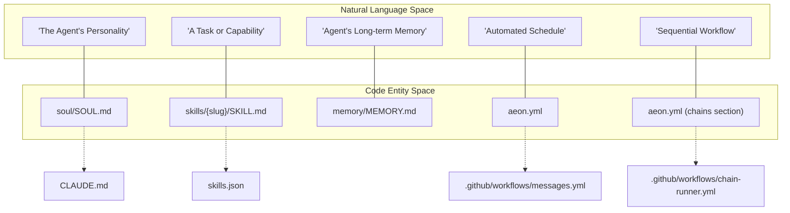
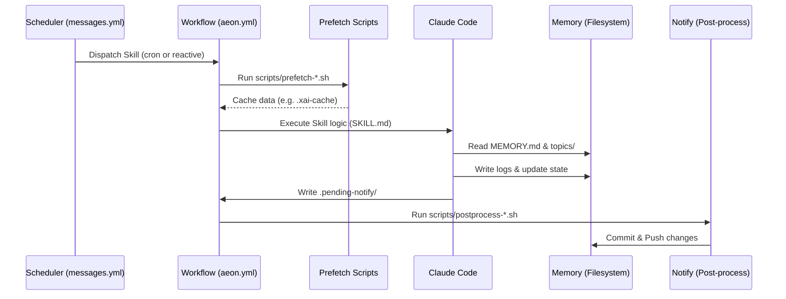

<!-- source: DeepWiki mcp.deepwiki.com · repo aaronjmars/aeon · page 1.2 Core Concepts & Terminology · fetched 2026-10-26 -->

# Core Concepts & Terminology

Relevant source files

The following files were used as context for generating this wiki page:

- [.github/workflows/aeon.yml](.github/workflows/aeon.yml)
- [.github/workflows/chain-runner.yml](.github/workflows/chain-runner.yml)
- [.github/workflows/messages.yml](.github/workflows/messages.yml)
- [.outputs/.gitkeep](.outputs/.gitkeep)
- [CLAUDE.md](CLAUDE.md)
- [README.md](README.md)
- [aeon.yml](aeon.yml)
- [export-skill](export-skill)
- [skills.json](skills.json)
- [skills/contributor-reward/SKILL.md](skills/contributor-reward/SKILL.md)
- [skills/distribute-tokens/SKILL.md](skills/distribute-tokens/SKILL.md)
- [skills/skill-analytics/SKILL.md](skills/skill-analytics/SKILL.md)
- [skills/star-milestone/SKILL.md](skills/star-milestone/SKILL.md)

This page defines the foundational vocabulary and structural architecture of the AEON framework. AEON is an autonomous agent system designed to run unattended, self-heal, and persist state across ephemeral execution environments.

## System Architecture Overview

AEON operates as a "zero-infrastructure" agent by leveraging GitHub Actions as its compute engine and the repository itself as its persistent database [README.md:40-43](). The system is composed of modular **Skills** that are orchestrated by a central **Scheduler** and governed by a set of identity and style guidelines known as the **Soul**.

### Natural Language to Code Entity Mapping

The following diagram bridges the conceptual "Natural Language Space" used by operators to the "Code Entity Space" used by the system.

**Diagram: Entity Mapping**

Sources: [CLAUDE.md:1-13](), [aeon.yml:7-117](), [skills.json:1-13](), [.github/workflows/messages.yml:1-18]()

---

## Core Terminology

### 1. Skills
A **Skill** is a modular unit of work. Each skill is defined by a `SKILL.md` file containing a two-phase pattern: **RESOLVE** (pre-flight checks and data gathering) and **EXECUTE** (action performance) [skills/distribute-tokens/SKILL.md:88-127]().

*   **Slug:** The unique directory name (e.g., `token-alert`).
*   **Frontmatter:** YAML metadata at the top of `SKILL.md` defining name, description, and tags [skills/star-milestone/SKILL.md:1-6]().
*   **Vars:** Parameters passed to a skill via `aeon.yml` or manual dispatch to focus its behavior (e.g., a specific repo or token) [aeon.yml:4-5](), [.github/workflows/aeon.yml:26-29]().

### 2. The Soul
The **Soul** directory contains the calibration material for AEON's voice and identity. It is read by the agent at the start of every task to ensure consistency across output channels [CLAUDE.md:5-13]().

*   **SOUL.md:** Identity, worldview, and background.
*   **STYLE.md:** Writing patterns, vocabulary, and anti-patterns.
*   **Examples:** Calibration material for social media or reporting.

### 3. Memory (Flat-File Database)
AEON uses a structured directory of Markdown and JSON files for persistence. This "flat-file database" avoids the need for an external SQL/NoSQL instance [README.md:40-43]().

| File/Path | Purpose | Implementation |
| :--- | :--- | :--- |
| `memory/MEMORY.md` | High-level index | Current goals and active topics [CLAUDE.md:27](). |
| `memory/topics/` | Domain-specific state | Detailed notes (e.g., `crypto.md`) [CLAUDE.md:28](). |
| `memory/logs/` | Append-only history | Daily logs in `YYYY-MM-DD.md` format [CLAUDE.md:29](). |
| `memory/issues/` | System health tracker | Tracks skill failures and degradations [CLAUDE.md:30-32](). |
| `cron-state.json` | Execution metrics | Tracks last run status and dispatch times [messages.yml:98-103](). |

### 4. Chains
**Chains** allow multiple skills to run in sequence or parallel as part of a single logical workflow. Outputs from upstream skills are saved to `.outputs/{skill}.md` and injected into the context of downstream skills via the `consume:` keyword [CLAUDE.md:53-73](), [chain-runner.yml:121-147]().

### 5. Reactive Triggers
Unlike standard cron schedules, **Reactive Triggers** allow AEON to respond to external events.
*   **Issue Triggers:** Responding to labels on GitHub issues (e.g., `ai-build`) [.github/workflows/aeon.yml:52-53]().
*   **Message Triggers:** Responding to incoming messages from Telegram, Discord, or Slack [.github/workflows/messages.yml:17-18]().

---

## Data Flow & Execution Lifecycle

AEON execution follows a strict lifecycle to manage the constraints of the GitHub Actions sandbox and ensure data persistence.

**Diagram: Execution Lifecycle**

Sources: [.github/workflows/aeon.yml:160-200](), [.github/workflows/messages.yml:52-175](), [CLAUDE.md:93-102]()

---

## The Exit Taxonomy

AEON uses a standardized taxonomy for skill exit statuses, which allows the `skill-analytics` and `heartbeat` skills to differentiate between "correct silence" and "failure" [skills/skill-analytics/SKILL.md:10-14]().

| Exit Code / Marker | Meaning |
| :--- | :--- |
| `*_OK` | Standard successful completion. |
| `SKIP_UNCHANGED` | Logic ran, but no changes were needed (common in research) [skill-analytics/SKILL.md:61](). |
| `SKIP_QUIET` | Condition for action not met (e.g., no new stars) [star-milestone/SKILL.md:73](). |
| `NEW_INFO` | Successful discovery of new data without immediate action [skill-analytics/SKILL.md:62](). |
| `*_ERROR` | Hard failure (API down, auth error, etc.) [skill-analytics/SKILL.md:64](). |
| `*_PARTIAL` | Some steps succeeded, others failed (common in token distribution) [distribute-tokens/SKILL.md:139-141](). |

Sources: [skills/skill-analytics/SKILL.md:58-68](), [skills/distribute-tokens/SKILL.md:132-141](), [skills/star-milestone/SKILL.md:71-84]()

---

