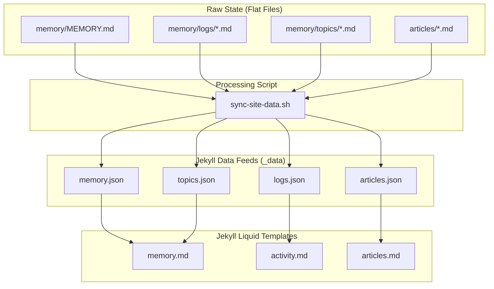
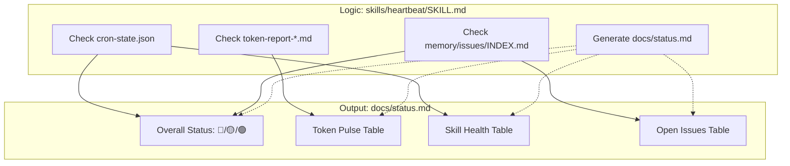

<!-- source: DeepWiki mcp.deepwiki.com · repo aaronjmars/aeon · page 8.1 Site Structure & Jekyll Configuration · fetched 2026-10-26 -->

# Site Structure & Jekyll Configuration

Relevant source files

The following files were used as context for generating this wiki page:

- [docs/Gemfile](docs/Gemfile)
- [docs/_config.yml](docs/_config.yml)
- [docs/_data/articles.json](docs/_data/articles.json)
- [docs/_data/logs.json](docs/_data/logs.json)
- [docs/_data/memory.json](docs/_data/memory.json)
- [docs/_data/topics.json](docs/_data/topics.json)
- [docs/_layouts/default.html](docs/_layouts/default.html)
- [docs/_layouts/post.html](docs/_layouts/post.html)
- [docs/_posts/2026-03-19-changelog-week-of-2026-03-19.md](docs/_posts/2026-03-19-changelog-week-of-2026-03-19.md)
- [docs/_posts/2026-03-25-aeon-is-the-anti-openclaw.md](docs/_posts/2026-03-25-aeon-is-the-anti-openclaw.md)
- [docs/_posts/2026-03-28-the-agent-that-fixes-itself.md](docs/_posts/2026-03-28-the-agent-that-fixes-itself.md)
- [docs/activity.md](docs/activity.md)
- [docs/articles.md](docs/articles.md)
- [docs/memory.md](docs/memory.md)
- [docs/skills.md](docs/skills.md)
- [docs/status.md](docs/status.md)
- [scripts/sync-site-data.sh](scripts/sync-site-data.sh)
- [skills/heartbeat/SKILL.md](skills/heartbeat/SKILL.md)

The AEON public site is a Jekyll-based documentation and output gallery hosted via GitHub Pages. It serves as the primary observability layer for the agent's autonomous activities, providing a human-readable interface for logs, memory, generated articles, and system health status.

## Jekyll Configuration

The site is configured in `docs/_config.yml` and uses the `minima` theme [docs/_config.yml:7](). It is structured to treat the `articles/` directory (mirrored into `_posts/`) as a collection of blog entries [docs/_config.yml:28-30]().

### Navigation & Routing
The site navigation is defined in the `header_pages` list, mapping markdown files in the `docs/` root to the top navigation bar [docs/_config.yml:16-22]().

| Page | Permalink | Purpose |
| :--- | :--- | :--- |
| `index.md` | `/` | Skill gallery and introduction. |
| `articles.md` | `/articles/` | Chronological list of generated research and digests. |
| `activity.md` | `/activity/` | Daily logs of skill executions. |
| `memory.md` | `/memory/` | Live snapshot of the agent's long-term memory and topics. |
| `skills.md` | `/skills/` | Documentation of all available modular skills. |
| `status.md` | `/status/` | Real-time health dashboard for the skill fleet. |

**Sources:** [docs/_config.yml:1-53](), [docs/status.md:1-5](), [docs/activity.md:1-5](), [docs/memory.md:1-5](), [docs/articles.md:1-5](), [docs/skills.md:1-5]()

---

## Data Synchronization Pipeline

The site relies on a "Static Data Feed" pattern where the agent's flat-file database (located in `memory/` and `articles/`) is transformed into JSON feeds within `docs/_data/`. This is handled by the `sync-site-data.sh` script.

### `sync-site-data.sh` Execution Logic
This script is typically invoked during the post-processing phase of an agent run. It performs the following transformations:

1.  **Activity Logs**: Iterates through `memory/logs/*.md`, escapes content for JSON, and creates a reverse-chronological array in `docs/_data/logs.json` [scripts/sync-site-data.sh:33-55]().
2.  **Memory Index**: Reads `memory/MEMORY.md` and wraps it into a single JSON object in `docs/_data/memory.json` [scripts/sync-site-data.sh:60-70]().
3.  **Topics**: Collects all files from `memory/topics/*.md` into `docs/_data/topics.json` [scripts/sync-site-data.sh:75-97]().
4.  **Article Metadata**: Scans the `articles/` directory to extract titles (from H1 tags), dates (from filenames), and summaries (first 200 characters) to populate `docs/_data/articles.json` [scripts/sync-site-data.sh:102-160]().

### Data Flow Diagram
The following diagram illustrates how raw agent state is promoted to the public site.

"Site Data Flow: From Memory to Jekyll"

**Sources:** [scripts/sync-site-data.sh:1-173](), [docs/activity.md:11-19](), [docs/memory.md:11-30]()

---

## The Status Dashboard (`status.md`)

The `docs/status.md` page is a specialized, auto-generated dashboard managed by the `heartbeat` skill [skills/heartbeat/SKILL.md:73](). Unlike other pages that use the `_data` sync pattern, `heartbeat` overwrites `docs/status.md` directly with fresh markdown and Jekyll frontmatter [skills/heartbeat/SKILL.md:89-142]().

### Health Monitoring Logic
The dashboard visualizes state from `memory/cron-state.json`, applying specific status icons based on execution metrics:
*   **✅ success**: Last run succeeded [skills/heartbeat/SKILL.md:140]().
*   **❌ failed**: `last_status` is "failed" [skills/heartbeat/SKILL.md:140]().
*   **⏳ dispatched**: Dispatched within the last 45 minutes [skills/heartbeat/SKILL.md:140]().
*   **🕸 stuck**: Dispatched > 45 minutes ago but never finished [skills/heartbeat/SKILL.md:140]().

### System Status Mapping
The "Overall Status" indicator on the page is derived from tiered health checks:

| Status | Trigger Criteria |
| :--- | :--- |
| `🔴 DEGRADED` | Any P0 flag: Stuck skills, `consecutive_failures >= 3`, or Heartbeat itself stale > 36h [skills/heartbeat/SKILL.md:83](). |
| `🟡 WATCH` | Any P1-P3 flag: Stalled PRs, urgent issues, or skills > 2x their schedule interval old [skills/heartbeat/SKILL.md:84-85](). |
| `🟢 OK` | No health flags active [skills/heartbeat/SKILL.md:85](). |

"Code Entity Mapping: Heartbeat to Status Dashboard"

**Sources:** [skills/heartbeat/SKILL.md:15-58](), [skills/heartbeat/SKILL.md:81-87](), [docs/status.md:1-36]()

---

## Templates and Styling

The site uses standard Jekyll layouts located in `docs/_layouts/`. 

*   **`default.html`**: The primary wrapper containing the HTML head, navigation header, and footer.
*   **`post.html`**: Specialized layout for articles, including date formatting and author attribution [docs/_config.yml:33-38]().

### CSS and Component Styling
Most pages include inline `<style>` blocks to handle component-specific layout without requiring a massive global CSS file:
*   **Activity Logs**: Uses a `border-left` timeline design for `.log-entry` [docs/activity.md:25-31]().
*   **Memory Topics**: Uses the HTML `
` and `
` elements for collapsible topic browsing [docs/memory.md:22-30]().
*   **Article Cards**: The `articles.md` page uses a `.card-grid` layout to display research snippets [docs/articles.md:11-20]().

**Sources:** [docs/activity.md:24-58](), [docs/memory.md:32-79](), [docs/articles.md:11-20]()

---

