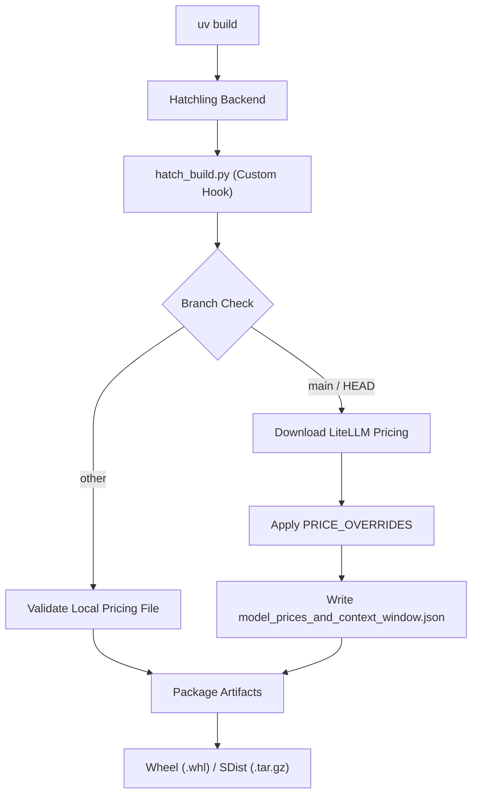
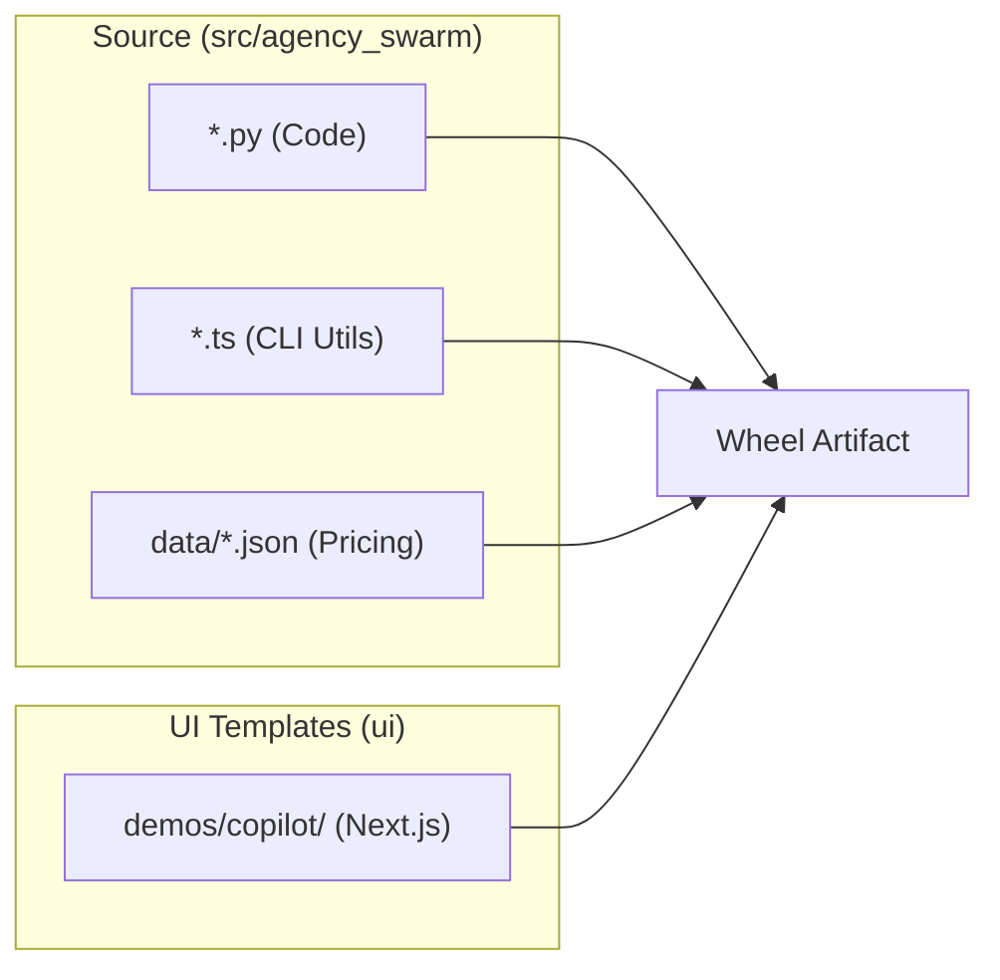

<!-- source: DeepWiki mcp.deepwiki.com · repo VRSEN/agency-swarm · page 9.1 Build and Configuration · fetched 2026-10-26 -->

# Build and Configuration

Relevant source files

The following files were used as context for generating this wiki page:

- [.github/workflows/publish.yml](.github/workflows/publish.yml)
- [hatch_build.py](hatch_build.py)
- [pyproject.toml](pyproject.toml)
- [tests/test_build_modules/test_dependency_constraints.py](tests/test_build_modules/test_dependency_constraints.py)
- [tests/test_build_modules/test_hatch_build.py](tests/test_build_modules/test_hatch_build.py)
- [uv.lock](uv.lock)

The `agency-swarm` framework utilizes a modern Python build stack centered around `hatchling` as the build backend and `uv` for dependency orchestration. The system is designed to be modular, allowing users to install only the components they need (e.g., FastAPI integration, Voice support, or Visualization) while maintaining strict version constraints on core dependencies like the OpenAI Agents SDK.

## Build System Architecture

The project follows the [PEP 517](https://peps.python.org/pep-0517) standard. Configuration is centralized in `pyproject.toml`, which defines the build environment, package metadata, and distribution artifacts.

### Key Build Components

| Component | Role | File Reference |
| :--- | :--- | :--- |
| **Hatchling** | The build backend used to generate `.whl` and `.tar.gz` distributions. | [pyproject.toml:1-3]() |
| **uv** | Used for high-performance dependency resolution and locking. | [uv.lock:1-22]() |
| **Custom Build Hook** | A specialized script (`hatch_build.py`) that executes during the build process. | [pyproject.toml:5-6]() |
| **Project Scripts** | Defines the `agency-swarm` CLI entry point. | [pyproject.toml:59-60]() |

### Data Flow: Build Initialization
The following diagram illustrates how the build system prepares the environment and handles custom hooks before generating the final package.

**Sources:** [hatch_build.py:1-11](), [pyproject.toml:5-6](), [pyproject.toml:99-127]()

## Custom Build Hook (`hatch_build.py`)

The `CustomBuildHook` class, extending `BuildHookInterface`, ensures that the framework always ships with up-to-date token pricing data for cost calculation and observability [hatch_build.py:13-22]().

1.  **Pricing Download**: On `main` or detached `HEAD` (releases), it downloads the latest pricing schema from LiteLLM's repository [hatch_build.py:33-35, 122-132]().
2.  **Price Overrides**: If LiteLLM is stale, the hook applies manual corrections defined in `PRICE_OVERRIDES` for specific models like `gpt-5.6-luna` [hatch_build.py:42-83, 134-160]().
3.  **Validation**: It ensures the pricing data is valid JSON and contains the required `sample_spec` key before allowing the build to proceed [hatch_build.py:101-114]().

**Sources:** [hatch_build.py:1-160](), [tests/test_build_modules/test_hatch_build.py:87-108]()

## Dependency Management

Dependencies are split into core requirements and optional extras to minimize the footprint of basic installations.

### Core Dependencies
Core dependencies are strictly pinned to ensure compatibility with the underlying OpenAI Agents SDK [pyproject.toml:16-41]().

*   **`openai-agents==0.18.1`**: Strictly pinned to prevent breaking changes in the agent orchestration layer [pyproject.toml:18](), [tests/test_build_modules/test_dependency_constraints.py:20]().
*   **`openai>=2.2,<2.45`**: Constrained to ensure compatibility with the Agents SDK [pyproject.toml:17]().
*   **`pydantic>=2.11,<3`**: Used for tool schemas and data validation [pyproject.toml:25]().

### Optional Extras
Users can install specialized features using the `[extra]` syntax [pyproject.toml:62-75]().

| Extra | Purpose | Key Packages |
| :--- | :--- | :--- |
| `fastapi` | Web server integration | `fastapi`, `uvicorn`, `ag-ui-protocol` |
| `voice` | Realtime voice capabilities | `numpy`, `websockets` |
| `viz` | Agency structure visualization | `graphviz` |
| `litellm` | Support for non-OpenAI models | `litellm` |
| `jupyter` | Notebook integration | `ipykernel`, `nest_asyncio` |

**Sources:** [pyproject.toml:62-75](), [uv.lock:101-141](), [tests/test_build_modules/test_dependency_constraints.py:9-25]()

## Package Distribution Structure

The build system is configured to include non-python artifacts necessary for the UI and CLI tools.

### Artifact Mapping

*   **Wheel Inclusion**: The wheel includes the `src/agency_swarm` package and excludes development directories like `node_modules` [pyproject.toml:99-101]().
*   **Force Include**: The TypeScript utility `generate-agent-from-settings.ts` is explicitly included to support the CLI [pyproject.toml:115-116]().
*   **UI Demos**: Copilot frontend files (`.ts`, `.tsx`, `.json`) are bundled to allow users to run the web UI out of the box [pyproject.toml:102-113]().

**Sources:** [pyproject.toml:99-127](), [.github/workflows/publish.yml:31-32]()

## Version Pinning Constraints
The framework enforces strict compatibility checks during build and test phases. `tests/test_build_modules/test_dependency_constraints.py` verifies that the `pyproject.toml` does not allow incompatible versions of upstream dependencies [tests/test_build_modules/test_dependency_constraints.py:9-25]().

*   **OpenAI**: Must be below `2.45.0` [tests/test_build_modules/test_dependency_constraints.py:19]().
*   **LiteLLM**: Must be below `1.92.0` [tests/test_build_modules/test_dependency_constraints.py:23]().
*   **Python**: Requires `>=3.12` [pyproject.toml:13]().

**Sources:** [pyproject.toml:13-18](), [tests/test_build_modules/test_dependency_constraints.py:1-25]()

---

