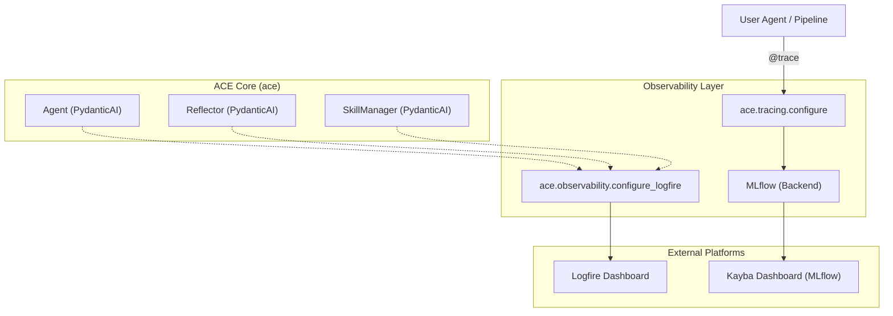
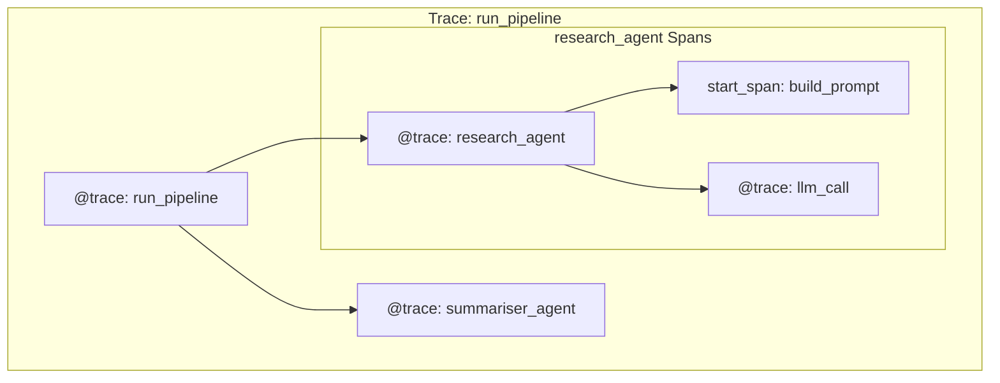

<!-- source: DeepWiki mcp.deepwiki.com · repo kayba-ai/agentic-context-engine · page 10 Observability and Monitoring · fetched 2026-10-26 -->

# Observability and Monitoring

Relevant source files

The following files were used as context for generating this wiki page:

- [AGENTS.md](AGENTS.md)
- [ace/observability/__init__.py](ace/observability/__init__.py)
- [ace/tracing/__init__.py](ace/tracing/__init__.py)
- [ace/tracing/_wrapper.py](ace/tracing/_wrapper.py)
- [agent-guides/logfire.md](agent-guides/logfire.md)
- [agent-guides/tracing-sdk.md](agent-guides/tracing-sdk.md)
- [docs/integrations/tracing.md](docs/integrations/tracing.md)
- [examples/tracing_glm_example.py](examples/tracing_glm_example.py)
- [tests/test_tracing.py](tests/test_tracing.py)

This document covers the observability and monitoring capabilities in the ACE framework, including automatic tracing, token tracking, cost management, and performance metrics. The framework primarily leverages **Logfire** for core role instrumentation and the **Kayba Tracing SDK** for application-level monitoring.

**Purpose**: Tracking agent performance, token usage, and costs with enterprise-grade visibility.

**Scope**: This page provides a high-level overview of the observability stack. For implementation details, see the child pages:
- [Logfire Integration](#10.1) — Auto-instrumenting PydanticAI agents (Agent, Reflector, SkillManager).
- [Kayba Tracing SDK](#10.2) — Custom instrumentation using the `kayba-tracing` package.
- [Performance Metrics](#10.3) — Tracking skill evolution and role adaptation.

---

## Overview

The ACE framework provides a multi-layered observability strategy:

- **Core Instrumentation**: All PydanticAI-backed roles (`Agent`, `Reflector`, `SkillManager`, and `RR`) are auto-instrumented via Logfire [ace/observability/__init__.py:1-6]().
- **Application Tracing**: Developers can use the Kayba Tracing SDK (a wrapper around MLflow) to instrument custom workflows and agents [ace/tracing/_wrapper.py:1-6]().
- **Usage Tracking**: LLM usage and costs are tracked via `MeteredModel` wrappers [AGENTS.md:34-44]().
- **Dashboard Organization**: Traces can be grouped into folders for environment-based (e.g., "production", "staging") filtering [ace/tracing/_wrapper.py:94-102]().

---

## Architecture

### Observability Data Flow

The following diagram bridges the **Natural Language Space** (Agent concepts) to the **Code Entity Space** (Classes and Modules).

**Sources**: [ace/observability/__init__.py:1-16](), [ace/tracing/_wrapper.py:52-92](), [AGENTS.md:80-87]()

---

## Logfire Integration

ACE includes opt-in Logfire integration that automatically instruments all core PydanticAI agents. This captures every LLM call, tool invocation, and internal reasoning step.

- **Configuration**: Use `configure_logfire()` to initialize the integration [ace/observability/__init__.py:27-39]().
- **Scrubbing**: The framework includes a default `scrubbing_callback` to protect sensitive data like payment IDs while preserving reasoning and tool arguments for analysis [ace/observability/__init__.py:47-60]().
- **Runner Support**: Integration runners like `ACELiteLLM` support a `logfire=True` flag for immediate activation [ace/observability/__init__.py:13-16]().

For details, see [Logfire Integration](#10.1).

**Sources**: [ace/observability/__init__.py:27-71]()

---

## Kayba Tracing SDK

The Kayba Tracing SDK is a thin, branded wrapper around **MLflow Tracing**. It allows developers to instrument any Python function or block of code, regardless of whether it uses the ACE core library.

### Core Primitives

- **`configure()`**: Sets the tracking URI to `https://use.kayba.ai/api/mlflow` and authenticates using `KAYBA_API_KEY` [ace/tracing/_wrapper.py:52-92]().
- **`@trace`**: A decorator that creates a trace span for a function, automatically capturing inputs and outputs [ace/tracing/_wrapper.py:134-179]().
- **`start_span()`**: A context manager for creating fine-grained child spans within a trace [ace/tracing/_wrapper.py:182-199]().

### Trace Hierarchy

For details, see [Kayba Tracing SDK](#10.2).

**Sources**: [ace/tracing/_wrapper.py:114-199](), [examples/tracing_glm_example.py:32-92]()

---

## Performance Metrics

ACE monitors the "Learning Loop" by logging metrics related to skill evolution and role performance.

- **Token Usage**: Tracked per-call to monitor operational costs [AGENTS.md:34-44]().
- **Skill Evolution**: Metrics on how many skills are added, updated, or consolidated during a learning cycle.
- **Role Performance**: Execution latency and success rates for the Agent and Reflector roles.
- **Folder Tagging**: Traces can be tagged with `kayba.folder` to separate benchmark metrics from production logs [ace/tracing/_wrapper.py:114-118]().

For details, see [Performance Metrics](#10.3).

**Sources**: [ace/tracing/_wrapper.py:94-102](), [agent-guides/logfire.md:198-218]()

---

