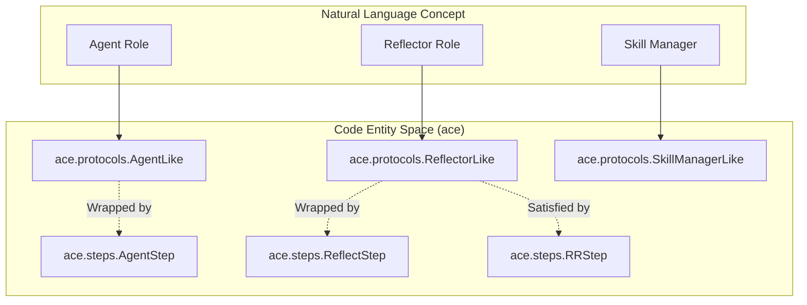
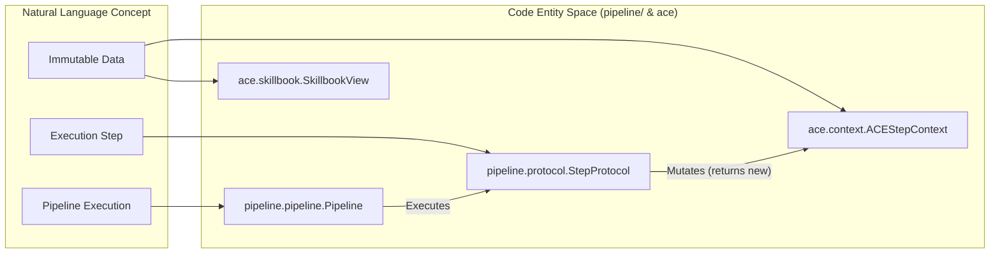

<!-- source: DeepWiki mcp.deepwiki.com · repo kayba-ai/agentic-context-engine · page 11.4 Documentation Guidelines · fetched 2026-10-26 -->

# Documentation Guidelines

Relevant source files

The following files were used as context for generating this wiki page:

- [.claude/commands/checkout-branch.md](.claude/commands/checkout-branch.md)
- [.claude/commands/create-branch.md](.claude/commands/create-branch.md)
- [.claude/commands/list-branches.md](.claude/commands/list-branches.md)
- [.claude/commands/remove-branch.md](.claude/commands/remove-branch.md)
- [CONTRIBUTING.md](CONTRIBUTING.md)
- [LICENSE](LICENSE)
- [docs/design/ACE_ARCHITECTURE.md](docs/design/ACE_ARCHITECTURE.md)
- [docs/design/ACE_DECISIONS.md](docs/design/ACE_DECISIONS.md)
- [docs/design/ACE_REFERENCE.md](docs/design/ACE_REFERENCE.md)
- [docs/design/CLI_DESIGN.md](docs/design/CLI_DESIGN.md)
- [docs/design/PIPELINE_DESIGN.md](docs/design/PIPELINE_DESIGN.md)
- [docs/design/RR_DESIGN.md](docs/design/RR_DESIGN.md)
- [examples/agentic-system-prompting/README.md](examples/agentic-system-prompting/README.md)

## Purpose and Scope

This page defines the requirements for maintaining technical documentation within the ACE Framework repository. It establishes the synchronization contract between the source code, design specifications, and user-facing guides. Contributors must ensure that any modifications to public APIs, architectural patterns, or core subsystems are reflected in the documentation to prevent "documentation rot" and maintain a reliable source of truth for developers.

Sources: [CONTRIBUTING.md:173-179](), [docs/design/ACE_ARCHITECTURE.md:1-7]()

---

## Core Design Documents

The repository maintains authoritative design documents that serve as the technical specification for the framework's subsystems. These documents must be updated alongside any structural code changes.

### ACE_ARCHITECTURE.md
**Location**: `docs/design/ACE_ARCHITECTURE.md`
**Purpose**: High-level architecture overview, role definitions, and naming conventions.
**Key Content**:
- **Layered Architecture**: Defines Protocols, Roles, Steps, and Runners [docs/design/ACE_ARCHITECTURE.md:43-57]().
- **Core Types**: Specifications for `Sample`, `ACESample`, `SkillbookView`, and `ACEStepContext` [docs/design/ACE_ARCHITECTURE.md:62-116]().
- **Migration Logic**: Documentation of the transition to PydanticAI-backed roles [docs/design/ACE_ARCHITECTURE.md:21-30]().

### RR_DESIGN.md
**Location**: `docs/design/RR_DESIGN.md`
**Purpose**: Detailed specification for the Recursive Reflector (RR) system.
**Key Content**:
- **RecursiveAgent**: The base class for iterative tool-calling agents [docs/design/RR_DESIGN.md:39-45]().
- **Tool Definitions**: Signatures for `execute_code`, `think`, and `recurse` [docs/design/RR_DESIGN.md:91-96]().
- **Configuration**: `AgenticConfig` and `RRConfig` parameters [docs/design/RR_DESIGN.md:126-137]().

### PIPELINE_DESIGN.md
**Location**: `docs/design/PIPELINE_DESIGN.md`
**Purpose**: Specification for the generic pipeline engine (`pipeline/` directory) including concurrency and data flow.

### ACE_DECISIONS.md
**Location**: `docs/design/ACE_DECISIONS.md`
**Purpose**: Historical record of rejected alternatives and rationale for current architectural choices [docs/design/ACE_DECISIONS.md:1-3]().

---

## Documentation Synchronization Requirements

**Core Rule**: Documentation MUST be kept in sync with code. A Pull Request is considered incomplete if it modifies public interfaces without updating the corresponding documentation [CONTRIBUTING.md:173-179]().

### Change Mapping Table

| Code Change Type | Required Documentation Update | Primary Target |
| :--- | :--- | :--- |
| New Pipeline Step | Add to Step Implementations section | `docs/design/ACE_REFERENCE.md` |
| New LLM Provider | Update Provider Resolution logic | `docs/design/ACE_DECISIONS.md` |
| Change in `ACEStepContext` | Update Context Fields table | `docs/design/ACE_ARCHITECTURE.md` |
| New CLI Command | Update CLI Architecture overview | `docs/design/CLI_DESIGN.md` |
| Protocol Modification | Update Protocol Definitions | `docs/design/ACE_REFERENCE.md` |

### Bridge: Natural Language Space to Code Entity Space

The following diagrams map conceptual system components to their specific code implementations to assist documentation writers in maintaining technical accuracy.

**Diagram: Role and Step Implementation Mapping**

Sources: [docs/design/ACE_ARCHITECTURE.md:43-57](), [docs/design/ACE_REFERENCE.md:142-160](), [docs/design/RR_DESIGN.md:110-120]()

**Diagram: Pipeline Engine and Data Flow**

Sources: [docs/design/ACE_REFERENCE.md:11-30](), [docs/design/ACE_ARCHITECTURE.md:115-134](), [docs/design/ACE_ARCHITECTURE.md:79-92]()

---

## Technical Writing Standards

### Code Citations
Every factual statement regarding the implementation must include a citation using the `[path/to/file:startLine-endLine]()` syntax. This allows for automated verification of documentation accuracy against the current codebase.

### Mermaid Diagram Requirements
- **No Colors**: Use standard black and white styling to ensure readability across different IDE themes.
- **Quoted Labels**: Always wrap node labels in double quotes (e.g., `"AgentStep"`) to avoid syntax errors with special characters.
- **Code Identifiers**: Use actual class names, file paths, and method names in diagrams rather than generic descriptions.

### API Documentation
When documenting new classes or functions, follow the structure established in `ACE_REFERENCE.md`:
1. **Signature**: Provide the Python type-hinted signature.
2. **Context**: Explain where the entity fits in the `ACEStepContext` flow [docs/design/ACE_REFERENCE.md:112-134]().
3. **Usage**: Provide a minimal, runnable code snippet.

---

## Contribution Workflow for Docs

1. **Branching**: Documentation changes should use the `docs/` prefix (e.g., `docs/john/update-rr-tools`) [CONTRIBUTING.md:46-57]().
2. **Commit Messages**: Use the `docs` type for conventional commits (e.g., `docs(rr): update tool signatures`) [CONTRIBUTING.md:136-156]().
3. **Verification**: Run `uv run pytest` to ensure that any code snippets included in documentation (if part of the test suite) are still valid [CONTRIBUTING.md:120-134]().
4. **Formatting**: Ensure all Markdown files follow standard formatting (Black for code blocks where applicable) [CONTRIBUTING.md:158-165]().

Sources: [CONTRIBUTING.md:37-67](), [CONTRIBUTING.md:136-165]()

---

