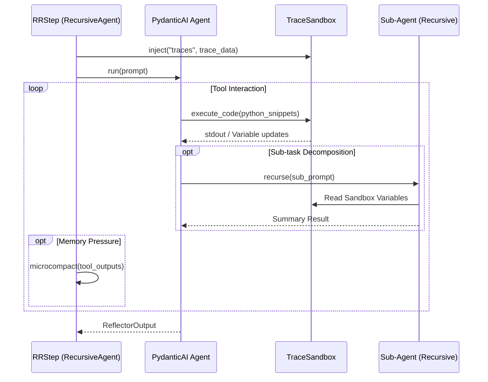

<!-- source: DeepWiki mcp.deepwiki.com · repo kayba-ai/agentic-context-engine · page 13 Glossary · fetched 2026-10-26 -->

# Glossary

<details>
<summary>Relevant source files</summary>

The following files were used as context for generating this wiki page:

- [CHANGELOG.md](CHANGELOG.md)
- [CLAUDE.md](CLAUDE.md)
- [README.md](README.md)
- [ace/__init__.py](ace/__init__.py)
- [ace/core/recursive_agent.py](ace/core/recursive_agent.py)
- [ace/implementations/prompts.py](ace/implementations/prompts.py)
- [ace/implementations/rr/__init__.py](ace/implementations/rr/__init__.py)
- [ace/implementations/rr/config.py](ace/implementations/rr/config.py)
- [ace/implementations/rr/prompts.py](ace/implementations/rr/prompts.py)
- [ace/implementations/rr/tools.py](ace/implementations/rr/tools.py)
- [ace/implementations/skill_manager.py](ace/implementations/skill_manager.py)
- [ace/runners/litellm.py](ace/runners/litellm.py)
- [ace/steps/rr_step.py](ace/steps/rr_step.py)
- [assets/kayba-banner.png](assets/kayba-banner.png)
- [docs/api/index.md](docs/api/index.md)
- [docs/concepts/skillbook.md](docs/concepts/skillbook.md)
- [docs/concepts/updates.md](docs/concepts/updates.md)
- [docs/design/SKILLBOOK_V2_PLAN.md](docs/design/SKILLBOOK_V2_PLAN.md)
- [docs/guides/composing-pipelines.md](docs/guides/composing-pipelines.md)
- [docs/guides/prompts.md](docs/guides/prompts.md)
- [examples/ace/ace_demo.py](examples/ace/ace_demo.py)
- [pyproject.toml](pyproject.toml)
- [tests/test_pipeline_exports.py](tests/test_pipeline_exports.py)
- [uv.lock](uv.lock)

</details>


This glossary defines technical terms, domain concepts, and architectural jargon specific to the ACE (Agentic Context Engine) codebase.

## Core Domain Terms

### Skillbook
The persistent knowledge store containing learned strategies. In the v2 schema, it is organized into sections and utilizes BM25 retrieval for context injection [ace/core/skillbook.py:59-60]().
*   **Skill**: A single atomic unit of strategic knowledge consisting of an `issue` (trigger) and an `insight` (actionable instruction) [ace/core/skillbook.py:74-75]().
*   **SkillbookView**: A read-only, point-in-time snapshot of the Skillbook used during a single execution to ensure consistency [ace/core/skillbook.py:24-25]().

### Trace
A recording of an agent's execution. It typically includes the original question, the agent's reasoning, tool calls, environment feedback, and ground truth [ace/steps/rr_step.py:169-174]().

### Adaptation Loop
The high-level cycle of Execute → Evaluate → Reflect → Update.
*   **Online Learning**: Learning from individual traces immediately after execution [ace/runners/ace.py:64-65]().
*   **Offline Learning**: Batch processing of pre-recorded traces to update the Skillbook [ace/runners/trace_analyser.py:44-45]().

---

## Architectural Components

### RecursiveAgent
A core abstraction that wraps a `PydanticAI` agent with advanced agentic capabilities [ace/core/recursive_agent.py:3-10]().
*   **Two-tier Compaction**: A memory management system that uses "microcompaction" (clearing tool outputs) and "full summarization" to handle long context windows [ace/core/recursive_agent.py:4-5]().
*   **Depth-based Recursion**: The ability for an agent to spawn sub-agents using the `recurse` tool to solve sub-problems [ace/core/recursive_agent.py:143-147]().

### Recursive Reflector (RR)
The specialized implementation of `RecursiveAgent` used for trace analysis. It operates in a sandboxed environment to programmatically inspect traces [ace/steps/rr_step.py:51-59]().

### Pipeline Engine
The foundational orchestration layer located in `pipeline/`. It uses `StepProtocol` to compose immutable data flows [pipeline/step.py:10-15]().

---

## Technical Jargon & Abbreviations

| Term | Definition | Code Pointer |
|:---|:---|:---|
| **SM** | **SkillManager**: The role responsible for mutating the Skillbook. | [ace/implementations/skill_manager.py:58-60]() |
| **RR** | **Recursive Reflector**: The role that analyzes traces. | [ace/steps/rr_step.py:51]() |
| **Context Injection** | The process of formatting Skillbook strategies into an LLM's system prompt. | [ace/implementations/prompts.py:31-43]() |
| **Microcompaction** | Deleting specific tool results from message history while keeping variables in the sandbox. | [ace/core/recursive_agent.py:115-118]() |
| **InsightSource** | Metadata describing the provenance (origin) of a learned skill. | [ace/core/insight_source.py:19-20]() |
| **Learning Tail** | A standard sequence of pipeline steps (Reflect → Update → Persist) added to the end of an execution. | [ace/steps/__init__.py:115]() |

---

## Implementation Diagrams

### Natural Language Space to Code Entity Space: Learning Loop
This diagram maps the conceptual "Learning Loop" to the specific classes and files that implement each phase.

```mermaid
graph TD
    subgraph "Natural Language Space (Concepts)"
        Task["Task / Question"]
        Strategy["Strategic Instruction"]
        Analysis["Trace Analysis"]
        Storage["Persistent Memory"]
    end

    subgraph "Code Entity Space (ace)"
        AgentClass["Agent (ace/implementations/agent.py)"]
        RRStepClass["RRStep (ace/steps/rr_step.py)"]
        SMClass["SkillManager (ace/implementations/skill_manager.py)"]
        SBClass["Skillbook (ace/core/skillbook.py)"]
    end

    Task --> AgentClass
    Strategy -.-> AgentClass
    AgentClass -- "Generates Trace" --> RRStepClass
    RRStepClass -- "ReflectorOutput" --> SMClass
    SMClass -- "UpdateBatch" --> SBClass
    SBClass -- "as_prompt()" -.-> Strategy
```
**Sources:** [ace/implementations/agent.py:71-72](), [ace/steps/rr_step.py:51-52](), [ace/implementations/skill_manager.py:58-60](), [ace/core/skillbook.py:75-76]()

### Recursive Reflector Execution Flow
This diagram details the interaction between the `RecursiveAgent` base class and the `TraceSandbox` during a reflection task.


**Sources:** [ace/core/recursive_agent.py:82-106](), [ace/core/recursive_agent.py:150-174](), [ace/steps/rr_step.py:122-126](), [ace/core/sandbox.py:24-25]()

---

## Key Data Models

### UpdateOperation
Defines how the `SkillManager` modifies the `Skillbook`.
*   **ADD**: Creates a new skill [ace/core/skillbook.py:256-257]().
*   **UPDATE**: Modifies an existing skill's insight or issue [ace/core/skillbook.py:258-259]().
*   **REMOVE**: Deletes a skill based on negative feedback [ace/core/skillbook.py:261-262]().
*   **TAG**: Increments helpful/harmful counters [ace/core/skillbook.py:260-261]().

### ACEStepContext
The immutable data carrier that moves through a `Pipeline`. It contains the `trace`, `skillbook`, `reflections`, and `metadata` [ace/core/context.py:18-25]().

**Sources:** [ace/core/skillbook.py:250-265](), [ace/core/context.py:18-30](), [pipeline/step.py:10-20]()