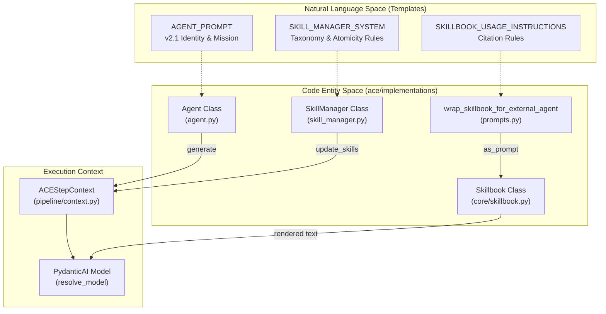
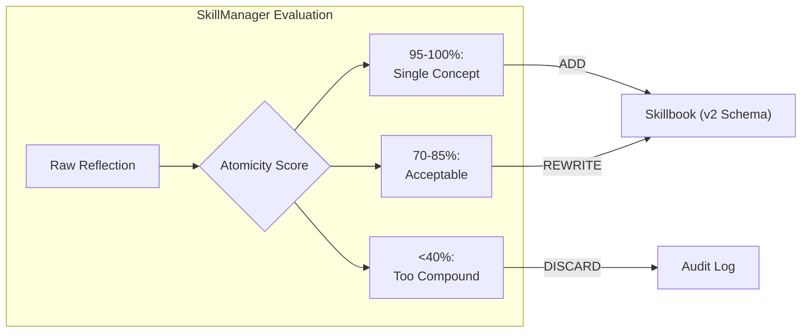

<!-- source: DeepWiki mcp.deepwiki.com · repo kayba-ai/agentic-context-engine · page 3.5 Prompt Engineering System · fetched 2026-10-26 -->

# Prompt Engineering System

<details>
<summary>Relevant source files</summary>

The following files were used as context for generating this wiki page:

- [ace/implementations/prompts.py](ace/implementations/prompts.py)
- [ace/implementations/skill_manager.py](ace/implementations/skill_manager.py)
- [docs/api/index.md](docs/api/index.md)
- [docs/concepts/skillbook.md](docs/concepts/skillbook.md)
- [docs/concepts/updates.md](docs/concepts/updates.md)
- [docs/design/SKILLBOOK_V2_PLAN.md](docs/design/SKILLBOOK_V2_PLAN.md)
- [docs/guides/composing-pipelines.md](docs/guides/composing-pipelines.md)
- [docs/guides/prompts.md](docs/guides/prompts.md)

</details>


## Purpose and Scope

The Prompt Engineering System in ACE manages the specialized prompt templates used by the three core roles: **Agent**, **Reflector**, and **SkillManager**. It provides versioning, domain-specific variants (e.g., math, code), and structured logic for skill application and extraction. The system ensures that learned strategies from the **Skillbook** are effectively utilized by agents and accurately refined by managers.

The current production standard is **v2.1**, which introduces rigorous atomicity scoring and specific usage instructions for external agents.

---

## System Overview

ACE utilizes structured Markdown templates to define role behaviors. These templates are designed to be "self-documenting" to the LLM, containing identity headers, mission statements, and explicit execution protocols.

### Version History

| Version | Status | Key Features |
| :--- | :--- | :--- |
| **v1.0** | Legacy | Basic instruction set, minimal structure. |
| **v2.0** | Deprecated | Introduced identity headers and Good/Bad examples. |
| **v2.1** | **Current** | Atomic strategy scoring, explicit citation requirements, and domain variants. |

**Sources:** [ace/implementations/prompts.py:1-5]()

---

## Role-Specific Prompts (v2.1)

### 1. Agent Prompt (`AGENT_PROMPT`)
The Agent prompt focuses on **Skillbook Application**. It mandates a 4-step protocol to ensure the agent doesn't just "guess" but applies learned strategic knowledge.

*   **Step 1: Analyze Strategies** - Scan the `{skillbook}` for relevant IDs.
*   **Step 2: Consider Recent Reflection** - Integrate `{reflection}` from previous failures.
*   **Step 3: Process the Question** - Analyze `{question}` and `{context}`.
*   **Step 4: Generate Solution** - Execute with mandatory citations.

**Key Requirement:** The Agent **MUST** cite skill IDs (e.g., `Following [skill-001], I will...`) to enable precise tracking of strategy effectiveness.

**Sources:** [ace/implementations/prompts.py:68-176]()

### 2. Reflector Prompt
The Reflector analyzes execution traces to identify root causes of failure or patterns of success. It is responsible for producing the `extracted_learnings` that the SkillManager later processes.

### 3. SkillManager Prompt (`SKILL_MANAGER_SYSTEM`)
The SkillManager prompt defines the taxonomy for the Skillbook. It enforces the **Atomic Strategy Principle**, requiring that every new skill addresses a single, specific issue rather than a compound problem.

**Sources:** [ace/implementations/skill_manager.py:30-30](), [docs/design/SKILLBOOK_V2_PLAN.md:131-137]()

---

## Architecture: Prompt Flow and Integration

The following diagram illustrates how natural language prompt templates are associated with code entities and how data flows into the LLM context.

### Diagram: Natural Language to Code Entity Space



**Sources:** [ace/implementations/prompts.py:15-28](), [ace/implementations/skill_manager.py:58-93](), [docs/api/index.md:124-138]()

---

## Skillbook Context Injection

For external agents (e.g., Browser-use, LangChain), ACE provides a canonical way to format the Skillbook for prompt injection.

### `wrap_skillbook_for_external_agent`
This function transforms the structured `Skillbook` object into a Markdown-formatted string with clear instructions for the external LLM.

```python
def wrap_skillbook_for_external_agent(skillbook) -> str:
    # 1. Extracts active skills
    # 2. Formats using skillbook.as_prompt()
    # 3. Appends SKILLBOOK_USAGE_INSTRUCTIONS
```

**Sources:** [ace/implementations/prompts.py:31-60]()

### Instruction Set for Agents
When a skillbook is injected, the system appends specific usage rules to the prompt:
*   **Citation:** "When applying a strategy, cite its ID in your reasoning."
*   **Prioritization:** "Prioritize strategies with high success rates (helpful > harmful)."
*   **Judgment:** "These are learned patterns, not rigid rules. Use judgment."

**Sources:** [ace/implementations/prompts.py:15-28]()

---

## Domain-Specific Variants

The Prompt Engineering System supports variants for specialized tasks. While the core logic remains the same, the "Identity" and "Constraints" sections are swapped.

| Variant | Purpose | Key Constraints |
| :--- | :--- | :--- |
| **General** | Standard problem solving | JSON output, citation of skill IDs. |
| **Math** | Quantitative reasoning | Show every arithmetic step, verify twice. |
| **Code** | Software engineering | Type hints, docstrings, error handling. |

**Sources:** [docs/guides/prompts.md:1-22](), [ace/implementations/prompts.py:63-66]()

---

## Prompt Evolution and Atomicity

A critical feature of the v2.1 system is the **Atomicity Scoring** handled by the SkillManager. The prompt instructs the manager to evaluate insights on a scale of 0-100%.

### Atomicity Scoring Logic in Prompts



**Sources:** [docs/design/SKILLBOOK_V2_PLAN.md:131-137](), [ace/implementations/skill_manager.py:44-51]()

---

## Implementation Details

### Prompt Template Variables
Templates use standard Python format strings. The following variables are dynamically injected by the `Agent`, `Reflector`, and `SkillManager` classes:

| Role | Variables |
| :--- | :--- |
| **Agent** | `{skillbook}`, `{reflection}`, `{question}`, `{context}` |
| **Reflector** | `{skillbook}`, `{question}`, `{agent_output}`, `{ground_truth}`, `{feedback}` |
| **SkillManager** | `{skillbook}`, `{reflection}`, `{question_context}`, `{progress}` |

**Sources:** [docs/guides/prompts.md:26-53]()

### Overriding Prompts
Users can override the default v2.1 prompts by passing a `prompt_template` string to the role constructor.

```python
from ace import Agent

custom_prompt = "You are a specialized agent. Context: {skillbook}. Task: {question}"
agent = Agent("gpt-4o", prompt_template=custom_prompt)
```

**Sources:** [docs/guides/prompts.md:12-22](), [ace/implementations/skill_manager.py:95-103]()

---

