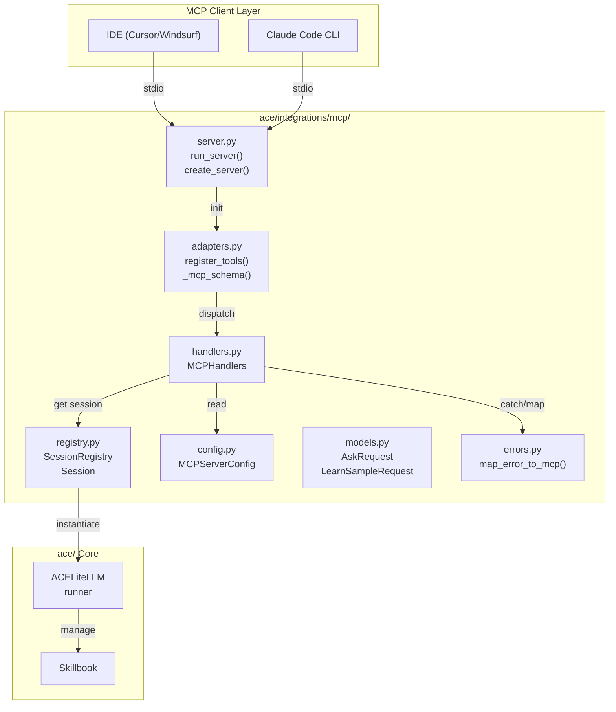
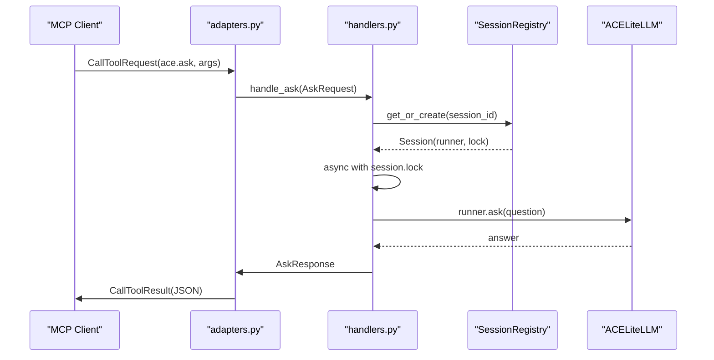

<!-- source: DeepWiki mcp.deepwiki.com · repo kayba-ai/agentic-context-engine · page 7.7 MCP Server Integration · fetched 2026-10-26 -->

# MCP Server Integration

<details>
<summary>Relevant source files</summary>

The following files were used as context for generating this wiki page:

- [ace/integrations/mcp/registry.py](ace/integrations/mcp/registry.py)
- [ace/integrations/mcp/server.py](ace/integrations/mcp/server.py)
- [docs/integrations/index.md](docs/integrations/index.md)
- [docs/integrations/mcp-client-setup.md](docs/integrations/mcp-client-setup.md)
- [docs/integrations/mcp.md](docs/integrations/mcp.md)
- [mkdocs.yml](mkdocs.yml)
- [specs/002-ace-mcp-server/contracts/tool-schemas.md](specs/002-ace-mcp-server/contracts/tool-schemas.md)
- [specs/002-ace-mcp-server/spec.md](specs/002-ace-mcp-server/spec.md)
- [tests/test_ace_mcp_compatibility.py](tests/test_ace_mcp_compatibility.py)

</details>


This page documents the ACE MCP Server, an optional integration that exposes ACE capabilities as tools over the [Model Context Protocol (MCP)](https://modelcontextprotocol.io). The server enables external MCP clients—IDEs like Cursor, Windsurf, and Claude Code, as well as AI assistants and orchestration frameworks—to call ACE for inference and learning through a standardized tool provider interface.

For general integration patterns with ACE, see [Integration Pattern Overview](). For using ACE programmatically without MCP, see [ACELiteLLM Integration]().

---

## Overview

The MCP server is fully opt-in and isolated in `ace/integrations/mcp/`. Installing `ace-framework` without the `mcp` extra does not pull in the MCP SDK. The server:

- Communicates over `stdio` transport (JSON-RPC) [docs/integrations/mcp.md:23]().
- Exposes six tools: `ace.ask`, `ace.learn.sample`, `ace.learn.feedback`, `ace.skillbook.get`, `ace.skillbook.save`, `ace.skillbook.load` [specs/002-ace-mcp-server/spec.md:68-69]().
- Maintains session-isolated state with per-session `ACELiteLLM` runners [ace/integrations/mcp/registry.py:42-44]().
- Validates all requests/responses with Pydantic schemas [specs/002-ace-mcp-server/spec.md:70]().
- Enforces safety controls: safe mode, request limits, and path validation [specs/002-ace-mcp-server/spec.md:73-75]().

**Sources:** [docs/integrations/mcp.md:1-6](), [specs/002-ace-mcp-server/spec.md:1-16](), [ace/integrations/mcp/server.py:13-16]()

---

## Installation and Setup

Install the `mcp` extra to enable the server:

```bash
pip install "ace-framework[mcp]"
# or with uv:
uv add "ace-framework[mcp]"
```

Start the server using the `ace-mcp` CLI entrypoint:

```bash
ace-mcp
```

The server reads configuration from environment variables prefixed with `ACE_MCP_`. Example:

```bash
ACE_MCP_DEFAULT_MODEL=bedrock/us.anthropic.claude-haiku-4-5-20251001-v1:0 ace-mcp
```

**Sources:** [docs/integrations/mcp.md:9-29](), [specs/002-ace-mcp-server/spec.md:125-126]()

---

## Architecture

### Component Structure

The following diagram maps the Natural Language concept of "MCP Integration" to the specific code entities in the `ace/integrations/mcp/` module.



**Key Components:**

| Module | Responsibility |
|--------|---------------|
| `server.py` | Server bootstrap, `stdio` transport, and CLI entrypoint via `main()` [ace/integrations/mcp/server.py:79-81](). |
| `adapters.py` | MCP SDK glue: tool registration and schema inlining for compatibility [ace/integrations/mcp/adapters.py:33-56](). |
| `handlers.py` | Tool implementation logic, validation, and session delegation [specs/002-ace-mcp-server/spec.md:102](). |
| `registry.py` | Session lifecycle: creation, TTL expiry, and per-session `asyncio.Lock` [ace/integrations/mcp/registry.py:20-29](). |
| `models.py` | Pydantic request/response schemas for all six tools [specs/002-ace-mcp-server/spec.md:101](). |
| `config.py` | Environment-based configuration with `MCPServerConfig` [ace/integrations/mcp/config.py:4-20](). |
| `errors.py` | Domain-specific exception hierarchy and MCP error code mapping [ace/integrations/mcp/errors.py:38-49](). |

**Sources:** [specs/002-ace-mcp-server/spec.md:90-103](), [ace/integrations/mcp/server.py:40-61](), [ace/integrations/mcp/registry.py:14-20]()

---

### Request Flow and Session Management

All state is isolated by `session_id`. Each session holds its own `ACELiteLLM` runner with an independent skillbook.



**Session Lifecycle:**
1. **Creation:** `SessionRegistry.get_or_create()` lazily creates sessions using `ACELiteLLM.from_model()` [ace/integrations/mcp/registry.py:29-43]().
2. **TTL Expiry:** Sessions are garbage-collected after `ACE_MCP_SESSION_TTL_SECONDS` (default 3600) of inactivity [docs/integrations/mcp.md:42]().
3. **Concurrency:** Per-session locks ensure concurrent requests to the same `session_id` are serialized [docs/integrations/mcp.md:137]().
4. **Cleanup:** `_drain_sessions()` waits for any in-progress background learning before removal [ace/integrations/mcp/registry.py:92-95]().

**Sources:** [ace/integrations/mcp/registry.py:14-95](), [docs/integrations/mcp.md:133-140](), [specs/002-ace-mcp-server/spec.md:137-143]()

---

## Tool Catalog

### `ace.ask`
Queries the agent using the session's current skillbook. This is a read-only operation and does not mutate the skillbook [docs/integrations/mcp.md:49-51]().

- **Request:** `session_id`, `question`, `context` (optional), `session_config` (optional) [specs/002-ace-mcp-server/contracts/tool-schemas.md:42-70]().
- **Returns:** `answer`, `skill_count` [specs/002-ace-mcp-server/contracts/tool-schemas.md:72-85]().

### `ace.learn.sample`
Batch learning from sample question/answer pairs. Runs the full ACE pipeline (Agent, Evaluate, Reflect, Update, Apply) [docs/integrations/mcp.md:62-64]().

- **Request:** `session_id`, `samples` (list of question/context/ground_truth), `epochs` [specs/002-ace-mcp-server/contracts/tool-schemas.md:89-131]().
- **Limits:** Max 25 samples per call by default [docs/integrations/mcp.md:40]().
- **Blocked by:** `ACE_MCP_SAFE_MODE=true` [docs/integrations/mcp.md:75]().

### `ace.learn.feedback`
Learns from explicit feedback on a specific answer. If a prior `ace.ask` exists in the session, it learns from that interaction; otherwise, it builds a synthetic trace [docs/integrations/mcp.md:77-79]().

- **Request:** `session_id`, `question`, `answer`, `feedback`, `ground_truth` (optional) [specs/002-ace-mcp-server/contracts/tool-schemas.md:153-183]().
- **Blocked by:** `ACE_MCP_SAFE_MODE=true` [docs/integrations/mcp.md:93]().

### `ace.skillbook.get`
Retrieves the list of learned skills and statistics (helpful/harmful scores) for the session [docs/integrations/mcp.md:95-97]().

- **Request:** `session_id`, `limit` (max 200), `include_invalid` [specs/002-ace-mcp-server/contracts/tool-schemas.md:204-219]().

### `ace.skillbook.save` / `ace.skillbook.load`
Persists or restores a skillbook from a local file path [docs/integrations/mcp.md:107-131]().

- **Path Security:** Paths are resolved to canonical absolute paths. If `ACE_MCP_SKILLBOOK_ROOT` is set, paths outside this root are rejected [docs/integrations/mcp.md:118]().
- **Blocked by:** `ACE_MCP_SAFE_MODE=true` or `ACE_MCP_ALLOW_SAVE_LOAD=false` [docs/integrations/mcp.md:118]().

**Sources:** [docs/integrations/mcp.md:47-131](), [specs/002-ace-mcp-server/contracts/tool-schemas.md:42-319]()

---

## Configuration and Safety

The server behavior is controlled via environment variables:

| Variable | Default | Description |
|----------|---------|-------------|
| `ACE_MCP_DEFAULT_MODEL` | `gpt-4o-mini` | Model used for new sessions [docs/integrations/mcp.md:37](). |
| `ACE_MCP_SAFE_MODE` | `false` | If `true`, blocks all mutating tools (`learn.*`, `save`, `load`) [docs/integrations/mcp.md:38](). |
| `ACE_MCP_ALLOW_SAVE_LOAD` | `true` | Specifically enables/disables disk I/O tools [docs/integrations/mcp.md:39](). |
| `ACE_MCP_MAX_PROMPT_CHARS` | `100000` | Limits total characters in question + context to prevent runaway costs [docs/integrations/mcp.md:41](). |
| `ACE_MCP_SKILLBOOK_ROOT` | unset | Restricts `save`/`load` to a specific directory subtree [docs/integrations/mcp.md:44](). |

**Error Mapping:**
The server maps internal exceptions (e.g., `SessionNotFoundError`, `ForbiddenInSafeModeError`) to stable MCP error codes like `ACE_MCP_SESSION_NOT_FOUND` or `ACE_MCP_FORBIDDEN_IN_SAFE_MODE` [specs/002-ace-mcp-server/spec.md:170-177]().

**Sources:** [docs/integrations/mcp.md:31-46](), [specs/002-ace-mcp-server/spec.md:144-183](), [ace/integrations/mcp/errors.py:38-49]()

---

## Client Integration Guide

The ACE MCP server communicates over `stdio`, making it compatible with any client that can launch a local process.

### Claude Code Setup
Add ACE as a user-scoped server:
```bash
claude mcp add-json -s user ace '{
  "type": "stdio",
  "command": "ace-mcp",
  "env": {
    "ACE_MCP_DEFAULT_MODEL": "gpt-4o-mini",
    "OPENAI_API_KEY": "sk-..."
  }
}'
```
**Sources:** [docs/integrations/mcp-client-setup.md:35-49]()

### Cursor and Windsurf Setup
Add a `stdio` server in the settings UI with the following configuration:
- **Command:** `ace-mcp`
- **Environment Variables:** `ACE_MCP_DEFAULT_MODEL`, `OPENAI_API_KEY`, etc.

**Sources:** [docs/integrations/mcp-client-setup.md:63-104]()

### Verification
Use the MCP Inspector to smoke test the server:
```bash
npx @modelcontextprotocol/inspector ace-mcp
```
**Sources:** [docs/integrations/mcp-client-setup.md:106-113]()

---

