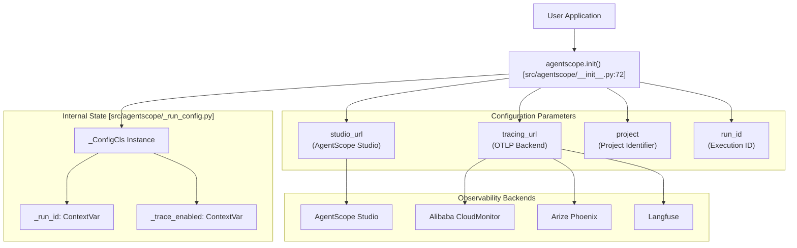
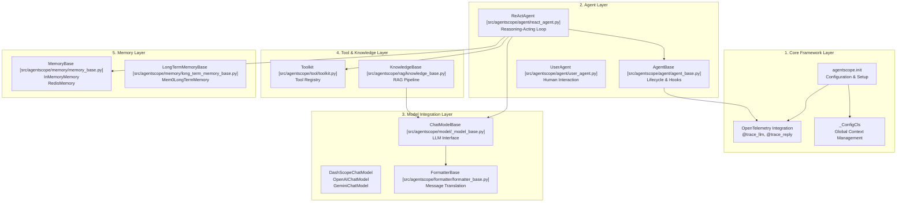
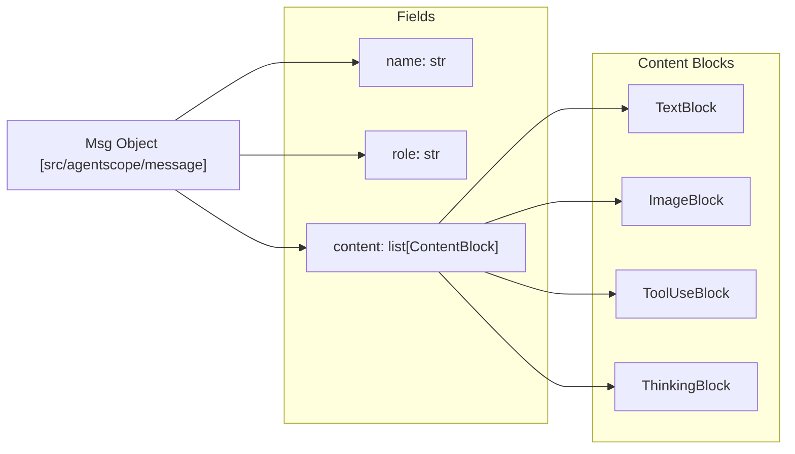

<!-- source: DeepWiki mcp.deepwiki.com · repo modelscope/agentscope · page 1 Overview · fetched 2026-10-26 -->

# Overview

<details>
<summary>Relevant source files</summary>

The following files were used as context for generating this wiki page:

- [.github/workflows/unittest.yml](.github/workflows/unittest.yml)
- [README.md](README.md)
- [README_zh.md](README_zh.md)
- [assets/images/agentscope.png](assets/images/agentscope.png)
- [docs/tutorial/en/src/task_tracing.py](docs/tutorial/en/src/task_tracing.py)
- [docs/tutorial/zh_CN/src/task_tracing.py](docs/tutorial/zh_CN/src/task_tracing.py)
- [src/agentscope/__init__.py](src/agentscope/__init__.py)
- [src/agentscope/_run_config.py](src/agentscope/_run_config.py)
- [src/agentscope/model/_model_base.py](src/agentscope/model/_model_base.py)
- [tests/config_test.py](tests/config_test.py)

</details>


This document provides an introduction to AgentScope, its design philosophy, core capabilities, and high-level architecture. It serves as an entry point for understanding how the framework's major subsystems work together to enable the development of production-ready agentic applications.

For installation instructions and initial setup, see [Installation and Setup](#1.1). For detailed architectural concepts, see [Core Concepts and Architecture](#1.2).

**Sources:** [README.md:58-65](), [README_zh.md:58-65]()

---

## What is AgentScope?

AgentScope is a production-ready agent framework that provides flexible abstractions designed to work with evolving large language model capabilities. The framework includes built-in support for model finetuning and emphasizes leveraging models' native reasoning and tool-use abilities rather than constraining them with rigid prompt engineering or opinionated orchestrations.

The current version is **1.0.17**, requiring Python 3.10 or higher.

**Key Design Features:**

| Feature | Description |
|-----------|-------------|
| **Simple** | Build agents in minutes with built-in `ReActAgent`, tools, memory, planning, and evaluation |
| **Extensible** | Large ecosystem integrations for tools, memory, observability; native MCP and A2A protocol support |
| **Production-ready** | Deploy locally, serverless, or on K8s with built-in OpenTelemetry observability |
| **Multimodal** | Native support for Realtime Voice, TTS, and multimodal message blocks |

**Sources:** [README.md:58-71](), [src/agentscope/__init__.py:66](), [README.md:137-138](), [README.md:82-86]()

---

## Design Philosophy

AgentScope is designed for **increasingly agentic LLMs**. The framework's approach prioritizes:

1. **Model-Driven Reasoning**: Leverage models' native reasoning capabilities rather than imposing fixed workflows.
2. **Flexible Tool Integration**: Enable dynamic tool use through `Toolkit` with middleware support, rather than hardcoded function chains.
3. **Adaptive Memory**: Provide multi-tiered memory (short-term, long-term, knowledge bases) that adapts to context needs.
4. **Observable Execution**: Built-in OpenTelemetry tracing for all components without code changes.
5. **Production Deployment**: First-class support for distributed deployment and state management.

This philosophy manifests in the framework's core abstraction: the **`ReActAgent`**, which orchestrates reasoning and action cycles rather than following predefined state machines.

**Sources:** [README.md:62-64](), [README.md:68-70]()

---

## System Initialization

All AgentScope applications begin with the `agentscope.init()` function, which configures global settings including model connections, observability backends, and runtime parameters. This function populates a thread-safe `_ConfigCls` instance.

### Initialization and Observability Flow



**Initialization Options:**

```python
import agentscope

# Option 1: Connect to AgentScope Studio
agentscope.init(studio_url="http://localhost:5000")

# Option 2: Connect to third-party OTLP backend
agentscope.init(tracing_url="https://your-backend/v1/traces")

# Option 3: No observability
agentscope.init()  # Tracing disabled
```

**Sources:** [src/agentscope/__init__.py:72-158](), [src/agentscope/_run_config.py:6-23](), [docs/tutorial/en/src/task_tracing.py:17-52]()

---

## High-Level Architecture

AgentScope's architecture is organized into major layers, each providing essential capabilities for building production-ready agent applications. The framework emphasizes clear separation of concerns while maintaining tight integration through well-defined interfaces.

### Architecture Overview



**Architecture Layers:**
1. **Core Framework Layer**: Provides initialization (`agentscope.init`), global context (`_ConfigCls`), and OpenTelemetry-based tracing.
2. **Agent Layer**: Implements core agent abstractions with `AgentBase` and built-in `ReActAgent`.
3. **Model Integration Layer**: Abstracts LLM APIs through `ChatModelBase` and `FormatterBase`.
4. **Tool & Knowledge Layer**: Manages external capabilities through `Toolkit` and RAG via `KnowledgeBase`.
5. **Memory Layer**: Provides short-term (InMemory, Redis) and long-term (Mem0, ReMe) storage.

**Sources:** [src/agentscope/__init__.py:43-60](), [src/agentscope/model/_model_base.py:13-37](), [README.md:58-77]()

---

## Major Subsystems

The following table summarizes AgentScope's major subsystems. Each subsystem is documented in detail in dedicated wiki pages.

| Subsystem | Key Components | Purpose | Wiki Section |
|-----------|----------------|---------|--------------|
| **Agent System** | `AgentBase`, `ReActAgent`, `UserAgent` | Core agent abstractions and lifecycle management | [Agent System](#2) |
| **Model Integration** | `ChatModelBase`, `FormatterBase`, provider implementations | Unified LLM API abstraction with provider-agnostic interfaces | [Model Integration](#3) |
| **Tool System** | `Toolkit`, MCP support, middleware | Extensible tool management with dynamic activation | [Tool System](#4) |
| **Memory & State** | `MemoryBase`, `RedisMemory`, `LongTermMemoryBase` | Multi-tiered memory with short-term and long-term storage | [Memory and Knowledge Systems](#5) |
| **Observability** | `@trace_llm`, `@trace_reply`, OTLP support | Built-in tracing with Studio and third-party platform support | [Observability and Evaluation](#7) |

### Core Components Detail

**Agent Layer** (`AgentBase`, `ReActAgent`)
- `AgentBase` provides lifecycle methods and asynchronous execution support.
- `ReActAgent` implements the Reasoning-Acting paradigm with iterative tool use.
- See [AgentBase Foundation](#2.1) and [ReActAgent Implementation](#2.2).

**Model Integration** (`ChatModelBase`, `FormatterBase`)
- `ChatModelBase` provides a unified `__call__` interface for all LLM providers.
- `FormatterBase` translates between internal `Msg` objects and provider-specific API formats.
- See [Model Integration](#3).

**Sources:** [src/agentscope/model/_model_base.py:13-44](), [docs/tutorial/en/src/task_tracing.py:104-162](), [README.md:172-210]()

---

## Message Protocol

AgentScope uses the `Msg` class as the fundamental communication unit. Messages support multimodal content through typed content blocks such as `TextBlock`, `ImageBlock`, and `ToolUseBlock`.

### Message Structure



**Key Features:**
- **Multimodal**: Supports text, images, audio, and video via dedicated block types.
- **Tool Integration**: `ToolUseBlock` for function calls and `ToolResultBlock` for results.
- **Reasoning Traces**: `ThinkingBlock` captures model reasoning (e.g., DeepSeek thinking mode).

**Sources:** [README.md:82-86](), [src/agentscope/__init__.py:45]()

---

## Extensibility Points

AgentScope is designed for extension at multiple levels:

| Extension Point | Base Class | Purpose |
|----------------|------------|---------|
| Agents | `AgentBase` | Custom agent implementations |
| Models | `ChatModelBase` | New LLM provider integrations |
| Formatters | `FormatterBase` | Provider-specific message formatting |
| Memory | `MemoryBase` | Alternative storage backends |

For guidance on extending the framework, see [Extending AgentScope](#9.3).

**Sources:** [src/agentscope/model/_model_base.py:13-44](), [docs/tutorial/en/src/task_tracing.py:111-116]()

---

## Getting Started

Building an agent application involves initializing the framework and defining agents with their respective models and tools.

### Quick Start Example

```python
from agentscope.agent import ReActAgent
from agentscope.model import DashScopeChatModel
import agentscope
import os

# Initialize global configuration
agentscope.init(project="MyProject")

# Create a model instance
model = DashScopeChatModel(
    model_name="qwen-max",
    api_key=os.environ.get("DASHSCOPE_API_KEY"),
    stream=True
)

# Initialize an agent
agent = ReActAgent(
    name="Assistant",
    model=model,
    sys_prompt="You are a helpful assistant."
)
```

For detailed installation instructions, see [Installation and Setup](#1.1).

**Sources:** [src/agentscope/__init__.py:72-80](), [README.md:172-210]()

---

## Community and Resources

- **Documentation**: [https://doc.agentscope.io/](https://doc.agentscope.io)
- **GitHub**: [https://github.com/modelscope/agentscope](https://github.com/modelscope/agentscope)
- **Discord**: [https://discord.gg/eYMpfnkG8h](https://discord.gg/eYMpfnkG8h)
- **License**: Apache 2.0

**Sources:** [README.md:34-45](), [README.md:129]()

---

