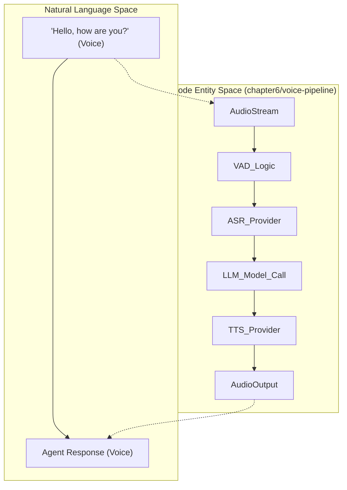
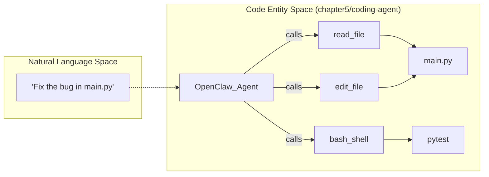

<!-- source: DeepWiki mcp.deepwiki.com · repo bojieli/ai-agent-book · page 12 Glossary · fetched 2026-10-26 -->

# Glossary

Relevant source files

The following files were used as context for generating this wiki page:

- [.github/workflows/i18n-check.yml](.github/workflows/i18n-check.yml)
- [agentbook/providers/__init__.py](agentbook/providers/__init__.py)
- [agentbook/providers/legacy.py](agentbook/providers/legacy.py)
- [agentbook/providers/models.py](agentbook/providers/models.py)
- [agentbook/providers/registry.py](agentbook/providers/registry.py)
- [agentbook/providers/resolution.py](agentbook/providers/resolution.py)
- [book-ar/chapter1.ar.md](book-ar/chapter1.ar.md)
- [book-en/chapter1.md](book-en/chapter1.md)
- [book-es/chapter1.es.md](book-es/chapter1.es.md)
- [book-hu/chapter1.md](book-hu/chapter1.md)
- [book-id/chapter1.md](book-id/chapter1.md)
- [book-ja/chapter1.ja.md](book-ja/chapter1.ja.md)
- [book-ko/chapter1.ko.md](book-ko/chapter1.ko.md)
- [book-ru/chapter1.md](book-ru/chapter1.md)
- [book-ta/chapter1.ta.md](book-ta/chapter1.ta.md)
- [book-tr/chapter1.tr.md](book-tr/chapter1.tr.md)
- [book-vi/chapter1.vi.md](book-vi/chapter1.vi.md)
- [book-zhtw/chapter1.zhtw.md](book-zhtw/chapter1.zhtw.md)
- [book/chapter1.md](book/chapter1.md)
- [book/chapter10.md](book/chapter10.md)
- [book/chapter2.md](book/chapter2.md)
- [book/chapter3.md](book/chapter3.md)
- [book/chapter4.md](book/chapter4.md)
- [book/chapter5.md](book/chapter5.md)
- [book/chapter6.md](book/chapter6.md)
- [book/chapter7.md](book/chapter7.md)
- [book/chapter8.md](book/chapter8.md)
- [book/chapter9.md](book/chapter9.md)
- [book/reference-answers.md](book/reference-answers.md)
- [chapter2/agent-skills-ppt/README.md](chapter2/agent-skills-ppt/README.md)
- [chapter2/agent-skills-ppt/demo.py](chapter2/agent-skills-ppt/demo.py)
- [chapter2/agent-skills-ppt/tests/conftest.py](chapter2/agent-skills-ppt/tests/conftest.py)
- [chapter2/agent-skills-ppt/tests/test_dispatch.py](chapter2/agent-skills-ppt/tests/test_dispatch.py)
- [chapter2/agent-skills-ppt/tests/test_generate_pptx_null_bullets.py](chapter2/agent-skills-ppt/tests/test_generate_pptx_null_bullets.py)
- [chapter2/agent-skills-ppt/tests/test_reasoning_degrade.py](chapter2/agent-skills-ppt/tests/test_reasoning_degrade.py)
- [docs/STATIC_SITE_I18N.md](docs/STATIC_SITE_I18N.md)
- [extras/auto-translate.css](extras/auto-translate.css)
- [extras/auto-translate.js](extras/auto-translate.js)
- [extras/book-theme.css](extras/book-theme.css)
- [extras/lang-switcher.css](extras/lang-switcher.css)
- [extras/lang-switcher.js](extras/lang-switcher.js)
- [extras/nav-collapse.js](extras/nav-collapse.js)
- [extras/search-index-router.js](extras/search-index-router.js)
- [extras/site-nav-i18n.json](extras/site-nav-i18n.json)
- [index.ko.md](index.ko.md)
- [index.md](index.md)
- [mkdocs.yml](mkdocs.yml)
- [overrides/main.html](overrides/main.html)
- [overrides/partials/header.html](overrides/partials/header.html)
- [scripts/build_site.sh](scripts/build_site.sh)
- [scripts/check_i18n_consistency.py](scripts/check_i18n_consistency.py)
- [scripts/site_i18n.py](scripts/site_i18n.py)
- [scripts/split_search_index.py](scripts/split_search_index.py)
- [tests/js/auto-translate.test.js](tests/js/auto-translate.test.js)
- [tests/test_providers.py](tests/test_providers.py)
- [tests/test_resolve_backend_whitespace_model.py](tests/test_resolve_backend_whitespace_model.py)
- [tests/test_site_i18n.py](tests/test_site_i18n.py)
- [tests/test_split_search_index.py](tests/test_split_search_index.py)

This page provides definitions for codebase-specific terms, jargon, and domain concepts used throughout the book and the accompanying repository. It serves as a technical onboarding reference for engineers to map conceptual terminology to specific code entities and implementation patterns.

## 1. Core Architectural Formulas

### Agent = LLM + Context + Tools
The foundational formula of the repository. It defines an Agent not as a monolithic model, but as a system where the LLM acts as the "Brain" (decision-making), Context acts as the "Eyes" (perception/memory), and Tools act as the "Hands/Feet" (action/execution).
*   **Implementation**: This formula is explored through ablation studies in `chapter1/context/main.py`.
*   **Sources**: [book/chapter1.md:11-21](), [book-en/chapter1.md:11-19](), [book-zhtw/chapter1.zhtw.md:11-19](), [book-vi/chapter1.vi.md:11-19]().

### Harness Engineering
The philosophy that an Agent's production-grade reliability comes from the engineering "harness" surrounding the model. The formula is expanded to: **Harness = Model + Context + Tools + Constrain + Verify + Correct**.
*   **Key Concept**: Harnessing the "unpredictable horse" (LLM) into a reliable "workhorse" via engineering guardrails.
*   **Sources**: [book/chapter1.md:23-27](), [book-en/chapter1.md:23-27](), [book/chapter7.md:17-19]().

---

## 2. Execution and Orchestration

### ReAct (Reason-Act-Observe) Loop
A paradigm where the Agent interleaves reasoning traces and action-specific steps. The loop follows: Thought → Action → Observation → Thought.
*   **Code Pointer**: Implemented as a recursive or iterative loop in `chapter1/context/main.py`.
*   **Sources**: [book/chapter2.md:31-37](), [book/chapter1.md:81-82](), [book-en/chapter1.md:81-82]().

### Tool Calling (Function Calling)
A protocol where the LLM outputs a structured request (usually JSON) to invoke a function, rather than just text.
*   **Protocol Steps**: 1. Declaration, 2. Decision, 3. Execution, 4. Response.
*   **Sources**: [book/chapter1.md:79-101](), [book-en/chapter1.md:79-101](), [book/chapter2.md:95-155]().

### Trajectory
The complete sequence of messages in a single session, including system prompts, user inputs, assistant thoughts, tool calls, and tool outputs.
*   **Implementation**: Managed as a message list in `chapter2/local_llm_serving/app.py`.
*   **Sources**: [book/chapter3.md:78-81](), [book/chapter2.md:45-57]().

---

## 3. Context and Memory Systems

### KV Cache Optimization / Prompt Cache
Techniques to maximize the reuse of Key-Value tensors in the transformer's attention mechanism to reduce latency and cost. Prompt Cache specifically refers to reusing the KV cache for static prefixes.
*   **Experiment**: `chapter2/kv-cache/` demonstrates how dynamic system prompts break prefix stability.
*   **Sources**: [book/chapter2.md:35-36](), [mkdocs.yml:129-130]().

### Static Prefix
A portion of the context (e.g., system prompt, tool definitions) that remains constant across multiple turns of a conversation, allowing for KV Cache reuse.
*   **Sources**: [book/chapter2.md:49-57](), [book/chapter10.md:87-90]().

### Agent Skills / SKILL.md
Bundles of specialized knowledge and tools that an Agent can dynamically load and use. `SKILL.md` refers to the markdown file format used to define these skills.
*   **Sources**: [book/chapter10.md:87-90](), [chapter2/agent-skills-ppt/README.md:1-10]().

### Agent Status Bar
A meta-information side-channel within the context window, used to convey critical, concise, and frequently updated information to the Agent without consuming significant token space.
*   **Sources**: [book/chapter6.md:113-115](), [book/chapter7.md:113-115]().

### User Memory / JSON Cards
A persistent storage system for user preferences and facts that spans across different chat sessions.
*   **Storage Formats**: Simple Notes, Enhanced Notes, JSON Cards, and Advanced JSON Cards.
*   **Implementation**: `chapter3/user-memory/` evaluation suite.
*   **Sources**: [book/chapter3.md:88-105](), [book/chapter3.md:113-155]().

### RAG (Retrieval-Augmented Generation) / Agentic RAG
A technique to grant the Agent access to external knowledge by retrieving relevant document chunks and injecting them into the context window.
*   **Sources**: [book/chapter3.md:5-9]().

---

## 4. Model Training and Evaluation

### SFT (Supervised Fine-Tuning)
Training a pre-trained model on a dataset of (Input, Output) pairs to teach it specific behaviors or format adherence.
*   **Sources**: [book/chapter8.md:11-11](), [book/chapter8.md:55-66]().

### RLVR (Reinforcement Learning from Verifiable Rewards)
Using verifiable outcomes (e.g., code execution success, sandbox state) as reward signals for reinforcement learning.
*   **Sources**: [book/chapter8.md:12-12](), [book/chapter10.md:62-65]().

### LoRA (Low-Rank Adaptation)
A parameter-efficient fine-tuning technique that injects small, trainable matrices into the transformer layers.
*   **Sources**: [book/chapter8.md:66-66]().

### GRPO (Group Relative Policy Optimization)
A reinforcement learning algorithm that optimizes policies by comparing rewards within a group of samples, avoiding the need for a separate value network.
*   **Sources**: [book/chapter8.md:80-84]().

### VLA (Vision-Language-Action)
Models that integrate visual perception, language understanding, and physical action capabilities.
*   **Sources**: [book/chapter6.md:27-27]().

### ELO / Bradley-Terry
ELO is a rating system used to rank models. The Bradley-Terry model is a probabilistic model for paired comparisons, often used to derive ratings from head-to-head evaluations.
*   **Sources**: [book/chapter7.md:68-81]().

---

## 5. Agent-Computer Interface (ACI) and Protocols

### ACI (Agent-Computer Interface)
A design philosophy for tools and interfaces optimized for LLM interaction rather than human interaction.
*   **Sources**: [book/chapter4.md:101-104]().

### MCP (Model Context Protocol)
A standard protocol for connecting models to external data sources and tools.
*   **Sources**: [book/chapter1.md:77-78]().

### Proposer-Reviewer Pattern
A multi-agent collaboration pattern where one agent generates a solution and another critiques it.
*   **Sources**: [book/chapter10.md:38-38]().

---

## 6. Development Environment and Utilities

### uv / pyproject.toml
`uv` is used for fast dependency management. `pyproject.toml` defines the environment and extras for the book's experiments.
*   **Sources**: [README.md:75-79]().

### Provider Registry
A centralized system in `agentbook/providers/` for managing and resolving different LLM backends (OpenAI, Anthropic, local, etc.).
*   **Implementation**: [agentbook/providers/registry.py:1-50](), [agentbook/providers/resolution.py:1-50]().

---

## 7. Technical Diagrams

### Diagram 1: Multi-Modal Voice Pipeline (Natural Language to Code)
This diagram maps the natural language concept of "Voice Interaction" to specific processing stages defined in the text.

**Sources**: [book/chapter6.md:25-25]().

### Diagram 2: Coding Agent Tool Interaction
This diagram maps the concept of "Coding Agent" to specific tool call sequences and file entities.

**Sources**: [book/chapter1.md:53-53](), [book/chapter6.md:79-81]().

---

## 8. Glossary Table

| Term | Definition | Code Reference |
| :--- | :--- | :--- |
| **MCP** | Model Context Protocol; standard for tool/data connection. | [book/chapter1.md:77-78]() |
| **SFT** | Supervised Fine-Tuning; imitation learning from demonstrations. | [book/chapter8.md:11-11]() |
| **RLVR** | Reinforcement Learning from Verifiable Rewards. | [book/chapter8.md:12-12]() |
| **LoRA** | Low-Rank Adaptation; efficient fine-tuning. | [book/chapter8.md:66-66]() |
| **GRPO** | Group Relative Policy Optimization; RL without value net. | [book/chapter8.md:80-84]() |
| **Trajectory** | The history of an agent's interactions in a session. | [book/chapter3.md:78-81]() |
| **KV Cache** | Attention mechanism optimization for inference speed. | [book/chapter2.md:35-36]() |
| **Status Bar** | A side-channel in context for meta-info. | [book/chapter6.md:113-115]() |
| **JSON Cards** | Structured format for user memory storage. | [book/chapter3.md:99-101]() |
| **transfer_to_agent** | Tool for switching agent roles in shared context. | [book/chapter10.md:87-90]() |

**Sources**: [book/chapter1.md:1-110](), [book/chapter2.md:1-155](), [book/chapter3.md:1-155](), [book/chapter6.md:1-118](), [book/chapter8.md:1-105](), [book/chapter10.md:1-104]().