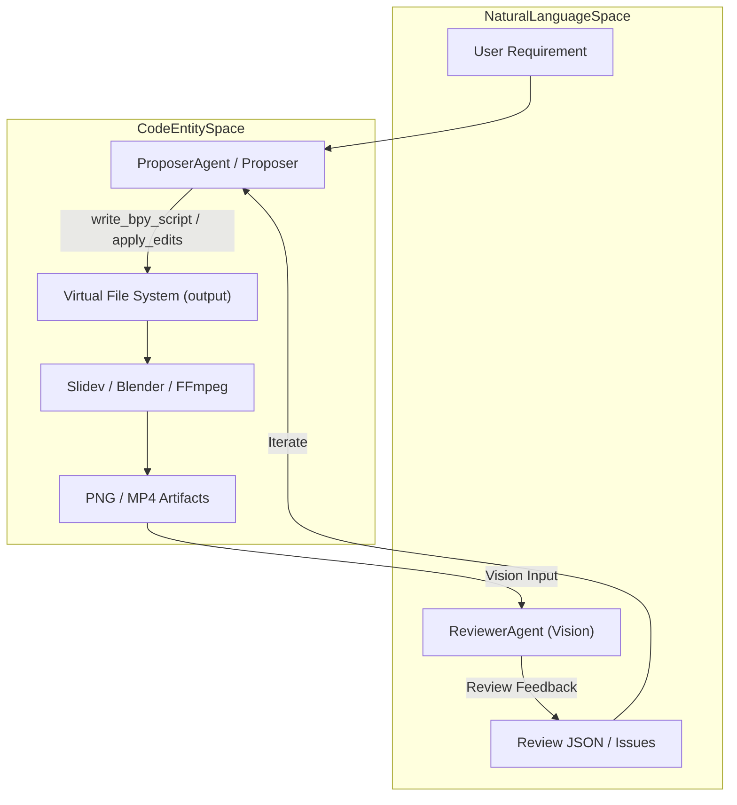
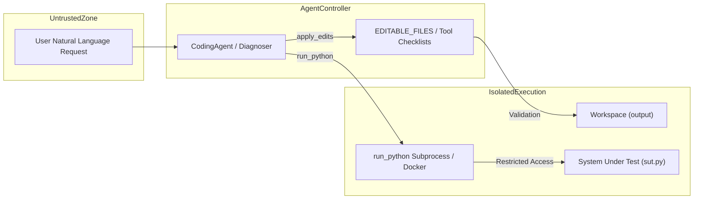

<!-- source: DeepWiki mcp.deepwiki.com · repo bojieli/ai-agent-book · page 6.2 File Editing Strategies and Multi-Agent Feedback Loops · fetched 2026-10-26 -->

# File Editing Strategies and Multi-Agent Feedback Loops

Relevant source files

The following files were used as context for generating this wiki page:

- [.github/workflows/provider-adoption-tests.yml](.github/workflows/provider-adoption-tests.yml)
- [agentbook/providers/openrouter.py](agentbook/providers/openrouter.py)
- [chapter4/multimodal-agent/config.py](chapter4/multimodal-agent/config.py)
- [chapter5/adaptive-log-parser/README.md](chapter5/adaptive-log-parser/README.md)
- [chapter5/code-for-logic/README.md](chapter5/code-for-logic/README.md)
- [chapter5/code-for-logic/demo.py](chapter5/code-for-logic/demo.py)
- [chapter5/code-for-logic/env.example](chapter5/code-for-logic/env.example)
- [chapter5/code-for-logic/test_parse_answer_boolean.py](chapter5/code-for-logic/test_parse_answer_boolean.py)
- [chapter5/code-for-math/README.md](chapter5/code-for-math/README.md)
- [chapter5/code-for-math/demo.py](chapter5/code-for-math/demo.py)
- [chapter5/coding-agent/README.md](chapter5/coding-agent/README.md)
- [chapter5/coding-agent/tests/README.md](chapter5/coding-agent/tests/README.md)
- [chapter5/conversational-ui/README.md](chapter5/conversational-ui/README.md)
- [chapter5/conversational-ui/agent.py](chapter5/conversational-ui/agent.py)
- [chapter5/conversational-ui/backend/main.py](chapter5/conversational-ui/backend/main.py)
- [chapter5/conversational-ui/test_customize_malformed_args.py](chapter5/conversational-ui/test_customize_malformed_args.py)
- [chapter5/dynamic-form/README.md](chapter5/dynamic-form/README.md)
- [chapter5/dynamic-form/demo.py](chapter5/dynamic-form/demo.py)
- [chapter5/dynamic-form/env.example](chapter5/dynamic-form/env.example)
- [chapter5/dynamic-form/generated_form.html](chapter5/dynamic-form/generated_form.html)
- [chapter5/dynamic-form/requirements.txt](chapter5/dynamic-form/requirements.txt)
- [chapter5/dynamic-form/test_round_trip_destination.py](chapter5/dynamic-form/test_round_trip_destination.py)
- [chapter5/dynamic-form/test_summarize_numeric_zero_baggage.py](chapter5/dynamic-form/test_summarize_numeric_zero_baggage.py)
- [chapter5/erp-agent/README.md](chapter5/erp-agent/README.md)
- [chapter5/erp-agent/agent.py](chapter5/erp-agent/agent.py)
- [chapter5/erp-agent/demo.py](chapter5/erp-agent/demo.py)
- [chapter5/erp-agent/test_parse_only.py](chapter5/erp-agent/test_parse_only.py)
- [chapter5/log-diagnosis/README.md](chapter5/log-diagnosis/README.md)
- [chapter5/log-diagnosis/data/PRD.md](chapter5/log-diagnosis/data/PRD.md)
- [chapter5/log-diagnosis/data/architecture.md](chapter5/log-diagnosis/data/architecture.md)
- [chapter5/log-diagnosis/data/trajectories.jsonl](chapter5/log-diagnosis/data/trajectories.jsonl)
- [chapter5/log-diagnosis/demo.py](chapter5/log-diagnosis/demo.py)
- [chapter5/log-diagnosis/diagnoser.py](chapter5/log-diagnosis/diagnoser.py)
- [chapter5/log-diagnosis/env.example](chapter5/log-diagnosis/env.example)
- [chapter5/log-diagnosis/github_mcp.py](chapter5/log-diagnosis/github_mcp.py)
- [chapter5/log-diagnosis/replay.py](chapter5/log-diagnosis/replay.py)
- [chapter5/log-diagnosis/requirements.txt](chapter5/log-diagnosis/requirements.txt)
- [chapter5/log-diagnosis/sut.py](chapter5/log-diagnosis/sut.py)
- [chapter5/log-diagnosis/test_github_mcp_bare_output.py](chapter5/log-diagnosis/test_github_mcp_bare_output.py)
- [chapter5/log-diagnosis/test_replay_latency.py](chapter5/log-diagnosis/test_replay_latency.py)
- [chapter5/paper-to-ppt/README.md](chapter5/paper-to-ppt/README.md)
- [chapter5/paper-to-ppt/agents.py](chapter5/paper-to-ppt/agents.py)
- [chapter5/paper-to-ppt/demo.py](chapter5/paper-to-ppt/demo.py)
- [chapter5/paper-to-ppt/test_null_issues.py](chapter5/paper-to-ppt/test_null_issues.py)
- [chapter5/paper-to-video/README.md](chapter5/paper-to-video/README.md)
- [chapter5/paper-to-video/demo.py](chapter5/paper-to-video/demo.py)
- [chapter5/paper-to-video/test_ffprobe_duration.py](chapter5/paper-to-video/test_ffprobe_duration.py)
- [chapter5/small-model-codified-rules/README.md](chapter5/small-model-codified-rules/README.md)
- [chapter5/small-model-codified-rules/agent.py](chapter5/small-model-codified-rules/agent.py)
- [chapter5/small-model-codified-rules/env.example](chapter5/small-model-codified-rules/env.example)
- [chapter5/video-edit/README.md](chapter5/video-edit/README.md)
- [chapter5/video-edit/agents.py](chapter5/video-edit/agents.py)
- [chapter5/video-edit/blender_editor.py](chapter5/video-edit/blender_editor.py)
- [chapter5/video-edit/demo.py](chapter5/video-edit/demo.py)
- [chapter5/video-edit/ffmpeg_utils.py](chapter5/video-edit/ffmpeg_utils.py)
- [chapter5/video-edit/make_test_video.py](chapter5/video-edit/make_test_video.py)
- [chapter5/video-edit/test_bare_output_filename.py](chapter5/video-edit/test_bare_output_filename.py)
- [chapter5/video-edit/test_extract_json_adjacent.py](chapter5/video-edit/test_extract_json_adjacent.py)
- [chapter5/video-edit/test_slowmo_factor_zero.py](chapter5/video-edit/test_slowmo_factor_zero.py)
- [chapter5/video-edit/test_slowmo_null_factor.py](chapter5/video-edit/test_slowmo_null_factor.py)
- [chapter5/video-edit/video_editor.py](chapter5/video-edit/video_editor.py)

This page details the technical implementation of file editing mechanisms, the architectural patterns for non-textual output generation, and the security models governing autonomous coding agents. It focuses on how agents transition from reasoning to concrete file system modifications and how multi-agent loops provide the necessary verification for complex tasks like UI generation, video editing, and self-repair.

## File Editing Strategies

In a Coding Agent architecture, editing existing files is more complex than simple writing because it requires precision to avoid breaking existing code. The codebase implements three primary strategies for file modification, particularly within the `conversational-ui`, `video-edit`, and `coding-agent` experiments.

### 1. String Replacement and Patching
This mode involves identifying a unique block of text and providing a replacement. The `coding-agent` implements this via specialized tools to minimize context overhead.
*   **Implementation**: The `Edit` tool provides search-and-replace functionality, while `MultiEdit` allows multiple atomic changes in one turn [chapter5/coding-agent/README.md:46-47]().
*   **Safety**: The `Write` and `Edit` tools in the `coding-agent` suite include an **Auto Lint Detection** layer that checks Python, JavaScript, and TypeScript syntax immediately after writing to the disk [chapter5/coding-agent/README.md:96-102]().

### 2. Full File Rewrite (Apply Edits)
For smaller frontend files or complex UI changes, the system often opts for a full rewrite to ensure syntactic integrity.
*   **Mechanism**: The `APPLY_EDITS_TOOL` in the conversational UI agent [chapter5/conversational-ui/agent.py:67-105]() requires the model to return the complete content of the modified file.
*   **Implementation**: The `customize` function [chapter5/conversational-ui/agent.py:128-182]() reads editable sources like `App.jsx` and `theme.css`, sends them to the LLM, and expects a full-content replacement via the `apply_edits` function call.
*   **Validation**: The agent is restricted to a whitelist of `EDITABLE_FILES` [chapter5/conversational-ui/agent.py:36-39]() to prevent accidental corruption of the build system.

### 3. Programmatic Code Generation (Blender bpy)
In the video editing experiment, the agent does not edit the video file directly; instead, it generates a Python script that uses the Blender API (`bpy`) to perform the edits [chapter5/video-edit/video_editor.py:4-13]().
*   **Strategy**: The `apply_edit` function ensures that regardless of the execution backend (Blender or FFmpeg), the Proposer's generated `bpy` script is persisted to `output/edit.py` for verification [chapter5/video-edit/video_editor.py:52-61]().
*   **Execution**: If Blender is available, the system calls `render_with_blender` which executes `blender --background --python` [chapter5/video-edit/video_editor.py:63-65]().

**Sources:** [chapter5/conversational-ui/agent.py:67-105](), [chapter5/video-edit/video_editor.py:4-13](), [chapter5/coding-agent/README.md:96-102]()

---

## Multi-Agent Feedback Loops: Proposer-Reviewer Pattern

For outputs that cannot be easily verified by a compiler (e.g., PPT slides, Video, UI layouts), the system employs a **Proposer-Reviewer** pattern. This is a multi-agent loop where one agent generates the artifact and another evaluates it using multimodal capabilities.

### Vision-Based Feedback Loops (Paper-to-PPT)
The `paper-to-ppt` experiment compares two collaboration modes:
1.  **Dual Agent (Proposer-Reviewer)**: A `Proposer` generates Slidev markdown, a `renderer` produces PNGs, and a `Reviewer` (Vision LLM) provides structured feedback.
2.  **Single Agent (Self-Review)**: A `SelfReviewAgent` generates the slides and then views its own screenshots in the same context to perform revisions.

### Video Editing Feedback
In the `video-edit` experiment, the core logic is decoupled into a `Proposer Agent` that generates the plan and a `Reviewer Agent` that validates the output [chapter5/video-edit/video_editor.py:124-126](). The `Reviewer` can extract keyframes to check if effects like `subtitle` or `slowmo` were applied at the correct timestamps [chapter5/video-edit/video_editor.py:82-99]().

### A2UI: Conversational UI and HMR
The `conversational-ui` project implements a feedback loop through **Hot Module Replacement (HMR)**. When the `customize` agent modifies `App.jsx`, the Vite dev server applies changes instantly [chapter5/conversational-ui/README.md:12-16](). The `demo.py` script then performs automated assertions on the source code (e.g., checking for specific CSS hex codes) followed by a `vite build` to ensure no regressions [chapter5/conversational-ui/README.md:137-143]().

### Multi-Agent Vision Feedback Loop
Title: Multi-Agent Vision Feedback Loop

**Sources:** [chapter5/video-edit/video_editor.py:124-126](), [chapter5/conversational-ui/README.md:12-16](), [chapter5/conversational-ui/agent.py:128-182]()

---

## Agent Bootstrapping and Self-Repair

Agent Bootstrapping refers to the "Self-Evolution" capability where an agent repairs its own environment or code based on diagnostic feedback.

### Log Diagnosis and Regression Testing
The `log-diagnosis` experiment demonstrates a self-repair loop for software bugs [chapter5/log-diagnosis/README.md:56-59]():
1.  **Diagnosis**: The `diagnoser.py` analyzes production logs (`trajectories.jsonl`), architecture docs, and PRDs to identify the root cause of a failure [chapter5/log-diagnosis/README.md:79-82]().
2.  **Test Generation**: The agent generates executable regression tests tied to specific trajectory IDs and turn numbers [chapter5/log-diagnosis/README.md:19-20]().
3.  **Verification**: The `replay.py` framework executes these tests against the System Under Test (`sut.py`). It verifies the bug is reproducible in the "buggy" state and resolved in the "fixed" state [chapter5/log-diagnosis/README.md:142-154]().

### Code-Assisted Logic and Math
In `code-for-math` and `code-for-logic`, the agent "heals" its own reasoning by delegating calculation to a sandbox. The `run_python` tool [chapter5/code-for-math/demo.py:106-126]() allows the model to execute `sympy` or `python-constraint` code, using the sandbox output to correct its internal Chain-of-Thought (CoT) [chapter5/code-for-math/README.md:37-48]().

**Sources:** [chapter5/log-diagnosis/README.md:19-20](), [chapter5/code-for-math/demo.py:106-126](), [chapter5/code-for-math/README.md:37-48]()

---

## Security and Provider Failover Patterns

The repository implements patterns for safely using external services and handling provider-specific limitations.

### Provider Failover and OpenRouter
The `agentbook.providers` package manages the mapping of model IDs and API keys.
*   **OpenRouter Fallback**: If a primary key (e.g., `OPENAI_API_KEY`) is missing, the system automatically routes requests through OpenRouter if `OPENROUTER_API_KEY` is present [chapter5/conversational-ui/agent.py:42-59]().
*   **Model Mapping**: The `map_model_to_openrouter` function handles namespacing (e.g., prefixing `gpt-` with `openai/`) to ensure compatibility across different model families [agentbook/providers/openrouter.py:81-112]().

### Security Boundaries: The Triple Guard
The `small-model-codified-rules` experiment implements a "Triple Guard" security model [chapter5/small-model-codified-rules/README.md:66-74]():
1.  **System Prompt**: Natural language policy.
2.  **Tool Description**: A checklist in the tool schema nudging the model to verify facts before calling.
3.  **Inside Tool (Gatekeeper)**: Codified validation within the tool itself (e.g., `airline_env.is_refundable`) that checks database truth and server time, rejecting illegal model requests [chapter5/small-model-codified-rules/README.md:72-74]().

### Security Architecture Diagram
Title: Security Boundaries and Execution Guardrails

**Sources:** [chapter5/small-model-codified-rules/README.md:66-74](), [agentbook/providers/openrouter.py:81-112](), [chapter5/conversational-ui/agent.py:177-181]()

---

