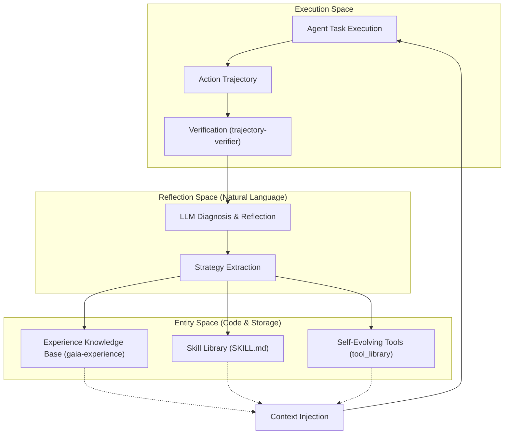
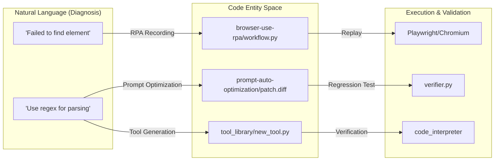

<!-- source: DeepWiki mcp.deepwiki.com · repo bojieli/ai-agent-book · page 9 Agent Self-Evolution (Chapter 8) · fetched 2026-10-26 -->

# Agent Self-Evolution (Chapter 8)

Relevant source files

The following files were used as context for generating this wiki page:

- [book-ar/chapter10.ar.md](book-ar/chapter10.ar.md)
- [book-ar/chapter9.ar.md](book-ar/chapter9.ar.md)
- [book-en/chapter10.md](book-en/chapter10.md)
- [book-en/chapter9.md](book-en/chapter9.md)
- [book-es/chapter10.es.md](book-es/chapter10.es.md)
- [book-es/chapter9.es.md](book-es/chapter9.es.md)
- [book-hu/chapter10.md](book-hu/chapter10.md)
- [book-hu/chapter9.md](book-hu/chapter9.md)
- [book-id/chapter10.md](book-id/chapter10.md)
- [book-id/chapter9.md](book-id/chapter9.md)
- [book-ja/chapter10.ja.md](book-ja/chapter10.ja.md)
- [book-ja/chapter9.ja.md](book-ja/chapter9.ja.md)
- [book-ko/chapter10.ko.md](book-ko/chapter10.ko.md)
- [book-ko/chapter9.ko.md](book-ko/chapter9.ko.md)
- [book-ru/chapter10.md](book-ru/chapter10.md)
- [book-ru/chapter9.md](book-ru/chapter9.md)
- [book-ta/chapter10.ta.md](book-ta/chapter10.ta.md)
- [book-ta/chapter9.ta.md](book-ta/chapter9.ta.md)
- [book-tr/chapter10.tr.md](book-tr/chapter10.tr.md)
- [book-tr/chapter9.tr.md](book-tr/chapter9.tr.md)
- [book-vi/chapter10.vi.md](book-vi/chapter10.vi.md)
- [book-vi/chapter9.vi.md](book-vi/chapter9.vi.md)
- [book-zhtw/chapter10.zhtw.md](book-zhtw/chapter10.zhtw.md)
- [book-zhtw/chapter9.zhtw.md](book-zhtw/chapter9.zhtw.md)

This page provides an overview of **Agent Self-Evolution**, the process by which AI Agents improve their performance, expand their toolsets, and refine their strategies through externalized learning without modifying the underlying model weights. While post-training (Chapter 7) focuses on "making the model smarter," self-evolution focuses on "making the Agent more capable" by converting experiences into reusable external resources.

## Overview: Externalized Learning

Self-evolution addresses the limitations of fixed model parameters. Since deployed models do not change weights during inference, "learning" is constructed as an autonomous system around the model [book-en/chapter9.md:3-11](). This system records evidence, verifies results, and extracts patterns to update the Agent's external components [book-en/chapter9.md:13-17]().

### The Evolution Cycle
The evolution process follows a cycle of capturing execution trajectories, validating them against environmental ground truth, and storing refined knowledge [book-en/chapter9.md:13-15]().

**Agent Evolution Architecture**

**Sources:** [book-en/chapter9.md:15-15](), [book-en/chapter9.md:27-29](), [book-en/chapter9.md:11-11]()

---

## Experience Learning and RPA Workflow Recording {#9.1}

Experience learning transforms raw execution history into actionable intelligence. This involves a three-layer verification structure (Outcome, Process, and Quality) to ensure that only valid experiences are learned [book-en/chapter9.md:27-29]().

### Key Components
*   **Trajectory Verification**: The system uses a multi-dimensional Rubric (Task Outcome, Rule Compliance, Privacy, etc.) to evaluate runs [book-en/chapter9.md:33-34]().
*   **Outcome Verifier**: Reads test results and tool returns to determine if a task was actually completed [book-en/chapter9.md:27-28]().
*   **Process Verifier**: Checks business rules and action sequences to ensure the task was completed in an allowed manner [book-en/chapter9.md:27-28]().
*   **Experience Distillation**: Successful trajectories are summarized to identify recurring steps and effective strategies, distinguishing sound strategies from environmental chance [book-en/chapter9.md:7-7]().

For details, see [Experience Learning and RPA Workflow Recording](#9.1).

**Sources:** [book-en/chapter9.md:7-7](), [book-en/chapter9.md:27-29](), [book-en/chapter9.md:33-34]()

---

## Prompt Distillation and System Prompt Learning {#9.2}

This section focuses on refining the Agent's instructional core and tool library through automated optimization and generation.

### Key Components
*   **Prompt Learning**: The system decides whether to update instructions or programs based on extracted patterns from multiple trajectories [book-en/chapter9.md:11-11]().
*   **Continual Evolution vs. Learning**: Updates are managed as an autonomous system where modifications are first candidate versions, released only after regression testing [book-en/chapter9.md:11-11]().
*   **Tool Evolution**: Agents can be given meta-capabilities to create tools and modify the system, as discussed in the context of meta-tooling [book-en/chapter9.md:13-13]().
*   **Skill Management**: Using `SKILL.md` or similar artifacts to load specific behavior patterns into the trajectory without changing the static system prompt [book-zhtw/chapter10.zhtw.md:89-89]().

For details, see [Prompt Distillation and System Prompt Learning](#9.2).

**Sources:** [book-en/chapter9.md:11-13](), [book-zhtw/chapter10.zhtw.md:89-89]()

---

## Bridging Language and Code Space

The diagram below maps how natural language reflections are converted into specific code entities and storage formats within the evolution loop.

**Evolution Entity Mapping**

**Sources:** [book-en/chapter9.md:11-11](), [book-en/chapter9.md:23-23](), [book-zhtw/chapter10.zhtw.md:25-27]()

### Summary of Evolution Mechanisms

| Mechanism | Storage Format | Primary Benefit | Verification Method |
| :--- | :--- | :--- | :--- |
| **Experience Docs** | Markdown / Vector | Strategy reuse & trap avoidance | Cross-trajectory induction [book-en/chapter9.md:7-7]() |
| **RPA Workflow** | JSON / Python | Speedup & cost reduction | Environmental ground truth [book-en/chapter9.md:23-23]() |
| **Tool Creation** | Python / JSON | New capabilities | Sandbox execution & Type checks [book-en/chapter9.md:23-23]() |
| **Prompt Learning** | Text Diff | Precise rule refinement | Regression testing [book-en/chapter9.md:11-11]() |

**Sources:** [book-en/chapter9.md:7-11](), [book-en/chapter9.md:23-23]()

---

