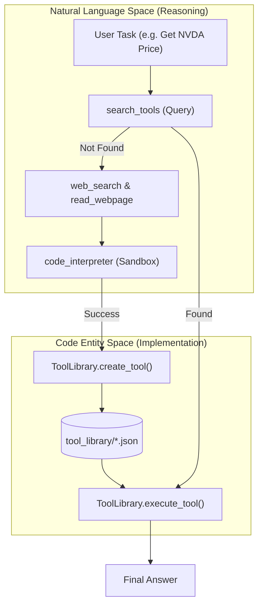
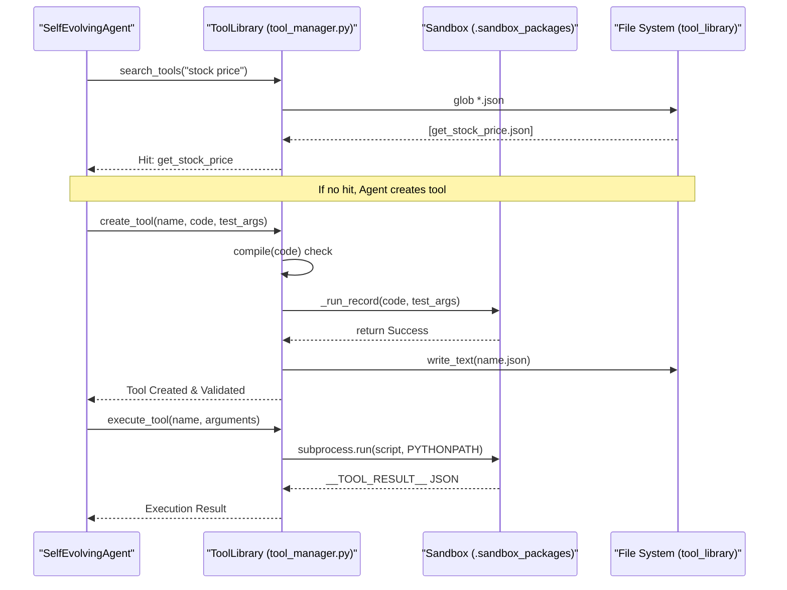

<!-- source: DeepWiki mcp.deepwiki.com · repo bojieli/ai-agent-book · page 9.2 Prompt Distillation and System Prompt Learning · fetched 2026-10-26 -->

# Prompt Distillation and System Prompt Learning

Relevant source files

The following files were used as context for generating this wiki page:

- [book-ar/chapter9.ar.md](book-ar/chapter9.ar.md)
- [book-en/chapter9.md](book-en/chapter9.md)
- [book-es/chapter9.es.md](book-es/chapter9.es.md)
- [book-hu/chapter9.md](book-hu/chapter9.md)
- [book-id/chapter9.md](book-id/chapter9.md)
- [book-ja/chapter9.ja.md](book-ja/chapter9.ja.md)
- [book-ko/chapter9.ko.md](book-ko/chapter9.ko.md)
- [book-ru/chapter9.md](book-ru/chapter9.md)
- [book-ta/chapter9.ta.md](book-ta/chapter9.ta.md)
- [book-tr/chapter9.tr.md](book-tr/chapter9.tr.md)
- [book-vi/chapter9.vi.md](book-vi/chapter9.vi.md)
- [book-zhtw/chapter9.zhtw.md](book-zhtw/chapter9.zhtw.md)
- [chapter8/prompt-distillation/create_data.py](chapter8/prompt-distillation/create_data.py)
- [chapter8/prompt-distillation/evaluate.py](chapter8/prompt-distillation/evaluate.py)
- [chapter8/prompt-distillation/test_create_data_empty.py](chapter8/prompt-distillation/test_create_data_empty.py)
- [chapter8/prompt-distillation/test_evaluate_empty_parse_rate.py](chapter8/prompt-distillation/test_evaluate_empty_parse_rate.py)
- [chapter8/prompt-distillation/test_evaluate_none_pred_label.py](chapter8/prompt-distillation/test_evaluate_none_pred_label.py)

This section covers the mechanisms of **Externalized Learning**—how Agents evolve by accumulating strategies, recording workflows, and refining their internal logic without modifying underlying model weights. It details prompt distillation from reasoning-heavy "thinking" models to efficient "non-thinking" models, iterative system prompt refinement via automated optimization, and the self-evolving tool system.

## 9.2.1 Overview of Self-Evolution

Agent self-evolution is the process of separating knowledge and procedures from transient conversation contexts and static model parameters, externalizing them into persistent, retrievable resources: tool libraries and knowledge bases. While post-training (Chapter 7) makes a model "smarter," self-evolution makes an Agent "more capable" by building a repertoire of specialized skills [book-en/chapter9.md:7-11]().

### The Learning Loop
The evolution cycle follows a Capture → Reflect → Store → Retrieve loop. In the context of tools, this manifests as a "Trial-Verify-Solidify" workflow:
1.  **Trial:** Attempt a task using raw code in a `code_interpreter` [chapter8/self-evolving-tools/base_tools.py:142-152]().
2.  **Verify:** Confirm the code works using `test_args` in a sandbox before registration [chapter8/self-evolving-tools/tool_manager.py:59-63]().
3.  **Solidify:** Wrap the code as a reusable tool with a JSON schema via `create_tool` [chapter8/self-evolving-tools/tool_manager.py:51-52]().

**Sources:** [book-en/chapter9.md:11-17](), [chapter8/self-evolving-tools/tool_manager.py:4-8](), [chapter8/self-evolving-tools/base_tools.py:4-9]()

---

## 9.2.2 Prompt Distillation: Thinking to Non-Thinking Models

Prompt distillation (or context distillation) involves transferring the reasoning capabilities and internalized knowledge of high-parameter "thinking" models (e.g., Qwen3-Thinking) with long prompts into smaller "instruct" models without those prompts [chapter8/prompt-distillation/README.md:9-11]().

### Implementation via TRL SFT
The `chapter8/prompt-distillation/` experiment demonstrates using the Hugging Face TRL library to train a student model to predict responses directly, bypassing explicit reasoning tokens and long system prompts [chapter8/prompt-distillation/README.md:21-23]().

**Data Flow for Distillation:**
1.  **Generation:** A teacher model (e.g., `Qwen3-30B-Thinking`) uses a 2000+ token prompt to generate high-quality labels [chapter8/prompt-distillation/README.md:10-11]().
2.  **Data Structuring:** The `create_data.py` script formats these into simple User/Assistant pairs [chapter8/prompt-distillation/README.md:161-169]().
3.  **Training:** The student (e.g., `Qwen3-30B-Instruct`) is fine-tuned using LoRA (Rank 32, Alpha 16) [chapter8/prompt-distillation/README.md:58-63]().
4.  **Evaluation:** The `evaluate.py` script measures accuracy and latency, typically showing significant speedups [chapter8/prompt-distillation/README.md:40-41]().

**Comparison Metrics (Experiment 7-8):**
| Metric | Teacher (Kimi-k3) | Student (SmolLM2-135M) |
| :--- | :--- | :--- |
| **Accuracy** | 100% | 95% |
| **Mean Latency** | ~4.14s | ~0.02s |
| **Speedup** | 1x | ~196x |
| **Input Tokens** | 30,898 | 7,738 |

**Sources:** [chapter8/prompt-distillation/README.md:5-17](), [chapter8/prompt-distillation/validation/exp7-8-kimi3-smollm2-20260730/comparison.json:4-14]()

---

## 9.2.3 System Prompt Learning and Auto-Optimization

System prompt learning (or "System Prompt Learning" as coined by Andrej Karpathy) is an automated process where the Agent's "operating instructions" are refined based on failure diagnostics [book-zhtw/chapter9.zhtw.md:96-98]().

### Iterative Refinement and Verification
Updates are gated by **boundary sets** (failed cases to improve) and **retention sets** (previously successful cases to prevent regression) [book-zhtw/chapter9.zhtw.md:98-99]().

The `chapter8/prompt-auto-optimization/` experiment uses a `CodingAgent` to apply precise edits:
- **Tool-based Editing:** The agent uses `apply_edits` to perform `old_str` -> `new_str` replacements rather than full rewrites [chapter8/prompt-auto-optimization/coding_agent.py:15-24]().
- **Evidence Manifests:** Modifications are treated as candidate versions. A modification only alters operation after passing regression tests [book-en/chapter9.md:11-12]().
- **Learning Signal:** Feedback from failed trajectories (e.g., "over-escalation to human") drives the optimization [book-zhtw/chapter9.zhtw.md:102-105]().

**Sources:** [book-en/chapter9.md:11-12](), [book-zhtw/chapter9.zhtw.md:96-105](), [chapter8/prompt-auto-optimization/coding_agent.py:15-24]()

---

## 9.2.4 Self-Evolving Tools System

The `tool_manager.py` implements a persistent tool library where an agent can search for existing solutions or create new ones.

### Dynamic Schema Normalization
To ensure compatibility with LLM providers, the system includes `normalize_schema`. This function corrects common model errors, such as providing only a property map without the top-level `{"type": "object"}` wrapper [chapter8/self-evolving-tools/tool_manager.py:22-27]().

### Hierarchical Tool Discovery
To prevent context saturation, the `SelfEvolvingAgent` uses a two-tier approach:
1.  **Meta-Tools:** `web_search`, `read_webpage`, `code_interpreter`, `create_tool`, and `search_tools` [chapter8/self-evolving-tools/demo.py:42-42]().
2.  **Domain-Specific Tools:** Discovered via `search_tools` and loaded dynamically into the context only when relevant [chapter8/self-evolving-tools/tool_manager.py:105-106]().

### Logic Flow: Tool Solidification and Reuse

**Sources:** [chapter8/self-evolving-tools/tool_manager.py:5-8](), [chapter8/self-evolving-tools/tool_manager.py:51-63](), [chapter8/self-evolving-tools/demo.py:39-42]()

---

## 9.2.5 Technical Architecture: The Evolution Pipeline

The `ToolLibrary` class manages the lifecycle of evolved tools, including persistence and execution in a sub-process sandbox.

### Component Interaction Diagram

**Sources:** [chapter8/self-evolving-tools/tool_manager.py:46-52](), [chapter8/self-evolving-tools/tool_manager.py:70-73](), [chapter8/self-evolving-tools/tool_manager.py:155-159](), [chapter8/self-evolving-tools/tool_manager.py:179-180]()

### Key Implementation Details

| Component | Function / Class | Role |
| :--- | :--- | :--- |
| **Tool Registry** | `ToolLibrary` [chapter8/self-evolving-tools/tool_manager.py:43]() | Manages the file-based persistence of tools. |
| **Schema Guard** | `normalize_schema` [chapter8/self-evolving-tools/tool_manager.py:22]() | Fixes invalid JSON schemas from LLMs to prevent 400 errors. |
| **Validation Gate** | `create_tool` (test_args) [chapter8/self-evolving-tools/tool_manager.py:84-90]() | Executes code in sandbox before saving to prevent library pollution. |
| **Sandbox Isolation** | `_run_record` [chapter8/self-evolving-tools/tool_manager.py:165-180]() | Uses `subprocess.run` with a custom `PYTHONPATH` pointing to `.sandbox_packages`. |
| **Dependency Mgmt** | `code_interpreter` (pip_install) [chapter8/self-evolving-tools/base_tools.py:161-167]() | Installs 3rd-party packages to a local target directory for persistent use. |

**Sources:** [chapter8/self-evolving-tools/tool_manager.py:43-180](), [chapter8/self-evolving-tools/base_tools.py:153-172]()

---

