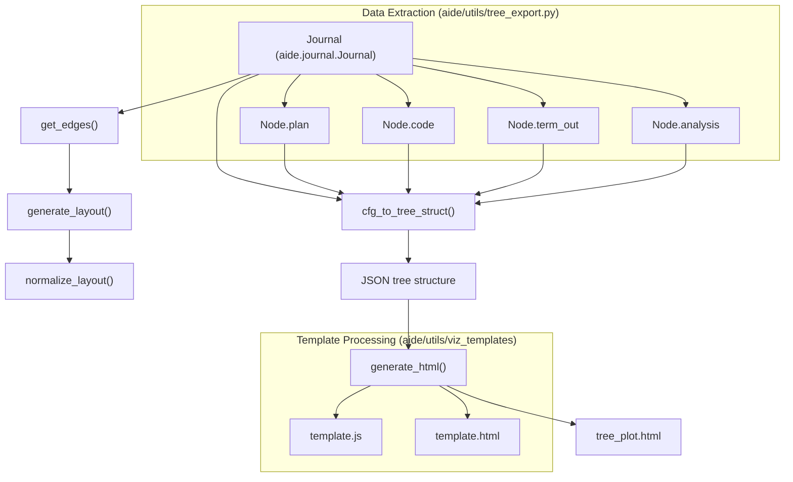
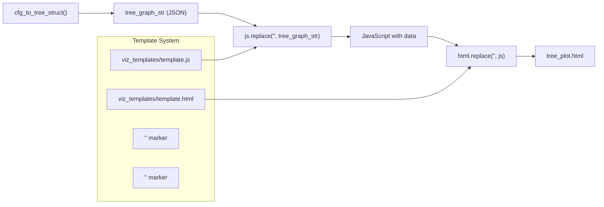
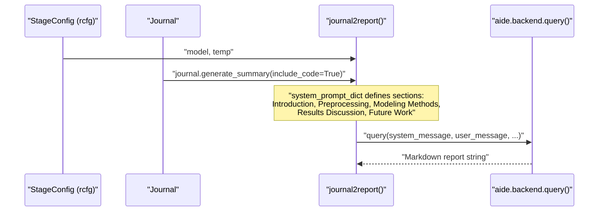

<!-- source: DeepWiki mcp.deepwiki.com · repo WecoAI/aideml · page 5.4 Visualization & Reporting · fetched 2026-10-26 -->

# Visualization & Reporting

Relevant source files

The following files were used as context for generating this wiki page:

- [aide/journal2report.py](aide/journal2report.py)
- [aide/utils/tree_export.py](aide/utils/tree_export.py)
- [aide/utils/viz_templates/template.html](aide/utils/viz_templates/template.html)
- [aide/utils/viz_templates/template.js](aide/utils/viz_templates/template.js)

This document covers AIDE ML's visualization and reporting capabilities, which provide insights into the solution exploration process and generate comprehensive outputs for analysis. The system includes interactive tree visualization of the solution space, data preview generation for agent context, and automated report generation from experiment results.

For information about the underlying data structures that power these visualizations, see [Journal & Data Structures](5.3). For details about the metrics being visualized, see [Metrics & Evaluation](5.5).

## Tree Visualization System

AIDE ML's core visualization feature is an interactive HTML tree that shows the complete solution exploration process. The `tree_export` module converts the journal's solution tree into a web-based visualization that displays the relationships between different code attempts, their outcomes, and the agent's reasoning process.

### Tree Export Pipeline

The tree visualization system extracts solution nodes from the journal and creates a graph layout using the `igraph` library. Each node contains the agent's plan, generated code (cleaned via `strip_code_markers`), execution results, and analysis.

Sources: [aide/utils/tree_export.py:12-95](), [aide/utils/tree_export.py:41-51]()

### Graph Layout Generation

The system uses `igraph` to automatically position nodes in the tree visualization:

| Function | Purpose | Input | Output |
|----------|---------|--------|---------|
| `get_edges()` | Extract parent-child relationships | `Journal` | Edge tuples `(node.step, c.step)` |
| `generate_layout()` | Create graph positions using `layout("rt")` | Node count, edges | Coordinate array |
| `normalize_layout()` | Scale coordinates to [0, 1] | Raw coordinates | Normalized positions |

The layout algorithm uses a "rt" (Reingold-Tilford) layout optimized for tree structures. The coordinates are then normalized, and the Y-axis is inverted (`1 - layout[:, 1]`) to ensure a standard top-down tree view.

Sources: [aide/utils/tree_export.py:12-38]()

### Interactive HTML Generation

The visualization combines JavaScript templates with the solution tree data:

The `generate_html()` function performs string injection to create a self-contained file. The `template.js` uses `p5.js` for rendering the tree and `highlight.js` for syntax highlighting the Python code.

Sources: [aide/utils/tree_export.py:76-94](), [aide/utils/viz_templates/template.html:6-23](), [aide/utils/viz_templates/template.js:12-24]()

## Report Generation

AIDE ML can automatically generate technical reports summarizing the experiment results and findings. The `journal2report` module uses an LLM to analyze the solution journal and create structured markdown reports.

### Report Generation Process

The report generation uses the `aide.backend.query` function, allowing it to leverage any configured LLM provider (OpenAI, Anthropic, etc.).

Sources: [aide/journal2report.py:1-31]()

### Report Structure and Content

The system prompt defines a specific report structure designed for research assistant outputs:

| Section | Purpose |
|---------|---------|
| **Introduction** | Overview of the task and initial approach. |
| **Preprocessing** | Data cleaning and feature engineering steps documented in the journal. |
| **Modelling Methods** | Algorithms, architectures, and hyperparameters used across different nodes. |
| **Results Discussion** | Performance analysis based on metrics and logs. |
| **Future Work** | Potential improvements based on identified bugs or limitations. |

The LLM receives a context prompt containing the `task_desc` and the `report_input` (the summary of all design attempts and outcomes from the journal).

Sources: [aide/journal2report.py:10-31]()

## UI Implementation Details (template.js)

The interactive visualization in `tree_plot.html` is powered by a custom `p5.js` implementation within `template.js`.

### Key JavaScript Components

*   **Node Class**: Represents a solution node. It handles its own rendering (`render()`), animation (`startAnimation()`), and mouse interaction. Clicking a node triggers `setCodeAndPlan()`.
*   **Edge Class**: Represents the relationship between parent and child nodes. It renders as a Bezier curve using `bezierPoint()`.
*   **setCodeAndPlan()**: Updates the HTML elements (`#code` and `#plan`) with the specific content from `treeStructData.code` and `treeStructData.plan` for the selected node.
*   **Animation**: Uses a quintic easing function `animEase()` to smoothly transition nodes and edges into view.

Sources: [aide/utils/viz_templates/template.js:12-24](), [aide/utils/viz_templates/template.js:59-218](), [aide/utils/viz_templates/template.js:220-271]()

### Data Structure for Visualization

The `cfg_to_tree_struct` function prepares a dictionary that is serialized to JSON for the frontend:

| Field | Source | Description |
|-------|--------|-------------|
| `edges` | `get_edges(jou)` | List of `(parent_step, child_step)` pairs. |
| `layout` | `normalize_layout(...)` | List of `[x, y]` coordinates. |
| `plan` | `n.plan` | Text-wrapped agent plans. |
| `code` | `n.code` | Cleaned Python source code. |
| `term_out` | `n.term_out` | Captured stdout/stderr from execution. |
| `analysis` | `n.analysis` | Agent's self-reflection/analysis. |
| `metrics` | `n.metric` | Metric values (currently zero-filled in export). |

Sources: [aide/utils/tree_export.py:54-73]()

---

