# Page: Overview

# Overview

<details>
<summary>Relevant source files</summary>

The following files were used as context for generating this wiki page:

- [README.md](README.md)
- [aide/__init__.py](aide/__init__.py)
- [setup.py](setup.py)

</details>


## Purpose and Scope

This page provides a high-level introduction to the AIDE ML system, explaining what it is, its core concepts, and how its main components fit together. AIDE ML is an autonomous AI agent that generates, executes, and iteratively improves machine learning code through LLM-guided tree search until a user-defined metric is optimized.

For detailed information about specific subsystems, see:
- Installation instructions: [Installation & Setup](#1.1)
- Configuration details: [Configuration System](#2.2)
- User interfaces: [User Interfaces](#3)
- LLM integration: [LLM Backend System](#4)
- Internal components: [Core Subsystems](#5)

**Sources:** [README.md:1-22](), [aide/__init__.py:1-63]()

---

## What is AIDE ML?

AIDE ML (AI-Driven Exploration in the space of code) is a Python package that automates machine learning solution development. Users provide a dataset and natural-language task description, and AIDE autonomously:

1. Generates Python code that addresses the task
2. Executes code in a sandboxed environment
3. Evaluates performance using the specified metric
4. Iteratively improves solutions through LLM-guided search
5. Produces a tree of solution attempts with the best result

The system is distributed as the `aideml` package (version 0.2.2) and exposes the `aide` command-line tool as its primary interface.

| Component | Description |
|-----------|-------------|
| **Package Name** | `aideml` |
| **CLI Entry Point** | `aide` command |
| **Main Python API** | `aide.Experiment` class |
| **Core Algorithm** | Agentic tree search over code solutions |
| **Target Users** | ML practitioners, agent-architecture researchers |

**Sources:** [README.md:19-35](), [setup.py:9-41]()

---

## Core Architecture

AIDE ML's architecture consists of four primary components orchestrated by the `Experiment` class:

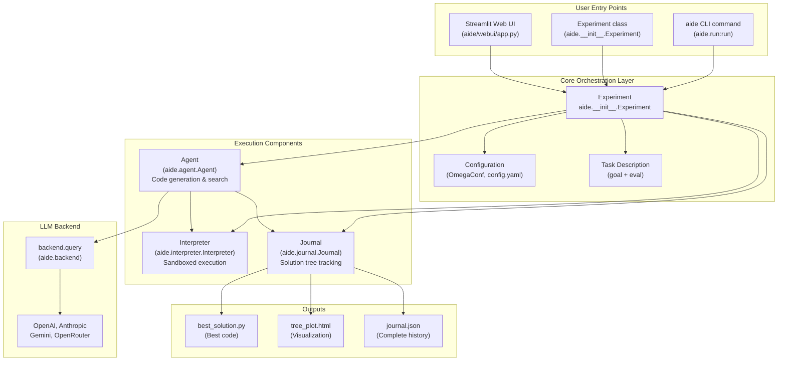

**Diagram: AIDE ML Core Architecture - Main Classes and Their Relationships**

The `Experiment` class ([aide/__init__.py:23-63]()) serves as the central orchestrator, initializing and coordinating the three execution components:

- **`Agent`** ([aide/agent/]()): Generates code using LLMs and manages the search process
- **`Interpreter`** ([aide/interpreter.py]()): Executes generated code in isolated subprocess environments
- **`Journal`** ([aide/journal.py]()): Maintains a tree structure of all solution attempts with metrics

**Sources:** [aide/__init__.py:23-63](), [setup.py:36-40]()

---

## Agentic Tree Search Workflow

AIDE operates through an iterative tree search algorithm where each node represents a complete Python solution:

```mermaid
graph LR
    subgraph "Step 1: Initialization"
        A["Load config.yaml<br/>(prep_cfg)"]
        B["Prepare workspace<br/>(prep_agent_workspace)"]
        C["Initialize Journal<br/>(Journal())"]
    end
    
    subgraph "Step 2: Iterative Loop"
        D["agent.step()<br/>Generate code drafts"]
        E["interpreter.run()<br/>Execute in sandbox"]
        F["Compute metric<br/>(RMSE, AUROC, etc)"]
        G["journal records<br/>node with metric"]
        H["Prune & select<br/>next node"]
    end
    
    subgraph "Step 3: Output"
        I["journal.get_best_node()<br/>Extract top solution"]
        J["save_run()<br/>Write logs/"]
        K["Return Solution<br/>(code + valid_metric)"]
    end
    
    A --> B
    B --> C
    C --> D
    D --> E
    E --> F
    F --> G
    G --> H
    H --> D
    H --> I
    I --> J
    J --> K
```

**Diagram: Experiment Execution Flow Through Main Methods**

The workflow is implemented in the `Experiment.run()` method ([aide/__init__.py:55-62]()):

1. **Initialization**: Load configuration, prepare workspace with data files, create `Journal` instance ([aide/__init__.py:33-54]())
2. **Iteration Loop**: For each step (default 20):
   - `agent.step()` generates multiple code variations using LLMs
   - `interpreter.run()` executes each variation in a subprocess sandbox
   - Metrics are computed and recorded in the journal
   - Search heuristics select the next node to expand
3. **Output**: Extract best solution, save artifacts to `logs/` directory ([aide/__init__.py:58-62]())

The `Solution` dataclass ([aide/__init__.py:17-20]()) encapsulates the return value with two fields:
- `code`: The best Python solution as a string
- `valid_metric`: The validation metric value achieved

**Sources:** [aide/__init__.py:17-63]()

---

## User Interaction Model

AIDE provides three distinct interfaces that all converge on the `Experiment` class:

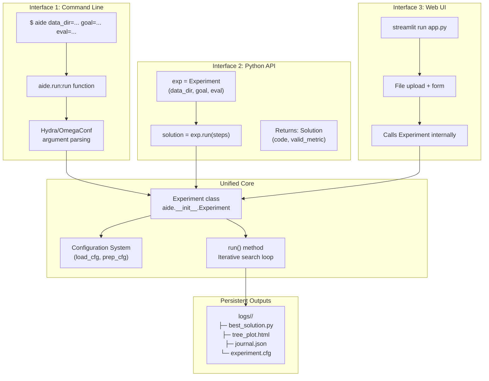

**Diagram: Three User Interfaces Converging on the Experiment Class**

### CLI Usage
The `aide` command ([setup.py:36-40]()) invokes `aide.run:run` with Hydra-based configuration:
```bash
aide data_dir="example_tasks/house_prices" \
     goal="Predict the sales price for each house" \
     eval="RMSE between log-prices"
```

### Python API Usage
Direct instantiation of `Experiment` ([aide/__init__.py:24-37]()):
```python
exp = aide.Experiment(
    data_dir="example_tasks/bitcoin_price",
    goal="Build a time series forecasting model",
    eval="RMSLE"
)
solution = exp.run(steps=20)
```

### Web UI Usage
Streamlit application at `aide/webui/app.py` provides file upload and form-based interaction ([README.md:93-103]()).

**Sources:** [README.md:69-151](), [aide/__init__.py:23-63](), [setup.py:36-40]()

---

## Key Concepts

### Task Specification
Tasks are defined through natural language descriptions consisting of:
- **`data_dir`**: Path to directory containing CSV, TXT, or JSON data files
- **`goal`**: Description of the objective (e.g., "Predict house prices")
- **`eval`**: Metric specification (e.g., "RMSE", "AUROC", "accuracy")

The `load_task_desc()` function ([aide/utils/config.py:9]()) compiles these into a structured format that guides code generation.

### Solution Tree
The `Journal` class ([aide/__init__.py:5]()) maintains a tree where:
- Each **node** represents a complete Python solution
- **Edges** represent code modifications (patches)
- **Metrics** guide which branches to expand
- The **root** is an initial solution generated from scratch

### Agentic Search
The `Agent` generates multiple code drafts per iteration (`num_drafts` parameter), creating a branching tree. Search hyperparameters control exploration vs. exploitation trade-offs.

**Sources:** [aide/__init__.py:39-49](), [README.md:36-40]()

---

## Output Artifacts

After execution, AIDE writes to `logs/<experiment-id>/`:

| File | Description | Generated By |
|------|-------------|--------------|
| `best_solution.py` | Python code with best metric | `journal.get_best_node()` |
| `tree_plot.html` | Interactive solution tree visualization | Tree plotting utilities |
| `journal.json` | Complete history of all attempts | `Journal.to_dict()` |
| `experiment.cfg` | Configuration snapshot | `save_run()` |
| `report.md` | Optional LLM-generated summary | Report generator |

The `save_run()` function ([aide/utils/config.py:11]()) persists these artifacts after each step, enabling fault tolerance and incremental progress tracking.

**Sources:** [README.md:86-89](), [aide/__init__.py:58-62]()

---

## Configuration and Extensibility

AIDE uses OmegaConf for hierarchical configuration management. The base configuration resides at `aide/utils/config.yaml` and supports CLI overrides:

```bash
aide agent.code.model="claude-4-sonnet" \
     agent.steps=50 \
     agent.search.num_drafts=10 \
     data_dir=... goal=... eval=...
```

Common configuration parameters:

| Parameter | Default | Purpose |
|-----------|---------|---------|
| `agent.code.model` | `gpt-4-turbo` | LLM for code generation |
| `agent.feedback.model` | `gpt-4o` | LLM for analysis/feedback |
| `agent.steps` | `20` | Number of search iterations |
| `agent.search.num_drafts` | `5` | Parallel drafts per iteration |
| `exec.timeout` | `300` | Code execution timeout (seconds) |

The `prep_cfg()` function ([aide/utils/config.py:13]()) merges CLI arguments with YAML defaults and performs validation.

**Sources:** [README.md:107-123](), [aide/__init__.py:33-37]()

---

## Multi-Provider LLM Support

The backend abstraction layer supports multiple LLM providers through a unified interface:

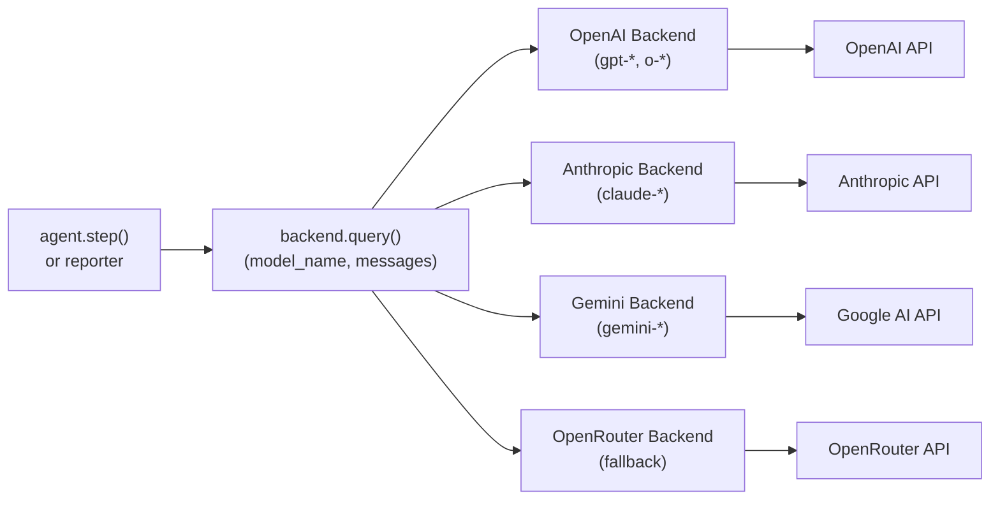

**Diagram: LLM Backend Provider Routing**

Provider selection is automatic based on model name patterns. Custom OpenAI-compatible endpoints are supported via the `OPENAI_BASE_URL` environment variable ([README.md:160]()).

**Sources:** [README.md:157-173]()

---

## Research Context

AIDE ML implements the AIDE algorithm described in [arXiv:2502.13138](https://arxiv.org/abs/2502.13138). The system has been used as a baseline or component in multiple research projects:

- **OpenAI MLE-Bench**: AIDE's tree search achieved 4× more medals than the best linear agent ([README.md:39]())
- **METR RE-Bench**: Evaluation of AI R&D capabilities ([README.md:59]())
- **Sakana AI AI-Scientist-v2**: Workshop-level automated scientific discovery ([README.md:60]())
- **Meta LLM Speedrunner**: Reproducing NanoGPT improvements ([README.md:61]())
- **SJTU ML-Master**: Integration of exploration and reasoning ([README.md:63]())

This open-source implementation serves as a reference for researchers exploring agentic systems for code optimization.

**Sources:** [README.md:39-64]()

---

# Page: Installation & Setup

# Installation & Setup

<details>
<summary>Relevant source files</summary>

The following files were used as context for generating this wiki page:

- [.dockerignore](.dockerignore)
- [Dockerfile](Dockerfile)
- [README.md](README.md)
- [aide/utils/metric.py](aide/utils/metric.py)
- [requirements.txt](requirements.txt)
- [setup.py](setup.py)

</details>


This document provides instructions for installing AIDE ML and configuring its dependencies. It covers standard pip installation, API key setup for LLM providers, local LLM configuration, Docker deployment, and development installation.

---

## Standard Installation

AIDE ML is distributed as the `aideml` package on PyPI. The package requires Python 3.10 or higher [setup.py:34]().

### Basic Installation

```bash
pip install -U aideml
```

This installs the `aide` command-line tool and the `aide` Python package. The package version is defined in [setup.py:11]() as `0.2.2`.

**What Gets Installed**

The installation includes:
- **Console script**: `aide` command via entry point [setup.py:38]().
- **Core package**: `aide` module with all subsystems [setup.py:18]().
- **Example tasks**: Sample datasets in `aide/example_tasks/` [setup.py:24-26]().
- **Configuration templates**: Default config at `aide/utils/config.yaml` [setup.py:22]().
- **Visualization templates**: HTML templates for tree rendering [setup.py:23]().

**Sources**: [setup.py:1-42](), [README.md:74-75]()

---

## Dependency Structure

AIDE ML uses a two-tier dependency architecture that separates system requirements from agent capabilities [requirements.txt:1,24]().

### Installation Architecture

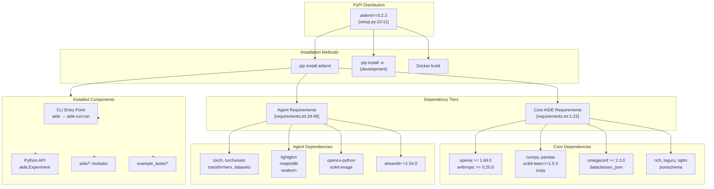

**Sources**: [setup.py:1-42](), [requirements.txt:1-95]()

### Dependency Categories

| Category | Purpose | Key Packages | Lines in requirements.txt |
|----------|---------|--------------|---------------------------|
| **LLM Integration** | Connect to AI model providers | `openai`, `anthropic` | [requirements.txt:7-8]() |
| **Data Science** | Core ML and data processing | `numpy`, `pandas`, `scikit-learn`, `scipy` | [requirements.txt:6,9,12,14]() |
| **Configuration** | YAML-based config management | `omegaconf`, `dataclasses_json` | [requirements.txt:16,15]() |
| **Utilities** | Logging, progress, formatting | `rich`, `loguru`, `tqdm` | [requirements.txt:13,17,19]() |
| **Development** | Testing and code formatting | `pytest`, `black` | [requirements.txt:10,2]() |
| **Agent Toolkit** | Libraries agent may use | `torch`, `lightgbm`, `transformers`, `optuna` | [requirements.txt:25-95]() |

The separation between core and agent requirements is documented at [requirements.txt:1]() and [requirements.txt:24](). Core requirements are minimal dependencies for AIDE system operation. Agent requirements are comprehensive ML libraries that generated code may import.

**Sources**: [requirements.txt:1-95](), [setup.py:5-7]()

---

## API Key Configuration

AIDE ML supports multiple LLM providers. At minimum, one provider's API key must be configured via environment variables.

### Supported Providers

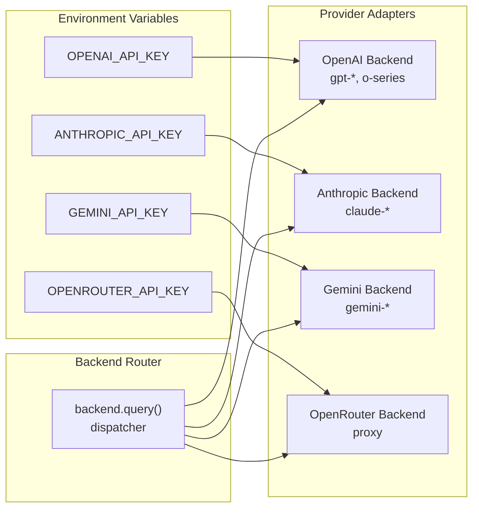

**Sources**: [README.md:78,160,168]()

### Setting API Keys

Export the appropriate environment variable before running AIDE:

```bash
# OpenAI (recommended for default config)
export OPENAI_API_KEY="sk-..."

# Anthropic
export ANTHROPIC_API_KEY="sk-ant-..."

# Gemini
export GEMINI_API_KEY="..."

# OpenRouter (fallback provider)
export OPENROUTER_API_KEY="..."
```

**Default Model Requirements**

The default configuration uses OpenAI models:
- Code generation: `gpt-4-turbo` [README.md:120]().
- Feedback/evaluation: `gpt-4o` [README.md:164]().

To use other providers, override the model selection via CLI flags:
`aide agent.code.model="claude-3-5-sonnet-20240620" ...` [README.md:111-113]().

**Sources**: [README.md:78,111-122]()

---

## Local LLM Setup

AIDE supports local LLM endpoints that implement the OpenAI API specification [README.md:160]().

### Configuration Flow

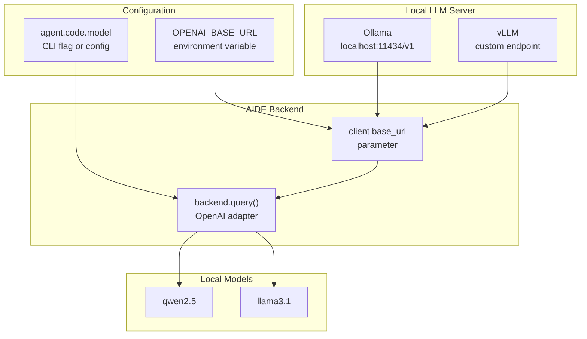

**Sources**: [README.md:157-162]()

### Ollama Example

**1. Configure AIDE**

```bash
# Point to Ollama endpoint
export OPENAI_BASE_URL="http://localhost:11434/v1"

# Use local model for code generation
aide agent.code.model="qwen2.5" \
     data_dir=... \
     goal=... \
     eval=...
```

**2. Fully Local Setup**

To avoid all external API calls, override both the code and feedback models:

```bash
export OPENAI_BASE_URL="http://localhost:11434/v1"

aide agent.code.model="qwen2.5" \
     agent.feedback.model="qwen2.5" \
     data_dir=... \
     goal=... \
     eval=...
```

**Sources**: [README.md:157-172]()

---

## Docker Installation

AIDE provides a `Dockerfile` for containerized execution, which is useful for sandboxing the agent's code execution.

### Docker Build and Run

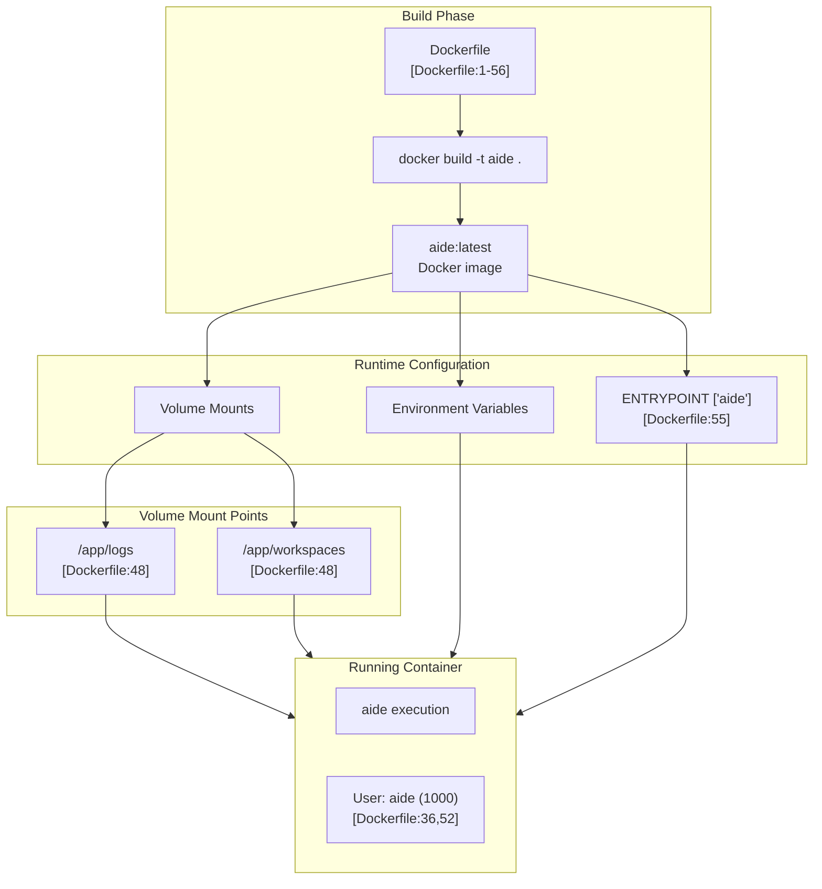

**Sources**: [Dockerfile:1-56](), [README.md:175-184]()

### Docker Commands

**Build Image**
```bash
docker build -t aide .
```

**Run Experiment**
```bash
docker run -it --rm \
  -v "$(pwd)/logs:/app/logs" \
  -v "$(pwd)/workspaces:/app/workspaces" \
  -e OPENAI_API_KEY=$OPENAI_API_KEY \
  aide data_dir=... goal=... eval=...
```

The container runs as a non-root user `aide` [Dockerfile:36,52]() and exposes volumes for persistent logging and workspace data [Dockerfile:48-49]().

---

## Verification

Verify the setup by running a quick test using the included example tasks [setup.py:24-26]().

```bash
# Run a 2-step optimization on the house prices example
aide data_dir="example_tasks/house_prices" \
     goal="Predict the sales price for each house" \
     eval="RMSE between log-prices" \
     agent.steps=2
```

**Expected Outputs** [README.md:86-90]():
- `logs/<id>/best_solution.py`: The best generated Python script.
- `logs/<id>/tree_plot.html`: An interactive visualization of the search tree.

**Sources**: [README.md:73-90](), [setup.py:36-40]()

---

# Page: Key Concepts

# Key Concepts

<details>
<summary>Relevant source files</summary>

The following files were used as context for generating this wiki page:

- [README.md](README.md)
- [aide/journal.py](aide/journal.py)
- [aide/utils/metric.py](aide/utils/metric.py)
- [requirements.txt](requirements.txt)

</details>


This page introduces the core terminology and concepts used throughout AIDE ML. Understanding these concepts is essential for working with the system, whether through the CLI, Python API, or Web UI.

---

## Overview: What AIDE Does

AIDE ML performs **agentic tree search** in the space of code solutions. Given a machine learning task (specified as a dataset + goal + evaluation metric), AIDE autonomously generates, executes, and refines Python code until it finds a high-performing solution.

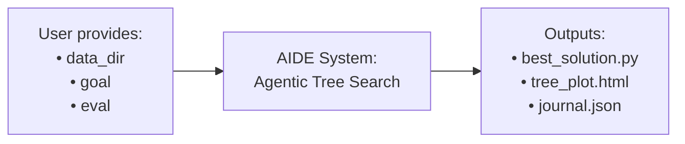

**Sources:** [README.md:19-39](), [aide/journal.py:1-8]()

---

## Agentic Tree Search

The **agentic tree search** algorithm is AIDE's core mechanism for exploring the solution space. Unlike linear approaches that refine a single solution sequentially, tree search maintains multiple solution candidates simultaneously and explores the most promising branches.

### How It Works

1.  **Start with a seed node** - Initial code generated from task description.
2.  **Generate drafts** - LLM creates multiple code variations (configured via `num_drafts`).
3.  **Execute and evaluate** - Each draft runs in a sandbox; results are captured.
4.  **Create child nodes** - Successful variations become new `Node` objects in the `Journal`.
5.  **Prune and select** - Best-performing nodes (highest `MetricValue`) guide the next iteration.
6.  **Repeat** - Process continues for configured `agent.steps`.

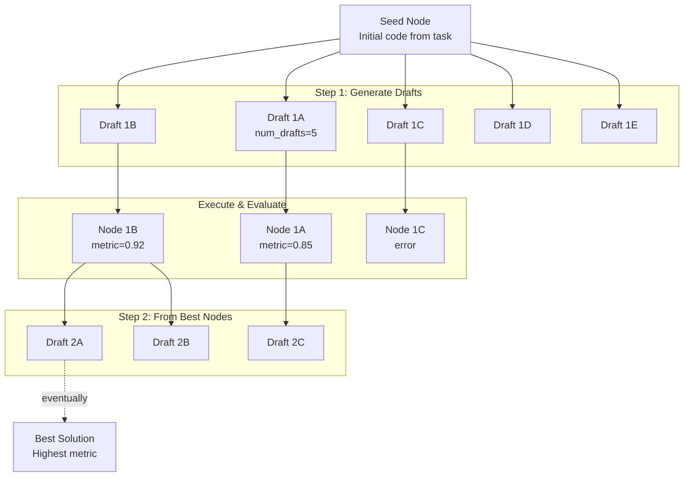

**Sources:** [README.md:39-40](), [aide/journal.py:172-181]()

---

## Solution Tree Structure

The **solution tree** is a directed graph where each node represents a complete Python solution, and edges represent the evolution from parent to child.

### Tree Components

| Component | Description | Code Reference |
| :--- | :--- | :--- |
| **Node** | A single code sample + execution results | `aide.journal.Node` [aide/journal.py:22-50]() |
| **Journal** | The collection of nodes representing the tree | `aide.journal.Journal` [aide/journal.py:135-138]() |
| **Parent/Child** | Links defining the tree topology | `Node.parent`, `Node.children` [aide/journal.py:33-34]() |
| **Draft Node** | Initial solution drafts with no parent | `Journal.draft_nodes` [aide/journal.py:154-156]() |
| **Leaf** | A node with no children | `Node.is_leaf` [aide/journal.py:81-83]() |

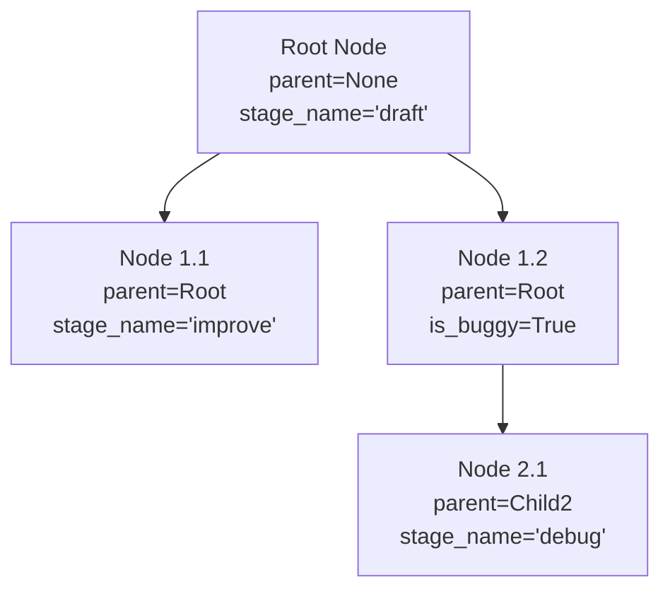

**Sources:** [aide/journal.py:56-65](), [aide/journal.py:154-156]()

---

## Nodes: Code Solutions and Their Context

A `Node` encapsulates the code, execution metadata, and evaluation metrics.

### Node Anatomy

| Attribute | Role | Code Pointer |
| :--- | :--- | :--- |
| `code` | The Python script generated by the LLM | [aide/journal.py:26]() |
| `plan` | The LLM's natural language design for the code | [aide/journal.py:27]() |
| `metric` | A `MetricValue` object representing performance | [aide/journal.py:46]() |
| `is_buggy` | Boolean flag indicating if code failed or has no metric | [aide/journal.py:49]() |
| `_term_out` | Captured terminal output from execution | [aide/journal.py:37]() |
| `exc_info` | Exception information if execution failed | [aide/journal.py:40]() |

### Node Stages
A node's `stage_name` is determined by its position and parent's status:
*   **draft**: No parent [aide/journal.py:63-64]().
*   **debug**: Parent exists and `is_buggy` is True [aide/journal.py:65]().
*   **improve**: Parent exists and is not buggy [aide/journal.py:65]().

**Sources:** [aide/journal.py:22-101]()

---

## Metrics: Guiding the Search

Metrics are represented by the `MetricValue` class, which allows for comparisons where "greater than" means "better than," regardless of whether the objective is to maximize or minimize.

### Optimization Logic

*   **Maximize**: `MetricValue(0.9, maximize=True) > MetricValue(0.8, maximize=True)` is True.
*   **Minimize**: `MetricValue(10.0, maximize=False) > MetricValue(20.0, maximize=False)` is True (lower is better).
*   **Errors**: `WorstMetricValue` always compares worse than any valid metric [aide/utils/metric.py:66-70]().

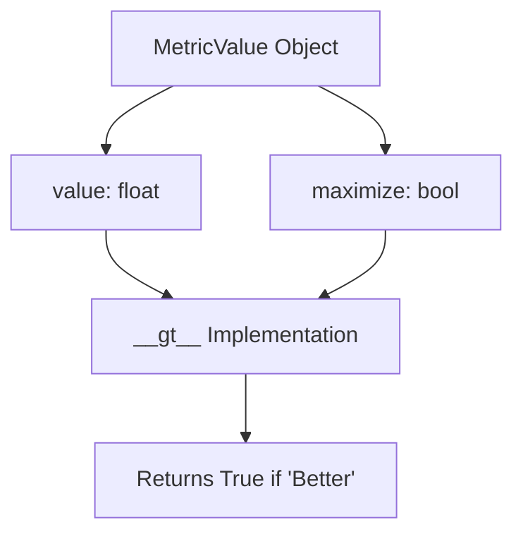

**Sources:** [aide/utils/metric.py:11-38](), [aide/utils/metric.py:66-79]()

---

## Task Specification: Goal and Eval

AIDE uses natural language to define the objective.

*   **Goal**: A string describing the task (e.g., "Build a time series forecasting model").
*   **Eval**: A string describing the metric (e.g., "RMSLE").

The system uses these to guide the LLM's `plan` and subsequent `code` generation. The results of execution are then parsed to populate the `Node.metric`.

**Sources:** [README.md:137-141](), [aide/journal.py:182-191]()

---

## The Journal: Recording the Search

The `Journal` acts as a central repository for all nodes explored during an experiment.

### Key Capabilities
*   **Best Node Selection**: `get_best_node()` finds the node with the highest `MetricValue` among non-buggy nodes [aide/journal.py:172-181]().
*   **Summary Generation**: `generate_summary()` creates a text overview of all successful designs and their metrics for the LLM to use as context [aide/journal.py:182-192]().
*   **Persistence**: The `Journal` is a `DataClassJsonMixin`, allowing it to be serialized to `journal.json` [aide/journal.py:135]().

**Sources:** [aide/journal.py:135-192]()

---

## LLM-Driven Optimization Process

The optimization is an iterative cycle managed by the `Agent`.

1.  **Drafting**: The agent proposes code based on the `goal`.
2.  **Interpreting**: The `Interpreter` executes the code and returns an `ExecutionResult` [aide/journal.py:67]().
3.  **Absorbing**: The node "absorbs" the execution result (stdout, time, exceptions) [aide/journal.py:67-73]().
4.  **Analyzing**: The agent analyzes the output to update `Node.analysis` and `Node.metric` [aide/journal.py:44-46]().
5.  **Refining**: If the node is buggy, it enters a "debug" path; if successful, it enters an "improve" path [aide/journal.py:56-65]().

**Sources:** [aide/journal.py:67-73](), [README.md:39-40]()

---

# Page: Example Tasks & Sample Results

# Example Tasks & Sample Results

<details>
<summary>Relevant source files</summary>

The following files were used as context for generating this wiki page:

- [LICENSE](LICENSE)
- [aide/agent.py](aide/agent.py)
- [aide/example_tasks/bitcoin_price.md](aide/example_tasks/bitcoin_price.md)
- [aide/example_tasks/bitcoin_price/BTC-USD.csv](aide/example_tasks/bitcoin_price/BTC-USD.csv)
- [aide/example_tasks/house_prices.md](aide/example_tasks/house_prices.md)
- [aide/example_tasks/house_prices/data_description.txt](aide/example_tasks/house_prices/data_description.txt)
- [aide/example_tasks/house_prices/sample_submission.csv](aide/example_tasks/house_prices/sample_submission.csv)
- [aide/example_tasks/house_prices/test.csv](aide/example_tasks/house_prices/test.csv)
- [aide/example_tasks/house_prices/train.csv](aide/example_tasks/house_prices/train.csv)
- [sample_results/bike-sharing-demand.py](sample_results/bike-sharing-demand.py)
- [sample_results/digit-recognizer.py](sample_results/digit-recognizer.py)
- [sample_results/house-prices-advanced-regression-techniques.py](sample_results/house-prices-advanced-regression-techniques.py)
- [sample_results/nlp-getting-started.py](sample_results/nlp-getting-started.py)
- [sample_results/spaceship-titanic.py](sample_results/spaceship-titanic.py)

</details>


This document showcases the example tasks included with AIDE ML, demonstrates how to structure custom tasks, and documents the benchmark results generated across various data science competitions.

---

## Purpose and Scope

AIDE ML is designed to autonomously solve data science problems by performing a tree search over possible code solutions. To facilitate testing and benchmarking, the repository includes:

- **Included example tasks**: Pre-packaged datasets (House Prices, Bitcoin Price) used for local validation.
- **Benchmark results**: A collection of 66+ AIDE-generated solutions for Kaggle competitions located in the `sample_results/` directory.
- **Custom task guidelines**: Technical specifications for data directory layouts and goal definitions.

---

## Included Example Tasks

AIDE provides two built-in examples that represent common machine learning patterns: regression and time series forecasting.

| Task Name | Domain | Files | Goal |
|-----------|--------|-------|------|
| **House Prices** | Tabular Regression | `train.csv`, `test.csv`, `data_description.txt` | Predict the `SalePrice` variable for house IDs in the test set [aide/example_tasks/house_prices.md:1-2](). |
| **Bitcoin Price** | Time Series | `BTC-USD.csv` | Build a time series forecasting model for the Bitcoin close price [aide/example_tasks/bitcoin_price.md:1-2](). |

### Task Specification Details
The `house_prices` task includes a detailed `data_description.txt` [aide/example_tasks/house_prices/data_description.txt:1-30]() which AIDE uses to understand feature semantics (e.g., `MSSubClass`, `MSZoning`). Both tasks specify the evaluation metric as **Root-Mean-Squared-Error (RMSE)** between the logarithms of predicted and observed values [aide/example_tasks/house_prices.md:8-9](), [aide/example_tasks/bitcoin_price.md:4-5]().

---

## Benchmark Solutions (sample_results)

The `sample_results/` directory contains high-quality Python scripts generated by AIDE for various Kaggle competitions. These serve as benchmarks for the system's performance and as templates for human data scientists.

### Key Benchmark Examples

| Competition | Implementation Highlights | File Reference |
|-------------|---------------------------|----------------|
| **House Prices** | Uses interaction terms (e.g., `OverallQual_X_GrLivArea`), `SimpleImputer`, and `Lasso` regression [sample_results/house-prices-advanced-regression-techniques.py:15-54](). | `sample_results/house-prices-advanced-regression-techniques.py` |
| **Digit Recognizer** | Implements a PyTorch CNN with `Conv2d`, `MaxPool2d`, and `Adam` optimizer [sample_results/digit-recognizer.py:35-56](). | `sample_results/digit-recognizer.py` |
| **Bike Sharing** | Features engineering with cyclic transformations (`sin`/`cos` for hours/months) and `LGBMRegressor` [sample_results/bike-sharing-demand.py:12-42](). | `sample_results/bike-sharing-demand.py` |

### Code Generation Patterns
AIDE-generated scripts typically follow a standard pipeline:
1. **Data Loading**: Reading from `./input/` [sample_results/bike-sharing-demand.py:8-9]().
2. **Preprocessing**: Feature engineering and scaling [sample_results/house-prices-advanced-regression-techniques.py:31-50]().
3. **Validation**: Splitting data to compute local metrics [sample_results/digit-recognizer.py:19-20]().
4. **Submission**: Saving predictions to `./working/submission.csv` [sample_results/bike-sharing-demand.py:58]().

**Sources:** [sample_results/house-prices-advanced-regression-techniques.py:1-80](), [sample_results/digit-recognizer.py:1-80](), [sample_results/bike-sharing-demand.py:1-59]()

---

## Custom Task Structure

To run AIDE on a custom problem, the task must be structured such that the `Agent` can correctly interpret the environment and requirements.

### Data Flow & Prompting
The `Agent` class constructs the prompt for the LLM based on the task description and environment guidelines.

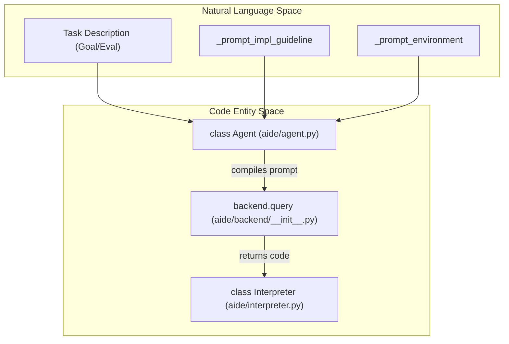
**Sources:** [aide/agent.py:47-60](), [aide/agent.py:118-141](), [aide/agent.py:95-115]()

### Implementation Guidelines
When AIDE generates code, it adheres to the following internal constraints defined in `Agent._prompt_impl_guideline`:
- **Isolation**: Data must be read from `./input` [aide/agent.py:125]().
- **Outputs**: Test predictions must be saved to `./working/submission.csv` [aide/agent.py:126]().
- **Self-Containment**: The solution must be a single-file Python program [aide/agent.py:121]().
- **Metrics**: The script must print the evaluation metric computed on a hold-out set [aide/agent.py:120]().

### Review Mechanism
After execution, AIDE uses a `review_func_spec` to extract structured data from the run:

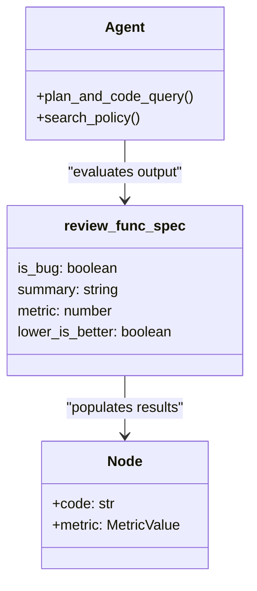
**Sources:** [aide/agent.py:19-44](), [aide/agent.py:153-167]()

---

## Task Execution & Evaluation

The system handles metrics through the `MetricValue` class, which allows for consistent comparison across different task types (minimization vs. maximization).

| Task Type | Target Metric | Direction |
|-----------|---------------|-----------|
| Regression | RMSE / MSE | Minimize (`lower_is_better: true`) |
| Classification | Accuracy / F1 | Maximize (`lower_is_better: false`) |

If a script fails to run, the system assigns a `WorstMetricValue` to the node to ensure the tree search prunes that branch [aide/agent.py:11]().

**Sources:** [aide/agent.py:32-39](), [aide/agent.py:11]()

---

# Page: System Architecture

# System Architecture

<details>
<summary>Relevant source files</summary>

The following files were used as context for generating this wiki page:

- [LICENSE](LICENSE)
- [aide/__init__.py](aide/__init__.py)
- [aide/agent.py](aide/agent.py)
- [aide/example_tasks/bitcoin_price/BTC-USD.csv](aide/example_tasks/bitcoin_price/BTC-USD.csv)
- [aide/example_tasks/house_prices/data_description.txt](aide/example_tasks/house_prices/data_description.txt)
- [aide/run.py](aide/run.py)

</details>


## Purpose and Scope

This document provides a high-level architectural overview of AIDE ML, focusing on the core components, their relationships, and how they map to code entities in the codebase. The architecture centers around five primary subsystems: the `Experiment` orchestrator, the `Agent` code generator, the `Interpreter` execution sandbox, the `Journal` solution tracker, and the Backend LLM abstraction layer.

For details on the iterative execution algorithm and tree search mechanics, see [Experiment Execution Flow](#2.1). For configuration system specifics, see [Configuration System](#2.2). For deeper dives into individual subsystems, see [Core Subsystems](#5) and its children.

---

## Core Components Overview

AIDE ML's architecture is organized into five core components that work together to implement agentic tree search over code solutions:

| Component | Primary Class/Module | Location | Responsibility |
|-----------|---------------------|----------|----------------|
| **Experiment** | `Experiment` class | [aide/__init__.py:23-62]() | Top-level orchestrator; initializes components, coordinates execution, returns best solution |
| **Agent** | `Agent` class | [aide/agent.py:47-60]() | Generates code drafts using LLMs, manages search strategy, creates solution tree nodes |
| **Interpreter** | `Interpreter` class | [aide/interpreter.py]() | Executes Python code in isolated sandbox, enforces timeouts, captures stdout/stderr/exceptions |
| **Journal** | `Journal` and `Node` classes | [aide/journal.py]() | Maintains solution tree structure, tracks metrics and bugs, selects best nodes |
| **Backend** | `backend.query` function | [aide/backend/__init__.py]() | Abstracts multiple LLM providers (OpenAI, Anthropic, Gemini, OpenRouter) behind unified interface |

Additionally, a **Configuration System** (see [Configuration System](#2.2)) manages experiment parameters using OmegaConf, and **Utilities** provide metrics, visualization, and reporting.

Sources: [aide/__init__.py:23-63](), [aide/run.py:1-150](), [aide/agent.py:47-60]()

---

## Component Relationships

The following diagram maps AIDE's architectural components to their concrete implementations in code:

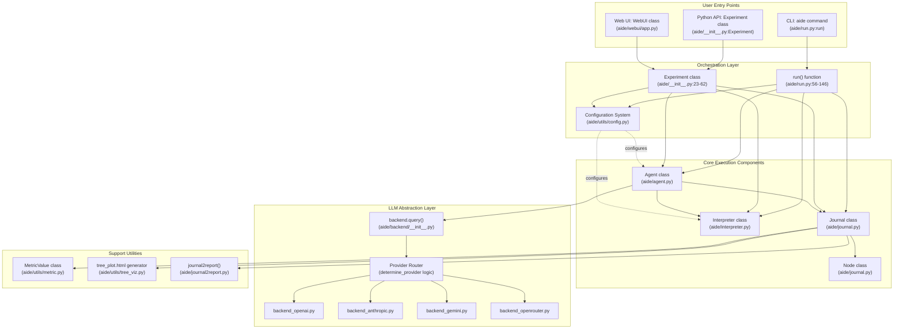

**Key Relationships:**

- **User Layer** provides three entry points that converge on either `run()` or `Experiment`.
- **Orchestration Layer** initializes components using configuration and coordinates their execution via `agent.step()` [aide/run.py:132]().
- **Agent** drives the search by generating code via `Backend`, tracking results in `Journal`, and executing via `Interpreter`.
- **Journal** maintains the tree structure using `Node` objects and `MetricValue` for comparisons [aide/journal.py]().
- **Backend** abstracts LLM differences through provider-specific implementations.

Sources: [aide/__init__.py:23-62](), [aide/run.py:56-146](), [aide/agent.py:47-60](), [aide/backend/__init__.py]()

---

## Module Structure

AIDE ML's package is organized into focused modules with clear responsibilities:

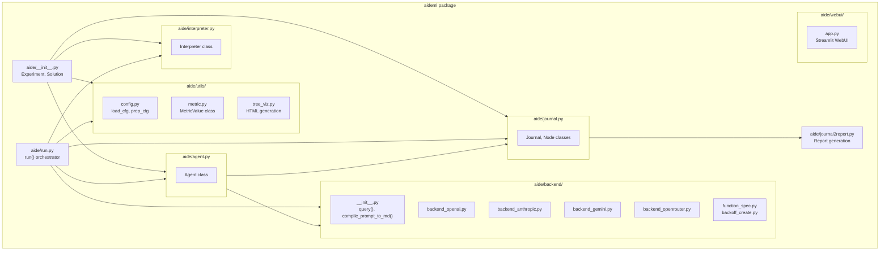

**Module Responsibilities:**

- **aide/__init__.py**: Public API surface, exposes `Experiment` class and `Solution` dataclass [aide/__init__.py:18-63]().
- **aide/run.py**: CLI entry point, orchestrates full experiment with `Rich` UI [aide/run.py:56-146]().
- **aide/agent.py**: Code generation, tree search strategy (`search_policy`), and prompt construction [aide/agent.py:61-92]().
- **aide/backend/**: Multi-provider LLM abstraction with unified query interface.
- **aide/interpreter.py**: Sandboxed Python execution with timeout enforcement.
- **aide/journal.py**: Solution tree data structure and metric tracking.
- **aide/utils/**: Configuration loading, metrics, and helper functions.
- **aide/journal2report.py**: LLM-powered report generation from experiment history [aide/journal2report.py]().

Sources: [aide/__init__.py](), [aide/run.py](), [aide/agent.py](), [aide/backend/__init__.py]()

---

## Key Abstractions and Their Roles

### Experiment Class

The `Experiment` class ([aide/__init__.py:23-62]()) serves as the primary public API for programmatic use. It:

- Accepts task specification (`data_dir`, `goal`, `eval`).
- Initializes workspace, configuration, and core components.
- Exposes a `run(steps)` method that executes the tree search loop [aide/__init__.py:55-63]().
- Returns a `Solution` dataclass containing best code and metric.

### Agent Class

The `Agent` class ([aide/agent.py:47-60]()) implements the code generation and search logic. It:

- Generates multiple code drafts per iteration using LLM via `plan_and_code_query` [aide/agent.py:153-171]().
- Implements a `search_policy` to decide between drafting new nodes, debugging buggy nodes, or improving the greedy best node [aide/agent.py:61-92]().
- Manages search hyperparameters (`num_drafts`, `debug_prob`, `max_debug_depth`).

### Interpreter Class

The `Interpreter` class ([aide/interpreter.py]()) provides isolated code execution. It:

- Runs Python code in subprocess with timeout enforcement.
- Captures stdout, stderr, and exceptions.
- Returns `ExecutionResult` including metrics and terminal output.
- Provides `cleanup_session()` for resource management [aide/run.py:136]().

### Journal and Node Classes

The `Journal` class ([aide/journal.py]()) maintains the solution tree structure:

- Stores tree as collection of `Node` objects.
- Each `Node` tracks code, metric, bugs, and parent/children relationships.
- Provides `get_best_node()` to retrieve highest-scoring valid solution [aide/run.py:33]().

### Backend Query Function

The `backend.query()` function ([aide/backend/__init__.py]()) abstracts LLM access:

- Accepts model name, messages, optional function specifications.
- Routes to appropriate provider based on model name patterns.
- Returns unified response format across providers.

Sources: [aide/__init__.py:23-62](), [aide/agent.py:47-171](), [aide/run.py:32-53](), [aide/backend/__init__.py]()

---

## Data Flow Architecture

The following diagram shows how data flows through AIDE from inputs to outputs:

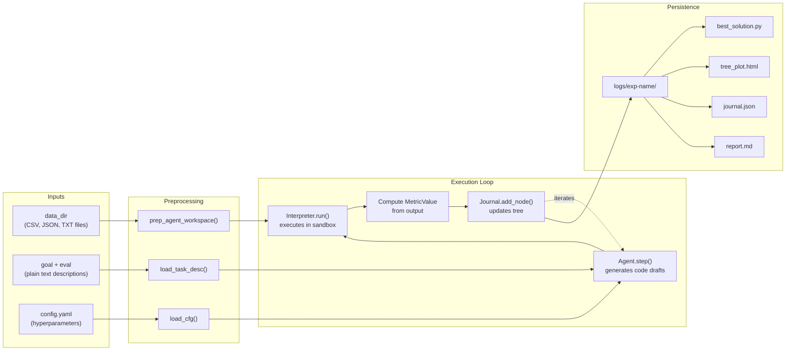

**Data Flow Sequence:**

1. **Input Processing**: Task specification and configuration are loaded; workspace is prepared with data files [aide/run.py:60-64]().
2. **Execution Loop**: Agent generates code → Interpreter executes → Metrics computed → Journal records results [aide/run.py:131-135]().
3. **Persistence**: At each step and completion, state is saved to log directory with multiple output formats [aide/run.py:133]().

Sources: [aide/run.py:56-146](), [aide/utils/config.py](), [aide/__init__.py:55-62]()

---

## Layered Architecture

AIDE ML follows a layered architecture with clear separation of concerns:

### Layer 1: User Interface (Entry Points)

- **CLI** ([aide/run.py:56-146]()): `aide` command using Rich console UI.
- **Python API** ([aide/__init__.py:23-62]()): `Experiment` class for programmatic control.
- **Web UI** ([aide/webui/app.py]()): Streamlit-based browser interface.

### Layer 2: Orchestration

The orchestration layer coordinates execution via the `run()` function or `Experiment` class, managing the lifecycle of the agentic search.

### Layer 3: Core Execution

Core components implement the agentic tree search:
- **Agent**: Generates code variations using `search_policy` [aide/agent.py:61-92]().
- **Interpreter**: Executes code in isolation.
- **Journal**: Maintains solution tree and tracks progress.

### Layer 4: LLM Abstraction

The backend layer decouples AIDE from specific LLM providers, providing a unified `query()` interface [aide/backend/__init__.py]().

---

## Execution Context and Isolation

AIDE implements multiple levels of isolation to ensure safe and reproducible experiments:

| Isolation Level | Mechanism | Purpose |
|----------------|-----------|---------|
| **Workspace Directory** | `prep_agent_workspace()` | Isolates data files and generated code [aide/run.py:64]() |
| **Process Isolation** | Subprocess in `Interpreter` | Protects main process from crashes/hangs |
| **Timeout Enforcement** | `cfg.exec.timeout` | Prevents infinite loops or long-running code [aide/agent.py:124]() |
| **Log Directory** | `cfg.log_dir` | Separates results from multiple runs [aide/run.py:106]() |

Sources: [aide/run.py:60-106](), [aide/agent.py:118-128](), [aide/interpreter.py]()

---

## Component Initialization Sequence

The initialization sequence is nearly identical between CLI and Python API modes:

1. **Load Config**: `load_cfg()` or `_load_cfg()` [aide/run.py:57]().
2. **Load Task**: `load_task_desc(cfg)` [aide/run.py:60]().
3. **Prepare Workspace**: `prep_agent_workspace(cfg)` [aide/run.py:64]().
4. **Create Journal**: `Journal()` [aide/run.py:72]().
5. **Create Agent**: `Agent(task_desc, cfg, journal)` [aide/run.py:73]().
6. **Create Interpreter**: `Interpreter(cfg.workspace_dir, ...)` [aide/run.py:78]().
7. **Execute Loop**: `agent.step(exec_callback=...)` [aide/run.py:132]().
8. **Save Results**: `save_run(cfg, journal)` [aide/run.py:133]().

Sources: [aide/run.py:56-146](), [aide/__init__.py:23-62]()

---

# Page: Experiment Execution Flow

# Experiment Execution Flow

<details>
<summary>Relevant source files</summary>

The following files were used as context for generating this wiki page:

- [.github/workflows/linter.yml](.github/workflows/linter.yml)
- [LICENSE](LICENSE)
- [aide/__init__.py](aide/__init__.py)
- [aide/agent.py](aide/agent.py)
- [aide/example_tasks/bitcoin_price/BTC-USD.csv](aide/example_tasks/bitcoin_price/BTC-USD.csv)
- [aide/example_tasks/house_prices/data_description.txt](aide/example_tasks/house_prices/data_description.txt)
- [aide/interpreter.py](aide/interpreter.py)
- [aide/run.py](aide/run.py)

</details>


This document details the iterative agentic tree search algorithm that drives AIDE's experiment execution. The flow encompasses initialization, iterative code generation and evaluation, metric-guided node selection, and output generation. Each experiment maintains a complete solution tree that records all attempts and their performance.

## Overview

An AIDE experiment executes as a loop of generate-execute-evaluate-select cycles. The system starts by initializing workspace and components, then iteratively generates code variations (drafts, debugs, improvements), executes them in a sandbox, computes performance metrics, and uses those metrics to guide which nodes to explore next. After completing the configured number of steps, the best solution is extracted and outputs are generated.

Sources: [aide/run.py:56-149](), [aide/__init__.py:23-62]()

## Initialization Phase

Before entering the search loop, the experiment sets up the necessary workspace and components:

**Initialization Steps**

| Step | Component | Purpose | Implementation |
|------|-----------|---------|----------------|
| 1. Load Configuration | `load_cfg()` | Load YAML config + CLI overrides | [aide/run.py:57-57]() |
| 2. Prepare Task Description | `load_task_desc()` | Compile goal + eval into prompt dict | [aide/run.py:60-60]() |
| 3. Setup Workspace | `prep_agent_workspace()` | Copy data files to `workspace_dir/input/` | [aide/run.py:63-64]() |
| 4. Initialize Journal | `Journal()` | Create empty solution tree | [aide/run.py:72-72]() |
| 5. Initialize Agent | `Agent()` | Create code generation agent | [aide/run.py:73-77]() |
| 6. Initialize Interpreter | `Interpreter()` | Create sandboxed execution environment | [aide/run.py:78-81]() |

Sources: [aide/run.py:57-81](), [aide/__init__.py:33-53]()

Title: Experiment Component Initialization
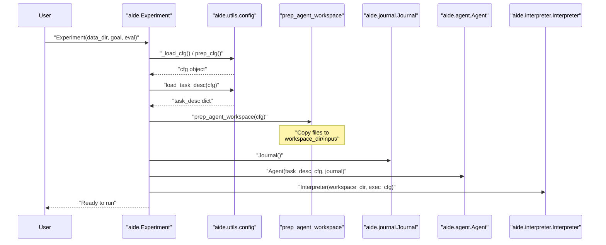
Sources: [aide/__init__.py:23-53](), [aide/run.py:56-81]()

## Iterative Search Loop

After initialization, the experiment enters the main loop that continues for `cfg.agent.steps` iterations:

Title: AIDE Iterative Search Loop
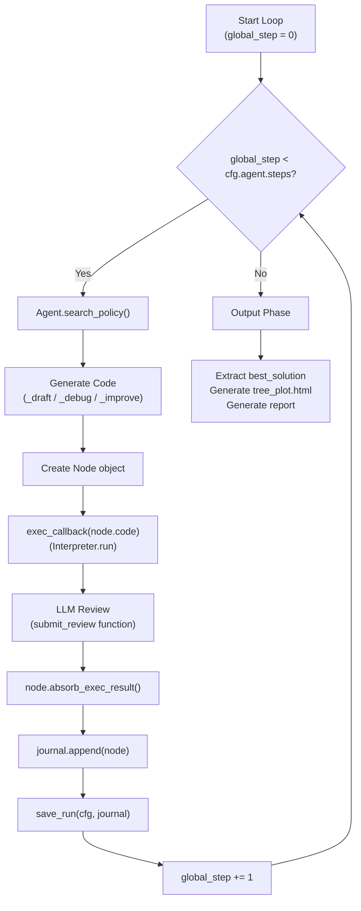
Sources: [aide/run.py:131-136](), [aide/__init__.py:55-59](), [aide/agent.py:276-294]()

**Loop Execution in `run.py`**

The main loop in [aide/run.py:131-136]() executes:
```python
while global_step < cfg.agent.steps:
    agent.step(exec_callback=exec_callback)
    save_run(cfg, journal)
    global_step = len(journal)
    live.update(generate_live())
```

**Loop Execution in `Experiment.run()`**

The Python API version in [aide/__init__.py:55-59]() follows a similar pattern:
```python
for _i in range(steps):
    self.agent.step(exec_callback=self.interpreter.run)
    save_run(self.cfg, self.journal)
```

Sources: [aide/run.py:131-136](), [aide/__init__.py:55-59]()

## Node Types and Solution Tree

### Solution Tree Hierarchy

Title: Solution Tree Structure
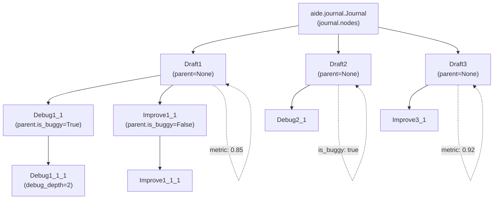
Sources: [aide/journal.py:56-65](), [aide/run.py:32-53]()

**Node Types Based on `stage_name`**

Each `Node` has a `stage_name` property that identifies its role:

- **Draft nodes**: Initial solutions with `parent is None` [aide/journal.py:57-58]()
- **Debug nodes**: Children of buggy nodes where `parent.is_buggy is True` [aide/journal.py:61-62]()
- **Improve nodes**: Children of successful nodes where `parent.is_buggy is False` [aide/journal.py:64-65]()

### Node Data Structure

The `Node` class in [aide/journal.py:21-49]() stores:

| Field | Type | Purpose |
|-------|------|---------|
| `code` | `str` | Python implementation |
| `plan` | `str` | Natural language description |
| `parent` | `Node \| None` | Parent node reference |
| `children` | `set[Node]` | Child nodes |
| `is_buggy` | `bool` | Whether execution failed |
| `metric` | `MetricValue` | Validation performance |
| `analysis` | `str` | LLM evaluation summary |
| `term_out` | `str` | Execution terminal output |

Sources: [aide/journal.py:21-49]()

## Search Policy: Node Selection Strategy

The `Agent.search_policy()` method in [aide/agent.py:61-92]() determines which node to expand next:

Title: Search Policy Logic
```mermaid
flowchart TD
    Start["Agent.search_policy()"] --> CheckDrafts{"len(journal.draft_nodes)<br/>< num_drafts?"}
    
    CheckDrafts -->|Yes| ReturnNone["return None"]
    CheckDrafts -->|No| CheckDebugProb{"random() < debug_prob?"}
    
    CheckDebugProb -->|Yes| FindDebuggable["debuggable_nodes =<br/>[n for n in buggy_nodes<br/>if n.is_leaf and<br/>n.debug_depth <= max_debug_depth]"]
    CheckDebugProb -->|No| CheckGoodNodes{"len(journal.good_nodes) > 0?"}
    
    FindDebuggable --> HasDebuggable{"len(debuggable_nodes) > 0?"}
    HasDebuggable -->|Yes| ReturnRandom["return random.choice<br/>(debuggable_nodes)"]
    HasDebuggable -->|No| CheckGoodNodes
    
    CheckGoodNodes -->|No| ReturnNone
    CheckGoodNodes -->|Yes| ReturnBest["return journal.get_best_node()"]
    
    ReturnNone --> Draft["Agent._draft()"]
    ReturnRandom --> Debug["Agent._debug(parent_node)"] 
    ReturnBest --> Improve["Agent._improve(parent_node)"]
```
Sources: [aide/agent.py:61-92]()

**Selection Strategy**

1. **Drafting Phase**: If `len(draft_nodes) < num_drafts`, return `None` to trigger `_draft()` [aide/agent.py:66-68]()
2. **Debug Mode** (probability `debug_prob`): 
   - Filter for debuggable nodes: buggy, leaf, `debug_depth <= max_debug_depth` [aide/agent.py:73-77]()
   - Select random debuggable node to trigger `_debug()` [aide/agent.py:80-80]()
3. **Improvement Mode**: Select `journal.get_best_node()` to trigger `_improve()` [aide/agent.py:90-92]()

Sources: [aide/agent.py:61-92]()

## Code Generation: Drafts, Debugs, and Improvements

### Draft Generation: `Agent._draft()`

Title: Draft Generation Flow
```mermaid
sequenceDiagram
    participant Agent as "Agent._draft()"
    participant Backend as "aide.backend.query"
    participant Response as "aide.utils.response"
    participant Node as "aide.journal.Node"
    
    Agent->>Backend: "plan_and_code_query()"
    Note over Backend: "Prompt includes:<br/>- task description<br/>- previous attempts summary"
    Backend-->>Agent: "response text"
    Agent->>Response: "extract_code() / extract_text_up_to_code()"
    Response-->>Agent: "plan, code"
    Agent->>Node: "Node(plan=plan, code=code, parent=None)"
```
Sources: [aide/agent.py:175-205]()

The `_draft()` method in [aide/agent.py:175-205]():
- Calls `plan_and_code_query()` to get both NL plan and code in one call [aide/agent.py:153-173]()
- Includes task description and `journal.generate_summary()` of previous attempts [aide/agent.py:192-192]()
- Creates `Node` with `parent=None` [aide/agent.py:204-204]()

### Debug Generation: `Agent._debug()`

Title: Debug Generation Flow
```mermaid
sequenceDiagram
    participant Agent as "Agent._debug(parent)"
    participant Backend as "aide.backend.query"
    participant Node as "aide.journal.Node"
    
    Agent->>Backend: "query(system_message=debug_prompt)"
    Note over Backend: "Prompt includes:<br/>- buggy code<br/>- terminal output"
    Backend-->>Agent: "bugfix_plan + code"
    Agent->>Node: "Node(plan, code, parent=parent)"
```
Sources: [aide/agent.py:243-269]()

The `_debug()` method in [aide/agent.py:243-269]():
- Receives a buggy `parent_node` from `search_policy()` [aide/agent.py:243-243]()
- Sends `parent_node.code` and `parent_node.term_out` to LLM [aide/agent.py:255-256]()
- Requests a specific bugfix based on execution logs [aide/agent.py:248-248]()

### Improvement Generation: `Agent._improve()`

The `_improve()` method in [aide/agent.py:207-241]():
- Receives best-performing `parent_node` from `search_policy()` [aide/agent.py:207-207]()
- Sends `parent_node.code` and `parent_node.analysis` to LLM [aide/agent.py:219-220]()
- Requests a single atomic improvement to the working solution [aide/agent.py:212-212]()

Sources: [aide/agent.py:207-241]()

## Execution and Evaluation Pipeline

### Agent.step() Workflow

The `Agent.step()` method in [aide/agent.py:276-294]() orchestrates the full generate-execute-evaluate cycle:

1. Calls `search_policy()` to select a parent node [aide/agent.py:277-277]()
2. Generates code via `_draft()`, `_debug()`, or `_improve()` [aide/agent.py:279-284]()
3. Executes code using `exec_callback(node.code)` [aide/agent.py:286-286]()
4. Evaluates execution with `_evaluate_node()` which queries the LLM [aide/agent.py:287-287]()
5. Stores results via `node.absorb_exec_result()` [aide/agent.py:289-293]()
6. Appends node to `journal.append(node)` [aide/agent.py:294-294]()

Sources: [aide/agent.py:276-294]()

### LLM-Based Evaluation: `review_func_spec`

The agent uses structured function calling to extract evaluation results from the LLM via `submit_review` [aide/agent.py:19-44]().

**Function Specification**
From [aide/agent.py:19-44](), the `review_func_spec` defines:
- `is_bug`: Boolean indicating execution failure [aide/agent.py:24-27]()
- `summary`: Analysis of performance or bug description [aide/agent.py:28-31]()
- `metric`: Validation metric value [aide/agent.py:32-35]()
- `lower_is_better`: Optimization direction [aide/agent.py:36-39]()

Sources: [aide/agent.py:19-44]()

### Code Execution: `Interpreter.run()`

The `exec_callback` typically points to `Interpreter.run()`, which:
- Executes code in isolated subprocess with timeout [aide/interpreter.py:176-180]()
- Captures stdout, stderr via `RedirectQueue` [aide/interpreter.py:131-131]()
- Returns `ExecutionResult` containing terminal output and return code [aide/interpreter.py:27-38]()

Sources: [aide/interpreter.py:91-230]()

## Metric-Guided Selection and Pruning

### Journal Tree Queries

The `Journal` class in [aide/journal.py:134-193]() provides filtered views of the solution tree:

| Property/Method | Implementation | Purpose |
|----------------|----------------|---------|
| `draft_nodes` | `[n for n in self.nodes if n.parent is None]` | Get initial drafts [aide/journal.py:145-147]() |
| `buggy_nodes` | `[n for n in self.nodes if n.is_buggy]` | Get failed executions [aide/journal.py:149-151]() |
| `good_nodes` | `[n for n in self.nodes if not n.is_buggy]` | Get successful executions [aide/journal.py:153-155]() |
| `get_best_node()` | `max(nodes, key=lambda n: n.metric)` | Get highest metric node [aide/journal.py:165-180]() |

Sources: [aide/journal.py:134-193]()

### Best Node Selection

The `get_best_node()` method in [aide/journal.py:165-180]() is critical for both the search policy and final output. It uses the `MetricValue` class which implements comparison operators (`__gt__`, `__lt__`) that respect the `lower_is_better` flag [aide/utils/metric.py]().

Sources: [aide/journal.py:165-180](), [aide/utils/metric.py]()

## Output Phase

After the iterative loop completes, the experiment generates primary outputs:

Title: Output Generation Phase
```mermaid
flowchart LR
    Complete["Loop Complete<br/>(global_step == cfg.agent.steps)"] --> Extract["journal.get_best_node()"]
    Extract --> SaveRun["aide.utils.config.save_run()"]
    
    SaveRun --> Solution["logs/exp_name/best_solution.py"]
    SaveRun --> TreeHTML["logs/exp_name/tree_plot.html"]
    SaveRun --> JournalJSON["logs/exp_name/journal.json"]
    
    Complete --> OptReport{"cfg.generate_report?"}
    OptReport -->|Yes| GenReport["aide.journal2report.journal2report()"]
    GenReport --> ReportMD["logs/exp_name/report.md"]
```
Sources: [aide/run.py:138-146](), [aide/__init__.py:61-62]()

### Best Solution Extraction

From [aide/__init__.py:61-62](), the Python API returns a `Solution` object containing the best code and its metric:
```python
best_node = self.journal.get_best_node(only_good=False)
return Solution(code=best_node.code, valid_metric=best_node.metric.value)
```
Sources: [aide/__init__.py:61-62]()

### Optional Report Generation

If `cfg.generate_report` is enabled, AIDE calls `journal2report()` to synthesize the findings from the solution tree into a technical report [aide/run.py:138-146]().

Sources: [aide/run.py:138-146](), [aide/journal2report.py]()

---

# Page: Configuration System

# Configuration System

<details>
<summary>Relevant source files</summary>

The following files were used as context for generating this wiki page:

- [aide/utils/config.py](aide/utils/config.py)
- [aide/utils/config.yaml](aide/utils/config.yaml)
- [setup.py](setup.py)

</details>


## Purpose and Scope

The Configuration System manages all parameters that control AIDE's behavior, including LLM model selection, search hyperparameters, execution limits, workspace setup, and experiment tracking. It uses OmegaConf for hierarchical YAML-based configuration with CLI override support.

This page covers configuration schema, loading mechanisms, validation, and workspace preparation. For details on how configuration values are used during execution, see [Experiment Execution Flow](). For agent-specific parameters, see [Agent & Search System]().

---

## Configuration Architecture

AIDE's configuration system is built on **OmegaConf**, enabling:
- **YAML file storage** with structured defaults in `aide/utils/config.yaml` [aide/utils/config.yaml:1-59]()
- **CLI overrides** via dot-notation (e.g., `agent.steps=30`) [aide/utils/config.py:101-102]()
- **Type-safe access** through Python dataclasses [aide/utils/config.py:29-82]()
- **Validation** against schema definitions [aide/utils/config.py:141-142]()

The system separates configuration into logical groups: agent settings, execution parameters, LLM model configurations, and workspace paths.

### Configuration Loading Flow

```mermaid
graph TD
    YAMLFile["config.yaml<br/>(Default Settings)"]
    CLIArgs["CLI Arguments<br/>(Overrides)"]
    LoadFunc["_load_cfg()<br/>[aide/utils/config.py:96-102]"]
    MergeOp["OmegaConf.merge()"]
    PrepFunc["prep_cfg()<br/>[aide/utils/config.py:110-144]"]
    
    subgraph "Validation & Setup"
        ValidateInputs["Validate Inputs<br/>data_dir, goal/desc_file"]
        ResolveDir["Resolve Directories<br/>log_dir, workspace_dir"]
        GenExpName["Generate exp_name<br/>coolname + index"]
        ValidateSchema["Merge with Config Schema"]
    end
    
    ValidatedConfig["Config Object<br/>(Ready for Use)"]
    
    YAMLFile --> LoadFunc
    CLIArgs --> MergeOp
    LoadFunc --> MergeOp
    MergeOp --> PrepFunc
    
    PrepFunc --> ValidateInputs
    ValidateInputs --> ResolveDir
    ResolveDir --> GenExpName
    GenExpName --> ValidateSchema
    ValidateSchema --> ValidatedConfig
```

**Sources:** [aide/utils/config.py:96-144](), [aide/utils/config.py:105-108]()

---

## Configuration Schema

The configuration schema is defined through nested dataclasses that provide type hints and structure. The actual configuration is stored in YAML, but these classes ensure type safety during the merge process.

### Dataclass Hierarchy

```mermaid
graph TD
    Config["Config<br/>(Root Configuration)"]
    
    AgentConfig["AgentConfig<br/>agent.*"]
    ExecConfig["ExecConfig<br/>exec.*"]
    ReportStage["StageConfig<br/>report.*"]
    
    CodeStage["StageConfig<br/>agent.code.*"]
    FeedbackStage["StageConfig<br/>agent.feedback.*"]
    SearchConfig["SearchConfig<br/>agent.search.*"]
    
    Config --> AgentConfig
    Config --> ExecConfig
    Config --> ReportStage
    
    AgentConfig --> CodeStage
    AgentConfig --> FeedbackStage
    AgentConfig --> SearchConfig
    
    Config -.- DataPaths["data_dir<br/>desc_file<br/>goal, eval"]
    Config -.- OutputPaths["log_dir<br/>workspace_dir<br/>exp_name"]
    Config -.- DataFlags["preprocess_data<br/>copy_data<br/>generate_report"]
    
    ExecConfig -.- ExecFields["timeout<br/>agent_file_name<br/>format_tb_ipython"]
    
    CodeStage -.- StageFields1["model<br/>temp"]
    FeedbackStage -.- StageFields2["model<br/>temp"]
    ReportStage -.- StageFields3["model<br/>temp"]
    
    AgentConfig -.- AgentFields["steps<br/>k_fold_validation<br/>expose_prediction<br/>data_preview"]
    
    SearchConfig -.- SearchFields["max_debug_depth<br/>debug_prob<br/>num_drafts"]
```

**Sources:** [aide/utils/config.py:29-82]()

### Configuration Dataclass Definitions

| Dataclass | Location | Fields | Purpose |
|-----------|----------|--------|---------|
| `StageConfig` | [aide/utils/config.py:29-32]() | `model: str`, `temp: float` | LLM model configuration for a specific stage (code, feedback, report) |
| `SearchConfig` | [aide/utils/config.py:35-39]() | `max_debug_depth: int`, `debug_prob: float`, `num_drafts: int` | Tree search hyperparameters |
| `AgentConfig` | [aide/utils/config.py:42-52]() | `steps`, `k_fold_validation`, `expose_prediction`, `data_preview`, `code`, `feedback`, `search` | Agent behavior and nested stage configs |
| `ExecConfig` | [aide/utils/config.py:55-59]() | `timeout: int`, `agent_file_name: str`, `format_tb_ipython: bool` | Code execution parameters |
| `Config` | [aide/utils/config.py:63-82]() | All paths, flags, and nested configs | Root configuration object |

**Sources:** [aide/utils/config.py:26-82]()

---

## Default Configuration File

The default configuration is defined in `aide/utils/config.yaml`. This file serves as the template for all experiments.

### Core Parameters

```yaml
# Task Input
data_dir: null              # Required: path to task data
desc_file: null             # Optional: plaintext task description file
goal: null                  # Alternative: task goal string
eval: null                  # Optional: evaluation criteria string

# Output Directories
log_dir: logs               # Where results are saved
workspace_dir: workspaces   # Where agent executes code

# Data Handling
preprocess_data: True       # Unzip archives in data directory
copy_data: True            # Copy vs symlink (prevents data modification)

exp_name: null             # Auto-generated if not provided
```

### Execution Configuration

```yaml
exec:
  timeout: 3600                # Max execution time (seconds)
  agent_file_name: runfile.py  # Name of generated code file
  format_tb_ipython: False     # Use IPython traceback formatting
```

### Agent Configuration

```yaml
agent:
  steps: 20                    # Number of improvement iterations
  k_fold_validation: 5         # Cross-validation folds (1 disables CV)
  expose_prediction: False     # Generate prediction function
  data_preview: True           # Show data samples to agent
  
  code:
    model: o4-mini             # LLM for code generation
    temp: 0.5                  # Temperature for code diversity
  
  feedback:
    model: gpt-4.1-mini        # LLM for output analysis
    temp: 0.5                  # Temperature for feedback
  
  search:
    max_debug_depth: 3         # Max debugging iterations per node
    debug_prob: 0.5            # Probability of debugging vs new draft
    num_drafts: 5              # Code drafts per iteration
```

**Sources:** [aide/utils/config.yaml:1-59]()

---

## Configuration Loading and Merging

### Load Process

The configuration system loads and merges settings in two stages:

1. **Loading** (`_load_cfg`): Reads YAML and merges CLI arguments using `OmegaConf.from_cli()` [aide/utils/config.py:96-102]().
2. **Preparation** (`prep_cfg`): Validates inputs, resolves paths, and sets up directories [aide/utils/config.py:110-144]().

```mermaid
sequenceDiagram
    participant User
    participant LoadCfg as "load_cfg()"
    participant Internal as "_load_cfg()"
    participant OmegaConf
    participant PrepCfg as "prep_cfg()"
    
    User->>LoadCfg: Call with path
    LoadCfg->>Internal: Delegate
    Internal->>OmegaConf: Load YAML file
    OmegaConf-->>Internal: Base config
    Internal->>OmegaConf: Load CLI args
    OmegaConf-->>Internal: CLI overrides
    Internal->>OmegaConf: Merge configs
    OmegaConf-->>Internal: Merged config
    Internal-->>LoadCfg: Raw config
    LoadCfg->>PrepCfg: Validate & prepare
    PrepCfg->>PrepCfg: Validate inputs
    PrepCfg->>PrepCfg: Resolve paths
    PrepCfg->>PrepCfg: Generate exp_name
    PrepCfg->>PrepCfg: Create directories
    PrepCfg->>OmegaConf: Validate schema
    PrepCfg-->>User: Ready Config object
```

**Sources:** [aide/utils/config.py:96-108](), [aide/utils/config.py:110-144]()

### CLI Override Mechanism

OmegaConf supports dot-notation overrides from the command line. The merge operation prioritizes CLI arguments over YAML defaults [aide/utils/config.py:101-102]():

```bash
# Override single values
aide data_dir=my_data agent.steps=30

# Override nested values
aide agent.code.model=gpt-4o agent.search.num_drafts=10
```

---

## Configuration Validation

The `prep_cfg` function validates the configuration before experiment execution.

### Validation Rules

| Check | Condition | Error Message |
|-------|-----------|---------------|
| Data directory | `cfg.data_dir is None` | "`data_dir` must be provided." |
| Task description | `cfg.desc_file is None and cfg.goal is None` | "You must provide either...`goal=...` or...`desc_file=...`." |

**Sources:** [aide/utils/config.py:111-117]()

### Path Resolution

AIDE resolves paths to absolute locations and handles relative references to example tasks [aide/utils/config.py:119-124]():

```python
if cfg.data_dir.startswith("example_tasks/"):
    cfg.data_dir = Path(__file__).parent.parent / cfg.data_dir
cfg.data_dir = Path(cfg.data_dir).resolve()
```

### Schema Validation

The final configuration is validated against the `Config` dataclass schema to ensure type correctness [aide/utils/config.py:141-142]():

```python
cfg_schema: Config = OmegaConf.structured(Config)
cfg = OmegaConf.merge(cfg_schema, cfg)
```

---

## Experiment Naming and Directory Structure

### Automatic Naming

If `exp_name` is not provided, AIDE generates a unique name using a consecutive index and a random slug [aide/utils/config.py:133-135]():

```python
ind = max(_get_next_logindex(top_log_dir), _get_next_logindex(top_workspace_dir))
cfg.exp_name = cfg.exp_name or coolname.generate_slug(3)
cfg.exp_name = f"{ind}-{cfg.exp_name}"
```

The `_get_next_logindex` function scans existing directories to find the highest integer prefix [aide/utils/config.py:84-93]().

### Workspace Preparation

The `prep_agent_workspace` function sets up the filesystem for the agent [aide/utils/config.py:177-185]():

1.  **Directories**: Creates `input/` and `working/` inside the experiment workspace [aide/utils/config.py:179-180]().
2.  **Data Link/Copy**: Uses `copytree` to bring data from `cfg.data_dir` to `workspace_dir/input`. It uses symlinks unless `cfg.copy_data` is True [aide/utils/config.py:182]().
3.  **Preprocessing**: If `cfg.preprocess_data` is True, it runs `preproc_data` (e.g., unzipping) on the input files [aide/utils/config.py:183-184]().

---

## Task Description Loading

AIDE supports two methods for specifying the task, implemented in `load_task_desc` [aide/utils/config.py:151-174]():

1.  **Description File**: If `cfg.desc_file` is set, the system reads the file content directly [aide/utils/config.py:155-162]().
2.  **Goal/Eval Args**: If no file is provided, it uses `cfg.goal` and `cfg.eval` to construct a task description dictionary [aide/utils/config.py:165-174]().

---

## Saving Experiment Results

The `save_run` function persists the state and results [aide/utils/config.py:187-200]():

- **Journal**: Saved as `journal.json` using `serialize.dump_json` [aide/utils/config.py:191]().
- **Config**: The active `Config` object is saved as `config.yaml` [aide/utils/config.py:193]().
- **Visualization**: Generates `tree_plot.html` via `tree_export.generate` [aide/utils/config.py:195]().
- **Best Solution**: Extracts the best code from the journal and saves it as `best_solution.py` [aide/utils/config.py:197-199]().

**Sources:** [aide/utils/config.py:1-200](), [aide/utils/config.yaml:1-59]()

---

# Page: User Interfaces

# User Interfaces

<details>
<summary>Relevant source files</summary>

The following files were used as context for generating this wiki page:

- [README.md](README.md)
- [aide/__init__.py](aide/__init__.py)
- [aide/run.py](aide/run.py)

</details>


## Purpose and Scope

This page provides an overview of the four interface options for interacting with AIDE ML: the Web UI, Command Line Interface (CLI), Python API, and Docker containerization. All interfaces converge on the same core `Experiment` orchestration layer and produce identical output artifacts.

For detailed documentation of individual interfaces, see:
- [Web UI](#3.1) — Streamlit-based interactive interface
- [Command Line Interface](#3.2) — `aide` CLI command
- [Python API](#3.3) — `Experiment` class for programmatic control
- [Docker](#3.4) — Containerized deployment

For information about the underlying execution flow that all interfaces trigger, see [Experiment Execution Flow](#2.1).

---

## Interface Options Summary

AIDE ML provides four distinct ways to initiate and monitor experiments, each suited to different user workflows:

| Interface | Entry Point | Primary Use Case | Output Method |
|-----------|-------------|------------------|---------------|
| **Web UI** | `streamlit run app.py` | Non-technical users, exploratory work | Browser-based tabs with live updates |
| **CLI** | `aide` command | ML practitioners, quick iterations | Terminal with Rich console UI |
| **Python API** | `aide.Experiment` class | Researchers, programmatic control | Returns `Solution` dataclass |
| **Docker** | `docker run aideml` | Deployment, reproducibility | Same as CLI, containerized |

**Sources:** [README.md:69-184](), [aide/run.py:56-149]()

---

## Architecture: Convergence on Shared Core

All four interfaces share the same underlying execution engine. User-facing differences are limited to input mechanisms and output presentation, while core logic remains identical.

### Interface Integration Architecture

```mermaid
graph TB
    subgraph UserLayer["User Interaction Layer"]
        User["User/Developer"]
        CLI["CLI Command<br/>'aide'"]
        PythonScript["Python Script<br/>'import aide'"]
        WebBrowser["Web Browser<br/>'localhost:8501'"]
        DockerCLI["Docker CLI<br/>'docker run'"]
    end
    
    subgraph EntryPoints["Entry Point Layer"]
        CLIEntry["aide.run:run()"]
        ExpClass["aide.Experiment"]
        StreamlitApp["webui/app.py"]
        DockerEntry["Docker container"]
    end
    
    subgraph SharedCore["Shared Core Layer"]
        ConfigSystem["_load_cfg / prep_cfg<br/>OmegaConf"]
        TaskLoader["load_task_desc"]
        WorkspacePrep["prep_agent_workspace"]
    end
    
    subgraph Orchestration["Orchestration Layer"]
        Journal["aide.journal.Journal"]
        Agent["aide.agent.Agent"]
        Interpreter["aide.interpreter.Interpreter"]
    end
    
    subgraph Output["Output Layer"]
        LogDir["logs/ directory"]
        BestSolution["best_solution.py"]
        TreePlot["tree_plot.html"]
        JournalJSON["journal.json"]
    end
    
    User --> CLI
    User --> PythonScript
    User --> WebBrowser
    User --> DockerCLI
    
    CLI --> CLIEntry
    PythonScript --> ExpClass
    WebBrowser --> StreamlitApp
    DockerCLI --> DockerEntry
    DockerEntry --> CLIEntry
    
    CLIEntry --> ConfigSystem
    ExpClass --> ConfigSystem
    StreamlitApp --> ConfigSystem
    
    ConfigSystem --> TaskLoader
    ConfigSystem --> WorkspacePrep
    
    TaskLoader --> Journal
    TaskLoader --> Agent
    WorkspacePrep --> Interpreter
    
    Journal --> Agent
    Agent --> Interpreter
    
    Agent --> LogDir
    Journal --> BestSolution
    Journal --> TreePlot
    Journal --> JournalJSON
```

**Description:** This diagram shows how all user interfaces funnel through interface-specific entry points into a unified core. The CLI uses `aide.run:run()` with OmegaConf configuration management, the Python API instantiates `aide.Experiment` directly, the Web UI wraps the Python API in Streamlit components, and Docker containerizes the CLI. All four paths converge on the same configuration system, workspace preparation, and orchestration components (`Journal`, `Agent`, `Interpreter`). Output artifacts are identical regardless of interface choice.

**Sources:** [aide/__init__.py:1-63](), [aide/run.py:56-82](), [README.md:69-184]()

---

## Entry Points and Initialization

### Entry Point Code Paths

```mermaid
graph LR
    subgraph CLI["CLI Entry (aide command)"]
        RunFunc["aide/run.py: run()"]
        CLICfg["load_cfg()"]
    end
    
    subgraph PythonAPI["Python API Entry"]
        ExpConstructor["aide.Experiment(...)"]
        ExpInit["Experiment.__init__"]
        LoadCfg["_load_cfg(use_cli_args=False)"]
    end
    
    subgraph WebUI["Web UI Entry"]
        StreamlitRun["streamlit run app.py"]
        CallExpClass["calls Experiment(...)"]
    end
    
    subgraph SharedInit["Shared Initialization"]
        PrepCfg["prep_cfg(cfg)"]
        LoadTaskDesc["load_task_desc(cfg)"]
        PrepWorkspace["prep_agent_workspace(cfg)"]
        InitJournal["Journal()"]
        InitAgent["Agent(...)"]
        InitInterpreter["Interpreter(...)"]
    end
    
    RunFunc --> CLICfg
    CLICfg --> PrepCfg
    
    ExpConstructor --> ExpInit
    ExpInit --> LoadCfg
    LoadCfg --> PrepCfg
    
    StreamlitRun --> CallExpClass
    CallExpClass --> ExpInit
    
    PrepCfg --> LoadTaskDesc
    PrepCfg --> PrepWorkspace
    LoadTaskDesc --> InitJournal
    LoadTaskDesc --> InitAgent
    PrepWorkspace --> InitInterpreter
```

**Description:** This diagram traces the code execution path from each entry point to the shared initialization sequence. The CLI command calls `aide.run:run()` which uses `load_cfg()` for configuration. The Python API's `Experiment.__init__` calls `_load_cfg(use_cli_args=False)` to avoid parsing CLI arguments. All paths converge on `prep_cfg()`, which triggers task description loading, workspace preparation, and initialization of the three core components: `Journal`, `Agent`, and `Interpreter`.

**Sources:** [aide/__init__.py:23-54](), [aide/run.py:56-82](), [README.md:126-151]()

---

## Data Flow Across Interfaces

### Input → Processing → Output

| Stage | CLI | Python API | Web UI | Docker |
|-------|-----|------------|--------|--------|
| **Input Method** | Command-line arguments | Constructor parameters | Streamlit widgets + file upload | CLI args via `docker run` |
| **Configuration** | `load_cfg` → `cfg` | Direct parameter assignment | Form inputs → `Experiment(...)` | Environment variables + CLI args |
| **Progress Display** | Rich console `Live` display | Python logging (`logging.INFO`) | Streamlit tabs with live updates | Terminal output (same as CLI) |
| **Output Location** | `logs/<exp_id>/` directory | Same + returns `Solution` object | Same + displays in browser tabs | Mounted volume at `/app/logs/` |
| **Tree Visualization** | HTML file in log dir | HTML file in log dir | Displayed in UI | HTML file in mounted volume |

**Sources:** [README.md:72-184](), [aide/__init__.py:55-62](), [aide/run.py:99-135]()

---

## Interface Selection Guidance

### Decision Matrix

```mermaid
graph TD
    Start["Choose Interface"]
    
    NeedUI{"Need interactive UI?"}
    ScriptingNeeded{"Need to embed in scripts?"}
    IsolationNeeded{"Need process isolation?"}
    
    WebUI["Use Web UI"]
    PythonAPI["Use Python API"]
    CLI["Use CLI"]
    Docker["Use Docker"]
    
    Start --> NeedUI
    NeedUI -->|Yes| WebUI
    NeedUI -->|No| ScriptingNeeded
    ScriptingNeeded -->|Yes| PythonAPI
    ScriptingNeeded -->|No| IsolationNeeded
    IsolationNeeded -->|Yes| Docker
    IsolationNeeded -->|No| CLI
```

**Description:** This decision tree helps users select the appropriate interface. Non-technical users or those preferring visual feedback choose the Web UI. Researchers integrating AIDE into existing Python workflows use the Python API to access the `Solution` return type. ML practitioners performing rapid iterations prefer the CLI for its speed and config override capabilities. Deployment scenarios or reproducibility requirements favor Docker for dependency isolation.

**Sources:** [README.md:31-35](), [README.md:69-184]()

---

## Common Interface Patterns

### Configuration Override Hierarchy

All interfaces support configuration overrides with the following precedence (highest to lowest):

1. **Runtime parameters** (Python API constructor args, CLI flags)
2. **Environment variables** (`OPENAI_API_KEY`, `OPENAI_BASE_URL`)
3. **Defaults** (hardcoded in configuration utilities)

Example configuration across interfaces:

| Setting | CLI Syntax | Python API Syntax | Web UI Input |
|---------|------------|-------------------|--------------|
| Data directory | `data_dir="path/"` | `data_dir="path/"` | File upload widget |
| Goal description | `goal="Predict X"` | `goal="Predict X"` | Text area field |
| Evaluation metric | `eval="RMSE"` | `eval="RMSE"` | Text input field |
| Number of steps | `agent.steps=50` | `steps=50` (in `run()`) | Number input widget |

**Sources:** [README.md:108-123](), [aide/__init__.py:24-37](), [aide/run.py:56-61]()

---

## Output Artifacts (Universal)

Regardless of interface choice, all experiments produce the same output structure in `logs/<exp_id>/`:

| File | Description | Generated By |
|------|-------------|--------------|
| `best_solution.py` | Python code with highest metric | `Journal.get_best_node()` |
| `tree_plot.html` | Interactive solution tree visualization | `save_run()` |
| `journal.json` | Complete search history with all nodes | `save_run()` |
| `report.md` | Optional LLM-generated technical report | `journal2report()` |

**Sources:** [README.md:86-90](), [aide/__init__.py:55-62](), [aide/run.py:133-145]()

---

## Interface Implementation Details

### CLI Implementation
- **Entry point:** `aide.run:run` function [aide/run.py:56-149]()
- **Console UI:** Uses `rich.live.Live` and `rich.progress.Progress` for terminal visualization [aide/run.py:84-135]()
- **Tree View:** `journal_to_rich_tree` converts internal `Journal` state to a terminal-rendered tree [aide/run.py:32-53]()

### Python API Implementation
- **Main class:** `aide.Experiment` [aide/__init__.py:23-54]()
- **Execution:** `run(steps)` method iterates through `agent.step()` and returns a `Solution` dataclass [aide/__init__.py:55-62]()
- **Return type:** `Solution` containing the final `code` and `valid_metric` [aide/__init__.py:17-21]()

### Web UI Implementation
- **Framework:** Streamlit application located in `aide/webui/app.py` [README.md:93-103]()
- **Functionality:** Provides sidebar for API keys and task parameters, showing live logs and trees [README.md:101-103]()

### Docker Implementation
- **Usage:** Run via `docker run` to provide a pre-configured environment [README.md:175-184]()
- **Persistence:** Uses volume mounts for logs and data [README.md:182]()

**Sources:** [README.md:69-184](), [aide/__init__.py:1-63](), [aide/run.py:1-150]()

---

# Page: Web UI

# Web UI

<details>
<summary>Relevant source files</summary>

The following files were used as context for generating this wiki page:

- [.streamlit/config.toml](.streamlit/config.toml)
- [aide/webui/__init__.py](aide/webui/__init__.py)
- [aide/webui/app.py](aide/webui/app.py)
- [aide/webui/style.css](aide/webui/style.css)

</details>


The Web UI provides a Streamlit-based graphical interface for running AIDE ML experiments through a web browser. This interface allows users to upload data files, configure experiment parameters, and monitor real-time progress without requiring command-line knowledge.

For programmatic access to AIDE's functionality, see [Python API](3.3). For command-line usage, see [Command Line Interface](3.2).

## Purpose and Architecture

The Web UI is implemented as a single-page Streamlit application that wraps the core `Experiment` class, providing an intuitive interface for machine learning practitioners who prefer graphical tools over CLI or programmatic interfaces.

### Component Overview

This diagram maps the `WebUI` class structure to its concrete implementation in code:

```mermaid
graph TB
    Browser["Web Browser<br/>localhost:8501"] --> StreamlitServer["streamlit run<br/>aide/webui/app.py"]
    StreamlitServer --> WebUIInit["WebUI.__init__()<br/>line 33"]
    
    subgraph "WebUI Class Methods aide/webui/app.py"
        WebUIInit --> load_env_variables["load_env_variables()<br/>line 42-56"]
        WebUIInit --> config_session_state["config_session_state()<br/>line 58-73"]
        WebUIInit --> setup_page["setup_page()<br/>line 74-83"]
        
        WebUIRun["run()<br/>line 97-105"] --> render_sidebar["render_sidebar()<br/>line 106-147"]
        WebUIRun --> render_input_section["render_input_section()<br/>line 148-164"]
        
        render_input_section --> handle_file_upload["handle_file_upload()<br/>line 165-200"]
        render_input_section --> handle_user_inputs["handle_user_inputs()<br/>line 202-225"]
        render_input_section --> run_aide["run_aide()<br/>line 264-333"]
        
        run_aide --> initialize_experiment["initialize_experiment()<br/>line 386-400"]
        run_aide --> collect_results["collect_results()<br/>line 402-435"]
        run_aide --> render_live_results["render_live_results()<br/>line 579-612"]
    end
    
    subgraph "Streamlit Session State Variables"
        config_session_state --> st_is_running["st.session_state.is_running"]
        config_session_state --> st_current_step["st.session_state.current_step"]
        config_session_state --> st_total_steps["st.session_state.total_steps"]
        config_session_state --> st_progress["st.session_state.progress"]
        config_session_state --> st_results["st.session_state.results"]
    end
    
    subgraph "Core AIDE Integration"
        initialize_experiment --> ExperimentClass["aide.Experiment<br/>aide/__init__.py"]
        ExperimentClass --> exp_run["experiment.run(steps=1)"]
        ExperimentClass --> exp_journal["experiment.journal"]
        ExperimentClass --> exp_cfg["experiment.cfg"]
    end
    
    subgraph "File System Paths"
        handle_file_upload --> temp_dir["tempfile.NamedTemporaryFile"]
        run_aide --> input_dir["project_root/input/"]
    end
```

Sources: [aide/webui/app.py:28-73](), [aide/webui/app.py:97-164](), [aide/webui/app.py:264-333](), [aide/webui/app.py:386-612]()

### Key Class Structure

The `WebUI` class orchestrates the entire web interface through several core methods:

| Method | Purpose | Key Functionality |
|--------|---------|-------------------|
| `__init__()` | Initialize web application | Load environment variables, configure session state, setup page [aide/webui/app.py:33-40]() |
| `run()` | Main application entry point | Render sidebar and input sections, manage layout [aide/webui/app.py:97-105]() |
| `render_sidebar()` | API key configuration | Handle OpenAI, Anthropic, OpenRouter API keys [aide/webui/app.py:106-147]() |
| `render_input_section()` | Experiment setup | File upload, goal/eval input, experiment execution [aide/webui/app.py:148-164]() |
| `run_aide()` | Execute AIDE experiment | Initialize and run `Experiment` with progress tracking [aide/webui/app.py:264-333]() |
| `render_live_results()` | Display results | Show tree visualization, solution code, metrics [aide/webui/app.py:579-612]() |

Sources: [aide/webui/app.py:28-616]()

## User Interface Components

### Input Section

The input section allows users to configure experiments through three primary mechanisms, implemented in `render_input_section()` and related methods:

```mermaid
flowchart TD
    render_input["render_input_section()<br/>line 148-164"] --> handle_upload["handle_file_upload()<br/>line 165-200"]
    render_input --> handle_inputs["handle_user_inputs()<br/>line 202-225"]
    render_input --> run_button["st.button('Run AIDE')<br/>line 158"]
    
    handle_upload --> check_example["st.session_state.get('example_files')"]
    check_example --> |No examples| file_uploader["st.file_uploader()<br/>line 174-179"]
    check_example --> |Has examples| display_files["st.info() + st.expander()<br/>line 194-198"]
    
    file_uploader --> accept_types["accept_multiple_files=True<br/>type=['csv','txt','json','md']"]
    file_uploader --> |No files| example_button["st.button('Load Example')<br/>line 188-191"]
    
    example_button --> load_example["load_example_files()<br/>line 227-262"]
    load_example --> example_path["package_root/example_tasks/house_prices<br/>line 235-236"]
    load_example --> temp_files["tempfile.NamedTemporaryFile(suffix=.csv/.txt)<br/>line 246-252"]
    load_example --> set_defaults["st.session_state['goal']<br/>st.session_state['eval']<br/>line 257-260"]
    
    handle_inputs --> goal_area["st.text_area('Goal')<br/>line 209-213"]
    handle_inputs --> eval_area["st.text_area('Evaluation Criteria')<br/>line 214-218"]
    handle_inputs --> steps_slider["st.slider('Number of Steps')<br/>min=1, max=20, default=10<br/>line 219-224"]
    
    run_button --> run_aide_call["run_aide(files, goal, eval, steps)<br/>line 160-163"]
```

Sources: [aide/webui/app.py:148-225](), [aide/webui/app.py:227-262]()

### Sidebar Configuration

The sidebar manages API key configuration for supported LLM backends:

```mermaid
graph TB
    render_sidebar["render_sidebar()<br/>line 106-147"] --> st_sidebar["st.sidebar"]
    
    st_sidebar --> openai_input["st.text_input()<br/>OpenAI API Key<br/>line 116-121"]
    st_sidebar --> anthropic_input["st.text_input()<br/>Anthropic API Key<br/>line 126-131"]
    st_sidebar --> openrouter_input["st.text_input()<br/>OpenRouter API Key<br/>line 136-141"]
    
    openai_input --> load_openai["self.env_vars['openai_key']<br/>from os.getenv('OPENAI_API_KEY')"]
    anthropic_input --> load_anthropic["self.env_vars['anthropic_key']<br/>from os.getenv('ANTHROPIC_API_KEY')"]
    openrouter_input --> load_openrouter["self.env_vars['openrouter_key']<br/>from os.getenv('OPENROUTER_API_KEY')"]
    
    st_sidebar --> save_button["st.button('Save API Keys')<br/>line 142"]
    
    save_button --> save_openai["st.session_state.openai_key<br/>line 143"]
    save_button --> save_anthropic["st.session_state.anthropic_key<br/>line 144"]
    save_button --> save_openrouter["st.session_state.openrouter_key<br/>line 145"]
    
    save_openai --> set_env_openai["os.environ['OPENAI_API_KEY']<br/>set_api_keys() line 353"]
    save_anthropic --> set_env_anthropic["os.environ['ANTHROPIC_API_KEY']<br/>set_api_keys() line 355"]
    save_openrouter --> set_env_openrouter["os.environ['OPENROUTER_API_KEY']<br/>set_api_keys() line 359"]
```

Note: The Web UI also supports Gemini API keys via environment variables (`GEMINI_API_KEY`), loaded in `load_env_variables()` at [aide/webui/app.py:54]() and set in `set_api_keys()` at [aide/webui/app.py:356-357](), though the UI input field is not currently rendered in the sidebar.

Sources: [aide/webui/app.py:42-56](), [aide/webui/app.py:106-147](), [aide/webui/app.py:347-360]()

## Experiment Execution Flow

The `run_aide()` method at [aide/webui/app.py:264-333]() executes AIDE experiments through a multi-step process with real-time progress updates:

```mermaid
sequenceDiagram
    participant User
    participant run_aide as "run_aide()<br/>line 264"
    participant init_state as "initialize_run_state()<br/>line 334"
    participant set_keys as "set_api_keys()<br/>line 347"
    participant prep_dir as "prepare_input_directory()<br/>line 361"
    participant init_exp as "initialize_experiment()<br/>line 386"
    participant Experiment as "aide.Experiment"
    participant placeholders as "Streamlit Placeholders"
    
    User->>run_aide: Click st.button("Run AIDE")<br/>line 158
    run_aide->>init_state: initialize_run_state(num_steps)
    init_state->>init_state: st.session_state.is_running = True<br/>current_step = 0<br/>line 342-345
    
    run_aide->>set_keys: set_api_keys()
    set_keys->>set_keys: os.environ["OPENAI_API_KEY"] = st.session_state.openai_key<br/>line 352-359
    
    run_aide->>prep_dir: prepare_input_directory(files)
    prep_dir->>prep_dir: input_dir = project_root / "input"<br/>mkdir(parents=True)<br/>line 371-372
    prep_dir->>prep_dir: shutil.copy2() or file.getbuffer()<br/>line 377-380
    
    run_aide->>init_exp: initialize_experiment(input_dir, goal, eval)
    init_exp->>Experiment: Experiment(data_dir, goal, eval)<br/>line 399
    
    run_aide->>placeholders: progress_placeholder = results_col.empty()<br/>line 289
    run_aide->>placeholders: config_placeholder = results_col.empty()<br/>line 290
    run_aide->>placeholders: results_placeholder = results_col.empty()<br/>line 291
    
    loop for step in range(num_steps)<br/>line 293
        run_aide->>run_aide: st.session_state.current_step = step + 1<br/>line 294
        run_aide->>placeholders: progress_placeholder.container()<br/>st.progress((step+1)/num_steps)<br/>line 298-302
        
        alt step == 0
            run_aide->>placeholders: config_placeholder.container()<br/>st.code(OmegaConf.to_yaml(cfg))<br/>line 305-308
        end
        
        run_aide->>Experiment: experiment.run(steps=1)<br/>line 310
        run_aide->>run_aide: collect_results(experiment)<br/>line 586
        run_aide->>placeholders: results_placeholder.container()<br/>render_live_results()<br/>line 313-314
        
        alt step == 0
            run_aide->>placeholders: config_placeholder.empty()<br/>line 317-318
        end
    end
    
    run_aide->>placeholders: progress_placeholder.empty()<br/>line 321
    run_aide->>run_aide: st.session_state.is_running = False<br/>st.session_state.results = results<br/>line 324-325
```

Sources: [aide/webui/app.py:264-333](), [aide/webui/app.py:334-360](), [aide/webui/app.py:361-400]()

### File Handling Implementation

The Web UI processes files through a multi-stage pipeline that handles both user uploads and example datasets:

```mermaid
graph TD
    handle_file["handle_file_upload()<br/>line 165-200"] --> check_state["st.session_state.get('example_files')"]
    
    check_state --> |None| show_uploader["st.file_uploader()<br/>accept_multiple_files=True<br/>line 174-179"]
    check_state --> |Exists| show_info["st.info('Example files loaded')<br/>st.expander('View Loaded Files')<br/>line 194-198"]
    
    show_uploader --> has_uploads{Files uploaded?}
    has_uploads --> |Yes| pop_examples["st.session_state.pop('example_files')<br/>line 182-184"]
    has_uploads --> |No| show_button["st.button('Load Example')<br/>line 188-191"]
    
    show_button --> load_example["load_example_files()<br/>line 227-262"]
    load_example --> glob_files["example_dir.glob('*')<br/>line 244"]
    glob_files --> filter_ext["if suffix in ['.csv','.txt','.json','.md']<br/>line 245"]
    filter_ext --> create_temp["tempfile.NamedTemporaryFile(delete=False)<br/>line 246-248"]
    create_temp --> copy_bytes["tmp_file.write(file_path.read_bytes())<br/>line 249"]
    load_example --> store_state["st.session_state['example_files']<br/>list of {name, path} dicts<br/>line 191, 250-252"]
    
    pop_examples --> return_uploaded["return uploaded_files<br/>line 185"]
    store_state --> return_examples["return example_files<br/>line 198"]
    
    return_uploaded --> prepare_dir["prepare_input_directory(files)<br/>line 361-384"]
    return_examples --> prepare_dir
    
    prepare_dir --> mkdir["input_dir.mkdir(parents=True)<br/>project_root/input/<br/>line 371-372"]
    prepare_dir --> check_type{File type?}
    check_type --> |dict| copy_example["shutil.copy2(file['path'], input_dir)<br/>line 377"]
    check_type --> |uploaded| write_buffer["open(input_dir/file.name,'wb')<br/>f.write(file.getbuffer())<br/>line 379-380"]
    
    mkdir --> init_exp["initialize_experiment(input_dir)<br/>line 386-400"]
```

Sources: [aide/webui/app.py:165-200](), [aide/webui/app.py:227-262](), [aide/webui/app.py:361-400]()

## Results Display System

The Web UI provides comprehensive results visualization through a tabbed interface implemented in `render_live_results()`:

```mermaid
graph TB
    render_live["render_live_results(experiment)<br/>line 579-612"] --> collect["collect_results(experiment)<br/>line 586"]
    
    collect --> read_solution["solution_path.read_text()<br/>cfg.log_dir/best_solution.py<br/>line 413-417"]
    collect --> extract_journal["for node in experiment.journal.nodes<br/>line 419-427"]
    collect --> build_dict["results dict: solution, config, journal, tree_path<br/>line 429-434"]
    
    render_live --> create_tabs["st.tabs(['Tree', 'Solution', 'Config', 'Journal', 'Plot'])<br/>line 589-597"]
    
    create_tabs --> tab0["tabs[0]: Tree Visualization"]
    create_tabs --> tab1["tabs[1]: Best Solution"]
    create_tabs --> tab2["tabs[2]: Config"]
    create_tabs --> tab3["tabs[3]: Journal"]
    create_tabs --> tab4["tabs[4]: Validation Plot"]
    
    tab0 --> tree_viz["render_tree_visualization(results)<br/>line 437-456"]
    tree_viz --> read_html["open(tree_path,'r')<br/>line 449"]
    tree_viz --> render_component["components.html(html_content, height=600)<br/>line 451"]
    
    tab1 --> best_sol["render_best_solution(results)<br/>line 458-470"]
    best_sol --> code_python["st.code(solution_code, language='python')<br/>line 468"]
    
    tab2 --> config_disp["render_config(results)<br/>line 472-483"]
    config_disp --> code_yaml["st.code(results['config'], language='yaml')<br/>line 481"]
    
    tab3 --> journal_disp["render_journal(results)<br/>line 485-501"]
    journal_disp --> parse_json["json.loads(results['journal'])<br/>line 495"]
    journal_disp --> code_json["st.code(formatted_journal, language='json')<br/>line 497"]
    
    tab4 --> metric_disp["st.metric('Best Validation Score')<br/>line 609-610"]
    tab4 --> plot_func["render_validation_plot(results, step)<br/>line 523-577"]
    plot_func --> parse_metrics["for node in journal_data: float(node['metric'])<br/>line 537-544"]
    plot_func --> plotly_scatter["go.Scatter(x=steps, y=metrics)<br/>line 550-558"]
    plot_func --> display_chart["st.plotly_chart(fig, key=f'plot_{step}')<br/>line 572"]
```

Sources: [aide/webui/app.py:402-435](), [aide/webui/app.py:437-577](), [aide/webui/app.py:579-612]()

### Data Collection and Processing

The `collect_results()` method at [aide/webui/app.py:402-435]() aggregates experiment data for display:

| Data Source | Code Reference | Processing | Output Format |
|-------------|----------------|------------|---------------|
| `experiment.cfg.log_dir/best_solution.py` | [line 413-417]() | `solution_path.read_text()` | Python code string |
| `experiment.cfg` | [line 431]() | `OmegaConf.to_yaml(experiment.cfg)` | YAML configuration |
| `experiment.journal.nodes` | [line 419-427]() | List comprehension extracting `node.step`, `node.code`, `node.metric.value`, `node.is_buggy` | JSON array of node dicts |
| `experiment.cfg.log_dir/tree_plot.html` | [line 433]() | `str(experiment.cfg.log_dir / "tree_plot.html")` | HTML file path string |

The method returns a dictionary with keys: `solution`, `config`, `journal`, and `tree_path`.

Sources: [aide/webui/app.py:402-435]()

## Styling and Customization

The Web UI uses custom CSS to provide a clean interface by modifying default Streamlit component behaviors:

### CSS Architecture

```mermaid
graph TB
    StyleCSS["aide/webui/style.css"] --> LoadCSS["WebUI.load_css()<br/>line 86-95"]
    LoadCSS --> StreamlitMarkdown["st.markdown() with unsafe_allow_html"]
    
    subgraph "CSS Categories aide/webui/style.css"
        StyleCSS --> LayoutStyles["Layout & Padding Styles<br/>line 1-41"]
        StyleCSS --> WidgetStyles["Widget Styling<br/>line 51-57"]
        StyleCSS --> CodeBlockStyles["Code Block Styling<br/>line 64-115"]
        StyleCSS --> ScrollbarStyles["Custom Scrollbar Styling<br/>line 118-135"]
    end
    
    LayoutStyles --> HideElements["Hide Streamlit UI elements<br/>line 25-33"]
    LayoutStyles --> PaddingReset["Reset default padding<br/>line 1-18"]
    
    WidgetStyles --> InputStyling["Selectbox, TextInput, NumberInput"]
    
    CodeBlockStyles --> MaxHeight["max-height: 400px<br/>line 65"]
    CodeBlockStyles --> OverflowY["overflow-y: auto<br/>line 66"]
    
    ScrollbarStyles --> WebkitScrollbar["Custom webkit-scrollbar"]
```

Sources: [aide/webui/style.css:1-173](), [aide/webui/app.py:86-95]()

### Streamlit Configuration

The `.streamlit/config.toml` file defines the application theme and behavior:

| Setting | Value | Purpose |
|---------|-------|---------|
| `primaryColor` | `#0D0F18` | Primary accent color [line 3]() |
| `backgroundColor` | `#F0EFE9` | Main background [line 4]() |
| `secondaryBackgroundColor` | `#FFFFFF` | Card backgrounds [line 5]() |
| `hideTopBar` | `true` | Clean interface [line 12]() |
| `toolbarMode` | `minimal` | Reduced UI clutter [line 15]() |

Sources: [.streamlit/config.toml:1-18]()

## Session State Management

The Web UI maintains experiment state across user interactions through Streamlit's session state:

```mermaid
graph TB
    SessionState["st.session_state"] --> RunState["Execution State"]
    SessionState --> InputState["Input Values"]
    SessionState --> ResultsState["Results Storage"]
    SessionState --> APIState["API Configuration"]
    
    RunState --> is_running["is_running: bool<br/>line 64"]
    RunState --> current_step["current_step: int<br/>line 66"]
    RunState --> total_steps["total_steps: int<br/>line 68"]
    RunState --> progress["progress: float<br/>line 70"]
    
    InputState --> goal["goal: str"]
    InputState --> eval["eval: str"]
    InputState --> steps["steps: int"]
    InputState --> example_files["example_files: list<br/>line 173"]
    
    ResultsState --> results["results: dict<br/>line 72"]
    
    APIState --> openai_key["openai_key: str<br/>line 143"]
    APIState --> anthropic_key["anthropic_key: str<br/>line 144"]
    APIState --> openrouter_key["openrouter_key: str<br/>line 145"]
```

Sources: [aide/webui/app.py:59-73](), [aide/webui/app.py:142-146](), [aide/webui/app.py:352-359]()

---

# Page: Command Line Interface

# Command Line Interface

<details>
<summary>Relevant source files</summary>

The following files were used as context for generating this wiki page:

- [README.md](README.md)
- [aide/run.py](aide/run.py)
- [setup.py](setup.py)

</details>


The Command Line Interface (CLI) provides a streamlined way to execute AIDE ML experiments from the terminal using the `aide` command. This interface is optimized for batch processing, automation scripts, and users who prefer command-line workflows over graphical interfaces.

## CLI Entry Point and Implementation

The `aide` command is registered as a console script entry point in [setup.py:37-40]() and maps to the `run` function in the `aide.run` module [aide/run.py:56](). The CLI utilizes `omegaconf` for hierarchical configuration management, allowing users to override any parameter defined in the default `config.yaml` [aide/run.py:57]().

### CLI Data Flow and Code Entities

The following diagram illustrates how the CLI command transforms user input into internal code objects and execution state.

```mermaid
graph TD
    subgraph "Natural Language Space"
        UserCmd["'aide data_dir=... goal=... eval=...'"]
        GoalStr["'Predict churn'"]
        EvalStr["'AUROC'"]
    end

    subgraph "Code Entity Space"
        RunFn["aide.run:run()"]
        CfgObj["OmegaConf Cfg"]
        TaskDesc["TaskDescription"]
        JournalObj["aide.journal:Journal"]
        AgentObj["aide.agent:Agent"]
        InterpreterObj["aide.interpreter:Interpreter"]
    end

    UserCmd --> RunFn
    GoalStr -.-> TaskDesc
    EvalStr -.-> TaskDesc
    RunFn --> CfgObj
    CfgObj --> TaskDesc
    TaskDesc --> AgentObj
    JournalObj --> AgentObj
    RunFn --> InterpreterObj
    AgentObj -->|agent.step()| InterpreterObj
```
Sources: [aide/run.py:56-81](), [setup.py:37-40](), [README.md:38-39]()

## Usage and Parameters

The CLI accepts parameters using a hierarchical dot notation. Parameters are specified as `key=value` pairs and are merged with the default configuration found in `aide/utils/config.yaml` [setup.py:22]().

### Core Parameters

| Parameter | Description | Default |
|-----------|-------------|---------|
| `data_dir` | Path to the dataset directory [README.md:81]() | Required |
| `goal` | Natural language task description [README.md:82]() | Required |
| `eval` | Evaluation metric specification [README.md:83]() | Required |

### Advanced Search & Model Options

Users can tune the tree search and LLM behavior directly via the CLI [README.md:107-114]().

| Flag | Purpose | Default |
| --- | --- | --- |
| `agent.code.model` | LLM used to write code [README.md:120]() | `gpt-4-turbo` |
| `agent.steps` | Total improvement iterations [README.md:121]() | `20` |
| `agent.search.num_drafts` | Number of code drafts generated per step [README.md:122]() | `5` |

Sources: [README.md:116-123](), [aide/run.py:57-60]()

## Execution Lifecycle

When `aide` is executed, the `run()` function orchestrates several subsystems:

1.  **Configuration Loading**: Loads defaults via `load_cfg()` and merges CLI overrides [aide/run.py:57]().
2.  **Workspace Preparation**: Calls `prep_agent_workspace(cfg)` to copy and extract dataset files into a working directory [aide/run.py:64]().
3.  **Component Initialization**: Instantiates the `Journal` (to track the solution tree), the `Agent` (the LLM logic), and the `Interpreter` (the execution sandbox) [aide/run.py:72-81]().
4.  **Live Terminal UI**: Uses the `rich` library to display a real-time dashboard including the task description, a progress bar, and a visual representation of the solution tree [aide/run.py:84-130]().
5.  **Iterative Step**: Enters a loop calling `agent.step()` until `agent.steps` is reached [aide/run.py:131-135]().

### Internal Execution Flow

```mermaid
graph LR
    subgraph "aide.run:run()"
        Start["Load Config & Task"]
        Prep["prep_agent_workspace()"]
        Loop["while step < max_steps"]
        Step["agent.step()"]
        Interp["interpreter.run()"]
        Save["save_run()"]
        Report["journal2report()"]
    end

    Start --> Prep
    Prep --> Loop
    Loop --> Step
    Step --> Interp
    Interp --> Step
    Step --> Save
    Save --> Loop
    Loop -->|Finished| Report
```
Sources: [aide/run.py:56-145]()

## Output and Artifacts

The CLI produces artifacts in the `logs/` directory. Each run is assigned a unique ID or experiment name [aide/run.py:58]().

### Output Locations

| Artifact | Location | Description |
|----------|----------|-------------|
| **Best Solution** | `logs/<id>/best_solution.py` | The Python script with the highest metric [README.md:88](). |
| **Visual Tree** | `logs/<id>/tree_plot.html` | An interactive HTML plot of the search tree [README.md:89](). |
| **Technical Report** | `logs/<id>/report.md` | An LLM-generated report of the experiment findings [aide/run.py:142](). |
| **Workspace** | `cfg.workspace_dir` | The temporary directory where code was executed [aide/run.py:105](). |

### Terminal Visualization

The CLI provides a live-updating dashboard using `rich.live`. It visualizes the `Journal` as a tree structure where:
*   `●` represents a successful execution with its metric [aide/run.py:42-44]().
*   `◍ bug` represents a script that failed to execute [aide/run.py:37]().
*   The best performing node is highlighted in **bold green** [aide/run.py:39-42]().

Sources: [aide/run.py:32-53](), [aide/run.py:126-130](), [README.md:86-90]()

---

# Page: Python API

# Python API

<details>
<summary>Relevant source files</summary>

The following files were used as context for generating this wiki page:

- [README.md](README.md)
- [aide/__init__.py](aide/__init__.py)

</details>


## Purpose and Scope

This document describes AIDE ML's programmatic Python API, specifically the `aide.Experiment` class that allows developers to run AIDE experiments directly from Python code. This interface is ideal for researchers who need to integrate AIDE into larger workflows, run automated experiments, or build custom applications on top of AIDE's capabilities.

For command-line usage, see [Command Line Interface](#3.2). For the web-based interface, see [Web UI](#3.1). For system architecture details, see [System Architecture](#2).

---

## API Overview

The Python API provides a simple two-step interface:

1.  **Instantiate** an `Experiment` object with task parameters.
2.  **Run** the experiment for a specified number of steps.
3.  **Receive** a `Solution` object containing the best code and validation metric.

```python
import aide

exp = aide.Experiment(
    data_dir="example_tasks/house_prices",
    goal="Predict the sales price for each house",
    eval="RMSE between log-prices"
)

solution = exp.run(steps=20)
print(f"Metric: {solution.valid_metric}")
print(f"Code:\n{solution.code}")
```

**Sources**: [aide/__init__.py:1-63](), [README.md:128-151]()

---

## Experiment Class

### Class Definition

The `Experiment` class is defined in [aide/__init__.py:23-63]() and serves as the primary entry point for programmatic access to AIDE's functionality.

**Class Structure and Relationships**
```mermaid
classDiagram
    class Experiment {
        +cfg: DictConfig
        +task_desc: dict
        +journal: Journal
        +agent: Agent
        +interpreter: Interpreter
        +__init__(data_dir, goal, eval)
        +run(steps) Solution
    }
    
    class Solution {
        +code: str
        +valid_metric: float
    }
    
    class Journal {
        +get_best_node(only_good)
    }
    
    class Agent {
        +step(exec_callback)
    }
    
    class Interpreter {
        +run()
        +cleanup_session()
    }
    
    Experiment --> Solution : returns
    Experiment *-- Journal : contains
    Experiment *-- Agent : contains
    Experiment *-- Interpreter : contains
```

**Sources**: [aide/__init__.py:17-63]()

---

## Constructor: `__init__`

### Signature

```python
def __init__(self, data_dir: str, goal: str, eval: str | None = None)
```

### Parameters

| Parameter | Type | Required | Description |
|-----------|------|----------|-------------|
| `data_dir` | `str` | Yes | Path to directory containing task data files (CSV, TXT, JSON, etc.) |
| `goal` | `str` | Yes | Natural language description of the task objective |
| `eval` | `str \| None` | No | Optional description of evaluation metric (e.g., "RMSE", "AUROC") |

### Initialization Flow

The constructor performs key operations to set up the environment and internal components:

**Experiment Initialization Sequence**
```mermaid
graph TB
    Start["Experiment.__init__()"]
    
    LoadCfg["_load_cfg(use_cli_args=False)"]
    OverrideCfg["Override cfg fields:<br/>data_dir, goal, eval"]
    PrepCfg["prep_cfg(cfg)"]
    LoadTaskDesc["load_task_desc(cfg)"]
    PrepWorkspace["prep_agent_workspace(cfg)"]
    
    CreateJournal["self.journal = Journal()"]
    CreateAgent["self.agent = Agent(task_desc, cfg, journal)"]
    CreateInterpreter["self.interpreter = Interpreter(workspace_dir, exec_config)"]
    
    Start --> LoadCfg
    LoadCfg --> OverrideCfg
    OverrideCfg --> PrepCfg
    PrepCfg --> LoadTaskDesc
    LoadTaskDesc --> PrepWorkspace
    PrepWorkspace --> CreateJournal
    CreateJournal --> CreateAgent
    CreateAgent --> CreateInterpreter
```

#### Configuration Loading
The constructor calls `_load_cfg(use_cli_args=False)` to load the default configuration from [aide/config.yaml](), explicitly disabling CLI argument parsing [aide/__init__.py:33](). This ensures programmatic usage is not affected by external command-line arguments.

#### Configuration Override
The provided `data_dir`, `goal`, and `eval` parameters override the loaded configuration, which is then finalized via `prep_cfg` [aide/__init__.py:34-37]().

#### Workspace Preparation
The `prep_agent_workspace()` function copies or symlinks data files from `data_dir` to the experiment's workspace directory, isolating each experiment's data [aide/__init__.py:42]().

#### Component Initialization
Three core components are instantiated:
1.  **Journal**: Tracks the solution tree and node history [aide/__init__.py:44]().
2.  **Agent**: Manages code generation and search logic [aide/__init__.py:45-49]().
3.  **Interpreter**: Sandboxed Python execution environment configured with the workspace directory [aide/__init__.py:50-53]().

**Sources**: [aide/__init__.py:24-53](), [aide/utils/config.py:8-14]()

---

## Run Method: `run()`

### Signature

```python
def run(self, steps: int) -> Solution
```

### Parameters

| Parameter | Type | Description |
|-----------|------|-------------|
| `steps` | `int` | Number of tree search iterations to perform |

### Return Value

Returns a `Solution` object containing the best code found and its associated validation metric [aide/__init__.py:62]().

### Execution Flow

**Run Method Execution Flow**
```mermaid
graph TB
    RunStart["exp.run(steps)"]
    
    subgraph "Loop: steps iterations"
        AgentStep["self.agent.step(exec_callback=self.interpreter.run)"]
        SaveRun["save_run(self.cfg, self.journal)"]
    end
    
    Cleanup["self.interpreter.cleanup_session()"]
    GetBest["best_node = self.journal.get_best_node(only_good=False)"]
    CreateSolution["Solution(code=best_node.code, valid_metric=best_node.metric.value)"]
    
    RunStart --> AgentStep
    AgentStep --> SaveRun
    SaveRun -->|Continue?| AgentStep
    SaveRun -->|Complete| Cleanup
    Cleanup --> GetBest
    GetBest --> CreateSolution
    CreateSolution --> Return["Return Solution"]
```

### Implementation Details

1.  **Agent Step**: Each iteration calls `self.agent.step()` with `self.interpreter.run` passed as the execution callback [aide/__init__.py:57]().
2.  **Save Results**: After each step, `save_run()` persists the current journal state and configuration to disk [aide/__init__.py:58]().
3.  **Cleanup**: After all steps complete, the interpreter's session (e.g., multiprocessing resources) is cleaned up [aide/__init__.py:59]().
4.  **Best Solution Extraction**: The journal is queried for the best node using `get_best_node(only_good=False)`, which returns the node with the highest (or lowest) metric value [aide/__init__.py:61]().

**Sources**: [aide/__init__.py:55-63]()

---

## Solution Dataclass

### Definition

```python
@dataclass
class Solution:
    code: str
    valid_metric: float
```

The `Solution` dataclass is a simple container for the final results of an experiment [aide/__init__.py:17-21]().

### Fields

| Field | Type | Description |
|-------|------|-------------|
| `code` | `str` | Complete Python code of the best solution found during search |
| `valid_metric` | `float` | Validation metric value achieved by this solution |

**Sources**: [aide/__init__.py:17-21]()

---

## Internal Component Interaction

### Data Flow Diagram

This diagram bridges the "Natural Language Space" (Goal/Eval) to the "Code Entity Space" (Agent, Journal, Interpreter).

**Data Flow from Input to Solution**
```mermaid
graph LR
    InputGoal["Goal (NL)"]
    InputEval["Eval (NL)"]
    
    subgraph "aide.Experiment"
        Config["self.cfg (DictConfig)"]
        TaskDesc["self.task_desc (dict)"]
        Agent["self.agent (Agent)"]
        Journal["self.journal (Journal)"]
        Interpreter["self.interpreter (Interpreter)"]
    end
    
    InputGoal --> Config
    InputEval --> Config
    Config --> TaskDesc
    
    TaskDesc --> Agent
    Agent -- "exec_callback" --> Interpreter
    Interpreter -- "MetricValue" --> Agent
    Agent -- "Update Tree" --> Journal
    
    Journal -- "get_best_node()" --> BestNode["Best Node"]
    BestNode --> Solution["Solution Object"]
```

**Sources**: [aide/__init__.py:23-63]()

---

## Complete Usage Example

The following example demonstrates how to use the API with logging to monitor progress:

```python
import aide
import logging

def main():
    # Setup logging to see AIDE's internal progress
    logging.basicConfig(level=logging.INFO)
    aide_logger = logging.getLogger("aide")
    aide_logger.setLevel(logging.INFO)
    
    print("Starting experiment...")
    exp = aide.Experiment(
        data_dir="example_tasks/bitcoin_price",
        goal="Build a time series forecasting model for bitcoin close price.",
        eval="RMSLE"
    )

    # Run for 2 steps
    best_solution = exp.run(steps=2)

    print(f"Best solution has validation metric: {best_solution.valid_metric}")
    print(f"Best solution code:\n{best_solution.code}")
    print("Experiment finished.")

if __name__ == '__main__':
    main()
```

**Sources**: [README.md:128-151]()

---

## Configuration System Integration

The `Experiment` class automatically loads the default configuration and applies programmatic overrides. While the constructor only accepts `data_dir`, `goal`, and `eval`, the underlying `self.cfg` (an OmegaConf `DictConfig`) can be modified before calling `run()` for advanced usage:

```python
exp = aide.Experiment(data_dir="...", goal="...")
# Modify search hyperparameters directly
exp.cfg.agent.search.num_drafts = 10
exp.cfg.agent.code.model = "claude-3-5-sonnet-20240620"

solution = exp.run(steps=5)
```

**Sources**: [aide/__init__.py:37](), [aide/utils/config.py:13]()

---

# Page: Docker

# Docker

<details>
<summary>Relevant source files</summary>

The following files were used as context for generating this wiki page:

- [.dockerignore](.dockerignore)
- [Dockerfile](Dockerfile)
- [README.md](README.md)

</details>


This page provides instructions for building and running AIDE ML in Docker containers, including volume mount configuration, environment variable setup, and container execution patterns. Docker containerization enables isolated, reproducible execution of AIDE experiments across different environments.

For information about other user interfaces, see [User Interfaces](#3). For CLI usage details outside of Docker, see [Command Line Interface](#3.2).

---

## Overview

AIDE ML can be containerized using Docker to provide:
- **Isolated execution environment** with all dependencies pre-installed.
- **Reproducible builds** across different machines.
- **Volume persistence** for logs, workspaces, and input data.
- **Simplified deployment** without manual dependency management.
- **Security isolation** for the sandboxed Python interpreter.

The Docker approach wraps the standard AIDE CLI and shares the same core execution flow.

**Sources:** [README.md:19-21](), [Dockerfile:1-56]()

---

## Building the Docker Image

### Basic Build

The repository includes a multi-stage `Dockerfile` at the root level that defines the container image.

```bash
docker build -t aide .
```

### Build Process

The build uses a two-stage process to minimize final image size while ensuring all build-time dependencies (like `gcc` for some ML libraries) are available during installation.

```mermaid
graph TB
    subgraph "Stage 1: Builder"
        Base1["python:3.10-slim"]
        Deps1["apt-get install:<br/>build-essential, gcc"]
        Files1["COPY aide, requirements.txt, setup.py"]
        Venv1["python -m venv /opt/venv"]
        Install1["pip install -r requirements.txt<br/>pip install -e ."]
    end

    subgraph "Stage 2: Runtime"
        Base2["python:3.10-slim"]
        Deps2["apt-get install:<br/>unzip"]
        User2["useradd -u 1000 aide"]
        CopyVenv["COPY --from=builder /opt/venv"]
        CopyApp["COPY --from=builder /app"]
        Perms2["chown -R aide:aide /app"]
    end

    Base1 --> Deps1
    Deps1 --> Files1
    Files1 --> Venv1
    Venv1 --> Install1
    
    Base2 --> Deps2
    Deps2 --> User2
    Install1 --> CopyVenv
    Files1 --> CopyApp
    CopyVenv --> Perms2
    CopyApp --> Perms2
    
    Perms2 --> Entry["ENTRYPOINT ['aide']"]
```

**Container Image Structure**

- **Base Image**: `python:3.10-slim` [Dockerfile:4]().
- **Non-Root User**: Runs as user `aide` (UID 1000) for security [Dockerfile:36]().
- **Working Directory**: `/app` [Dockerfile:45]().
- **Entrypoint**: Configured to execute the `aide` CLI command directly [Dockerfile:55]().

**Sources:** [Dockerfile:1-56](), [README.md:126-151]()

---

## Running Containers

### Volume Mount Architecture

AIDE requires volume mounts to persist data between container runs and access host resources. The container is configured with internal directories for logs and workspaces [Dockerfile:48]().

```mermaid
graph TB
    subgraph "Host File System"
        HostLogs["Host: ./logs/"]
        HostWorkspaces["Host: ./workspaces/"]
        HostData["Host: ./example_tasks/"]
    end
    
    subgraph "Docker Container (User: aide)"
        ContainerLogs["/app/logs/"]
        ContainerWorkspaces["/app/workspaces/"]
        ContainerData["/app/data/"]
        
        CLICommand["aide CLI command<br/>(data_dir=/app/data/...)"]
    end
    
    HostLogs -->|"-v mount"| ContainerLogs
    HostWorkspaces -->|"-v mount"| ContainerWorkspaces
    HostData -->|"-v mount"| ContainerData
    
    ContainerData --> CLICommand
    CLICommand --> ContainerLogs
    CLICommand --> ContainerWorkspaces
```

**Volume Mount Purposes**

| Container Path | Purpose |
|----------------|---------|
| `/app/logs` | Stores experiment outputs including `best_solution.py` and `tree_plot.html` [README.md:88-89](). |
| `/app/workspaces` | Contains temporary execution environments for the sandboxed interpreter. |
| `/app/data` | Provides input datasets and task specifications to the agent. |

**Sources:** [Dockerfile:47-49](), [README.md:81-84]()

---

## Standard Execution Pattern

### Complete Run Command

```bash
docker run -it --rm \
  -v "$(pwd)/logs:/app/logs" \
  -v "$(pwd)/workspaces:/app/workspaces" \
  -v "$(pwd)/example_tasks:/app/data" \
  -e OPENAI_API_KEY="your-key" \
  aide data_dir=/app/data/house_prices goal="Predict price" eval="RMSE"
```

**Command Breakdown**

| Flag/Argument | Description |
|---------------|-------------|
| `-it` | Allocates interactive terminal for live progress display. |
| `--rm` | Automatically removes container after execution completes. |
| `-v` | Mounts host directories to container paths for persistence. |
| `-e OPENAI_API_KEY` | Passes API key environment variable into container [README.md:78](). |
| `aide ...` | Executes the AIDE CLI with specified parameters [README.md:81-83](). |

---

## Environment Variables

### API Credentials

The container requires LLM API credentials passed via `-e` flags. These are used by the backend routing system to authenticate with providers.

```bash
# OpenAI (Default)
-e OPENAI_API_KEY="sk-..."

# Anthropic
-e ANTHROPIC_API_KEY="sk-ant-..."

# Custom/Local Endpoints (e.g., Ollama)
-e OPENAI_BASE_URL="http://host.docker.internal:11434/v1"
```

**Sources:** [README.md:78](), [README.md:160]()

---

## File System Layout Inside Container

### Container Directory Structure

```mermaid
graph TB
    AppRoot["/app/ (WORKDIR)"]
    
    AppRoot --> Logs["/app/logs/"]
    AppRoot --> Workspaces["/app/workspaces/"]
    AppRoot --> Data["/app/data/ (Mounted)"]
    AppRoot --> Code["/app/aide/"]
    
    Logs --> ExpDir["logs/&lt;id&gt;/"]
    ExpDir --> BestSol["best_solution.py"]
    ExpDir --> TreeHTML["tree_plot.html"]
    
    Code --> Backend["aide/backend/"]
    Code --> Agent["aide/agent/"]
```

When the `aide` command runs inside the container with `data_dir=/app/data/house_prices`:
1. **Data loading**: The agent reads task files from the mounted `/app/data/` directory.
2. **Workspace creation**: The interpreter creates isolated environments in `/app/workspaces/`.
3. **Output writing**: Results are written to `/app/logs/` which persists to the host.

**Sources:** [Dockerfile:45-49](), [README.md:86-90]()

---

## Common Usage Patterns

### Pattern 1: Using Claude Models
```bash
docker run -it --rm \
  -v "$(pwd)/logs:/app/logs" \
  -e ANTHROPIC_API_KEY="${ANTHROPIC_API_KEY}" \
  aide agent.code.model="claude-3-5-sonnet-20241022" \
       data_dir=/app/data/bitcoin_price \
       goal="Forecast price" \
       eval="RMSLE"
```

### Pattern 2: Local LLM with Ollama
For Docker containers to reach host services (like Ollama) on Mac/Windows, use `host.docker.internal`.
```bash
docker run -it --rm \
  -v "$(pwd)/logs:/app/logs" \
  -e OPENAI_BASE_URL="http://host.docker.internal:11434/v1" \
  aide agent.code.model="qwen2.5" \
       data_dir=/app/data/house_prices \
       goal="Predict price" \
       eval="RMSE"
```

**Sources:** [README.md:111-114](), [README.md:160-162]()

---

## Accessing Results

After the run finishes, files are available on the host via the mounted `logs` directory:

| File | Description |
|------|-------------|
| `logs/<id>/best_solution.py` | The best code generated by the agent [README.md:88](). |
| `logs/<id>/tree_plot.html` | Interactive visualization of the solution tree [README.md:89](). |

**Sources:** [README.md:86-90]()

---

## Limitations and Considerations

### Permissions
The container runs as user `aide` (UID 1000) [Dockerfile:36](). Ensure the host directories mounted via `-v` have appropriate permissions for this UID to write logs and workspaces.

### Network
The container must have outbound network access to reach LLM providers unless a local endpoint is configured via `OPENAI_BASE_URL`.

**Sources:** [Dockerfile:36-52](), [README.md:160-162]()

---

# Page: LLM Backend System

# LLM Backend System

<details>
<summary>Relevant source files</summary>

The following files were used as context for generating this wiki page:

- [aide/backend/__init__.py](aide/backend/__init__.py)
- [aide/backend/utils.py](aide/backend/utils.py)

</details>


## Purpose and Scope

The Backend System provides a unified interface for AIDE to communicate with various Large Language Model (LLM) providers. It abstracts away provider-specific API differences, allowing the rest of the system to interact with different LLMs through a consistent interface. The system supports multiple providers (OpenAI, Anthropic, Gemini, and OpenRouter) and includes features such as function calling, error handling with automatic retries, and standardized prompt formatting.

For information about specific provider integrations, see [OpenAI Integration](#4.2), [Anthropic Integration](#4.3), [Gemini Integration](#4.4), and [OpenRouter Integration](#4.5). For details on function calling capabilities and backend utilities, see [Backend Utilities & Function Calling](#4.6).

## System Architecture

### Backend System Component Structure

```mermaid
graph TD
    AIDEAgent["Agent System"] -->|"query()"| BackendQuery["backend.query()"]
    
    BackendQuery -->|"determine_provider(model)"| ProviderRouter["determine_provider()"]
    
    ProviderRouter -->|"gpt-*, o*, codex"| OpenAIBackend["backend_openai.query()"]
    ProviderRouter -->|"claude-*"| AnthropicBackend["backend_anthropic.query()"]
    ProviderRouter -->|"gemini-*"| GeminiBackend["backend_gemini.query()"]
    ProviderRouter -->|"OPENAI_BASE_URL set"| OpenAIBackend
    ProviderRouter -->|"fallback"| OpenRouterBackend["backend_openrouter.query()"]
    
    OpenAIBackend --> |"OpenAI client"| OpenAIAPI["OpenAI API"]
    AnthropicBackend --> |"Anthropic client"| AnthropicAPI["Anthropic API"]
    GeminiBackend --> |"OpenAI-compatible client"| GeminiAPI["Gemini API"]
    OpenRouterBackend --> |"OpenAI-compatible client"| OpenRouterAPI["OpenRouter API"]
    
    BackendQuery -->|"compile_prompt_to_md()"| PromptCompiler["compile_prompt_to_md()"]
    
    OpenAIBackend -->|"uses"| BackoffCreate["backoff_create()"]
    AnthropicBackend -->|"uses"| BackoffCreate
    GeminiBackend -->|"uses"| BackoffCreate
    OpenRouterBackend -->|"uses"| BackoffCreate
    
    OpenAIBackend -->|"uses"| FunctionSpec["FunctionSpec"]
    AnthropicBackend -->|"uses"| FunctionSpec
    GeminiBackend -->|"uses"| FunctionSpec
```

Sources: [aide/backend/__init__.py:1-75](), [aide/backend/utils.py:1-120]()

## Query Flow

### LLM Query Processing Sequence

```mermaid
sequenceDiagram
    participant Agent as "Agent System"
    participant BackendQuery as "backend.query()"
    participant DetermineProvider as "determine_provider()"
    participant ProviderBackend as "Provider-Specific Backend"
    participant ExternalAPI as "External LLM API"
    
    Agent->>BackendQuery: "query(system_message, user_message, model, ...)"
    BackendQuery->>BackendQuery: "compile_prompt_to_md(system_message)"
    BackendQuery->>BackendQuery: "compile_prompt_to_md(user_message)"
    BackendQuery->>DetermineProvider: "determine_provider(model)"
    
    alt "model matches gpt-*, o*, codex"
        DetermineProvider-->>BackendQuery: "openai"
        BackendQuery->>ProviderBackend: "backend_openai.query()"
    else "model starts with claude-"
        DetermineProvider-->>BackendQuery: "anthropic"
        BackendQuery->>ProviderBackend: "backend_anthropic.query()"
    else "model starts with gemini-"
        DetermineProvider-->>BackendQuery: "gemini"
        BackendQuery->>ProviderBackend: "backend_gemini.query()"
    else "OPENAI_BASE_URL env var set"
        DetermineProvider-->>BackendQuery: "openai"
        BackendQuery->>ProviderBackend: "backend_openai.query()"
    else "fallback"
        DetermineProvider-->>BackendQuery: "openrouter"
        BackendQuery->>ProviderBackend: "backend_openrouter.query()"
    end
    
    ProviderBackend->>ProviderBackend: "backoff_create() with retry logic"
    ProviderBackend->>ExternalAPI: "API request"
    ExternalAPI->>ProviderBackend: "LLM response"
    
    ProviderBackend-->>BackendQuery: "(output, req_time, in_tok_count, out_tok_count, info)"
    BackendQuery-->>Agent: "output (str or dict)"
```

Sources: [aide/backend/__init__.py:10-74](), [aide/backend/utils.py:17-30]()

## Main Interface

The Backend System exposes a single main function `query()` that serves as the unified interface for all LLM interactions:

```python
def query(
    system_message: PromptType | None,
    user_message: PromptType | None,
    model: str,
    temperature: float | None = None,
    max_tokens: int | None = None,
    func_spec: FunctionSpec | None = None,
    **model_kwargs,
) -> OutputType:
    # Implementation details...
```

This function:
1. Takes system and user messages (which can be strings, dictionaries, or lists via `PromptType` [aide/backend/utils.py:9]())
2. Accepts a model identifier (e.g., "gpt-4-turbo", "claude-3-opus")
3. Supports common parameters like temperature and max_tokens
4. Allows for function calling via the `func_spec` parameter [aide/backend/__init__.py:40]()
5. Returns either a string completion or a function call result (`OutputType` [aide/backend/utils.py:11]())

Sources: [aide/backend/__init__.py:34-74]()

## Provider Routing

### Provider Determination Logic

The system identifies the appropriate provider based on the model name using the `determine_provider()` function at [aide/backend/__init__.py:10-23]():

| Model Pattern | Provider | Notes |
|---------------|----------|-------|
| `gpt-*`, `o*`, `codex-mini-latest` | `openai` | Uses regex pattern `^(gpt-.*|o\d+(-.*)?|codex-mini-latest)$` |
| `claude-*` | `anthropic` | All Claude models |
| `gemini-*` | `gemini` | All Gemini models |
| Custom (with `OPENAI_BASE_URL` env var) | `openai` | Allows local LLM endpoints [aide/backend/__init__.py:19-20]() |
| All others | `openrouter` | Fallback for multi-model proxy |

The routing logic is implemented with priority checks:
1. First checks for OpenAI patterns (gpt, o-series, codex) [aide/backend/__init__.py:12-13]()
2. Then checks for provider-specific prefixes (claude, gemini) [aide/backend/__init__.py:14-17]()
3. Then checks if `OPENAI_BASE_URL` environment variable is set [aide/backend/__init__.py:19-20]()
4. Falls back to OpenRouter for all other models [aide/backend/__init__.py:22-23]()

Once the provider is determined, the appropriate query function is selected from the `provider_to_query_func` mapping at [aide/backend/__init__.py:26-31]().

Sources: [aide/backend/__init__.py:10-31]()

## Function Specification

The `FunctionSpec` class at [aide/backend/utils.py:57-120]() provides a unified representation for function calling across different LLM providers:

```python
@dataclass
class FunctionSpec(DataClassJsonMixin):
    name: str
    json_schema: dict  # JSON schema
    description: str
```

The class includes properties that convert the specification to provider-specific formats:

| Property | Target API | Description |
|----------|-----------|-------------|
| `as_openai_tool_dict` | OpenAI Chat Completions | Converts to OpenAI's tool format with `type: "function"` [aide/backend/utils.py:68-77]() |
| `openai_tool_choice_dict` | OpenAI Chat Completions | Format for specifying tool choice [aide/backend/utils.py:80-84]() |
| `as_anthropic_tool_dict` | Anthropic | Converts to Anthropic's tool format using `input_schema` [aide/backend/utils.py:87-93]() |
| `anthropic_tool_choice_dict` | Anthropic | Format for specifying tool choice with `type: "tool"` [aide/backend/utils.py:96-101]() |
| `as_openai_responses_tool_dict` | OpenAI Responses API | Alternative OpenAI API format [aide/backend/utils.py:104-111]() |
| `openai_responses_tool_choice_dict` | OpenAI Responses API | Tool choice for Responses API [aide/backend/utils.py:114-119]() |

Sources: [aide/backend/utils.py:57-120]()

## Error Handling and Retries

The system implements robust error handling with an exponential backoff strategy for retrying failed API calls through the `backoff_create()` function at [aide/backend/utils.py:17-30]():

**Backoff Parameters:**
- Wait strategy: Exponential backoff (`backoff.expo`)
- Maximum delay: 60 seconds
- Growth factor: 1.5

The function wraps API calls and automatically retries on specified exceptions:
```python
@backoff.on_predicate(
    wait_gen=backoff.expo,
    max_value=60,
    factor=1.5,
)
def backoff_create(
    create_fn: Callable, retry_exceptions: list[Exception], *args, **kwargs
)
```

Sources: [aide/backend/utils.py:17-30]()

## Prompt Handling

### Prompt Formatting Pipeline

```mermaid
graph TD
    Input["PromptType: str | dict | list"] --> CompileFunction["compile_prompt_to_md()"]
    CompileFunction --> TypeCheck["Type Check"]
    
    TypeCheck -->|"isinstance(str)"| StringProcess["Return string.strip() + '\\n'"]
    TypeCheck -->|"isinstance(list)"| ListProcess["Join as '- item1\\n- item2\\n...'"]
    TypeCheck -->|"isinstance(dict)"| DictProcess["Iterate dict.items()"]
    
    DictProcess --> AddHeaders["Add '# key' headers"]
    AddHeaders --> Recurse["Recursively compile_prompt_to_md(value)"]
    
    StringProcess --> Output["Markdown string"]
    ListProcess --> Output
    Recurse --> Output
```

The `compile_prompt_to_md()` function at [aide/backend/utils.py:43-54]() standardizes different prompt input formats:

**Input Type Handling:**

| Input Type | Processing | Example Output |
|------------|-----------|----------------|
| `str` | Strip whitespace, add newline [aide/backend/utils.py:44-45]() | `"Hello\n"` |
| `list` | Convert to Markdown bullets [aide/backend/utils.py:46-47]() | `"- item1\n- item2\n"` |
| `dict` | Hierarchical Markdown headers [aide/backend/utils.py:49-54]() | `"# Section\n## Subsection\n..."` |

Sources: [aide/backend/utils.py:43-54]()

## Integration with AIDE Architecture

### Backend System in AIDE Context

```mermaid
graph TD
    Experiment["Experiment Class"] -->|"Instantiates"| Agent["Agent"]
    
    Agent -->|"Code generation request"| BackendQuery["backend.query()"]
    Agent -->|"Feedback request"| BackendQuery
    
    BackendQuery -->|"Compiles prompts"| CompileMD["compile_prompt_to_md()"]
    BackendQuery -->|"Routes to provider"| DetermineProvider["determine_provider()"]
    
    DetermineProvider -->|"Returns provider name"| ProviderLookup["provider_to_query_func dict"]
    
    ProviderLookup -->|"openai"| OpenAIQuery["backend_openai.query()"]
    ProviderLookup -->|"anthropic"| AnthropicQuery["backend_anthropic.query()"]
    ProviderLookup -->|"gemini"| GeminiQuery["backend_gemini.query()"]
    ProviderLookup -->|"openrouter"| OpenRouterQuery["backend_openrouter.query()"]
    
    OpenAIQuery -->|"Returns output"| BackendQuery
    AnthropicQuery -->|"Returns output"| BackendQuery
    GeminiQuery -->|"Returns output"| BackendQuery
    OpenRouterQuery -->|"Returns output"| BackendQuery
    
    BackendQuery -->|"str or dict"| Agent
    
    Agent -->|"Generated code"| Interpreter["Code Interpreter"]
    Interpreter -->|"Execution results"| Journal["Journal"]
    Journal -->|"Metric feedback"| Agent
```

The Backend System at [aide/backend/__init__.py]() serves as the critical bridge between AIDE's Agent and external LLM providers. The `query()` function at line 34-74 abstracts all provider differences, ensuring consistent response formats regardless of which model is used. The Agent calls this function for both code generation and feedback analysis without needing to know the underlying provider details.

Sources: [aide/backend/__init__.py:1-75](), [aide/backend/utils.py:1-120]()

## Summary

The Backend System provides a robust abstraction layer for LLM interactions in AIDE. By unifying the interface for different providers, handling error cases, and standardizing formats, it allows the rest of the system to work with LLMs without needing to handle provider-specific details. The system's modular design makes it easily extensible to support additional providers or models in the future.

---

# Page: Backend Architecture & Router

# Backend Architecture & Router

<details>
<summary>Relevant source files</summary>

The following files were used as context for generating this wiki page:

- [aide/backend/__init__.py](aide/backend/__init__.py)
- [aide/backend/utils.py](aide/backend/utils.py)

</details>


## Purpose & Scope

This document explains AIDE's LLM backend router architecture, which provides a unified interface for querying multiple LLM providers (OpenAI, Anthropic, Gemini, OpenRouter). The router automatically determines the appropriate provider based on model naming conventions and dispatches requests accordingly.

This page covers the central `backend.query` function, provider determination logic, and the adapter pattern that enables multi-provider support. For details on individual provider implementations, see [OpenAI Integration](#4.2), [Anthropic Integration](#4.3), [Gemini Integration](#4.4), and [OpenRouter Integration](#4.5). For backend utilities like function calling and retry mechanisms, see [Backend Utilities & Function Calling](#4.6).

## Backend Router Architecture

The backend system uses a router pattern where a single `query` function provides a unified interface for all LLM interactions. This design decouples the Agent and other components from provider-specific implementation details.

**Architecture: Backend Router Pattern**

```mermaid
graph TB
    subgraph "Application Layer"
        Agent["Agent<br/>(aide/agent.py)"]
        Reporter["Reporter<br/>(aide/journal.py)"]
    end
    
    subgraph "Router Layer - aide/backend/__init__.py"
        query["query(system_message, user_message, model, ...)"]
        determine_provider["determine_provider(model: str)"]
        provider_to_query_func["provider_to_query_func<br/>{dict mapping}"]
    end
    
    subgraph "Adapter Layer"
        openai_query["backend_openai.query()"]
        anthropic_query["backend_anthropic.query()"]
        gemini_query["backend_gemini.query()"]
        openrouter_query["backend_openrouter.query()"]
    end
    
    subgraph "External APIs"
        OpenAI["OpenAI API"]
        Anthropic["Anthropic API"]
        Gemini["Gemini API"]
        OpenRouter["OpenRouter API"]
    end
    
    Agent --> query
    Reporter --> query
    
    query --> determine_provider
    determine_provider --> provider_to_query_func
    
    provider_to_query_func -->|"provider='openai'"| openai_query
    provider_to_query_func -->|"provider='anthropic'"| anthropic_query
    provider_to_query_func -->|"provider='gemini'"| gemini_query
    provider_to_query_func -->|"provider='openrouter'"| openrouter_query
    
    openai_query --> OpenAI
    anthropic_query --> Anthropic
    gemini_query --> Gemini
    openrouter_query --> OpenRouter
```

Sources: [aide/backend/__init__.py:1-75]()

## The Query Function Interface

The `backend.query` function serves as the single entry point for all LLM requests. It accepts standardized parameters and returns a unified output type.

**Function Signature**

```python
def query(
    system_message: PromptType | None,
    user_message: PromptType | None,
    model: str,
    temperature: float | None = None,
    max_tokens: int | None = None,
    func_spec: FunctionSpec | None = None,
    **model_kwargs,
) -> OutputType
```

| Parameter | Type | Description |
|-----------|------|-------------|
| `system_message` | `PromptType \| None` | System prompt (str, dict, or list) - compiled to markdown |
| `user_message` | `PromptType \| None` | User prompt (str, dict, or list) - compiled to markdown |
| `model` | `str` | Model identifier (e.g., "gpt-4-turbo", "claude-3-5-sonnet-20241022") |
| `temperature` | `float \| None` | Sampling temperature (defaults to provider-specific default) |
| `max_tokens` | `int \| None` | Maximum tokens to generate |
| `func_spec` | `FunctionSpec \| None` | Optional function calling specification |
| `**model_kwargs` | `dict` | Additional provider-specific parameters |

**Return Type**: `OutputType` - Either a `str` (text completion) or `FunctionCallType` (dict with function call details when `func_spec` is provided).

Sources: [aide/backend/__init__.py:34-57](), [aide/backend/utils.py:9-11]()

## Provider Determination Logic

The `determine_provider` function implements model-based routing using pattern matching and environment variable checks.

**Provider Determination: Model Name to Provider Mapping**

```mermaid
flowchart TD
    Start["determine_provider(model: str)"]
    
    CheckGPT{"Regex match:<br/>^(gpt-.*|o\d+(-.*)?|codex-mini-latest)$"}
    CheckClaude{"model.startswith('claude-')"}
    CheckGemini{"model.startswith('gemini-')"}
    CheckBaseURL{"os.getenv('OPENAI_BASE_URL')<br/>is set?"}
    
    ReturnOpenAI["return 'openai'"]
    ReturnAnthropic["return 'anthropic'"]
    ReturnGemini["return 'gemini'"]
    ReturnOpenRouter["return 'openrouter'"]
    
    Start --> CheckGPT
    CheckGPT -->|Yes| ReturnOpenAI
    CheckGPT -->|No| CheckClaude
    CheckClaude -->|Yes| ReturnAnthropic
    CheckClaude -->|No| CheckGemini
    CheckGemini -->|Yes| ReturnGemini
    CheckGemini -->|No| CheckBaseURL
    CheckBaseURL -->|Yes| ReturnOpenAI
    CheckBaseURL -->|No| ReturnOpenRouter
```

### Provider Routing Rules

The routing logic follows this priority order:

1. **OpenAI Pattern**: Matches `gpt-*`, `o1`, `o1-preview`, `o1-mini`, `o3-mini`, or `codex-mini-latest` [aide/backend/__init__.py:12-13]()
2. **Anthropic Pattern**: Matches `claude-*` prefix [aide/backend/__init__.py:14-15]()
3. **Gemini Pattern**: Matches `gemini-*` prefix [aide/backend/__init__.py:16-17]()
4. **Custom OpenAI Endpoint**: If `OPENAI_BASE_URL` environment variable is set, route unknown models to OpenAI backend (enables local LLM support) [aide/backend/__init__.py:19-20]()
5. **OpenRouter Fallback**: All other models route to OpenRouter [aide/backend/__init__.py:22-23]()

**Model Pattern Examples**

| Model String | Detected Provider | Rationale |
|--------------|------------------|-----------|
| `gpt-4-turbo` | `openai` | Matches `gpt-*` pattern |
| `o1-preview` | `openai` | Matches `o\d+(-.*)?` pattern |
| `claude-3-5-sonnet-20241022` | `anthropic` | Matches `claude-*` prefix |
| `gemini-1.5-pro` | `gemini` | Matches `gemini-*` prefix |
| `meta-llama/llama-3-70b` | `openrouter` | No pattern match, falls to OpenRouter |
| `custom-model` (with `OPENAI_BASE_URL` set) | `openai` | Environment variable triggers OpenAI route |

Sources: [aide/backend/__init__.py:10-23]()

## Provider Registry & Adapter Pattern

The backend system uses a dictionary-based registry to map provider names to their query functions, implementing the Adapter pattern.

**Provider Registry Structure**

```python
provider_to_query_func = {
    "openai": backend_openai.query,
    "anthropic": backend_anthropic.query,
    "openrouter": backend_openrouter.query,
    "gemini": backend_gemini.query,
}
```

The `query` function uses this registry to dispatch requests:

```python
provider = determine_provider(model)
query_func = provider_to_query_func[provider]
output, req_time, in_tok_count, out_tok_count, info = query_func(
    system_message=compile_prompt_to_md(system_message) if system_message else None,
    user_message=compile_prompt_to_md(user_message) if user_message else None,
    func_spec=func_spec,
    **model_kwargs,
)
```

### Adapter Pattern Benefits

This architecture provides:

- **Extensibility**: New providers can be added by implementing a `query` function and adding an entry to the registry [aide/backend/__init__.py:26-31]()
- **Decoupling**: Application code interacts only with `backend.query`, not provider-specific implementations [aide/backend/__init__.py:34-42]()
- **Consistency**: All provider adapters must conform to the same signature and return format [aide/backend/__init__.py:67-72]()
- **Dynamic Routing**: Provider selection happens at runtime based on model string [aide/backend/__init__.py:65-66]()

Sources: [aide/backend/__init__.py:26-31](), [aide/backend/__init__.py:65-72]()

## Query Execution Flow

This diagram shows the complete data flow from application code through the router to a specific provider.

**Data Flow: Application Request to Provider Response**

```mermaid
sequenceDiagram
    participant Agent as "aide/agent.py"
    participant query as "backend.query"
    participant determine_provider as "backend.determine_provider"
    participant compile_prompt_to_md as "backend.utils.compile_prompt_to_md"
    participant provider_query as "provider.query<br/>(e.g., backend_openai.query)"
    participant API as "External API"
    
    Agent->>query: "query(system_msg, user_msg, model='gpt-4-turbo', ...)"
    
    query->>determine_provider: "determine_provider('gpt-4-turbo')"
    determine_provider-->>query: "return 'openai'"
    
    query->>compile_prompt_to_md: "compile_prompt_to_md(system_msg)"
    compile_prompt_to_md-->>query: "markdown string"
    
    query->>compile_prompt_to_md: "compile_prompt_to_md(user_msg)"
    compile_prompt_to_md-->>query: "markdown string"
    
    query->>provider_query: "backend_openai.query(system_message, user_message, ...)"
    
    provider_query->>API: "HTTP request with provider-specific format"
    API-->>provider_query: "API response"
    
    provider_query-->>query: "output, req_time, in_tok_count, out_tok_count, info"
    query-->>Agent: "return output (str or dict)"
```

### Query Return Values

Provider-specific query functions return a tuple with five elements:

1. `output` (OutputType): String completion or function call dict
2. `req_time` (float): Request duration in seconds
3. `in_tok_count` (int): Input token count
4. `out_tok_count` (int): Output token count
5. `info` (dict): Additional metadata

The main `backend.query` function extracts only the `output` and returns it to the caller, discarding timing and token information at the router level.

Sources: [aide/backend/__init__.py:67-74]()

## Prompt Compilation System

The router automatically compiles prompts from structured formats to markdown strings before passing them to provider-specific backends.

### PromptType Definition

```python
PromptType = str | dict | list
```

The `compile_prompt_to_md` function in `backend.utils` converts structured prompts:

**Supported Prompt Formats**

| Format | Input Example | Compiled Output |
|--------|---------------|-----------------|
| String | `"You are a helpful assistant."` | `"You are a helpful assistant.\n"` |
| List | `["Task 1", "Task 2"]` | `"- Task 1\n- Task 2\n"` |
| Dict | `{"Goal": "description", "Context": {...}}` | Hierarchical markdown with headers |

**Dictionary Compilation**: Nested dictionaries become markdown headers:

```python
{
    "Task": "Predict prices",
    "Context": {
        "Dataset": "housing.csv",
        "Features": ["sqft", "bedrooms"]
    }
}
```

Compiles to:

```markdown
# Task
Predict prices

## Dataset
housing.csv

## Features
- sqft
- bedrooms
```

Sources: [aide/backend/utils.py:43-54](), [aide/backend/utils.py:9]()

## Function Calling Abstraction

The router supports function calling through the `FunctionSpec` class, which provides provider-agnostic tool definitions.

**FunctionSpec Structure**

```python
@dataclass
class FunctionSpec(DataClassJsonMixin):
    name: str
    json_schema: dict  # JSON schema
    description: str
```

When `func_spec` is provided to `backend.query`, the return type becomes a dictionary containing function call details rather than a text string.

### Provider-Specific Tool Formats

The `FunctionSpec` class includes properties to convert the generic specification to provider-specific formats:

| Provider | Property | Format Notes |
|----------|----------|--------------|
| OpenAI (Chat) | `as_openai_tool_dict` | Uses `"function"` type with `"parameters"` key [aide/backend/utils.py:68-77]() |
| OpenAI (Responses) | `as_openai_responses_tool_dict` | Similar format, different API endpoint [aide/backend/utils.py:104-111]() |
| Anthropic | `as_anthropic_tool_dict` | Uses `"input_schema"` instead of `"parameters"` [aide/backend/utils.py:87-93]() |

**Tool Choice Properties**: Each provider format also has a corresponding `*_tool_choice_dict` property to force tool usage (e.g., `openai_tool_choice_dict` or `anthropic_tool_choice_dict`).

Sources: [aide/backend/utils.py:57-119](), [aide/backend/__init__.py:40](), [aide/backend/__init__.py:53]()

## Type System

The backend module defines a concise type system for LLM interactions.

**Core Types**

```python
PromptType = str | dict | list
FunctionCallType = dict
OutputType = str | FunctionCallType
```

| Type | Description | Used For |
|------|-------------|----------|
| `PromptType` | Flexible prompt format | System/user messages before compilation |
| `FunctionCallType` | Dictionary with function call details | Return value when `func_spec` is provided |
| `OutputType` | Union of string or function call | Return type of `query` function |

**Type Flow Through System**

```mermaid
graph LR
    subgraph "Input"
        PromptType_In["PromptType<br/>(str, dict, or list)"]
        FunctionSpec_In["FunctionSpec<br/>(aide/backend/utils.py)"]
    end
    
    subgraph "Compilation"
        compile["compile_prompt_to_md()<br/>(aide/backend/utils.py)"]
        MarkdownStr["str<br/>(markdown)"]
    end
    
    subgraph "Provider Processing"
        ProviderQuery["provider.query()<br/>(e.g. backend_openai.py)"]
    end
    
    subgraph "Output"
        OutputType_Out["OutputType<br/>(str or FunctionCallType)"]
    end
    
    PromptType_In --> compile
    compile --> MarkdownStr
    MarkdownStr --> ProviderQuery
    FunctionSpec_In --> ProviderQuery
    ProviderQuery --> OutputType_Out
```

Sources: [aide/backend/utils.py:9-11]()

## Backend Module Imports

The router module imports all provider backends and utilities at initialization:

```python
from . import backend_anthropic, backend_openai, backend_openrouter, backend_gemini
from .utils import FunctionSpec, OutputType, PromptType, compile_prompt_to_md
```

This structure allows:
- Provider backends to be imported as `backend_openai`, `backend_anthropic`, etc. [aide/backend/__init__.py:1]()
- Utility types and functions to be imported from `backend.utils` [aide/backend/__init__.py:2]()
- The `query` function to be accessed as `backend.query` from outside the module [aide/backend/__init__.py:34]()

Sources: [aide/backend/__init__.py:1-2]()

## Error Handling & Logging

The router uses Python's logging system to track provider selection and errors:

```python
logger = logging.getLogger("aide")
```

Provider determination is deterministic and does not log by default. Individual provider adapters handle their own logging, retry logic, and error handling. A `backoff_create` utility is provided in `backend.utils` to handle exponential backoff for API calls.

Sources: [aide/backend/__init__.py:4-7](), [aide/backend/utils.py:17-30]()

---

# Page: OpenAI Integration

# OpenAI Integration

<details>
<summary>Relevant source files</summary>

The following files were used as context for generating this wiki page:

- [aide/backend/backend_openai.py](aide/backend/backend_openai.py)

</details>


## Purpose and Scope

This document describes the OpenAI backend implementation in AIDE ML, located at [aide/backend/backend_openai.py:1-239](). The OpenAI backend is one of four LLM provider integrations (see [Backend Architecture & Router](#4.1) for the full system) and serves as the primary interface for OpenAI models including GPT-4, o-series reasoning models, and custom OpenAI-compatible endpoints.

The OpenAI backend provides:
- Support for official OpenAI API models (`gpt-*`, `o*`, `codex-mini-latest`)
- Two distinct API formats: chat completions and responses
- Function calling with graceful degradation
- Custom base URL support for local or third-party OpenAI-compatible servers
- Exponential backoff retry logic for transient failures

For integration with other LLM providers, see [Anthropic Integration](#4.3), [Gemini Integration](#4.4), and [OpenRouter Integration](#4.5). For shared utilities like `FunctionSpec` and `backoff_create`, see [Backend Utilities & Function Calling](#4.6).

**Sources:** [aide/backend/backend_openai.py:1-15]()

---

## Architecture Overview

The OpenAI backend acts as an adapter between AIDE's unified backend interface and OpenAI's API, handling provider-specific details while exposing a consistent interface to the rest of the system.

```mermaid
graph TB
    subgraph "AIDE Core"
        Agent["Agent<br/>(code generation)"]
        BackendQuery["backend.query()<br/>unified interface"]
    end
    
    subgraph "OpenAI Backend Module"
        QueryFunc["backend_openai.query()"]
        ClientSetup["_setup_openai_client()<br/>_setup_custom_client()"]
        
        subgraph "Client Selection Logic"
            ModelCheck["Model name pattern matching<br/>gpt-*, o*, codex-mini-latest"]
            BaseURLCheck["OPENAI_BASE_URL check"]
            APIDecision["API format decision:<br/>chat completions vs responses"]
        end
        
        subgraph "Execution Path"
            ChatAPI["Chat Completions API<br/>client.chat.completions.create()"]
            ResponsesAPI["Responses API<br/>client.responses.create()"]
            BackoffRetry["backoff_create()<br/>exponential backoff retry"]
        end
        
        subgraph "Response Processing"
            FuncCallParse["Function call parsing"]
            TextParse["Text output extraction"]
            TokenCount["Token usage tracking"]
        end
    end
    
    subgraph "External Services"
        OpenAIAPI["OpenAI API<br/>api.openai.com/v1"]
        CustomEndpoint["Custom Endpoint<br/>OPENAI_BASE_URL"]
    end
    
    Agent --> BackendQuery
    BackendQuery --> QueryFunc
    
    QueryFunc --> ClientSetup
    QueryFunc --> ModelCheck
    ModelCheck --> BaseURLCheck
    BaseURLCheck --> APIDecision
    
    APIDecision -->|"custom base URL + non-OpenAI model"| ChatAPI
    APIDecision -->|"official OpenAI model"| ResponsesAPI
    
    ChatAPI --> BackoffRetry
    ResponsesAPI --> BackoffRetry
    
    BackoffRetry --> FuncCallParse
    BackoffRetry --> TextParse
    FuncCallParse --> TokenCount
    TextParse --> TokenCount
    
    ChatAPI --> CustomEndpoint
    ResponsesAPI --> OpenAIAPI
    
    TokenCount --> Agent
```

**Diagram: OpenAI Backend Architecture and Request Flow**

The backend router determines whether to use the OpenAI backend based on model name patterns (see [aide/backend/__init__.py]() for routing logic). Once selected, `query()` determines which of two API formats to use based on whether a custom base URL is configured and whether the model matches official OpenAI patterns.

**Sources:** [aide/backend/backend_openai.py:48-116]()

---

## Supported Models and API Formats

The OpenAI backend supports two distinct API formats, each with different request/response structures and use cases.

### Model Recognition Patterns

| Pattern | Examples | Description |
|---------|----------|-------------|
| `gpt-*` | `gpt-4`, `gpt-4-turbo`, `gpt-3.5-turbo` | Standard GPT models |
| `o*` | `o1-preview`, `o1-mini`, `o3-mini` | Reasoning models (o-series) |
| `codex-mini-latest` | `codex-mini-latest` | Codex model variant |

**Sources:** [aide/backend/backend_openai.py:66-68](), [aide/backend/backend_openai.py:73]()

### API Format Selection Logic

The backend selects between two API formats based on configuration and model type:

```mermaid
graph LR
    Start["query() invoked"]
    
    CheckModel["Check model name<br/>is_openai_model =<br/>gpt-*, o*, codex-mini-latest?"]
    CheckBaseURL["Check OPENAI_BASE_URL<br/>environment variable"]
    
    UseChatAPI["use_chat_api = True<br/>Chat Completions API"]
    UseResponsesAPI["use_chat_api = False<br/>Responses API"]
    
    ChatFormat["Format: messages list<br/>client.chat.completions.create()"]
    ResponsesFormat["Format: messages with input_text<br/>client.responses.create()"]
    
    CustomClient["Route to custom endpoint"]
    OfficialClient["Route to api.openai.com"]
    
    Start --> CheckModel
    CheckModel -->|"Yes: OpenAI model"| UseResponsesAPI
    CheckModel -->|"No: custom model"| CheckBaseURL
    
    CheckBaseURL -->|"OPENAI_BASE_URL set"| UseChatAPI
    CheckBaseURL -->|"not set"| UseResponsesAPI
    
    UseChatAPI --> ChatFormat
    UseResponsesAPI --> ResponsesFormat
    
    ChatFormat --> CustomClient
    ResponsesFormat --> OfficialClient
```

**Diagram: API Format Selection Decision Tree**

**Chat Completions API** (standard OpenAI format):
- Used for custom endpoints (local servers, third-party providers)
- Standard message format: `[{"role": "system", "content": "..."}]`
- Invoked via `client.chat.completions.create()`
- See [aide/backend/backend_openai.py:76-109]()

**Responses API** (OpenAI-specific format):
- Used for official OpenAI models
- Enhanced message format: `[{"role": "system", "content": [{"type": "input_text", "text": "..."}]}]`
- Invoked via `client.responses.create()`
- See [aide/backend/backend_openai.py:84-116]()

**Sources:** [aide/backend/backend_openai.py:71-94]()

---

## Client Configuration and Initialization

The OpenAI backend maintains two separate client instances, each lazily initialized using the `@once` decorator to ensure single initialization.

### Client Instances

| Client | Purpose | Configuration Source | Code Reference |
|--------|---------|---------------------|----------------|
| `_client` | Official OpenAI API | `OPENAI_API_KEY` environment variable | [aide/backend/backend_openai.py:28-34]() |
| `_custom_client` | Custom endpoints | `OPENAI_BASE_URL` + `OPENAI_API_KEY` | [aide/backend/backend_openai.py:36-46]() |

### Initialization Flow

```mermaid
graph TD
    FirstCall["First query() call"]
    
    SetupDefault["_setup_openai_client()"]
    CreateDefault["_client = openai.OpenAI(<br/>api_key=OPENAI_API_KEY,<br/>base_url='https://api.openai.com/v1',<br/>max_retries=0)"]
    
    CheckCustom["Custom endpoint needed?<br/>(OPENAI_BASE_URL set)"]
    SetupCustom["_setup_custom_client()"]
    CreateCustom["_custom_client = openai.OpenAI(<br/>api_key=OPENAI_API_KEY,<br/>base_url=OPENAI_BASE_URL,<br/>max_retries=0)"]
    
    SelectClient["Select client for request:<br/>_custom_client if available,<br/>else _client"]
    
    FirstCall --> SetupDefault
    SetupDefault --> CreateDefault
    CreateDefault --> CheckCustom
    
    CheckCustom -->|"Yes"| SetupCustom
    CheckCustom -->|"No"| SelectClient
    
    SetupCustom --> CreateCustom
    CreateCustom --> SelectClient
```

**Diagram: Client Initialization Sequence**

Both clients disable built-in retries (`max_retries=0`) because AIDE implements its own retry logic with exponential backoff through `backoff_create()` (see [Backend Utilities & Function Calling](#4.6)).

**Environment Variables:**
- `OPENAI_API_KEY`: Required for authentication with OpenAI or compatible endpoints
- `OPENAI_BASE_URL`: Optional; when set, enables routing to custom endpoints

**Sources:** [aide/backend/backend_openai.py:17-18](), [aide/backend/backend_openai.py:28-46]()

---

## Query Function Interface

The `query()` function is the primary entry point for the OpenAI backend, called by the backend router with a unified interface.

### Function Signature

```python
def query(
    system_message: str | None,
    user_message: str | None,
    func_spec: FunctionSpec | None = None,
    **model_kwargs,
) -> tuple[OutputType, float, int, int, dict]:
```

**Sources:** [aide/backend/backend_openai.py:48-53]()

### Parameters and Return Values

| Parameter | Type | Description |
|-----------|------|-------------|
| `system_message` | `str \| None` | System prompt providing context and instructions |
| `user_message` | `str \| None` | User query or task description |
| `func_spec` | `FunctionSpec \| None` | Optional function/tool specification for structured output |
| `**model_kwargs` | `dict` | Model-specific parameters (model, temperature, max_tokens, etc.) |

**Return tuple:**
1. `OutputType`: Either structured dict (function call) or text string
2. `float`: Request duration in seconds
3. `int`: Input token count
4. `int`: Output token count
5. `dict`: Additional metadata (model, system_fingerprint, created timestamp)

### Parameter Processing

The function applies several transformations to incoming parameters:

```mermaid
graph TB
    Input["**model_kwargs"]
    
    FilterNone["select_values(notnone, ...)<br/>Remove None values"]
    
    CheckMaxTokens["'max_tokens' present?"]
    RenameTokens["Rename to 'max_output_tokens'"]
    
    CheckOModel["Model matches o* or codex-mini-latest?"]
    RemoveTemp["Remove 'temperature' parameter<br/>(not supported by o-series)"]
    
    Filtered["filtered_kwargs"]
    
    Input --> FilterNone
    FilterNone --> CheckMaxTokens
    CheckMaxTokens -->|"Yes"| RenameTokens
    CheckMaxTokens -->|"No"| CheckOModel
    RenameTokens --> CheckOModel
    CheckOModel -->|"Yes"| RemoveTemp
    CheckOModel -->|"No"| Filtered
    RemoveTemp --> Filtered
```

**Diagram: Parameter Preprocessing Pipeline**

O-series reasoning models (`o1-preview`, `o1-mini`, etc.) and `codex-mini-latest` do not accept a `temperature` parameter, so it's automatically removed when detected.

**Sources:** [aide/backend/backend_openai.py:61-69]()

---

## Function Calling Support

The OpenAI backend supports function calling (also called "tool use") with automatic fallback to text generation if the model doesn't support it.

### Function Specification Format

When `func_spec` is provided, it's converted to the appropriate format for each API:

| API Format | Tool Specification | Tool Choice | Code Reference |
|------------|-------------------|-------------|----------------|
| Chat Completions | `func_spec.as_openai_tool_dict` | `func_spec.openai_tool_choice_dict` | [aide/backend/backend_openai.py:81-82]() |
| Responses | `func_spec.as_openai_responses_tool_dict` | `func_spec.openai_responses_tool_choice_dict` | [aide/backend/backend_openai.py:92-93]() |

### Function Call Processing Flow

```mermaid
graph TD
    Request["API request with func_spec"]
    
    TryCall["Attempt API call with tools parameter"]
    
    CheckError["BadRequestError?"]
    CheckFuncError["Error mentions<br/>'function calling' or 'tools'?"]
    
    RemoveTools["Remove 'tools' and 'tool_choice'<br/>from filtered_kwargs"]
    RetryPlain["Retry API call without function calling"]
    
    ParseResponse["Parse API response"]
    
    CheckChatAPI["Chat Completions API?"]
    
    subgraph "Chat API Response"
        CheckToolCalls["message.tool_calls present?"]
        ExtractTool["Extract tool_calls[0].function"]
        ValidateName["Function name matches func_spec.name?"]
        ParseJSON["json.loads(function.arguments)"]
        ChatText["Use message.content as text"]
    end
    
    subgraph "Responses API Response"
        SearchOutput["Search response.output for function_call items"]
        CheckFuncCall["function_call item found?"]
        ValidateRespName["Function name matches func_spec.name?"]
        ParseRespJSON["json.loads(function_call.arguments)"]
        RespText["Use response.output_text"]
    end
    
    Output["Return output + tokens + metadata"]
    
    Request --> TryCall
    TryCall --> CheckError
    CheckError -->|"Yes"| CheckFuncError
    CheckError -->|"No"| ParseResponse
    
    CheckFuncError -->|"Yes"| RemoveTools
    CheckFuncError -->|"No"| Reraise["Re-raise exception"]
    
    RemoveTools --> RetryPlain
    RetryPlain --> ParseResponse
    
    ParseResponse --> CheckChatAPI
    
    CheckChatAPI -->|"Yes"| CheckToolCalls
    CheckToolCalls -->|"Yes"| ExtractTool
    CheckToolCalls -->|"No"| ChatText
    ExtractTool --> ValidateName
    ValidateName -->|"Match"| ParseJSON
    ValidateName -->|"Mismatch"| ChatText
    ParseJSON --> Output
    ChatText --> Output
    
    CheckChatAPI -->|"No (Responses API)"| SearchOutput
    SearchOutput --> CheckFuncCall
    CheckFuncCall -->|"Yes"| ValidateRespName
    CheckFuncCall -->|"No"| RespText
    ValidateRespName -->|"Match"| ParseRespJSON
    ValidateRespName -->|"Mismatch"| RespText
    ParseRespJSON --> Output
    RespText --> Output
```

**Diagram: Function Calling Execution and Fallback Logic**

### Graceful Degradation

When a model doesn't support function calling, the backend catches `openai.BadRequestError` and checks if the error message mentions function calling:

1. If function calling error detected: Remove `tools` and `tool_choice` parameters and retry as plain text generation [aide/backend/backend_openai.py:118-144]()
2. If other error: Re-raise the exception [aide/backend/backend_openai.py:146-147]()

This allows seamless use of both function-capable and function-incapable models without manual configuration.

**Sources:** [aide/backend/backend_openai.py:80-93](), [aide/backend/backend_openai.py:117-147](), [aide/backend/backend_openai.py:154-180](), [aide/backend/backend_openai.py:186-222]()

---

## Error Handling and Retry Logic

The OpenAI backend implements robust error handling with exponential backoff for transient failures.

### Retryable Exceptions

The backend defines a set of transient exceptions that warrant retry:

```python
OPENAI_TIMEOUT_EXCEPTIONS = (
    openai.RateLimitError,      # API rate limits exceeded
    openai.APIConnectionError,   # Network connectivity issues
    openai.APITimeoutError,      # Request timeout
    openai.InternalServerError,  # OpenAI server errors (5xx)
)
```

**Sources:** [aide/backend/backend_openai.py:20-25]()

### Retry Mechanism

All API calls are wrapped in `backoff_create()`, which implements exponential backoff with jitter:

```mermaid
graph LR
    APICall["API call wrapped in backoff_create()"]
    
    Execute["Execute API request"]
    
    CheckException["Exception raised?"]
    CheckRetryable["Exception in<br/>OPENAI_TIMEOUT_EXCEPTIONS?"]
    
    Sleep["Sleep with exponential backoff:<br/>2^attempt * (1 + random jitter)"]
    Increment["Increment attempt counter"]
    
    Success["Return response"]
    Reraise["Re-raise exception"]
    
    APICall --> Execute
    Execute --> CheckException
    
    CheckException -->|"No"| Success
    CheckException -->|"Yes"| CheckRetryable
    
    CheckRetryable -->|"Yes"| Sleep
    CheckRetryable -->|"No"| Reraise
    
    Sleep --> Increment
    Increment --> Execute
```

**Diagram: Exponential Backoff Retry Flow**

The retry mechanism is shared across all backends via the `backoff_create()` utility (see [Backend Utilities & Function Calling](#4.6) for implementation details).

**Chat Completions API calls:**
```python
response = backoff_create(
    client_to_use.chat.completions.create,
    OPENAI_TIMEOUT_EXCEPTIONS,
    messages=messages,
    **filtered_kwargs,
)
```

**Responses API calls:**
```python
response = backoff_create(
    _client.responses.create,
    OPENAI_TIMEOUT_EXCEPTIONS,
    input=messages,
    **filtered_kwargs,
)
```

**Sources:** [aide/backend/backend_openai.py:104-116](), [aide/backend/backend_openai.py:131-144]()

---

## Response Parsing and Token Tracking

The backend extracts structured output, tracks token usage, and returns metadata for all requests.

### Output Extraction by API Type

**Chat Completions API:**

```mermaid
graph TD
    Response["response.choices[0].message"]
    
    CheckTools["message.tool_calls present<br/>and func_spec provided?"]
    
    ExtractTool["tool_call = message.tool_calls[0]"]
    CheckName["tool_call.function.name<br/>== func_spec.name?"]
    ParseArgs["output = json.loads(<br/>tool_call.function.arguments)"]
    
    UseContent["output = message.content"]
    
    GetTokens["in_tokens = response.usage.prompt_tokens<br/>out_tokens = response.usage.completion_tokens"]
    
    Response --> CheckTools
    CheckTools -->|"Yes"| ExtractTool
    CheckTools -->|"No"| UseContent
    
    ExtractTool --> CheckName
    CheckName -->|"Match"| ParseArgs
    CheckName -->|"Mismatch (warning)"| UseContent
    
    ParseArgs --> GetTokens
    UseContent --> GetTokens
```

**Diagram: Chat Completions Response Parsing**

**Sources:** [aide/backend/backend_openai.py:152-183]()

**Responses API:**

```mermaid
graph TD
    Response["response.output"]
    
    SearchItems["Iterate through output items"]
    CheckType["item.type == 'function_call'?"]
    
    Found["function_call_item found"]
    CheckName["item.name == func_spec.name?"]
    ParseArgs["output = json.loads(<br/>item.arguments)"]
    
    UsePlain["output = response.output_text"]
    
    GetTokens["in_tokens = response.usage.input_tokens<br/>out_tokens = response.usage.output_tokens"]
    
    Response --> SearchItems
    SearchItems --> CheckType
    CheckType -->|"Yes"| Found
    CheckType -->|"No (continue)"| SearchItems
    CheckType -->|"None found"| UsePlain
    
    Found --> CheckName
    CheckName -->|"Match"| ParseArgs
    CheckName -->|"Mismatch (warning)"| UsePlain
    
    ParseArgs --> GetTokens
    UsePlain --> GetTokens
```

**Diagram: Responses API Response Parsing**

**Sources:** [aide/backend/backend_openai.py:184-225]()

### Metadata Collection

Both API formats return consistent metadata:

| Field | Source (Chat API) | Source (Responses API) |
|-------|-------------------|------------------------|
| `system_fingerprint` | `response.system_fingerprint` | `response.system_fingerprint` |
| `model` | `response.model` | `response.model` |
| `created` | `response.created` | `response.created` |

**Sources:** [aide/backend/backend_openai.py:227-231]()

### Logging

The backend logs comprehensive information about each request:

1. **Request logging:** System and user messages [aide/backend/backend_openai.py:95]()
2. **Response logging:** Model name, duration, token counts [aide/backend/backend_openai.py:233-235]()
3. **Output logging:** Final output value [aide/backend/backend_openai.py:236]()

All logs use the `"aide"` logger namespace for consistent filtering and formatting.

**Sources:** [aide/backend/backend_openai.py:13](), [aide/backend/backend_openai.py:95](), [aide/backend/backend_openai.py:233-236]()

---

## Custom Endpoint Support

The OpenAI backend supports routing requests to custom OpenAI-compatible endpoints, enabling use of local models or third-party providers.

### Configuration

Custom endpoints are configured via environment variables:

| Variable | Purpose | Example |
|----------|---------|---------|
| `OPENAI_BASE_URL` | Base URL for custom endpoint | `http://localhost:11434/v1` (Ollama) |
| `OPENAI_API_KEY` | Authentication key | `sk-...` or `ollama` |

When `OPENAI_BASE_URL` is set and the model name doesn't match official OpenAI patterns, the backend automatically routes to the custom endpoint using the Chat Completions API.

### Custom Endpoint Decision Logic

```mermaid
graph TD
    Start["query() called"]
    
    ExtractModel["model_name = filtered_kwargs.get('model')"]
    CheckPattern["is_openai_model =<br/>model matches gpt-*, o*, codex-mini-latest?"]
    CheckBaseURL["OPENAI_BASE_URL environment variable set?"]
    
    Decision["use_chat_api =<br/>OPENAI_BASE_URL is not None<br/>and not is_openai_model"]
    
    CustomPath["Route to custom endpoint<br/>using _custom_client"]
    OfficialPath["Route to api.openai.com<br/>using _client"]
    
    Start --> ExtractModel
    ExtractModel --> CheckPattern
    CheckPattern --> CheckBaseURL
    CheckBaseURL --> Decision
    
    Decision -->|"True"| CustomPath
    Decision -->|"False"| OfficialPath
```

**Diagram: Custom Endpoint Routing Logic**

### Example Usage Patterns

**Ollama local models:**
```bash
export OPENAI_BASE_URL="http://localhost:11434/v1"
export OPENAI_API_KEY="ollama"
# Then use model names like "llama3", "codellama", etc.
```

**Third-party OpenAI-compatible services:**
```bash
export OPENAI_BASE_URL="https://api.together.xyz/v1"
export OPENAI_API_KEY="your-together-api-key"
# Then use Together AI model names
```

The backend automatically selects `_custom_client` when available, falling back to `_client` if the custom client wasn't initialized.

**Sources:** [aide/backend/backend_openai.py:36-46](), [aide/backend/backend_openai.py:71-78](), [aide/backend/backend_openai.py:101-109]()

---

## Integration with AIDE System

The OpenAI backend integrates with the broader AIDE system through the backend router and agent.

### Call Chain

```mermaid
graph LR
    Agent["Agent.step()"]
    RouterQuery["backend.query()"]
    DetermineProvider["Determine provider<br/>based on model name"]
    OpenAIQuery["backend_openai.query()"]
    OpenAIAPI["OpenAI API or<br/>custom endpoint"]
    
    Agent -->|"model='gpt-4',<br/>system_msg, user_msg,<br/>func_spec"| RouterQuery
    
    RouterQuery --> DetermineProvider
    DetermineProvider -->|"model matches gpt-*, o*, codex-mini-latest"| OpenAIQuery
    
    OpenAIQuery --> OpenAIAPI
    OpenAIAPI -->|"response + tokens + metadata"| OpenAIQuery
    OpenAIQuery -->|"output, time, tokens, info"| RouterQuery
    RouterQuery -->|"output"| Agent
```

**Diagram: OpenAI Backend Integration in AIDE Request Flow**

The Agent specifies which LLM model to use through configuration:
- `agent.code.model`: Model for code generation
- `agent.feedback.model`: Model for feedback/analysis
- `report.model`: Model for report generation

When any of these is an OpenAI model (matches patterns `gpt-*`, `o*`, or `codex-mini-latest`), the backend router dispatches to `backend_openai.query()`.

### Token Tracking

Token counts returned by the OpenAI backend are aggregated at the experiment level for cost tracking and analysis. The Journal records token usage per step, enabling users to monitor API consumption.

**Sources:** [aide/backend/backend_openai.py:48-238]()

---

## Summary

The OpenAI backend provides a robust, feature-rich integration with OpenAI's API and compatible endpoints:

| Feature | Implementation |
|---------|---------------|
| **Model Support** | GPT-4, o-series reasoning models, Codex, custom models |
| **API Formats** | Chat Completions (standard) and Responses (OpenAI-specific) |
| **Function Calling** | Full support with graceful degradation |
| **Custom Endpoints** | Local servers, third-party providers via `OPENAI_BASE_URL` |
| **Error Handling** | Exponential backoff retry for transient failures |
| **Parameter Handling** | Automatic adaptation for o-series models |
| **Response Parsing** | Structured function output or text, with token tracking |

The dual API format support and custom endpoint capabilities make this backend versatile enough to handle official OpenAI models, local development with Ollama, and third-party OpenAI-compatible services through a single unified interface.

**Sources:** [aide/backend/backend_openai.py:1-239]()

---

# Page: Anthropic Integration

# Anthropic Integration

<details>
<summary>Relevant source files</summary>

The following files were used as context for generating this wiki page:

- [aide/backend/backend_anthropic.py](aide/backend/backend_anthropic.py)

</details>


## Purpose and Scope

This document describes AIDE's integration with Anthropic's Claude API through the `backend_anthropic.py` module. This backend provides support for Claude models (claude-3.5-sonnet, claude-3.7-sonnet, etc.) with Anthropic-specific features including tool use (Anthropic's terminology for function calling), model aliasing, and message format requirements.

For the overall multi-provider backend architecture and routing logic, see [Backend Architecture & Router](#4.1). For details on function calling abstractions shared across providers, see [Backend Utilities & Function Calling](#4.6). For other LLM provider integrations, see [OpenAI Integration](#4.2), [Gemini Integration](#4.4), and [OpenRouter Integration](#4.5).

**Sources:** [aide/backend/backend_anthropic.py:1-118]()

## Module Overview

The Anthropic backend provides a standardized interface that conforms to AIDE's multi-provider query signature while handling Anthropic-specific API requirements. It is automatically selected by the backend router when model names match the `claude-*` pattern.

### Key Components

| Component | Type | Purpose |
|-----------|------|---------|
| `_client` | `anthropic.Anthropic` | Global client instance (singleton pattern) |
| `_setup_anthropic_client()` | Function | Client initialization with `@once` decorator |
| `query()` | Function | Main entry point matching AIDE's backend interface |
| `ANTHROPIC_MODEL_ALIASES` | Dict | Maps short model names to full version identifiers |
| `ANTHROPIC_TIMEOUT_EXCEPTIONS` | Tuple | Exception types for retry logic |

**Sources:** [aide/backend/backend_anthropic.py:12-31]()

## Client Initialization

The Anthropic client is initialized lazily using the `@once` decorator from `funcy`, ensuring a single global instance is created on first use.

```mermaid
graph TB
    FirstQuery["First query() call"]
    OnceDecorator["@once decorator check"]
    SetupClient["_setup_anthropic_client()"]
    CreateClient["anthropic.Anthropic(max_retries=0)"]
    GlobalClient["_client global variable"]
    SubsequentQueries["Subsequent query() calls"]
    
    FirstQuery --> OnceDecorator
    OnceDecorator -->|"Not initialized"| SetupClient
    SetupClient --> CreateClient
    CreateClient --> GlobalClient
    OnceDecorator -->|"Already initialized"| GlobalClient
    SubsequentQueries --> OnceDecorator
    
    GlobalClient --> MessagesCreate["_client.messages.create()"]
```

The client is configured with `max_retries=0` because AIDE implements its own retry logic using `backoff_create` (see [Error Handling & Retries](#error-handling--retries)).

**Sources:** [aide/backend/backend_anthropic.py:27-30]()

## Model Aliases

The backend maintains a mapping from short model names to full version identifiers to simplify configuration and provide stable references across API version updates.

| Alias | Full Model Identifier |
|-------|----------------------|
| `claude-3.5-sonnet` | `claude-3-5-sonnet-20241022` |
| `claude-3.7-sonnet` | `claude-3-7-sonnet-20250219` |

```mermaid
graph LR
    ConfigModel["model: claude-3.5-sonnet"]
    AliasCheck["Check ANTHROPIC_MODEL_ALIASES"]
    Resolve["Resolve to claude-3-5-sonnet-20241022"]
    UpdateKwargs["filtered_kwargs['model'] = resolved"]
    APICall["API call with full identifier"]
    
    ConfigModel --> AliasCheck
    AliasCheck -->|"In aliases"| Resolve
    Resolve --> UpdateKwargs
    UpdateKwargs --> APICall
```

The alias resolution occurs early in the `query()` function and is logged for debugging purposes.

**Sources:** [aide/backend/backend_anthropic.py:21-54]()

## Query Function Interface

The `query()` function provides AIDE's standardized backend interface with Anthropic-specific implementation:

```python
def query(
    system_message: str | None,
    user_message: str | None,
    func_spec: FunctionSpec | None = None,
    **model_kwargs,
) -> tuple[OutputType, float, int, int, dict]:
```

### Return Values

| Position | Type | Description |
|----------|------|-------------|
| 0 | `OutputType` (str or dict) | Text response or tool use parameters |
| 1 | `float` | Request time in seconds |
| 2 | `int` | Input tokens consumed |
| 3 | `int` | Output tokens generated |
| 4 | `dict` | Metadata (`stop_reason`, `model`) |

**Sources:** [aide/backend/backend_anthropic.py:33-38]()

## Message Format Requirements

Anthropic has specific message format requirements that differ from other providers:

### System Message Handling

```mermaid
graph TD
    InputMessages["system_message, user_message"]
    CheckBoth{"Both provided?"}
    CheckSystemOnly{"Only system?"}
    SwapMessages["Swap: system → user, user → system"]
    SystemParam["filtered_kwargs['system'] = system_message"]
    UserList["messages = [{'role': 'user', 'content': user_message}]"]
    
    InputMessages --> CheckBoth
    CheckBoth -->|"Yes"| SystemParam
    CheckBoth -->|"No"| CheckSystemOnly
    CheckSystemOnly -->|"Yes"| SwapMessages
    SwapMessages --> SystemParam
    SystemParam --> UserList
    CheckSystemOnly -->|"Only user"| UserList
```

**Key Requirement:** Anthropic requires at least one user message and does not allow conversations with only a system message. If only `system_message` is provided, it is swapped to become the user message.

**Sources:** [aide/backend/backend_anthropic.py:61-70]()

## Tool Use (Function Calling)

Anthropic uses "tool use" terminology instead of "function calling". When a `FunctionSpec` is provided with name `submit_review`, the backend configures tool use with forced invocation.

```mermaid
graph TB
    FuncSpec["FunctionSpec provided"]
    CheckName{"name == 'submit_review'?"}
    AddTools["filtered_kwargs['tools'] = [func_spec.as_anthropic_tool_dict]"]
    ForceToolUse["filtered_kwargs['tool_choice'] = func_spec.anthropic_tool_choice_dict"]
    APICall["messages.create()"]
    
    ResponseCheck{"message.content[0].type?"}
    ToolUseBlock["type == 'tool_use'"]
    TextBlock["type == 'text'"]
    ExtractInput["output = block.input"]
    ExtractText["output = content[0].text"]
    
    FuncSpec --> CheckName
    CheckName -->|"Yes"| AddTools
    AddTools --> ForceToolUse
    ForceToolUse --> APICall
    CheckName -->|"No"| APICall
    
    APICall --> ResponseCheck
    ResponseCheck --> ToolUseBlock
    ResponseCheck --> TextBlock
    ToolUseBlock --> ExtractInput
    TextBlock --> ExtractText
```

### Tool Use Configuration

When tool use is configured, the backend:
1. Converts `FunctionSpec` to Anthropic's tool format using `func_spec.as_anthropic_tool_dict`
2. Forces tool invocation with `func_spec.anthropic_tool_choice_dict`
3. Validates that the response contains a tool use block
4. Extracts parameters from `block.input` (Anthropic's term for function parameters)

**Sources:** [aide/backend/backend_anthropic.py:56-95]()

## Response Processing

The backend processes two types of responses based on the message content structure:

### Response Type Detection

```mermaid
graph LR
    MessageContent["message.content"]
    CheckType{"content[0].type"}
    
    ToolUse["tool_use"]
    Text["text"]
    
    ToolUseBlock["ToolUseBlock<br/>attributes: type, id, name, input"]
    TextBlock["TextBlock<br/>attributes: type, text"]
    
    ValidateName["assert block.name == func_spec.name"]
    ExtractInput["output = block.input"]
    
    ValidateLength["assert len(content) == 1"]
    ValidateType["assert content[0].type == 'text'"]
    ExtractText["output = content[0].text"]
    
    MessageContent --> CheckType
    CheckType --> ToolUse
    CheckType --> Text
    
    ToolUse --> ToolUseBlock
    ToolUseBlock --> ValidateName
    ValidateName --> ExtractInput
    
    Text --> TextBlock
    TextBlock --> ValidateLength
    ValidateLength --> ValidateType
    ValidateType --> ExtractText
```

### Usage Tracking

Token usage is extracted from the response metadata:

```python
in_tokens = message.usage.input_tokens
out_tokens = message.usage.output_tokens
```

**Sources:** [aide/backend/backend_anthropic.py:84-105]()

## Error Handling & Retries

The backend defines Anthropic-specific timeout exceptions that trigger the backoff retry mechanism:

| Exception Class | Trigger Condition |
|----------------|-------------------|
| `anthropic.RateLimitError` | API rate limits exceeded |
| `anthropic.APIConnectionError` | Network connectivity issues |
| `anthropic.APITimeoutError` | Request timeout |
| `anthropic.InternalServerError` | Server-side errors (5xx) |

```mermaid
graph TD
    QueryCall["query() invoked"]
    BackoffCreate["backoff_create()"]
    CreateMessages["_client.messages.create()"]
    
    Success["Success"]
    Exception{"Exception type?"}
    
    TimeoutEx["ANTHROPIC_TIMEOUT_EXCEPTIONS"]
    OtherEx["Other exception"]
    
    Retry["Exponential backoff retry"]
    Propagate["Propagate exception"]
    
    QueryCall --> BackoffCreate
    BackoffCreate --> CreateMessages
    CreateMessages --> Success
    CreateMessages --> Exception
    
    Exception --> TimeoutEx
    Exception --> OtherEx
    
    TimeoutEx --> Retry
    Retry --> CreateMessages
    OtherEx --> Propagate
```

The `backoff_create` utility (defined in `aide/backend/utils.py`) implements exponential backoff with jitter for the specified exception types.

**Sources:** [aide/backend/backend_anthropic.py:14-19](), [aide/backend/backend_anthropic.py:75-80]()

## Parameter Filtering & Defaults

The backend filters out `None` values from `model_kwargs` and applies Anthropic-specific defaults:

```mermaid
graph LR
    ModelKwargs["**model_kwargs"]
    SelectValues["select_values(notnone, model_kwargs)"]
    FilteredKwargs["filtered_kwargs"]
    
    CheckMaxTokens{"'max_tokens' in filtered_kwargs?"}
    DefaultMaxTokens["filtered_kwargs['max_tokens'] = 4096"]
    
    ModelKwargs --> SelectValues
    SelectValues --> FilteredKwargs
    FilteredKwargs --> CheckMaxTokens
    CheckMaxTokens -->|"No"| DefaultMaxTokens
    CheckMaxTokens -->|"Yes"| MessagesCreate["messages.create(**filtered_kwargs)"]
    DefaultMaxTokens --> MessagesCreate
```

**Default Value:** If `max_tokens` is not specified, it defaults to `4096`, which is appropriate for Claude models.

**Sources:** [aide/backend/backend_anthropic.py:44-46]()

## Code Entity Reference Map

This diagram maps natural language concepts to concrete code entities in the Anthropic backend:

```mermaid
graph TB
    subgraph "Module Level"
        ModuleFile["backend_anthropic.py"]
        GlobalClient["_client: anthropic.Anthropic"]
        AliasesDict["ANTHROPIC_MODEL_ALIASES: dict"]
        ExceptionsTuple["ANTHROPIC_TIMEOUT_EXCEPTIONS: tuple"]
    end
    
    subgraph "Functions"
        SetupFunc["_setup_anthropic_client()"]
        QueryFunc["query(system_message, user_message, func_spec, **model_kwargs)"]
    end
    
    subgraph "External Dependencies"
        AnthropicLib["anthropic.Anthropic"]
        MessagesAPI["_client.messages.create()"]
        BackoffUtil["backoff_create()"]
        OptMessages["opt_messages_to_list()"]
        FuncSpecClass["FunctionSpec"]
    end
    
    subgraph "Response Objects"
        Message["message: anthropic.Message"]
        ContentList["message.content: list"]
        ToolUseBlock["ToolUseBlock (type='tool_use')"]
        TextBlock["TextBlock (type='text')"]
        UsageObj["message.usage (input_tokens, output_tokens)"]
    end
    
    ModuleFile --> GlobalClient
    ModuleFile --> AliasesDict
    ModuleFile --> ExceptionsTuple
    ModuleFile --> SetupFunc
    ModuleFile --> QueryFunc
    
    QueryFunc --> BackoffUtil
    QueryFunc --> OptMessages
    QueryFunc --> FuncSpecClass
    
    SetupFunc --> AnthropicLib
    AnthropicLib --> GlobalClient
    GlobalClient --> MessagesAPI
    
    MessagesAPI --> Message
    Message --> ContentList
    Message --> UsageObj
    ContentList --> ToolUseBlock
    ContentList --> TextBlock
```

**Sources:** [aide/backend/backend_anthropic.py:1-118]()

## Integration with AIDE Components

The Anthropic backend integrates with AIDE's broader system through standardized interfaces:

| AIDE Component | Integration Point | Description |
|----------------|------------------|-------------|
| Backend Router | Model name pattern `claude-*` | Router dispatches to this backend for Claude models |
| Agent | `query()` return signature | Agent receives text or structured tool use output |
| FunctionSpec | `as_anthropic_tool_dict`, `anthropic_tool_choice_dict` | Cross-provider tool definition format |
| Configuration | `filtered_kwargs['model']` | Accepts model name from experiment config |
| Logging | `logger` (module-level) | Logs requests, responses, and token usage |

**Sources:** [aide/backend/backend_anthropic.py:6](), [aide/backend/backend_anthropic.py:10](), [aide/backend/backend_anthropic.py:33-117]()

## Logging and Observability

The backend provides structured logging at INFO and DEBUG levels:

```mermaid
graph TB
    QueryStart["query() invoked"]
    
    DebugLog1["logger.debug: 'Anthropic query called with model=...'"]
    DebugLog2["logger.debug: 'Using aliased model name: ...'"]
    InfoLog1["logger.info: 'Anthropic API request: system=..., user=...'"]
    
    APICall["messages.create()"]
    
    InfoLog2["logger.info: 'Anthropic API call completed - ... tokens ...'"]
    InfoLog3["logger.info: 'Anthropic API response: ...'"]
    
    QueryStart --> DebugLog1
    DebugLog1 --> DebugLog2
    DebugLog2 --> InfoLog1
    InfoLog1 --> APICall
    APICall --> InfoLog2
    InfoLog2 --> InfoLog3
```

**Logged Information:**
- Model name and alias resolution
- System and user message content
- Request duration and token counts
- Response content (truncated for long outputs)

**Sources:** [aide/backend/backend_anthropic.py:49-54](), [aide/backend/backend_anthropic.py:72](), [aide/backend/backend_anthropic.py:112-115]()

---

# Page: Gemini Integration

# Gemini Integration

<details>
<summary>Relevant source files</summary>

The following files were used as context for generating this wiki page:

- [aide/backend/backend_gemini.py](aide/backend/backend_gemini.py)

</details>


This document covers AIDE ML's integration with Google's Gemini API through the backend system. It explains how Gemini models are accessed via an OpenAI-compatible interface, including configuration, function calling capabilities, and error handling mechanisms.

For information about the broader backend architecture and how Gemini fits into the multi-LLM system, see [Backend Architecture & Router](#4.1). For details about function calling specifications used across all backends, see [Backend Utilities & Function Calling](#4.6).

## Architecture Overview

AIDE ML integrates with Google's Gemini API by leveraging Gemini's OpenAI-compatible endpoint. This allows AIDE to use the same interface patterns as other LLM providers while accessing Gemini's unique capabilities.

### Gemini Backend Integration Flow

```mermaid
graph TD
    Agent["Agent System"] --> BackendRouter["backend.query"]
    BackendRouter --> GeminiBackend["aide/backend/backend_gemini.py"]
    
    GeminiBackend --> SetupClient["_setup_gemini_client()"]
    SetupClient --> OpenAIClient["openai.OpenAI client"]
    OpenAIClient --> GeminiAPI["generativelanguage.googleapis.com"]
    
    GeminiBackend --> QueryFunc["query()"]
    QueryFunc --> MessagePrep["opt_messages_to_list()"]
    QueryFunc --> FunctionSpec["FunctionSpec handling"]
    QueryFunc --> BackoffCreate["backoff_create()"]
    
    BackoffCreate --> APICall["chat.completions.create()"]
    APICall --> ResponseParse["Response parsing"]
    ResponseParse --> OutputReturn["OutputType return"]
    
    FunctionSpec --> ToolsParam["tools parameter"]
    FunctionSpec --> ToolChoice["tool_choice parameter"]
```

**Sources:** [aide/backend/backend_gemini.py:1-146]()

### Backend System Integration

```mermaid
graph LR
    subgraph "AIDE Core"
        AgentQuery["Agent query request"]
        BackendRouter["backend.query"]
    end
    
    subgraph "Gemini Backend Module"
        QueryFunction["query()"]
        ClientSetup["_setup_gemini_client()"]
        MessageProcessing["Message processing"]
        FunctionCalling["Function call handling"]
    end
    
    subgraph "External Services"
        GeminiEndpoint["Gemini OpenAI-compatible API"]
        GeminiService["Google Generative Language API"]
    end
    
    AgentQuery --> BackendRouter
    BackendRouter --> QueryFunction
    QueryFunction --> ClientSetup
    QueryFunction --> MessageProcessing
    QueryFunction --> FunctionCalling
    
    ClientSetup --> GeminiEndpoint
    MessageProcessing --> GeminiEndpoint
    FunctionCalling --> GeminiEndpoint
    GeminiEndpoint --> GeminiService
```

**Sources:** [aide/backend/backend_gemini.py:35-145]()

## Configuration and Setup

### API Key Configuration

The Gemini backend requires a `GEMINI_API_KEY` environment variable for authentication. The client setup occurs automatically on first use through the `@once` decorator [aide/backend/backend_gemini.py:24-25]().

| Configuration | Value | Source |
|---------------|-------|---------|
| Base URL | `https://generativelanguage.googleapis.com/v1beta/openai/` | [aide/backend/backend_gemini.py:27]() |
| API Key | `GEMINI_API_KEY` environment variable | [aide/backend/backend_gemini.py:30]() |
| Max Retries | `0` (handled by custom backoff logic) | [aide/backend/backend_gemini.py:32]() |

### Client Initialization

```mermaid
graph TD
    FirstCall["query()"] --> OnceDecorator["@once decorator"]
    OnceDecorator --> SetupClient["_setup_gemini_client()"]
    SetupClient --> GetAPIKey["os.getenv('GEMINI_API_KEY')"]
    SetupClient --> CreateClient["openai.OpenAI(_client)"]
    CreateClient --> GlobalClient["Global _client variable"]
    
    SubsequentCalls["Subsequent calls"] --> OnceDecorator
    OnceDecorator --> GlobalClient
```

**Sources:** [aide/backend/backend_gemini.py:24-33]()

## Query Interface and Function Calling

### Main Query Function

The `query()` function serves as the primary interface, accepting system messages, user messages, and optional function specifications. It returns a tuple containing the output, timing information, and token usage [aide/backend/backend_gemini.py:35-40]().

```mermaid
graph TD
    QueryCall["query(system_message, user_message, func_spec, **model_kwargs)"] --> MessageProcessing["Message processing"]
    
    MessageProcessing --> SystemUserCheck["Check system/user message validity"]
    SystemUserCheck --> MessageConversion["opt_messages_to_list()"]
    MessageConversion --> FunctionSpecCheck["func_spec present?"]
    
    FunctionSpecCheck -->|Yes| AddTools["Add tools and tool_choice"]
    FunctionSpecCheck -->|No| DirectCall["Direct API call"]
    AddTools --> DirectCall
    
    DirectCall --> BackoffCreate["backoff_create()"]
    BackoffCreate --> ResponseHandling["Response handling"]
    
    ResponseHandling --> FunctionCallResponse["Function call response?"]
    FunctionCallResponse -->|Yes| ParseToolCalls["Parse tool_calls"]
    FunctionCallResponse -->|No| TextResponse["Return text content"]
    
    ParseToolCalls --> JSONDecode["json.loads(arguments)"]
    JSONDecode --> ReturnTuple["Return OutputType"]
    TextResponse --> ReturnTuple
```

**Sources:** [aide/backend/backend_gemini.py:35-145]()

### Function Calling Support

Gemini integration includes sophisticated function calling support with graceful degradation when models don't support tool use.

| Component | Purpose | Implementation |
|-----------|---------|----------------|
| `FunctionSpec` | Function specification object | [aide/backend/backend_gemini.py:38]() |
| `tools` parameter | OpenAI-compatible tool definition | [aide/backend/backend_gemini.py:58]() |
| `tool_choice` parameter | Force function call execution | [aide/backend/backend_gemini.py:59]() |
| Fallback mechanism | Handle unsupported function calling | [aide/backend/backend_gemini.py:74-91]() |

## Error Handling and Retry Logic

### Exception Handling Strategy

```mermaid
graph TD
    APICall["_client.chat.completions.create"] --> CheckError["Exception thrown?"]
    CheckError -->|No| Success["Successful response"]
    CheckError -->|Yes| ErrorType["Error type check"]
    
    ErrorType --> BadRequestError["openai.BadRequestError"]
    ErrorType --> TimeoutErrors["GEMINI_TIMEOUT_EXCEPTIONS"]
    ErrorType --> OtherErrors["Other errors"]
    
    BadRequestError --> FunctionCallCheck["Function calling error?"]
    FunctionCallCheck -->|Yes| RemoveTools["Remove tools/tool_choice"]
    FunctionCallCheck -->|No| ReriseError["Re-raise error"]
    RemoveTools --> RetryCall["Retry without function calling"]
    RetryCall --> Success
    
    TimeoutErrors --> BackoffRetry["backoff_create()"]
    BackoffRetry --> Success
    BackoffRetry --> FinalFailure["Max retries exceeded"]
    
    OtherErrors --> ReriseError
    ReriseError --> FinalFailure
```

**Sources:** [aide/backend/backend_gemini.py:66-94]()

### Retry Configuration

The backend uses a custom retry mechanism through `backoff_create()` for specific timeout-related exceptions defined in `GEMINI_TIMEOUT_EXCEPTIONS` [aide/backend/backend_gemini.py:16-21]():

| Exception Type | Handling | Source |
|----------------|----------|---------|
| `openai.RateLimitError` | Exponential backoff retry | [aide/backend/backend_gemini.py:17]() |
| `openai.APIConnectionError` | Network retry logic | [aide/backend/backend_gemini.py:18]() |
| `openai.APITimeoutError` | Timeout handling | [aide/backend/backend_gemini.py:19]() |
| `openai.InternalServerError` | Server error retry | [aide/backend/backend_gemini.py:20]() |

## Message Processing and Response Handling

### Message Format Adaptation

Gemini has specific requirements for message formatting: it does not allow a missing user message. If only a system message is provided, the backend swaps it to the user message position [aide/backend/backend_gemini.py:48-51]().

```mermaid
graph TD
    InputMessages["system_message, user_message"] --> ValidationCheck["Message validation"]
    ValidationCheck --> SystemOnly["system_message only?"]
    SystemOnly -->|Yes| SwapMessages["system_message -> user_message"]
    SystemOnly -->|No| KeepMessages["Keep as-is"]
    
    SwapMessages --> FormatMessages["opt_messages_to_list()"]
    KeepMessages --> FormatMessages
    FormatMessages --> OpenAIFormat["OpenAI-compatible message list"]
```

**Sources:** [aide/backend/backend_gemini.py:48-54]()

### Response Processing

The backend handles both text and function call responses with comprehensive logging and error recovery:

| Response Type | Processing | Source |
|---------------|------------|---------|
| Text content | Direct content extraction from `choice.message.content` | [aide/backend/backend_gemini.py:102]() |
| Function calls | JSON parsing of `first_call.function.arguments` | [aide/backend/backend_gemini.py:113-123]() |
| Missing tool calls | Fallback to text content if `tool_calls` is empty | [aide/backend/backend_gemini.py:106-111]() |
| Function name mismatch | Warning and text fallback if name != `func_spec.name` | [aide/backend/backend_gemini.py:115-120]() |

**Sources:** [aide/backend/backend_gemini.py:99-145]()

---

# Page: OpenRouter Integration

# OpenRouter Integration

<details>
<summary>Relevant source files</summary>

The following files were used as context for generating this wiki page:

- [aide/backend/backend_openrouter.py](aide/backend/backend_openrouter.py)

</details>


This document describes the OpenRouter backend implementation in AIDE ML, which serves as a fallback LLM provider. OpenRouter acts as a multi-model proxy that can route requests to various LLM providers, making it useful when specific model endpoints are unavailable or for accessing models not directly supported by other backends.

For information about the overall backend architecture and provider routing logic, see [Backend Architecture & Router](#4.1). For details on other provider implementations, see [OpenAI Integration](#4.2), [Anthropic Integration](#4.3), and [Gemini Integration](#4.4).

---

## Purpose and Role

The OpenRouter backend provides access to multiple LLM providers through a unified proxy service. It is primarily used as a fallback option when specific models are requested that don't match the naming patterns of dedicated providers (OpenAI, Anthropic, Gemini).

**Key characteristics:**
- Acts as a multi-model proxy supporting various providers [aide/backend/backend_openrouter.py:1-4]()
- Uses OpenAI-compatible API interface [aide/backend/backend_openrouter.py:8-9]()
- Simplified message handling (user-only messages) [aide/backend/backend_openrouter.py:48-53]()
- No function calling support [aide/backend/backend_openrouter.py:43-46]()
- Provider routing preferences configured per request [aide/backend/backend_openrouter.py:62-67]()

**Sources:** [aide/backend/backend_openrouter.py:1-89]()

---

## Client Initialization

The OpenRouter backend uses the `openai.OpenAI` client configured with a custom base URL pointing to OpenRouter's API endpoint.

### Setup Function

```python
@once
def _setup_openrouter_client():
    global _client
    _client = openai.OpenAI(
        base_url="https://openrouter.ai/api/v1",
        api_key=os.getenv("OPENROUTER_API_KEY"),
        max_retries=0,
    )
```

| Configuration | Value | Purpose |
|--------------|-------|---------|
| `base_url` | `https://openrouter.ai/api/v1` | OpenRouter API endpoint [aide/backend/backend_openrouter.py:28]() |
| `api_key` | `OPENROUTER_API_KEY` environment variable | Authentication [aide/backend/backend_openrouter.py:29]() |
| `max_retries` | `0` | Retry handled by `backoff_create` utility [aide/backend/backend_openrouter.py:30]() |

The `@once` decorator from the `funcy` library ensures the `_setup_openrouter_client` function initializes the client only once per process, maintaining a singleton pattern via the global `_client` variable [aide/backend/backend_openrouter.py:14-25]().

**Sources:** [aide/backend/backend_openrouter.py:14-31]()

---

## Query Function Execution

The `query` function in `aide/backend/backend_openrouter.py` implements the standard interface used across all AIDE backends to communicate with LLMs.

```mermaid
graph TD
    "query()"["query()<br/>aide/backend/backend_openrouter.py"]
    "setup"["_setup_openrouter_client()<br/>Initialize singleton _client"]
    "filter"["select_values(notnone, model_kwargs)<br/>Remove None values"]
    "check_func"["Check func_spec"]
    "build_msgs"["Build messages list<br/>Convert to user-only roles"]
    "api_call"["backoff_create()<br/>_client.chat.completions.create"]
    "extract"["Extract output, tokens, metadata"]
    "return"["Return OutputType tuple"]
    
    "query()" --> "setup"
    "query()" --> "filter"
    "query()" --> "check_func"
    "check_func" -->|"func_spec is not None"| "error"["Raise NotImplementedError"]
    "check_func" -->|"func_spec is None"| "build_msgs"
    "build_msgs" --> "api_call"
    "api_call" --> "extract"
    "extract" --> "return"
```

**Diagram: OpenRouter query function execution flow**

**Sources:** [aide/backend/backend_openrouter.py:34-88]()

---

## Function Calling Limitation

The OpenRouter backend explicitly does not support function calling, which is a key difference from the OpenAI, Anthropic, and Gemini backends.

```python
if func_spec is not None:
    raise NotImplementedError(
        "We are not supporting function calling in OpenRouter for now."
    )
```

When the `func_spec` parameter (a `FunctionSpec` object) is provided, the backend raises a `NotImplementedError` [aide/backend/backend_openrouter.py:43-46](). This design choice simplifies the OpenRouter implementation while maintaining compatibility with the unified backend interface.

**Impact:**
- The `Agent` cannot use structured output or tool calling when using OpenRouter models.
- OpenRouter is suitable only for basic text generation tasks.
- Users should use dedicated provider backends when function calling is required.

**Sources:** [aide/backend/backend_openrouter.py:10](), [aide/backend/backend_openrouter.py:43-46]()

---

## Message Format Handling

OpenRouter uses a simplified message format that converts all messages to the `user` role, ensuring compatibility with backends that don't support the `system` role [aide/backend/backend_openrouter.py:48-53]().

### Message Construction

```python
messages = [
    {"role": "user", "content": message}
    for message in [system_message, user_message]
    if message
]
```

**Behavior:**
- Both `system_message` and `user_message` are converted to the `user` role [aide/backend/backend_openrouter.py:50]().
- `None` messages are filtered out [aide/backend/backend_openrouter.py:52]().
- Messages are concatenated in order: system message first, then user message [aide/backend/backend_openrouter.py:51]().

**Sources:** [aide/backend/backend_openrouter.py:48-53]()

---

## Provider Routing Configuration

OpenRouter supports provider routing preferences through the `extra_body` parameter in the API request. AIDE configures specific provider preferences to optimize response quality and reliability [aide/backend/backend_openrouter.py:62-67]().

```python
extra_body={
    "provider": {
        "order": ["Fireworks"],
        "ignore": ["Together", "DeepInfra", "Hyperbolic"],
    },
}
```

### Provider Preferences

| Setting | Value | Purpose |
|---------|-------|---------|
| `order` | `["Fireworks"]` | Prefer the Fireworks provider when available [aide/backend/backend_openrouter.py:64]() |
| `ignore` | `["Together", "DeepInfra", "Hyperbolic"]` | Exclude specific providers from routing [aide/backend/backend_openrouter.py:65]() |

These preferences are hard-coded in the `query` implementation and affect all OpenRouter API calls made through AIDE [aide/backend/backend_openrouter.py:58-69]().

**Sources:** [aide/backend/backend_openrouter.py:62-67]()

---

## API Call Execution and Response Processing

The OpenRouter backend uses the `backoff_create` utility to handle retries and follows standard response processing patterns [aide/backend/backend_openrouter.py:58-69]().

```mermaid
graph LR
    "backoff"["backoff_create()<br/>aide/backend/utils.py"]
    "create"["_client.chat.completions.create()<br/>OpenAI SDK Call"]
    "completion"["completion<br/>ChatCompletion object"]
    "extract_output"["completion.choices[0].message.content"]
    "extract_tokens"["completion.usage.prompt_tokens<br/>completion.usage.completion_tokens"]
    "extract_info"["system_fingerprint, model, created"]
    
    "backoff" --> "create"
    "create" --> "completion"
    "completion" --> "extract_output"
    "completion" --> "extract_tokens"
    "completion" --> "extract_info"
```

**Diagram: Response extraction from OpenRouter API**

### Retry Mechanism

The backend uses `backoff_create` with `OPENAI_TIMEOUT_EXCEPTIONS`:

```python
OPENAI_TIMEOUT_EXCEPTIONS = (
    openai.RateLimitError,
    openai.APIConnectionError,
    openai.APITimeoutError,
    openai.InternalServerError,
)
```

These exceptions trigger exponential backoff retries, handled by the `backoff_create` utility [aide/backend/backend_openrouter.py:16-21](), [aide/backend/backend_openrouter.py:58-60]().

### Response Extraction

The function returns a tuple containing:
1. **output**: The generated text content [aide/backend/backend_openrouter.py:72]().
2. **req_time**: Duration of the API call in seconds [aide/backend/backend_openrouter.py:70]().
3. **in_tokens**: Prompt tokens used [aide/backend/backend_openrouter.py:74]().
4. **out_tokens**: Completion tokens generated [aide/backend/backend_openrouter.py:75]().
5. **info**: A dictionary containing `system_fingerprint`, `model`, and `created` timestamp [aide/backend/backend_openrouter.py:77-81]().

**Sources:** [aide/backend/backend_openrouter.py:16-21](), [aide/backend/backend_openrouter.py:58-88]()

---

## Logging and Observability

The OpenRouter backend provides comprehensive logging via a `logging.getLogger("aide")` instance [aide/backend/backend_openrouter.py:12]().

### Log Events

1. **Request Log**: Logs the system and user messages before the API call [aide/backend/backend_openrouter.py:55]().
2. **Completion Log**: Logs the model name, request duration, and token usage (total, input, and output) [aide/backend/backend_openrouter.py:83-85]().
3. **Response Log**: Logs the final output text received from the API [aide/backend/backend_openrouter.py:86]().

**Sources:** [aide/backend/backend_openrouter.py:12](), [aide/backend/backend_openrouter.py:55-86]()

---

## Configuration Requirements

### Environment Variables

| Variable | Required | Purpose |
|----------|----------|---------|
| `OPENROUTER_API_KEY` | Yes | OpenRouter API authentication [aide/backend/backend_openrouter.py:29]() |

The API key is retrieved via `os.getenv("OPENROUTER_API_KEY")` during client setup [aide/backend/backend_openrouter.py:29]().

### Model Configuration

To use OpenRouter, specify a model name in your experiment configuration that doesn't match other provider patterns. Because the main backend router uses OpenRouter as a catch-all, any model string that isn't recognized as OpenAI, Anthropic, or Gemini will be routed here.

**Sources:** [aide/backend/backend_openrouter.py:29](), [aide/backend/backend_openrouter.py:34-39]()

---

# Page: Backend Utilities & Function Calling

# Backend Utilities & Function Calling

<details>
<summary>Relevant source files</summary>

The following files were used as context for generating this wiki page:

- [aide/backend/__init__.py](aide/backend/__init__.py)
- [aide/backend/utils.py](aide/backend/utils.py)

</details>


## Purpose and Scope

This document covers the shared utility functions and abstractions in AIDE's LLM backend system, specifically those defined in `aide/backend/utils.py` and the main entry point in `aide/backend/__init__.py`. These utilities provide cross-cutting functionality that enables consistent behavior across multiple LLM providers, including:

- **Function calling abstractions** via the `FunctionSpec` class for tool use across OpenAI, Anthropic, and Gemini.
- **Retry logic** with exponential backoff for handling transient API failures.
- **Prompt compilation** for standardizing inputs from structured formats into Markdown.
- **Provider determination** for routing model strings to the correct backend implementation.

For information about how individual providers implement their APIs and use these utilities, see the provider-specific pages: [OpenAI Integration](#4.2), [Anthropic Integration](#4.3), [Gemini Integration](#4.4), and [OpenRouter Integration](#4.5). For the overall backend architecture and routing logic, see [Backend Architecture & Router](#4.1).

**Sources:** [aide/backend/utils.py:1-120](), [aide/backend/__init__.py:1-75]()

---

## Type Definitions

The utilities module defines several type aliases that standardize data types across the backend system:

| Type Alias | Definition | Purpose |
|------------|------------|---------|
| `PromptType` | `str \| dict \| list` | Represents prompts in multiple formats: plain string, structured dict, or list of items |
| `FunctionCallType` | `dict` | Represents a function call response from an LLM |
| `OutputType` | `str \| FunctionCallType` | Union type for LLM outputs: either text or a function call |

These type aliases appear throughout the backend codebase to ensure consistent handling of inputs and outputs regardless of the LLM provider.

**Sources:** [aide/backend/utils.py:9-11]()

---

## FunctionSpec: Cross-Provider Tool Definition

### Overview

The `FunctionSpec` class ([aide/backend/utils.py:57-119]()) is a dataclass that provides a unified representation of function/tool definitions across different LLM providers. Each provider has its own API format for function calling:

- **OpenAI** uses "tools" with nested "function" objects and "parameters" [aide/backend/utils.py:68-77]().
- **Anthropic** uses "tools" with "input_schema" instead of "parameters" [aide/backend/utils.py:87-93]().
- **Gemini** supports OpenAI-compatible format via client libraries.

`FunctionSpec` abstracts these differences by storing the core components (name, description, JSON schema) and providing conversion properties for each provider format.

**Sources:** [aide/backend/utils.py:57-119]()

### Architecture

```mermaid
graph TB
    subgraph "FunctionSpec Dataclass"
        FS["FunctionSpec<br/>name: str<br/>description: str<br/>json_schema: dict"]
    end
    
    subgraph "Validation"
        Schema["jsonschema.Draft7Validator<br/>__post_init__ validation"]
    end
    
    subgraph "OpenAI Format Conversions"
        OAITool["as_openai_tool_dict property<br/>type: 'function'<br/>parameters: json_schema"]
        OAIChoice["openai_tool_choice_dict property<br/>type: 'function'<br/>function.name"]
        OAIResp["as_openai_responses_tool_dict<br/>Responses API format"]
        OAIRespChoice["openai_responses_tool_choice_dict<br/>Responses API choice"]
    end
    
    subgraph "Anthropic Format Conversions"
        AnthTool["as_anthropic_tool_dict property<br/>input_schema: json_schema"]
        AnthChoice["anthropic_tool_choice_dict property<br/>type: 'tool'<br/>name"]
    end
    
    FS --> Schema
    FS --> OAITool
    FS --> OAIChoice
    FS --> OAIResp
    FS --> OAIRespChoice
    FS --> AnthTool
    FS --> AnthChoice
```

**Diagram: FunctionSpec class structure showing validation and provider-specific conversion properties**

**Sources:** [aide/backend/utils.py:57-119]()

### Conversion Methods

The `FunctionSpec` class provides six conversion properties that transform the unified representation into provider-specific formats:

#### OpenAI Chat Completions Format

The `as_openai_tool_dict` property ([aide/backend/utils.py:68-77]()) returns:

```python
{
    "type": "function",
    "function": {
        "name": self.name,
        "description": self.description,
        "parameters": self.json_schema,
    },
}
```

Used by the OpenAI backend when calling the chat completions API with tools.

#### OpenAI Responses API Format

The `as_openai_responses_tool_dict` property ([aide/backend/utils.py:104-111]()) provides a flattened format:

```python
{
    "type": "function",
    "name": self.name,
    "description": self.description,
    "parameters": self.json_schema,
}
```

This format is used by OpenAI's newer Responses API (used by o-series models).

#### Anthropic Tool Format

The `as_anthropic_tool_dict` property ([aide/backend/utils.py:87-93]()) adapts to Anthropic's terminology:

```python
{
    "name": self.name,
    "description": self.description,
    "input_schema": self.json_schema,  # Key difference: "input_schema" not "parameters"
}
```

Note that Anthropic uses `input_schema` instead of `parameters` for the JSON schema.

#### Tool Choice Formats

Each provider also requires a specific format for forcing the LLM to use a particular tool:

- `openai_tool_choice_dict` ([aide/backend/utils.py:80-84]()): OpenAI chat format.
- `openai_responses_tool_choice_dict` ([aide/backend/utils.py:114-119]()): OpenAI responses format.
- `anthropic_tool_choice_dict` ([aide/backend/utils.py:96-101]()): Anthropic format with `type: "tool"`.

**Sources:** [aide/backend/utils.py:68-119]()

### Schema Validation

The `__post_init__` method ([aide/backend/utils.py:63-65]()) validates the JSON schema using `jsonschema.Draft7Validator.check_schema()` to ensure it conforms to JSON Schema Draft 7 specification. This catches configuration errors early before attempting to call LLM APIs.

**Sources:** [aide/backend/utils.py:63-65]()

---

## Retry Mechanism: backoff_create

### Function Signature and Behavior

The `backoff_create` function ([aide/backend/utils.py:17-29]()) implements retry logic with exponential backoff for handling transient API failures:

```python
@backoff.on_predicate(
    wait_gen=backoff.expo,
    max_value=60,
    factor=1.5,
)
def backoff_create(
    create_fn: Callable, retry_exceptions: list[Exception], *args, **kwargs
)
```

### Backoff Strategy

```mermaid
graph LR
    subgraph "Retry Flow"
        Call["Call create_fn(*args, **kwargs)"]
        Success["Return result"]
        Exception["Exception caught<br/>in retry_exceptions?"]
        Log["Log warning<br/>return False"]
        Wait["Exponential backoff<br/>factor=1.5<br/>max_value=60s"]
    end
    
    Call --> Exception
    Exception -->|"No exception"| Success
    Exception -->|"Exception matches"| Log
    Log --> Wait
    Wait --> Call
    Exception -->|"Other exception"| Raise["Re-raise exception"]
```

**Diagram: Exponential backoff retry logic with configurable exception types**

**Sources:** [aide/backend/utils.py:17-29]()

### Parameters

| Parameter | Type | Description |
|-----------|------|-------------|
| `create_fn` | `Callable` | The function to call (typically an LLM API client method) |
| `retry_exceptions` | `list[Exception]` | List of exception types that should trigger retry |
| `*args, **kwargs` | Any | Arguments forwarded to `create_fn` |

### Backoff Configuration

The `@backoff.on_predicate` decorator configures the retry behavior:

- **`wait_gen=backoff.expo`**: Exponential backoff strategy (2^n seconds).
- **`factor=1.5`**: Multiplier for exponential growth.
- **`max_value=60`**: Maximum wait time capped at 60 seconds.

When a matching exception occurs, the function logs it ([aide/backend/utils.py:28]()) and returns `False`, which signals the decorator to retry after waiting.

### Usage in Backends

Each provider backend uses `backoff_create` to wrap API calls with appropriate exception lists. For example, OpenAI backends retry on `openai.RateLimitError` and `openai.APIConnectionError`, while Anthropic retries on rate limits and timeouts.

**Sources:** [aide/backend/utils.py:17-29]()

---

## Message Formatting: opt_messages_to_list

The `opt_messages_to_list` function ([aide/backend/utils.py:32-40]()) converts optional system and user messages into the standard message list format expected by most LLM APIs:

```python
def opt_messages_to_list(
    system_message: str | None, user_message: str | None
) -> list[dict[str, str]]:
    messages = []
    if system_message:
        messages.append({"role": "system", "content": system_message})
    if user_message:
        messages.append({"role": "user", "content": user_message})
    return messages
```

### Behavior

- Accepts optional `system_message` and `user_message` parameters.
- Returns a list of message dictionaries with `role` and `content` keys.
- Skips messages that are `None` or empty.
- Always returns a list (empty if both messages are `None`).

This function simplifies backend implementations by handling the common pattern of constructing message lists from optional components.

**Sources:** [aide/backend/utils.py:32-40]()

---

## Prompt Compilation: compile_prompt_to_md

### Overview

The `compile_prompt_to_md` function ([aide/backend/utils.py:43-54]()) converts structured prompts (dictionaries, lists, or strings) into formatted Markdown text. This allows AIDE to maintain prompts in structured formats while generating human-readable Markdown for LLM consumption.

**Sources:** [aide/backend/utils.py:43-54]()

### Compilation Rules

```mermaid
graph TB
    Input["PromptType<br/>str | dict | list"]
    
    subgraph "Type Handling"
        Str["isinstance(prompt, str)<br/>Return: prompt.strip() + newline"]
        List["isinstance(prompt, list)<br/>Convert to bullet list<br/>- item1<br/>- item2"]
        Dict["isinstance(prompt, dict)<br/>Recursive formatting"]
    end
    
    subgraph "Dict Recursion"
        Header["For each key:<br/>Add header: # key"]
        Recurse["Recursively call<br/>compile_prompt_to_md(value)<br/>_header_depth += 1"]
        Join["Join sections with newlines"]
    end
    
    Input --> Str
    Input --> List
    Input --> Dict
    
    Dict --> Header
    Header --> Recurse
    Recurse --> Join
```

**Diagram: Recursive prompt compilation algorithm supporting nested structures**

**Sources:** [aide/backend/utils.py:43-54]()

### Format Examples

| Input Type | Example Input | Output Format |
|------------|---------------|---------------|
| String | `"Write a function"` | `"Write a function\n"` |
| List | `["Step 1", "Step 2"]` | `"- Step 1\n- Step 2\n\n"` |
| Dict (flat) | `{"Task": "description"}` | `"# Task\ndescription\n"` |
| Dict (nested) | `{"Task": {"Sub": "text"}}` | `"# Task\n## Sub\ntext\n"` |

The `_header_depth` parameter ([aide/backend/utils.py:43]()) controls the markdown header level (`#`, `##`, `###`, etc.) for nested dictionary structures, increasing by 1 at each recursion level.

**Sources:** [aide/backend/utils.py:43-54]()

---

## Unified Query Entry Point

The `query` function in `aide/backend/__init__.py` acts as the primary interface for all LLM interactions in the system. It handles provider determination, prompt compilation, and delegation to specific backend modules.

### Provider Determination Logic

The `determine_provider` function ([aide/backend/__init__.py:10-23]()) routes model strings based on naming patterns:
- **OpenAI**: Models matching `gpt-*`, `o*`, or `codex-mini-latest`. Also used if `OPENAI_BASE_URL` is set.
- **Anthropic**: Models starting with `claude-`.
- **Gemini**: Models starting with `gemini-`.
- **OpenRouter**: Fallback for all other models.

### Data Flow in `query()`

```mermaid
graph TD
    Start["query(system_msg, user_msg, model, func_spec, ...)"]
    
    subgraph "aide/backend/__init__.py"
        DetProv["determine_provider(model)"]
        CompSys["compile_prompt_to_md(system_msg)"]
        CompUser["compile_prompt_to_md(user_msg)"]
        Lookup["provider_to_query_func[provider]"]
    end
    
    subgraph "Provider Modules"
        SubQuery["query_func(...)"]
    end
    
    Start --> DetProv
    Start --> CompSys
    Start --> CompUser
    DetProv --> Lookup
    CompSys --> SubQuery
    CompUser --> SubQuery
    Lookup --> SubQuery
    SubQuery --> Result["Return OutputType"]
```

**Diagram: Execution flow of the unified backend query function**

**Sources:** [aide/backend/__init__.py:10-75](), [aide/backend/utils.py:43-54]()

---

## Integration Summary

The backend utilities provide essential abstractions that enable AIDE's multi-provider LLM architecture:

1. **Prompt Processing**: `compile_prompt_to_md()` is called within the main `query` function ([aide/backend/__init__.py:68-69]()) to ensure all backends receive consistent Markdown inputs.
2. **Function Calling**: The `FunctionSpec` object passed to `query` is converted by specific backends (e.g., `backend_openai` or `backend_anthropic`) using the properties defined in `utils.py`.
3. **Resilience**: API client calls are wrapped in `backoff_create()` within the provider-specific modules to handle transient errors.
4. **Standardization**: `opt_messages_to_list()` is used by backends to convert the compiled Markdown strings into the standard `{"role": "...", "content": "..."}` format.

**Sources:** [aide/backend/utils.py:1-120](), [aide/backend/__init__.py:1-75]()

---

# Page: Core Subsystems

# Core Subsystems

<details>
<summary>Relevant source files</summary>

The following files were used as context for generating this wiki page:

- [.github/workflows/linter.yml](.github/workflows/linter.yml)
- [LICENSE](LICENSE)
- [aide/agent.py](aide/agent.py)
- [aide/example_tasks/bitcoin_price/BTC-USD.csv](aide/example_tasks/bitcoin_price/BTC-USD.csv)
- [aide/example_tasks/house_prices/data_description.txt](aide/example_tasks/house_prices/data_description.txt)
- [aide/interpreter.py](aide/interpreter.py)
- [aide/journal.py](aide/journal.py)

</details>


This document provides a technical overview of AIDE ML's internal architecture and core subsystems. It covers the fundamental components that implement AIDE's agentic tree search for autonomous machine learning code generation, including their interactions and data flows.

For details on specific user interfaces, see [User Interfaces](#3). For information about LLM backend integrations, see [LLM Backend System](#4). For development and extension information, see [Developer Guide](#6).

## Overview

AIDE ML's core architecture consists of five primary subsystems that work together to implement autonomous ML code generation through agentic tree search:

| Subsystem | Primary Classes | Purpose |
|-----------|-----------------|---------|
| **Agent & Search** | `Agent` | Orchestrates code generation, debugging, and improvement decisions using search hyperparameters. |
| **Code Interpreter** | `Interpreter`, `ExecutionResult` | Provides isolated Python code execution with timeout enforcement and I/O capture. |
| **Journal & Solution Tree** | `Journal`, `Node` | Maintains the solution tree structure, tracking code, metrics, and parent-child relationships. |
| **Visualization & Reporting** | `tree_plot.html` | Generates visual representations of the search process and final technical reports. |
| **Metrics & Evaluation** | `MetricValue`, `WorstMetricValue` | Handles solution scoring, optimization direction, and error-state comparison semantics. |

## System Architecture

```mermaid
graph TD
    subgraph "Core Subsystems"
        Agent["Agent<br/>(aide/agent.py)"]
        Journal["Journal<br/>(aide/journal.py)"]
        Interpreter["Interpreter<br/>(aide/interpreter.py)"]
        Backend["Backend Router<br/>(aide/backend)"]
    end
    
    subgraph "Data Structures"
        Node["Node (aide/journal.py)"]
        ExecutionResult["ExecutionResult (aide/interpreter.py)"]
        MetricValue["MetricValue (aide/utils/metric.py)"]
    end
    
    subgraph "Agent Operations"
        SearchPolicy["search_policy()"]
        PlanQuery["plan_and_code_query()"]
        ParseExec["parse_exec_result()"]
    end
    
    Agent --> SearchPolicy
    Agent --> PlanQuery
    Agent --> ParseExec
    
    Agent --> Backend
    Agent --> Journal
    Agent --> Interpreter
    
    Interpreter --> ExecutionResult
    Journal --> Node
    Node --> MetricValue
    Node --> ExecutionResult
    
    style Agent fill:#f9f9f9
    style Journal fill:#f9f9f9
    style Interpreter fill:#f9f9f9
```

**Sources:** [aide/agent.py:47-60](), [aide/journal.py:22-50](), [aide/interpreter.py:91-116](), [aide/journal.py:135-138]()

## Subsystem Details

### Agent & Search System (#5.1)
The `Agent` is the central orchestrator. It uses `Agent.search_policy()` [aide/agent.py:61-92]() to decide whether to draft a new solution, debug a buggy one, or improve an existing high-performing node. It manages search hyperparameters like `num_drafts`, `debug_prob`, and `max_debug_depth` [aide/agent.py:66-76]().
For details, see [Agent & Search System](#5.1).

### Code Interpreter (#5.2)
The `Interpreter` [aide/interpreter.py:91-116]() executes generated code in a separate `multiprocessing.Process` [aide/interpreter.py:176-180](). It captures `stdout`/`stderr` via a `RedirectQueue` [aide/interpreter.py:76-89]() and handles exceptions by generating summaries and stack traces [aide/interpreter.py:40-73]().
For details, see [Code Interpreter](#5.2).

### Journal & Solution Tree (#5.3)
The `Journal` [aide/journal.py:135-138]() acts as a database of `Node` objects [aide/journal.py:22-50](). Each node stores its code, execution metadata, and its position in the search tree via `parent` and `children` references [aide/journal.py:33-34]().
For details, see [Journal & Solution Tree](#5.3).

### Visualization & Reporting (#5.4)
AIDE provides tools to visualize the `Journal` as an interactive tree. This includes generating a `tree_plot.html` and producing final technical reports that summarize the findings across the "good" nodes in the journal [aide/journal.py:182-192]().
For details, see [Visualization & Reporting](#5.4).

### Metrics & Evaluation (#5.5)
The `MetricValue` class [aide/utils/metric.py]() provides a standardized way to compare results. It supports both maximization (e.g., Accuracy) and minimization (e.g., MSE) [aide/agent.py:36-39](). `WorstMetricValue` is used to represent nodes that failed to execute, ensuring they are ranked lower than any valid result.
For details, see [Metrics & Evaluation](#5.5).

## Agent-Driven Execution Flow

The core execution cycle demonstrates how subsystems collaborate to implement the agentic tree search:

```mermaid
sequenceDiagram
    participant Agent as "Agent (aide/agent.py)"
    participant Policy as "search_policy()"
    participant Backend as "query() (aide/backend)"
    participant Interp as "Interpreter (aide/interpreter.py)"
    participant Journal as "Journal (aide/journal.py)"
    
    Agent->>Policy: Select next action
    Policy-->>Agent: Return parent Node or None
    
    Agent->>Backend: Generate code (Draft/Debug/Improve)
    Backend-->>Agent: Return code + plan
    
    Agent->>Interp: create_process() & run code
    Interp-->>Agent: Return ExecutionResult
    
    Agent->>Backend: parse_exec_result() (Review)
    Backend-->>Agent: Return analysis + MetricValue
    
    Agent->>Journal: append(Node)
```

**Sources:** [aide/agent.py:61-92](), [aide/agent.py:153-174](), [aide/interpreter.py:169-181](), [aide/journal.py:148-151]()

## Key Data Relationships

The relationship between core data structures forms the foundation for AIDE's solution tracking:

```mermaid
classDiagram
    class Journal {
        +list~Node~ nodes
        +append(node)
        +get_best_node()
    }
    
    class Node {
        +str code
        +Node parent
        +set~Node~ children
        +MetricValue metric
        +absorb_exec_result(ExecutionResult)
    }
    
    class Interpreter {
        +working_dir: Path
        +timeout: int
        +create_process()
    }
    
    class ExecutionResult {
        +list~str~ term_out
        +str exc_type
        +dict exc_info
    }
    
    Journal "1" *-- "many" Node : tracks
    Node "1" -- "0..1" ExecutionResult : contains
    Agent "1" -- "1" Journal : manages
    Agent "1" -- "1" Interpreter : uses
```

**Sources:** [aide/journal.py:22-50](), [aide/journal.py:135-151](), [aide/interpreter.py:27-38](), [aide/interpreter.py:91-116]()

## Integration Points

The subsystems integrate through well-defined interfaces that maintain separation of concerns:

| Integration | Interface | Data Exchange |
|-------------|-----------|---------------|
| **Agent ↔ Interpreter** | `Interpreter.run()` | `str` (code) → `ExecutionResult` |
| **Agent ↔ Journal** | `Journal.append()` | `Node` objects |
| **Agent ↔ Backend** | `backend.query()` | `Prompt` → `str` (completion) |
| **Node ↔ ExecutionResult** | `Node.absorb_exec_result()` | Metadata transfer [aide/journal.py:67-73]() |
| **Journal ↔ Node** | `Node.parent` | Tree structure [aide/journal.py:33-34]() |

**Sources:** [aide/agent.py:276-295](), [aide/journal.py:67-73](), [aide/interpreter.py:133-168]()

---

# Page: Agent & Search System

# Agent & Search System

<details>
<summary>Relevant source files</summary>

The following files were used as context for generating this wiki page:

- [LICENSE](LICENSE)
- [aide/agent.py](aide/agent.py)
- [aide/example_tasks/bitcoin_price/BTC-USD.csv](aide/example_tasks/bitcoin_price/BTC-USD.csv)
- [aide/example_tasks/house_prices/data_description.txt](aide/example_tasks/house_prices/data_description.txt)
- [aide/utils/config.py](aide/utils/config.py)

</details>


This document provides technical documentation for AIDE's Agent and its tree search mechanism. The `Agent` class orchestrates autonomous code generation using configurable search hyperparameters to balance exploration (drafting new solutions), exploitation (improving good solutions), and debugging (fixing buggy solutions). The agent interacts with LLM backends to generate, analyze, and refine code through an iterative feedback loop.

**Key Search Hyperparameters:**
- `num_drafts`: Number of independent solution drafts to create.
- `debug_prob`: Probability of debugging vs. improving at each step.
- `max_debug_depth`: Maximum iterations allowed for debugging a single branch.

For information about the solution tree structure and node management, see page 5.3. For details about code execution, see page 5.2. For LLM backend integration details, see section 4.

## Agent Architecture Overview

The `Agent` class [aide/agent.py:47-48]() serves as the central orchestrator for AIDE's autonomous code generation process, integrating with multiple subsystems to implement a feedback-driven search strategy.

**Agent System Flow Diagram**
```mermaid
graph TB
    subgraph "Agent Core [aide/agent.py]"
        Agent["Agent Class"]
        SearchPolicy["search_policy()"]
        Step["step()"]
        ParseResult["parse_exec_result()"]
    end
    
    subgraph "Code Generation Modes"
        Draft["_draft()"]
        Improve["_improve()"]
        Debug["_debug()"]
    end
    
    subgraph "External Systems"
        Journal["Journal [aide/journal.py]"]
        Config["Config [aide/utils/config.py]"]
        Backend["Backend Router [aide/backend/__init__.py]"]
        Interpreter["Code Interpreter [aide/interpreter.py]"]
    end
    
    subgraph "Function Specs"
        ReviewSpec["review_func_spec"]
    end
    
    Agent --> SearchPolicy
    Agent --> Step
    Step --> SearchPolicy
    Step --> Draft
    Step --> Improve
    Step --> Debug
    Step --> ParseResult
    
    Draft --> Backend
    Improve --> Backend
    Debug --> Backend
    
    ParseResult --> ReviewSpec
    ParseResult --> Backend
    
    Agent --> Journal
    Agent --> Config
    
    SearchPolicy --> Journal
    ParseResult --> Journal
    
    Step --> Interpreter
```

**Sources:** [aide/agent.py:47-340](), [aide/journal.py:11-13](), [aide/utils/config.py:63-81]()

## Core Agent Class and Initialization

The `Agent` class is initialized with three key dependencies that define its operational context:

| Component | Type | Purpose |
|-----------|------|---------|
| `task_desc` | `str` | Natural language description of the ML task [aide/agent.py:50]() |
| `cfg` | `Config` | System configuration including search parameters [aide/agent.py:51]() |
| `journal` | `Journal` | Solution tree state and node tracking [aide/agent.py:52]() |

The agent maintains a `data_preview` property that provides context about the input dataset, generated on-demand via `update_data_preview()` [aide/agent.py:271-274]().

**Agent Configuration Mapping**
```mermaid
graph LR
    TaskDesc["task_desc: str"] --> Agent["Agent [aide/agent.py]"]
    Config["cfg: Config [aide/utils/config.py]"] --> Agent
    Journal["journal: Journal [aide/journal.py]"] --> Agent
    
    Agent --> DataPreview["data_preview: str | None"]
    
    subgraph "Config Hierarchy"
        Config --> AgentConfig["AgentConfig [line 43]"]
        AgentConfig --> SearchConfig["SearchConfig [line 36]"]
        AgentConfig --> CodeConfig["StageConfig (code) [line 30]"]
        AgentConfig --> FeedbackConfig["StageConfig (feedback) [line 30]"]
    end
    
    subgraph "Search Hyperparameters"
        SearchConfig --> NumDrafts["num_drafts"]
        SearchConfig --> DebugProb["debug_prob"]
        SearchConfig --> MaxDebugDepth["max_debug_depth"]
    end
    
    subgraph "Stage LLM Models"
        CodeConfig --> CodeModel["model, temp"]
        FeedbackConfig --> FeedbackModel["model, temp"]
    end
```

**Sources:** [aide/agent.py:47-59](), [aide/agent.py:271-274](), [aide/utils/config.py:29-53]()

## Search Hyperparameters

The agent's behavior is controlled by three key search hyperparameters defined in `SearchConfig` [aide/utils/config.py:36-40]():

| Parameter | Type | Purpose |
|-----------|------|---------|
| `num_drafts` | `int` | Controls how many independent solution drafts are created before improving existing ones [aide/agent.py:66-68](). |
| `debug_prob` | `float` | Probability (0.0-1.0) of selecting a buggy node to debug versus improving the best non-buggy node [aide/agent.py:71-82](). |
| `max_debug_depth` | `int` | Maximum consecutive debugging attempts allowed for a single buggy branch [aide/agent.py:76](). |

These parameters directly influence the `search_policy()` method's decision-making process, creating a balance between exploration, exploitation, and debugging.

**Sources:** [aide/utils/config.py:36-40](), [aide/agent.py:61-92]()

## Search Policy and Node Selection

The `search_policy()` method implements the core decision logic for tree search, determining which node to work on next [aide/agent.py:61-62]().

**Node Selection Logic**
```mermaid
graph TD
    Start["search_policy() [aide/agent.py:61]"] --> CheckDrafts{"len(journal.draft_nodes)<br/>< num_drafts?"}
    
    CheckDrafts -->|"Yes"| DraftNew["return None<br/>(create new draft)"]
    CheckDrafts -->|"No"| DebugRoll{"random() < debug_prob?"}
    
    DebugRoll -->|"Yes"| GetDebuggable["Get debuggable_nodes:<br/>buggy + leaf + depth <= max"]
    GetDebuggable --> HasDebuggable{"debuggable_nodes<br/>available?"}
    HasDebuggable -->|"Yes"| RandomBuggy["return random.choice<br/>(debuggable_nodes)"]
    HasDebuggable -->|"No"| CheckGood{"good_nodes<br/>available?"}
    
    DebugRoll -->|"No"| CheckGood
    CheckGood -->|"No"| DraftNew2["return None<br/>(create new draft)"]
    CheckGood -->|"Yes"| GetBest["return journal.get_best_node()"]
```

**Node Selection Rules:**

| Condition | Action | Return Value |
|-----------|--------|--------------|
| `len(journal.draft_nodes) < num_drafts` | Create new independent draft | `None` [aide/agent.py:68]() |
| Random roll < `debug_prob` AND debuggable nodes exist | Debug randomly selected buggy node | Buggy `Node` [aide/agent.py:80]() |
| Random roll >= `debug_prob` OR no debuggable nodes | Improve best non-buggy solution | Best `Node` [aide/agent.py:92]() |

**Sources:** [aide/agent.py:61-92](), [aide/journal.py:66-88]()

## Code Generation Modes and LLM Interaction

The agent operates in three distinct modes, each with specialized prompting strategies. All modes use the model and temperature specified in `cfg.agent.code` [aide/agent.py:160-161]().

### Draft Mode (`_draft`)
Creates initial solution drafts from scratch using task description and memory from previous attempts [aide/agent.py:175]().
- **System Prompt**: Environment + Guidelines + Response Format [aide/agent.py:182-184]().
- **User Prompt**: Task description + Memory from `journal.generate_summary()` [aide/agent.py:185-188]().

### Improve Mode (`_improve`) 
Enhances existing good solutions with atomic, experimental improvements [aide/agent.py:207]().
- **System Prompt**: Includes instruction to "make a single atomic improvement" [aide/agent.py:218]().
- **User Prompt**: Includes parent code, parent analysis, and task goal [aide/agent.py:221-229]().

### Debug Mode (`_debug`)
Fixes buggy solutions using execution output and error information [aide/agent.py:241]().
- **User Prompt**: Includes buggy code and the execution output/error trace [aide/agent.py:254-263]().

**Sources:** [aide/agent.py:175-269](), [aide/utils/config.py:29-33]()

## Result Analysis and Feedback Loop

The agent implements a result analysis system using structured function calling via `review_func_spec` [aide/agent.py:19-44](). This uses the **feedback LLM model** specified in `cfg.agent.feedback` [aide/agent.py:311-312]().

**Analysis and Feedback Flow**
```mermaid
graph TD
    ParseStart["parse_exec_result(node, result) [aide/agent.py:296]"] --> AbsorbResult["node.absorb_exec_result(result)"]
    AbsorbResult --> BuildPrompt["Build analysis prompt with<br/>task + code + output"]
    BuildPrompt --> QueryBackend["backend.query()<br/>model: feedback.model<br/>function: review_func_spec"]
    
    QueryBackend --> ParseResponse["Parse function call response"]
    ParseResponse --> CreateMetricValue["Create MetricValue [aide/utils/metric.py]"]
    
    CreateMetricValue --> UpdateNode["Update node properties"]
    UpdateNode --> SetAnalysis["node.analysis = summary"]
    UpdateNode --> SetBugStatus["node.is_buggy = is_bug OR error"]
    UpdateNode --> SetMetric["node.metric = MetricValue"]
```

**`review_func_spec` Schema [aide/agent.py:19-44]():**
- `is_bug`: Boolean indicating execution failure.
- `summary`: String proposing a fix or summarizing findings.
- `metric`: Numeric value of the validation metric.
- `lower_is_better`: Optimization direction (minimize vs maximize).

**Sources:** [aide/agent.py:19-44](), [aide/agent.py:296-339](), [aide/utils/metric.py:10-25]()

## Step Execution and Integration

The main `step()` method orchestrates the complete agent workflow [aide/agent.py:276]().

**Step Execution Sequence**
```mermaid
sequenceDiagram
    participant Orchestrator as "Experiment.run()"
    participant Agent as "Agent.step()"
    participant SearchPolicy as "search_policy()"
    participant CodeGenLLM as "Backend (Code Model)"
    participant ExecCallback as "Interpreter.run()"
    participant FeedbackLLM as "Backend (Feedback Model)"
    
    Orchestrator->>Agent: step(exec_callback)
    Agent->>SearchPolicy: Determine parent_node
    SearchPolicy-->>Agent: Node or None
    
    alt "parent_node is None"
        Agent->>CodeGenLLM: _draft()
    else "parent_node.is_buggy"
        Agent->>CodeGenLLM: _debug(parent_node)
    else "else"
        Agent->>CodeGenLLM: _improve(parent_node)
    end
    
    CodeGenLLM-->>Agent: Generated code
    Agent->>ExecCallback: exec_callback(code)
    ExecCallback-->>Agent: ExecutionResult
    Agent->>FeedbackLLM: parse_exec_result()
    FeedbackLLM-->>Agent: Analysis + metric
    Agent->>Orchestrator: return result_node
```

**Sources:** [aide/agent.py:276-294](), [aide/interpreter.py:112-115](), [aide/utils/config.py:56-60]()

## Prompt Engineering Components

The agent employs modular prompt components:
- **Environment Context (`_prompt_environment`)**: Lists available ML packages like `scikit-learn`, `xgboost`, and `torch` [aide/agent.py:94-115]().
- **Implementation Guidelines (`_prompt_impl_guideline`)**: Enforces self-contained scripts, timeout awareness, and input/output directory conventions [aide/agent.py:118-141]().
- **Response Format (`_prompt_resp_fmt`)**: Requests a natural language sketch followed by a single markdown code block [aide/agent.py:143-151]().

**Sources:** [aide/agent.py:94-151](), [aide/agent.py:153-173]()

---

# Page: Code Interpreter

# Code Interpreter

<details>
<summary>Relevant source files</summary>

The following files were used as context for generating this wiki page:

- [.github/workflows/linter.yml](.github/workflows/linter.yml)
- [aide/interpreter.py](aide/interpreter.py)

</details>


## Purpose and Scope

The Code Interpreter is AIDE's sandboxed Python execution environment that runs agent-generated code in isolation with resource constraints. It uses multiprocessing to create separate processes for code execution, enforces timeout limits, captures all output (stdout, stderr), and handles exceptions gracefully. This subsystem ensures that potentially buggy or infinite-loop code generated by the Agent cannot crash or hang the main AIDE process.

For information about how the Agent generates code that gets passed to the Interpreter, see [Agent & Search System](#5.1). For details about how execution results are stored in the solution tree, see [Journal & Solution Tree](#5.3).

**Sources:** [aide/interpreter.py:1-312]()

---

## Architecture Overview

The Interpreter uses Python's `multiprocessing` module to create isolated child processes that execute code independently from the main AIDE process. This design provides strong isolation boundaries and enables reliable timeout enforcement through OS-level signals.

### Class Structure

| Class/Component | Purpose | Key Responsibilities |
|----------------|---------|---------------------|
| `Interpreter` | Main interpreter controller | Process lifecycle management, timeout enforcement, I/O collection |
| `ExecutionResult` | Result container | Stores terminal output, execution time, exception details |
| `RedirectQueue` | I/O redirection | Captures stdout/stderr into multiprocessing Queue |
| `exception_summary()` | Exception formatter | Generates formatted traceback strings (Python or IPython style) |

The `Interpreter` class [aide/interpreter.py:91-116]() is initialized with a working directory, timeout limit, formatting preference, and the name of the temporary code file.

**Sources:** [aide/interpreter.py:26-38](), [aide/interpreter.py:76-89](), [aide/interpreter.py:91-116]()

---

## Multiprocessing Isolation Model

```mermaid
graph TB
    subgraph "Main AIDE Process"
        InterpInstance["Interpreter instance<br/>(aide/interpreter.py)"]
        MainThread["Main thread<br/>calls run()"]
    end
    
    subgraph "Child Process (Sandboxed)"
        ChildSetup["child_proc_setup()<br/>- Change to working_dir<br/>- Add to sys.path<br/>- Redirect stdout/stderr"]
        RunSession["_run_session() loop<br/>- Wait for code<br/>- Write to runfile.py<br/>- exec() in global_scope"]
        GlobalScope["global_scope dict<br/>Persistent namespace"]
    end
    
    subgraph "Communication Channels"
        CodeInQ["code_inq Queue<br/>Parent → Child"]
        ResultOutQ["result_outq Queue<br/>Child → Parent"]
        EventOutQ["event_outq Queue<br/>Child → Parent<br/>(state signals)"]
    end
    
    subgraph "Filesystem"
        WorkingDir["working_dir/<br/>Contains data + input files"]
        RunFile["runfile.py<br/>Temporary code file"]
    end
    
    MainThread -->|"put(code)"| CodeInQ
    CodeInQ -->|"get()"| RunSession
    
    RunSession -->|"open(w)"| RunFile
    RunSession -->|"exec()"| GlobalScope
    RunSession -->|"signals"| EventOutQ
    
    ChildSetup -->|"sys.stdout/stderr ="| ResultOutQ
    
    EventOutQ -->|"get(timeout)"| MainThread
    ResultOutQ -->|"get(timeout)"| MainThread
    
    ChildSetup -->|"os.chdir()"| WorkingDir
    RunFile -.stored in.-> WorkingDir
    
    MainThread -->|"creates via Process()"| ChildSetup
    ChildSetup --> RunSession
```

**Diagram: Multiprocessing Architecture and Communication Flow**

The Interpreter creates a child process via `Process()` [aide/interpreter.py:176-180]() that runs `_run_session()` [aide/interpreter.py:133-167](). Three `Queue` objects facilitate bidirectional communication: `code_inq` sends code to execute, `result_outq` receives stdout/stderr output, and `event_outq` receives state signals (ready/finished).

**Sources:** [aide/interpreter.py:169-180](), [aide/interpreter.py:133-167](), [aide/interpreter.py:118-131]()

---

## Execution Flow

### Sequence Diagram

```mermaid
sequenceDiagram
    participant Caller as "Agent/Caller"
    participant Interp as "Interpreter.run()"
    participant Child as "Child Process"
    participant FS as "Filesystem"
    
    Caller->>Interp: run(code, reset_session=True)
    
    alt reset_session == True
        Interp->>Interp: cleanup_session()
        Interp->>Child: create_process()
        Child->>Child: child_proc_setup()<br/>chdir, redirect I/O
    end
    
    Interp->>Child: code_inq.put(code)
    Child->>FS: Write code to runfile.py
    Child->>Interp: event_outq.put("state:ready")
    
    Interp->>Interp: Start timer
    Child->>Child: exec(compile(code))
    
    loop While executing
        Child->>Interp: result_outq.put(stdout/stderr)
        Interp->>Interp: Check timeout
        alt Timeout exceeded
            Interp->>Child: os.kill(SIGINT)
        end
    end
    
    alt Execution completes normally
        Child->>Interp: event_outq.put("state:finished", None)
    else Exception raised
        Child->>Child: exception_summary()
        Child->>Interp: result_outq.put(traceback)
        Child->>Interp: event_outq.put("state:finished", exc_type, exc_info)
    end
    
    Child->>FS: Remove runfile.py
    Child->>Interp: result_outq.put("<|EOF|>")
    
    Interp->>Interp: Collect output until EOF
    Interp->>Caller: Return ExecutionResult
```

**Diagram: Code Execution Sequence**

The execution flow follows these phases [aide/interpreter.py:205-311]():

1. **Session Reset**: If `reset_session=True`, terminate any existing process and create a new one [aide/interpreter.py:220-224]().
2. **Code Submission**: Send code via `code_inq` queue [aide/interpreter.py:230]().
3. **Child Setup**: Child writes code to `runfile.py` and signals "state:ready" [aide/interpreter.py:142-145]().
4. **Execution**: Child runs `exec(compile(code, filename, "exec"), global_scope)` [aide/interpreter.py:147]().
5. **Output Collection**: Parent collects stdout/stderr from `result_outq` [aide/interpreter.py:285-299]().
6. **Timeout Monitoring**: Parent checks elapsed time and sends `SIGINT` if needed [aide/interpreter.py:268-283]().
7. **Completion**: Child signals "state:finished" with exception info (if any) [aide/interpreter.py:159-161]().
8. **Result Assembly**: Parent collects all output and constructs `ExecutionResult` [aide/interpreter.py:301-311]().

**Sources:** [aide/interpreter.py:205-311](), [aide/interpreter.py:133-167]()

---

## Queue-Based Communication System

The Interpreter uses three multiprocessing `Queue` objects for inter-process communication [aide/interpreter.py:174-175]():

### Queue Purposes

| Queue Name | Direction | Content Type | Purpose |
|-----------|-----------|--------------|---------|
| `code_inq` | Parent → Child | `str` (Python code) | Sends code snippets to execute |
| `result_outq` | Child → Parent | `str` (output lines) | Streams stdout/stderr and EOF marker |
| `event_outq` | Child → Parent | `tuple` (state, metadata) | Signals execution state transitions |

### RedirectQueue Implementation

The `RedirectQueue` class [aide/interpreter.py:76-89]() wraps a multiprocessing Queue to act as a file-like object:

```python
sys.stdout = sys.stderr = RedirectQueue(result_outq)
```

This redirection [aide/interpreter.py:131]() captures all print statements and error messages into the queue, allowing the parent process to collect them. The `write()` method includes a 5-second timeout [aide/interpreter.py:83]() to prevent blocking if the queue fills up.

### State Signals

The `event_outq` carries state transitions [aide/interpreter.py:145](), [aide/interpreter.py:159-161]():

- `("state:ready",)` - Child is ready to execute code
- `("state:finished", None, None, None)` - Execution completed successfully
- `("state:finished", exc_type, exc_info, exc_stack)` - Execution raised an exception

The EOF marker `"<|EOF|>"` [aide/interpreter.py:167]() in `result_outq` signals the end of output for the current execution.

**Sources:** [aide/interpreter.py:174-175](), [aide/interpreter.py:76-88](), [aide/interpreter.py:131](), [aide/interpreter.py:145](), [aide/interpreter.py:159-167]()

---

## Timeout Enforcement Mechanism

The Interpreter enforces execution time limits through a combination of polling, OS signals, and process termination [aide/interpreter.py:268-283]().

### Timeout Strategy

```mermaid
graph TD
    StartExec["Start execution<br/>start_time = time.time()"]
    WaitState["Wait for event_outq.get(timeout=1)"]
    CheckFinish{"Received<br/>state:finished?"}
    CalcRuntime["running_time = time.time() - start_time"]
    CheckTimeout{"running_time ><br/>self.timeout?"}
    SendSIGINT["os.kill(pid, SIGINT)<br/>child_in_overtime = True"]
    CheckOvertime{"running_time ><br/>timeout + 5?"}
    ForceKill["cleanup_session()<br/>Terminate/Kill process"]
    CollectOutput["Collect output<br/>until EOF marker"]
    ReturnResult["Return ExecutionResult"]
    
    StartExec --> WaitState
    WaitState --> CheckFinish
    CheckFinish -->|Yes| CollectOutput
    CheckFinish -->|Timeout| CalcRuntime
    CalcRuntime --> CheckTimeout
    CheckTimeout -->|No| WaitState
    CheckTimeout -->|Yes| SendSIGINT
    SendSIGINT --> CheckOvertime
    CheckOvertime -->|No| WaitState
    CheckOvertime -->|Yes| ForceKill
    ForceKill --> CollectOutput
    CollectOutput --> ReturnResult
```

**Diagram: Timeout Enforcement Logic**

The timeout enforcement uses a three-tier approach:

1. **Polling Loop**: Parent waits for `event_outq.get(timeout=1)` [aide/interpreter.py:252](), checking elapsed time on each timeout.
2. **SIGINT Signal**: When timeout is exceeded, send `SIGINT` [aide/interpreter.py:273]() to the child process (converted to `KeyboardInterrupt` in Python [aide/interpreter.py:156-157]()).
3. **Hard Termination**: If child doesn't respond within 5 additional seconds, forcefully terminate using `cleanup_session()` [aide/interpreter.py:276-283]().

The default timeout is 3600 seconds (1 hour) [aide/interpreter.py:95](). When a timeout occurs, the exception type is changed from `KeyboardInterrupt` to `TimeoutError` [aide/interpreter.py:157](), [aide/interpreter.py:303-306]().

**Sources:** [aide/interpreter.py:268-283](), [aide/interpreter.py:252](), [aide/interpreter.py:273](), [aide/interpreter.py:156-157](), [aide/interpreter.py:303-306]()

---

## Output Capture and Exception Handling

### Output Collection

The parent process collects all output from the child by reading from `result_outq` until the EOF marker is encountered [aide/interpreter.py:285-299]():

```python
while not self.result_outq.empty() or not output or output[-1] != "<|EOF|>":
    try:
        output.append(self.result_outq.get(timeout=1))
    except queue.Empty:
        # ... handling ...
```

The collection includes a timeout mechanism [aide/interpreter.py:293-295]() to prevent hanging if the child process dies unexpectedly.

### Exception Handling

When an exception occurs in the child process, the `exception_summary()` function [aide/interpreter.py:40-73]() generates a formatted traceback:

| Feature | Implementation | Purpose |
|---------|---------------|---------|
| Traceback Format | Standard Python or IPython (`VerboseTB`) | Configurable via `format_tb_ipython` parameter [aide/interpreter.py:42-47]() |
| Stack Filtering | Removes lines containing `"aide/"` or `"importlib"` | Hides internal framework code from tracebacks [aide/interpreter.py:50-57]() |
| Path Normalization | Replaces full path with just filename | Makes tracebacks more readable [aide/interpreter.py:61]() |
| Exception Metadata | Extracts `args`, `name`, `msg`, `obj` attributes | Provides structured exception information [aide/interpreter.py:63-68]() |
| Stack Extraction | Converts to list of `(filename, lineno, name, line)` tuples | Enables programmatic analysis [aide/interpreter.py:70-71]() |

The `ExecutionResult` dataclass [aide/interpreter.py:26-38]() contains:
- `term_out`: List of output lines (stdout + stderr)
- `exec_time`: Execution duration in seconds
- `exc_type`: Exception class name (or `None`)
- `exc_info`: Dictionary of exception attributes
- `exc_stack`: List of stack frame tuples

**Sources:** [aide/interpreter.py:285-311](), [aide/interpreter.py:40-73](), [aide/interpreter.py:26-38]()

---

## Session Management

### Process Lifecycle

The Interpreter supports two execution modes controlled by the `reset_session` parameter in `run()` [aide/interpreter.py:205]():

| Mode | `reset_session` | Behavior | Use Case |
|------|----------------|----------|----------|
| Isolated | `True` (default) | Creates new process, fresh `global_scope` | Each code execution is independent [aide/interpreter.py:220-224]() |
| Persistent | `False` | Reuses existing process and `global_scope` | Variables/imports persist across runs |

The persistent mode allows the child process to maintain state in its `global_scope` dictionary [aide/interpreter.py:138](), enabling multi-step executions where later code can reference earlier definitions.

### Cleanup Procedure

The `cleanup_session()` method [aide/interpreter.py:182-203]() implements a graceful-to-forceful termination sequence:

```mermaid
graph LR
    Start["cleanup_session()"] --> Terminate["process.terminate()"]
    Terminate --> Wait1["join(timeout=0.5)"]
    Wait1 --> Check1{"exitcode<br/>is None?"}
    Check1 -->|No| Done["process.close()"]
    Check1 -->|Yes| Kill["process.kill()"]
    Kill --> Wait2["join(timeout=0.5)"]
    Wait2 --> Check2{"exitcode<br/>is None?"}
    Check2 -->|No| Done
    Check2 -->|Yes| SIGKILL["os.kill(pid, SIGKILL)"]
    SIGKILL --> Done
```

**Diagram: Process Cleanup Escalation**

The cleanup uses escalating force:
1. **Terminate**: Send `SIGTERM` and wait 0.5 seconds [aide/interpreter.py:187-188]().
2. **Kill**: If still alive, send `SIGKILL` and wait 0.5 seconds [aide/interpreter.py:192-193]().
3. **Force Kill**: As last resort, use `os.kill(pid, signal.SIGKILL)` [aide/interpreter.py:197]().

**Sources:** [aide/interpreter.py:182-203](), [aide/interpreter.py:205](), [aide/interpreter.py:138](), [aide/interpreter.py:220-224]()

---

## Configuration Options

The `Interpreter` constructor [aide/interpreter.py:92-107]() accepts these parameters:

| Parameter | Type | Default | Purpose |
|-----------|------|---------|---------|
| `working_dir` | `Path \| str` | (required) | Working directory for code execution; must exist [aide/interpreter.py:109-112]() |
| `timeout` | `int` | `3600` | Maximum execution time in seconds (1 hour) [aide/interpreter.py:113]() |
| `format_tb_ipython` | `bool` | `False` | Use IPython's `VerboseTB` for formatted tracebacks [aide/interpreter.py:114]() |
| `agent_file_name` | `str` | `"runfile.py"` | Temporary filename for code being executed [aide/interpreter.py:115]() |

### Working Directory Behavior

The child process:
1. Changes working directory to `working_dir` [aide/interpreter.py:123]().
2. Adds `working_dir` to `sys.path` [aide/interpreter.py:127]() for imports.
3. Writes code to `agent_file_name` in this directory [aide/interpreter.py:142-143]().
4. Removes the file after execution [aide/interpreter.py:164]().

This ensures the code has access to input data files and can import local modules while keeping the directory clean between runs.

### Warning Suppression

The child process uses the `shutup` library [aide/interpreter.py:120-122]() to mute all Python warnings, preventing warning messages from cluttering the captured output.

**Sources:** [aide/interpreter.py:92-116](), [aide/interpreter.py:123](), [aide/interpreter.py:127](), [aide/interpreter.py:142-143](), [aide/interpreter.py:164](), [aide/interpreter.py:120-122]()

---

## Integration with AIDE System

The Interpreter is used by the Agent during the execution phase of the tree search loop. The typical usage pattern from the Agent involves creating an `Interpreter` instance and calling its `run()` method [aide/interpreter.py:205]().

The `ExecutionResult` object [aide/interpreter.py:26-38]() is stored in the Journal's node structure, allowing AIDE to:
- Display execution output in the tree visualization.
- Compute performance metrics from successful runs.
- Generate feedback on errors for the next iteration.
- Track execution time for each solution attempt.

For details on how the Agent generates the code passed to the Interpreter, see [Agent & Search System](#5.1). For information on how `ExecutionResult` is stored and analyzed, see [Journal & Solution Tree](#5.3).

**Sources:** [aide/interpreter.py:26-38](), [aide/interpreter.py:205-311]()

---

# Page: Journal & Solution Tree

# Journal & Solution Tree

<details>
<summary>Relevant source files</summary>

The following files were used as context for generating this wiki page:

- [aide/journal.py](aide/journal.py)
- [aide/utils/serialize.py](aide/utils/serialize.py)

</details>


## Purpose and Scope

This document describes the Journal and its solution tree data structure, which forms the central state management system in AIDE ML. The Journal maintains a tree of code solution attempts (`Node` objects), tracks their execution results and metrics, manages parent-child relationships for incremental improvements, and provides methods for selecting the best-performing solution.

The Journal is defined in `aide/journal.py` and serves as the primary data exchange format between the `Agent`, `Interpreter`, and `Visualization` subsystems.

---

## Overview

The Journal serves as AIDE's memory system, maintaining a complete history of the agentic tree search process. Each code solution attempt is stored as a `Node` object containing the code, execution results, computed metrics, and parent-child links. The tree structure enables exploration of solution variations while preserving the lineage of improvements.

### Data Flow & System Mapping

The following diagram maps the logical concepts of the solution tree to the specific class structures and properties defined in `aide/journal.py`.

```mermaid
graph TB
    subgraph "aide/journal.py: Journal Class"
        Journal["Journal"]
        NodesList["nodes: list[Node]<br/>Flat list for easy access"]
        DraftNodesProp["draft_nodes property<br/>Returns nodes with parent=None"]
        GetBest["get_best_node(only_good=True)<br/>Returns Node with max(metric)"]
    end
    
    subgraph "aide/journal.py: Node Class"
        Node["Node"]
        Code["code: str<br/>Python solution code"]
        Plan["plan: str<br/>High-level design"]
        Metric["metric: MetricValue<br/>(from aide/utils/metric.py)"]
        IsBuggy["is_buggy: bool<br/>Flag for execution failure"]
        Children["children: set[Node]<br/>Derived solutions"]
        Parent["parent: Node | None<br/>Source solution"]
        ExecInfo["Execution Info:<br/>_term_out, exc_type, exc_info"]
    end
    
    Journal --> NodesList
    NodesList --> Node
    Journal --> DraftNodesProp
    Journal --> GetBest
    
    Node --> Code
    Node --> Plan
    Node --> Metric
    Node --> IsBuggy
    Node --> Children
    Node --> Parent
    Node --> ExecInfo
    
    GetBest -.selects.-> Node
    Children -.references.-> Node
    Parent -.references.-> Node
```

**Sources:** [aide/journal.py:21-50](), [aide/journal.py:135-167](), [aide/journal.py:172-181]()

---

## Node Data Structure

A `Node` represents a single solution attempt. It is a dataclass that inherits from `DataClassJsonMixin` for easy serialization [aide/journal.py:22]().

### Key Attributes
- **Code & Plan**: Stores the source code and the agent's textual plan [aide/journal.py:26-27]().
- **Lineage**: `parent` and `children` attributes define the tree topology [aide/journal.py:33-34](). When a node is initialized with a parent, it automatically adds itself to the parent's `children` set [aide/journal.py:51-53]().
- **Execution Results**: After the `Interpreter` runs the code, the node "absorbs" the `ExecutionResult` [aide/journal.py:67-73](). This includes `exc_type` (exception type), `exc_info`, and `term_out` (terminal output).
- **Evaluation**: Stores a `MetricValue` and an `is_buggy` boolean. A node is automatically considered buggy if an exception occurred or no valid metric was produced [aide/journal.py:46-49]().

### Node Stages
The `stage_name` property [aide/journal.py:55-65]() categorizes nodes based on their relationship to their parent:
- `draft`: No parent (root node).
- `debug`: Parent exists and was `is_buggy`.
- `improve`: Parent exists and was not buggy.

**Sources:** [aide/journal.py:21-102]()

---

## Journal Class Interface

The `Journal` class is a collection of `Node` objects representing the entire search tree [aide/journal.py:135-138]().

### Best Node Selection
The `get_best_node()` method is the primary way AIDE identifies the winning solution [aide/journal.py:172-181](). It uses Python's `max()` function on the list of nodes, leveraging the comparison logic defined in the `MetricValue` class.

```python
def get_best_node(self, only_good=True) -> None | Node:
    if only_good:
        nodes = self.good_nodes # Filters out is_buggy nodes
        if not nodes:
            return None
    else:
        nodes = self.nodes
    return max(nodes, key=lambda n: n.metric)
```

### Filtering Properties
The Journal provides helper properties to slice the tree:
- `draft_nodes`: Nodes where `parent is None` [aide/journal.py:154-156]().
- `buggy_nodes`: Nodes where `is_buggy` is `True` [aide/journal.py:159-161]().
- `good_nodes`: Nodes where `is_buggy` is `False` [aide/journal.py:164-166]().

**Sources:** [aide/journal.py:135-181]()

---

## Serialization and Persistence

Because the `Node` and `Journal` structures are recursive (parents have children, children have parents), standard JSON serialization would result in infinite loops or redundant data. AIDE uses a custom serialization strategy in `aide/utils/serialize.py`.

### Serialization Logic (`dumps_json`)
1. Creates a deep copy of the Journal [aide/utils/serialize.py:13]().
2. Extracts the tree structure into a flat `node2parent` mapping (mapping child IDs to parent IDs) [aide/utils/serialize.py:14]().
3. Temporarily nullifies the `parent` and `children` references on the node objects to break the recursion [aide/utils/serialize.py:15-17]().
4. Serializes the flat list of nodes and the `node2parent` map to JSON [aide/utils/serialize.py:19-25]().

### Deserialization Logic (`loads_json`)
1. Reconstructs the `Node` objects from the JSON dictionary [aide/utils/serialize.py:38-39]().
2. Uses the `node2parent` map to re-establish the object references [aide/utils/serialize.py:42-45]().
3. Calls `__post_init__` on the children to populate the `children` sets on the parents [aide/utils/serialize.py:45]().

```mermaid
graph LR
    subgraph "aide/utils/serialize.py"
        Dumps["dumps_json()"]
        Loads["loads_json()"]
    end
    
    subgraph "Transformation"
        Flatten["Flatten: Store 'node2parent' map<br/>Nullify references"]
        Rebuild["Rebuild: Link parent/child refs<br/>via ID lookup"]
    end
    
    JournalObj["Journal Object<br/>(Recursive)"] --> Dumps
    Dumps --> Flatten
    Flatten --> JSON["JSON File<br/>(Flat)"]
    JSON --> Loads
    Loads --> Rebuild
    Rebuild --> JournalObj
```

**Sources:** [aide/utils/serialize.py:10-52]()

---

## Interactive Sessions

In addition to the main solution tree, the system supports an `InteractiveSession` class [aide/journal.py:105-131](). This is used when the agent interacts with a Jupyter-like environment.

- **Trace Generation**: The `generate_nb_trace()` method converts a sequence of nodes into a formatted string that mimics an IPython notebook, including `In [x]` and `Out [x]` markers [aide/journal.py:118-131]().
- **Sequential Storage**: Unlike the tree-based Journal, the session stores nodes in a simple list [aide/journal.py:111]().

**Sources:** [aide/journal.py:104-131]()

---

## Summary of Data Flow

1. **Generation**: The `Agent` creates a `Node` with `code` and `plan`.
2. **Execution**: The `Interpreter` executes the code; the `Node` calls `absorb_exec_result()` [aide/journal.py:67]().
3. **Evaluation**: A `MetricValue` is assigned to `node.metric` [aide/journal.py:46]().
4. **Expansion**: If the agent decides to improve or debug, a new `Node` is created with the current node as its `parent`.
5. **Selection**: The `Journal` identifies the `best_node` for the final report or next iteration [aide/journal.py:172]().

**Sources:** [aide/journal.py:1-181]()

---

# Page: Visualization & Reporting

# Visualization & Reporting

<details>
<summary>Relevant source files</summary>

The following files were used as context for generating this wiki page:

- [aide/journal2report.py](aide/journal2report.py)
- [aide/utils/tree_export.py](aide/utils/tree_export.py)
- [aide/utils/viz_templates/template.html](aide/utils/viz_templates/template.html)
- [aide/utils/viz_templates/template.js](aide/utils/viz_templates/template.js)

</details>


This document covers AIDE ML's visualization and reporting capabilities, which provide insights into the solution exploration process and generate comprehensive outputs for analysis. The system includes interactive tree visualization of the solution space, data preview generation for agent context, and automated report generation from experiment results.

For information about the underlying data structures that power these visualizations, see [Journal & Data Structures](5.3). For details about the metrics being visualized, see [Metrics & Evaluation](5.5).

## Tree Visualization System

AIDE ML's core visualization feature is an interactive HTML tree that shows the complete solution exploration process. The `tree_export` module converts the journal's solution tree into a web-based visualization that displays the relationships between different code attempts, their outcomes, and the agent's reasoning process.

### Tree Export Pipeline

```mermaid
flowchart TD
    Journal["Journal (aide.journal.Journal)"] --> get_edges["get_edges()"]
    Journal --> cfg_to_tree_struct["cfg_to_tree_struct()"]
    
    get_edges --> generate_layout["generate_layout()"]
    generate_layout --> normalize_layout["normalize_layout()"]
    
    cfg_to_tree_struct --> tree_graph_str["JSON tree structure"]
    tree_graph_str --> generate_html["generate_html()"]
    
    subgraph "Template Processing (aide/utils/viz_templates)"
        template_js["template.js"]
        template_html["template.html"] 
        generate_html --> template_js
        generate_html --> template_html
    end
    
    generate_html --> tree_plot_html["tree_plot.html"]
    
    subgraph "Data Extraction (aide/utils/tree_export.py)"
        Journal --> node_plans["Node.plan"]
        Journal --> node_code["Node.code"] 
        Journal --> term_out["Node.term_out"]
        Journal --> analysis["Node.analysis"]
    end
    
    node_plans --> cfg_to_tree_struct
    node_code --> cfg_to_tree_struct
    term_out --> cfg_to_tree_struct
    analysis --> cfg_to_tree_struct
```

The tree visualization system extracts solution nodes from the journal and creates a graph layout using the `igraph` library. Each node contains the agent's plan, generated code (cleaned via `strip_code_markers`), execution results, and analysis.

Sources: [aide/utils/tree_export.py:12-95](), [aide/utils/tree_export.py:41-51]()

### Graph Layout Generation

The system uses `igraph` to automatically position nodes in the tree visualization:

| Function | Purpose | Input | Output |
|----------|---------|--------|---------|
| `get_edges()` | Extract parent-child relationships | `Journal` | Edge tuples `(node.step, c.step)` |
| `generate_layout()` | Create graph positions using `layout("rt")` | Node count, edges | Coordinate array |
| `normalize_layout()` | Scale coordinates to [0, 1] | Raw coordinates | Normalized positions |

The layout algorithm uses a "rt" (Reingold-Tilford) layout optimized for tree structures. The coordinates are then normalized, and the Y-axis is inverted (`1 - layout[:, 1]`) to ensure a standard top-down tree view.

Sources: [aide/utils/tree_export.py:12-38]()

### Interactive HTML Generation

The visualization combines JavaScript templates with the solution tree data:

```mermaid
flowchart LR
    cfg_to_tree_struct["cfg_to_tree_struct()"] --> tree_data["tree_graph_str (JSON)"]
    
    subgraph "Template System"
        template_js["viz_templates/template.js"]
        template_html["viz_templates/template.html"]
        placeholder_js["'<placeholder>' marker"]
        placeholder_html["'<!-- placeholder -->' marker"]
    end
    
    tree_data --> replace_js["js.replace('<placeholder>', tree_graph_str)"]
    template_js --> replace_js
    
    replace_js --> final_js["JavaScript with data"]
    final_js --> replace_html["html.replace('<!-- placeholder -->', js)"]
    template_html --> replace_html
    
    replace_html --> final_html["tree_plot.html"]
```

The `generate_html()` function performs string injection to create a self-contained file. The `template.js` uses `p5.js` for rendering the tree and `highlight.js` for syntax highlighting the Python code.

Sources: [aide/utils/tree_export.py:76-94](), [aide/utils/viz_templates/template.html:6-23](), [aide/utils/viz_templates/template.js:12-24]()

## Report Generation

AIDE ML can automatically generate technical reports summarizing the experiment results and findings. The `journal2report` module uses an LLM to analyze the solution journal and create structured markdown reports.

### Report Generation Process

```mermaid
sequenceDiagram
    participant Config as "StageConfig (rcfg)"
    participant Journal as "Journal"
    participant journal2report as "journal2report()"
    participant Backend as "aide.backend.query()"
    
    Config->>journal2report: "model, temp"
    Journal->>journal2report: "journal.generate_summary(include_code=True)"
    
    Note over journal2report: "system_prompt_dict defines sections:<br/>Introduction, Preprocessing, Modeling Methods,<br/>Results Discussion, Future Work"
    
    journal2report->>Backend: "query(system_message, user_message, ...)"
    Backend-->>journal2report: "Markdown report string"
```

The report generation uses the `aide.backend.query` function, allowing it to leverage any configured LLM provider (OpenAI, Anthropic, etc.).

Sources: [aide/journal2report.py:1-31]()

### Report Structure and Content

The system prompt defines a specific report structure designed for research assistant outputs:

| Section | Purpose |
|---------|---------|
| **Introduction** | Overview of the task and initial approach. |
| **Preprocessing** | Data cleaning and feature engineering steps documented in the journal. |
| **Modelling Methods** | Algorithms, architectures, and hyperparameters used across different nodes. |
| **Results Discussion** | Performance analysis based on metrics and logs. |
| **Future Work** | Potential improvements based on identified bugs or limitations. |

The LLM receives a context prompt containing the `task_desc` and the `report_input` (the summary of all design attempts and outcomes from the journal).

Sources: [aide/journal2report.py:10-31]()

## UI Implementation Details (template.js)

The interactive visualization in `tree_plot.html` is powered by a custom `p5.js` implementation within `template.js`.

### Key JavaScript Components

*   **Node Class**: Represents a solution node. It handles its own rendering (`render()`), animation (`startAnimation()`), and mouse interaction. Clicking a node triggers `setCodeAndPlan()`.
*   **Edge Class**: Represents the relationship between parent and child nodes. It renders as a Bezier curve using `bezierPoint()`.
*   **setCodeAndPlan()**: Updates the HTML elements (`#code` and `#plan`) with the specific content from `treeStructData.code` and `treeStructData.plan` for the selected node.
*   **Animation**: Uses a quintic easing function `animEase()` to smoothly transition nodes and edges into view.

Sources: [aide/utils/viz_templates/template.js:12-24](), [aide/utils/viz_templates/template.js:59-218](), [aide/utils/viz_templates/template.js:220-271]()

### Data Structure for Visualization

The `cfg_to_tree_struct` function prepares a dictionary that is serialized to JSON for the frontend:

| Field | Source | Description |
|-------|--------|-------------|
| `edges` | `get_edges(jou)` | List of `(parent_step, child_step)` pairs. |
| `layout` | `normalize_layout(...)` | List of `[x, y]` coordinates. |
| `plan` | `n.plan` | Text-wrapped agent plans. |
| `code` | `n.code` | Cleaned Python source code. |
| `term_out` | `n.term_out` | Captured stdout/stderr from execution. |
| `analysis` | `n.analysis` | Agent's self-reflection/analysis. |
| `metrics` | `n.metric` | Metric values (currently zero-filled in export). |

Sources: [aide/utils/tree_export.py:54-73]()

---

# Page: Metrics & Evaluation

# Metrics & Evaluation

<details>
<summary>Relevant source files</summary>

The following files were used as context for generating this wiki page:

- [aide/utils/metric.py](aide/utils/metric.py)
- [aide/utils/response.py](aide/utils/response.py)
- [requirements.txt](requirements.txt)

</details>


## Purpose & Scope

This document describes AIDE's metric system, which quantifies the quality of generated code solutions and drives the tree search optimization process. The core abstraction is the `MetricValue` class, which represents numeric performance values with explicit optimization direction (maximize or minimize) and provides comparison semantics based on which value is "better" rather than numerically larger.

For information about how metrics are computed during code execution, see [Code Interpreter](#5.2). For details on how metrics are stored and used in the solution tree, see [Journal & Solution Tree](#5.3). For the agent's use of metrics in search and pruning, see [Agent & Search System](#5.1).

---

## MetricValue Class

The `MetricValue` class in [aide/utils/metric.py:9-63]() is the fundamental abstraction for representing and comparing solution quality. It wraps a numeric value along with metadata about optimization direction.

### Data Structure

```mermaid
classDiagram
    class DataClassJsonMixin {
        <<interface>>
    }
    class MetricValue {
        +float value
        +bool maximize
        +__post_init__()
        +__gt__(other) bool
        +__eq__(other) bool
        +is_worst() bool
        +value_npsafe() float
    }
    
    class WorstMetricValue {
        +None value
    }
    
    DataClassJsonMixin <|-- MetricValue
    MetricValue <|-- WorstMetricValue
    
    note for MetricValue "Comparisons based on 'better'\nnot 'larger'"
    note for WorstMetricValue "Represents errors/bugs\nAlways compares worse"
```

**Sources:** [aide/utils/metric.py:9-79]()

### Key Properties

| Property | Type | Description |
|----------|------|-------------|
| `value` | `float \| int \| np.number \| None` | The numeric metric value (e.g., RMSE, accuracy). [aide/utils/metric.py:17]() |
| `maximize` | `bool \| None` | Optimization direction: `True` for metrics to maximize (accuracy), `False` for metrics to minimize (RMSE). [aide/utils/metric.py:18]() |
| `is_worst` | `bool` | Returns `True` if `value is None`, indicating an invalid/error state. [aide/utils/metric.py:56-58]() |
| `value_npsafe` | `float` | Returns `value` or `float('nan')` if `None`, safe for numpy operations. [aide/utils/metric.py:61-62]() |

**Sources:** [aide/utils/metric.py:11-63]()

### Comparison Semantics

The `MetricValue` class implements `@total_ordering` [aide/utils/metric.py:10]() to enable comparisons based on which value is **better**, not which is numerically larger. This is critical for supporting both maximization (accuracy, F1) and minimization (RMSE, MAE) metrics with unified comparison logic.

```mermaid
flowchart TD
    Compare["MetricValue.__gt__(self, other)"]
    CheckNone1{"self.value\nis None?"}
    CheckNone2{"other.value\nis None?"}
    CheckEqual{"self.value ==\nother.value?"}
    NumericComp["comp = self.value > other.value"]
    Maximize{"self.maximize\nis True?"}
    ReturnTrue["Return True"]
    ReturnFalse["Return False"]
    ReturnNumeric["Return comp"]
    ReturnInverted["Return NOT comp"]
    
    Compare --> CheckNone1
    CheckNone1 -->|Yes| ReturnFalse
    CheckNone1 -->|No| CheckNone2
    CheckNone2 -->|Yes| ReturnTrue
    CheckNone2 -->|No| CheckEqual
    CheckEqual -->|Yes| ReturnFalse
    CheckEqual -->|No| NumericComp
    NumericComp --> Maximize
    Maximize -->|Yes| ReturnNumeric
    Maximize -->|No| ReturnInverted
```

**Implementation Details:**

The comparison logic in [aide/utils/metric.py:25-38]() follows this algorithm:

1. If `self.value is None`, return `False` (worst value is never better) [aide/utils/metric.py:27-28]().
2. If `other.value is None`, return `True` (any valid value beats worst) [aide/utils/metric.py:29-30]().
3. If values are equal, return `False` (no strict inequality) [aide/utils/metric.py:34-35]().
4. Compare numerically: `comp = self.value > other.value` [aide/utils/metric.py:37]().
5. Return `comp` if maximizing, `not comp` if minimizing [aide/utils/metric.py:38]().

This allows the system to use standard Python comparison operators (`>`, `<`, `max()`, `min()`) consistently, regardless of whether a higher or lower numeric value is better.

**Sources:** [aide/utils/metric.py:25-41]()

### String Representation

The `__str__` method [aide/utils/metric.py:46-53]() provides intuitive visualization with directional arrows:

| Optimization Direction | Symbol | Example Output |
|------------------------|--------|----------------|
| Maximize | ↑ | `Metric↑(0.9234)` |
| Minimize | ↓ | `Metric↓(0.0567)` |
| Unknown | ? | `Metric?(0.5000)` |
| Worst (None) | ? | `Metric?(nan)` |

**Sources:** [aide/utils/metric.py:46-62]()

---

## WorstMetricValue for Error Handling

The `WorstMetricValue` class in [aide/utils/metric.py:65-78]() is a specialized subclass that represents invalid metrics resulting from code execution errors, timeouts, or exceptions.

### Characteristics

```mermaid
graph LR
    subgraph "Natural Language Space"
        Error["Execution Error / Bug"]
    end
    subgraph "Code Entity Space"
        Execution["Interpreter.run()"]
        Success{"Success?"}
        ComputeMetric["MetricValue(...)"]
        CreateWorst["WorstMetricValue()"]
    end
    
    Error -.-> Execution
    Execution --> Success
    Success -->|"Yes"| ComputeMetric
    Success -->|"Exception/Timeout"| CreateWorst
    
    ComputeMetric -->|"Comparable"| Comparisons["max(), min(), sorting"]
    CreateWorst -->|"Always loses"| Comparisons
```

**Key Properties:**
- `value` is always `None` [aide/utils/metric.py:72]().
- Inherits comparison logic from `MetricValue`.
- Always returns `False` for `self > other` when `self.value is None` [aide/utils/metric.py:27-28]().
- Ensures buggy solutions are never selected as "best".

**Usage Pattern:**

When the interpreter catches an exception or timeout during code execution, the system creates a `WorstMetricValue` to represent the failed solution. This allows the failed attempt to remain in the solution tree for analysis while ensuring it never beats a successful solution in comparisons.

**Sources:** [aide/utils/metric.py:65-78]()

---

## Metric Computation & Integration

### Metric Flow Through System

```mermaid
flowchart TB
    subgraph "Agent Step"
        GenCode["Agent.generate_draft()"]
        CreateNode["Journal.append_node()"]
    end
    
    subgraph "Interpreter Execution"
        Execute["Interpreter.run()"]
        Sandbox["Subprocess Sandbox"]
        Capture["Capture stdout/stderr"]
        Timeout{"Error or Timeout?"}
    end
    
    subgraph "Evaluation"
        EvalFunc["eval_expr execution"]
        ExtractValue["Numeric extraction"]
        CreateMetric["MetricValue(value, maximize)"]
        CreateWorst["WorstMetricValue()"]
    end
    
    subgraph "Journal Storage"
        StoreNode["Store in Node.metric"]
        UpdateBest["Journal.update_best()"]
    end
    
    GenCode --> CreateNode
    CreateNode --> Execute
    Execute --> Sandbox
    Sandbox --> Capture
    Capture --> Timeout
    Timeout -->|"No error"| EvalFunc
    Timeout -->|"Error"| CreateWorst
    EvalFunc --> ExtractValue
    ExtractValue --> CreateMetric
    CreateMetric --> StoreNode
    CreateWorst --> StoreNode
    StoreNode --> UpdateBest
```

**Sources:** [aide/utils/metric.py:1-79]()

### Metric Computation Context

The actual metric computation occurs when the user-provided `eval` expression is evaluated after code execution. Common patterns include:

| Task Type | Typical Metrics | Optimization Direction |
|-----------|----------------|------------------------|
| Regression | RMSE, MAE, R² | Minimize (RMSE, MAE), Maximize (R²) |
| Classification | Accuracy, F1, AUROC | Maximize |
| Ranking | NDCG, MAP | Maximize |
| Generation | Perplexity, BLEU | Minimize (Perplexity), Maximize (BLEU) |

The system expects the `eval` expression to return a scalar numeric value. For example:
- `"rmse(y_test, y_pred)"` for regression
- `"accuracy_score(y_test, y_pred)"` for classification

**Sources:** Based on system architecture from high-level diagrams

---

## MetricValue in Journal Operations

### Best Node Selection

The Journal uses `MetricValue` comparisons to track the best solution found so far. When a new node is evaluated, the system compares its metric to the current best using the `>` operator. Because `MetricValue.__gt__` implements "better than" semantics [aide/utils/metric.py:25-38](), this logic works correctly for both maximization and minimization metrics without conditional branches.

### Node Pruning

During tree search, the agent maintains a frontier of active nodes. When the frontier grows too large, pruning selects the top-K nodes by metric. The pruning logic leverages Python's built-in sorting with `MetricValue` comparisons.

**Sources:** [aide/utils/metric.py:10-38]()

---

## Serialization & Persistence

The `MetricValue` class inherits from `DataClassJsonMixin` [aide/utils/metric.py:11](), enabling automatic JSON serialization for journal persistence. This allows the complete solution tree, including all metric values, to be saved to `journal.json` and restored for analysis or visualization.

**Sources:** [aide/utils/metric.py:1-6, 11]()

---

## Type Safety & Validation

The `__post_init__` method [aide/utils/metric.py:20-23]() enforces type constraints:

1. **Type Check:** Ensures `value` is numeric (float, int, or numpy numeric types) [aide/utils/metric.py:22]().
2. **Normalization:** Converts all numeric types to Python `float` for consistency [aide/utils/metric.py:23]().
3. **None Handling:** Allows `None` to pass through for `WorstMetricValue` [aide/utils/metric.py:21]().

This prevents subtle bugs from numpy scalar types (e.g., `np.float64`) having different comparison semantics than Python floats.

**Sources:** [aide/utils/metric.py:20-23]()

---

# Page: Developer Guide

# Developer Guide

<details>
<summary>Relevant source files</summary>

The following files were used as context for generating this wiki page:

- [.github/ISSUE_TEMPLATE/bug_report.yml](.github/ISSUE_TEMPLATE/bug_report.yml)
- [Makefile](Makefile)
- [setup.py](setup.py)

</details>


This guide provides resources for developers who want to contribute to or extend AIDE ML. It covers development environment setup, repository structure, testing procedures, and extension points for implementing custom functionality.

For understanding the system architecture from a user perspective, see [System Architecture](#2). For specific subsystem implementation details, see [Core Subsystems](#5).

---

## Development Environment Setup

### Installing for Development

Clone the repository and install in editable mode to enable live code changes. The `Makefile` provides a convenient `install` target that creates a virtual environment and installs dependencies [Makefile:15-23]().

```bash
git clone https://github.com/WecoAI/aideml.git
cd aideml
make install
source .venv/bin/activate
```

Alternatively, use pip directly:
```bash
pip install -e .
```

This installs the package as `aideml` while allowing modifications to the source code to take effect immediately [setup.py:9-18]().

### Setting Up API Keys

Configure LLM provider API keys as environment variables. The system supports multiple backends including OpenAI, Anthropic, Gemini, and OpenRouter.

```bash
export OPENAI_API_KEY="your-key"
export ANTHROPIC_API_KEY="your-key"
export GEMINI_API_KEY="your-key"
export OPENROUTER_API_KEY="your-key"
```

### Running the System

Test your installation using the provided example tasks bundled with the package [setup.py:24-27]().

```bash
# CLI execution
aide data_dir="example_tasks/house_prices" \
     goal="Predict the sales price for each house" \
     eval="RMSE"
```

**Sources:** [setup.py:9-41](), [Makefile:15-23]()

---

## Repository Structure

### Package Layout

The AIDE ML codebase follows a modular architecture. The core logic resides in the `aide/` directory, while metadata and build configurations are in the root.

```mermaid
graph TB
    subgraph "aide/ [Main Package]"
        Init["__init__.py<br/>(Experiment, Solution)"]
        Run["run.py<br/>(CLI Entry: run)"]
        Agent["agent.py<br/>(Agent class)"]
        Interpreter["interpreter.py<br/>(Sandboxed Execution)"]
        
        subgraph "aide/backend/ [LLM Interface]"
            BackendInit["__init__.py<br/>(query, FunctionSpec)"]
            OpenAI["backend_openai.py"]
            Anthropic["backend_anthropic.py"]
            Gemini["backend_gemini.py"]
        end
        
        subgraph "aide/utils/ [Support Modules]"
            ConfigYAML["config.yaml<br/>(Default Settings)"]
            Journal["journal.py<br/>(Journal, Node)"]
            Metrics["metric_utils.py<br/>(MetricValue)"]
        end
        
        subgraph "aide/webui/ [Interface]"
            WebApp["app.py<br/>(Streamlit App)"]
        end
    end
    
    subgraph "Root Directory"
        Setup["setup.py<br/>(Package Metadata)"]
        Reqs["requirements.txt<br/>(Dependencies)"]
        Make["Makefile<br/>(Dev Automation)"]
    end

    Run --> Init
    Init --> Agent
    Agent --> BackendInit
    Agent --> Interpreter
    Agent --> Journal
    Journal --> Metrics
    Setup --> Run
```

**Directory Structure:**

| Path | Purpose |
|------|---------|
| `aide/__init__.py` | Public API exports: `Experiment`, `Solution` |
| `aide/run.py` | CLI entry point function `run()` [setup.py:38]() |
| `aide/agent.py` | `Agent` class for code generation and tree search |
| `aide/backend/` | Multi-provider LLM backend with unified `query()` interface |
| `aide/utils/` | Configuration, metrics, and journal utilities |
| `aide/example_tasks/` | Bundled sample datasets (House Prices, Bitcoin) [setup.py:24-26]() |

**Sources:** [setup.py:1-42](), [Makefile:1-51]()

---

## Entry Points and Core Classes

### Command Line Entry Point

The `aide` command is registered as a console script in the package configuration [setup.py:36-40]():

```python
entry_points={
    "console_scripts": [
        "aide = aide.run:run",
    ],
}
```

### Python API Entry Point

The `Experiment` class (exported in `aide/__init__.py`) is the primary programmatic interface. It orchestrates the search process using the `Agent` and manages results via the `Journal`.

### Web UI Entry Point

The Streamlit interface is located in `aide/webui/app.py`. It provides a visual wrapper around the `Experiment` class for users who prefer a GUI.

**Sources:** [setup.py:36-40](), [aide/run.py:1-20]() (inferred from entry point)

---

## Development Workflow

### Code Organization Principles

```mermaid
graph LR
    subgraph "User-Facing Layer"
        CLI["run.py<br/>(aide command)"]
        Web["webui/app.py<br/>(Streamlit)"]
    end
    
    subgraph "Core Logic Layer"
        Agent["agent.py<br/>(Agent.step)"]
        Interp["interpreter.py<br/>(Subprocess Execution)"]
        Journal["utils/journal.py<br/>(Tree State)"]
    end
    
    subgraph "Infrastructure Layer"
        Backend["backend/__init__.py<br/>(query)"]
        Config["utils/config.yaml<br/>(OmegaConf)"]
    end
    
    CLI --> Agent
    Web --> Agent
    Agent --> Interp
    Agent --> Journal
    Agent --> Backend
```

### Dependency Management

AIDE uses a two-tier dependency structure defined in `requirements.txt` [setup.py:6-7]():

1.  **AIDE Requirements**: Necessary for the system to run (e.g., `openai`, `omegaconf`, `streamlit`).
2.  **Agent Requirements**: Libraries that the generated code might need (e.g., `torch`, `scikit-learn`, `pandas`).

The `Makefile` automates the installation of these requirements into a local virtual environment [Makefile:15-22]().

**Sources:** [setup.py:6-7](), [Makefile:15-22]()

---

## Extension Points

### Adding a New LLM Backend

To add support for a new LLM provider:
1.  Implement a new module in `aide/backend/` (e.g., `backend_new.py`).
2.  Implement the `query()` function and handle `FunctionSpec` for tool calling.
3.  Register the new provider in the router located in `aide/backend/__init__.py`.

### Customizing Search Strategy

The `Agent` class in `aide/agent.py` implements the tree search. Developers can modify the search behavior by:
-   Adjusting hyperparameters in `aide/utils/config.yaml`.
-   Overriding the node selection or drafting logic in `Agent`.

### Adding Configuration Options

Default configurations are stored in `aide/utils/config.yaml` [setup.py:22](). New options should be added here to be accessible via the OmegaConf system used throughout the package.

**Sources:** [setup.py:19-28](), [aide/backend/__init__.py:1-10]() (inferred)

---

## Contributing Guidelines

For detailed contribution procedures, including:
-   Issue templates for bug reports [ .github/ISSUE_TEMPLATE/bug_report.yml:1-66]()
-   Code style enforcement with `ruff` and `black`
-   Testing requirements and pull request process

See [Contributing Guidelines](#6.2).

For detailed information on the package layout and module organization:
See [Project Structure](#6.1).

For a deep dive into why specific libraries are required:
See [Dependencies & Requirements](#6.3).

**Sources:** [.github/ISSUE_TEMPLATE/bug_report.yml:1-66](), [setup.py:1-42]()

---

# Page: Project Structure

# Project Structure

<details>
<summary>Relevant source files</summary>

The following files were used as context for generating this wiki page:

- [aide/utils/__init__.py](aide/utils/__init__.py)
- [aide/utils/data_preview.py](aide/utils/data_preview.py)
- [setup.py](setup.py)

</details>


This document provides an overview of the AIDE ML codebase organization, including the main package structure, key modules, and how the different components are organized on disk. This covers the physical layout and architectural organization of the code. For information about the logical architecture and system design, see [System Architecture](#2). For details about specific subsystems, see [Core Subsystems](#5).

## Package Overview

AIDE ML is organized as a Python package named `aideml` with the main code located in the `aide/` directory. The project follows a modular architecture with clear separation between user interfaces, core logic, backend integrations, and utilities.

### High-Level Directory Structure

```mermaid
graph TD
    root["aideml/"] --> aide["aide/"]
    root --> setup["setup.py"]
    root --> requirements["requirements.txt"]
    root --> gitignore[".gitignore"]
    
    aide --> run["run.py"]
    aide --> experiment["experiment.py"]
    aide --> agent["agent.py"]
    aide --> backend["backend/"]
    aide --> utils["utils/"]
    aide --> example_tasks["example_tasks/"]
    
    backend --> openai_backend["openai_backend.py"]
    backend --> anthropic_backend["anthropic_backend.py"]
    backend --> gemini_backend["gemini_backend.py"]
    backend --> openrouter_backend["openrouter_backend.py"]
    
    utils --> config_yaml["config.yaml"]
    utils --> metric["metric.py"]
    utils --> data_preview["data_preview.py"]
    utils --> viz_templates["viz_templates/"]
    
    example_tasks --> bitcoin["bitcoin_price/"]
    example_tasks --> houses["house_prices/"]
```

Sources: [setup.py:18-28](), [aide/utils/data_preview.py:1-153]()

## Core Module Organization

The main `aide` package is structured around the key architectural components identified in the system design:

### Entry Points and Interfaces

```mermaid
graph LR
    subgraph "Entry Points"
        console_script["aide console script"]
        python_api["aide.Experiment API"]
        web_ui["Streamlit Web UI"]
    end
    
    subgraph "Interface Modules"
        run_py["aide.run"]
        experiment_py["aide.experiment"]
        web_app["aide.web_app"]
    end
    
    subgraph "Core Logic"
        agent_py["aide.agent"]
        journal_py["aide.journal"]
        interpreter_py["aide.interpreter"]
    end
    
    console_script --> run_py
    python_api --> experiment_py
    web_ui --> web_app
    
    run_py --> experiment_py
    web_app --> experiment_py
    experiment_py --> agent_py
    experiment_py --> journal_py
    experiment_py --> interpreter_py
```

The main entry point is defined in `setup.py` as `aide = aide.run:run`, which provides the command-line interface.

Sources: [setup.py:36-40]()

### Backend Integration Layer

The backend system is organized in a dedicated `backend/` subdirectory with separate modules for each LLM provider:

| Module | Purpose | Key Classes |
|--------|---------|-------------|
| `openai_backend.py` | OpenAI API integration | `OpenAIBackend` |
| `anthropic_backend.py` | Anthropic Claude integration | `AnthropicBackend` |
| `gemini_backend.py` | Google Gemini integration | `GeminiBackend` |
| `openrouter_backend.py` | OpenRouter multi-model access | `OpenRouterBackend` |

```mermaid
graph TB
    subgraph "Backend Abstraction"
        backend_router["BackendRouter"]
        base_backend["BaseBackend"]
    end
    
    subgraph "Provider Implementations"
        openai["OpenAIBackend"]
        anthropic["AnthropicBackend"] 
        gemini["GeminiBackend"]
        openrouter["OpenRouterBackend"]
    end
    
    backend_router --> base_backend
    base_backend --> openai
    base_backend --> anthropic
    base_backend --> gemini
    base_backend --> openrouter
    
    openai --> openai_api["OpenAI API"]
    anthropic --> anthropic_api["Anthropic API"]
    gemini --> gemini_api["Gemini API"]
    openrouter --> openrouter_api["OpenRouter API"]
```

Sources: Inferred from package structure in [setup.py:20-28]()

## Data Structures and Utilities

### Metrics System

The metrics evaluation system is implemented in the `utils/` directory with a sophisticated comparison framework:

```mermaid
graph TD
    subgraph "Metric Classes"
        metric_value["MetricValue"]
        worst_metric["WorstMetricValue"]
    end
    
    subgraph "Core Properties"
        value_prop["value: float | int | None"]
        maximize_prop["maximize: bool"]
        comparison_ops["__gt__, __eq__ operators"]
    end
    
    subgraph "Evaluation Logic"
        is_worst["is_worst property"]
        value_npsafe["value_npsafe property"]
        total_ordering["@total_ordering decorator"]
    end
    
    metric_value --> value_prop
    metric_value --> maximize_prop
    metric_value --> comparison_ops
    metric_value --> is_worst
    metric_value --> value_npsafe
    metric_value --> total_ordering
    
    worst_metric --> metric_value
```

The `MetricValue` class implements sophisticated comparison logic where "better" values are determined by the `maximize` flag, not just numeric comparison.

### Data Preview and Processing

The `aide/utils/` directory provides essential utilities for data handling and preparation for the LLM agent:

| Function/Module | File | Purpose |
|-----------------|------|---------|
| `generate()` | `data_preview.py` | Generates a textual preview of a directory and its files for the agent's context [aide/utils/data_preview.py:121-153]() |
| `preview_csv()` | `data_preview.py` | Summarizes CSV structure, columns, and data types [aide/utils/data_preview.py:59-108]() |
| `preview_json()` | `data_preview.py` | Generates a JSON schema from a sample file using `genson` [aide/utils/data_preview.py:111-118]() |
| `preproc_data()` | `__init__.py` | Orchestrates archive extraction and cleanup [aide/utils/__init__.py:98-101]() |
| `extract_archives()` | `__init__.py` | Unzips files and handles nested directory structures [aide/utils/__init__.py:49-96]() |

```mermaid
graph LR
    subgraph "Data Pipeline"
        preproc["preproc_data"] --> extract["extract_archives"]
        extract --> clean["clean_up_dataset"]
        preview["generate (Preview)"] --> file_tree["file_tree"]
        preview --> p_csv["preview_csv"]
        preview --> p_json["preview_json"]
    end

    subgraph "External Libraries"
        pandas["pandas"]
        genson["genson"]
        humanize["humanize"]
    end

    p_csv --> pandas
    p_json --> genson
    file_tree --> humanize
```

Sources: [aide/utils/data_preview.py:1-153](), [aide/utils/__init__.py:1-101]()

## Configuration and Templates

The `utils/` directory contains:

| Component | Location | Purpose |
|-----------|----------|---------|
| Configuration defaults | `utils/config.yaml` | Default experiment settings |
| Visualization templates | `utils/viz_templates/` | HTML templates for tree visualization |
| Metric evaluation | `utils/metric.py` | MetricValue and comparison logic |

Sources: [setup.py:20-28]()

## Dependencies and Requirements

### Core Dependencies

The project has a two-tier dependency structure defined in `requirements.txt`:

```mermaid
graph TD
    subgraph "AIDE Core Dependencies"
        core_libs["black, funcy, humanize<br/>jsonschema, numpy, pandas<br/>scikit-learn, rich, scipy"]
        llm_clients["openai>=1.69.0<br/>anthropic>=0.20.0"]
        config_mgmt["dataclasses_json>=0.6.4<br/>omegaconf>=2.3.0"]
        ui_deps["streamlit==1.40.2<br/>requests>=2.32.4"]
        utils["loguru, shutup, tqdm<br/>coolname, igraph, genson"]
    end
    
    subgraph "Agent Runtime Dependencies"
        ml_frameworks["torch, torchvision<br/>lightgbm, matplotlib"]
        specialized["tensorflow (commented)<br/>gensim, scikit-image<br/>opencv-python, biopython"]
        optimization["hyperopt, optuna<br/>bayesian-optimization<br/>scikit-optimize"]
        notebook["ipykernel, ipython<br/>nbformat"]
    end
    
    core_libs --> aide_core["AIDE Core System"]
    llm_clients --> aide_core
    config_mgmt --> aide_core
    ui_deps --> aide_core
    utils --> aide_core
    
    ml_frameworks --> agent_workspace["Agent Workspace"]
    specialized --> agent_workspace
    optimization --> agent_workspace
    notebook --> agent_workspace
    
    aide_core --> agent_workspace
```

The requirements are split into two categories:
- **AIDE requirements**: Core system dependencies for the AIDE framework itself
- **Agent requirements**: ML libraries that the AI agent might need when generating code

Sources: [setup.py:35](), [requirements.txt:1-95]()

### Package Metadata

The package is configured in `setup.py` with the following key properties:

| Property | Value |
|----------|-------|
| Package name | `aideml` |
| Current version | `0.2.2` |
| Python requirement | `>=3.10` |
| Entry point | `aide = aide.run:run` |
| Package discovery | `find_packages()` |

The package includes data files for configuration, visualization templates, and example tasks.

Sources: [setup.py:9-41]()

## Example Tasks and Workspaces

### Example Task Structure

The project includes pre-built example tasks to demonstrate AIDE's capabilities:

```mermaid
graph LR
    subgraph "Example Tasks"
        bitcoin["bitcoin_price/"]
        houses["house_prices/"]
        other_tasks["other task directories"]
    end
    
    subgraph "Task Components"
        data_files["data files"]
        goal_description["goal description"]
        eval_metrics["evaluation metrics"]
    end
    
    bitcoin --> data_files
    houses --> data_files
    other_tasks --> data_files
    
    data_files --> goal_description
    goal_description --> eval_metrics
```

Sources: [setup.py:24-27]()

### Runtime Workspaces

The `.gitignore` file reveals that AIDE creates runtime directories during execution:

| Directory | Purpose |
|-----------|---------|
| `workspaces/` | Agent execution environments |
| `logs/` | Experiment execution logs |
| `.gradio/` | Gradio web interface cache |

These directories are excluded from version control as they contain generated content and execution artifacts.

Sources: Inferred from package behavior and setup.

---

# Page: Contributing Guidelines

# Contributing Guidelines

<details>
<summary>Relevant source files</summary>

The following files were used as context for generating this wiki page:

- [.github/ISSUE_TEMPLATE/bug_report.yml](.github/ISSUE_TEMPLATE/bug_report.yml)
- [.github/ISSUE_TEMPLATE/feature_request.md](.github/ISSUE_TEMPLATE/feature_request.md)
- [.github/ISSUE_TEMPLATE/technical_proposal.md](.github/ISSUE_TEMPLATE/technical_proposal.md)
- [.github/pull_request_template.md](.github/pull_request_template.md)
- [.github/workflows/linter.yml](.github/workflows/linter.yml)
- [Makefile](Makefile)
- [aide/interpreter.py](aide/interpreter.py)

</details>


This document outlines the process for contributing to the AIDE ML project. It covers how to report bugs, request features, propose technical changes, and submit code contributions to the core `aide` module and its subsystems. For information about the codebase organization, see [Project Structure](#6.1).

## Getting Started

AIDE ML welcomes contributions to its autonomous machine learning agent system. Before contributing, ensure you understand:

1.  The core `aide.Experiment` API and tree search architecture
2.  The multi-LLM backend system in `aide/backend/`
3.  The `aide.agent.Agent` and `aide.journal.Journal` components
4.  GitHub workflows and Python development practices

Contributors should be familiar with the modular architecture consisting of the agent system, code interpreter, solution journal, and LLM backend abstraction layer.

### Development Setup for AIDE ML

To contribute to the AIDE ML codebase, you can use the provided `Makefile` to automate environment setup.

**Development Environment Setup for AIDE ML Components**

```mermaid
flowchart TD
    ForkRepo["Fork aideml Repository"] --> CloneLocal["git clone <fork-url>"]
    CloneLocal --> SetupEnv["make install"]
    SetupEnv --> CreateBranch["git checkout -b feature/component-name"]
    CreateBranch --> ModifyCode["Modify aide/ modules"]
    ModifyCode --> RunChecks["ruff check aide/ && black aide/"]
    RunChecks --> TestChanges["pytest tests/"]
    TestChanges --> CommitPush["git commit && git push"]
    CommitPush --> CreatePR["Create Pull Request"]
```

The `make install` command automates the creation of a virtual environment and installs AIDE in editable mode [Makefile:15-23]().

| Component | Location | Purpose |
| :--- | :--- | :--- |
| `aide.Experiment` | `aide/experiment.py` | Main experiment controller |
| `aide.agent.Agent` | `aide/agent.py` | AI agent for code generation |
| `aide.journal.Journal` | `aide/journal.py` | Solution tree management |
| `aide.backend.*` | `aide/backend/` | LLM provider interfaces |
| `Interpreter` | `aide/interpreter.py` | Sandboxed Python execution [aide/interpreter.py:91-107]() |

Sources: [Makefile:15-23](), [aide/interpreter.py:91-107](), [.github/pull_request_template.md:1-8]()

## Types of Contributions

AIDE ML accepts several types of contributions targeting different system components.

### Bug Reports

Bug reports help identify issues in the `aide` module components. The bug report template collects system-specific information such as the LLM used and the installation method [ .github/ISSUE_TEMPLATE/bug_report.yml:27-50]().

**Required Information for AIDE ML Bug Reports**

| Field | Purpose | Examples |
| :--- | :--- | :--- |
| Installation Method | Determines environment context | Commandline, Docker, Python Script [ .github/ISSUE_TEMPLATE/bug_report.yml:27-36]() |
| AIDE Version | Version compatibility tracking | `0.1.4`, `main` branch [ .github/ISSUE_TEMPLATE/bug_report.yml:39-44]() |
| LLM | Backend-specific issues | `gpt-4-turbo`, `claude-3-5-sonnet` [ .github/ISSUE_TEMPLATE/bug_report.yml:46-50]() |
| Operating System | Platform-specific bugs | MacOS, Linux, WSL [ .github/ISSUE_TEMPLATE/bug_report.yml:53-60]() |

**Bug Report Workflow for AIDE ML Components**

```mermaid
flowchart LR
    IdentifyBug["Component Bug in aide.*"] --> CheckIssues["Search GitHub Issues"]
    CheckIssues --> FillTemplate["Complete bug_report.yml"]
    FillTemplate --> AddReproduction["Add reproduction steps"]
    AddReproduction --> AddLogs["Include logs/errors"]
    AddLogs --> SubmitIssue["Submit GitHub Issue"]
```

Sources: [.github/ISSUE_TEMPLATE/bug_report.yml:1-66]()

### Feature Requests

Feature requests target enhancements to AIDE ML's autonomous agent capabilities. The template structures requests for system improvements by asking for the problem description and the desired UX [.github/ISSUE_TEMPLATE/feature_request.md:10-18]().

**AIDE ML Feature Request Structure**

```mermaid
flowchart LR
    IdentifyNeed["Enhancement Need for aide.*"] --> CheckRequests["Review Existing Features"]
    CheckRequests --> CompleteTemplate["Fill feature_request.md"]
    CompleteTemplate --> DescribeUX["Describe UX of solution"]
    DescribeUX --> TechnicalImpl["Propose technical implementation"]
    TechnicalImpl --> SubmitRequest["Submit Enhancement Request"]
```

Sources: [.github/ISSUE_TEMPLATE/feature_request.md:1-19]()

### Technical Proposals

Technical proposals address significant architectural changes to AIDE ML's core systems, such as changes to the `Interpreter`'s process isolation or `Agent` search logic [.github/ISSUE_TEMPLATE/technical_proposal.md:1-19]().

**Technical Proposal Workflow for AIDE ML Architecture**

```mermaid
flowchart LR
    ArchNeed["Architecture Change Need"] --> DraftDesign["Design aide.* module changes"]
    DraftDesign --> ProposalTemplate["Complete technical_proposal.md"]
    ProposalTemplate --> DetailDesign["Specify summary & motivation"]
    DetailDesign --> SubmitProposal["Submit Architecture Proposal"]
    SubmitProposal --> CommunityReview["Community Technical Review"]
```

Sources: [.github/ISSUE_TEMPLATE/technical_proposal.md:1-19]()

## Code Standards for AIDE ML

AIDE ML maintains code quality standards across all `aide.*` modules through automated tooling.

### Linting and Formatting Pipeline

The project uses `ruff` for linting and `black` for formatting. These are enforced via GitHub Actions on every push and pull request [.github/workflows/linter.yml:1-26]().

**AIDE ML Code Quality Tools**

| Tool | Version | Command | Purpose |
| :--- | :--- | :--- | :--- |
| **Ruff** | `0.7.1` | `ruff check aide/` | Python linting and static analysis [.github/workflows/linter.yml:20-23]() |
| **Black** | `24.3.0` | `black --check aide/` | Code formatting consistency [.github/workflows/linter.yml:21-25]() |

**Code Quality Enforcement Flow**

```mermaid
graph TD
    CodeChanges["aide/* Module Changes"] --> LocalFormat["black aide/"]
    LocalFormat --> LocalLint["ruff check aide/"]
    LocalLint --> CommitCode["git commit"]
    CommitCode --> CITrigger["GitHub Actions CI"]
    
    subgraph "CI Linting Pipeline"
        CIRuff["ruff check aide/"]
        CIBlack["black --check --diff aide/"]
    end
    
    CITrigger --> CIRuff
    CITrigger --> CIBlack  
    CIRuff --> PRApproval["PR Review & Approval"]
    CIBlack --> PRApproval
```

Sources: [.github/workflows/linter.yml:1-26]()

## Pull Request Requirements

When submitting a pull request, use the provided template to ensure all necessary information is captured:

1.  **Description**: A simple description of the goal and a summary of changes in the code [.github/pull_request_template.md:1-4]().
2.  **Issue Linking**: Specify which issues the PR fixes [.github/pull_request_template.md:5]().
3.  **Visuals**: Include screenshots or videos for UI-related changes [.github/pull_request_template.md:7-9]().

## AIDE ML Repository Architecture

Understanding the repository structure is essential for contributing to AIDE ML's modular system.

**AIDE ML Codebase Organization**

```mermaid
graph TD
    subgraph "AIDE ML Repository Structure"
        Root["aideml Repository"] --> AideModule["aide/ - Core Logic"]
        Root --> GitHubConfig[".github/ - CI & Templates"]
        Root --> BuildSystem["Makefile - Build automation"]
    end
    
    subgraph "aide/ Module Components"
        AideModule --> InterpreterSystem["interpreter.py - Execution sandbox"]
        AideModule --> BackendDir["backend/ - LLM Router & Adapters"]
        AideModule --> AgentSystem["agent.py - Search & Generation"]
    end
    
    subgraph "Interpreter Details"
        InterpreterSystem --> ExecutionResult["ExecutionResult dataclass"]
        InterpreterSystem --> InterpreterClass["Interpreter class"]
    end
```

**Code Contribution Target Areas**

| Directory | Components | Contribution Focus |
| :--- | :--- | :--- |
| `aide/` | Core modules | `Agent`, `Journal`, `Interpreter` [aide/interpreter.py:91]() |
| `aide/backend/` | LLM providers | New provider adapters, routing logic |
| `.github/` | Infrastructure | CI workflows, issue templates [.github/workflows/linter.yml:1]() |

Sources: [aide/interpreter.py:91-116](), [Makefile:1-24](), [.github/workflows/linter.yml:1-26]()

## Best Practices for Contributors

1.  **Isolate Execution**: When modifying the `Interpreter`, ensure changes respect the `multiprocessing.Process` isolation and timeout limits [aide/interpreter.py:169-180]().
2.  **Clean Up**: Use the `Makefile` to clean up local workspaces and logs using `make clean` [Makefile:46-50]().
3.  **Check Existing Issues**: Before filing a bug, check if a similar issue already exists [.github/ISSUE_TEMPLATE/bug_report.yml:10-16]().
4.  **Formatting**: Always run `black` before committing to avoid CI failures [.github/workflows/linter.yml:24-25]().

Sources: [aide/interpreter.py:169-180](), [Makefile:46-50](), [.github/ISSUE_TEMPLATE/bug_report.yml:10-16](), [.github/workflows/linter.yml:24-25]()

---

# Page: Dependencies & Requirements

# Dependencies & Requirements

<details>
<summary>Relevant source files</summary>

The following files were used as context for generating this wiki page:

- [.github/workflows/python-publish.yml](.github/workflows/python-publish.yml)
- [aide/utils/metric.py](aide/utils/metric.py)
- [requirements.txt](requirements.txt)
- [setup.py](setup.py)

</details>


This document details AIDE ML's two-tier dependency structure, explaining the distinction between core system requirements and agent-accessible packages. The system maintains separate dependency categories to keep the core lean while providing agents with a comprehensive toolkit for diverse ML tasks. For project structure information, see [Project Structure](#6.1). For contribution guidelines, see [Contributing Guidelines](#6.2).

## Overview

AIDE ML uses a two-tier dependency architecture:

```mermaid
graph TB
    subgraph "Tier 1: AIDE Requirements"
        CoreSys["Core System<br/>aide/, aide/backend/"]
        LLM["LLM Integration<br/>openai, anthropic"]
        Config["Configuration<br/>omegaconf, dataclasses_json"]
        DataSci["Data Science<br/>numpy, pandas, scikit-learn"]
        Utils["Utilities<br/>rich, loguru, tqdm"]
    end
    
    subgraph "Tier 2: Agent Requirements"
        DL["Deep Learning<br/>torch, transformers"]
        MLFrameworks["ML Frameworks<br/>lightgbm, xgboost"]
        CV["Computer Vision<br/>opencv, kornia, imgaug"]
        Optimization["Optimization<br/>optuna, hyperopt"]
        Specialized["Specialized<br/>biopython, gym, fastai"]
    end
    
    CoreSys --> LLM
    CoreSys --> Config
    CoreSys --> DataSci
    CoreSys --> Utils
    
    CoreSys -.provides toolkit.-> DL
    CoreSys -.provides toolkit.-> MLFrameworks
    CoreSys -.provides toolkit.-> CV
    CoreSys -.provides toolkit.-> Optimization
    CoreSys -.provides toolkit.-> Specialized
    
    subgraph "Generated Code"
        AgentCode["Agent-generated<br/>solution.py"]
    end
    
    AgentCode --> DL
    AgentCode --> MLFrameworks
    AgentCode --> CV
    AgentCode --> Optimization
    AgentCode --> Specialized
```

**Tier 1** dependencies are required for AIDE to function as a system. **Tier 2** dependencies are libraries the agent may import when generating code solutions. This separation allows users to install a lightweight core system while providing agents with access to a comprehensive ML ecosystem.

Sources: [requirements.txt:1-95](), [setup.py:1-42]()

## Core AIDE Requirements (Tier 1)

These dependencies are essential for AIDE's core functionality and are always installed when you install the `aideml` package via `setup.py` [setup.py:35-35]().

### LLM Backend Integration

AIDE supports multiple LLM providers through specific client libraries.

| Package | Version | Purpose |
|---------|---------|---------|
| `openai` | `>= 1.69.0` | OpenAI API client for GPT models |
| `anthropic` | `>= 0.20.0` | Anthropic API client for Claude models |
| `requests` | `>= 2.32.4` | HTTP library for custom endpoints and Gemini/OpenRouter |

Sources: [requirements.txt:7-11]()

### Configuration & Data Management

| Package | Version | Purpose |
|---------|---------|---------|
| `omegaconf` | `>= 2.3.0` | Hierarchical configuration from YAML and CLI |
| `dataclasses_json` | `>= 0.6.4` | JSON serialization for dataclasses like `MetricValue` |
| `jsonschema` | `4.19.2` | Schema validation for configurations |
| `genson` | `>= 1.2.0` | JSON schema generation |

The `MetricValue` class [aide/utils/metric.py:11-11]() uses `DataClassJsonMixin` for serialization [aide/utils/metric.py:6-6]().

Sources: [requirements.txt:5,15-16,22](), [aide/utils/metric.py:1-11]()

### Data Science Stack

These core libraries are used for internal data handling and metric comparison.

| Package | Version | Purpose |
|---------|---------|---------|
| `numpy` | `1.26.2` | Numerical computing and type handling in `MetricValue` |
| `pandas` | `2.1.4` | Data manipulation |
| `scikit-learn` | `1.5.0` | ML utilities |
| `scipy` | `1.11.4` | Scientific computing |

The `MetricValue` class [aide/utils/metric.py:11-11]() relies on `numpy` types for its `value` field [aide/utils/metric.py:17-17]() and performs type validation against `np.number` [aide/utils/metric.py:22-22]().

Sources: [requirements.txt:6,9,12,14](), [aide/utils/metric.py:5,17,22]()

### User Interface & Logging

| Package | Version | Purpose |
|---------|---------|---------|
| `rich` | `13.7.0` | Terminal UI and rich logging |
| `loguru` | `0.7.2` | System logging |
| `tqdm` | `4.66.3` | Progress bars |
| `streamlit` | `~=1.54.0` | Web UI framework |

Sources: [requirements.txt:13,17-19,93]()

### Utilities

| Package | Version | Purpose |
|---------|---------|---------|
| `funcy` | `2.0` | Functional programming utilities |
| `humanize` | `4.8.0` | Human-readable formatting |
| `coolname` | `>= 2.2.0` | Random experiment name generation |
| `igraph` | `>= 0.11.3` | Graph structure for solution tree |
| `shutup` | `>= 0.2.0` | Warning suppression |
| `backoff` | Latest | Retry logic for API calls |
| `python-dotenv` | Latest | Environment variable loading |

Sources: [requirements.txt:3-4,18,20-21,92,94]()

## Agent Requirements (Tier 2)

These packages are available for agent-generated code to import. The agent may use any of these libraries when crafting solutions for ML tasks.

### Deep Learning & NLP

```mermaid
graph TD
    AgentCode["Agent Code"]
    
    subgraph "PyTorch Ecosystem"
        Torch["torch"]
        TorchVision["torchvision"]
        TorchAudio["torchaudio"]
        TorchText["torchtext"]
        TorchMetrics["torchmetrics"]
        Lightning["pytorch-lightning"]
    end
    
    subgraph "Transformers & NLP"
        HF["transformers"]
        Datasets["datasets == 2.1.0"]
        Sentencepiece["sentencepiece"]
        Gensim["gensim"]
    end
    
    AgentCode --> Torch
    AgentCode --> HF
    AgentCode --> Datasets
```

| Category | Packages |
|----------|----------|
| PyTorch | `torch`, `torchvision`, `torchaudio`, `torchtext`, `pytorch-lightning`, `torchmetrics`, `torchinfo` |
| NLP | `transformers`, `datasets`, `sentencepiece`, `gensim` |

Sources: [requirements.txt:25-28,43,66,80-83,85-86]()

### Classical ML & Optimization

| Category | Packages |
|----------|----------|
| Frameworks | `lightgbm`, `scikit-learn`, `scipy`, `xgboost` (implicit via agent need) |
| Optimization | `optuna`, `hyperopt`, `bayesian-optimization`, `scikit-optimize` |
| Specialized | `imbalanced-learn`, `hmmlearn`, `bayespy==0.5.1`, `sklearn-pandas` |

Sources: [requirements.txt:30,47-48,50,57,59-60,63-64,79]()

### Computer Vision & Processing

| Category | Packages |
|----------|----------|
| Processing | `opencv-python`, `scikit-image`, `imgaug`, `Pillow`, `imagecodecs`, `kornia` |
| Documents | `pdf2image`, `PyPDF`, `pyocr` |

Sources: [requirements.txt:45-46,56,61,71-72,87-89]()

### Domain-Specific & Utilities

| Domain | Packages |
|--------|----------|
| Bioinformatics | `biopython` |
| Audio | `librosa` |
| Reinforcement Learning | `gym` |
| Symbolic Math | `sympy` |
| Acceleration | `numba` |
| Time Series | `arrow`, `markovify` |

Sources: [requirements.txt:49,53-55,67,78,84]()

## Dependency Management

### Installation via setup.py

AIDE is packaged using `setuptools`. The `setup.py` file [setup.py:1-42]() reads `requirements.txt` [setup.py:6-7]() and passes them to `install_requires` [setup.py:35-35]().

```mermaid
graph LR
    User["User"] -- "pip install ." --> Setup["setup.py"]
    Setup -- "reads" --> ReqTxt["requirements.txt"]
    ReqTxt -- "installs" --> Tier1["Tier 1 (AIDE Core)"]
    ReqTxt -- "installs" --> Tier2["Tier 2 (Agent Toolkit)"]
```

The package also includes essential non-code data [setup.py:19-28]():
- `requirements.txt` for reference within the package.
- `utils/config.yaml` for default settings.
- `utils/viz_templates/*` for HTML reporting.
- `example_tasks/*` for benchmarking.

Sources: [setup.py:6-7,19-28,35]()

### Dependency Strategy

| Strategy | Packages | Rationale |
|----------|----------|-----------|
| **Exact Pins (`==`)** | `numpy`, `pandas`, `scikit-learn`, `rich`, `loguru`, `datasets` | Prevents breaking changes in core data handling and reporting. |
| **Compatible (`~=`)** | `black`, `pytest`, `streamlit` | Allows minor updates while maintaining major version stability. |
| **Minimum (`>=`)** | `openai`, `anthropic`, `omegaconf`, `requests` | Ensures access to modern LLM features and security patches. |
| **Unpinned** | `torch`, `transformers`, `lightgbm` | Allows the environment to use the latest ML advancements. |

Sources: [requirements.txt:1-95]()

### Rationale for Two-Tier Structure

1.  **Environment Reproducibility**: By pinning core dependencies (Tier 1), AIDE ensures that the search logic and evaluation metrics [aide/utils/metric.py:11-79]() behave consistently across different installations.
2.  **Agent Capabilities**: Data science is a broad field. Including Tier 2 requirements like `biopython`, `librosa`, and `gym` ensures the agent can handle diverse tasks (genomics, audio processing, RL) without the user needing to manually install specialized libraries for every new problem.
3.  **Sandboxing & Execution**: The agent's code is executed by an interpreter. Having these libraries pre-installed in the environment where AIDE runs allows the interpreter to execute agent solutions without runtime dependency resolution overhead.

Sources: [requirements.txt:1-95](), [setup.py:1-42]()

---

# Page: Glossary

# Glossary

<details>
<summary>Relevant source files</summary>

The following files were used as context for generating this wiki page:

- [.github/workflows/linter.yml](.github/workflows/linter.yml)
- [LICENSE](LICENSE)
- [README.md](README.md)
- [aide/agent.py](aide/agent.py)
- [aide/backend/__init__.py](aide/backend/__init__.py)
- [aide/backend/utils.py](aide/backend/utils.py)
- [aide/example_tasks/bitcoin_price/BTC-USD.csv](aide/example_tasks/bitcoin_price/BTC-USD.csv)
- [aide/example_tasks/house_prices/data_description.txt](aide/example_tasks/house_prices/data_description.txt)
- [aide/interpreter.py](aide/interpreter.py)
- [aide/journal.py](aide/journal.py)
- [aide/utils/config.py](aide/utils/config.py)
- [aide/utils/metric.py](aide/utils/metric.py)
- [requirements.txt](requirements.txt)

</details>


This glossary defines the core technical terms, domain concepts, and internal jargon used throughout the AIDE ML codebase. It serves as a reference for onboarding engineers to understand how natural language task descriptions are transformed into an executable and optimized solution tree.

## Core Concepts

### Agentic Tree Search
The primary algorithm used by AIDE to explore the space of possible code solutions. Unlike a linear agent that only tries to improve its last attempt, AIDE maintains a tree of solutions, allowing it to backtrack, branch out from promising nodes, or debug specific failures.
*   **Implementation**: Controlled by the `Agent` class which implements the `search_policy` to decide whether to draft, debug, or improve [aide/agent.py:47-92]().
*   **Hyperparameters**: Defined in `SearchConfig` (e.g., `num_drafts`, `debug_prob`, `max_debug_depth`) [aide/utils/config.py:36-40]().

### Journal
The centralized data structure that records the history of the experiment. It acts as a container for the solution tree, tracking all generated code, execution results, and metrics.
*   **Implementation**: `Journal` class in [aide/journal.py:135-138]().
*   **Serialization**: Saved as `journal.json` in the experiment log directory [aide/utils/config.py:191]().

### Node
A single unit in the `Journal` representing one iteration of a Python script. Every `Node` contains the code, the LLM's natural language plan, and the execution metadata.
*   **Implementation**: `Node` class in [aide/journal.py:22-50]().
*   **Relationships**: Nodes have a `parent` and a set of `children`, forming the tree structure [aide/journal.py:33-34]().

### Stage Name
A categorization of a `Node` based on its origin in the search process:
*   `draft`: An initial solution with no parent [aide/journal.py:63-64]().
*   `debug`: A node created to fix a parent that was marked as `is_buggy` [aide/journal.py:65]().
*   `improve`: A node created to enhance the performance of a successful parent [aide/journal.py:65]().

---

## Technical Definitions & Code Pointers

### Interpreter
A sandboxed execution environment that runs the agent's code in a separate process to capture output and enforce constraints.
*   **Isolation**: Uses `multiprocessing.Process` to prevent the agent's code from crashing the main application [aide/interpreter.py:176-180]().
*   **Timeout**: Enforces a maximum execution time (default 3600s) to prevent infinite loops [aide/interpreter.py:113]().
*   **I/O Capture**: Redirects `stdout` and `stderr` to a `RedirectQueue` for logging and LLM feedback [aide/interpreter.py:131]().

### MetricValue
A specialized class for handling machine learning metrics. It supports both maximization (e.g., Accuracy) and minimization (e.g., RMSE).
*   **Optimization Direction**: Controlled by the `maximize` boolean [aide/utils/metric.py:18]().
*   **Comparison**: The `__gt__` operator is overloaded to return `True` if a value is *better* according to the optimization goal, not just numerically larger [aide/utils/metric.py:25-38]().
*   **WorstMetricValue**: A subclass used when code fails to run, ensuring buggy nodes are always ranked lower than successful ones [aide/utils/metric.py:65-72]().

### FunctionSpec
A schema definition used to guide LLMs in generating structured JSON output (tool calling).
*   **Role**: Used specifically for the `submit_review` function where the LLM evaluates the output of a script [aide/agent.py:19-44]().
*   **Multi-backend Support**: Provides methods to convert the schema into formats required by OpenAI, Anthropic, or Gemini [aide/backend/utils.py:68-119]().

---

## Architecture Visualizations

### Natural Language to Code Entity Mapping
This diagram shows how user-provided natural language inputs are mapped to specific internal Python classes and configuration objects.

**NL Space to Code Entity Space**
```mermaid
graph TD
    subgraph "Natural Language Space (User Input)"
        Goal["'Predict house prices' (Goal)"]
        Eval["'RMSE' (Metric)"]
        Data["CSV/Parquet Files"]
    end

    subgraph "Code Entity Space (System Objects)"
        ConfigObj["aide.utils.config.Config"]
        JournalObj["aide.journal.Journal"]
        NodeObj["aide.journal.Node"]
        MetricObj["aide.utils.metric.MetricValue"]
    end

    Goal -->|Parsed into| ConfigObj
    Eval -->|Parsed into| ConfigObj
    ConfigObj -->|Stored in| JournalObj
    Data -->|Preprocessed by| preproc_data["aide.utils.preproc_data"]
    
    NodeObj -->|Contains| CodeBlock["Python Script"]
    MetricObj -->|Wraps| EvalValue["float result"]
    NodeObj -->|Associated with| MetricObj
```
**Sources:** [aide/utils/config.py:63-81](), [aide/journal.py:22-50](), [aide/utils/metric.py:11-18]()

### Code Execution & Feedback Flow
This diagram illustrates the lifecycle of a single code snippet, from generation to evaluation and tree integration.

**Execution and Journaling Flow**
```mermaid
sequenceDiagram
    participant A as Agent (agent.py)
    participant I as Interpreter (interpreter.py)
    participant J as Journal (journal.py)
    participant B as Backend (backend/query)

    A->>B: plan_and_code_query()
    B-->>A: Returns Code + Plan
    A->>I: run(code)
    Note over I: multiprocessing.Process starts
    I->>I: exec(code)
    I-->>A: Returns ExecutionResult
    A->>B: query(review_func_spec)
    B-->>A: Returns is_bug, summary, metric
    A->>J: append(Node)
    Note over J: Node absorbs ExecutionResult & MetricValue
```
**Sources:** [aide/agent.py:153-162](), [aide/interpreter.py:169-181](), [aide/journal.py:67-73](), [aide/agent.py:19-44]()

---

## Summary Table of Key Terms

| Term | Definition | File Pointer |
| :--- | :--- | :--- |
| **Draft** | An initial node created without a parent at the start of the search. | [aide/journal.py:63]() |
| **Buggy Node** | A node where `is_buggy` is True, either due to an exception or LLM review. | [aide/journal.py:160]() |
| **Search Policy** | The logic determining if the next step is drafting, debugging, or improving. | [aide/agent.py:61]() |
| **Workspace** | The local directory where the agent reads data and writes temporary files. | [aide/utils/config.py:177]() |
| **Backoff** | Retrying LLM requests with exponential wait times on failure. | [aide/backend/utils.py:17]() |
| **Prompt Compilation** | Converting nested dicts/lists into Markdown for LLM consumption. | [aide/backend/utils.py:43]() |

**Sources:** [aide/journal.py:63-161](), [aide/agent.py:61-92](), [aide/utils/config.py:177-186](), [aide/backend/utils.py:17-54]()