# Page: Overview

# Overview

<details>
<summary>Relevant source files</summary>

The following files were used as context for generating this wiki page:

- [HISTORY.md](HISTORY.md)
- [README.md](README.md)
- [aider/args.py](aider/args.py)
- [aider/coders/base_coder.py](aider/coders/base_coder.py)
- [aider/commands.py](aider/commands.py)
- [aider/io.py](aider/io.py)
- [aider/main.py](aider/main.py)
- [aider/models.py](aider/models.py)
- [aider/repo.py](aider/repo.py)
- [aider/repomap.py](aider/repomap.py)
- [aider/voice.py](aider/voice.py)
- [aider/website/HISTORY.md](aider/website/HISTORY.md)
- [aider/website/_data/blame.yml](aider/website/_data/blame.yml)
- [aider/website/assets/sample-analytics.jsonl](aider/website/assets/sample-analytics.jsonl)
- [aider/website/docs/config/adv-model-settings.md](aider/website/docs/config/adv-model-settings.md)
- [aider/website/docs/config/model-aliases.md](aider/website/docs/config/model-aliases.md)
- [aider/website/docs/faq.md](aider/website/docs/faq.md)
- [aider/website/docs/languages.md](aider/website/docs/languages.md)
- [aider/website/docs/leaderboards/index.md](aider/website/docs/leaderboards/index.md)
- [aider/website/docs/more/infinite-output.md](aider/website/docs/more/infinite-output.md)
- [aider/website/index.html](aider/website/index.html)
- [scripts/update-blame.sh](scripts/update-blame.sh)
- [tests/basic/test_io.py](tests/basic/test_io.py)

</details>


## Purpose and Scope

This document provides a high-level introduction to the Aider codebase architecture, explaining the primary components, their interactions, and the overall system design. Aider is an AI pair programming tool that integrates Large Language Models (LLMs) with version control and code editing workflows to assist developers in modifying existing codebases.

For detailed information about specific subsystems:
- **Installation and Setup**: see [Getting Started](#1.1)
- **Fundamental Terms**: see [Key Concepts and Terminology](#1.2)
- **Core Architecture Components**: see [Core Architecture](#2)
- **Edit Strategies**: see [Edit Strategies and Code Modification](#3)
- **Repository Context**: see [Repository Understanding and Context](#4)

## What is Aider?

Aider is a command-line AI coding assistant that enables developers to collaborate with LLMs to edit code within their existing repositories. Users can request changes through natural language, and Aider applies those changes using various edit formats optimized for different LLMs. The system automatically manages git commits, provides repository context to the LLM via a repo-map, and supports over 100 programming languages [README.md:40-102](). Aider is notable for its self-referential development; for example, 88% of the code in recent releases was written by Aider itself [README.md:35-36]().

**Sources:** [README.md:1-122](), [aider/coders/base_coder.py:88-123]()

## High-Level Architecture

Aider follows a layered architecture with the `Coder` class serving as the central orchestrator. The system separates concerns into distinct layers: user interfaces (CLI, GUI, file watcher), core orchestration, LLM integration, edit strategies, repository understanding, and version control.

### System Component Diagram

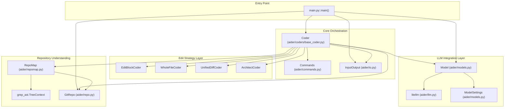

**Sources:** [aider/main.py:451-650](), [aider/coders/base_coder.py:88-123](), [aider/models.py:127-152](), [aider/repomap.py:42-82]()

## Core Components

### Application Entry Point

The `main()` function in `main.py` serves as the primary entry point, handling configuration loading from `.aider.conf.yml`, `.env`, and CLI arguments [aider/main.py:451-650](). It initializes the `GitRepo` [aider/main.py:101-152](), and instantiates the `Coder` through the `Coder.create()` factory method [aider/coders/base_coder.py:125-201]().

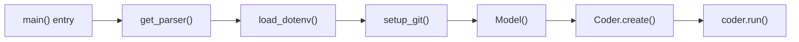

**Sources:** [aider/main.py:451-650](), [aider/args.py:35-65](), [aider/coders/base_coder.py:125-201]()

### Coder Orchestration

The `Coder` base class orchestrates all major subsystems, managing chat history, file tracking, and the LLM interaction loop [aider/coders/base_coder.py:88-123]().

| Responsibility | Implementation | Key Attributes/Methods |
|---------------|----------------|-------------|
| Message management | `done_messages`, `cur_messages` | [aider/coders/base_coder.py:160-175]() |
| File tracking | `abs_fnames`, `abs_read_only_fnames` | [aider/coders/base_coder.py:89-90]() |
| LLM interaction | `main_model` | [aider/coders/base_coder.py:127-140]() |
| Edit application | Edit strategy subclasses | `apply_updates()` |
| Repository context | `repo_map`, `repo` | [aider/coders/base_coder.py:91-95]() |
| Git integration | `GitRepo` | [aider/repo.py:52-788]() |

**Sources:** [aider/coders/base_coder.py:88-201](), [aider/repo.py:52-788]()

### Model and LLM Integration

The `Model` class encapsulates LLM configuration and technical capabilities [aider/models.py:127-152](). It uses `litellm` to support providers like OpenAI, Anthropic, and DeepSeek [aider/models.py:33-123]().

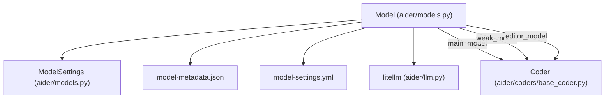

**Sources:** [aider/models.py:127-152](), [aider/models.py:33-123](), [aider/llm.py]()

### Edit Strategy System

Aider implements multiple edit strategies (subclasses of `Coder`) optimized for different model behaviors, such as Search/Replace blocks or whole-file rewrites [aider/coders/base_coder.py:190-201]().

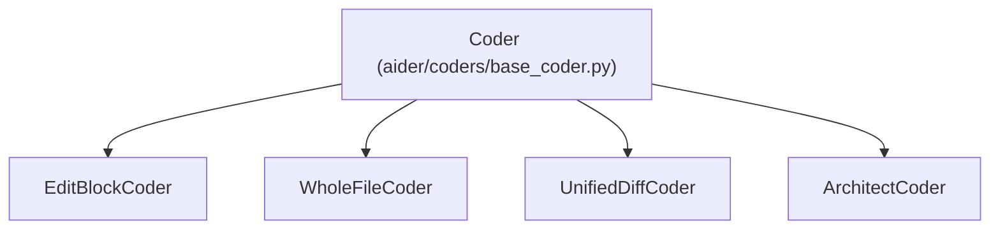

**Sources:** [aider/coders/base_coder.py:190-201](), [aider/args.py:164-177]()

### Repository Understanding

The `RepoMap` class uses tree-sitter to build a map of the codebase, providing the LLM with relevant symbols and definitions without exceeding context limits [aider/repomap.py:42-82](). It uses ranked tags to identify important context [aider/repomap.py:135-142]().

**Sources:** [aider/repomap.py:42-167]()

### Git Integration

The `GitRepo` class manages version control, including auto-commits with AI-generated messages and co-authored attribution [aider/repo.py:52-788]().

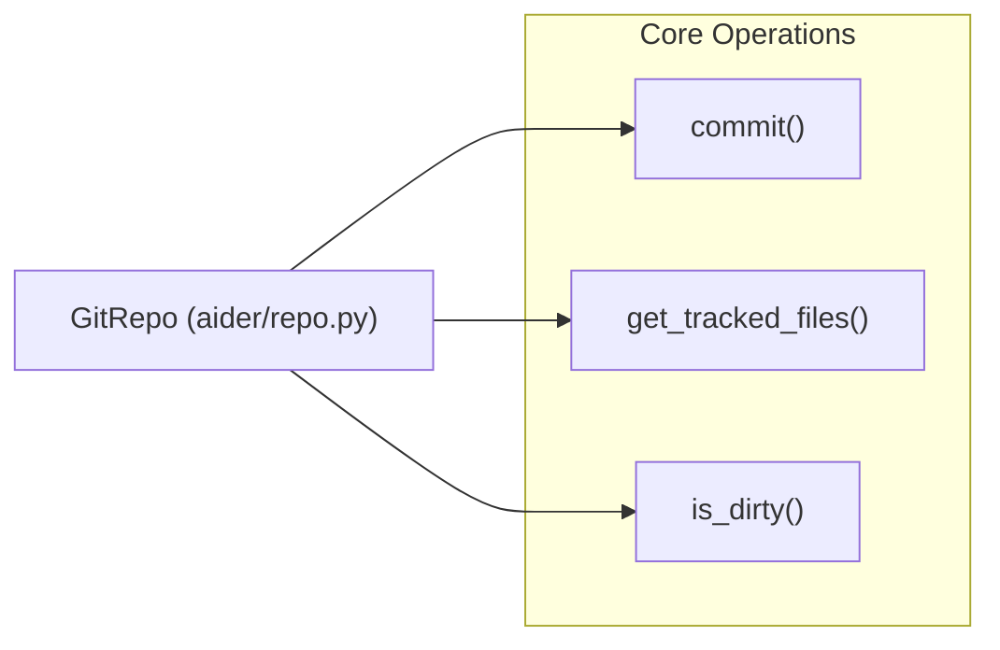

**Sources:** [aider/repo.py:52-788]()

## Configuration System

Aider uses a multi-layered configuration approach with clear precedence: CLI arguments > environment variables > local configuration files [aider/args.py:36-42]().

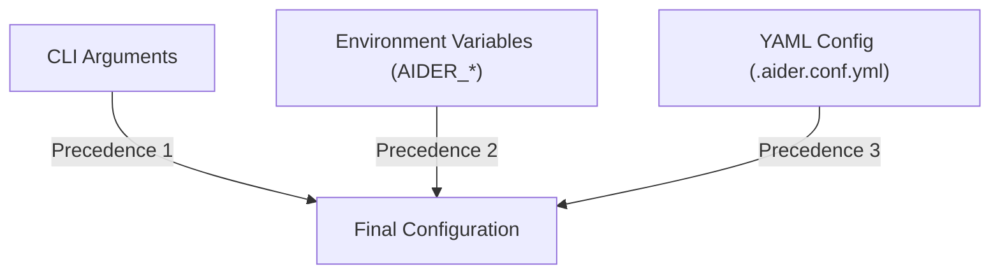

**Sources:** [aider/args.py:36-42](), [aider/main.py:43-57]()

---

# Page: Getting Started

# Getting Started

<details>
<summary>Relevant source files</summary>

The following files were used as context for generating this wiki page:

- [.github/workflows/docker-build-test.yml](.github/workflows/docker-build-test.yml)
- [.github/workflows/docker-release.yml](.github/workflows/docker-release.yml)
- [.github/workflows/pages.yml](.github/workflows/pages.yml)
- [.github/workflows/release.yml](.github/workflows/release.yml)
- [aider/website/_includes/get-started.md](aider/website/_includes/get-started.md)
- [aider/website/_includes/help.md](aider/website/_includes/help.md)
- [aider/website/_posts/2024-05-13-models-over-time.md](aider/website/_posts/2024-05-13-models-over-time.md)
- [aider/website/docs/config/api-keys.md](aider/website/docs/config/api-keys.md)
- [aider/website/docs/install.md](aider/website/docs/install.md)
- [aider/website/docs/install/optional.md](aider/website/docs/install/optional.md)
- [aider/website/docs/more/edit-formats.md](aider/website/docs/more/edit-formats.md)
- [aider/website/docs/troubleshooting.md](aider/website/docs/troubleshooting.md)
- [aider/website/docs/troubleshooting/models-and-keys.md](aider/website/docs/troubleshooting/models-and-keys.md)
- [aider/website/docs/troubleshooting/token-limits.md](aider/website/docs/troubleshooting/token-limits.md)
- [aider/website/docs/usage.md](aider/website/docs/usage.md)
- [aider/website/docs/usage/images-urls.md](aider/website/docs/usage/images-urls.md)
- [aider/website/install.ps1](aider/website/install.ps1)
- [aider/website/install.sh](aider/website/install.sh)
- [docker/Dockerfile](docker/Dockerfile)

</details>


This page guides new users through the installation, initial setup, and first use of Aider. It covers the various installation methods, API key configuration via environment variables or configuration files, and the automated onboarding process.

## Installation

Aider is primarily distributed as a Python package and can be installed via several methods. The recommended approach is using `uv` or `pipx` to ensure dependencies are isolated.

### Recommended: Quick Install Scripts
The project provides automated scripts that install `uv` (if necessary) and then use it to install Aider in a managed environment.

*   **Mac & Linux:**
    ```bash
    curl -LsSf https://aider.chat/install.sh | sh
    ```
*   **Windows:**
    ```powershell
    powershell -ExecutionPolicy ByPass -c "irm https://aider.chat/install.ps1 | iex"
    ```

### Manual Installation Methods
| Method | Command | Notes |
| :--- | :--- | :--- |
| **uv** | `uv tool install --force --python python3.12 --with pip aider-chat@latest` | Recommended for speed and Python version management [aider/website/docs/install.md:54-59](). |
| **pipx** | `pipx install aider-chat` | Good for global CLI tool isolation [aider/website/docs/install.md:71-76](). |
| **pip** | `python -m pip install -U aider-chat` | Use within a virtual environment to avoid dependency conflicts [aider/website/docs/install.md:98-100](). |

Sources: [aider/website/docs/install.md:12-100](), [aider/website/install.sh:1-50]()

---

## Initial Setup and Onboarding

When Aider is launched, it performs an initialization sequence to detect the environment and ensure the user has a functional model to work with.

### Automatic Model Selection
If no model is specified via the `--model` flag, Aider attempts to select a default based on available environment variables [aider/website/docs/troubleshooting/models-and-keys.md:11-19]().

1.  **OpenRouter Detection**: If no keys are provided, Aider may offer to connect via OpenRouter [aider/website/docs/troubleshooting/models-and-keys.md:22-27]().
2.  **Provider Detection**: Aider looks for keys for major providers like Anthropic (Claude 3.7 Sonnet), OpenAI (o3-mini, gpt-4o), or DeepSeek (R1, V3) [aider/website/docs/troubleshooting/models-and-keys.md:31-49]().

### Onboarding Logic Flow
The following diagram illustrates the decision logic during the first launch.

**Aider Onboarding and Model Selection**
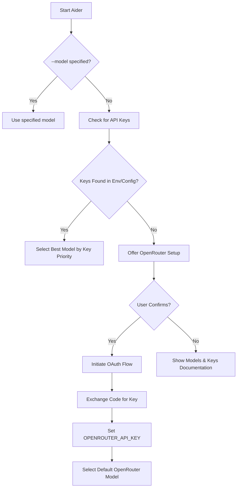
Sources: [aider/website/docs/troubleshooting/models-and-keys.md:11-55](), [aider/website/docs/install.md:14-23]()

---

## Configuration

Aider supports a multi-layered configuration system. Settings are loaded with precedence rules where command line arguments override environment variables and configuration files.

### API Key Configuration
Users can configure keys through environment variables or specific arguments.

*   **Environment Variables**: Best for storing various provider keys like `OPENAI_API_KEY`, `ANTHROPIC_API_KEY`, or `DEEPSEEK_API_KEY` [aider/website/docs/troubleshooting/models-and-keys.md:16-19]().
*   **Command Line**: Keys can be passed directly using `--api-key provider=key` [aider/website/docs/troubleshooting/models-and-keys.md:31-49]().

### Token Management
Aider monitors token usage and reports errors if a model's **context window** or **output token limit** is exceeded [aider/website/docs/troubleshooting/token-limits.md:8-14](). Users can manage context using:
*   `/tokens`: View current usage [aider/website/docs/troubleshooting/token-limits.md:59]().
*   `/drop`: Remove files from context [aider/website/docs/troubleshooting/token-limits.md:60]().
*   `/clear`: Clear chat history [aider/website/docs/troubleshooting/token-limits.md:61]().

Sources: [aider/website/docs/troubleshooting/models-and-keys.md:8-55](), [aider/website/docs/troubleshooting/token-limits.md:6-78]()

---

## First Use

Once installed and configured, Aider is typically run from the root of a git repository.

### Adding Files to Context
Aider needs to know which files it is allowed to edit. You can add files during startup or during the chat session.
*   **Startup**: `aider <file1> <file2>` [aider/website/docs/usage.md:16-18]().
*   **In-Chat**: Use the `/add` command [aider/website/docs/usage.md:42-46]().

### The Interaction Loop
Aider operates in a REPL where it:
1.  Accepts natural language instructions via the `InputOutput` interface.
2.  Analyzes files in the chat context and the `RepoMap`.
3.  Sends a prompt to the LLM using the configured `EditFormat`.
4.  Applies edits to local files.
5.  Automatically commits changes to Git via the `GitRepo` class [aider/website/docs/usage.md:88-89]().

**Natural Language to Code Entity Mapping**
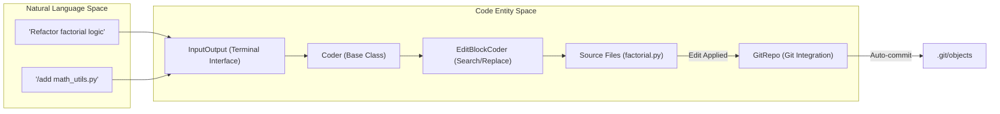

### Optional Dependencies and Docker
*   **Playwright**: For web scraping via `/web <url>`. Requires `playwright install --with-deps chromium` [aider/website/docs/install/optional.md:32-49]().
*   **PortAudio**: For voice-to-code via `/voice`. Requires `libportaudio2` on Linux or `brew install portaudio` on Mac [aider/website/docs/install/optional.md:56-68]().
*   **Docker**: Aider provides a `Dockerfile` with two targets: `aider-full` (includes help, browser, and playwright) and `aider` (standard install) [docker/Dockerfile:35-80]().

Sources: [aider/website/docs/usage.md:9-93](), [aider/website/docs/install/optional.md:9-80](), [docker/Dockerfile:1-80]()

---

# Page: Key Concepts and Terminology

# Key Concepts and Terminology

<details>
<summary>Relevant source files</summary>

The following files were used as context for generating this wiki page:

- [HISTORY.md](HISTORY.md)
- [README.md](README.md)
- [aider/args.py](aider/args.py)
- [aider/coders/base_coder.py](aider/coders/base_coder.py)
- [aider/commands.py](aider/commands.py)
- [aider/io.py](aider/io.py)
- [aider/main.py](aider/main.py)
- [aider/models.py](aider/models.py)
- [aider/repo.py](aider/repo.py)
- [aider/repomap.py](aider/repomap.py)
- [aider/voice.py](aider/voice.py)
- [aider/website/HISTORY.md](aider/website/HISTORY.md)
- [aider/website/_data/blame.yml](aider/website/_data/blame.yml)
- [aider/website/assets/sample-analytics.jsonl](aider/website/assets/sample-analytics.jsonl)
- [aider/website/docs/config/adv-model-settings.md](aider/website/docs/config/adv-model-settings.md)
- [aider/website/docs/config/model-aliases.md](aider/website/docs/config/model-aliases.md)
- [aider/website/docs/faq.md](aider/website/docs/faq.md)
- [aider/website/docs/languages.md](aider/website/docs/languages.md)
- [aider/website/docs/leaderboards/index.md](aider/website/docs/leaderboards/index.md)
- [aider/website/docs/more/infinite-output.md](aider/website/docs/more/infinite-output.md)
- [aider/website/index.html](aider/website/index.html)
- [scripts/update-blame.sh](scripts/update-blame.sh)
- [tests/basic/test_io.py](tests/basic/test_io.py)

</details>


This page defines the fundamental concepts and technical terminology that underpin Aider's operation. It serves as a conceptual reference for understanding how Aider bridges the gap between natural language instructions and concrete codebase modifications.

## Edit Formats

Edit formats are the protocols Aider uses to instruct an LLM on how to communicate code changes. Instead of the LLM returning a full file every time, it uses specific "strategies" to minimize token usage and increase reliability.

The `Coder` class determines the appropriate format during initialization [aider/coders/base_coder.py:142-149](). Valid formats are dynamically gathered from registered coder classes [aider/coders/base_coder.py:190-201]().

| Format | Technical Description | Use Case |
|:---|:---|:---|
| `whole` | The LLM returns the entire content of the file. | Small files or weaker models [aider/models.py:131](). |
| `diff` | The LLM returns a search/replace block format. | Efficient updates to larger files [aider/website/docs/faq.md:164](). |
| `udiff` | A unified diff format. | Standardized patching. |
| `architect` | A two-stage reasoning format using an Architect and an Editor. | Complex refactoring and design [aider/commands.py:161-166](). |
| `ask` | No code changes; text-only response. | General questions about the code [aider/commands.py:197-199](). |

### Fencing
To prevent the LLM's output from being misinterpreted, Aider uses "fences" to wrap code blocks. The system supports multiple fence types, including triple backticks and XML-style tags like `<source>`, to handle nested code blocks [aider/coders/base_coder.py:73-85]().

Sources: [aider/coders/base_coder.py:73-85](), [aider/coders/base_coder.py:142-201](), [aider/commands.py:161-199](), [aider/models.py:131]().

## Repository Map (repo-map)

The repository map is a compressed representation of the entire codebase. It allows Aider to provide the LLM with "global context" without exceeding the token limit or overwhelming the model with irrelevant details [aider/website/docs/faq.md:22-28]().

*   **Implementation**: The `RepoMap` class uses `tree-sitter` via the `grep_ast` library to extract symbols (classes, functions, variables) [aider/repomap.py:15-19]().
*   **Ranking**: It identifies the most important parts of the repository using a PageRank-like algorithm applied to the symbol graph [aider/repomap.py:135-142]().
*   **Caching**: Tags and map data are cached in a SQLite-backed disk cache (`.aider.tags.cache.v{CACHE_VERSION}`) to ensure performance in large repositories [aider/repomap.py:43-47](), [aider/repomap.py:217-223]().

Sources: [aider/repomap.py:15-47](), [aider/repomap.py:135-142](), [aider/repomap.py:217-223](), [aider/website/docs/faq.md:22-28]().

## Chat Modes and File Management

Aider operates on a "chat context" that consists of specific files the LLM is allowed to modify or read.

*   **In-Chat Files**: Files explicitly added via `/add` or CLI arguments. These are stored in `abs_fnames` and are "editable" by the LLM [aider/coders/base_coder.py:89]().
*   **Read-Only Files**: Files added via `/read` or `--read`. These are stored in `abs_read_only_fnames`. The LLM can see their content for context but is instructed not to modify them [aider/coders/base_coder.py:90](), [aider/commands.py:84-85]().
*   **Chat Modes**: Users can switch between modes like `ask`, `code`, `architect`, or `context` using the `/chat-mode` command [aider/commands.py:138-172](). This internally raises a `SwitchCoder` exception to re-initialize the `Coder` instance with new parameters [aider/commands.py:30-34](), [aider/commands.py:200-203]().

Sources: [aider/coders/base_coder.py:89-90](), [aider/commands.py:30-34](), [aider/commands.py:84-85](), [aider/commands.py:138-203]().

## The Weak/Architect Model Pattern

Aider employs a multi-model strategy to optimize for both performance and cost. This is managed by the `Model` class and `ModelSettings` configuration [aider/models.py:128-151]().

### Three-Tier Architecture
1.  **Main Model**: The primary LLM used for complex reasoning and code generation (e.g., Claude 3.7 Sonnet, GPT-4o) [aider/models.py:30-31]().
2.  **Weak Model**: A smaller, faster model used for lightweight tasks like generating git commit messages and summarizing chat history [aider/models.py:132]().
3.  **Editor Model**: Used specifically in `architect` mode to apply the high-level changes designed by the Architect [aider/models.py:145-146]().

### Data Flow: From Intent to Code
The following diagram illustrates how user intent is transformed into codebase changes through these components.

**System Architecture: Natural Language to Code Entity Space**

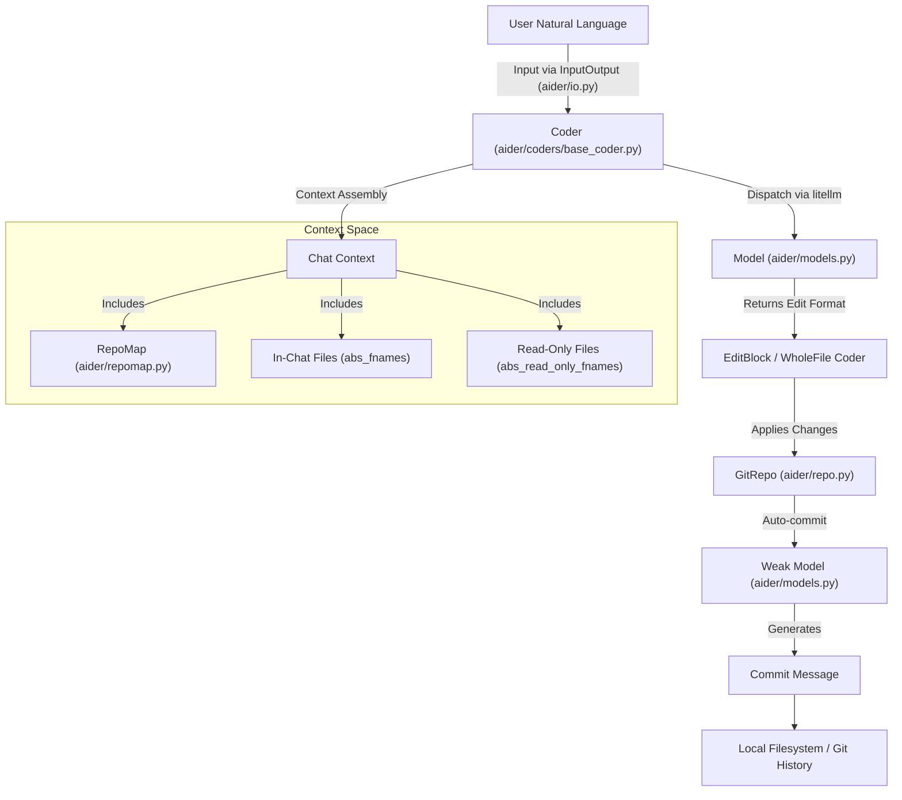
Sources: [aider/coders/base_coder.py:88-122](), [aider/models.py:128-151](), [aider/repo.py:35](), [aider/repomap.py:42-47](), [aider/io.py:31]().

## Technical Terminology Reference

| Term | Code Reference | Description |
|:---|:---|:---|
| `abs_fnames` | [aider/coders/base_coder.py:89]() | Set of absolute paths for files the LLM is allowed to edit. |
| `abs_read_only_fnames` | [aider/coders/base_coder.py:90]() | Set of absolute paths for files provided as read-only context. |
| `litellm` | [aider/main.py:32]() | The underlying library used to provide a unified interface to LLM providers. |
| `SwitchCoder` | [aider/commands.py:30-34]() | Exception used to hot-swap the `Coder` instance when the model or mode changes. |
| `done_messages` | [aider/coders/base_coder.py:160]() | Historical messages in the current session that have been processed. |
| `reasoning_tag` | [aider/models.py:147]() | Config for handling "thinking" blocks (e.g., `<thought>`) from reasoning models. |
| `MODEL_ALIASES` | [aider/models.py:99]() | Mapping of short names (e.g., `sonnet`) to canonical model strings. |

### Component Interaction: Edit Strategy Selection

**Logic Flow: Coder Initialization and Format Selection**

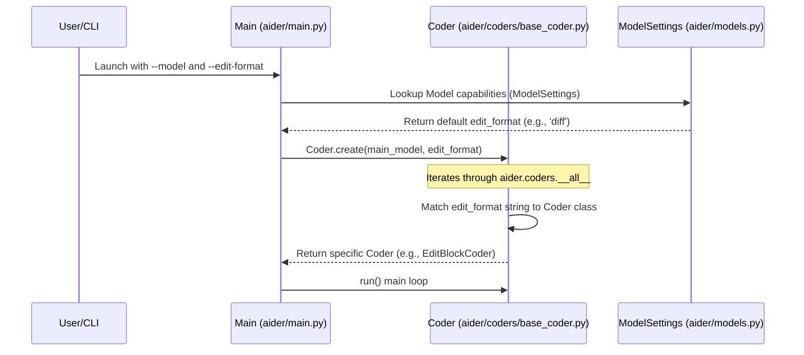
Sources: [aider/main.py:23-26](), [aider/coders/base_coder.py:125-194](), [aider/models.py:128-151]().

---

# Page: Core Architecture

# Core Architecture

<details>
<summary>Relevant source files</summary>

The following files were used as context for generating this wiki page:

- [MANIFEST.in](MANIFEST.in)
- [aider/__init__.py](aider/__init__.py)
- [aider/args.py](aider/args.py)
- [aider/coders/base_coder.py](aider/coders/base_coder.py)
- [aider/commands.py](aider/commands.py)
- [aider/help_pats.py](aider/help_pats.py)
- [aider/io.py](aider/io.py)
- [aider/llm.py](aider/llm.py)
- [aider/main.py](aider/main.py)
- [aider/models.py](aider/models.py)
- [aider/repo.py](aider/repo.py)
- [aider/repomap.py](aider/repomap.py)
- [aider/voice.py](aider/voice.py)
- [aider/website/docs/languages.md](aider/website/docs/languages.md)
- [aider/website/docs/leaderboards/by-release-date.md](aider/website/docs/leaderboards/by-release-date.md)
- [pyproject.toml](pyproject.toml)
- [scripts/versionbump.py](scripts/versionbump.py)
- [tests/basic/test_io.py](tests/basic/test_io.py)

</details>


## Purpose and Scope

This document describes the fundamental architectural components of Aider and how they interact to enable AI-assisted pair programming. It covers the core orchestration layer, major subsystems, and the flow of requests through the system.

Detailed documentation for specific subsystems can be found in the following child pages:
- [Application Entry Point and Main Loop](#2.1) — Covers `main.py`, initialization, and the execution loop.
- [Coder Orchestration System](#2.2) — Covers the `Coder` base class and interaction orchestration.
- [Commands and User Interactions](#2.3) — Covers the `Commands` class and slash command processing.
- [Model Management and LLM Integration](#2.4) — Covers the `Model` class and `litellm` integration.
- [Input/Output and Terminal Interface](#2.5) — Covers `InputOutput` and terminal handling.

## Architectural Overview

Aider follows a layered architecture with the `Coder` class as the central orchestrator. The system coordinates between user input, LLM interactions, code understanding, version control, and file operations.

**High-Level Component Interaction**

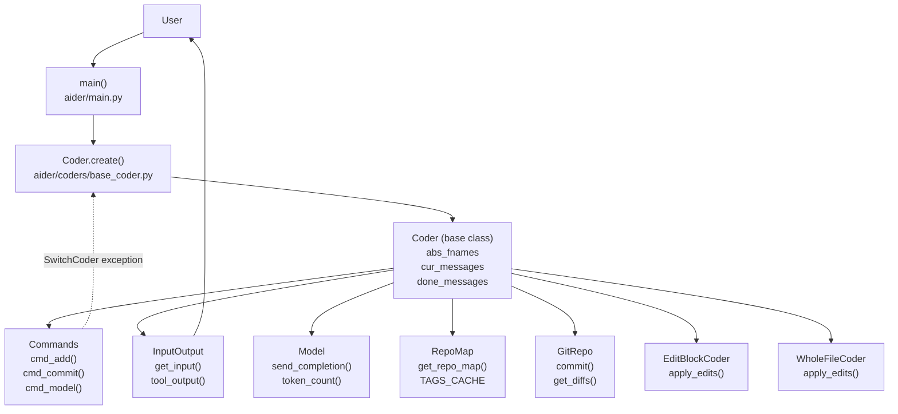

Sources: [aider/main.py:451-1000](), [aider/coders/base_coder.py:88-543](), [aider/commands.py:30-33]()

## Central Orchestrator: The Coder Class

The `Coder` class ([aider/coders/base_coder.py:88-2257]()) is the heart of Aider's architecture. It manages the lifecycle of chat interactions, coordinates between subsystems, and maintains state throughout the session. For details, see [Coder Orchestration System](#2.2).

**Coder Class Responsibilities and Key Attributes**

| Responsibility | Key Attributes | Key Methods | Location |
|---------------|----------------|---------|----------|
| File Management | `abs_fnames`, `abs_read_only_fnames` | `add_rel_fname()`, `drop_rel_fname()` | [aider/coders/base_coder.py:89-91]() |
| Message History | `cur_messages`, `done_messages` | `format_messages()` | [aider/coders/base_coder.py:395-403]() |
| Repository Integration | `repo`, `repo_map` | `get_repo_map()`, `get_repo_messages()` | [aider/coders/base_coder.py:91-95]() |
| Model Communication | `main_model` | `send_message()`, `send_completion()` | [aider/coders/base_coder.py:418-424]() |
| Git Operations | `repo` | `repo.commit()` | [aider/coders/base_coder.py:409-413]() |
| Cost Tracking | `total_cost`, `message_cost` | Updated in `send_completion()` | [aider/coders/base_coder.py:384-388]() |

**Coder Creation and Initialization**

The `Coder.create()` factory method ([aider/coders/base_coder.py:124-201]()) instantiates the appropriate coder subclass based on the `edit_format`. This allows switching between different edit strategies while maintaining state.

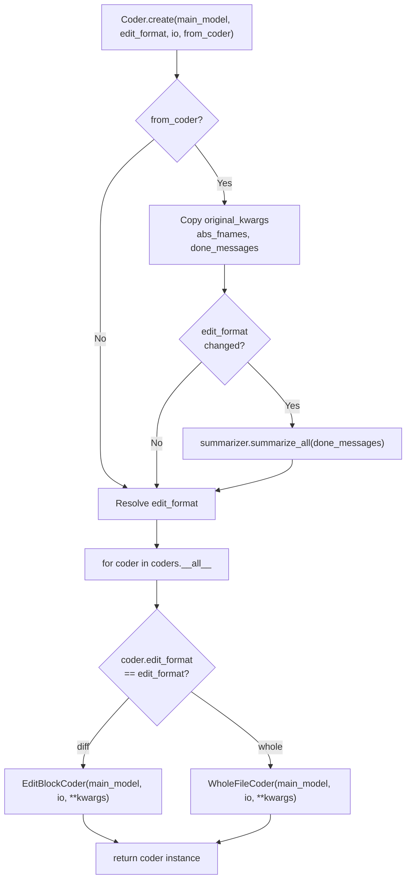

Sources: [aider/coders/base_coder.py:124-201](), [aider/coders/base_coder.py:160-168]()

## Core Components

### Application Entry and Initialization

The `main()` function ([aider/main.py:451-1000]()) orchestrates the startup sequence, handling configuration and validation. For details, see [Application Entry Point and Main Loop](#2.1).

The system loads configuration with specific precedence ([aider/main.py:461-505]()):
1. Home directory: `~/.aider.conf.yml`
2. Git root: `<git_root>/.aider.conf.yml`
3. Current directory: `./.aider.conf.yml`
4. Command-line arguments (highest priority)

Sources: [aider/main.py:451-757](), [aider/args.py:35-42]()

### Command System

The `Commands` class ([aider/commands.py:36-1500]()) implements the slash command interface and acts as a bridge between user actions and coder operations. For details, see [Commands and User Interactions](#2.3).

The `SwitchCoder` exception ([aider/commands.py:30-33]()) enables commands like `/model` to trigger coder recreation. When raised, the exception is caught in the main loop ([aider/main.py:994-1004]()), and a new `Coder` is created.

Sources: [aider/commands.py:255-333](), [aider/main.py:994-1004]()

### Model Management

The `Model` class ([aider/models.py:317-838]()) encapsulates LLM configuration and manages API communication via `litellm`. For details, see [Model Management and LLM Integration](#2.4).

**Model Configuration Hierarchy**

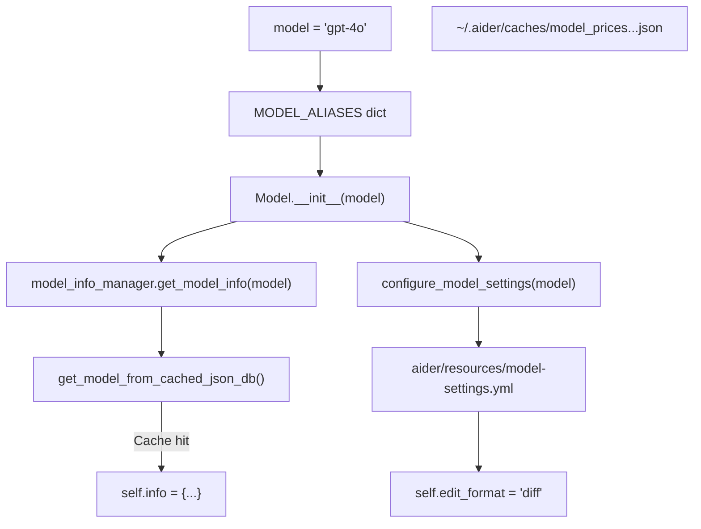

Sources: [aider/models.py:317-420](), [aider/models.py:149-314](), [aider/models.py:87-111]()

### Input/Output System

The `InputOutput` class ([aider/io.py:230-1063]()) manages terminal interactions, formatting, and file operations. For details, see [Input/Output and Terminal Interface](#2.5).

The `AutoCompleter` class ([aider/io.py:91-228]()) provides context-aware completions for commands, file paths, and tokens from source files ([aider/io.py:127-146]()).

Sources: [aider/io.py:230-373](), [aider/io.py:91-228]()

### Git Integration

The `GitRepo` class ([aider/repo.py:52-742]()) provides git repository operations, including commits with attribution.

**GitRepo Core Operations**

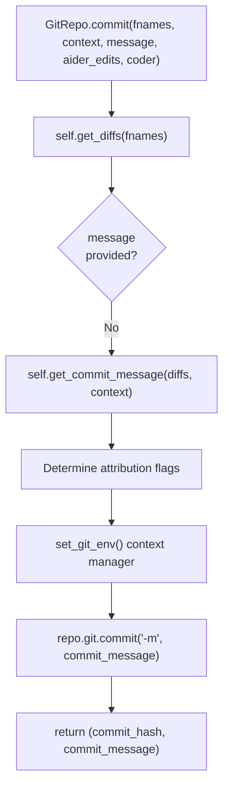

Sources: [aider/repo.py:131-318](), [aider/repo.py:326-373](), [aider/repo.py:39-50]()

## Request Processing Flow

The complete request processing flow shows how user input becomes code changes and git commits.

**End-to-End Request Flow**

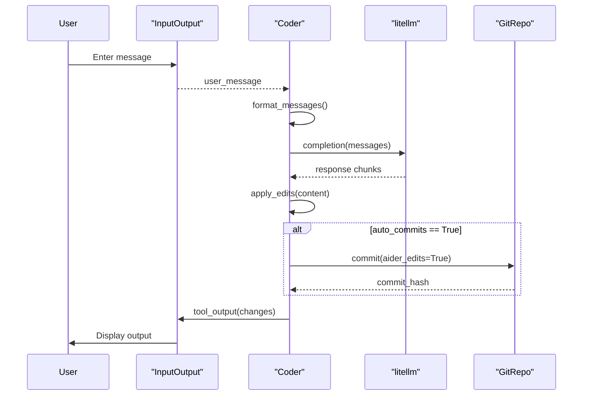

Sources: [aider/coders/base_coder.py:876-945](), [aider/coders/base_coder.py:1597-1782]()

---

# Page: Application Entry Point and Main Loop

# Application Entry Point and Main Loop

<details>
<summary>Relevant source files</summary>

The following files were used as context for generating this wiki page:

- [aider/args.py](aider/args.py)
- [aider/coders/base_coder.py](aider/coders/base_coder.py)
- [aider/commands.py](aider/commands.py)
- [aider/io.py](aider/io.py)
- [aider/main.py](aider/main.py)
- [aider/models.py](aider/models.py)
- [aider/onboarding.py](aider/onboarding.py)
- [aider/repo.py](aider/repo.py)
- [aider/repomap.py](aider/repomap.py)
- [aider/voice.py](aider/voice.py)
- [aider/website/docs/languages.md](aider/website/docs/languages.md)
- [pytest.ini](pytest.ini)
- [tests/basic/test_io.py](tests/basic/test_io.py)
- [tests/basic/test_main.py](tests/basic/test_main.py)
- [tests/basic/test_model_info_manager.py](tests/basic/test_model_info_manager.py)
- [tests/basic/test_ssl_verification.py](tests/basic/test_ssl_verification.py)
- [tests/scrape/test_scrape.py](tests/scrape/test_scrape.py)

</details>


## Purpose and Scope

This page documents the main entry point for the aider application, specifically the `main()` function in [aider/main.py](). It covers the initialization sequence, configuration loading, argument parsing, and the flow that occurs before control is handed to the Coder system. For information about the Coder orchestration layer itself, see [Coder Orchestration System](#2.2). For details about command-line argument definitions, see [Command Line Interface](#5.1).

**Sources:** [aider/main.py:1-1000]()

---

## The `main()` Function

The application entry point is the `main()` function defined at [aider/main.py:451](). This function accepts optional parameters to support both command-line invocation and programmatic usage:

| Parameter | Type | Purpose |
|-----------|------|---------|
| `argv` | `list[str]` or `None` | Command-line arguments; defaults to `sys.argv[1:]` |
| `input` | IO object or `None` | Input stream for testing/embedding |
| `output` | IO object or `None` | Output stream for testing/embedding |
| `force_git_root` | `str` or `None` | Override git root detection |
| `return_coder` | `bool` | If `True`, return the Coder instance instead of running it |

The function returns an integer exit code (typically 0 for success, 1 for error) or a Coder instance if `return_coder=True`.

**Sources:** [aider/main.py:451-452]()

---

## Initialization Flow Overview

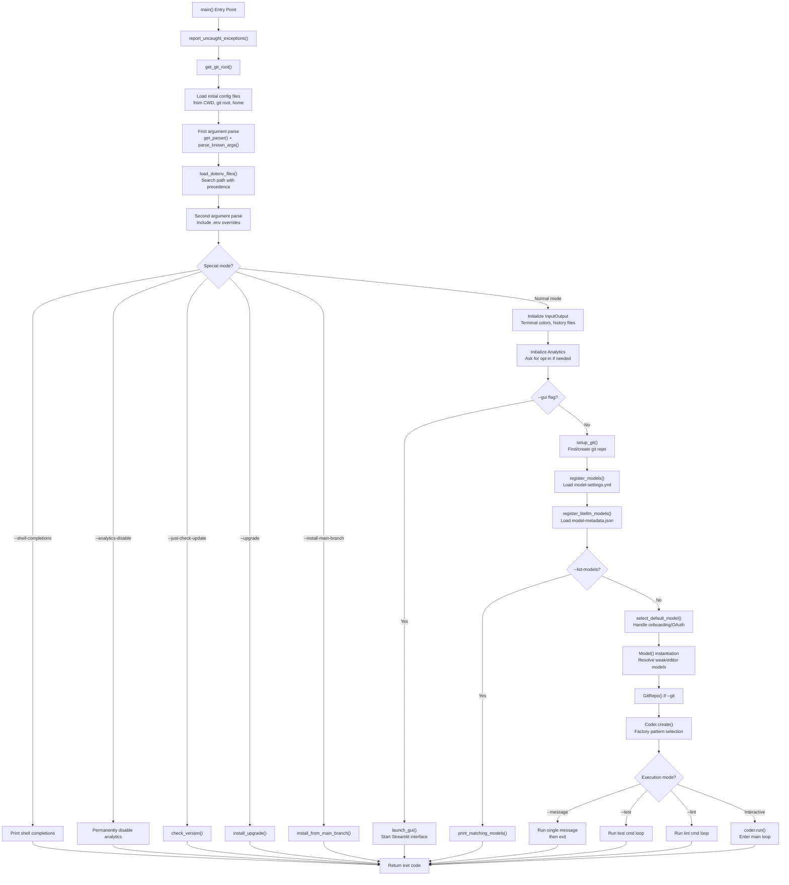

**Sources:** [aider/main.py:451-1000](), [aider/main.py:876-892](), [aider/report.py:1-50]()

---

## Configuration File Loading

Aider uses a hierarchical configuration system where settings from multiple sources are merged with a specific precedence order. The configuration is loaded in two phases: YAML/config files first, then `.env` files.

### YAML Configuration Search Path

The `get_parser()` function in [aider/args.py:35]() sets up the configuration file search order using `configargparse.ArgumentParser`:

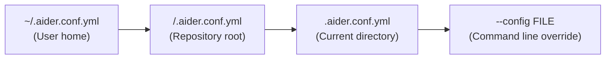

Files are processed in order, with later files overriding earlier ones. The logic at [aider/main.py:464-477]() constructs this list.

### Environment Variable Loading

The `load_dotenv_files()` function at [aider/main.py:361-387]() loads `.env` files in a similar hierarchical manner:

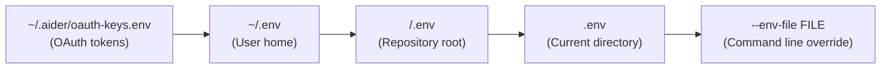

Each file loaded sets `override=True` so later values replace earlier ones. The OAuth keys file is explicitly prepended to ensure it's loaded first (but potentially overridden).

### Precedence Summary

The final precedence order (highest to lowest) is:

1. Command-line arguments (`--option value`)
2. Environment variables with `AIDER_` prefix (configured via `auto_env_var_prefix` in [aider/args.py:41]())
3. Current directory `.env` and `.aider.conf.yml`
4. Git root `.env` and `.aider.conf.yml`
5. Home directory `.env` and `.aider.conf.yml`
6. OAuth keys from `~/.aider/oauth-keys.env`

**Sources:** [aider/main.py:361-387](), [aider/main.py:464-494](), [aider/args.py:35-42]()

---

## Argument Parsing with ConfigArgParse

Aider uses the `configargparse` library which extends `argparse` to support configuration files. The parser is defined in `get_parser()` at [aider/args.py:35]().

### Two-Pass Parsing

The `main()` function performs argument parsing twice:

```python
# First pass - before .env loading
parser = get_parser(default_config_files, git_root)
args, unknown = parser.parse_known_args(argv)

# Load .env files based on first pass
loaded_dotenvs = load_dotenv_files(git_root, args.env_file, args.encoding)

# Second pass - include .env variables
args = parser.parse_args(argv)
```

This two-pass approach at [aider/main.py:496-504]() ensures that:
1. The `--env-file` argument is respected when loading environment variables.
2. Environment variables can influence final argument values.

### Argument Groups

Arguments are organized into logical groups in [aider/args.py:55-700]():

| Group | Purpose | Key Arguments |
|-------|---------|---------------|
| Main model | Primary LLM selection | `--model`, `files` |
| API Keys and settings | Authentication | `--openai-api-key`, `--set-env`, `--api-key` |
| Model settings | Model behavior | `--edit-format`, `--weak-model`, `--reasoning-effort`, `--thinking-tokens` |
| Repomap settings | Context building | `--map-tokens`, `--map-refresh` |
| History Files | Persistence | `--input-history-file`, `--chat-history-file` |
| Output settings | Display formatting | `--pretty`, `--dark-mode`, `--stream` |
| Git settings | Version control | `--git`, `--auto-commits`, `--dirty-commits` |

**Sources:** [aider/main.py:479-504](), [aider/args.py:35-700]()

---

## Special Execution Modes

Before entering the main application flow, `main()` checks for several special modes that cause early exit:

### Shell Completion Generation

At [aider/main.py:506-510](), the `--shell-completions` flag generates shell completion scripts for bash/zsh/fish using `shtab`.

### Analytics Management

At [aider/main.py:515-517](), the `--analytics-disable` flag permanently disables telemetry via the `Analytics` class.

### Version Check and Update

The following flags trigger version-related operations and exit:

- `--just-check-update`: Check for updates without installing ([aider/main.py:722-725]())
- `--upgrade`: Install the latest version from PyPI ([aider/main.py:732-735]())
- `--install-main-branch`: Install from the GitHub main branch ([aider/main.py:727-730]())

### GUI Mode

At [aider/main.py:666-673](), the `--gui` flag launches the Streamlit web interface via `launch_gui()` at [aider/main.py:233-268](). It first checks if `streamlit` is installed using `utils.check_pip_install_extra` [aider/main.py:208-214]().

**Sources:** [aider/main.py:506-743](), [aider/main.py:233-268](), [aider/main.py:208-214]()

---

## Git Repository Initialization

Git repository setup occurs in discovery and optional creation phases.

### Git Root Discovery

The `get_git_root()` function at [aider/main.py:60-66]() attempts to find the git repository root using `git.Repo(search_parent_directories=True)`.

### Repository Setup or Creation

The `setup_git()` function at [aider/main.py:101-152]() is called later in the initialization flow:

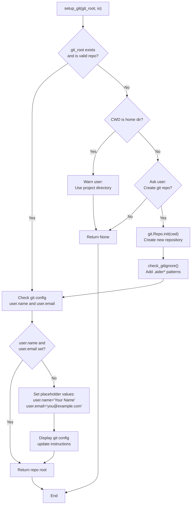

### Gitignore Management

The `check_gitignore()` function at [aider/main.py:155-206]() ensures that aider's working files are excluded from git by adding `.aider*` and `.env` (if present) to the `.gitignore` file.

**Sources:** [aider/main.py:60-66](), [aider/main.py:101-152](), [aider/main.py:155-206](), [aider/main.py:740-743]()

---

## Model Registration and Selection

Model registration is a two-stage process that loads operational settings and technical metadata.

### Model Settings Registration

The `register_models()` function at [aider/main.py:335-358]() loads `.aider.model.settings.yml` files. These files contain model configuration like `edit_format`, `use_repo_map`, and behavioral flags defined in the `ModelSettings` dataclass [aider/models.py:128-151]().

### Model Metadata Registration

The `register_litellm_models()` function at [aider/main.py:390-410]() loads `.aider.model.metadata.json` files. These files contain technical specifications like `max_input_tokens`, `max_output_tokens`, and cost information, managed by the `ModelInfoManager` [aider/models.py:161-240]().

### Model Selection with Onboarding

The `select_default_model()` function at [aider/onboarding.py:116-151]() (called at [aider/main.py:777]()) handles the welcome flow and OAuth for new users if no model is specified and no keys are found. It uses `try_to_select_default_model` [aider/onboarding.py:44-76]() to check for environment keys and `offer_openrouter_oauth` [aider/onboarding.py:79-113]() if needed.

### Model Instance Creation

After selection, a `Model` instance is created at [aider/main.py:822-828]():

```python
main_model = models.Model(
    args.model,
    weak_model=args.weak_model,
    editor_model=args.editor_model,
    editor_edit_format=args.editor_edit_format,
    verbose=args.verbose,
)
```

The `Model` class at [aider/models.py:312]() handles alias resolution via `MODEL_ALIASES` [aider/models.py:99-123]() and selects appropriate sub-models for weak and editor tasks.

**Sources:** [aider/main.py:335-358](), [aider/main.py:390-410](), [aider/main.py:777-828](), [aider/models.py:128-151](), [aider/models.py:312-353](), [aider/onboarding.py:44-151]()

---

## Coder Creation and Execution

The final initialization step creates a `Coder` instance and begins execution.

### Coder Factory Pattern

The `Coder.create()` class method at [aider/coders/base_coder.py:125-202]() uses a factory pattern to instantiate the correct coder subclass (e.g., `ArchitectCoder`, `EditBlockCoder`) based on the requested `edit_format`.

### Main Execution Flow

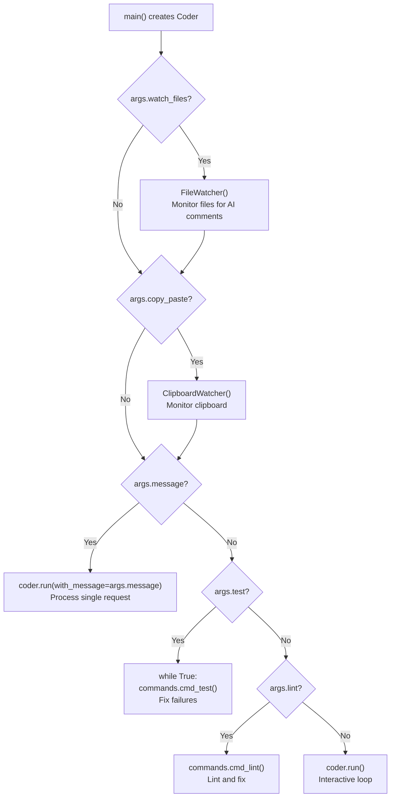

The `coder.run()` method at [aider/coders/base_coder.py:876-892]() implements the core interaction loop.

**Sources:** [aider/main.py:876-1000](), [aider/coders/base_coder.py:125-202](), [aider/coders/base_coder.py:876-892]()

---

## Main Interaction Loop

The main loop consists of input collection, message preprocessing, and message execution.

### Input Collection Phase

The `get_input()` method at [aider/coders/base_coder.py:898-910]() prepares context and calls `InputOutput.get_input()`. This delegates to `PromptSession.prompt()` at [aider/io.py:787](), using an `AutoCompleter` [aider/io.py:91-228]() for tab completions of files and slash commands.

### Message Preprocessing Phase

The `run_one()` method at [aider/coders/base_coder.py:924-944]() orchestrates processing. The `preproc_user_input()` method at [aider/coders/base_coder.py:912-922]() checks if the input is a command using `self.commands.is_command(inp)`.

### Command Execution Branch

If a command is detected, it is dispatched via `self.commands.run(inp)` [aider/commands.py:255-333](). This method matches the input against available commands and calls the corresponding `cmd_<name>` method.

### Message Execution Phase

If the input is not a command, it is sent to the LLM via `send_message()` [aider/coders/base_coder.py:859-862](). This triggers the LLM completion, edit extraction, and application cycle.

**Sources:** [aider/coders/base_coder.py:898-944](), [aider/io.py:91-228](), [aider/commands.py:255-333]()

---

## Loop Control Flow and Exit

### Interrupt Handling

The `keyboard_interrupt()` method at [aider/coders/base_coder.py:986-1000]() implements double Ctrl-C detection to prevent accidental exits.

### Return Modes

The `main()` function supports returning an integer exit code or the `Coder` instance itself (if `return_coder=True`) [aider/main.py:451-452](). In `return_coder` mode, it automatically sets `yes_always = True` [aider/main.py:546-547]().

### Error Handling

Uncaught exceptions are handled by `report_uncaught_exceptions()` [aider/report.py](), which is installed at the very start of `main()` [aider/main.py:452]().

**Sources:** [aider/main.py:451-452](), [aider/main.py:546-547](), [aider/coders/base_coder.py:986-1000](), [aider/report.py:1-50]()

---

# Page: Coder Orchestration System

# Coder Orchestration System

<details>
<summary>Relevant source files</summary>

The following files were used as context for generating this wiki page:

- [aider/args.py](aider/args.py)
- [aider/coders/base_coder.py](aider/coders/base_coder.py)
- [aider/coders/chat_chunks.py](aider/coders/chat_chunks.py)
- [aider/commands.py](aider/commands.py)
- [aider/help.py](aider/help.py)
- [aider/io.py](aider/io.py)
- [aider/main.py](aider/main.py)
- [aider/models.py](aider/models.py)
- [aider/repo.py](aider/repo.py)
- [aider/repomap.py](aider/repomap.py)
- [aider/voice.py](aider/voice.py)
- [aider/website/docs/languages.md](aider/website/docs/languages.md)
- [scripts/issues.py](scripts/issues.py)
- [tests/basic/test_coder.py](tests/basic/test_coder.py)
- [tests/basic/test_commands.py](tests/basic/test_commands.py)
- [tests/basic/test_io.py](tests/basic/test_io.py)
- [tests/basic/test_sanity_check_repo.py](tests/basic/test_sanity_check_repo.py)
- [tests/help/test_help.py](tests/help/test_help.py)

</details>


The `Coder` class in [aider/coders/base_coder.py:88-123]() is the central orchestrator that coordinates all subsystems in Aider. It manages the complete lifecycle of AI-assisted code editing: accepting user input, maintaining conversation state, generating code context, communicating with LLMs, applying code changes, and committing to git.

**Related Pages:** See [Edit Format Implementations](3.1) for edit format details, [Commands and User Interactions](2.3) for command processing, and [Model Management and LLM Integration](2.4) for model configuration.

## Core Responsibilities

The `Coder` class orchestrates eight primary subsystems:

| Subsystem | Key Attributes/Methods | Purpose |
|-----------|------------------------|---------|
| **Message History** | `done_messages`, `cur_messages`, `move_back_cur_messages()` | Maintains conversation state, manages token limits via summarization. |
| **File Management** | `abs_fnames`, `abs_read_only_fnames`, `add_rel_fname()`, `drop_rel_fname()` | Tracks editable and read-only files in the chat session. |
| **Model Integration** | `main_model`, `weak_model`, `send_with_retries()`, `send_completion()` | Communicates with LLMs, handles retries, and manages reasoning/thinking tokens. |
| **Context Generation** | `repo_map`, `get_repo_map()`, `get_repo_messages()` | Generates relevant code context using PageRank-based RepoMap. |
| **Edit Processing** | `get_edits()`, `apply_updates()`, `aider_edited_files` | Parses and applies AI-generated code changes based on specific edit formats. |
| **Version Control** | `repo`, `aider_commit_hashes`, `commit_before_message` | Manages git commits and tracks AI-authored changes via `GitRepo`. |
| **Command Routing** | `commands`, `preproc_user_input()` | Delegates slash commands to the `Commands` subsystem. |
| **Quality Control** | `linter`, `auto_lint`, `auto_test`, `reflected_message` | Runs linting/testing with a reflection loop for error correction. |

**Sources:** [aider/coders/base_coder.py:88-123](), [aider/coders/base_coder.py:299-543](), [aider/repo.py:131-152]()

## Orchestration Architecture

**Diagram: Coder Subsystem Orchestration with Code Entities**

```mermaid
graph TB
    subgraph External["External Interfaces"]
        User["User (CLI/GUI)"]
        GitCLI["git CLI"]
        LLM["LLM API"]
    end
    
    subgraph CoderClass["Coder (base_coder.py)"]
        CoderInstance["Coder instance<br/>self.abs_fnames: set<br/>self.abs_read_only_fnames: set<br/>self.done_messages: list<br/>self.cur_messages: list<br/>self.main_model: Model<br/>self.repo: GitRepo<br/>self.commands: Commands<br/>self.repo_map: RepoMap<br/>self.linter: Linter<br/>self.aider_commit_hashes: set"]
    end
    
    subgraph Subsystems["Subsystems"]
        IO["InputOutput<br/>(io.py)"]
        Commands["Commands<br/>(commands.py)"]
        RepoMap["RepoMap<br/>(repomap.py)"]
        GitRepo["GitRepo<br/>(repo.py)"]
        Linter["Linter<br/>(linter.py)"]
        Model["Model<br/>(models.py)"]
    end
    
    User -->|"run(with_message)"| CoderInstance
    CoderInstance -->|"self.io.get_input(root, files, commands)"| IO
    IO -->|"user_message"| CoderInstance
    
    CoderInstance -->|"self.commands.run(inp)"| Commands
    Commands -->|"raises SwitchCoder"| CoderInstance
    
    CoderInstance -->|"self.get_repo_map(force_refresh)"| RepoMap
    RepoMap -->|"repo_content str"| CoderInstance
    
    CoderInstance -->|"self.send_with_retries(messages)"| Model
    Model -->|"model.send_completion(messages)"| LLM
    LLM -->|"streaming chunks"| Model
    Model -->|"self.partial_response_content"| CoderInstance
    
    CoderInstance -->|"self.repo.commit(fnames, aider_edits, coder)"| GitRepo
    GitRepo -->|"repo.git.commit()"| GitCLI
    GitRepo -->|"commit_hash, commit_message"| CoderInstance
    
    CoderInstance -->|"self.linter.lint(fname)"| Linter
    Linter -->|"errors str"| CoderInstance
    
    CoderInstance -->|"self.io.tool_output(msg)"| IO
    IO -->|"console display"| User
```

**Sources:** [aider/coders/base_coder.py:88-123](), [aider/coders/base_coder.py:299-543](), [aider/io.py:11-38](), [aider/commands.py:36-52](), [aider/repo.py:35-152](), [aider/models.py:121-151]()

## Coder Factory Pattern

The factory method `Coder.create()` at [aider/coders/base_coder.py:124-201]() selects the correct `Coder` subclass by matching `edit_format` against registered coder classes. When switching modes via `/chat-mode` [aider/commands.py:138-203](), it preserves state through `from_coder.original_kwargs` and may call `summarizer.summarize_all()` [aider/coders/base_coder.py:163]() to prevent confusing the new LLM with incompatible message history.

**Diagram: `Coder.create()` Factory Pattern**

```mermaid
graph TB
    Create["Coder.create(main_model, edit_format, io, from_coder, kwargs)"]
    
    CheckModel{"main_model<br/>provided?"}
    UseFromCoder["main_model = from_coder.main_model"]
    UseDefault["main_model = Model(DEFAULT_MODEL_NAME)"]
    
    CheckFormat{"edit_format<br/>provided?"}
    FromCoderFormat["edit_format = from_coder.edit_format"]
    ModelFormat["edit_format = main_model.edit_format"]
    
    CheckSwitch{"from_coder<br/>exists?"}
    
    CopyState["use_kwargs = dict(from_coder.original_kwargs)<br/>Copy: fnames, read_only_fnames<br/>done_messages, cur_messages<br/>aider_commit_hashes, commands"]
    
    CheckSummarize{"edit_format changed<br/>and summarize_from_coder?"}
    
    Summarize["done_messages = from_coder.summarizer.summarize_all(done_messages)"]
    
    Iterate["for coder in coders.__all__:<br/>if coder.edit_format == edit_format:<br/>return coder(main_model, io, **kwargs)"]
    
    SetOriginal["res.original_kwargs = dict(kwargs)"]
    Return["return res"]
    
    RaiseError["raise UnknownEditFormat(edit_format, valid_formats)"]
    
    Create --> CheckModel
    CheckModel -->|"from_coder"| UseFromCoder
    CheckModel -->|"new session"| UseDefault
    UseFromCoder --> CheckFormat
    UseDefault --> CheckFormat
    
    CheckFormat -->|"from_coder"| FromCoderFormat
    CheckFormat -->|"from model"| ModelFormat
    FromCoderFormat --> CheckSwitch
    ModelFormat --> CheckSwitch
    
    CheckSwitch -->|"Yes"| CopyState
    CheckSwitch -->|"No"| Iterate
    
    CopyState --> CheckSummarize
    CheckSummarize -->|"Yes"| Summarize
    CheckSummarize -->|"No"| Iterate
    Summarize --> Iterate
    
    Iterate -->|"match found"| SetOriginal
    Iterate -->|"no match"| RaiseError
    SetOriginal --> Return
```

**Sources:** [aider/coders/base_coder.py:124-201](), [aider/commands.py:138-203](), [aider/models.py:30]()

## Initialization

The `__init__()` method at [aider/coders/base_coder.py:299-543]() initializes subsystems in sequence: analytics, I/O, model, commands, repository, file tracking, repo mapping, summarization, and linting. Files are validated and tracked in `abs_fnames` or `abs_read_only_fnames`.

**Diagram: `__init__()` Initialization Sequence**

```mermaid
graph TB
    Init["__init__(main_model, io, repo, fnames,<br/>read_only_fnames, auto_commits, ...)"]
    
    State["Initialize core state:<br/>self.abs_fnames = set()<br/>self.abs_read_only_fnames = set()<br/>self.done_messages = []<br/>self.cur_messages = []<br/>self.aider_commit_hashes = set()"]
    
    Components["Set up components:<br/>self.analytics = analytics or Analytics()<br/>self.io = io<br/>self.main_model = main_model<br/>self.stream = stream and main_model.streaming"]
    
    Commands["self.commands = Commands(self.io, self)"]
    
    Repo{"use_git<br/>and not repo?"}
    CreateRepo["self.repo = GitRepo(io, fnames, None,<br/>models=main_model.commit_message_models())"]
    
    Files["Process fnames:<br/>- Check repo.git_ignored_file()<br/>- Check repo.ignored_file()<br/>- Create with utils.touch_file() if needed<br/>- Validate is_file()<br/>- Add to self.abs_fnames"]
    
    ReadOnly["Process read_only_fnames:<br/>- Convert to abs_root_path()<br/>- Validate exists()<br/>- Add to self.abs_read_only_fnames"]
    
    RepoMapCheck{"use_repo_map<br/>and repo<br/>and has_map_prompt?"}
    
    RepoMapCreate["self.repo_map = RepoMap(<br/>map_tokens, root, main_model, io,<br/>gpt_prompts.repo_content_prefix)"]
    
    Summarizer["self.summarizer = ChatSummary(<br/>[main_model.weak_model, main_model],<br/>main_model.max_chat_history_tokens)"]
    
    Linter["self.linter = Linter(root, encoding)<br/>self.setup_lint_cmds(lint_cmds)"]
    
    Done["Ready for run()"]
    
    Init --> State
    State --> Components
    Components --> Commands
    Commands --> Repo
    Repo -->|"Yes"| CreateRepo
    Repo -->|"No"| Files
    CreateRepo --> Files
    Files --> ReadOnly
    ReadOnly --> RepoMapCheck
    RepoMapCheck -->|"Yes"| RepoMapCreate
    RepoMapCheck -->|"No"| Summarizer
    RepoMapCreate --> Summarizer
    Summarizer --> Linter
    Linter --> Done
```

**Sources:** [aider/coders/base_coder.py:299-543](), [aider/repo.py:101-152](), [aider/history.py:30]()

## Core State Management

### File Tracking
The Coder maintains two primary file collections:
- `abs_fnames`: A `set` of absolute paths for editable files in the chat [aider/coders/base_coder.py:89]().
- `abs_read_only_fnames`: A `set` of absolute paths for reference files [aider/coders/base_coder.py:90]().

Files are added via `add_rel_fname()` [aider/coders/base_coder.py:556-564]() and removed via `drop_rel_fname()`.

### Message History
The Coder maintains a two-tier message history:
- `self.cur_messages`: Messages from the current user request and AI response [aider/coders/base_coder.py:403]().
- `self.done_messages`: Completed message exchanges from previous interactions [aider/coders/base_coder.py:395]().

When context limits are reached, `ChatSummary` at [aider/history.py:30]() is used to condense history. The method `move_back_cur_messages()` [aider/coders/base_coder.py:1036-1046]() moves messages from current to done.

**Diagram: Message History State Management**

```mermaid
graph LR
    subgraph MessageFlow["Message Flow"]
        UserInput["User sends message"]
        
        CurMessages["self.cur_messages<br/>list[dict]<br/>Current exchange"]
        
        MoveBack["move_back_cur_messages()"]
        
        DoneMessages["self.done_messages<br/>list[dict]<br/>Completed exchanges"]
        
        SummarizerThread["self.summarizer_thread<br/>Background worker"]
        
        CheckSize{"Context window<br/>exhausted?"}
    end
    
    UserInput -->|"Appended to"| CurMessages
    CurMessages -->|"After send_message()"| MoveBack
    MoveBack -->|"done_messages += cur_messages"| DoneMessages
    DoneMessages --> CheckSize
    CheckSize -->|"Yes"| SummarizerThread
```

**Sources:** [aider/coders/base_coder.py:395-403](), [aider/coders/base_coder.py:1002-1034](), [aider/coders/base_coder.py:1036-1046]()

### Commit Tracking
The `self.aider_commit_hashes` set tracks all commits made by Aider during the session [aider/coders/base_coder.py:92](). This enables the `/undo` command [aider/commands.py:555-579]() to safely revert only Aider-initiated changes via `GitRepo.commit()` [aider/repo.py:131]().

**Sources:** [aider/coders/base_coder.py:92](), [aider/commands.py:555-579](), [aider/repo.py:131]()

## Request Processing Pipeline

The processing pipeline is defined across three main methods:
1. `run()` [aider/coders/base_coder.py:876-893](): The main interactive loop that waits for user input.
2. `run_one()` [aider/coders/base_coder.py:924-944](): Dispatches input to slash commands or the LLM.
3. `send_message()` [aider/coders/base_coder.py:1135-1389](): Assembles context (RepoMap, file contents), calls the LLM, parses streaming responses, and applies edits.

**Diagram: Request Processing Pipeline**

```mermaid
sequenceDiagram
    participant User
    participant Coder
    participant Commands
    participant RepoMap
    participant Model
    participant LLM
    participant GitRepo
    
    User->>Coder: "run(with_message=None)"
    loop "while True"
        Coder->>Coder: "self.io.get_input()"
        User-->>Coder: "user_message"
        
        Coder->>Coder: "run_one(user_message)"
        
        alt "is_command"
            Coder->>Commands: "self.commands.run(inp)"
            Commands-->>Coder: "result"
        else "Normal message"
            Coder->>Coder: "send_message(message)"
            Coder->>RepoMap: "self.get_repo_map()"
            RepoMap-->>Coder: "context"
            
            Coder->>Model: "self.send_with_retries(messages)"
            Model->>LLM: "litellm.completion(stream=True)"
            
            loop "streaming"
                LLM-->>Coder: "chunk"
                Coder->>User: "stream to console"
            end
            
            Coder->>Coder: "apply_updates(edits)"
            
            alt "auto_commits"
                Coder->>GitRepo: "self.repo.commit()"
                GitRepo-->>Coder: "commit_hash"
            end
            
            Coder->>Coder: "move_back_cur_messages()"
        end
    end
```

**Sources:** [aider/coders/base_coder.py:876-893](), [aider/coders/base_coder.py:924-944](), [aider/coders/base_coder.py:1135-1389]()

## Integration with Subsystems

### Context Generation via RepoMap
The `get_repo_map()` method [aider/coders/base_coder.py:709-748]() identifies relevant code symbols by:
1. Extracting identifiers from the current message via `get_ident_mentions()` [aider/coders/base_coder.py:678-682]().
2. Matching identifiers to file stems via `get_ident_filename_matches()` [aider/coders/base_coder.py:684-707]().
3. Requesting a ranked map from the `RepoMap` subsystem [aider/repomap.py:103]().

### Command Integration
The Coder delegates slash commands to the `Commands` subsystem [aider/coders/base_coder.py:912-922](). Commands like `/add` [aider/commands.py:746-805]() update the Coder's file state, while `/model` [aider/commands.py:87-112]() raises a `SwitchCoder` exception to trigger reconfiguration.

### Quality Control and Reflection
The Coder implements a reflection loop in `run_one()` [aider/coders/base_coder.py:932-944](). If `auto_lint` is enabled [aider/coders/base_coder.py:105](), lint errors detected by `Linter.lint()` are fed back to the LLM as a new message, allowing it to correct its own mistakes up to `max_reflections` [aider/coders/base_coder.py:101]() times.

**Diagram: Lint and Test Feedback Loop**

```mermaid
graph TB
    Apply["apply_updates(edits)"]
    Lint{"auto_lint?"}
    RunLint["self.linter.lint(fname)"]
    Errors{"Errors?"}
    Reflect["self.reflected_message = errors"]
    Loop["Recursive send_message()"]
    
    Apply --> Lint
    Lint -->|"Yes"| RunLint
    RunLint --> Errors
    Errors -->|"Yes"| Reflect
    Reflect --> Loop
    Loop --> Apply
```

**Sources:** [aider/coders/base_coder.py:101-109](), [aider/coders/base_coder.py:525-531](), [aider/coders/base_coder.py:932-944](), [aider/repomap.py:103]()

---

# Page: Commands and User Interactions

# Commands and User Interactions

<details>
<summary>Relevant source files</summary>

The following files were used as context for generating this wiki page:

- [aider/args.py](aider/args.py)
- [aider/coders/base_coder.py](aider/coders/base_coder.py)
- [aider/commands.py](aider/commands.py)
- [aider/help.py](aider/help.py)
- [aider/io.py](aider/io.py)
- [aider/main.py](aider/main.py)
- [aider/models.py](aider/models.py)
- [aider/repo.py](aider/repo.py)
- [aider/repomap.py](aider/repomap.py)
- [aider/voice.py](aider/voice.py)
- [aider/website/docs/languages.md](aider/website/docs/languages.md)
- [aider/website/docs/usage/commands.md](aider/website/docs/usage/commands.md)
- [scripts/issues.py](scripts/issues.py)
- [tests/basic/test_coder.py](tests/basic/test_coder.py)
- [tests/basic/test_commands.py](tests/basic/test_commands.py)
- [tests/basic/test_io.py](tests/basic/test_io.py)
- [tests/basic/test_sanity_check_repo.py](tests/basic/test_sanity_check_repo.py)
- [tests/help/test_help.py](tests/help/test_help.py)

</details>


This document describes how Aider processes slash commands and shell commands that users enter during interactive chat sessions. It covers the `Commands` class that dispatches command methods, the auto-completion system, and the mechanisms for switching between different coding modes. For information about the main chat loop and message processing, see [Coder Orchestration System](2.2). For details on terminal input/output and styling, see [Input/Output and Terminal Interface](2.5).

## Overview

The command system allows users to interact with Aider through slash commands (e.g., `/add`, `/commit`) and shell commands (prefixed with `!`). The `Commands` class acts as a dispatcher that:

- Detects commands in user input via prefix matching (`/` or `!`) [[aider/commands.py:255-256]]().
- Routes commands to appropriate handler methods [[aider/commands.py:287-298]]().
- Provides tab-completion for commands and their arguments [[aider/io.py:148-185]]().
- Manages file additions, model switching, and repository operations [[aider/commands.py:87-1360]]().
- Can trigger mode changes by raising `SwitchCoder` exceptions [[aider/commands.py:30-34]]().

Sources: [[aider/commands.py:36-333]](), [[aider/coders/base_coder.py:912-922]]()

## Command Detection and Dispatch Flow

The following diagram illustrates how a user's input string is identified as a command and routed to the correct execution logic within the `Commands` class.

Title: "Command Dispatch Sequence"
```mermaid
sequenceDiagram
    participant User
    participant Coder as "Coder (aider/coders/base_coder.py)"
    participant Commands as "Commands (aider/commands.py)"
    participant CmdMethod as "cmd_* Method"
    
    User->>Coder: Enter input
    Coder->>Coder: "preproc_user_input()"
    Coder->>Commands: "is_command(inp)"
    Commands-->>Coder: True if starts with / or !
    
    alt Is Shell Command (!)
        Coder->>Commands: "run(inp)"
        Commands->>Commands: "do_run('run', cmd_args)"
        Commands->>CmdMethod: "cmd_run(args)"
    else Is Slash Command ()
        Commands->>Commands: "matching_commands(inp)"
        Commands-->>Commands: Find matching commands
        alt Single Match
            Commands->>Commands: "do_run(command, args)"
            Commands->>CmdMethod: "cmd_<name>(args)"
        else Multiple Matches
            Commands->>User: "Ambiguous command: ..."
        else No Match
            Commands->>User: "Invalid command: ..."
        end
    end
    
    alt Command raises SwitchCoder
        CmdMethod-->>Commands: raise SwitchCoder(kwargs)
        Commands-->>Coder: SwitchCoder exception
        Coder->>Coder: "Coder.create()" with new settings
    else Normal completion
        CmdMethod-->>Commands: Return value or None
        Commands-->>Coder: Result
    end
```

**Command Dispatch Process**

1. **Input Preprocessing**: `preproc_user_input()` checks if input is a command using `Commands.is_command()` [[aider/coders/base_coder.py:912-922]]().
2. **Command Type Detection**: The system checks for `/` (slash command) or `!` (shell command) [[aider/commands.py:255-256]]().
3. **Command Matching**: `matching_commands()` finds commands that match the input prefix [[aider/commands.py:300-310]]().
4. **Execution**: `do_run()` invokes the corresponding `cmd_*` method [[aider/commands.py:287-298]]().
5. **Mode Switching**: Commands can raise `SwitchCoder` to trigger coder recreation [[aider/commands.py:30-34]]().

Sources: [[aider/commands.py:255-333]](), [[aider/coders/base_coder.py:912-922]]()

## Command Method Convention

All commands follow a naming convention where methods starting with `cmd_` automatically become available commands. The method name is converted from snake_case to dash-case for user input.

Title: "Command Method Discovery"
```mermaid
graph LR
    UserTypes["/User types<br/>/model-settings"]
    MethodNaming["Method name:<br/>cmd_model_settings()"]
    AutoDetect["Commands.get_commands()<br/>finds all cmd_* methods"]
    Transform["Converts cmd_model_settings<br/>to /model-settings"]
    
    AutoDetect-->Transform
    Transform-->MethodNaming
    UserTypes-->MethodNaming
```

**Implementation Details**:
- `get_commands()` scans `self` for methods starting with `cmd_` [[aider/commands.py:276-285]]().
- `do_run()` converts dash-case back to snake_case and invokes the method [[aider/commands.py:287-298]]().
- Each command method receives a single `args` string parameter containing everything after the command name.

Sources: [[aider/commands.py:276-298]]()

## Available Commands by Category

### File Management Commands

| Command | Method | Description | Sources |
|---------|--------|-------------|---------|
| `/add` | `cmd_add()` | Add files to the chat context | [[aider/commands.py:744-851]]() |
| `/drop` | `cmd_drop()` | Remove files from chat context | [[aider/commands.py:853-930]]() |
| `/read-only` | `cmd_read_only()` | Add files as read-only references | [[aider/commands.py:932-969]]() |

### Git Operations

| Command | Method | Description | Sources |
|---------|--------|-------------|---------|
| `/commit` | `cmd_commit()` | Commit changes to repository | [[aider/commands.py:337-354]]() |
| `/undo` | `cmd_undo()` | Undo last aider commit | [[aider/commands.py:553-655]]() |
| `/diff` | `cmd_diff()` | Show diff since last message | [[aider/commands.py:657-695]]() |
| `/git` | `cmd_git()` | Run git command | [[aider/commands.py:1303-1315]]() |

### Chat History and Model Configuration

| Command | Method | Description | Sources |
|---------|--------|-------------|---------|
| `/clear` | `cmd_clear()` | Clear chat history | [[aider/commands.py:411-415]]() |
| `/tokens` | `cmd_tokens()` | Report token usage | [[aider/commands.py:445-551]]() |
| `/model` | `cmd_model()` | Switch main model | [[aider/commands.py:87-112]]() |
| `/think` | `cmd_think()` | Toggle the thinking token budget | [[aider/commands.py:1438-1447]]() |
| `/thinking-tokens` | `cmd_thinking_tokens()` | Set specific thinking token budget | [[aider/commands.py:1411-1436]]() |
| `/reasoning-effort`| `cmd_reasoning_effort()`| Set reasoning effort level (low/med/high) | [[aider/commands.py:1385-1409]]() |

### Interaction Modes

| Command | Method | Description | Sources |
|---------|--------|-------------|---------|
| `/ask` | `cmd_ask()` | Switch to ask mode (no edits) | [[aider/commands.py:1362-1372]]() |
| `/code` | `cmd_code()` | Switch to code mode (edits) | [[aider/commands.py:1374-1383]]() |
| `/architect` | `cmd_architect()` | Toggle architect mode | [[aider/commands.py:1347-1360]]() |
| `/chat-mode` | `cmd_chat_mode()` | Switch edit format/mode | [[aider/commands.py:138-203]]() |

Sources: [[aider/commands.py:87-1447]]()

## SwitchCoder Exception Mechanism

The `SwitchCoder` exception is a control flow mechanism that allows commands to trigger the creation of a new `Coder` instance with different settings (like switching from GPT-4 to Claude).

Title: "Coder Mode Switching Flow"
```mermaid
graph TB
    CmdModel["cmd_model()<br/>cmd_chat_mode()<br/>cmd_architect()"]
    RaiseSwitchCoder["raise SwitchCoder(<br/>main_model=...,<br/>edit_format=...<br/>)"]
    CatchInRun["Caught in<br/>preproc_user_input()"]
    CoderCreate["Coder.create(<br/>from_coder=old_coder,<br/>**kwargs<br/>)"]
    NewCoder["New Coder instance<br/>with updated settings"]
    
    CmdModel-->RaiseSwitchCoder
    RaiseSwitchCoder-->CatchInRun
    CatchInRun-->CoderCreate
    CoderCreate-->NewCoder
```

**SwitchCoder Flow**:

1. **Command raises exception**: `cmd_model()` raises `SwitchCoder(main_model=model, edit_format=...)` [[aider/commands.py:112]]().
2. **Exception contains kwargs**: `SwitchCoder.__init__()` stores model/format parameters [[aider/commands.py:30-34]]().
3. **Caught by coder**: `preproc_user_input()` detects command and invokes it [[aider/coders/base_coder.py:916-917]]().
4. **New coder created**: The exception is caught and triggers `Coder.create(from_coder=self, **kwargs)` [[aider/coders/base_coder.py:133-201]]().
5. **Context preserved**: Chat history, files, and settings are migrated from the old coder to the new one [[aider/coders/base_coder.py:153-188]]().

Sources: [[aider/commands.py:30-34]](), [[aider/commands.py:87-203]](), [[aider/coders/base_coder.py:133-201]]()

## Auto-Completion System

The `AutoCompleter` class in `aider/io.py` provides intelligent tab-completion for both command names and their arguments.

Title: "Auto-Completion Architecture"
```mermaid
graph TB
    subgraph "AutoCompleter (aider/io.py)"
        GetCompletions["get_completions()"]
        GetCommandCompletions["get_command_completions()"]
        CommandNames["command_names:<br/>['/add', '/drop', ...]"]
    end
    
    subgraph "Commands (aider/commands.py)"
        GetCommands["get_commands()<br/>Scans for cmd_* methods"]
        CompletionsMethod["completions_<cmd>()<br/>Returns candidates"]
        RawCompletions["completions_raw_<cmd>()<br/>Custom completer"]
    end
    
    UserInput["User types '/a'"]
    MatchCommands["Filter to commands<br/>starting with '/a'"]
    ShowCompletions["Display:<br/>/add<br/>/architect"]
    
    UserInput-->GetCompletions
    GetCompletions-->GetCommandCompletions
    GetCommandCompletions-->CommandNames
    CommandNames-->MatchCommands
    MatchCommands-->ShowCompletions
    
    GetCommands-->CommandNames
    CompletionsMethod-->GetCommandCompletions
    RawCompletions-->GetCommandCompletions
```

**Completion Types**:

1. **Command Name Completion**: Completes partial command names [[aider/io.py:148-154]]().
2. **Argument Completion via `completions_*`**: Returns a list of candidates, such as model names for `/model` [[aider/commands.py:266-274]]().
3. **Raw Path Completion via `completions_raw_*`**: Custom completer for file paths used in commands like `/add` [[aider/commands.py:258-264]]().

Sources: [[aider/io.py:91-228]](), [[aider/commands.py:205-274]]()

## Shell Command Execution

Shell commands are entered with a `!` prefix and executed directly via the `cmd_run()` method.

Title: "Shell Command Execution Pipeline"
```mermaid
graph LR
    UserShell["User: !ls -la"]
    DetectBang["is_command()<br/>detects '!'"]
    CmdRun["cmd_run(args)"]
    RunCmdUtil["run_cmd(command)"]
    OutputCapture["Capture stdout/stderr"]
    Display["Display to user<br/>+ add to chat history"]
    
    UserShell-->DetectBang
    DetectBang-->CmdRun
    CmdRun-->RunCmdUtil
    RunCmdUtil-->OutputCapture
    OutputCapture-->Display
```

**Shell Command Implementation**:
- `cmd_run()` executes shell commands [[aider/commands.py:971-1024]]().
- It uses the `run_cmd()` utility which handles subprocess management [[aider/run_cmd.py:1-42]]().
- Output is formatted and added to the chat history using templates from `prompts.py` so the LLM is aware of the command result [[aider/prompts.py:36-43]]().

Sources: [[aider/commands.py:971-1024]](), [[aider/prompts.py:36-43]]()

## File Management Commands

File commands modify the set of files tracked in the current coding session.

1. **`/add`** [[aider/commands.py:744-851]]():
   - Parses space-separated file patterns.
   - Expands globs using `glob.glob()`.
   - Prompts to create non-existent files if `io.confirm_ask` is true.
   - Updates `coder.abs_fnames` set.

2. **`/drop`** [[aider/commands.py:853-930]]():
   - Removes files from `coder.abs_fnames`.
   - Supports dropping by exact path or by basename if unambiguous.

3. **`/read-only`** [[aider/commands.py:932-969]]():
   - Adds files to `coder.abs_read_only_fnames`.
   - These files are included in the prompt for context but the LLM is instructed not to modify them.

Sources: [[aider/commands.py:744-969]]()

## Commands Class Architecture

The `Commands` class manages the lifecycle and execution of all slash commands.

Title: "Commands System Class Diagram"
```mermaid
classDiagram
    class Commands {
        +InputOutput io
        +Coder coder
        +Scraper scraper
        +Help help
        +is_command(inp) bool
        +run(inp)
        +get_commands() list
        +do_run(cmd_name, args)
        +cmd_add(args)
        +cmd_drop(args)
        +cmd_undo(args)
        +cmd_tokens(args)
        +cmd_think(args)
    }
    
    class Coder {
        +Commands commands
        +abs_fnames set
        +abs_read_only_fnames set
        +preproc_user_input(inp)
        +create() Coder
    }
    
    class SwitchCoder {
        <<exception>>
        +kwargs dict
    }
    
    Commands --> Coder : modifies state
    Coder --> Commands : dispatches to
    Commands ..> SwitchCoder : raises
```

**Initialization**:
- `Commands` is initialized with references to `InputOutput` and `Coder` [[aider/commands.py:53-86]]().
- It stores persistent state for voice processing, web scraping, and help systems.

Sources: [[aider/commands.py:36-86]](), [[aider/coders/base_coder.py:431-432]]()

---

# Page: Model Management and LLM Integration

# Model Management and LLM Integration

<details>
<summary>Relevant source files</summary>

The following files were used as context for generating this wiki page:

- [MANIFEST.in](MANIFEST.in)
- [aider/__init__.py](aider/__init__.py)
- [aider/args.py](aider/args.py)
- [aider/coders/base_coder.py](aider/coders/base_coder.py)
- [aider/commands.py](aider/commands.py)
- [aider/exceptions.py](aider/exceptions.py)
- [aider/help_pats.py](aider/help_pats.py)
- [aider/io.py](aider/io.py)
- [aider/llm.py](aider/llm.py)
- [aider/main.py](aider/main.py)
- [aider/models.py](aider/models.py)
- [aider/repo.py](aider/repo.py)
- [aider/repomap.py](aider/repomap.py)
- [aider/resources/__init__.py](aider/resources/__init__.py)
- [aider/resources/model-metadata.json](aider/resources/model-metadata.json)
- [aider/resources/model-settings.yml](aider/resources/model-settings.yml)
- [aider/voice.py](aider/voice.py)
- [aider/website/_data/polyglot_leaderboard.yml](aider/website/_data/polyglot_leaderboard.yml)
- [aider/website/_includes/install.md](aider/website/_includes/install.md)
- [aider/website/docs/languages.md](aider/website/docs/languages.md)
- [aider/website/docs/leaderboards/by-release-date.md](aider/website/docs/leaderboards/by-release-date.md)
- [aider/website/docs/llms/bedrock.md](aider/website/docs/llms/bedrock.md)
- [aider/website/docs/llms/gemini.md](aider/website/docs/llms/gemini.md)
- [pyproject.toml](pyproject.toml)
- [scripts/versionbump.py](scripts/versionbump.py)
- [tests/basic/test_exceptions.py](tests/basic/test_exceptions.py)
- [tests/basic/test_io.py](tests/basic/test_io.py)
- [tests/basic/test_models.py](tests/basic/test_models.py)
- [tests/basic/test_reasoning.py](tests/basic/test_reasoning.py)

</details>


This document explains how Aider manages LLM models, handles configuration, integrates with multiple providers through litellm, and implements its multi-tier model architecture.

## Overview

Aider supports 200+ LLM models from multiple providers (OpenAI, Anthropic, Google, DeepSeek, OpenRouter, local models) through a unified model management system. The system handles model configuration, metadata, API integration, and provides a three-tier architecture (main/weak/editor models) to optimize cost and performance.

**Key Components:**
- `Model` class: Core model abstraction with configuration and API integration [aider/models.py:317-358]().
- `ModelSettings` dataclass: Per-model behavioral settings [aider/models.py:128-151]().
- `ModelInfoManager`: Metadata caching and provider information [aider/models.py:161-183]().
- Configuration files: `model-settings.yml` [aider/models.py:155-159]() and `model-metadata.json` [aider/models.py:130-131]().
- LiteLLM integration: Multi-provider API abstraction layer [aider/llm.py:1-50]().

Sources: [aider/models.py:1-400](), [aider/main.py:32-32]()

## Model Class Architecture

The `Model` class extends `ModelSettings` to combine configuration data with runtime functionality. Each `Model` instance can reference other `Model` instances as its weak or editor model, creating a flexible multi-tier architecture [aider/models.py:317-358]().

Model Management Structure:
```mermaid
classDiagram
    class ModelSettings {
        +str name
        +str edit_format
        +str weak_model_name
        +bool use_repo_map
        +bool cache_control
        +bool streaming
        +dict extra_params
        +str reasoning_tag
        +list accepts_settings
    }
    
    class Model {
        +str name
        +dict info
        +Model weak_model
        +Model editor_model
        +int max_chat_history_tokens
        +set missing_keys
        +__init__(model, weak_model, editor_model)
        +get_model_info(model)
        +configure_model_settings(model)
        +send_completion(messages, functions, stream)
        +token_count(messages)
        +set_reasoning_effort(effort)
        +set_thinking_tokens(tokens)
    }
    
    class ModelInfoManager {
        +Path cache_dir
        +Path cache_file
        +dict content
        +dict local_model_metadata
        +OpenRouterModelManager openrouter_manager
        +get_model_info(model)
        +_load_cache()
        +_update_cache()
        +get_model_from_cached_json_db(model)
    }
    
    class OpenRouterModelManager {
        +get_model_info(model)
        +update_cache()
        +set_verify_ssl(verify)
    }
    
    ModelSettings <|-- Model
    Model --> ModelInfoManager : uses
    ModelInfoManager --> OpenRouterModelManager : contains
    Model --> Model : weak_model
    Model --> Model : editor_model
```

Sources: [aider/models.py:128-151](), [aider/models.py:317-358](), [aider/models.py:161-240]()

## Model Configuration System

Configuration files are loaded in a specific order with later files overriding earlier ones. The `register_models()` function loads YAML settings files into the global `MODEL_SETTINGS` list [aider/models.py:1100-1110](), while `register_litellm_models()` loads JSON metadata into the litellm database [aider/models.py:1140-1150]().

Configuration Loading Logic:
```mermaid
graph TB
    subgraph "Configuration Sources"
        PackageYAML["aider/resources/<br/>model-settings.yml"]
        PackageJSON["aider/resources/<br/>model-metadata.json"]
        HomeYAML["~/.aider.model.settings.yml"]
        HomeJSON["~/.aider.model.metadata.json"]
        GitYAML["git_root/.aider.model.settings.yml"]
        GitJSON["git_root/.aider.model.metadata.json"]
        CWDYAML["./.aider.model.settings.yml"]
        CWDJSON["./.aider.model.metadata.json"]
        CLIYAML["--model-settings-file"]
        CLIJSON["--model-metadata-file"]
    end
    
    subgraph "Loading Process"
        register_models["register_models()"]
        register_litellm["register_litellm_models()"]
        MODEL_SETTINGS["MODEL_SETTINGS list"]
        litellm_db["litellm model database"]
    end
    
    subgraph "Runtime"
        Model_init["Model.__init__()"]
        configure["configure_model_settings()"]
        get_info["get_model_info()"]
        ModelInstance["Model instance"]
    end
    
    PackageYAML --> register_models
    HomeYAML --> register_models
    GitYAML --> register_models
    CWDYAML --> register_models
    CLIYAML --> register_models
    
    PackageJSON --> register_litellm
    HomeJSON --> register_litellm
    GitJSON --> register_litellm
    CWDJSON --> register_litellm
    CLIJSON --> register_litellm
    
    register_models --> MODEL_SETTINGS
    register_litellm --> litellm_db
    
    MODEL_SETTINGS --> configure
    litellm_db --> get_info
    
    Model_init --> configure
    Model_init --> get_info
    configure --> ModelInstance
    get_info --> ModelInstance
```

**Configuration Search Path:**
1. Package resources (`aider/resources/`) [aider/models.py:155-159]()
2. Home directory (`~/.aider.model.settings.yml`) [aider/args.py:121-125]()
3. Git root (`git_root/.aider.model.settings.yml`) [aider/args.py:121-125]()
4. Current directory (`./.aider.model.settings.yml`) [aider/args.py:121-125]()
5. Command line (`--model-settings-file`) [aider/args.py:121-125]()

Sources: [aider/main.py:335-358](), [aider/models.py:153-160](), [aider/args.py:121-131]()

## Model Initialization Flow

The initialization sequence ensures model configuration is loaded before creating `Model` instances. The `Model.__init__()` method resolves aliases, retrieves metadata, validates API keys, and recursively creates weak/editor model instances [aider/models.py:317-358]().

```mermaid
sequenceDiagram
    participant CLI as main()
    participant Args as argparse
    participant Reg as register_models()
    participant RegLLM as register_litellm_models()
    participant M as Model.__init__()
    participant Info as ModelInfoManager
    participant Config as configure_model_settings()
    
    CLI->>Args: Parse --model argument
    CLI->>Reg: Load model settings YAML files
    Reg->>Reg: Search config paths
    Reg->>Reg: Populate MODEL_SETTINGS
    
    CLI->>RegLLM: Load model metadata JSON
    RegLLM->>Info: register_litellm_models()
    Info->>Info: Update litellm database
    
    CLI->>M: Model(name, weak_model, editor_model)
    M->>M: Apply MODEL_ALIASES
    M->>Info: get_model_info(name)
    Info->>Info: Check local_model_metadata
    Info->>Info: Check cached litellm DB
    Info-->>M: Return model info dict
    
    M->>M: validate_environment()
    M->>M: Calculate max_chat_history_tokens
    M->>Config: configure_model_settings(name)
    Config->>Config: Search MODEL_SETTINGS for exact match
    Config->>Config: Apply generic settings if no match
    Config->>Config: Apply extra_params override
    Config-->>M: Settings configured
    
    M->>M: get_weak_model(weak_model_name)
    M->>M: get_editor_model(editor_model_name)
    M-->>CLI: Model instance ready
```

Sources: [aider/main.py:756-828](), [aider/models.py:317-358](), [aider/models.py:373-420]()

## ModelInfoManager and Metadata Caching

The `ModelInfoManager` class provides a multi-layered approach to retrieving model metadata:

```mermaid
graph TB
    Request["get_model_info(model)"]
    LocalMeta["local_model_metadata<br/>(user-provided JSON)"]
    CacheCheck{"Cache<br/>loaded?"}
    DiskCache["Disk cache<br/>~/.aider/caches/<br/>model_prices_and_context_window.json"]
    Update["_update_cache()<br/>Download from litellm GitHub"]
    LiteLLM["litellm.get_model_info()"]
    OpenRouter{"model starts with<br/>openrouter/?"}
    ORManager["OpenRouterModelManager"]
    ORScrape["fetch_openrouter_model_info()<br/>Scrape openrouter.ai"]
    Return["Return model info dict"]
    
    Request --> LocalMeta
    LocalMeta -->|Found| Return
    LocalMeta -->|Not found| CacheCheck
    CacheCheck -->|No| DiskCache
    DiskCache --> CacheCheck
    CacheCheck -->|Yes| LiteLLM
    LiteLLM -->|Found| Return
    LiteLLM -->|Not found| OpenRouter
    OpenRouter -->|Yes| ORManager
    ORManager -->|Found| Return
    ORManager -->|Not found| ORScrape
    ORScrape --> Return
    OpenRouter -->|No| Return
    
    DiskCache -.Cache expired.-> Update
    Update --> DiskCache
```

**Cache Strategy:**
- **Local metadata**: User-provided JSON files via `local_model_metadata` [aider/models.py:172]().
- **Disk cache**: 24-hour TTL cache of litellm's model database [aider/models.py:166-170]().
- **LiteLLM API**: Runtime lookup in litellm's model registry [aider/models.py:237-241]().
- **OpenRouter cache**: Pre-cached OpenRouter model database via `OpenRouterModelManager` [aider/models.py:177]().

Sources: [aider/models.py:161-312](), [aider/models.py:237-262](), [aider/models.py:264-311]()

## LiteLLM Integration Architecture

The `litellm` library provides a unified interface for calling different LLM providers. Aider's `Model` class wraps litellm calls with retry logic, error handling, and streaming support [aider/models.py:720-850]().

Provider Integration Data Flow:
```mermaid
graph TB
    subgraph "Aider Model Layer"
        Model["Model instance"]
        send_completion["send_completion()"]
        simple_send["simple_send_with_retries()"]
    end
    
    subgraph "LiteLLM Abstraction"
        litellm_completion["litellm.completion()"]
        litellm_encode["litellm.encode()"]
        litellm_token_counter["litellm.token_counter()"]
    end
    
    subgraph "Provider Adapters"
        OpenAI["OpenAI adapter"]
        Anthropic["Anthropic adapter"]
        Google["Google adapter"]
        DeepSeek["DeepSeek adapter"]
        OpenRouter["OpenRouter adapter"]
        LocalLLM["Local model adapters"]
    end
    
    subgraph "API Endpoints"
        OpenAI_API["api.openai.com"]
        Anthropic_API["api.anthropic.com"]
        Google_API["generativelanguage.googleapis.com"]
        DeepSeek_API["api.deepseek.com"]
        OR_API["openrouter.ai/api"]
        Local_API["localhost:11434 (Ollama)"]
    end
    
    Model --> send_completion
    send_completion --> simple_send
    simple_send --> litellm_completion
    
    Model --> litellm_encode
    Model --> litellm_token_counter
    
    litellm_completion --> OpenAI
    litellm_completion --> Anthropic
    litellm_completion --> Google
    litellm_completion --> DeepSeek
    litellm_completion --> OpenRouter
    litellm_completion --> LocalLLM
    
    OpenAI --> OpenAI_API
    Anthropic --> Anthropic_API
    Google --> Google_API
    DeepSeek --> DeepSeek_API
    OpenRouter --> OR_API
    LocalLLM --> Local_API
```

Sources: [aider/models.py:632-930](), [aider/llm.py:1-50](), [aider/main.py:32-32]()

## Three-Tier Model System

The three-tier architecture optimizes cost and performance by delegating tasks to specialized models:

**Main Model:**
- Primary coding model specified via `--model` [aider/args.py:60-64]().
- Handles edit generation and complex reasoning.
- Configured via `main_model.edit_format`, `main_model.use_repo_map`, etc [aider/models.py:128-151]().

**Weak Model:**
- Specified via `--weak-model` [aider/args.py:185-192]() or `weak_model_name` in settings.
- Used for commit messages [aider/models.py:607-608]().
- Used for chat history summarization [aider/coders/base_coder.py:510-513]().

**Editor Model:**
- Specified via `--editor-model` [aider/args.py:194-198]() or `editor_model_name` in settings.
- Used in architect mode to implement high-level plans [aider/args.py:172-177]().

Sources: [aider/models.py:588-630](), [aider/coders/base_coder.py:510-513](), [aider/args.py:185-205]()

## Special Model Features

### Reasoning and Thinking Tokens

Aider supports models with extended reasoning capabilities like Claude 3.7 and o1/o3:

- **Reasoning Effort**: Set via `--reasoning-effort` [aider/args.py:139-142]() for o1/o3 models. Values: `"low"`, `"medium"`, `"high"`. Stored in `extra_params["reasoning_effort"]` [aider/models.py:673-673]().
- **Thinking Tokens**: Set via `--thinking-tokens` [aider/args.py:144-150]() for models like Claude 3.7. Controls the budget for internal reasoning. Stored in `extra_params["thinking"]["budget_tokens"]` [aider/models.py:698-698]().
- **Reasoning Tags**: For models that output reasoning in specific tags (e.g., `<thought>`), Aider can extract and display this separately using `reasoning_tag` configuration [aider/models.py:147-147]().

Sources: [aider/models.py:657-705](), [aider/args.py:139-150](), [aider/reasoning_tags.py:40-45]()

### Prompt Caching and Warming

Aider integrates provider-specific caching features to reduce latency and cost:

- **Cache Control**: Enabled via `model.cache_control` flag [aider/models.py:140-140](). It adds breakpoints to messages for Anthropic's prompt caching.
- **Cache Warming**: Aider can keep the prompt cache "warm" by sending periodic pings in a background thread `cache_warming_thread` [aider/coders/base_coder.py:115-115](). This is configured via `--cache-keepalive-pings` [aider/args.py:221-224]().

Sources: [aider/models.py:140-141](), [aider/coders/base_coder.py:114-116](), [aider/args.py:221-224]()

## Model Validation and Sanity Checks

Before starting a chat, Aider performs several checks:

1. **Environment Validation**: The `validate_environment()` method checks if required API keys are present by calling `litellm.validate_environment(model_name)` [aider/models.py:934-946]().
2. **Sanity Checks**: The `sanity_check_models()` function validates model configuration, checking for metadata and edit format compatibility [aider/models.py:972-1009]().
3. **Missing Keys**: If keys are missing, Aider identifies them and can prompt the user or fail gracefully with a `MissingAPIKeyError` [aider/coders/base_coder.py:65-66]().

Sources: [aider/models.py:934-1009](), [aider/coders/base_coder.py:65-66](), [aider/main.py:101-101]()

---

# Page: Input/Output and Terminal Interface

# Input/Output and Terminal Interface

<details>
<summary>Relevant source files</summary>

The following files were used as context for generating this wiki page:

- [aider/args.py](aider/args.py)
- [aider/coders/base_coder.py](aider/coders/base_coder.py)
- [aider/commands.py](aider/commands.py)
- [aider/io.py](aider/io.py)
- [aider/main.py](aider/main.py)
- [aider/mdstream.py](aider/mdstream.py)
- [aider/models.py](aider/models.py)
- [aider/repo.py](aider/repo.py)
- [aider/repomap.py](aider/repomap.py)
- [aider/voice.py](aider/voice.py)
- [aider/waiting.py](aider/waiting.py)
- [aider/website/_includes/multi-line.md](aider/website/_includes/multi-line.md)
- [aider/website/docs/config/editor.md](aider/website/docs/config/editor.md)
- [aider/website/docs/languages.md](aider/website/docs/languages.md)
- [tests/basic/test_io.py](tests/basic/test_io.py)

</details>


The Input/Output system provides all terminal interaction capabilities in Aider, including user input collection, output formatting, auto-completion, markdown streaming, and the waiting/spinner system. This system handles both simple text-based I/O for basic terminals and rich formatted output with colors, markdown rendering, and interactive prompts for capable terminals.

For information about how commands are processed after input is received, see [Commands and User Interactions (2.3)](). For details on chat history storage and formatting, see [Message Formatting and Chat History (3.5)]().

## System Architecture

The `InputOutput` class serves as the central interface between the user's terminal and Aider's core components. It integrates with `prompt_toolkit` for advanced input features and `Rich` for formatted output.

### Terminal Interaction Components
```mermaid
graph TB
    subgraph "Terminal Layer"
        Terminal["User Terminal"]
        PromptToolkit["prompt_toolkit.PromptSession"]
        Rich["rich.Console Formatted Output"]
    end
    
    subgraph "IO System (aider/io.py)"
        InputOutput["InputOutput Class"]
        AutoCompleter["AutoCompleter"]
        ConfirmGroup["ConfirmGroup"]
    end
    
    subgraph "Visual Feedback"
        MarkdownStream["MarkdownStream"]
        WaitingSpinner["WaitingSpinner"]
        Voice["Voice"]
    end
    
    subgraph "Core Components"
        Coder["aider.coders.base_coder.Coder"]
        Commands["aider.commands.Commands"]
        Main["aider.main.main"]
    end
    
    Terminal --> PromptToolkit
    Terminal --> Rich
    
    InputOutput --> AutoCompleter
    InputOutput --> ConfirmGroup
    InputOutput --> MarkdownStream
    InputOutput --> WaitingSpinner
    
    Main --> InputOutput
    Coder --> InputOutput
    Commands --> InputOutput
    Commands --> Voice
```

**Sources:** [aider/io.py:237-797](), [aider/main.py:551-580](), [aider/coders/base_coder.py:129](), [aider/waiting.py:171-193]()

## InputOutput Class Initialization

The `InputOutput` class is configured with extensive options for terminal appearance, history files, and behavioral settings. It detects terminal capabilities and handles graceful fallbacks.

| Configuration Category | Key Parameters | Default Values |
|----------------------|----------------|----------------|
| **Visual Style** | `pretty`, `user_input_color`, `assistant_output_color` | `pretty=True`, hex-colors initialized in `__init__` |
| **Input Modes** | `fancy_input`, `multiline_mode`, `editing_mode` | `fancy_input=True`, `multiline_mode=False` |
| **History Files** | `input_history_file`, `chat_history_file` | `.aider.input.history`, `.aider.chat.history.md` |
| **Confirmation** | `yes_always`, `notifications` | `yes_always=False` |
| **Encoding** | `encoding`, `line_endings` | `encoding="utf-8"`, `line_endings="platform"` |

**Sources:** [aider/io.py:237-373](), [aider/io.py:339-367](), [aider/args.py:532-580]()

## User Input Collection System

The input system provides two modes: fancy input with `prompt_toolkit` features (auto-completion, syntax highlighting, history) and simple input using Python's built-in `input()` function for "dumb" terminals [aider/io.py:683-714]().

### Auto-completion Implementation
The `AutoCompleter` class provides context-aware completions. It tokenizes current files using `Pygments` lexers to provide identifier completions and handles command-specific arguments [aider/io.py:127-146]().

```mermaid
graph LR
    subgraph "AutoCompleter (aider/io.py)"
        AC["AutoCompleter.get_completions()"]
        
        CmdComp["get_command_completions()"]
        Tokenize["tokenize()"]
        
        subgraph "Sources"
            FileNames["rel_fnames"]
            CmdNames["commands.get_commands()"]
            CodeTokens["PygmentsLexer Tokens"]
        end
    end
    
    AC --> CmdComp
    AC --> Tokenize
    
    CmdComp --> CmdNames
    Tokenize --> CodeTokens
    AC --> FileNames
```

**Sources:** [aider/io.py:91-228](), [aider/io.py:127-146](), [aider/io.py:186-228]()

### Voice Input
The `Voice` class in `aider/voice.py` provides audio recording and transcription using the OpenAI Whisper model [aider/voice.py:169-171](). It integrates with `sounddevice` for recording and `pydub` for audio format conversion [aider/voice.py:45-47]().

**Sources:** [aider/voice.py:33-180](), [aider/commands.py:465-492]()

## Visual Feedback and Waiting Systems

Aider provides two main mechanisms for feedback during long-running LLM tasks: the `WaitingSpinner` and `MarkdownStream`.

### Waiting Spinner
The `WaitingSpinner` runs in a separate background thread to provide a "live" feel while waiting for LLM responses.

- **Implementation**: Uses `threading.Thread` to run a loop that updates the terminal [aider/waiting.py:171-193]().
- **Animation**: The `Spinner` class pre-renders ASCII or Unicode frames that bounce back and forth [aider/waiting.py:23-104]().
- **Cleanup**: The spinner is "killable" and ensures the cursor is restored and the line is cleared upon stopping [aider/waiting.py:162-169]().

**Sources:** [aider/waiting.py:23-193](), [aider/coders/base_coder.py:50]()

### Markdown Streaming
The `MarkdownStream` class progressively displays LLM output. It uses `rich.live.Live` to maintain a sliding window of visible content while streaming [aider/mdstream.py:168-170]().

- **Stable vs Unstable Lines**: It splits output into "stable" older lines (printed directly to console) and "unstable" recent lines (rendered in the Live window) to play nicely with terminal scrollback [aider/mdstream.py:150-165]().
- **Adaptive Throttling**: It measures render time and adjusts `min_delay` to maintain smooth rendering [aider/mdstream.py:172-185]().

**Sources:** [aider/mdstream.py:92-218](), [aider/io.py:36]()

## Confirmation Dialog System

The `confirm_ask()` method provides flexible user confirmation with support for grouped decisions and persistent preferences [aider/io.py:965-1092]().

### Confirmation Logic
```mermaid
stateDiagram-v2
    [*] --> CheckYesAlways
    CheckYesAlways --> ReturnTrue: --yes-always set
    CheckYesAlways --> CheckGroup: Prompt needed
    
    CheckGroup --> ReturnPref: Group preference exists
    CheckGroup --> UserPrompt: No preference
    
    UserPrompt --> ParseResponse
    ParseResponse --> ReturnTrue: y / yes / all
    ParseResponse --> ReturnFalse: n / no / skip
    ParseResponse --> SetGroup: all / skip
    
    SetGroup --> ReturnTrue
```

- **ConfirmGroup**: Allows the user to "Apply all" or "Skip all" for a set of related operations (e.g., adding multiple files) [aider/io.py:81-90]().
- **Explicit Yes**: Certain dangerous operations can require an explicit "yes" even if `--yes-always` is set [aider/io.py:1016-1020]().

**Sources:** [aider/io.py:965-1092](), [aider/io.py:81-90]()

## Output Formatting and Styling

`InputOutput` uses `Rich` to provide colored and formatted output.

| Method | Style | Purpose |
|--------|-------|---------|
| `tool_output()` | `tool_output_color` | General information and announcements |
| `tool_error()` | `tool_error_color` | Errors (red by default) |
| `tool_warning()` | `tool_warning_color` | Warnings (orange by default) |
| `assistant_output()` | `assistant_output_color` | LLM responses (blue by default) |

- **Color Normalization**: Hex colors are automatically prefixed with `#` if missing via `ensure_hash_prefix` [aider/io.py:46-54]().
- **Style Validation**: Styles are validated against `RichStyle` to ensure they are compatible with the terminal [aider/io.py:374-398]().

**Sources:** [aider/io.py:798-897](), [aider/io.py:46-54](), [aider/io.py:374-398]()

## File I/O Operations

`InputOutput` encapsulates file access to handle encoding and concurrent write issues.

- **Write with Retry**: `write_text` includes exponential backoff and retries when encountering `PermissionError`, common on Windows if another process has locked the file [aider/io.py:453-511]().
- **Encoding Support**: It attempts to read files using the user-specified encoding, falling back to safe defaults [aider/io.py:435-452]().

**Sources:** [aider/io.py:435-511](), [aider/io.py:314-316]()

---

# Page: Edit Strategies and Code Modification

# Edit Strategies and Code Modification

<details>
<summary>Relevant source files</summary>

The following files were used as context for generating this wiki page:

- [aider/coders/__init__.py](aider/coders/__init__.py)
- [aider/coders/ask_prompts.py](aider/coders/ask_prompts.py)
- [aider/coders/base_prompts.py](aider/coders/base_prompts.py)
- [aider/coders/editblock_coder.py](aider/coders/editblock_coder.py)
- [aider/coders/editblock_func_coder.py](aider/coders/editblock_func_coder.py)
- [aider/coders/editblock_func_prompts.py](aider/coders/editblock_func_prompts.py)
- [aider/coders/editblock_prompts.py](aider/coders/editblock_prompts.py)
- [aider/coders/patch_prompts.py](aider/coders/patch_prompts.py)
- [aider/coders/shell.py](aider/coders/shell.py)
- [aider/coders/single_wholefile_func_coder.py](aider/coders/single_wholefile_func_coder.py)
- [aider/coders/single_wholefile_func_prompts.py](aider/coders/single_wholefile_func_prompts.py)
- [aider/coders/udiff_prompts.py](aider/coders/udiff_prompts.py)
- [aider/coders/wholefile_coder.py](aider/coders/wholefile_coder.py)
- [aider/coders/wholefile_func_coder.py](aider/coders/wholefile_func_coder.py)
- [aider/coders/wholefile_func_prompts.py](aider/coders/wholefile_func_prompts.py)
- [aider/coders/wholefile_prompts.py](aider/coders/wholefile_prompts.py)
- [aider/diffs.py](aider/diffs.py)

</details>


## Purpose and Scope

This document explains Aider's strategy pattern implementation for applying code changes from LLM responses to source files. Different LLMs excel at different response formats, so Aider implements multiple edit strategies that can be selected based on the model being used.

For details on individual coder implementations, see [Edit Format Implementations](#3.1). For the search/replace matching algorithms, see [Search and Replace Logic](#3.2). For prompt engineering details, see [Prompt Engineering and Templates](#3.4).

## The Strategy Pattern Architecture

Aider implements the Strategy pattern to separate the algorithm for extracting and applying code edits from the core orchestration logic. Each edit strategy is a subclass of the `Coder` base class, implementing a common interface while providing different parsing and application logic.

```mermaid
graph TB
    subgraph "Base Interface"
        Coder["Coder (base_coder.py)<br/>Abstract Interface"]
    end
    
    subgraph "Text-Based Strategies"
        EditBlock["EditBlockCoder (editblock_coder.py)<br/>edit_format: diff<br/>SEARCH/REPLACE blocks"]
        EditFenced["EditBlockFencedCoder (editblock_fenced_coder.py)<br/>edit_format: diff-fenced<br/>Fenced SEARCH/REPLACE"]
        WholeFile["WholeFileCoder (wholefile_coder.py)<br/>edit_format: whole<br/>Complete file replacement"]
        UDiff["UnifiedDiffCoder (udiff_coder.py)<br/>edit_format: udiff<br/>Unified diff format"]
        UDiffSimple["UnifiedDiffSimpleCoder (udiff_simple.py)<br/>edit_format: udiff-simple<br/>Simplified diff"]
        Patch["PatchCoder (patch_coder.py)<br/>edit_format: patch<br/>V4A patch format"]
    end
    
    subgraph "Special Purpose"
        Ask["AskCoder (ask_coder.py)<br/>Questions only, no edits"]
        Context["ContextCoder (context_coder.py)<br/>File selection mode"]
        Help["HelpCoder (help_coder.py)<br/>Documentation lookup"]
    end
    
    subgraph "Architect Mode"
        Architect["ArchitectCoder (architect_coder.py)<br/>Two-stage workflow"]
    end
    
    subgraph "Editor Variants"
        EditorEdit["EditorEditBlockCoder (editor_editblock_coder.py)"]
        EditorWhole["EditorWholeFileCoder (editor_whole_coder.py)"]
        EditorFenced["EditorDiffFencedCoder (editor_diff_fenced_coder.py)"]
    end
    
    Coder --> EditBlock
    Coder --> EditFenced
    Coder --> WholeFile
    Coder --> UDiff
    Coder --> UDiffSimple
    Coder --> Patch
    Coder --> Ask
    Coder --> Context
    Coder --> Help
    Coder --> Architect
    Coder --> EditorEdit
    Coder --> EditorWhole
    Coder --> EditorFenced
```

Sources: [aider/coders/__init__.py:1-34](), [aider/coders/editblock_coder.py:15-19](), [aider/coders/wholefile_coder.py:10-14]()

## Core Interface Methods

Each coder strategy implements three key methods that define how LLM responses are processed into file modifications:

| Method | Purpose | Return Type |
|--------|---------|-------------|
| `get_edits()` | Parse LLM response to extract edit operations | List of edit tuples |
| `apply_edits(edits)` | Apply extracted edits to the filesystem | None or raises ValueError |
| `render_incremental_response(final)` | Display streaming updates to user | Formatted string |

The `Coder` base class defines the orchestration loop that calls these methods. For details, see [Edit Format Implementations](#3.1).

Sources: [aider/coders/editblock_coder.py:21-36](), [aider/coders/wholefile_coder.py:16-22](), [aider/coders/base_coder.py:3-10]()

## Edit Format Characteristics

| Format | Class | Primary Use Case | Logic Summary |
|--------|-------|------------------|---------------|
| `diff` | `EditBlockCoder` | Targeted edits | Uses `SEARCH/REPLACE` blocks to match and swap lines. |
| `whole` | `WholeFileCoder` | Complete rewrites | Overwrites the entire file with new content. |
| `udiff` | `UnifiedDiffCoder` | Git-style patches | Parsed similar to `diff -U0` output. |
| `patch` | `PatchCoder` | V4A diff format | Uses `*** Begin Patch` markers and 3-line context. |
| `func` | `SingleWholeFileFunctionCoder` | Tool-calling models | Uses JSON function arguments to write file content. |

Sources: [aider/coders/editblock_coder.py:15-18](), [aider/coders/wholefile_coder.py:10-13](), [aider/coders/udiff_prompts.py:16-17](), [aider/coders/patch_prompts.py:28-31](), [aider/coders/single_wholefile_func_coder.py:8-14]()

## Edit Processing Pipeline

The following diagram shows how an LLM response flows through the edit strategy system to modify source files:

```mermaid
sequenceDiagram
    participant LLM as "LLM Response Stream"
    participant Coder as "Coder Strategy"
    participant Parser as "get_edits()"
    participant Applier as "apply_edits()"
    participant FS as "File System"
    participant Git as "Git Repository"
    
    LLM->>Coder: Streaming response chunks
    Coder->>Coder: Buffer partial_response_content
    
    alt Streaming enabled
        loop Each chunk
            Coder->>Parser: Parse partial content
            Parser->>Coder: Extract edits so far
            Coder->>Coder: render_incremental_response()
            Coder->>LLM: Display progress to user
        end
    end
    
    LLM->>Coder: Response complete
    Coder->>Parser: get_edits()
    Parser->>Parser: find_original_update_blocks()
    Parser->>Parser: Extract (path, original, updated) tuples
    Parser-->>Coder: List of edits
    
    Coder->>Applier: apply_edits(edits)
    
    loop For each edit
        Applier->>FS: Read file content
        Applier->>Applier: do_replace()
        alt Match found
            Applier->>FS: write_text()
            Applier->>Git: Auto-commit if enabled
        else Match failed
            Applier->>Applier: Try other files in chat
            alt Still failed
                Applier-->>Coder: Add to failed list
            end
        end
    end
    
    alt Any failures
        Applier-->>Coder: Raise ValueError with details
        Coder-->>LLM: Send error as user message
    else All succeeded
        Applier-->>Coder: Success
    end
```

Sources: [aider/coders/editblock_coder.py:21-124](), [aider/coders/wholefile_coder.py:22-128](), [aider/coders/base_coder.py:3-10]()

## SEARCH/REPLACE Block Format

The `EditBlockCoder` strategy uses a distinctive block format that separates the search pattern from the replacement text. This is documented in the system prompts to guide the LLM.

```
path/to/file.py
<<<<<<< SEARCH
def old_function():
    return "old"
=======
def old_function():
    return "new"
>>>>>>> REPLACE
```

The `EditBlockPrompts` class defines the strict rules for these blocks, requiring exact character-for-character matching in the `SEARCH` section.

Sources: [aider/coders/editblock_prompts.py:120-159](), [aider/coders/editblock_coder.py:93-97]()

## Whole File Format

The `WholeFileCoder` strategy expects the LLM to provide complete file contents. The parser identifies filenames by looking for lines immediately before fence markers.

1. **Filename detection**: Heuristics check the line before the opening fence (e.g., `path/to/filename.js`) [aider/coders/wholefile_coder.py:54-62]().
2. **Fallback**: If only one file is in the chat context, it may default to that file [aider/coders/wholefile_coder.py:77-79]().
3. **Application**: `apply_edits` simply calls `io.write_text` with the new content [aider/coders/wholefile_coder.py:124-128]().

Sources: [aider/coders/wholefile_coder.py:54-84](), [aider/coders/wholefile_coder.py:124-128](), [aider/coders/wholefile_prompts.py:42-62]()

## Matching and Replacement Logic

The `EditBlockCoder` employs a sophisticated matching process to handle LLM imperfections. For details, see [Search and Replace Logic](#3.2).

```mermaid
graph TD
    Start["do_replace()"] --> NewFile{"File exists?"}
    
    NewFile -->|No & empty before| Create["Create new file"]
    NewFile -->|Yes| Match["replace_most_similar_chunk()"]
    
    Match --> Perfect["perfect_replace()"]
    Perfect -->|No| Whitespace["replace_part_with_missing_leading_whitespace()"]
    
    Whitespace -->|No| Ellipsis["try_dotdotdots()"]
    
    Ellipsis -->|No| Fail["Return None"]
    
    Create --> Success["Return new_content"]
    Perfect -->|Yes| Success
    Whitespace -->|Yes| Success
    Ellipsis -->|Yes| Success
```

Sources: [aider/coders/editblock_coder.py:134-183](), [aider/coders/editblock_coder.py:51-53]()

### Ellipsis Handling

The `try_dotdotdots` function allows LLMs to elide large chunks of unchanging code using `...` markers. It splits the blocks into pieces and applies them sequentially if the non-elided parts match exactly.

Sources: [aider/coders/editblock_coder.py:190-218]()

## Diff Generation and Display

Aider provides visual feedback during the edit process. The `diffs.py` module contains utilities for calculating partial updates during streaming.

- **Progress Bar**: `create_progress_bar` generates a visual indicator of how much of a file has been processed (e.g., `[██████░░░░]`) [aider/diffs.py:26-33]().
- **Partial Diffs**: `diff_partial_update` generates a unified diff even when the LLM has only finished part of the file [aider/diffs.py:43-102]().

For details, see [Diff Generation and Display](#3.3).

Sources: [aider/diffs.py:26-33](), [aider/diffs.py:43-102](), [aider/coders/wholefile_coder.py:130-141]()

## Error Handling and Reflection

When an edit fails to match, Aider does not simply fail. It raises a `ValueError` containing a detailed diagnostic message. This message is then sent back to the LLM as a new user message, allowing the model to "reflect" and correct the `SEARCH` block.

The error message includes:
- Which blocks failed [aider/coders/editblock_coder.py:84-85]().
- A `SearchReplaceNoExactMatch` error [aider/coders/editblock_coder.py:92]().
- Suggestions from `find_similar_lines` to show the LLM what the file actually contains [aider/coders/editblock_coder.py:98-106]().

Sources: [aider/coders/editblock_coder.py:79-124](), [aider/coders/editblock_coder.py:98-106]()

## Deprecated Function-Call Strategies

Aider includes several "Function" coders that were designed for early OpenAI tool-calling APIs. These are largely deprecated or refactored into the modern text-based strategies.

- `EditBlockFunctionCoder`: Deprecated, required refactor for `get_edits` [aider/coders/editblock_func_coder.py:61]().
- `WholeFileFunctionCoder`: Deprecated [aider/coders/wholefile_func_coder.py:47]().
- `SingleWholeFileFunctionCoder`: Still used for specific "func" format requirements [aider/coders/single_wholefile_func_coder.py:8-9]().

Sources: [aider/coders/editblock_func_coder.py:61](), [aider/coders/wholefile_func_coder.py:47](), [aider/coders/single_wholefile_func_coder.py:8-9]()

---

# Page: Edit Format Implementations

# Edit Format Implementations

<details>
<summary>Relevant source files</summary>

The following files were used as context for generating this wiki page:

- [aider/coders/__init__.py](aider/coders/__init__.py)
- [aider/coders/architect_coder.py](aider/coders/architect_coder.py)
- [aider/coders/architect_prompts.py](aider/coders/architect_prompts.py)
- [aider/coders/ask_coder.py](aider/coders/ask_coder.py)
- [aider/coders/context_coder.py](aider/coders/context_coder.py)
- [aider/coders/context_prompts.py](aider/coders/context_prompts.py)
- [aider/coders/editblock_coder.py](aider/coders/editblock_coder.py)
- [aider/coders/editblock_fenced_coder.py](aider/coders/editblock_fenced_coder.py)
- [aider/coders/editblock_fenced_prompts.py](aider/coders/editblock_fenced_prompts.py)
- [aider/coders/editblock_func_coder.py](aider/coders/editblock_func_coder.py)
- [aider/coders/editblock_func_prompts.py](aider/coders/editblock_func_prompts.py)
- [aider/coders/editor_diff_fenced_coder.py](aider/coders/editor_diff_fenced_coder.py)
- [aider/coders/editor_diff_fenced_prompts.py](aider/coders/editor_diff_fenced_prompts.py)
- [aider/coders/editor_editblock_coder.py](aider/coders/editor_editblock_coder.py)
- [aider/coders/editor_editblock_prompts.py](aider/coders/editor_editblock_prompts.py)
- [aider/coders/editor_whole_coder.py](aider/coders/editor_whole_coder.py)
- [aider/coders/editor_whole_prompts.py](aider/coders/editor_whole_prompts.py)
- [aider/coders/help_coder.py](aider/coders/help_coder.py)
- [aider/coders/patch_coder.py](aider/coders/patch_coder.py)
- [aider/coders/search_replace.py](aider/coders/search_replace.py)
- [aider/coders/single_wholefile_func_coder.py](aider/coders/single_wholefile_func_coder.py)
- [aider/coders/single_wholefile_func_prompts.py](aider/coders/single_wholefile_func_prompts.py)
- [aider/coders/udiff_coder.py](aider/coders/udiff_coder.py)
- [aider/coders/wholefile_coder.py](aider/coders/wholefile_coder.py)
- [aider/coders/wholefile_func_coder.py](aider/coders/wholefile_func_coder.py)
- [aider/coders/wholefile_func_prompts.py](aider/coders/wholefile_func_prompts.py)
- [aider/diffs.py](aider/diffs.py)
- [aider/website/_data/architect.yml](aider/website/_data/architect.yml)
- [aider/website/_posts/2024-09-26-architect.md](aider/website/_posts/2024-09-26-architect.md)
- [aider/website/_sass/custom/custom.scss](aider/website/_sass/custom/custom.scss)
- [aider/website/docs/usage/modes.md](aider/website/docs/usage/modes.md)

</details>


## Purpose and Scope

This document describes the various coder implementations in Aider that handle different edit formats for code modifications. Each coder class implements a specific strategy for parsing LLM responses and applying code changes to files. For information about the base `Coder` orchestration system, see [Core Architecture](2.2). For details on search/replace matching algorithms, see [Search and Replace Logic](3.2). For prompt templates that guide LLM behavior, see [Prompt Engineering and Templates](3.4).

## Coder Implementation Architecture

Aider implements the Strategy pattern for code modifications, where each concrete coder class provides a different edit format. All coders inherit from the base `Coder` class and implement key methods for parsing and applying changes.

### Class Hierarchy and Edit Formats

```mermaid
classDiagram
    class Coder {
        <<abstract>>
        +edit_format: str
        +gpt_prompts: CoderPrompts
        +get_edits()
        +apply_edits(edits)
        +render_incremental_response(final)
    }
    
    class EditBlockCoder {
        +edit_format = "diff"
        +gpt_prompts: EditBlockPrompts
        +get_edits()
        +apply_edits(edits, dry_run)
    }
    
    class WholeFileCoder {
        +edit_format = "whole"
        +gpt_prompts: WholeFilePrompts
        +get_edits(mode)
        +apply_edits(edits)
        +do_live_diff(full_path, new_lines, final)
    }
    
    class UnifiedDiffCoder {
        +edit_format = "udiff"
        +get_edits()
        +apply_edits(edits)
    }
    
    class ArchitectCoder {
        +edit_format = "architect"
        +gpt_prompts: ArchitectPrompts
    }
    
    class PatchCoder {
        +edit_format = "patch"
        +gpt_prompts: PatchPrompts
    }
    
    class AskCoder {
        "Questions only"
    }
    
    class HelpCoder {
        "Documentation lookup"
    }
    
    class ContextCoder {
        "File selection"
    }
    
    Coder <|-- EditBlockCoder
    Coder <|-- WholeFileCoder
    Coder <|-- UnifiedDiffCoder
    Coder <|-- ArchitectCoder
    Coder <|-- PatchCoder
    Coder <|-- AskCoder
    Coder <|-- HelpCoder
    Coder <|-- ContextCoder
```

**Sources:** [aider/coders/base_coder.py](), [aider/coders/__init__.py:1-34]()

The `edit_format` attribute identifies each coder's format, which is used in model configuration to determine which strategy a specific LLM should use. Each coder has an associated prompts class (e.g., `EditBlockPrompts` [aider/coders/editblock_coder.py:19](), `WholeFilePrompts` [aider/coders/wholefile_coder.py:14]()) providing system instructions for that format.

## EditBlockCoder - SEARCH/REPLACE Format

`EditBlockCoder` is the primary implementation for models capable of precise line-based editing. It uses a SEARCH/REPLACE block format where the LLM identifies a specific block of code and provides its replacement.

### Edit Format Structure

The expected format uses three separators to delimit sections:

```
<<<<<<< SEARCH
original code to find
=======
replacement code
>>>>>>> REPLACE
```

### Parsing and Application Logic

The `get_edits()` method [aider/coders/editblock_coder.py:21-36]() uses `find_original_update_blocks()` to extract these blocks from the LLM stream. It handles shell commands and identifies which file the block belongs to.

```mermaid
flowchart TD
    Start["EditBlockCoder.apply_edits(edits)"] --> IterEdits["For each (path, original, updated)"]
    IterEdits --> FileExists{"File exists?"}
    
    FileExists -->|Yes| ReadFile["Read file content via io.read_text()"]
    ReadFile --> DoReplace["do_replace(full_path, content, original, updated)"]
    
    DoReplace --> CheckSuccess{"Replacement succeeded?"}
    CheckSuccess -->|Yes| WriteFile["io.write_text(full_path, new_content)"]
    WriteFile --> AddPassed["Add to passed list"]
    
    CheckSuccess -->|No| TryOthers["Try matching other files in chat context (abs_fnames)"]
    TryOthers --> TrySuccess{"Found match elsewhere?"}
    TrySuccess -->|Yes| WriteFile
    TrySuccess -->|No| AddFailed["Add to failed list"]
    
    AddFailed --> IterEdits
    AddPassed --> IterEdits
    IterEdits --> CheckFailed{"Any failed edits?"}
    CheckFailed -->|Yes| RaiseError["Raise ValueError with SearchReplaceNoExactMatch feedback"]
    CheckFailed -->|No| Return["Return"]
```

**Sources:** [aider/coders/editblock_coder.py:41-124](), [aider/coders/editblock_coder.py:51-65]()

### Replacement Strategies

The `do_replace()` function tries multiple matching strategies in order:
1. **Perfect match**: Exact line-by-line comparison via `perfect_replace()` [aider/coders/editblock_coder.py:146-155]().
2. **Whitespace flexible**: Handles cases where the LLM ignores leading indentation via `replace_part_with_missing_leading_whitespace()` [aider/coders/editblock_coder.py:141-143]().
3. **Ellipsis expansion**: The `try_dotdotdots()` function handles `...` placeholders representing elided code within a block [aider/coders/editblock_coder.py:190-240]().

## WholeFileCoder - Complete File Replacement

`WholeFileCoder` replaces entire files. It is less token-efficient but easier for models that struggle with precise line-matching (like reasoning-heavy models).

### Parsing Logic

The `get_edits()` method [aider/coders/wholefile_coder.py:22-122]() implements a state machine to detect filenames and their corresponding fenced code blocks.

```mermaid
flowchart TD
    Start["WholeFileCoder.get_edits()"] --> IterLines["Iterate response lines"]
    IterLines --> IsFence{"Line starts with fence (```)?"}
    
    IsFence -->|Yes, fname exists| EndBlock["End current block, store edit"]
    IsFence -->|Yes, fname null| StartBlock["Extract filename from preceding text"]
    
    StartBlock --> SourceBlock["Priority 1: Line immediately before fence (block)"]
    SourceBlock --> SourceSaw["Priority 2: Filename mentioned in backticks (saw)"]
    SourceSaw --> SourceChat["Priority 3: Single file in chat context (chat)"]
    
    IsFence -->|No| Content["Accumulate content into new_lines"]
    
    EndBlock --> IterLines
    Content --> IterLines
    IterLines --> Final["Refine edits by source priority (block > saw > chat)"]
```

**Sources:** [aider/coders/wholefile_coder.py:22-122](), [aider/coders/wholefile_coder.py:108-121]()

## Architect Mode and Two-Stage Editing

Architect mode separates "reasoning" from "editing" by using two different models or two distinct steps [aider/website/docs/usage/modes.md:111-141]().

1. **Architect model**: Proposes a solution in natural language or high-level descriptions. This is handled by `ArchitectCoder` [aider/coders/architect_coder.py]().
2. **Editor model**: Receives the architect's proposal and generates specific file edits. This is typically implemented by classes like `EditorEditBlockCoder` [aider/coders/editor_editblock_coder.py](), `EditorWholeFileCoder` [aider/coders/editor_whole_coder.py](), or `EditorDiffFencedCoder` [aider/coders/editor_diff_fenced_coder.py]().

This approach has produced SOTA results on code editing benchmarks by allowing the architect model to focus on logic while the editor model handles formatting [aider/website/_posts/2024-09-26-architect.md:12-26]().

**Sources:** [aider/website/docs/usage/modes.md:111-151](), [aider/website/_posts/2024-09-26-architect.md:1-26](), [aider/coders/__init__.py:29-32]()

## UnifiedDiffCoder - Standard Diff Format

The `UnifiedDiffCoder` [aider/coders/udiff_coder.py:46-119]() uses a format similar to standard `diff -u` output. It is highly efficient but requires the LLM to strictly follow the unified diff syntax.

- **Parsing**: The `get_edits` method identifies diff headers and hunks [aider/coders/udiff_coder.py:52-67]().
- **Application**: The `apply_edits` method uses `do_replace` which attempts to apply hunks even if context lines don't match perfectly, utilizing `apply_hunk` [aider/coders/udiff_coder.py:151-199]().

**Sources:** [aider/coders/udiff_coder.py:46-119](), [aider/coders/udiff_coder.py:121-145]()

## Specialized Coder Implementations

| Class | Format / Mode | Purpose |
|-------|---------------|---------|
| `PatchCoder` | `"patch"` | Implements a custom patch format with `ADD`, `DELETE`, and `UPDATE` actions [aider/coders/patch_coder.py:17-40](). |
| `AskCoder` | `"ask"` | Used for discussion. It answers questions without making code changes [aider/website/docs/usage/modes.md:12](). |
| `HelpCoder` | `"help"` | Answers questions about Aider's usage and configuration using documentation context [aider/website/docs/usage/modes.md:14](). |
| `ContextCoder` | `"context"` | Used to help the LLM suggest which files should be added to the chat context [aider/coders/context_coder.py](). |

**Sources:** [aider/coders/__init__.py:1-34](), [aider/website/docs/usage/modes.md:9-15](), [aider/coders/patch_coder.py:17-40]()

## Deprecated Function-Based Coders

Aider previously supported OpenAI function-calling (tools) for edits. These are largely deprecated but remain in the codebase:

- **`EditBlockFunctionCoder`**: Used a `replace_lines` function schema [aider/coders/editblock_func_coder.py:10-58]().
- **`WholeFileFunctionCoder`**: Used a `write_file` function schema [aider/coders/wholefile_func_coder.py:9-44]().
- **`SingleWholeFileFunctionCoder`**: A simplified version for writing a single file via `write_file` [aider/coders/single_wholefile_func_coder.py:8-35]().

**Sources:** [aider/coders/editblock_func_coder.py:60-61](), [aider/coders/wholefile_func_coder.py:46-47](), [aider/coders/single_wholefile_func_coder.py:11-35]()

---

# Page: Search and Replace Logic

# Search and Replace Logic

<details>
<summary>Relevant source files</summary>

The following files were used as context for generating this wiki page:

- [aider/coders/ask_coder.py](aider/coders/ask_coder.py)
- [aider/coders/editblock_fenced_coder.py](aider/coders/editblock_fenced_coder.py)
- [aider/coders/help_coder.py](aider/coders/help_coder.py)
- [aider/coders/patch_coder.py](aider/coders/patch_coder.py)
- [aider/coders/search_replace.py](aider/coders/search_replace.py)
- [aider/coders/udiff_coder.py](aider/coders/udiff_coder.py)
- [aider/website/docs/ctags.md](aider/website/docs/ctags.md)
- [aider/website/examples/README.md](aider/website/examples/README.md)
- [tests/basic/test_editblock.py](tests/basic/test_editblock.py)
- [tests/basic/test_find_or_blocks.py](tests/basic/test_find_or_blocks.py)
- [tests/fixtures/chat-history-search-replace-gold.txt](tests/fixtures/chat-history-search-replace-gold.txt)
- [tests/fixtures/chat-history.md](tests/fixtures/chat-history.md)

</details>


This document explains the sophisticated search and replace algorithms used by the `EditBlockCoder` class to apply code modifications. The EditBlockCoder uses a SEARCH/REPLACE block format where the LLM provides original code to search for and replacement code to insert. The logic must handle imperfect matches, whitespace variations, ellipsis placeholders, and provide helpful error messages when matches fail.

For information about the overall EditBlockCoder implementation and prompt engineering, see [Edit Format Implementations (3.1)](). For diff generation and display, see [Diff Generation and Display (3.3)]().

## SEARCH/REPLACE Block Format

The EditBlockCoder expects LLM responses containing blocks in this format:

```
filename.py
<<<<<<< SEARCH
original code to find
=======
replacement code
>>>>>>> REPLACE
```

The parser extracts these blocks and attempts to locate the SEARCH content in the target file, replacing it with the REPLACE content. The system is designed to be fault-tolerant, handling common LLM mistakes like incorrect indentation, spurious blank lines, and code elision with ellipsis (`...`).

**Sources:** [aider/coders/editblock_coder.py:386-396]()

## Block Parsing and Extraction

### Pattern Matching

The parser uses regular expressions to identify SEARCH/REPLACE block boundaries. It is robust enough to handle variations in the number of comparison symbols (typically 7, but accepts 5-9).

```mermaid
graph TB
    Input["LLM Response Content"]
    FindBlocks["find_original_update_blocks()"]
    HeadPattern["HEAD Pattern<br/>^<{5,9} SEARCH>?"]
    DividerPattern["DIVIDER Pattern<br/>^={5,9}"]
    UpdatedPattern["UPDATED Pattern<br/>^>{5,9} REPLACE"]
    
    Input --> FindBlocks
    FindBlocks --> HeadPattern
    FindBlocks --> DividerPattern
    FindBlocks --> UpdatedPattern
    
    HeadPattern --> ExtractFilename["find_filename()"]
    HeadPattern --> ExtractOriginal["Extract SEARCH Lines"]
    DividerPattern --> ExtractUpdated["Extract REPLACE Lines"]
    
    ExtractFilename --> Yield["Yield (filename, original, updated)"]
    ExtractOriginal --> Yield
    ExtractUpdated --> Yield
```

The parser iterates through response lines in `find_original_update_blocks`, detecting block boundaries and extracting the filename, original text, and updated text as tuples.

**Sources:** [aider/coders/editblock_coder.py:386-396](), [aider/coders/editblock_coder.py:439-536]()

### Filename Extraction

Filenames are extracted from the lines immediately preceding the SEARCH block using a flexible algorithm that handles markdown fences and fuzzy matching.

```mermaid
graph TB
    PrecedingLines["Lines before <<<<<<< SEARCH"]
    Reverse["Reverse and take first 3 lines"]
    StripFence["strip_filename()<br/>Remove fence markers, *, #, :"]
    
    PrecedingLines --> Reverse
    Reverse --> StripFence
    
    StripFence --> CheckExact{"Exact match in<br/>valid_fnames?"}
    CheckExact -->|Yes| ReturnExact["Return exact match"]
    CheckExact -->|No| CheckBasename{"Basename match?"}
    
    CheckBasename -->|Yes| ReturnBasename["Return full path"]
    CheckBasename -->|No| FuzzyMatch["difflib.get_close_matches()<br/>cutoff=0.8"]
    
    FuzzyMatch --> CheckFuzzy{"Found fuzzy match?"}
    CheckFuzzy -->|Yes| ReturnFuzzy["Return fuzzy match"]
    CheckFuzzy -->|No| CheckExtension{"Has file extension?"}
    
    CheckExtension -->|Yes| ReturnFirst["Return first filename"]
    CheckExtension -->|No| ReturnFirst
```

The `find_filename()` function implements a multi-stage matching strategy to associate code blocks with the correct files in the `Coder`'s context. It supports exact matching, basename matching, and fuzzy matching via `difflib`.

**Sources:** [aider/coders/editblock_coder.py:538-600](), [aider/coders/editblock_coder.py:408-436](), [tests/basic/test_editblock.py:20-51]()

### Shell Command Extraction

The parser also recognizes fenced shell code blocks (bash, sh, zsh, etc.) and extracts them as executable commands rather than edit blocks. This allows the LLM to suggest shell operations alongside file edits.

```mermaid
graph LR
    Line["Current Line"]
    CheckShell{"Starts with<br/>```bash, ```sh, etc?"}
    NextIsEdit{"Next line is<br/>SEARCH block?"}
    
    Line --> CheckShell
    CheckShell -->|Yes| NextIsEdit
    NextIsEdit -->|No| ExtractShell["Extract shell content"]
    NextIsEdit -->|Yes| ContinueParsing["Continue as edit block"]
    
    ExtractShell --> YieldShell["Yield (None, shell_content)"]
```

**Sources:** [aider/coders/editblock_coder.py:451-485](), [tests/basic/test_find_or_blocks.py:60-63]()

## Matching Strategies

The core replacement logic in `replace_most_similar_chunk()` attempts multiple strategies in order of decreasing precision:

### Strategy Cascade

```mermaid
graph TB
    Start["do_replace()"]
    Strip["strip_quoted_wrapping()<br/>Remove filename/fence wrappers"]
    ReplaceChunk["replace_most_similar_chunk()"]
    
    Start --> Strip
    Strip --> ReplaceChunk
    
    ReplaceChunk --> Perfect["perfect_replace()<br/>Exact line-by-line match"]
    Perfect --> PerfectSuccess{"Match found?"}
    PerfectSuccess -->|Yes| Return["Return new content"]
    PerfectSuccess -->|No| Whitespace
    
    Whitespace["replace_part_with_missing_leading_whitespace()<br/>Match ignoring leading whitespace"]
    Whitespace --> WSSuccess{"Match found?"}
    WSSuccess -->|Yes| Return
    WSSuccess -->|No| SkipBlank
    
    SkipBlank["Try skipping leading blank line"]
    SkipBlank --> SkipSuccess{"Match found?"}
    SkipSuccess -->|Yes| Return
    SkipSuccess -->|No| Ellipsis
    
    Ellipsis["try_dotdotdots()<br/>Handle ... placeholders"]
    Ellipsis --> EllipsisSuccess{"Match found?"}
    EllipsisSuccess -->|Yes| Return
    EllipsisSuccess -->|No| Failed
    
    Failed["Return None<br/>(match failed)"]
```

**Sources:** [aider/coders/editblock_coder.py:157-188](), [aider/coders/editblock_coder.py:364-383]()

### Perfect Match Strategy

The `perfect_replace()` function performs exact tuple comparison of line sequences. It is the most restrictive and accurate strategy.

| Step | Description | Code Reference |
|------|-------------|----------------|
| 1 | Convert `part_lines` to tuple | [aider/coders/editblock_coder.py:147]() |
| 2 | Slide window through `whole_lines` | [aider/coders/editblock_coder.py:150-151]() |
| 3 | Compare tuples for equality | [aider/coders/editblock_coder.py:152]() |
| 4 | Replace matching section | [aider/coders/editblock_coder.py:153]() |

**Sources:** [aider/coders/editblock_coder.py:146-154]()

### Whitespace Handling Strategy

LLMs frequently produce SEARCH blocks with incorrect indentation. The `replace_part_with_missing_leading_whitespace()` function handles this by finding the minimum leading whitespace and matching the "shape" of the code.

```mermaid
graph TB
    Input["part_lines, whole_lines"]
    CalcMin["Calculate minimum leading whitespace<br/>across all non-empty lines"]
    Outdent["Outdent part_lines and replace_lines<br/>by minimum amount"]
    
    Input --> CalcMin
    CalcMin --> Outdent
    
    Outdent --> Slide["Slide window through whole_lines"]
    Slide --> Match["match_but_for_leading_whitespace()"]
    
    Match --> CheckContent{"Content matches<br/>after lstrip()?"}
    CheckContent -->|No| NextWindow["Try next window"]
    NextWindow --> Slide
    
    CheckContent -->|Yes| CheckOffset{"All lines offset<br/>by same amount?"}
    CheckOffset -->|No| NextWindow
    CheckOffset -->|Yes| ApplyOffset["Apply offset to replace_lines"]
    
    ApplyOffset --> Replace["Replace section"]
```

**Sources:** [aider/coders/editblock_coder.py:243-273](), [aider/coders/editblock_coder.py:276-293]()

### Ellipsis Handling Strategy

LLMs sometimes use `...` to indicate unchanged code sections. The `try_dotdotdots()` function validates and processes these by splitting the SEARCH and REPLACE blocks into chunks. It ensures that the number of `...` markers matches in both blocks and that each non-ellipsis piece appears exactly once in the file.

```mermaid
graph TB
    Input["SEARCH and REPLACE blocks"]
    SplitDots["Split by pattern: ^\\s*\\.\\.\\.\\n"]
    
    Input --> SplitDots
    SplitDots --> CheckCount{"Same number of<br/>pieces in both?"}
    
    CheckCount -->|No| RaiseError["ValueError:<br/>Unpaired ..."]
    CheckCount -->|Yes| CheckMatch{"All ... positions match?"}
    
    CheckMatch -->|No| RaiseError2["ValueError:<br/>Unmatched ..."]
    CheckMatch -->|Yes| ExtractPieces["Extract non-... pieces<br/>as (part, replace) pairs"]
    
    ExtractPieces --> ProcessPairs["For each pair:"]
    ProcessPairs --> CheckOccurrences{"Count occurrences<br/>in whole"}
    
    CheckOccurrences -->|0| RaiseError3["ValueError:<br/>Not found"]
    CheckOccurrences -->|>1| RaiseError4["ValueError:<br/>Ambiguous"]
    CheckOccurrences -->|1| ReplaceOnce["whole.replace(part, replace, 1)"]
    
    ReplaceOnce --> NextPair{"More pairs?"}
    NextPair -->|Yes| ProcessPairs
    NextPair -->|No| ReturnWhole["Return modified whole"]
```

**Sources:** [aider/coders/editblock_coder.py:190-240]()

### Fuzzy Matching (Disabled)

The codebase includes a `replace_closest_edit_distance()` function using `SequenceMatcher` for fuzzy matching, but it is currently disabled in the main `replace_most_similar_chunk` cascade to prevent accidental incorrect edits.

**Sources:** [aider/coders/editblock_coder.py:184-187](), [aider/coders/editblock_coder.py:296-329](), [tests/basic/test_editblock.py:53-70]()

## Application Flow

### Edit Application Process

The `EditBlockCoder.apply_edits` method iterates through the parsed blocks. If a block fails to apply to its specified file, it attempts to find a match in other files currently in the chat session.

```mermaid
sequenceDiagram
    participant EC as EditBlockCoder
    participant Parser as find_original_update_blocks
    participant Replacer as do_replace
    participant Strategy as replace_most_similar_chunk
    participant FS as File System
    
    EC->>Parser: parse LLM response
    Parser-->>EC: edits = [(path, original, updated), ...]
    
    loop For each edit
        EC->>Replacer: do_replace(path, original, updated)
        Replacer->>Strategy: try matching strategies
        
        alt Match found
            Strategy-->>Replacer: new_content
            Replacer-->>EC: new_content
            EC->>FS: write_text(path, new_content)
            EC->>EC: Mark as passed
        else No match for specified file
            EC->>EC: Try all other files in chat
            loop For each chat file
                EC->>Replacer: do_replace(chat_file, original, updated)
                Replacer->>Strategy: try matching strategies
                
                alt Match found in alternate file
                    Strategy-->>Replacer: new_content
                    Replacer-->>EC: new_content
                    EC->>FS: write_text(alternate_file, new_content)
                    EC->>EC: Mark as passed
                    break
                else Continue searching
                    EC->>EC: Try next file
                end
            end
        end
        
        alt Still no match
            EC->>EC: Mark as failed
        end
    end
    
    alt Any edits failed
        EC->>EC: raise ValueError with diagnostics
    end
```

**Sources:** [aider/coders/editblock_coder.py:38-124]()

## Error Handling and Diagnostics

### Failed Match Response

When SEARCH blocks fail to match, the system constructs detailed error messages to help the LLM correct its mistake. This includes detecting if the `REPLACE` content is already present in the file.

```mermaid
graph TB
    Failed["Failed edits list"]
    BuildMsg["Build error message"]
    
    Failed --> BuildMsg
    BuildMsg --> Header["# N SEARCH/REPLACE blocks failed to match!"]
    
    Header --> ForEach["For each failed edit:"]
    ForEach --> ShowBlock["## SearchReplaceNoExactMatch<br/>Show SEARCH/REPLACE block"]
    
    ShowBlock --> FindSim["find_similar_lines()<br/>Search for similar content"]
    FindSim --> HasSim{"Similar lines found?"}
    
    HasSim -->|Yes| ShowDYM["Did you mean to match some of these<br/>actual lines from {file}?<br/>Show similar content"]
    HasSim -->|No| CheckPresent
    
    ShowDYM --> CheckPresent{"REPLACE lines already<br/>in file?"}
    CheckPresent -->|Yes| ShowWarning["Are you sure you need this block?<br/>The REPLACE lines are already in {file}!"]
    CheckPresent -->|No| NextEdit
    
    ShowWarning --> NextEdit["Next failed edit"]
    NextEdit --> ForEach
    
    ForEach --> Reminder["Add reminder about exact matching requirement"]
    Reminder --> PassedInfo{"Any blocks passed?"}
    
    PassedInfo -->|Yes| ShowPassed["The other N blocks were applied successfully.<br/>Don't re-send them."]
    PassedInfo -->|No| RaiseError
    
    ShowPassed --> RaiseError["raise ValueError(message)"]
```

**Sources:** [aider/coders/editblock_coder.py:79-124]()

### Similar Line Detection

The `find_similar_lines()` function uses `SequenceMatcher` to locate the most similar content in the file, providing "Did you mean?" suggestions to the LLM.

| Parameter | Purpose | Default |
|-----------|---------|---------|
| `search_lines` | Failed SEARCH block content | - |
| `content_lines` | Actual file content | - |
| `threshold` | Minimum similarity ratio | 0.6 |

**Sources:** [aider/coders/editblock_coder.py:602-628]()

## Alternative Search and Replace Implementations

While `EditBlockCoder` is the primary user of the logic above, other coders use different search and replace mechanisms:

### Unified Diff Coder (`udiff`)
The `UnifiedDiffCoder` uses standard unified diff formats. It implements `apply_hunk` and `apply_partial_hunk` to apply changes. It also uses `flexible_search_and_replace` from the `search_replace` module. It handles file creation if the hunk starts with empty context.

**Sources:** [aider/coders/udiff_coder.py:46-51](), [aider/coders/udiff_coder.py:121-144](), [aider/coders/udiff_coder.py:151-200]()

### Patch Coder (`patch`)
The `PatchCoder` implements a custom patch format. It uses `find_context` and `find_context_core` to locate the correct lines in a file with varying levels of "fuzz" (exact, rstrip, or full strip). It handles multi-section updates via `peek_next_section`.

**Sources:** [aider/coders/patch_coder.py:59-94](), [aider/coders/patch_coder.py:96-191](), [aider/coders/patch_coder.py:218-230]()

### Search Replace Module Utilities
The `aider/coders/search_replace.py` module provides advanced utilities like `RelativeIndenter`, which transforms code into a relative indentation format to make it easier to match blocks across different indentation levels. It also includes `map_patches` which uses `diff_match_patch` to adjust patch offsets.

**Sources:** [aider/coders/search_replace.py:18-81](), [aider/coders/search_replace.py:106-171](), [aider/coders/search_replace.py:193-226]()

---

# Page: Diff Generation and Display

# Diff Generation and Display

<details>
<summary>Relevant source files</summary>

The following files were used as context for generating this wiki page:

- [aider/coders/__init__.py](aider/coders/__init__.py)
- [aider/coders/editblock_coder.py](aider/coders/editblock_coder.py)
- [aider/coders/editblock_func_coder.py](aider/coders/editblock_func_coder.py)
- [aider/coders/editblock_func_prompts.py](aider/coders/editblock_func_prompts.py)
- [aider/coders/single_wholefile_func_coder.py](aider/coders/single_wholefile_func_coder.py)
- [aider/coders/single_wholefile_func_prompts.py](aider/coders/single_wholefile_func_prompts.py)
- [aider/coders/wholefile_coder.py](aider/coders/wholefile_coder.py)
- [aider/coders/wholefile_func_coder.py](aider/coders/wholefile_func_coder.py)
- [aider/coders/wholefile_func_prompts.py](aider/coders/wholefile_func_prompts.py)
- [aider/diffs.py](aider/diffs.py)
- [aider/mdstream.py](aider/mdstream.py)
- [aider/waiting.py](aider/waiting.py)

</details>


This document describes how Aider generates and displays diffs to show code changes to users during incremental LLM responses. This covers the diff generation algorithms, progress bar visualization, and integration with coder implementations for real-time change preview via the `MarkdownStream` utility.

## Overview

When an LLM streams a response containing code modifications, Aider generates and displays unified diffs incrementally to show the user what changes are being made in real-time. This feedback is critical for monitoring progress and catching potential issues early.

The diff system handles a unique challenge: generating meaningful diffs when the LLM has only provided a partial update to a file. Aider must distinguish between lines that are truly being deleted versus lines that simply haven't been reached yet in the streaming response.

### Natural Language to Code Entity Mapping: Diff Workflow
The following diagram bridges the user's natural language request to the specific code entities responsible for visualizing the resulting changes.

```mermaid
graph TD
    User["User Request (Natural Language)"]
    Coder["Coder (e.g., WholeFileCoder)"]
    MDStream["MarkdownStream (aider/mdstream.py)"]
    DiffUtil["diff_partial_update (aider/diffs.py)"]
    RichLive["rich.live.Live"]
    
    User -->|"Triggers edit"| Coder
    Coder -->|"Calls"| DiffUtil
    DiffUtil -->|"Returns formatted diff"| Coder
    Coder -->|"Passes text to update()"| MDStream
    MDStream -->|"Renders via"| RichLive
    RichLive -->|"Displays in terminal"| Terminal["Terminal Output"]

    subgraph "Code Entity Space"
        Coder["Coder Class (aider/coders/base_coder.py)"]
        MDStream["MarkdownStream (aider/mdstream.py)"]
        DiffUtil["diff_partial_update (aider/diffs.py)"]
    end
```
**Sources:** [aider/coders/wholefile_coder.py:16-21](), [aider/mdstream.py:92-98](), [aider/diffs.py:43-48]()

## Core Diff Generation Algorithm

The diff generation system is implemented in `aider/diffs.py`, centered around the `diff_partial_update()` function.

### The diff_partial_update Function
The `diff_partial_update()` function generates a unified diff between original file content and a partial update, while intelligently handling incomplete updates. [aider/diffs.py:43-102]().

1.  **Identify completion point**: Calls `find_last_non_deleted()` to determine where the update ends. [aider/diffs.py:60-60]().
2.  **Truncate original**: Removes lines from `lines_orig` that are beyond the update boundary to avoid showing them as "deleted". [aider/diffs.py:73-73]().
3.  **Add progress indicator**: Appends a progress bar to `lines_updated` (unless `final=True`). [aider/diffs.py:75-76]().
4.  **Generate unified diff**: Uses `difflib.unified_diff()` with a context of 5 lines. [aider/diffs.py:78-78]().
5.  **Format output**: Wraps in a fenced code block with appropriate backticks to avoid conflicts with content. [aider/diffs.py:86-98]().

### Finding the Last Non-Deleted Line
The `find_last_non_deleted()` function determines how much of the original file has been processed. [aider/diffs.py:105-124](). It uses `difflib.ndiff()` to produce a sequence of line-level operations:
*   `' '` prefix: line unchanged. [aider/diffs.py:114-116]().
*   `'-'` prefix: line only in original (deleted). [aider/diffs.py:117-119]().
*   `'+'` prefix: line only in updated (added). [aider/diffs.py:120-122]().

By tracking unchanged lines, the function determines the last line in the original that has been "accounted for" in the update. [aider/diffs.py:116-116]().

### Progress Bar Visualization
The `create_progress_bar()` function generates a visual representation of update completion. [aider/diffs.py:26-33]().
*   Uses `█` for filled blocks and `░` for empty blocks. [aider/diffs.py:27-28]().
*   The progress bar is included in the diff output with line counts: ` 145 / 200 lines [███████████████░░░░░░░░░░░░░░░] 72%`. [aider/diffs.py:71-71]().

**Sources:** [aider/diffs.py:26-124]()

## Incremental Display via MarkdownStream

The `MarkdownStream` class in `aider/mdstream.py` handles the progressive display of markdown content (including diffs) with a live updating window. [aider/mdstream.py:92-98]().

### Live Rendering Logic
`MarkdownStream` maintains a sliding window of visible content while streaming. It splits output into "stable" older lines and "unstable" recent lines. [aider/mdstream.py:156-165](). Stable lines are printed to the console above the live window to ensure they remain in the terminal scrollback buffer. [aider/mdstream.py:163-164]().

```mermaid
graph TB
    Update["MarkdownStream.update(text, final)"]
    RenderLines["_render_markdown_to_lines()"]
    CheckStable{"Is line stable?"}
    PrintConsole["Print to Console<br/>(Above Live window)"]
    UpdateLive["Update Live Window<br/>(Bottom of stream)"]
    
    Update --> RenderLines
    RenderLines --> CheckStable
    CheckStable -->|"Yes"| PrintConsole
    CheckStable -->|"No"| UpdateLive
    
    subgraph "aider/mdstream.py"
        RenderLines
        CheckStable
    end
```
**Sources:** [aider/mdstream.py:149-218]()

### Key Classes in mdstream.py
| Class | Purpose | Source |
| :--- | :--- | :--- |
| `NoInsetCodeBlock` | Renders syntax highlighting without extra padding. | [aider/mdstream.py:52-59]() |
| `LeftHeading` | Renders left-justified headings (h1 with heavy borders). | [aider/mdstream.py:61-79]() |
| `NoInsetMarkdown` | Custom Markdown class using the specialized elements above. | [aider/mdstream.py:81-89]() |
| `MarkdownStream` | Orchestrates the `rich.live.Live` display and throttles updates. | [aider/mdstream.py:92-104]() |

**Sources:** [aider/mdstream.py:52-104]()

## Integration with Coder Implementations

Different coder implementations integrate diff display during incremental response rendering.

### WholeFileCoder
The `WholeFileCoder` uses `do_live_diff()` to display changes as the LLM streams file content. [aider/coders/wholefile_coder.py:130-144]().
*   It reads the original file content from disk via `self.io.read_text()`. [aider/coders/wholefile_coder.py:132-132]().
*   It calls `diffs.diff_partial_update()` to generate the formatted diff string. [aider/coders/wholefile_coder.py:136-140]().

### EditBlockCoder Matching and Diffs
While `EditBlockCoder` primarily uses SEARCH/REPLACE blocks, it provides detailed feedback when a match fails. [aider/coders/editblock_coder.py:84-124]().
*   If an edit fails, it raises a `ValueError` containing a representation of the failed SEARCH block. [aider/coders/editblock_coder.py:124-124]().
*   It uses `find_similar_lines()` to suggest corrections to the LLM based on fuzzy matching. [aider/coders/editblock_coder.py:98-98]().
*   It handles elided code (using `...`) via `try_dotdotdots()` to match blocks where the LLM skipped unchanged code. [aider/coders/editblock_coder.py:190-211]().

### Function Call Diffs
Implementations like `WholeFileFunctionCoder` and `SingleWholeFileFunctionCoder` also utilize the diffing utility.
*   `SingleWholeFileFunctionCoder.live_diffs()` generates diffs for content provided via tool/function calls. [aider/coders/single_wholefile_func_coder.py:66-85]().
*   `WholeFileFunctionCoder.live_diffs()` performs similar logic for multiple files in a single function call. [aider/coders/wholefile_func_coder.py:89-108]().

**Sources:** [aider/coders/wholefile_coder.py:130-144](), [aider/coders/editblock_coder.py:84-211](), [aider/coders/single_wholefile_func_coder.py:66-85](), [aider/coders/wholefile_func_coder.py:89-108]()

## Implementation Details and Edge Cases

### Assertion for Line Endings
The diff system includes assertions to ensure line consistency. All lines except the last must end with newlines. [aider/diffs.py:36-41]().

### Backtick Selection
To prevent diff content from breaking the markdown fencing, `diff_partial_update` dynamically selects the number of backticks (3 to 9) required to wrap the diff. [aider/diffs.py:86-98]().

### Handling New Files
When a file is being created (it does not yet exist), `WholeFileCoder` defaults to showing the new content inside a standard code block rather than a diff. [aider/coders/wholefile_coder.py:143-144]().

### Waiting Spinner
Before the LLM starts streaming, Aider uses `WaitingSpinner` to indicate activity. [aider/waiting.py:171-180](). This spinner is managed in a background thread and is stopped once the `MarkdownStream` starts receiving content. [aider/waiting.py:186-193](), [aider/mdstream.py:167-170]().

**Sources:** [aider/diffs.py:36-98](), [aider/coders/wholefile_coder.py:143-144](), [aider/waiting.py:171-193](), [aider/mdstream.py:167-170]()

---

# Page: Prompt Engineering and Templates

# Prompt Engineering and Templates

<details>
<summary>Relevant source files</summary>

The following files were used as context for generating this wiki page:

- [aider/coders/ask_prompts.py](aider/coders/ask_prompts.py)
- [aider/coders/base_prompts.py](aider/coders/base_prompts.py)
- [aider/coders/editblock_fenced_prompts.py](aider/coders/editblock_fenced_prompts.py)
- [aider/coders/editblock_prompts.py](aider/coders/editblock_prompts.py)
- [aider/coders/editor_diff_fenced_coder.py](aider/coders/editor_diff_fenced_coder.py)
- [aider/coders/editor_diff_fenced_prompts.py](aider/coders/editor_diff_fenced_prompts.py)
- [aider/coders/editor_editblock_prompts.py](aider/coders/editor_editblock_prompts.py)
- [aider/coders/editor_whole_prompts.py](aider/coders/editor_whole_prompts.py)
- [aider/coders/patch_prompts.py](aider/coders/patch_prompts.py)
- [aider/coders/shell.py](aider/coders/shell.py)
- [aider/coders/udiff_prompts.py](aider/coders/udiff_prompts.py)
- [aider/coders/wholefile_prompts.py](aider/coders/wholefile_prompts.py)
- [aider/history.py](aider/history.py)
- [aider/prompts.py](aider/prompts.py)
- [aider/sendchat.py](aider/sendchat.py)
- [tests/basic/test_sendchat.py](tests/basic/test_sendchat.py)

</details>


Aider uses prompt templates to guide LLM behavior and enforce specific output formats. The prompt system is organized into base classes that define common message patterns, extended by mode-specific implementations for different edit formats.

The `CoderPrompts` base class in [aider/coders/base_prompts.py:1-61]() defines the foundational template structure, with subclasses like `EditBlockPrompts`, `WholeFilePrompts`, `UnifiedDiffPrompts`, and `PatchPrompts` providing format-specific instructions. Each `Coder` instance accesses its prompts through the `self.gpt_prompts` attribute.

## Prompt Class Hierarchy

### Class Inheritance Structure

```mermaid
graph TB
    CoderPrompts["CoderPrompts<br/>base_prompts.py"]
    EditBlockPrompts["EditBlockPrompts<br/>editblock_prompts.py"]
    WholeFilePrompts["WholeFilePrompts<br/>wholefile_prompts.py"]
    UnifiedDiffPrompts["UnifiedDiffPrompts<br/>udiff_prompts.py"]
    PatchPrompts["PatchPrompts<br/>patch_prompts.py"]
    AskPrompts["AskPrompts<br/>ask_prompts.py"]
    EditBlockFencedPrompts["EditBlockFencedPrompts<br/>editblock_fenced_prompts.py"]
    EditorDiffFencedPrompts["EditorDiffFencedPrompts<br/>editor_diff_fenced_prompts.py"]
    
    CoderPrompts --> EditBlockPrompts
    CoderPrompts --> WholeFilePrompts
    CoderPrompts --> UnifiedDiffPrompts
    CoderPrompts --> AskPrompts
    EditBlockPrompts --> PatchPrompts
    EditBlockPrompts --> EditBlockFencedPrompts
    EditBlockFencedPrompts --> EditorDiffFencedPrompts
    
    EditBlockPrompts -.->|"Defines"| main_system_eb["main_system"]
    WholeFilePrompts -.->|"Defines"| main_system_wf["main_system"]
    PatchPrompts -.->|"Defines"| main_system_p["main_system (V4A format)"]
```

Each prompt class defines attributes that are accessed by the corresponding `Coder` subclass. For example, `EditBlockPrompts` defines the system instructions for the SEARCH/REPLACE format [aider/coders/editblock_prompts.py:7-30]().

Sources: [aider/coders/base_prompts.py:1-61](), [aider/coders/editblock_prompts.py:7-30](), [aider/coders/wholefile_prompts.py:6-15](), [aider/coders/udiff_prompts.py:7-17](), [aider/coders/patch_prompts.py:7-33](), [aider/coders/ask_prompts.py:6-12](), [aider/coders/editblock_fenced_prompts.py:6-143](), [aider/coders/editor_diff_fenced_prompts.py:6-12]().

## Prompt Template Attributes

The `CoderPrompts` base class defines template attributes that control LLM behavior. Subclasses override these to implement format-specific instructions.

### Core Template Attributes

| Attribute | Type | Purpose | Example |
|-----------|------|---------|---------|
| `main_system` | `str` | Primary system message defining LLM role | "Act as an expert software developer..." [aider/coders/editblock_prompts.py:8]() |
| `system_reminder` | `str` | Format enforcement rules appended to messages | "# *SEARCH/REPLACE block* Rules..." [aider/coders/editblock_prompts.py:120]() |
| `example_messages` | `list` | Few-shot examples of correct format | User/assistant Q&A pairs [aider/coders/editblock_prompts.py:31-118]() |
| `files_content_prefix` | `str` | Introduces file contents | "I have *added these files to the chat*..." [aider/coders/base_prompts.py:24-28]() |
| `repo_content_prefix` | `str` | Introduces repository map | "Here are summaries of some files..." [aider/coders/base_prompts.py:45-49]() |

### Behavior Modifier Attributes

| Attribute | Purpose | Implementation |
|-----------|---------|--------------|
| `lazy_prompt` | Prevents placeholder code comments | "You NEVER leave comments describing code without implementing it!" [aider/coders/base_prompts.py:12-15]() |
| `overeager_prompt` | Limits scope of changes | "Do what they ask, but no more." [aider/coders/base_prompts.py:17-20]() |

Sources: [aider/coders/base_prompts.py:1-61](), [aider/coders/editblock_prompts.py:1-173](), [aider/coders/ask_prompts.py:14-18]().

## Message Assembly and History Management

### Message Context Mapping

```mermaid
graph LR
    subgraph "Natural Language Space (Prompts)"
        MS["main_system"]
        SR["system_reminder"]
        CP["files_content_prefix"]
        RP["repo_content_prefix"]
        SUM["prompts.summarize"]
    end

    subgraph "Code Entity Space (Implementation)"
        BC["Coder (base_coder.py)"]
        CS["ChatSummary (history.py)"]
        SC["sanity_check_messages (sendchat.py)"]
        EAR["ensure_alternating_roles (sendchat.py)"]
    end

    BC -- "assembles" --> MS
    BC -- "uses" --> CS
    CS -- "triggers prompt" --> SUM
    BC -- "validates with" --> SC
    BC -- "sanitizes with" --> EAR
```

### Chat History Summarization
As conversations grow, Aider uses the `ChatSummary` class to compress history [aider/history.py:7-13]. If the token count exceeds `max_tokens` [aider/history.py:15-18], it recursively summarizes older parts of the conversation using the `prompts.summarize` template [aider/prompts.py:46-59]. The summary is written in the first person ("I asked you...") to maintain context continuity [aider/prompts.py:55-58].

### Message Sanitization
Before sending to the LLM, Aider ensures messages adhere to provider requirements:
- **Alternating Roles**: `ensure_alternating_roles` inserts empty messages if consecutive messages have the same role [aider/sendchat.py:29-61].
- **Sanity Checks**: `sanity_check_messages` verifies that the last non-system message is from the user [aider/sendchat.py:5-26].

Sources: [aider/history.py:7-123](), [aider/prompts.py:46-62](), [aider/sendchat.py:5-61]().

## Edit Strategy Templates

### SEARCH/REPLACE (EditBlock)
The primary format for precise code modification. It requires the LLM to provide a unique block of existing code to find and the new code to replace it with [aider/coders/editblock_prompts.py:120-159]. 

### V4A Patch Format
Implemented in `PatchPrompts` [aider/coders/patch_prompts.py:7-33], this is a specialized variation of the edit block format that uses `*** Begin Patch` and `*** Update File:` markers [aider/coders/patch_prompts.py:116-129]. It consolidates all changes for a single file into one block and uses context lines (starting with a space) to identify locations [aider/coders/patch_prompts.py:136-145].

### Unified Diff (UDiff)
Guides the LLM to output changes in a format similar to `diff -U0`. It uses `---` and `+++` file headers and `@@ ... @@` hunk markers [aider/coders/udiff_prompts.py:74-109].

### Whole File
The simplest but most token-intensive format. The LLM must return the entire updated content of the file [aider/coders/wholefile_prompts.py:42-62].

Sources: [aider/coders/editblock_prompts.py:120-159](), [aider/coders/patch_prompts.py:116-160](), [aider/coders/udiff_prompts.py:74-109](), [aider/coders/wholefile_prompts.py:42-62]().

## Specialized Task Prompts

### Git Commits
When auto-committing changes, Aider uses `prompts.commit_system` to generate concise, one-line messages in the imperative mood (e.g., "fix: ...") [aider/prompts.py:8-22].

### Command Outputs
When a user runs a shell command via `/run`, the output is formatted for the LLM using the `run_output` template [aider/prompts.py:36-43].

### Ask Mode
The `AskPrompts` guide the LLM to act as a "code analyst" rather than an editor, focusing on explanations and plans rather than generating diffs [aider/coders/ask_prompts.py:7-18].

Sources: [aider/prompts.py:8-43](), [aider/coders/ask_prompts.py:7-18]().

---

# Page: Message Formatting and Chat History

# Message Formatting and Chat History

<details>
<summary>Relevant source files</summary>

The following files were used as context for generating this wiki page:

- [aider/coders/udiff_simple.py](aider/coders/udiff_simple.py)
- [aider/coders/udiff_simple_prompts.py](aider/coders/udiff_simple_prompts.py)
- [aider/history.py](aider/history.py)
- [aider/prompts.py](aider/prompts.py)
- [aider/sendchat.py](aider/sendchat.py)
- [tests/basic/test_history.py](tests/basic/test_history.py)
- [tests/basic/test_repo.py](tests/basic/test_repo.py)
- [tests/basic/test_sendchat.py](tests/basic/test_sendchat.py)
- [tests/scrape/test_playwright_disable.py](tests/scrape/test_playwright_disable.py)

</details>


This document explains how Aider formats messages before sending them to LLMs and manages conversation history over extended sessions. It covers the message structure, role alternation requirements, chat history accumulation, and automatic summarization via `ChatSummary`.

For information about the actual prompts and templates used in messages, see [aider/prompts.py](). For model-specific message handling and token counting, see [aider/models.py]().

## Message Structure and Layers

Aider constructs a layered message structure before each LLM API call. Messages are assembled from multiple sources and formatted into a standardized sequence that provides the LLM with system instructions, repository context, conversation history, and the current user request.

### Natural Language Space to Code Entity Space: Message Assembly
The following diagram maps the logical parts of a chat message to the internal code methods and variables that generate them.

```mermaid
graph TB
    subgraph "Message Assembly Pipeline"
        SystemPrompts["System Prompts<br/>(fmt_system_prompt)"]
        RepoContext["Repository Context<br/>(get_repo_map, get_files_messages)"]
        History["Chat History<br/>(done_messages)"]
        Current["Current Exchange<br/>(cur_messages)"]
    end
    
    subgraph "Message List Construction"
        SystemMsg["System Messages<br/>role: system"]
        RepoUserMsg["Context User Messages<br/>role: user"]
        RepoAssistMsg["Context Assistant Messages<br/>role: assistant"]
        HistoryMsgs["History Messages<br/>alternating user/assistant"]
        CurrentMsgs["Current Messages<br/>alternating user/assistant"]
    end
    
    SystemPrompts --> SystemMsg
    RepoContext --> RepoUserMsg
    RepoUserMsg --> RepoAssistMsg
    History --> HistoryMsgs
    Current --> CurrentMsgs
    
    SystemMsg --> FinalMessages["Final Messages List<br/>sent to LLM API"]
    RepoAssistMsg --> FinalMessages
    HistoryMsgs --> FinalMessages
    CurrentMsgs --> FinalMessages
    
    FinalMessages --> Validation["sanity_check_messages()<br/>ensure_alternating_roles()"]
    Validation --> LLMCall["litellm.completion()"]
```

**Sources:** [aider/coders/base_coder.py:750-815](), [aider/sendchat.py:5-61]()

### System Messages
System messages contain the core instructions that define the LLM's behavior. These are formatted via `fmt_system_prompt()` and include:
- **Main system prompt**: Instructions for the edit format, coding style, and general behavior.
- **System reminder**: Reinforces key instructions to maintain consistency.

System messages are constructed fresh for each request and cannot be cached between messages.
**Sources:** [aider/coders/base_coder.py:452-461]()

### Context Messages
Context messages provide the LLM with information about the codebase and files. These are structured as user/assistant pairs to maintain role alternation:

| Context Type | User Message Content | Assistant Reply |
|--------------|---------------------|-----------------|
| **Repository Map** | `repo_content_prefix` + ranked tags from `get_repo_map()` | "Ok, I won't try and edit those files without asking first." |
| **Read-Only Files** | `read_only_files_prefix` + file contents | "Ok, I will use these files as references." |
| **Chat Files** | `files_content_prefix` + editable file contents | `files_content_assistant_reply` or "Ok." |

**Sources:** [aider/coders/base_coder.py:750-815]()

## Message Role Alternation

LLM APIs (especially Anthropic and some OpenAI-compatible providers) require messages to alternate between `user` and `assistant` roles. Aider enforces this through validation and automatic correction in `aider/sendchat.py`.

```mermaid
graph TB
    InputMessages["Input Messages"]
    
    InputMessages --> SanityCheck["sanity_check_messages()"]
    
    SanityCheck -->|Valid| Return["Return True"]
    SanityCheck -->|Invalid| RaiseError["ValueError: Messages don't properly alternate"]
    
    InputMessages --> EnsureAlternating["ensure_alternating_roles()"]
    
    EnsureAlternating --> CheckConsecutive{"current_role == prev_role?"}
    
    CheckConsecutive -->|"No"| AppendMessage["Append msg to fixed_messages"]
    CheckConsecutive -->|"Yes"| InsertEmpty["Insert empty content message<br/>of opposite role"]
    
    InsertEmpty --> AppendMessage
    AppendMessage --> MoreMessages{"More messages?"}
    MoreMessages -->|"Yes"| CheckConsecutive
    MoreMessages -->|"No"| FixedMessages["Return fixed_messages"]
```

**Sources:** [aider/sendchat.py:5-61]()

### sanity_check_messages()
Validates that messages properly alternate between `user` and `assistant` roles:
- Ignores `system` messages when checking alternation [aider/sendchat.py:15-16]().
- Verifies that the last non-system message is from the `user` [aider/sendchat.py:26]().
- Raises `ValueError` if validation fails, including a formatted dump of the messages [aider/sendchat.py:18-20]().

**Sources:** [aider/sendchat.py:5-26]()

### ensure_alternating_roles()
Automatically fixes messages with consecutive same-role entries by inserting empty "opposite role" messages:
- If two consecutive `user` messages are found, it inserts `{"role": "assistant", "content": ""}` [aider/sendchat.py:53-54]().
- If two consecutive `assistant` messages are found, it inserts `{"role": "user", "content": ""}` [aider/sendchat.py:55-56]().

**Sources:** [aider/sendchat.py:29-61]()

## Chat History Management and Summarization

The `ChatSummary` class handles the logic for reducing the size of the conversation history while preserving critical context.

### The Summarization Algorithm
When history exceeds `max_tokens`, `ChatSummary` performs the following:

1. **Tokenization**: It calculates the token count for each message using the model's `token_count` method [aider/history.py:20-25]().
2. **Splitting**: It splits the messages into a "head" (older messages) and a "tail" (recent messages). It attempts to keep roughly half of `max_tokens` for the tail [aider/history.py:48-57]().
3. **Head Summarization**: The head is summarized into a single user message using the `summarize_all()` method [aider/history.py:87]().
4. **Recursive Refinement**: If the combined summary and tail are still too large, it recurses via `summarize_real()` [aider/history.py:96]().

### summarize_all()
This method performs the actual LLM call to generate the summary:
- It formats the messages into a plain text representation prefixed with `# USER` or `# ASSISTANT` [aider/history.py:99-108]().
- It uses `prompts.summarize` as the system instruction [aider/history.py:110]().
- The prompt instructs the LLM to write in the first person as the user, referencing the assistant as "you" [aider/prompts.py:55-58]().
- It requires the inclusion of function names, libraries, and filenames referenced in code blocks [aider/prompts.py:51-52]().

**Sources:** [aider/history.py:7-124](), [aider/prompts.py:46-61]()

### Chat History Summarization Flow
The following diagram maps the summarization process to specific functions in `aider/history.py`.

```mermaid
graph TD
    subgraph "Natural Language Context"
        ChatHistory["Full Chat History"]
        SummaryPrompt["Summarization Instructions"]
    end

    subgraph "aider/history.py (Code Entities)"
        CS["ChatSummary class"]
        TB["too_big()"]
        SR["summarize_real()"]
        SA["summarize_all()"]
        MSW["model.simple_send_with_retries()"]
    end

    ChatHistory --> TB
    TB -->|True| SR
    SR -->|Head Messages| SA
    SummaryPrompt --> SA
    SA --> MSW
    MSW -->|Summary Text| NewHistory["Summarized History Message"]
```

**Sources:** [aider/history.py:7-124](), [aider/prompts.py:46-61]()

## Message Content Formatting

### File Content Formatting
Files are formatted with fencing characters to clearly delimit content. The fence characters are selected to avoid conflicts with content.

### Edit Format Changes
When switching edit formats (e.g., via `/model`), old assistant messages may be summarized to prevent the LLM from being confused by previous structural instructions.

**Sources:** [aider/coders/base_coder.py:156-168]()

### Commit Message Generation
Aider uses the same messaging infrastructure to generate commit messages. The `GitRepo.get_commit_message` method sends a list of messages to the LLM containing the `commit_system` prompt and the git diff [aider/prompts.py:8-22]().

**Sources:** [aider/prompts.py:8-22](), [tests/basic/test_repo.py:131-154]()

---

# Page: Repository Understanding and Context

# Repository Understanding and Context

<details>
<summary>Relevant source files</summary>

The following files were used as context for generating this wiki page:

- [aider/args.py](aider/args.py)
- [aider/coders/base_coder.py](aider/coders/base_coder.py)
- [aider/commands.py](aider/commands.py)
- [aider/io.py](aider/io.py)
- [aider/main.py](aider/main.py)
- [aider/models.py](aider/models.py)
- [aider/queries/tree-sitter-language-pack/bash-tags.scm](aider/queries/tree-sitter-language-pack/bash-tags.scm)
- [aider/queries/tree-sitter-languages/bash-tags.scm](aider/queries/tree-sitter-languages/bash-tags.scm)
- [aider/repo.py](aider/repo.py)
- [aider/repomap.py](aider/repomap.py)
- [aider/voice.py](aider/voice.py)
- [aider/website/docs/languages.md](aider/website/docs/languages.md)
- [tests/basic/test_io.py](tests/basic/test_io.py)
- [tests/basic/test_repomap.py](tests/basic/test_repomap.py)
- [tests/fixtures/languages/bash/test.sh](tests/fixtures/languages/bash/test.sh)
- [tests/fixtures/languages/clojure/test.clj](tests/fixtures/languages/clojure/test.clj)
- [tests/fixtures/languages/python/test.py](tests/fixtures/languages/python/test.py)
- [tests/fixtures/languages/tsx/test.tsx](tests/fixtures/languages/tsx/test.tsx)
- [tests/fixtures/languages/typescript/test.ts](tests/fixtures/languages/typescript/test.ts)

</details>


This document explains how Aider understands codebases and provides relevant context to language models. This is the foundation that enables Aider to work effectively on large codebases by intelligently selecting which code to include in LLM prompts.

For details on the repository mapping algorithm, see [Repository Mapping System](#4.1). For file tracking, see [File Management and Tracking](#4.2). For git operations, see [Git Integration and Version Control](#4.3). For file watching, see [File Watching and AI Comments](#4.4). For code quality features, see [Code Quality and Linting](#4.5).

## Purpose and Scope

Aider must solve a fundamental challenge: language models have limited context windows, but codebases can be arbitrarily large. This system addresses that challenge by:

1.  **Analyzing code structure** using tree-sitter parsers to extract definitions and references [aider/repomap.py:279-336]().
2.  **Ranking code relevance** using graph algorithms to identify which code is most important [aider/repomap.py:365-574]().
3.  **Generating compact representations** that fit within token limits while maximizing usefulness [aider/repomap.py:629-706]().
4.  **Maintaining context caches** to avoid redundant parsing and analysis [aider/repomap.py:43](), [aider/repomap.py:217-225]().

The result is a "repository map" that the LLM receives alongside the actual files being edited, providing essential context about the broader codebase.

## Core Components

The repository understanding system consists of several interconnected components:

Title: Repository Understanding Architecture
```mermaid
graph TB
    subgraph "Input: Repository Files"
        ChatFiles["Files in Chat<br/>(being edited)"]
        OtherFiles["Other Files<br/>(rest of repo)"]
        MentionedIdents["Mentioned Identifiers<br/>(from user messages)"]
    end
    
    subgraph "Parsing and Extraction"
        TreeSitterParser["tree-sitter Parser<br/>get_parser()"]
        TagsQuery["Tree-sitter Query<br/>*-tags.scm files"]
        TagExtraction["get_tags_raw()<br/>Extract definitions/references"]
        TagsCache["TAGS_CACHE<br/>diskcache.Cache"]
    end
    
    subgraph "Analysis and Ranking"
        NetworkGraph["NetworkX MultiDiGraph<br/>File relationships"]
        PageRankAlg["PageRank Algorithm<br/>nx.pagerank()"]
        Personalization["Personalization Weights<br/>Chat files, mentioned idents"]
        RankedTags["Ranked Tags List<br/>get_ranked_tags()"]
    end
    
    subgraph "Context Generation"
        TreeContext["TreeContext<br/>grep_ast library"]
        BinarySearch["Binary Search<br/>Token budget fitting"]
        FormattedOutput["Formatted Repository Map<br/>to_tree()"]
    end
    
    ChatFiles --> TagExtraction
    OtherFiles --> TagExtraction
    
    TreeSitterParser --> TagExtraction
    TagsQuery --> TagExtraction
    TagExtraction --> TagsCache
    TagsCache --> NetworkGraph
    
    MentionedIdents --> Personalization
    ChatFiles --> Personalization
    
    NetworkGraph --> PageRankAlg
    Personalization --> PageRankAlg
    PageRankAlg --> RankedTags
    
    RankedTags --> TreeContext
    TreeContext --> BinarySearch
    BinarySearch --> FormattedOutput
```
Sources: [aider/repomap.py:1-868]()

## The RepoMap Class

The `RepoMap` class is the central orchestrator of repository understanding. It is instantiated by the `Coder` class [aider/coders/base_coder.py:47]() and used throughout the coding session.

| Component | Purpose | Key Methods |
| :--- | :--- | :--- |
| `RepoMap` | Main class coordinating repository analysis | `get_repo_map()`, `get_ranked_tags()` |
| `TAGS_CACHE` | Disk-based cache for parsed tags | Stores file mtimes and extracted tags |
| `tree_cache` | In-memory cache for rendered trees | Caches `TreeContext` outputs |
| `map_cache` | Cache for complete repository maps | Keyed by chat files and parameters |

Sources: [aider/repomap.py:42-88]()

### Initialization Parameters

The `RepoMap.__init__()` method accepts several configuration parameters:

*   `map_tokens`: Maximum tokens to allocate for the repository map (default 1024) [aider/repomap.py:49]().
*   `map_mul_no_files`: Multiplier when no files are in chat (default 8) [aider/repomap.py:56]().
*   `root`: Repository root directory [aider/repomap.py:50]().
*   `main_model`: Model instance for token counting [aider/repomap.py:51]().
*   `refresh`: Cache refresh strategy (`"auto"`, `"always"`, `"files"`, `"manual"`) [aider/repomap.py:57]().
*   `max_context_window`: Maximum context window size for the model [aider/repomap.py:55]().

Sources: [aider/repomap.py:47-87]()

## Tag Extraction Process

Tags are the fundamental units of code understanding. A `Tag` is a named tuple containing:

```python
Tag = namedtuple("Tag", "rel_fname fname line name kind".split())
```

Where `kind` is either `"def"` (definition) or `"ref"` (reference) [aider/repomap.py:29]().

Title: Tag Extraction Pipeline
```mermaid
graph LR
    SourceFile["Source File<br/>(e.g., main.py)"]
    TreeSitter["tree_sitter.Parser<br/>parse()"]
    SyntaxTree["Parse Tree<br/>tree.root_node"]
    Query["tree_sitter.Query<br/>(language, query_scm)"]
    Captures["Query Captures<br/>name.definition.*<br/>name.reference.*"]
    Tags["Tag Objects<br/>(rel_fname, name, kind, line)"]
    
    SourceFile --> TreeSitter
    TreeSitter --> SyntaxTree
    SyntaxTree --> Query
    Query --> Captures
    Captures --> Tags
    
    TagsCache["TAGS_CACHE<br/>{fname: {mtime, data}}"]
    Tags --> TagsCache
```
Sources: [aider/repomap.py:29](), [aider/repomap.py:233-264](), [aider/repomap.py:279-336]()

### Language Support via Tree-sitter Queries

Aider uses tree-sitter query files (`*-tags.scm`) to extract language-specific tags. These queries define patterns for identifying definitions and references:

*   Definitions: Captured as `name.definition.*` [aider/repomap.py:293-295]().
*   References: Captured as `name.reference.*` [aider/repomap.py:313-315]().

The query files are loaded from `aider/queries/tree-sitter-language-pack/` or `aider/queries/tree-sitter-languages/` [aider/repomap.py:805-829]().

## Relevance Ranking with PageRank

Aider uses PageRank to rank code relevance based on the graph of definitions and references.

Title: PageRank-Based Relevance Ranking
```mermaid
graph TB
    subgraph "Graph Construction"
        DefinesSets["defines: Dict[ident -> Set[files]]<br/>Which files define each identifier"]
        ReferencesList["references: Dict[ident -> List[files]]<br/>Which files reference each identifier"]
        DefinitionsSets["definitions: Dict[(file,ident) -> Set[Tags]]<br/>Actual definition tags"]
    end
    
    subgraph "NetworkX Graph"
        GraphNodes["G.nodes<br/>(relative file paths)"]
        GraphEdges["G.edges<br/>(referencer -> definer)<br/>weight = multiplier * sqrt(num_refs)"]
        EdgeWeights["Edge Weight Multipliers<br/>• mentioned ident: 10x<br/>• snake/camel/kebab (len>=8): 10x<br/>• in chat files: 50x"]
    end
    
    subgraph "PageRank Computation"
        Personalization["Personalization Vector<br/>• chat files<br/>• mentioned filenames<br/>• path components matching idents"]
        PageRankResult["nx.pagerank(G, weight, personalization)"]
        NodeRanks["ranked: Dict[file -> score]"]
    end
    
    subgraph "Edge Rank Distribution"
        DistributeRank["For each node:<br/>distribute rank to out-edges<br/>proportional to edge weight"]
        RankedDefinitions["ranked_definitions:<br/>Dict[(file,ident) -> rank]"]
    end
    
    DefinesSets --> GraphEdges
    ReferencesList --> GraphEdges
    EdgeWeights --> GraphEdges
    
    GraphNodes --> PageRankResult
    GraphEdges --> PageRankResult
    Personalization --> PageRankResult
    
    PageRankResult --> NodeRanks
    NodeRanks --> DistributeRank
    GraphEdges --> DistributeRank
    DistributeRank --> RankedDefinitions
    
    DefinitionsSets --> RankedTags["Ranked Tags Output<br/>Sorted by (rank, file, ident)"]
    RankedDefinitions --> RankedTags
```
Sources: [aider/repomap.py:365-574]()

### Personalization Strategy

The PageRank algorithm accepts a personalization vector that biases results toward certain files [aider/repomap.py:374-445]():

| Condition | Personalization Weight | Purpose |
| :--- | :--- | :--- |
| File in chat | `100 / num_files` | Prioritize code related to files being edited |
| Filename mentioned | `100 / num_files` | Include files the user explicitly mentioned |
| Path component matches mentioned identifier | `100 / num_files` | Include files whose paths contain mentioned symbols |

## Context Generation and Token Budget

After ranking tags, Aider generates a compact representation using a binary search algorithm [aider/repomap.py:629-706]().

Title: Token Budget Binary Search
```mermaid
graph TD
    RankedTags["ranked_tags<br/>List of (file, ident, line) tuples<br/>sorted by relevance"]
    
    SpecialFiles["filter_important_files()<br/>README, LICENSE, etc.<br/>prepended to ranked_tags"]
    
    BinarySearchSetup["Binary Search Setup<br/>lower=0, upper=len(tags)<br/>middle=min(max_tokens/25, num_tags)"]
    
    RenderTree["to_tree(ranked_tags[:middle])<br/>Generate formatted output"]
    
    TokenCount["token_count(tree)<br/>Estimate tokens using model"]
    
    Decision{"tokens <= max_tokens?"}
    
    UpdateBest["best_tree = tree<br/>best_tree_tokens = tokens"]
    
    AdjustBounds["tokens < max:<br/>  lower = middle + 1<br/>tokens > max:<br/>  upper = middle - 1<br/>middle = (lower + upper) / 2"]
    
    Return["Return best_tree"]
    
    RankedTags --> SpecialFiles
    SpecialFiles --> BinarySearchSetup
    BinarySearchSetup --> RenderTree
    RenderTree --> TokenCount
    TokenCount --> Decision
    
    Decision -->|Yes| UpdateBest
    Decision -->|No| AdjustBounds
    
    UpdateBest --> AdjustBounds
    AdjustBounds --> RenderTree
```
Sources: [aider/repomap.py:629-706]()

## Git Integration and Version Control

Aider integrates deeply with Git via the `GitRepo` class [aider/repo.py:52]().

*   **Auto-commits**: Aider automatically commits changes after successful edits [aider/repo.py:131]().
*   **Attribution**: Handles author/committer names and `Co-authored-by` trailers [aider/repo.py:149-200]().
*   **Undo**: The `/undo` command reverts the last commit [aider/commands.py:22]().

Sources: [aider/repo.py:1-200](), [aider/commands.py:1-100]()

## Code Quality and Linting

The `Linter` class provides language-specific syntax checking [aider/linter.py:37]().

*   **Python Linting**: Combines `compile()` checks and tree-sitter syntax validation [aider/linter.py:118-135]().
*   **Feedback Loop**: Lint errors are formatted with `TreeContext` and fed back to the LLM to trigger a "lint-and-fix" cycle [aider/linter.py:111-116]().

Sources: [aider/linter.py:1-254](), [aider/run_cmd.py:1-133]()

## Supported Languages

Aider supports repository mapping and linting for over 60 languages [aider/website/docs/languages.md:55-132](). This is powered by `tree-sitter-language-pack` and language-specific `tags.scm` files [aider/repomap.py:805-829]().

Sources: [aider/repomap.py:832-849](), [aider/website/docs/languages.md:1-265]()

---

# Page: Repository Mapping System

# Repository Mapping System

<details>
<summary>Relevant source files</summary>

The following files were used as context for generating this wiki page:

- [aider/args.py](aider/args.py)
- [aider/coders/base_coder.py](aider/coders/base_coder.py)
- [aider/commands.py](aider/commands.py)
- [aider/io.py](aider/io.py)
- [aider/main.py](aider/main.py)
- [aider/models.py](aider/models.py)
- [aider/queries/tree-sitter-language-pack/arduino-tags.scm](aider/queries/tree-sitter-language-pack/arduino-tags.scm)
- [aider/queries/tree-sitter-language-pack/bash-tags.scm](aider/queries/tree-sitter-language-pack/bash-tags.scm)
- [aider/queries/tree-sitter-language-pack/c-tags.scm](aider/queries/tree-sitter-language-pack/c-tags.scm)
- [aider/queries/tree-sitter-language-pack/chatito-tags.scm](aider/queries/tree-sitter-language-pack/chatito-tags.scm)
- [aider/queries/tree-sitter-language-pack/commonlisp-tags.scm](aider/queries/tree-sitter-language-pack/commonlisp-tags.scm)
- [aider/queries/tree-sitter-language-pack/cpp-tags.scm](aider/queries/tree-sitter-language-pack/cpp-tags.scm)
- [aider/queries/tree-sitter-language-pack/d-tags.scm](aider/queries/tree-sitter-language-pack/d-tags.scm)
- [aider/queries/tree-sitter-language-pack/dart-tags.scm](aider/queries/tree-sitter-language-pack/dart-tags.scm)
- [aider/queries/tree-sitter-language-pack/elisp-tags.scm](aider/queries/tree-sitter-language-pack/elisp-tags.scm)
- [aider/queries/tree-sitter-language-pack/elixir-tags.scm](aider/queries/tree-sitter-language-pack/elixir-tags.scm)
- [aider/queries/tree-sitter-language-pack/elm-tags.scm](aider/queries/tree-sitter-language-pack/elm-tags.scm)
- [aider/queries/tree-sitter-language-pack/gleam-tags.scm](aider/queries/tree-sitter-language-pack/gleam-tags.scm)
- [aider/queries/tree-sitter-languages/bash-tags.scm](aider/queries/tree-sitter-languages/bash-tags.scm)
- [aider/repo.py](aider/repo.py)
- [aider/repomap.py](aider/repomap.py)
- [aider/voice.py](aider/voice.py)
- [aider/website/docs/languages.md](aider/website/docs/languages.md)
- [scripts/tsl_pack_langs.py](scripts/tsl_pack_langs.py)
- [tests/basic/test_io.py](tests/basic/test_io.py)
- [tests/basic/test_repomap.py](tests/basic/test_repomap.py)
- [tests/fixtures/languages/bash/test.sh](tests/fixtures/languages/bash/test.sh)
- [tests/fixtures/languages/clojure/test.clj](tests/fixtures/languages/clojure/test.clj)
- [tests/fixtures/languages/python/test.py](tests/fixtures/languages/python/test.py)
- [tests/fixtures/languages/tsx/test.tsx](tests/fixtures/languages/tsx/test.tsx)
- [tests/fixtures/languages/typescript/test.ts](tests/fixtures/languages/typescript/test.ts)

</details>


The Repository Mapping System provides the LLM with structured context about code not directly included in the chat. It uses tree-sitter to parse source files, extracts code definitions and references, ranks files by relevance using graph analysis, and generates a token-budgeted summary of the most important code entities. This allows the LLM to understand the broader codebase structure and make informed decisions about which files to modify.

For information about how files are added to and managed within the chat context itself, see [File Management and Tracking](aider/repo.py:52-130)(). For information about Git integration, see [Git Integration and Version Control](aider/repo.py:131-200)().

## Architecture Overview

The repo map system operates as a multi-stage pipeline that transforms source code into ranked, token-budgeted context for the LLM.

```mermaid
graph TB
    Coder["Coder.get_repo_map"]
    RepoMap["RepoMap.get_repo_map"]
    GetRanked["RepoMap.get_ranked_tags_map"]
    GetTags["RepoMap.get_tags"]
    TreeSitter["tree-sitter parser"]
    PageRank["NetworkX PageRank"]
    Format["RepoMap.to_tree"]
    Cache["diskcache.Cache TAGS_CACHE"]
    
    Coder -->|"chat_files, other_files, mentioned_fnames, mentioned_idents"| RepoMap
    RepoMap -->|max_map_tokens| GetRanked
    GetRanked -->|"for each file"| GetTags
    GetTags -->|check cache| Cache
    Cache -->|miss| TreeSitter
    TreeSitter -->|"Tag(fname, name, kind, line)"| GetTags
    GetTags -->|tags| Cache
    GetTags -->|all tags| GetRanked
    GetRanked -->|"defines, references"| PageRank
    PageRank -->|ranked files| Format
    Format -->|formatted text| RepoMap
    RepoMap -->|repo_content_prefix + files_listing| Coder
```

**Core Components:**

| Component | File | Purpose |
|-----------|------|---------|
| `RepoMap` | [aider/repomap.py:42-88]() | Main orchestrator, manages token budgets and caching. |
| `get_repo_map()` | [aider/repomap.py:103-167]() | Entry point, determines token budget and returns formatted context. |
| `get_ranked_tags_map()` | [aider/repomap.py:365-485]() | Extracts tags from all files and builds the reference graph. |
| `rank_tags()` | [aider/repomap.py:487-577]() | Runs PageRank algorithm to rank files by relevance. |
| `to_tree()` | [aider/repomap.py:579-699]() | Formats ranked tags into tree structure within token budget. |

Sources: [aider/repomap.py:42-699]()

## Tag Extraction with Tree-Sitter

The repo map system uses tree-sitter parsers to extract code definitions and references from source files. Each language has a corresponding tree-sitter grammar with a `tags.scm` query file that defines what constitutes a "definition" vs. a "reference".

### Tag Structure

```mermaid
graph LR
    SourceFile["source_file.py"]
    Parser["tree-sitter Parser"]
    QuerySCM["tags.scm query"]
    Captures["Query Captures"]
    TagDef["Tag(kind='def')"]
    TagRef["Tag(kind='ref')"]
    
    SourceFile -->|bytes| Parser
    QuerySCM -->|"name.definition.*"| Parser
    QuerySCM -->|"name.reference.*"| Parser
    Parser --> Captures
    Captures -->|"name.definition.*"| TagDef
    Captures -->|"name.reference.*"| TagRef
    
    TagDef -->|"rel_fname, fname, line, name, kind"| Cache
    TagRef -->|"rel_fname, fname, line, name, kind"| Cache
```

Each `Tag` is a named tuple containing:

| Field | Type | Description |
|-------|------|-------------|
| `rel_fname` | str | Relative path from repo root. |
| `fname` | str | Absolute file path. |
| `line` | int | Line number where tag appears (-1 for references). |
| `name` | str | Identifier name (function, class, variable, etc.). |
| `kind` | str | Either "def" (definition) or "ref" (reference). |

**Tag Extraction Process:**

1. **Language Detection**: [aider/repomap.py:280-282]() uses `filename_to_lang()` from `grep-ast` to determine the language.
2. **Parser Initialization**: [aider/repomap.py:285-287]() gets the tree-sitter parser and language via `get_parser()` and `get_language()`.
3. **Query Loading**: [aider/repomap.py:291-294]() loads the corresponding `tags.scm` file from `aider.queries` resources.
4. **Parsing**: [aider/repomap.py:296-302]() parses the source code and runs the query to extract captures.
5. **Tag Creation**: [aider/repomap.py:318-336]() creates `Tag` objects for each capture, distinguishing between definitions (`name.definition.*`) and references (`name.reference.*`).
6. **Fallback References**: [aider/repomap.py:338-363]() if a file has definitions but no references, uses Pygments lexer to extract all identifiers as references.

Sources: [aider/repomap.py:29-30](), [aider/repomap.py:279-364]()

## Caching System

The repo map uses `diskcache.Cache` to avoid re-parsing files that haven't changed. The cache is invalidated based on file modification time.

```mermaid
graph TB
    GetTags["get_tags"]
    CheckCache{"Cache hit?"}
    CheckMtime{"mtime matches?"}
    ReturnCached["Return cached data"]
    ParseFile["get_tags_raw"]
    SaveCache["Save to cache"]
    
    GetTags -->|fname| CheckCache
    CheckCache -->|Yes| CheckMtime
    CheckCache -->|No| ParseFile
    CheckMtime -->|Yes| ReturnCached
    CheckMtime -->|No| ParseFile
    ParseFile --> SaveCache
    SaveCache --> GetTags
```

**Cache Implementation:**

- **Location**: [aider/repomap.py:43]() defines `TAGS_CACHE_DIR = ".aider.tags.cache.v{CACHE_VERSION}"`.
- **Initialization**: [aider/repomap.py:217-222]() creates a `Cache` object at `{repo_root}/.aider.tags.cache.v{version}/`.
- **Cache Key**: Absolute file path (`fname`).
- **Cache Value**: Dictionary with `{"mtime": float, "data": [Tag, ...]}`.
- **Lookup**: [aider/repomap.py:240-251]() checks if cached mtime matches current file mtime.
- **Error Handling**: [aider/repomap.py:177-215]() falls back to an in-memory dictionary if SQLite errors occur.

The `CACHE_VERSION` is incremented when the tag extraction logic changes (e.g., [aider/repomap.py:35-37]()).

Sources: [aider/repomap.py:33-43](), [aider/repomap.py:177-264]()

## Reference Graph and PageRank

The repo map builds a directed graph where nodes are files and edges represent code references. Files are then ranked using NetworkX's PageRank algorithm with personalization based on chat context.

### Graph Construction

```mermaid
graph TB
    subgraph "Input Data"
        ChatFiles["chat_files (in chat)"]
        OtherFiles["other_files (repo)"]
        MentionedFnames["mentioned_fnames"]
        MentionedIdents["mentioned_idents"]
    end
    
    subgraph "Graph Building"
        Defines["defines[ident] = {file1, file2, ...}"]
        References["references[ident] = [file1, file2, ...]"]
        Personalization["personalization[file] = weight"]
        MultiDiGraph["nx.MultiDiGraph()"]
    end
    
    subgraph "Edges"
        Edge1["file_ref -> file_def (weight=1.0)"]
        Edge2["file_def -> file_def (weight=0.1, self-loop)"]
    end
    
    ChatFiles --> Personalization
    MentionedFnames --> Personalization
    MentionedIdents --> Personalization
    
    OtherFiles --> Defines
    OtherFiles --> References
    
    Defines --> MultiDiGraph
    References --> MultiDiGraph
    MultiDiGraph --> Edge1
    MultiDiGraph --> Edge2
    
    Personalization --> PageRank["nx.pagerank"]
    MultiDiGraph --> PageRank
```

**Personalization Logic** ([aider/repomap.py:374-445]()):

The PageRank algorithm is biased toward files that are contextually relevant:

| Condition | Personalization Weight | Code Reference |
|-----------|----------------------|----------------|
| File in `chat_fnames` | `100 / len(fnames)` | [aider/repomap.py:424-426]() |
| File in `mentioned_fnames` | `100 / len(fnames)` | [aider/repomap.py:428-430]() |
| File path component in `mentioned_idents` | `100 / len(fnames)` | [aider/repomap.py:432-445]() |

**Edge Creation** ([aider/repomap.py:475-485]()):

For each identifier that appears in both `defines` and `references`:
- For each file that **references** the identifier.
- For each file that **defines** the identifier.
- Add edge: `referencing_file -> defining_file` with `weight=1.0`.

Self-loop edges with `weight=0.1` are added for definitions without references to prevent isolated nodes ([aider/repomap.py:465-471]()).

**PageRank Execution** ([aider/repomap.py:487-520]()):
Returns a dictionary mapping each file to its PageRank score. Higher scores indicate more important files given the current context.

Sources: [aider/repomap.py:365-577]()

## Token Budget Management

The repo map must fit within the LLM's context window. The system dynamically calculates token budgets and formats output to stay within limits.

### Token Budget Calculation

**Budget Calculation** ([aider/repomap.py:120-132]()):

When no files are in the chat, the budget is expanded using `map_mul_no_files`:
```python
target = min(
    int(max_map_tokens * self.map_mul_no_files),
    self.max_context_window - padding,
)
```

**Token Counting** ([aider/repomap.py:89-101]()):

For efficiency, large texts are sampled by every 100th line to estimate the total token count.

Sources: [aider/repomap.py:89-167]()

## Output Formatting

The `to_tree()` method formats the ranked tags into a hierarchical tree structure that shows file paths and their definitions.

### Format Structure

**File Tree Example:**
```
aider/
  repomap.py
    class RepoMap
      def __init__(self, map_tokens=1024, root=None, ...)
      def get_repo_map(self, chat_files, other_files, ...)
```

**Implementation** ([aider/repomap.py:579-699]()):

1. **Ranking**: Files are sorted by PageRank score.
2. **Budget Tracking**: Accumulates tokens as files are added.
3. **File Selection**: Includes files until token budget is exhausted.
4. **Definition Display**: Shows class/function definitions with indentation using `grep-ast`'s `TreeContext`.
5. **Truncation**: If budget is exceeded, definitions are truncated using ellipsis (`...`).

Sources: [aider/repomap.py:579-699]()

## Supported Languages

The repo map system supports 130+ languages through tree-sitter parsers. Languages with "Repo map" support have corresponding `tags.scm` query files.

**Language Support Categories:**

| Category | Count | Example Languages |
|----------|-------|-------------------|
| Full support (repo map + linter) | 40+ | Python, JavaScript, TypeScript, Go, Rust, Java, C/C++ |
| Linter only | 90+ | Bash, YAML, JSON, Markdown, CSS |

Full list available at [aider/website/docs/languages.md:55-261]().

**Adding Language Support:**

To add repo map support for a new language:
1. Ensure the language is supported by [tree-sitter-language-pack](https://github.com/Goldziher/tree-sitter-language-pack).
2. Obtain or create a `tags.scm` file from the language's tree-sitter grammar.
3. Place it in `aider/queries/tree-sitter-languages/` or use the `scripts/tsl_pack_langs.py` utility to download it ([scripts/tsl_pack_langs.py:22-39]()).

Sources: [aider/website/docs/languages.md:1-265](), [aider/repomap.py:291-294](), [scripts/tsl_pack_langs.py:1-146]()

---

# Page: File Management and Tracking

# File Management and Tracking

<details>
<summary>Relevant source files</summary>

The following files were used as context for generating this wiki page:

- [aider/args.py](aider/args.py)
- [aider/coders/base_coder.py](aider/coders/base_coder.py)
- [aider/commands.py](aider/commands.py)
- [aider/help.py](aider/help.py)
- [aider/io.py](aider/io.py)
- [aider/main.py](aider/main.py)
- [aider/models.py](aider/models.py)
- [aider/repo.py](aider/repo.py)
- [aider/repomap.py](aider/repomap.py)
- [aider/special.py](aider/special.py)
- [aider/voice.py](aider/voice.py)
- [aider/website/docs/languages.md](aider/website/docs/languages.md)
- [scripts/issues.py](scripts/issues.py)
- [tests/basic/test_coder.py](tests/basic/test_coder.py)
- [tests/basic/test_commands.py](tests/basic/test_commands.py)
- [tests/basic/test_io.py](tests/basic/test_io.py)
- [tests/basic/test_sanity_check_repo.py](tests/basic/test_sanity_check_repo.py)
- [tests/help/test_help.py](tests/help/test_help.py)

</details>


## Purpose and Scope

This document describes how Aider manages and tracks files within a chat session. It covers the mechanisms for adding files (both editable and read-only), detecting file mentions in user input, path resolution, encoding validation, and special handling for critical files. This system forms the foundation for providing context to the LLM about which files to work with.

For information about how file contents are incorporated into prompts and repo maps, see [Repository Mapping System (4.1)](). For git-related operations on files, see [Git Integration and Version Control (4.3)]().

---

## File Types and State Management

Aider maintains two distinct sets of files in each chat session, stored in the `Coder` class:

| File Set | Attribute | Purpose | Can be Modified by LLM |
|----------|-----------|---------|----------------------|
| Editable Files | `abs_fnames` | Files the LLM can edit and modify | Yes |
| Read-Only Files | `abs_read_only_fnames` | Files provided as context only | No |

Both sets store **absolute file paths** as strings in Python `set` objects. This design ensures no duplicates and provides O(1) lookup performance.

### File State Transitions

The following diagram illustrates how files transition between states based on user commands and system detection.

Title: File State Transitions
```mermaid
stateDiagram-v2
    [*] --> NotInChat: File exists in repo
    NotInChat --> Editable: "cmd_add()" or CLI "files"
    NotInChat --> ReadOnly: "cmd_read_only()" or "--read" flag
    NotInChat --> Editable: "check_for_file_mentions()"
    Editable --> NotInChat: "cmd_drop()"
    ReadOnly --> NotInChat: "cmd_drop()"
    Editable --> ReadOnly: "cmd_read_only()" on existing file
    ReadOnly --> Editable: "cmd_add()" on existing file
    Editable --> [*]: "cmd_reset()"
    ReadOnly --> [*]: "cmd_reset()"
```

**Sources:** [aider/coders/base_coder.py:89-90](), [aider/coders/base_coder.py:172-173](), [aider/commands.py:85-86](), [aider/args.py:56-58]()

---

## File Addition Mechanisms

### Command-Line Initialization

Files can be specified when launching Aider through command-line arguments:

- **Positional arguments**: `aider file1.py file2.py` adds editable files. [aider/args.py:56-58]()
- **`--read` flag**: `aider --read docs/api.md` adds read-only files. [aider/args.py:270-275]()

The initialization logic in `main.py` processes these arguments and resolves paths before creating the `Coder` instance. Read-only file paths provided via args are tracked in `Commands.original_read_only_fnames` to allow persistence across resets. [aider/commands.py:85](), [aider/main.py:679-688]()

### Interactive File Addition

The following diagram bridges the Natural Language space of user commands to the code entities that process them.

Title: Natural Language to Code Entity Mapping (File Addition)
```mermaid
graph TD
    UserInput["User Input (Natural Language)"] --> IsCommand{"Is Command?"}
    IsCommand -->|"/add [glob]"| CmdAdd["Commands.cmd_add()"]
    IsCommand -->|"/read-only [glob]"| CmdReadOnly["Commands.cmd_read_only()"]
    IsCommand -->|No| CheckMentions["Coder.check_for_file_mentions()"]
    
    CmdAdd --> GlobExpand["glob.glob() expansion"]
    GlobExpand --> ValidateFiles["Coder.add_rel_fname()"]
    ValidateFiles --> FilterGitIgnore{"GitRepo.ignored_file()?"}
    
    FilterGitIgnore -->|No| CreateIfMissing{"os.path.exists()?"}
    CreateIfMissing -->|No, yes=True| TouchFile["io.write_text() (empty)"]
    CreateIfMissing -->|Yes| AddToFnames["Coder.abs_fnames.add()"]
    TouchFile --> AddToFnames
    
    CmdReadOnly --> ValidateRO["Coder.add_read_only_rel_fname()"]
    ValidateRO --> AddToReadOnly["Coder.abs_read_only_fnames.add()"]
    
    CheckMentions --> GetMentions["Coder.get_file_mentions()"]
    GetMentions --> ConfirmAdd{"io.confirm_ask()"}
    ConfirmAdd -->|Yes| AddToFnames
    ConfirmAdd -->|No| AddToIgnored["Coder.ignore_mentions.add()"]
```

**The `/add` Command**

The `/add` command handles glob expansion via `glob.glob` and validates file existence. If a file doesn't exist and the user is in "yes" mode, Aider creates an empty file. [aider/commands.py:743-840](), [tests/basic/test_commands.py:35-49]()

**The `/read-only` Command**

Similar to `/add`, but places files in `abs_read_only_fnames`. These files provide context to the LLM but cannot be modified. The command can move files from editable to read-only status if they're already in chat. [aider/commands.py:926-996]()

---

## File Mention Detection System

### Detection Strategies

Aider automatically detects when users mention files in their messages using two complementary detection strategies.

Title: File Mention Detection Flow
```mermaid
graph LR
    UserMessage["User Message Text"] --> PatternMatch["Coder.get_file_mentions()"]
    UserMessage --> IdentMatch["Coder.get_ident_filename_matches()"]
    
    PatternMatch --> FindPaths["Regex path search"]
    FindPaths --> ValidateRepo["GitRepo.get_tracked_files()"]
    ValidateRepo --> Mentioned1["Mentioned Files Set"]
    
    IdentMatch --> ExtractIdents["Identifier extraction"]
    ExtractIdents --> MatchFilenames["Match to basenames"]
    MatchFilenames --> FilterAmbiguous["Filter duplicates/short idents"]
    FilterAmbiguous --> Mentioned2["Mentioned Files Set"]
    
    Mentioned1 --> Merge["Merge & Filter existing"]
    Mentioned2 --> Merge
    Merge --> ConfirmWithUser["io.confirm_ask()"]
```

**Pattern-Based Detection**

The `get_file_mentions()` method searches for file path patterns in user input, including absolute paths, relative paths, and quoted paths. It validates these against the repository's tracked files. [aider/coders/base_coder.py:1651-1730]()

**Identifier-Based Matching**

Aider extracts identifiers from user messages and matches them against file basenames. It filters out short identifiers (minimum length 5) and avoids adding files with ambiguous basenames (e.g., if multiple files share the same name in different directories). [aider/coders/base_coder.py:678-707](), [tests/basic/test_coder.py:175-204]()

**Sources:** [aider/coders/base_coder.py:678-707](), [aider/coders/base_coder.py:1651-1730](), [tests/basic/test_coder.py:175-204]()

---

## Path Resolution and Encoding

### Absolute Path Normalization

All relative file paths are resolved through `abs_root_path()`, which canonicalizes paths using `utils.safe_abs_path()`. This ensures all file paths are stored consistently in absolute form, enabling reliable comparisons and lookups. [aider/coders/base_coder.py:566-574]()

### Encoding Validation

Aider validates file encodings during content retrieval. The `io.read_text()` method is used to read file contents, and the `AutoCompleter` handles potential `UnicodeDecodeError` or `IsADirectoryError` when tokenizing files for completion. [aider/io.py:133-141](), [tests/basic/test_io.py:138-160]()

---

## File Removal and Filtering

### The `/drop` Command

The `/drop` command removes files from both editable and read-only sets. It supports individual filenames, glob patterns, and wildcards (e.g., `/drop *`). [aider/commands.py:842-924]()

### Gitignore and .aiderignore

When adding files, Aider checks `.gitignore` patterns and a special `.aiderignore` file. The `.aiderignore` file allows users to specify patterns that Aider should always ignore, even if they aren't in `.gitignore`. [aider/args.py:22-28](), [aider/main.py:155-207](), [aider/repo.py:52-60]()

### Important Files List

Aider maintains a list of "important files" in `aider/special.py`. The function `filter_important_files` is used by the `RepoMap` to prioritize files that are central to the repository's structure (e.g., `README.md`, `requirements.txt`, `package.json`). [aider/special.py:1-20](), [aider/repomap.py:22]()

---

## File Management Architecture

The following diagram summarizes the system architecture for file management, showing the interaction between UI, core logic, and the repository layer.

Title: File Management Component Architecture
```mermaid
graph TB
    subgraph "User Interface Layer"
        CLI["main.py (Args)"]
        Commands["Commands class"]
        IO["InputOutput class"]
        AutoComp["AutoCompleter class"]
    end
    
    subgraph "Core State Layer"
        Coder["Coder class"]
        CoderState["abs_fnames (Set)<br/>abs_read_only_fnames (Set)"]
        AbsRootPath["Coder.abs_root_path()"]
    end
    
    subgraph "Detection & Validation Layer"
        CheckMentions["Coder.check_for_file_mentions()"]
        GetMentions["Coder.get_file_mentions()"]
        Encoding["io.read_text() validation"]
    end
    
    subgraph "Repository Layer"
        GitRepo["GitRepo class"]
        IgnoreFiles["GitRepo.aider_ignore_spec"]
        Root["GitRepo.root"]
    end
    
    CLI --> Coder
    Commands --> Coder
    Coder --> CoderState
    CoderState --> AbsRootPath
    AbsRootPath --> Root
    
    Coder --> CheckMentions
    CheckMentions --> GetMentions
    GetMentions --> GitRepo
    
    AutoComp --> Encoding
    Encoding --> CoderState
    
    Commands --> IgnoreFiles
    IgnoreFiles --> GitRepo
```

**Sources:** [aider/coders/base_coder.py:88-123](), [aider/commands.py:36-66](), [aider/io.py:91-126](), [aider/main.py:101-152](), [aider/repo.py:52-60]()

---

# Page: Git Integration and Version Control

# Git Integration and Version Control

<details>
<summary>Relevant source files</summary>

The following files were used as context for generating this wiki page:

- [aider/coders/udiff_simple.py](aider/coders/udiff_simple.py)
- [aider/coders/udiff_simple_prompts.py](aider/coders/udiff_simple_prompts.py)
- [aider/help.py](aider/help.py)
- [aider/website/docs/git.md](aider/website/docs/git.md)
- [aider/website/docs/install/docker.md](aider/website/docs/install/docker.md)
- [scripts/blame.py](scripts/blame.py)
- [scripts/issues.py](scripts/issues.py)
- [tests/basic/test_coder.py](tests/basic/test_coder.py)
- [tests/basic/test_commands.py](tests/basic/test_commands.py)
- [tests/basic/test_history.py](tests/basic/test_history.py)
- [tests/basic/test_repo.py](tests/basic/test_repo.py)
- [tests/basic/test_sanity_check_repo.py](tests/basic/test_sanity_check_repo.py)
- [tests/help/test_help.py](tests/help/test_help.py)
- [tests/scrape/test_playwright_disable.py](tests/scrape/test_playwright_disable.py)

</details>


This document explains how Aider integrates with Git for version control, including automatic commits, attribution, and repository management. It covers the `GitRepo` class, commit attribution logic, auto-commit behavior, git-related commands, and repository initialization.

For information about file management and tracking in the chat session, see page 4.2 (File Management and Tracking).

## Overview of Git Integration

Aider deeply integrates with Git to track all code changes made during chat sessions. The system automatically detects Git repositories, creates commits for LLM-generated changes, and provides commands for managing the version control workflow [aider/website/docs/git.md:7-22]().

**Git Integration Architecture**

```mermaid
graph TB
    subgraph "User_Interaction"
        User["User Request"]
        Commands["Commands<br/>cmd_commit()<br/>cmd_undo()<br/>cmd_diff()"]
    end
    
    subgraph "Coder_Orchestration"
        Coder["Coder"]
        auto_commits["self.auto_commits: bool"]
        dirty_commits["self.dirty_commits: bool"]
        aider_commit_hashes["self.aider_commit_hashes: Set[str]"]
        repo["self.repo: GitRepo"]
    end
    
    subgraph "GitRepo_System"
        GitRepo["GitRepo"]
        commit_method["commit(fnames, context,<br/>message, aider_edits, coder)"]
        get_commit_message["get_commit_message(diffs,<br/>context, user_language)"]
        is_dirty["is_dirty(): bool"]
        get_diffs["get_diffs(fnames): str"]
    end
    
    subgraph "Git_Operations"
        git_Repo["git.Repo<br/>(GitPython)"]
        repo_index["repo.index"]
        repo_git["repo.git"]
    end
    
    User --> Coder
    Commands --> Coder
    Coder --> auto_commits
    Coder --> dirty_commits
    Coder --> aider_commit_hashes
    Coder --> repo
    
    repo --> GitRepo
    GitRepo --> commit_method
    GitRepo --> get_commit_message
    GitRepo --> is_dirty
    GitRepo --> get_diffs
    
    commit_method --> git_Repo
    is_dirty --> git_Repo
    get_diffs --> git_Repo
    git_Repo --> repo_index
    git_Repo --> repo_git
```

Sources: [aider/repo.py:52-448](), [tests/basic/test_commands.py:15-20](), [aider/website/docs/git.md:25-34]()

## GitRepo Class

The `GitRepo` class in [aider/repo.py]() serves as the primary interface for all Git operations. It wraps the GitPython library and provides Aider-specific functionality.

### Initialization and Configuration

**GitRepo Initialization Flow**

```mermaid
graph TB
    Init["GitRepo.__init__(io, fnames,<br/>git_dname, aider_ignore_file,<br/>models, attribute_*, commit_prompt,<br/>subtree_only, git_commit_verify)"]
    
    subgraph "Input_Parameters"
        fnames["fnames: List[str]"]
        git_dname["git_dname: str"]
        aider_ignore_file["aider_ignore_file: str"]
        models["models: List[Model]"]
    end
    
    subgraph "Attribution_Config"
        attribute_author["self.attribute_author: bool|None = True"]
        attribute_committer["self.attribute_committer: bool|None = True"]
        attribute_co_authored_by["self.attribute_co_authored_by: bool = False"]
        attribute_commit_message_author["self.attribute_commit_message_author: bool = False"]
        attribute_commit_message_committer["self.attribute_commit_message_committer: bool = False"]
    end
    
    subgraph "Git_Integration"
        search_repo["git.Repo(fname,<br/>search_parent_directories=True)"]
        repo_obj["self.repo: git.Repo<br/>(with odbt=git.GitDB)"]
        root["self.root: str<br/>(repo.working_tree_dir)"]
    end
    
    Init --> fnames
    Init --> git_dname
    Init --> aider_ignore_file
    Init --> models
    Init --> attribute_author
    Init --> attribute_committer
    Init --> attribute_co_authored_by
    Init --> attribute_commit_message_author
    Init --> attribute_commit_message_committer
    
    fnames --> search_repo
    git_dname --> search_repo
    search_repo --> repo_obj
    repo_obj --> root
```

Sources: [aider/repo.py:62-130](), [tests/basic/test_repo.py:34-38]()

| Parameter | Type | Default | Description |
|-----------|------|---------|-------------|
| `io` | InputOutput | Required | IO interface for user interaction |
| `fnames` | List[str] | Required | Files to track in repository |
| `git_dname` | str | None | Directory containing git repo |
| `aider_ignore_file` | str | None | Path to .aiderignore file |
| `models` | List[Model] | None | Models for commit message generation |
| `attribute_author` | bool\|None | True | Modify author name with "(aider)" |
| `attribute_committer` | bool\|None | True | Modify committer name with "(aider)" |
| `attribute_commit_message_author` | bool | False | Prefix commit message with "aider:" |
| `attribute_commit_message_committer` | bool | False | Prefix commit message with "aider:" |
| `attribute_co_authored_by` | bool | False | Add Co-authored-by trailer |
| `subtree_only` | bool | False | Only consider current subtree |
| `git_commit_verify` | bool | True | Enable commit signature verification |

Sources: [aider/repo.py:62-92](), [aider/website/docs/git.md:38-77]()

## Commit Attribution System

Aider provides a sophisticated attribution system to track whether changes were made by AI or by the user, with multiple configuration options [aider/website/docs/git.md:59-77]().

### Attribution Logic Flow

**commit() Attribution Decision Tree**

```mermaid
flowchart TD
    Start["commit(fnames, context, message,<br/>aider_edits, coder)"]
    GetAttrs["Retrieve attribution settings<br/>from coder.args or self"]
    AiderEdits{"aider_edits<br/>== True?"}
    
    CoAuthor{"attribute_co_authored_by<br/>== True?"}
    
    AIWithCoAuthor["AI Changes with Co-Authored"]
    AIWithoutCoAuthor["AI Changes without Co-Authored"]
    UserCommit["User-Initiated Commit"]
    
    ExplicitAuthor{"author_explicit<br/>(attribute_author is not None)?"}
    ExplicitCommitter{"committer_explicit<br/>(attribute_committer is not None)?"}
    
    ModAuthor["use_attribute_author = True<br/>Set GIT_AUTHOR_NAME = 'Name (aider)'"]
    NoModAuthor["use_attribute_author = False<br/>Keep original GIT_AUTHOR_NAME"]
    
    ModCommitter["use_attribute_committer = True<br/>Set GIT_COMMITTER_NAME = 'Name (aider)'"]
    NoModCommitter["use_attribute_committer = False<br/>Keep original GIT_COMMITTER_NAME"]
    
    AddTrailer["Append to commit message:<br/>Co-authored-by: aider (model_name)"]
    
    FinalCommit["repo.index.commit(message,<br/>author, committer)"]
    
    Start --> GetAttrs
    GetAttrs --> AiderEdits
    AiderEdits -->|True| CoAuthor
    AiderEdits -->|False| UserCommit
    
    CoAuthor -->|True| AIWithCoAuthor
    CoAuthor -->|False| AIWithoutCoAuthor
    
    AIWithCoAuthor --> ExplicitAuthor
    ExplicitAuthor -->|True| ModAuthor
    ExplicitAuthor -->|False| NoModAuthor
    
    AIWithCoAuthor --> ExplicitCommitter
    ExplicitCommitter -->|True| ModCommitter
    ExplicitCommitter -->|False| NoModCommitter
    
    AIWithCoAuthor --> AddTrailer
    
    AIWithoutCoAuthor --> ModAuthor
    AIWithoutCoAuthor --> ModCommitter
    
    UserCommit --> NoModAuthor
    UserCommit --> ModCommitter
    
    ModAuthor --> FinalCommit
    NoModAuthor --> FinalCommit
    ModCommitter --> FinalCommit
    NoModCommitter --> FinalCommit
    AddTrailer --> FinalCommit
```

Sources: [aider/repo.py:131-200](), [aider/repo.py:218-267](), [scripts/blame.py:88-101]()

### Attribution Behavior Summary

| Scenario | `aider_edits` | `attribute_co_authored_by` | Author Name | Committer Name | Trailer |
|----------|---------------|---------------------------|-------------|----------------|---------|
| AI edit (default) | True | False | You (aider) | You (aider) | None |
| AI edit w/ Co-author | True | True | You | You | Co-authored-by added |
| AI edit w/ explicit author | True | True + `--attribute-author` | You (aider) | You | Co-authored-by added |
| User commit (default) | False | N/A | You | You (aider) | None |
| User commit w/ no-committer | False + `--no-attribute-committer` | N/A | You | You | None |

Sources: [aider/repo.py:148-200](), [aider/website/docs/git.md:59-77]()

### Implementation of Attribution

The commit method applies attribution using Git environment variables and commit parameters. It uses the `set_git_env` [aider/repo.py:39-50]() context manager to temporarily override environment variables.

**Attribution Implementation Sequence**

```mermaid
sequenceDiagram
    participant CM as commit() method
    participant Config as repo.git.config()
    participant Env as Environment Variables
    participant Index as repo.index
    
    CM->>Config: Get user.name via git.config()
    CM->>Config: Get user.email via git.config()
    Config-->>CM: original_name, original_email
    
    CM->>CM: Determine use_attribute_author
    CM->>CM: Determine use_attribute_committer
    
    alt use_attribute_author
        CM->>CM: author_name = f"{original_name} (aider)"
        CM->>Env: Set GIT_AUTHOR_NAME = author_name
        CM->>Env: Set GIT_AUTHOR_EMAIL = original_email
    end
    
    alt use_attribute_committer
        CM->>CM: committer_name = f"{original_name} (aider)"
        CM->>Env: Set GIT_COMMITTER_NAME = committer_name
        CM->>Env: Set GIT_COMMITTER_EMAIL = original_email
    end
    
    alt attribute_co_authored_by
        CM->>CM: commit_message_trailer =<br/>"Co-authored-by: aider (model)"
        CM->>CM: commit_message += trailer
    end
    
    alt prefix_commit_message
        CM->>CM: commit_message = "aider: " + commit_message
    end
    
    CM->>Index: index.add(fnames_to_stage)
    CM->>Index: index.commit(commit_message)
    Index-->>CM: commit.hexsha
    
    CM->>Env: Restore original GIT_* env vars
    CM-->>Caller: (commit_hash, commit_message)
```

Sources: [aider/repo.py:39-50](), [aider/repo.py:268-313](), [tests/basic/test_repo.py:192-195]()

## Auto-Commits and Dirty Commits

Aider provides flags that control automatic commit behavior: `auto_commits` and `dirty_commits` [aider/website/docs/git.md:38-44]().

### Auto-Commits

When `auto_commits=True`, Aider automatically commits all LLM-generated changes to Git after each successful code modification [aider/website/docs/git.md:19-21]().

**Auto-Commit Flow After LLM Edits**

```mermaid
graph TB
    LLMResponse["LLM generates code edits"]
    ApplyEdits["EditStrategy.apply_edits()<br/>Writes changes to disk"]
    CheckAutoCommit{"self.auto_commits<br/>== True?"}
    GetContext["Build context:<br/>self.get_context()"]
    CallCommit["self.repo.commit(<br/>fnames=edited_fnames,<br/>context=context,<br/>aider_edits=True,<br/>coder=self)"]
    GetHash["commit_hash, commit_message<br/>returned from commit()"]
    TrackHash["self.aider_commit_hashes.add(<br/>short_commit_hash)"]
    DisplayDiff["Display diff using<br/>self.show_diff()"]
    Continue["Continue Chat"]
    
    LLMResponse --> ApplyEdits
    ApplyEdits --> CheckAutoCommit
    CheckAutoCommit -->|True| GetContext
    CheckAutoCommit -->|False| Continue
    GetContext --> CallCommit
    CallCommit --> GetHash
    GetHash --> TrackHash
    TrackHash --> DisplayDiff
    DisplayDiff --> Continue
```

Sources: [aider/repo.py:131-315](), [tests/basic/test_coder.py:25-53]()

### Dirty Commits

When `dirty_commits=True`, Aider will commit any uncommitted changes in the repository before making LLM edits [aider/website/docs/git.md:20-21](). This ensures a clean baseline.

**Dirty Commit Flow Before Processing User Request**

```mermaid
sequenceDiagram
    participant User
    participant Coder
    participant Repo as GitRepo
    participant Index as repo.index
    
    User->>Coder: Send chat message
    Coder->>Coder: init_before_message()
    Coder->>Repo: is_dirty()
    Repo->>Index: diff_index('HEAD')
    
    alt Repository has uncommitted changes
        Index-->>Repo: Dirty files list
        Repo-->>Coder: True
        
        alt self.dirty_commits == True
            Coder->>Repo: commit(aider_edits=False,<br/>coder=self)
            Repo->>Index: add(dirty_files)
            Repo->>Index: commit(message)
            Index-->>Repo: commit_hash
            Repo-->>Coder: (commit_hash, message)
        else self.dirty_commits == False
            Coder->>Coder: Skip commit, continue
        end
    else Repository is clean
        Index-->>Repo: No changes
        Repo-->>Coder: False
    end
    
    Coder->>Coder: Process LLM request
```

Sources: [aider/repo.py:396-403](), [tests/basic/test_coder.py:82-102]()

## Git-Related Commands

Aider provides several slash commands for Git operations that users can invoke during chat sessions [aider/website/docs/git.md:25-34]().

### /commit Command

The `/commit` command manually commits changes made outside the chat, optionally with a custom message [aider/website/docs/git.md:31]().

**cmd_commit() Execution Flow**

```mermaid
flowchart TD
    UserCmd["User types: /commit [message]"]
    RawCmdCommit["Commands.raw_cmd_commit(args)"]
    CheckRepo{"self.coder.repo<br/>exists?"}
    CheckDirty{"self.coder.repo.is_dirty()"}
    ParseMessage{"args.strip()<br/>has message?"}
    UseMessage["commit_message = args.strip()"]
    GenerateMsg["commit_message =<br/>self.coder.repo.get_commit_message(<br/>diffs, context=None,<br/>user_language)"]
    CallCommit["self.coder.repo.commit(<br/>message=commit_message,<br/>coder=self.coder)"]
    Success["Display success message"]
    
    UserCmd --> RawCmdCommit
    RawCmdCommit --> CheckRepo
    CheckRepo -->|None| ErrorNoRepo["io.tool_error('No git repository')"]
    CheckRepo -->|exists| CheckDirty
    CheckDirty -->|False| ErrorNoChanges["io.tool_warning('No more changes')"]
    CheckDirty -->|True| ParseMessage
    ParseMessage -->|Yes| UseMessage
    ParseMessage -->|No| GenerateMsg
    UseMessage --> CallCommit
    GenerateMsg --> CallCommit
    CallCommit --> Success
```

Sources: [tests/basic/test_commands.py:15-20](), [aider/website/docs/git.md:31]()

### /undo Command

The `/undo` command undoes the last commit made by Aider in the current session [aider/website/docs/git.md:30](). It performs extensive safety checks before executing, including verifying the commit was made by Aider and that there are no uncommitted changes in the affected files.

**cmd_undo() Safety Checks and Execution**

```mermaid
sequenceDiagram
    participant User
    participant Cmd as Commands.raw_cmd_undo()
    participant Coder as self.coder
    participant Repo as self.coder.repo
    participant Git as repo.repo.git
    
    User->>Cmd: /undo
    Cmd->>Repo: get_head_commit()
    Repo-->>Cmd: last_commit object
    Cmd->>Repo: get_head_commit_sha(short=True)
    Repo-->>Cmd: last_commit_hash
    
    Cmd->>Coder: Check last_commit_hash in<br/>aider_commit_hashes
    
    alt Not in aider_commit_hashes
        Cmd->>User: Error: Not made by aider
    else Is aider commit
        Cmd->>Cmd: Check len(last_commit.parents) > 1
        alt Is merge commit
            Cmd->>User: Error: Cannot undo merge
        else Not merge commit
            Cmd->>Cmd: Get changed_files_last_commit<br/>from last_commit.diff(prev_commit)
            
            loop For each changed file
                Cmd->>Repo: repo.is_dirty(path=fname)
                alt File is dirty
                    Cmd->>User: Error: File has uncommitted changes
                end
                
                Cmd->>Cmd: Check file in prev_commit.tree
                alt File not in prev commit
                    Cmd->>User: Error: Cannot undo safely
                end
            end
            
            Cmd->>Git: git.rev_parse('HEAD')
            Cmd->>Git: git.rev_parse('origin/branch')
            alt local_head == remote_head
                Cmd->>User: Error: Already pushed
            else Safe to proceed
                loop For each changed file
                    Cmd->>Git: git.checkout('HEAD~1', file_path)
                end
                Cmd->>Git: git.reset('--soft', 'HEAD~1')
                Cmd->>User: Success: Removed commit
            end
        end
    end
```

Sources: [aider/website/docs/git.md:30](), [tests/basic/test_repo.py:84-113]()

### /diff Command

The `/diff` command displays changes made since the last user message [aider/website/docs/git.md:29]().

**cmd_diff() Execution Flow**

```mermaid
graph TB
    UserCmd["User types: /diff"]
    RawCmdDiff["Commands.raw_cmd_diff(args)"]
    CheckRepo{"self.coder.repo<br/>exists?"}
    GetCurrent["current_head =<br/>repo.get_head_commit_sha()"]
    CheckList{"len(commit_before_message)<br/>< 2?"}
    GetBefore["commit_before_message =<br/>current_head + '^'"]
    GetBeforeFromList["commit_before_message =<br/>self.coder.commit_before_message[-2]"]
    CheckSame{"commit_before_message<br/>== current_head?"}
    CheckPretty{"self.coder.pretty?"}
    RunCmd["run_cmd(f'git diff {commit_before}')"]
    GetDiff["diff = repo.diff_commits(<br/>pretty, commit_before, 'HEAD')"]
    Display["io.print(diff)"]
    
    UserCmd --> RawCmdDiff
    RawCmdDiff --> CheckRepo
    CheckRepo -->|None| ErrorNoRepo["io.tool_error('No git repository')"]
    CheckRepo -->|exists| GetCurrent
    GetCurrent --> CheckList
    CheckList -->|True| GetBefore
    CheckList -->|False| GetBeforeFromList
    GetBefore --> CheckSame
    GetBeforeFromList --> CheckSame
    CheckSame -->|True| NoChanges["io.tool_warning('No changes')"]
    CheckSame -->|False| CheckPretty
    CheckPretty -->|True| RunCmd
    CheckPretty -->|False| GetDiff
    RunCmd --> Display
    GetDiff --> Display
```

Sources: [aider/website/docs/git.md:29](), [tests/basic/test_repo.py:22-38]()

## Commit Message Generation

Aider uses the LLM to generate concise, one-line commit messages based on the diff of changes. It defaults to Conventional Commits format [aider/website/docs/git.md:47-50]().

**Commit Message Generation Sequence**

```mermaid
sequenceDiagram
    participant Repo as GitRepo
    participant Model as LLM
    participant Prompt as commit_prompt
    
    Repo->>Repo: get_diffs()
    Repo->>Model: simple_send_with_retries(messages)
    Note over Model: messages include commit_prompt<br/>and diff content
    Model-->>Repo: "feat: add git integration"
    Repo->>Repo: Strip quotes if matched
    Repo-->>Repo: Final message
```

Sources: [aider/website/docs/git.md:45-56](), [aider/repo.py:317-360](), [tests/basic/test_repo.py:131-154]()

## Integration with Coder Class

The `Coder` class integrates `GitRepo` throughout its lifecycle to track changes and manage version control.

### Coder-GitRepo Class Relationship

**Key Attributes and Methods**

```mermaid
classDiagram
    class Coder {
        +GitRepo repo
        +bool auto_commits
        +bool dirty_commits
        +Set[str] aider_commit_hashes
        +List[str] commit_before_message
        +str last_aider_commit_hash
        +__init__(main_model, io, repo, auto_commits, dirty_commits, ...)
        +init_before_message()
        +show_undo_hint()
        +get_rel_fname(fname)
        +check_added_files()
    }
    
    class GitRepo {
        +git.Repo repo
        +str root
        +IO io
        +List[Model] models
        +bool attribute_author
        +bool attribute_committer
        +bool attribute_co_authored_by
        +__init__(io, fnames, git_dname, ...)
        +commit(fnames, context, message, aider_edits, coder)
        +get_commit_message(diffs, context, user_language)
        +get_diffs(fnames)
        +is_dirty()
        +get_dirty_files()
        +get_head_commit_sha(short)
        +get_head_commit_message(default)
        +get_tracked_files()
        +diff_commits(pretty, commit1, commit2)
    }
    
    class Commands {
        +Coder coder
        +IO io
        +cmd_commit(args)
        +raw_cmd_commit(args)
        +cmd_undo(args)
        +raw_cmd_undo(args)
        +cmd_diff(args)
        +raw_cmd_diff(args)
        +cmd_lint(args)
    }
    
    Coder --> GitRepo : self.repo
    Commands --> Coder : self.coder
    Commands --> GitRepo : via self.coder.repo
```

Sources: [aider/repo.py:52-448](), [tests/basic/test_commands.py:15-20](), [tests/basic/test_coder.py:9-16]()

## Error Handling

The `GitRepo` class defines a broad tuple `ANY_GIT_ERROR` [aider/repo.py:9-36]() to catch various exceptions from GitPython and underlying system errors. Aider also performs sanity checks to ensure repo compatibility, such as checking the git index version [tests/basic/test_sanity_check_repo.py:10-11]().

**ANY_GIT_ERROR Exception Tuple**

```mermaid
graph TB
    AnyGitError["ANY_GIT_ERROR<br/>tuple in repo.py"]
    
    subgraph "GitPython_Exceptions"
        GitError["git.exc.GitError"]
        ODBError["git.exc.ODBError"]
        InvalidRepo["git.exc.InvalidGitRepositoryError"]
        GitCmdNotFound["git.exc.GitCommandNotFound"]
    end
    
    subgraph "Python_Builtins"
        OSError["OSError"]
        IndexError["IndexError"]
        BufferError["BufferError"]
        TypeError["TypeError"]
        ValueError["ValueError"]
        AttributeError["AttributeError"]
        AssertionError["AssertionError"]
        TimeoutError["TimeoutError"]
    end
    
    AnyGitError --> GitError
    AnyGitError --> ODBError
    AnyGitError --> InvalidRepo
    AnyGitError --> GitCmdNotFound
    AnyGitError --> OSError
    AnyGitError --> IndexError
    AnyGitError --> BufferError
    AnyGitError --> TypeError
    AnyGitError --> ValueError
    AnyGitError --> AttributeError
    AnyGitError --> AssertionError
    AnyGitError --> TimeoutError
```

Sources: [aider/repo.py:6-36](), [tests/basic/test_sanity_check_repo.py:103-134]()

---

# Page: File Watching and AI Comments

# File Watching and AI Comments

<details>
<summary>Relevant source files</summary>

The following files were used as context for generating this wiki page:

- [aider/copypaste.py](aider/copypaste.py)
- [aider/watch.py](aider/watch.py)
- [aider/watch_prompts.py](aider/watch_prompts.py)
- [aider/website/assets/copypaste.jpg](aider/website/assets/copypaste.jpg)
- [aider/website/assets/copypaste.mp4](aider/website/assets/copypaste.mp4)
- [aider/website/assets/watch.jpg](aider/website/assets/watch.jpg)
- [aider/website/assets/watch.mp4](aider/website/assets/watch.mp4)
- [aider/website/docs/usage/copypaste.md](aider/website/docs/usage/copypaste.md)
- [aider/website/docs/usage/watch.md](aider/website/docs/usage/watch.md)
- [benchmark/prompts.py](benchmark/prompts.py)
- [tests/basic/test_watch.py](tests/basic/test_watch.py)
- [tests/fixtures/watch.js](tests/fixtures/watch.js)
- [tests/fixtures/watch.lisp](tests/fixtures/watch.lisp)
- [tests/fixtures/watch.py](tests/fixtures/watch.py)

</details>


## Purpose and Scope

This document describes the file watching system that monitors source code files for special AI comment markers. When developers add comments containing `ai`, `ai!`, or `ai?` to their code, the file watcher detects these markers and automatically triggers Aider to process the instructions or answer questions embedded in the comments. This feature allows for an asynchronous, editor-centric workflow where Aider acts as an automated background agent.

**Sources:** [aider/watch.py:65-71](), [aider/website/docs/usage/watch.md:35-62]()

## Overview

The file watching system enables a workflow where developers can annotate their code with AI instructions directly in comments. Aider automatically detects and processes these annotations, providing an alternative interface to the command-line chat. This allows developers to request code changes or ask questions without leaving their IDE.

### Data Flow and System Interaction

The following diagram illustrates how a file system event translates into an AI processing task within the Aider architecture.

```mermaid
graph TB
    Developer["Developer writes<br/>AI comment in code"]
    FileSystem["File System<br/>Source file modified"]
    WatchFiles["watchfiles.watch()<br/>Monitors file changes"]
    FilterFunc["FileWatcher.filter_func()<br/>Gitignore + AI marker check"]
    HandleChanges["FileWatcher.handle_changes()<br/>Accumulate changed files"]
    InterruptInput["InputOutput.interrupt_input()<br/>Signal to main loop"]
    ProcessChanges["FileWatcher.process_changes()<br/>Extract AI comments"]
    TreeContext["TreeContext (grep_ast)<br/>Format code context"]
    Prompt["Generated Prompt<br/>watch_code_prompt or<br/>watch_ask_prompt"]
    Coder["Coder.run()<br/>Process AI request"]
    
    Developer --> FileSystem
    FileSystem --> WatchFiles
    WatchFiles --> FilterFunc
    FilterFunc -->|"Has AI marker"| HandleChanges
    FilterFunc -->|"No AI marker"| WatchFiles
    HandleChanges --> InterruptInput
    InterruptInput --> ProcessChanges
    ProcessChanges --> TreeContext
    TreeContext --> Prompt
    Prompt --> Coder
```

**Sources:** [aider/watch.py:90-143](), [aider/watch.py:181-255](), [aider/watch_prompts.py:1-12]()

## AI Comment Syntax and Detection

The system detects AI comments using a compiled regex pattern that matches various comment styles across different programming languages.

### Comment Pattern

The `ai_comment_pattern` is defined as a case-insensitive regex that looks for standard comment prefixes (`#`, `//`, `--`, `;`) followed by "ai" keywords and optional action markers.

[aider/watch.py:68-71]()

### Action Types

| Marker | Purpose | Prompt Used |
|--------|---------|-------------|
| `ai` or `AI` | Add file to chat context | None - just adds file to `coder.abs_fnames` |
| `ai!` or `AI!` | Request code changes | `watch_code_prompt` |
| `ai?` or `AI?` | Ask questions | `watch_ask_prompt` |

### Multi-Language Support

The system is tested against various language fixtures to ensure the regex handles diverse comment syntaxes:

*   **Python/Bash (`#`)**: [tests/fixtures/watch.py:1-22]()
*   **JavaScript/C (`//`)**: [tests/fixtures/watch.js:1-39]()
*   **Lisp/Assembly (`;`)**: [tests/fixtures/watch.lisp:1-20]()
*   **SQL/Lua (`--`)**: [aider/watch.py:70]()

**Sources:** [aider/watch.py:186-216](), [aider/watch_prompts.py:1-12](), [tests/basic/test_watch.py:115-167]()

## FileWatcher Architecture

The `FileWatcher` class manages the background monitoring thread and the logic for filtering relevant file system events.

### Class Definition and Key Entities

The relationship between the watcher and the core `Coder` and `InputOutput` systems is shown below.

```mermaid
classDiagram
    class FileWatcher {
        +Coder coder
        +InputOutput io
        +Path root
        +set changed_files
        +PathSpec gitignore_spec
        +Pattern ai_comment_pattern
        +__init__(coder, gitignores, verbose, analytics, root)
        +filter_func(change_type, path) bool
        +get_roots_to_watch() list
        +handle_changes(changes) bool
        +watch_files()
        +start()
        +stop()
        +process_changes() str
        +get_ai_comments(filepath) tuple
    }
    
    class Coder {
        +InputOutput io
        +str root
        +set abs_fnames
        +get_rel_fname(fname) str
    }
    
    class InputOutput {
        +FileWatcher file_watcher
        +interrupt_input()
        +tool_output(msg)
    }
    
    class TreeContext {
        +add_lines_of_interest(lois)
        +format() str
    }
    
    FileWatcher o-- Coder : monitors
    FileWatcher o-- InputOutput : signals
    FileWatcher ..> TreeContext : formats context
```

**Sources:** [aider/watch.py:65-88](), [aider/watch.py:234-245]()

### Monitoring Lifecycle

1.  **Start**: `FileWatcher.start()` initializes a `threading.Event` and launches `watch_files()` in a daemon thread. [aider/watch.py:164-170]()
2.  **Filter**: `watchfiles` calls `filter_func()`. It checks if the file is within the root, not gitignored, under 1MB, and contains an AI marker. [aider/watch.py:90-119]()
3.  **Interrupt**: If a valid change is found, `handle_changes()` updates `self.changed_files` and calls `io.interrupt_input()` to break the main chat loop. [aider/watch.py:135-143]()
4.  **Process**: The main loop calls `process_changes()`, which iterates through `changed_files`, adds them to the coder context, and generates the instruction prompt. [aider/watch.py:181-255]()

**Sources:** [aider/watch.py:90-170](), [aider/watch.py:181-255]()

## Gitignore Integration

The `FileWatcher` respects project-specific `.gitignore` files and includes a comprehensive set of built-in patterns to avoid unnecessary processing of artifacts, caches, and IDE metadata.

### load_gitignores Logic

The `load_gitignores` function merges built-in rules with patterns read from provided `.gitignore` paths into a `pathspec.PathSpec` object.

[aider/watch.py:15-62]()

### Built-in Exclusions

| Category | Patterns |
| :--- | :--- |
| **Aider Internal** | `.aider*`, `.git` |
| **Python** | `*.pyc`, `__pycache__/`, `.venv/`, `.pytest_cache/` |
| **IDE/Editors** | `.idea/`, `.vscode/`, `*.swp`, `*~`, `.project` |
| **Web/Node** | `node_modules/`, `vendor/` |
| **Media/Docs** | `*.svg`, `*.pdf`, `Thumbs.db` |

**Sources:** [aider/watch.py:20-56](), [tests/basic/test_watch.py:18-72]()

## Processing and Context Assembly

When a change is processed, the system must extract the specific comments and provide enough surrounding code context for the LLM to understand the request.

### AI Comment Extraction

The `get_ai_comments` function reads the file and identifies lines matching the AI pattern, returning the line numbers, the cleaned comment text, and the highest priority action marker found (`!` > `?` > none).

[aider/watch.py:257-281]()

### TreeContext Formatting

To provide context, the system uses `grep_ast.TreeContext`. Lines containing AI comments are treated as "Lines of Interest" (LOI).

[aider/watch.py:234-253]()

*   **Padding**: Includes 3 lines of padding around each LOI (`loi_pad=3`). [aider/watch.py:241]()
*   **Marking**: Uses the █ symbol to highlight lines of interest for the LLM. [aider/watch.py:240]()
*   **Prompt Selection**:
    *   `watch_code_prompt`: Used for `AI!`. Instructs the LLM to perform edits and then remove the AI comments. [aider/watch_prompts.py:1-7]()
    *   `watch_ask_prompt`: Used for `AI?`. Switches to `/ask` mode context. [aider/watch_prompts.py:9-12]()

**Sources:** [aider/watch.py:213-255](), [aider/watch_prompts.py:1-12]()

## Copy/Paste Mode Interaction

While distinct from the file-based `AI!` comments, Aider also includes a `ClipboardWatcher` in `aider/copypaste.py` that follows a similar pattern of background monitoring and input interruption.

### ClipboardWatcher Architecture

The `ClipboardWatcher` monitors the system clipboard for changes. When a user copies a response from a web-based LLM (like ChatGPT or Claude), the watcher detects the change and interrupts Aider's input loop to suggest the new content as a placeholder.

```mermaid
graph LR
    UserCopy["User copies LLM response<br/>from Browser"]
    Clipboard["System Clipboard"]
    CBW["ClipboardWatcher Thread"]
    IO["InputOutput"]
    
    UserCopy --> Clipboard
    Clipboard -- "pyperclip.paste()" --> CBW
    CBW -- "interrupt_input()" --> IO
    CBW -- "placeholder = current" --> IO
```

**Sources:** [aider/copypaste.py:7-43](), [aider/website/docs/usage/copypaste.md:81-92]()

### Comparison of Watcher Systems

| Feature | FileWatcher (`watch.py`) | ClipboardWatcher (`copypaste.py`) |
| :--- | :--- | :--- |
| **Trigger** | File system modification | Clipboard content change |
| **Library** | `watchfiles` | `pyperclip` |
| **Action** | Triggers AI edit/ask loop | Populates input placeholder |
| **Scope** | Source files in repo | System-wide clipboard |

**Sources:** [aider/watch.py:9](), [aider/copypaste.py:4](), [aider/copypaste.py:29-30]()

---

# Page: Code Quality and Linting

# Code Quality and Linting

<details>
<summary>Relevant source files</summary>

The following files were used as context for generating this wiki page:

- [aider/linter.py](aider/linter.py)
- [aider/run_cmd.py](aider/run_cmd.py)
- [aider/website/docs/usage/lint-test.md](aider/website/docs/usage/lint-test.md)
- [tests/basic/test_linter.py](tests/basic/test_linter.py)
- [tests/basic/test_run_cmd.py](tests/basic/test_run_cmd.py)

</details>


Aider's code quality system provides automated linting and testing integration to ensure generated code meets quality standards. The `Linter` class [aider/linter.py:21-36]() analyzes code for syntax errors, undefined names, and critical issues, while the test integration system runs user-specified test commands to validate functionality. Both integrate with the code modification pipeline through automatic feedback loops that allow the AI to detect and fix issues immediately after generating code.

## Overview

The `Linter` class [aider/linter.py:21-36]() provides language-specific error detection capabilities. When `auto_lint` is enabled in the Coder, modified files are automatically linted after edits are applied. If errors are detected, the Coder requests fixes from the AI in an iterative loop until the code is clean or a maximum number of attempts is reached [aider/website/docs/usage/lint-test.md:9-12]().

The linting system focuses on identifying critical issues:
- Syntax errors that prevent code from parsing [aider/linter.py:201-204]()
- Undefined names and variables [aider/linter.py:137-142]()
- Control flow errors (break/continue/return outside valid context) [aider/linter.py:143-146]()
- Module import issues [aider/linter.py:143-144]()
- Compilation errors [aider/linter.py:177-181]()

### Lint-and-Fix Reflection Cycle

The following diagram illustrates how the `Coder` orchestrates the feedback loop between the LLM and the linting subsystem.

```mermaid
flowchart TD
    Coder["BaseCoder<br/>base_coder.py"] --> ApplyEdits["apply_edits()<br/>Write files"]
    ApplyEdits --> AutoLintCheck{"auto_lint<br/>enabled?"}
    
    AutoLintCheck -->|Yes| LinterLint["Linter.lint()<br/>aider/linter.py:82"]
    AutoLintCheck -->|No| Done["Continue workflow"]
    
    LinterLint --> CheckErrors{"Lint errors<br/>found?"}
    CheckErrors -->|Yes| FormatPrompt["Format error report<br/>with tree_context()"]
    CheckErrors -->|No| Done
    
    FormatPrompt --> SendToAI["Send to AI:<br/>'Fix any errors below'"]
    SendToAI --> Coder
    
    Done --> AutoTest{"auto_test<br/>enabled?"}
```

Sources: [aider/linter.py:21-36](), [aider/linter.py:82-116](), [aider/linter.py:111-116](), [aider/website/docs/usage/lint-test.md:9-31]()

## Core Linting Architecture

The `Linter` class [aider/linter.py:21-36]() provides a pluggable framework for running code quality checks. It supports both built-in tree-sitter-based syntax checking and external linting tool integration.

### Linter Class Structure

```mermaid
classDiagram
    class Linter {
        +encoding: str
        +root: str
        +languages: dict~str,callable~
        +all_lint_cmd: str
        +__init__(encoding, root)
        +set_linter(lang, cmd)
        +get_rel_fname(fname)
        +run_cmd(cmd, rel_fname, code)
        +errors_to_lint_result(rel_fname, errors)
        +lint(fname, cmd)
        +py_lint(fname, rel_fname, code)
        +flake8_lint(rel_fname)
    }
    
    class LintResult {
        +text: str
        +lines: list~int~
    }
    
    class TreeContext {
        +add_lines_of_interest(lines)
        +add_context()
        +format()
    }
    
    Linter --> LintResult : returns
    Linter ..> TreeContext : uses
```

Sources: [aider/linter.py:21-36](), [aider/linter.py:171-174](), [aider/linter.py:234-256]()

### Key Methods

| Method | Purpose | Return Type |
|--------|---------|-------------|
| `lint(fname, cmd)` | Main entry point for linting a file [aider/linter.py:82]() | `str` or `None` |
| `py_lint(fname, rel_fname, code)` | Python-specific multi-layer linting [aider/linter.py:118]() | `LintResult` or `None` |
| `flake8_lint(rel_fname)` | Run flake8 with fatal error codes [aider/linter.py:136]() | `LintResult` or `None` |
| `set_linter(lang, cmd)` | Register custom linter for language [aider/linter.py:31]() | `None` |
| `run_cmd(cmd, rel_fname, code)` | Execute external linting tool [aider/linter.py:47]() | `LintResult` or `None` |

Sources: [aider/linter.py:31-36](), [aider/linter.py:82-116](), [aider/linter.py:118-135](), [aider/linter.py:136-168]()

The `languages` dictionary [aider/linter.py:26-28]() maps language names to linting functions. By default, only `"python"` is mapped to `self.py_lint`. Users can register custom linters via `set_linter()`.

## Language Support and Extensibility

The linting system supports multiple programming languages through a combination of built-in and custom linters.

### Python Linting Pipeline

Python files undergo a three-stage linting process in `py_lint()` [aider/linter.py:118-135]():

```mermaid
sequenceDiagram
    participant Coder["BaseCoder"]
    participant Linter["Linter"]
    participant basic_lint["basic_lint()<br/>aider/linter.py:201"]
    participant lint_python_compile["lint_python_compile()<br/>aider/linter.py:177"]
    participant flake8_lint["flake8_lint()<br/>aider/linter.py:136"]
    participant tree_context["tree_context()<br/>aider/linter.py:234"]
    
    Coder->>Linter: lint("file.py")
    Linter->>Linter: py_lint(fname, rel_fname, code)
    
    Linter->>basic_lint: Check tree-sitter syntax
    basic_lint-->>Linter: LintResult(lines=[...])
    
    Linter->>lint_python_compile: compile(code, fname, "exec")
    lint_python_compile-->>Linter: LintResult(text=traceback)
    
    Linter->>flake8_lint: Run flake8 with fatal codes
    flake8_lint-->>Linter: LintResult(text=errors)
    
    Linter->>Linter: Merge all results
    Linter->>tree_context: Format with TreeContext
    tree_context-->>Linter: Formatted output
    
    Linter-->>Coder: "# Fix any errors below\\n\\n..."
```

Sources: [aider/linter.py:118-135](), [aider/linter.py:136-168](), [aider/linter.py:177-198](), [aider/linter.py:201-231](), [aider/linter.py:234-256]()

#### Flake8 Fatal Error Codes

The `flake8_lint()` method [aider/linter.py:136-168]() runs flake8 with `--select` filtering to only report critical issues:

| Code | Description |
|------|-------------|
| E9 | Runtime syntax errors [aider/linter.py:137]() |
| F821 | Undefined name [aider/linter.py:137]() |
| F823 | Local variable referenced before assignment [aider/linter.py:137]() |
| F831 | Duplicate argument name in function definition [aider/linter.py:137]() |
| F406 | Import module from `__future__` after other statements [aider/linter.py:137]() |
| F407 | `__future__` feature not defined [aider/linter.py:137]() |
| F701 | `break` statement outside loop [aider/linter.py:137]() |
| F702 | `continue` statement outside loop [aider/linter.py:137]() |
| F704 | `yield` or `yield from` outside function [aider/linter.py:137]() |
| F706 | `return` statement outside function [aider/linter.py:137]() |

Sources: [aider/linter.py:137-146]()

#### Python Compilation Check

The `lint_python_compile()` function [aider/linter.py:177-198]() uses Python's built-in `compile()` to catch syntax errors. It formats the traceback to only show relevant lines by filtering out internal stack frames above the `# USE TRACEBACK BELOW HERE` marker [aider/linter.py:188-195]().

Sources: [aider/linter.py:177-198]()

### Fallback: Tree-sitter Syntax Checking

When no language-specific linter is registered, the system falls back to `basic_lint()` [aider/linter.py:201-231](), which uses tree-sitter parsers to detect syntax errors. This provides universal syntax checking for any language with a tree-sitter grammar supported by `grep_ast`.

The `traverse_tree()` function [aider/linter.py:260-269]() recursively walks the AST to find nodes with `type == "ERROR"` or `is_missing == True`, indicating parse failures.

Sources: [aider/linter.py:201-231](), [aider/linter.py:260-269]()

### Custom Linter Registration

Users can register custom linters via CLI [aider/website/docs/usage/lint-test.md:20-34]():

```bash
aider --lint-cmd "eslint"
aider --lint "javascript: eslint"
```

The `set_linter()` method [aider/linter.py:31-36]() either sets a language-specific linter or, if `lang=None`, sets a universal linter command in `all_lint_cmd` that applies to all files.

Sources: [aider/linter.py:31-36](), [aider/linter.py:96-99](), [aider/website/docs/usage/lint-test.md:20-34]()

## Tree-sitter Error Detection

The `basic_lint()` function [aider/linter.py:201-231]() provides language-agnostic syntax checking using tree-sitter parsers from the `grep_ast` library.

### Detection Pipeline

```mermaid
flowchart TD
    basic_lint["basic_lint(fname, code)<br/>aider/linter.py:201"] --> filename_to_lang["filename_to_lang(fname)<br/>grep_ast"]
    filename_to_lang --> get_parser["get_parser(lang)<br/>grep_ast.tsl"]
    
    get_parser --> parse["parser.parse(bytes(code))"]
    parse --> traverse["traverse_tree(root_node)<br/>aider/linter.py:260"]
    
    traverse --> check_error{"node.type == 'ERROR'<br/>or node.is_missing?"}
    check_error -->|Yes| record["errors.append(line_no)"]
    check_error -->|No| recurse["Recurse to children"]
    
    record --> recurse
    recurse --> traverse
    
    traverse --> return["LintResult(text='', lines=errors)"]
    return --> tree_context["tree_context()<br/>aider/linter.py:234"]
```

Sources: [aider/linter.py:201-231](), [aider/linter.py:260-269](), [aider/linter.py:234-256]()

### Error Node Detection

The `traverse_tree()` function [aider/linter.py:260-269]() recursively examines each node in the AST:

```python
def traverse_tree(node):
    errors = []
    if node.type == "ERROR" or node.is_missing:
        line_no = node.start_point[0]
        errors.append(line_no)
    
    for child in node.children:
        errors += traverse_tree(child)
    
    return errors
```

Nodes with `type == "ERROR"` indicate parse failures. Nodes with `is_missing == True` indicate expected syntax elements that are absent (e.g., a missing closing brace) [aider/linter.py:262]().

Sources: [aider/linter.py:260-269]()

### Language Exclusions

TypeScript is explicitly excluded from tree-sitter linting [aider/linter.py:210-212]() due to parser limitations that cause false positives.

Sources: [aider/linter.py:210-212]()

## Error Reporting with Context

The linting system generates formatted error reports with code context to help the AI understand and fix issues.

### Report Format

The `lint()` method [aider/linter.py:82-116]() returns a formatted string:

```
# Fix any errors below, if possible.

[Error output from linter]

## See relevant line(s) below marked with █.

[Code with highlighted error lines]
```

Sources: [aider/linter.py:111-116]()

### TreeContext Integration

The `tree_context()` function [aider/linter.py:234-256]() uses `TreeContext` from `grep_ast` to format code with visual error markers:

```mermaid
flowchart TD
    tree_context["tree_context(fname, code, line_nums)<br/>aider/linter.py:234"] --> create["TreeContext(fname, code,<br/>line_number=True,<br/>mark_lois=True, loi_pad=3)"]
    
    create --> add_lois["add_lines_of_interest(line_nums)"]
    add_lois --> add_context["add_context()<br/>Include parent scopes"]
    add_context --> format["format()<br/>Generate output"]
    
    format --> output["## See relevant line(s)...<br/>fname:<br/>  5  def foo():<br/>  6 █    undefined_var"]
```

Sources: [aider/linter.py:234-256]()

The `TreeContext` is configured to:
- Display line numbers (`line_number=True`) [aider/linter.py:239]()
- Mark lines of interest with `█` (`mark_lois=True`) [aider/linter.py:243]()
- Include 3 lines of padding around errors (`loi_pad=3`) [aider/linter.py:244]()
- Include parent scope context [aider/linter.py:250]()

Sources: [aider/linter.py:235-250]()

## External Tool Execution

The linting system executes external tools through `run_cmd_subprocess()` [aider/run_cmd.py:42-86]().

### Command Execution Flow

```mermaid
flowchart TD
    run_cmd["Linter.run_cmd(cmd, rel_fname, code)<br/>aider/linter.py:47"] --> quote["oslex.quote(rel_fname)"]
    quote --> call["run_cmd_subprocess(cmd)<br/>aider/run_cmd.py:42"]
    
    call --> popen["subprocess.Popen(<br/>shell=True,<br/>stdout=PIPE,<br/>stderr=STDOUT)"]
    
    popen --> read["Read output byte-by-byte"]
    read --> wait["process.wait()"]
    
    wait --> check{"returncode == 0?"}
    check -->|Yes| return_none["return None"]
    check -->|No| format_errors["errors_to_lint_result()"]
    
    format_errors --> find_lines["find_filenames_and_linenums()<br/>aider/linter.py:272"]
    find_lines --> result["LintResult(text, lines)"]
```

Sources: [aider/linter.py:47-68](), [aider/run_cmd.py:42-86](), [aider/linter.py:70-80](), [aider/linter.py:272-285]()

### Path Quoting and Safety

The `run_cmd()` method [aider/linter.py:47-68]() uses `oslex.quote()` to safely quote file paths before passing them to shell commands. This prevents shell injection and handles special characters in filenames (parentheses, brackets, etc.) [tests/basic/test_linter.py:61-80]().

Sources: [aider/linter.py:47-48](), [tests/basic/test_linter.py:61-80]()

### Error Parsing

The `errors_to_lint_result()` method [aider/linter.py:70-80]() extracts line numbers from linter output using `find_filenames_and_linenums()` [aider/linter.py:272-285](), which searches for patterns like `filename:123` in the error text.

Sources: [aider/linter.py:70-80](), [aider/linter.py:272-285]()

## Auto-Lint Feedback Loop

The auto-lint feature creates an automatic feedback loop where the AI detects and fixes its own errors immediately after generating code [aider/website/docs/usage/lint-test.md:9-12]().

### Feedback Loop Integration

When `auto_lint=True` is configured (default behavior), the system automatically lints modified files after applying edits [aider/website/docs/usage/lint-test.md:29]():

```mermaid
sequenceDiagram
    participant AI["AI Model"]
    participant Coder["BaseCoder"]
    participant apply_edits["apply_edits()"]
    participant Linter["Linter.lint()"]
    participant User["User/Terminal"]
    
    AI->>Coder: Generate code edits
    Coder->>apply_edits: Write files
    apply_edits->>Linter: Lint modified files
    
    alt Lint errors found
        Linter->>Coder: "# Fix any errors below..."
        Coder->>User: Display lint errors
        Coder->>AI: Send fix request with errors
        AI->>Coder: Generate fixes
        Note over Coder: Loop continues until clean<br/>or max attempts reached
    else No errors
        Linter->>Coder: None (clean)
        Coder->>User: Continue workflow
    end
```

Sources: [aider/linter.py:82-116](), [aider/website/docs/usage/lint-test.md:9-31]()

## Test Command Integration

Aider can run tests via the `/test` command or automatically after edits [aider/website/docs/usage/lint-test.md:61-73]().

### Configuration and Execution

Users specify test commands using `--test-cmd` [aider/website/docs/usage/lint-test.md:72](). If a test command returns a non-zero exit code, Aider captures the output and sends it back to the LLM for a fix [aider/website/docs/usage/lint-test.md:67-68]().

| Feature | CLI Switch | Purpose |
|---------|------------|---------|
| Auto Test | `--auto-test` | Run tests after every AI edit [aider/website/docs/usage/lint-test.md:73]() |
| Test Command | `--test-cmd <cmd>` | Command to execute for testing [aider/website/docs/usage/lint-test.md:72]() |
| Manual Run | `/run <cmd>` | Execute command and optionally share output [aider/website/docs/usage/lint-test.md:97]() |

Sources: [aider/website/docs/usage/lint-test.md:61-101](), [aider/run_cmd.py:11-16]()

### Subprocess vs Pexpect

`run_cmd.py` provides two ways to execute commands:
1. `run_cmd_subprocess()` [aider/run_cmd.py:42-86](): Used for non-interactive execution, captures output via pipes. It handles shell selection and Windows-specific parent process checks [aider/run_cmd.py:47-54]().
2. `run_cmd_pexpect()` [aider/run_cmd.py:89-133](): Used for interactive shell commands on non-Windows systems, allowing user interaction during the command run via `child.interact()` [aider/run_cmd.py:124]().

Sources: [aider/run_cmd.py:11-16](), [aider/run_cmd.py:42-86](), [aider/run_cmd.py:89-133]()

## Linter Test Suite

The linting system includes comprehensive tests in `tests/basic/test_linter.py` and `tests/basic/test_run_cmd.py`.

### Test Coverage

The test suite covers:
- Linter initialization and path resolution [tests/basic/test_linter.py:13-29]()
- Command execution with and without errors [tests/basic/test_linter.py:31-60]()
- Handling special characters in filenames [tests/basic/test_linter.py:61-80]()
- Basic echo command execution [tests/basic/test_run_cmd.py:6-12]()

Sources: [tests/basic/test_linter.py:1-84](), [tests/basic/test_run_cmd.py:1-12]()

---

# Page: User Interaction Modes

# User Interaction Modes

<details>
<summary>Relevant source files</summary>

The following files were used as context for generating this wiki page:

- [aider/args.py](aider/args.py)
- [aider/coders/architect_coder.py](aider/coders/architect_coder.py)
- [aider/coders/architect_prompts.py](aider/coders/architect_prompts.py)
- [aider/coders/base_coder.py](aider/coders/base_coder.py)
- [aider/coders/editor_editblock_coder.py](aider/coders/editor_editblock_coder.py)
- [aider/coders/editor_whole_coder.py](aider/coders/editor_whole_coder.py)
- [aider/commands.py](aider/commands.py)
- [aider/io.py](aider/io.py)
- [aider/main.py](aider/main.py)
- [aider/models.py](aider/models.py)
- [aider/repo.py](aider/repo.py)
- [aider/repomap.py](aider/repomap.py)
- [aider/voice.py](aider/voice.py)
- [aider/website/_data/architect.yml](aider/website/_data/architect.yml)
- [aider/website/_posts/2024-09-26-architect.md](aider/website/_posts/2024-09-26-architect.md)
- [aider/website/_sass/custom/custom.scss](aider/website/_sass/custom/custom.scss)
- [aider/website/docs/languages.md](aider/website/docs/languages.md)
- [aider/website/docs/usage/modes.md](aider/website/docs/usage/modes.md)
- [tests/basic/test_io.py](tests/basic/test_io.py)

</details>


Aider provides multiple interaction modes to accommodate different workflows and use cases. This document provides an overview of the various ways users can interact with Aider, from the standard command-line interface to browser-based GUIs, voice input, and reasoning-heavy architect modes.

For detailed information about specific modes:
- **CLI fundamentals**: See [Command Line Interface](#5.1)
- **Web-based interface**: See [Streamlit Web GUI](#5.2)
- **Voice input**: See [Voice-to-Code Mode](#5.3)
- **Web chat integration**: See [Copy/Paste Integration with Web Chat UIs](#5.4)
- **Two-stage reasoning**: See [Architect Mode](#5.5)

## Overview of Interaction Modes

Aider supports several distinct modes of user interaction, each optimized for different workflows. All modes ultimately interact with the same core `Coder` class [aider/coders/base_coder.py:88-206]() but provide different interfaces for user input and output.

### Interaction Modes Architecture

```mermaid
graph TB
    User["User"]
    
    subgraph "Entry Points"
        CLI["CLI Interface<br/>main.py:main()"]
        GUI["Web GUI<br/>gui.py:GUI"]
        Watch["File Watcher<br/>watch.py:FileWatcher"]
        Message["--message Mode<br/>One-off execution"]
    end
    
    subgraph "Input Processing"
        StdInput["InputOutput.get_input()"]
        StreamlitInput["Streamlit text_area"]
        VoiceInput["Whisper API Transcription"]
        FileComments["AI! / AI? Comments"]
        ClipboardInput["Clipboard Content"]
    end
    
    subgraph "Core Orchestration"
        Coder["Coder.run()"]
        Commands["Commands.run()"]
    end
    
    subgraph "Output Modes"
        Terminal["Terminal Output<br/>InputOutput.tool_output()"]
        StreamlitUI["Streamlit UI Components"]
        ClipboardOut["Clipboard Context<br/>/copy-context"]
    end
    
    User --> CLI
    User --> GUI
    User --> Watch
    User --> Message
    
    CLI --> StdInput
    CLI --> VoiceInput
    CLI --> ClipboardInput
    GUI --> StreamlitInput
    Watch --> FileComments
    Message --> StdInput
    
    StdInput --> Coder
    StreamlitInput --> Coder
    VoiceInput --> Coder
    FileComments --> Coder
    ClipboardInput --> Coder
    
    Coder --> Commands
    Coder --> Terminal
    Coder --> StreamlitUI
    Coder --> ClipboardOut
```

Sources: [aider/main.py:1-40](), [aider/coders/base_coder.py:88-123](), [aider/io.py:15-36]()

## Mode Comparison

| Mode | Use Case | Interactive | Input Method | Output Format |
|------|----------|-------------|--------------|---------------|
| CLI | Primary development workflow | Yes | Terminal prompts | Terminal with color/formatting |
| Web GUI | Browser-based interaction | Yes | Web form/text area | Streamlit components |
| Voice | Hands-free coding | Yes | Whisper API transcription | Terminal |
| Copy/Paste | Use with ChatGPT/Claude web | Semi | Manual clipboard operations | Formatted context blocks |
| Architect | Complex reasoning tasks | Yes | Terminal / GUI | Multi-model reasoning + edits |

Sources: [aider/main.py:208-216](), [aider/voice.py:106-181](), [aider/args.py:164-184]()

## Mode Selection Flow

```mermaid
graph TD
    Start["aider command execution"]
    
    CheckGUI{"--gui flag?"}
    CheckWatch{"--watch-files flag?"}
    CheckMessage{"--message provided?"}
    CheckArchitect{"--architect flag?"}
    
    LaunchGUI["Launch Streamlit GUI<br/>gui.py:main()"]
    StartWatch["Start FileWatcher<br/>watch.py:FileWatcher"]
    RunMessage["Execute single message<br/>Coder.run() with inp"]
    ArchitectMode["Set edit_format='architect'<br/>args.py:172"]
    InteractiveCLI["Start interactive CLI loop<br/>Coder.run()"]
    
    Start --> CheckGUI
    CheckGUI -->|Yes| LaunchGUI
    CheckGUI -->|No| CheckWatch
    CheckWatch -->|Yes| StartWatch
    CheckWatch -->|No| CheckMessage
    CheckMessage -->|Yes| RunMessage
    CheckMessage -->|No| CheckArchitect
    CheckArchitect -->|Yes| ArchitectMode
    CheckArchitect -->|No| InteractiveCLI
    
    ArchitectMode --> InteractiveCLI
```

Sources: [aider/main.py:208-214](), [aider/args.py:164-184](), [aider/watch.py:1-38]()

## Common Components Across Modes

All interaction modes share common infrastructure:

### InputOutput System

The `InputOutput` class [aider/io.py:81-330]() provides a unified abstraction for terminal I/O that works across all modes. In GUI mode, it is extended by a `CaptureIO` adapter (found in `aider/gui.py`) to capture output for Streamlit display.

```mermaid
graph LR
    subgraph "InputOutput System"
        BaseIO["InputOutput<br/>Base class"]
        ConfirmGrp["ConfirmGroup<br/>Batch confirmation"]
        AutoComp["AutoCompleter<br/>Context-aware tab"]
    end
    
    subgraph "I/O Methods"
        GetInput["get_input()"]
        ToolOutput["tool_output()"]
        ConfirmAsk["confirm_ask()"]
    end
    
    BaseIO --> GetInput
    BaseIO --> ToolOutput
    BaseIO --> ConfirmAsk
    AutoComp --> GetInput
```

Sources: [aider/io.py:81-330](), [aider/io.py:91-126]()

### Coder Integration

Each mode creates and configures a `Coder` instance. The CLI is the primary entry point, while other modes wrap or modify how the `Coder` receives instructions:

| Mode | Coder Creation | Configuration |
|------|----------------|---------------|
| CLI | `Coder.create()` in `main.py` | Full arg parsing via `args.py` |
| Architect | `SwitchCoder(edit_format='architect')` | Triggered via command or arg |
| Watch | `FileWatcher` monitoring | Detects `AI!` in comments |

Sources: [aider/main.py:24](), [aider/commands.py:30-34](), [aider/watch.py:1-38]()

## Mode-Specific Features

### CLI Features
- **Auto-completion**: Uses `AutoCompleter` [aider/io.py:91-126]() to provide completions for files and commands.
- **Syntax Highlighting**: Uses `PygmentsLexer` [aider/io.py:23-28]() for rich terminal output.
- **External Editor**: Integrated via `pipe_editor` [aider/io.py:39]() to allow complex message drafting.

### Voice Mode Features
- **Whisper Integration**: Uses `litellm.transcription` [aider/voice.py:169-171]() with the `whisper-1` model.
- **Real-time Feedback**: Displays a recording bar [aider/voice.py:93-104]() based on audio RMS levels.

### Architect Mode Features
- **Two-Stage Workflow**: Separates reasoning (Architect) from file editing (Editor) [aider/args.py:194-205]().
- **Auto-Accept**: Optional `auto_accept_architect` [aider/args.py:179-183]() for seamless edits after the reasoning phase.

### File Watcher Mode
- **IDE Integration**: Monitors for `AI!` or `AI?` comments in source files [aider/watch.py:1-38]().
- **Automated Trigger**: Triggers a chat cycle when a file is saved with specific comment markers.

## Mode Switching at Runtime

Users can switch between chat modes and models during an active session using slash commands:

- `/chat-mode <mode>`: Switches between `ask`, `code`, `architect`, etc. [aider/commands.py:138-203]().
- `/model <model>`: Changes the main LLM [aider/commands.py:87-112]().
- `/voice`: Triggers a voice recording session [aider/commands.py:37-79]().

Sources: [aider/commands.py:37-203](), [aider/coders/base_coder.py:125-201]()

---

# Page: Command Line Interface

# Command Line Interface

<details>
<summary>Relevant source files</summary>

The following files were used as context for generating this wiki page:

- [aider/args.py](aider/args.py)
- [aider/args_formatter.py](aider/args_formatter.py)
- [aider/coders/base_coder.py](aider/coders/base_coder.py)
- [aider/commands.py](aider/commands.py)
- [aider/io.py](aider/io.py)
- [aider/main.py](aider/main.py)
- [aider/models.py](aider/models.py)
- [aider/onboarding.py](aider/onboarding.py)
- [aider/repo.py](aider/repo.py)
- [aider/repomap.py](aider/repomap.py)
- [aider/voice.py](aider/voice.py)
- [aider/website/docs/languages.md](aider/website/docs/languages.md)
- [tests/basic/test_io.py](tests/basic/test_io.py)
- [tests/basic/test_onboarding.py](tests/basic/test_onboarding.py)

</details>


## Purpose and Scope

This document describes Aider's command line interface (CLI), which is the primary method for users to invoke and configure Aider. The CLI handles argument parsing, configuration file loading, environment variable processing, model selection, and the initialization sequence that prepares the system for interactive use.

For information about interactive commands during a session (slash commands), see [aider/commands.py](). For details about the main execution loop after initialization, see [aider/main.py]().

**Sources:** [aider/main.py:451-1183](), [aider/args.py:1-714]()

---

## Argument Parsing System

Aider uses the `configargparse` library to manage CLI arguments, which extends Python's standard `argparse` with support for configuration files and environment variables. The `get_parser()` function in [aider/args.py:35-714]() defines all available arguments organized into logical groups.

### Parser Configuration

The parser is configured with several key features:

- **Config file support**: Uses `YAMLConfigFileParser` to read `.aider.conf.yml` files [aider/args.py:40]().
- **Environment variable mapping**: Automatically maps environment variables with `AIDER_` prefix to arguments [aider/args.py:41]().
- **Default config files**: Accepts a list of default configuration files searched in order [aider/args.py:39]().
- **Shell completion**: Integrates with `shtab` for shell autocompletion support [aider/args.py:58]().

**Sources:** [aider/args.py:35-42]()

### Argument Groups

Arguments are organized into functional groups for clarity in the help output and internal logic:

| Group | Purpose | Key Arguments |
|-------|---------|---------------|
| Main model | Primary LLM configuration | `--model`, `files` [aider/args.py:55-64]() |
| API Keys and settings | Authentication | `--openai-api-key`, `--api-key`, `--set-env` [aider/args.py:67-112]() |
| Model settings | Model behavior | `--edit-format`, `--weak-model`, `--reasoning-effort`, `--thinking-tokens` [aider/args.py:113-220]() |
| Cache settings | Prompt caching | `--cache-prompts`, `--cache-keepalive-pings` [aider/args.py:356-372]() |
| Repomap settings | Code context | `--map-tokens`, `--map-refresh` [aider/args.py:373-404]() |
| History Files | Persistence | `--input-history-file`, `--chat-history-file` [aider/args.py:255-274]() |
| Output settings | Display | `--dark-mode`, `--light-mode`, `--pretty`, `--stream` [aider/args.py:228-254]() |
| Git settings | Version control | `--git`, `--auto-commits`, `--attribute-author` [aider/args.py:405-470]() |

**Sources:** [aider/args.py:55-586]()

---

## Configuration Precedence and Layering

Configuration in Aider follows a strict precedence hierarchy where later sources override earlier ones. This allows for global settings in the home directory, project-specific settings in the git root, and temporary overrides via CLI flags.

### Precedence Diagram

```mermaid
graph TD
    A["~/.aider.conf.yml<br/>(Home directory)"] --> B["git_root/.aider.conf.yml<br/>(Git root directory)"]
    B --> C["./.aider.conf.yml<br/>(Current directory)"]
    C --> D["--config file.yml<br/>(Named config file)"]
    D --> E["AIDER_*<br/>(Environment variables)"]
    E --> F["Command line arguments"]
    
    F --> G["Final Configuration"]
    
    style G stroke-width:2px
```

**Sources:** [aider/main.py:464-505](), [aider/args.py:35-42]()

### Configuration File Discovery

The `get_git_root()` function [aider/main.py:60-67]() attempts to find the repository root to locate project-specific configuration. Files are searched in order, with later files overriding earlier ones. The parser processes all found files before applying environment variables and command line arguments.

**Sources:** [aider/main.py:305-332](), [aider/main.py:60-67]()

---

## Environment Variable Processing

Aider loads environment variables from multiple `.env` files and also processes environment variable overrides specified via CLI arguments.

### .env File Loading

The system searches for and loads `.env` files in this order:

```mermaid
graph LR
    A["~/.aider/oauth-keys.env"] --> B["git_root/.env"]
    B --> C["./.env"]
    C --> D["--env-file specified"]
    
    D --> E["Merged Environment"]
    
    style E stroke-width:2px
```

Later files override earlier ones using `load_dotenv(..., override=True)`. The OAuth keys file is loaded first to ensure it can be overridden by project-specific or user-specified `.env` files.

**Sources:** [aider/main.py:361-387]()

### Command Line Environment Variable Overrides

The `--set-env` and `--api-key` arguments allow setting environment variables directly from the command line:

- `--set-env VAR_NAME=value`: Sets arbitrary environment variables [aider/args.py:97]().
- `--api-key provider=key`: Sets `PROVIDER_API_KEY=key` [aider/args.py:104]().

**Sources:** [aider/main.py:590-610]()

---

## Initialization Sequence

The `main()` function in `aider/main.py` orchestrates the complex initialization sequence that prepares Aider for use.

### Initialization Flow

```mermaid
graph TD
    Start["CLI Invocation<br/>aider [args]"] --> GuessGitRoot["Guess git root<br/>get_git_root()"]
    GuessGitRoot --> ParseArgs1["Initial argument parse<br/>get_parser()"]
    
    ParseArgs1 --> LoadEnv["Load .env files<br/>load_dotenv_files()"]
    LoadEnv --> ParseArgs2["Re-parse with env vars"]
    
    ParseArgs2 --> CheckGitRoot{"Git root<br/>changed?"}
    CheckGitRoot -->|Yes| RecurseMain["Recursively call main()<br/>with correct git root"]
    CheckGitRoot -->|No| ProcessEnv["Process --set-env<br/>and --api-key"]
    
    ProcessEnv --> SetupGit["Setup git repo<br/>setup_git()"]
    SetupGit --> RegisterModels["Register models<br/>register_models()"]
    
    RegisterModels --> SelectModel["Select default model<br/>select_default_model()"]
    SelectModel --> CreateModel["Create Model instance<br/>Model(args.model)"]
    
    CreateModel --> ValidateFiles["Validate file arguments"]
    ValidateFiles --> CreateIO["Create InputOutput instance"]
    CreateIO --> CreateCoder["Create Coder<br/>Coder.create()"]
    
    CreateCoder --> Run["Run interactive loop<br/>coder.run()"]
    
    style Start stroke-width:2px
    style Run stroke-width:2px
```

**Sources:** [aider/main.py:451-1183]()

### Key Initialization Steps

1. **Git Root Detection**: `get_git_root()` attempts to find the git repository containing the current directory [aider/main.py:60-66]().
2. **Git Repository Verification**: `guessed_wrong_repo()` checks if the actual repository differs from the initial guess [aider/main.py:69-86]().
3. **Model Registration**: 
   - `register_models()` loads model settings from `.aider.model.settings.yml` files [aider/main.py:335-358]().
4. **Model Selection**: `select_default_model()` determines which model to use, potentially triggering OAuth flows for providers like OpenRouter [aider/onboarding.py:116-151]().
5. **Coder Creation**: The `Coder.create()` factory method instantiates the appropriate coder implementation [aider/coders/base_coder.py:124-201]().

**Sources:** [aider/main.py:451-1183]()

---

## Model Selection and Registration

### Model Settings and Metadata

Model behavior is configured via YAML and JSON files. The `ModelInfoManager` handles the retrieval and caching of these settings [aider/models.py:161-240]().

- **Model Settings**: Defined in `model-settings.yml` (bundled in `aider/resources/`) and custom `.aider.model.settings.yml` files [aider/models.py:154-159]().
- **Model Metadata**: `ModelInfoManager` fetches and caches LiteLLM model prices and context windows from a remote JSON database [aider/models.py:162-165]().

### Model Aliases

The `MODEL_ALIASES` dictionary maps shorthand names (like `sonnet`, `4o`, `r1`, or `flash`) to full model identifiers [aider/models.py:99-123](). These can be extended via the `--alias` CLI argument [aider/args.py:133]().

**Sources:** [aider/models.py:99-159](), [aider/main.py:765-775]()

---

## Special CLI Flags and Exit Paths

Several CLI flags cause Aider to perform a specific action and exit without entering the interactive chat loop.

| Flag | Behavior |
|------|----------|
| `--exit` | Exit immediately after initialization [aider/args.py:605]() |
| `--list-models` | List matching models [aider/args.py:115]() |
| `--gui` | Launch Streamlit GUI [aider/args.py:612]() |
| `--shell-completions` | Generate shell completions [aider/args.py:633]() |
| `--upgrade` | Install upgrade from PyPI [aider/args.py:600]() |

**Sources:** [aider/main.py:506-762]()

---

## Color and I/O Configuration

The `InputOutput` class handles terminal interactions, including styling and autocompletion [aider/io.py:31-35]().

### Color Theme Presets
- **Dark Mode (`--dark-mode`)**: Configures colors optimized for dark backgrounds [aider/args.py:236]().
- **Light Mode (`--light-mode`)**: Configures colors optimized for light backgrounds [aider/args.py:242]().

### Autocompletion
The `AutoCompleter` class [aider/io.py:91-126]() provides intelligent completions for commands and file names. It tokenizes files in the chat using Pygments lexers to provide symbol-based completion [aider/io.py:127-147]().

**Sources:** [aider/io.py:31-147](), [aider/main.py:532-579]()

---

## Onboarding Flow

For new users, Aider includes an onboarding flow triggered during initialization:

1. **API Key Check**: If no API keys are found, Aider offers OpenRouter OAuth via `offer_openrouter_oauth()` [aider/onboarding.py:79-113]().
2. **Model Selection**: If no model is specified, `select_default_model()` attempts to find a default based on environment keys or OAuth. It checks OpenRouter tiers to prefer `deepseek-r1:free` for free users or `claude-sonnet-4` for paid users [aider/onboarding.py:116-151](), [aider/onboarding.py:52-60]().
3. **Git Setup**: If no git repo is found, `setup_git()` offers to create one [aider/main.py:101-153]().
4. **Gitignore Check**: `check_gitignore()` offers to add `.aider*` and `.env` to `.gitignore` [aider/main.py:155-207]().

**Sources:** [aider/main.py:101-207](), [aider/onboarding.py:44-151]()

---

# Page: Streamlit Web GUI

# Streamlit Web GUI

<details>
<summary>Relevant source files</summary>

The following files were used as context for generating this wiki page:

- [aider/gui.py](aider/gui.py)
- [aider/report.py](aider/report.py)
- [aider/scrape.py](aider/scrape.py)
- [aider/urls.py](aider/urls.py)
- [aider/utils.py](aider/utils.py)
- [aider/versioncheck.py](aider/versioncheck.py)
- [scripts/update-docs.sh](scripts/update-docs.sh)
- [tests/browser/test_browser.py](tests/browser/test_browser.py)

</details>


## Purpose and Scope

This page documents the browser-based graphical user interface (GUI) for Aider, implemented using Streamlit. The GUI provides an alternative interaction mode to the command-line interface. While the CLI runs in a terminal, the GUI runs in a web browser and provides a chat-like interface with visual file selection, web content integration, and interactive undo functionality.

The GUI implementation is primarily contained within `aider/gui.py`, which bridges the Streamlit frontend with the core `Coder` system.

## Architecture Overview

The Streamlit GUI is built around a single-page application pattern with persistent state management and integration with the core Coder system. It utilizes Streamlit's resource caching to ensure that the backend AI state persists across browser refreshes.

### Component Relationship Diagram

This diagram maps the natural language components of the GUI to their specific code entities.

```mermaid
graph TB
    subgraph "Entry Point Space"
        gui_main["gui_main() [aider/gui.py]"]
    end
    
    subgraph "Streamlit Architecture Space"
        GUI_Class["class GUI [aider/gui.py]"]
        State_Class["class State [aider/gui.py]"]
        CaptureIO["class CaptureIO [aider/gui.py]"]
    end
    
    subgraph "Resource Management"
        get_coder["get_coder() [aider/gui.py]"]
        get_state["get_state() [aider/gui.py]"]
    end
    
    subgraph "Core Aider Space"
        Coder["class Coder [aider/coders/base_coder.py]"]
        cli_main["main() [aider/main.py]"]
        InputOutput["class InputOutput [aider/io.py]"]
    end
    
    gui_main --> GUI_Class
    GUI_Class --> get_coder
    GUI_Class --> get_state
    
    get_coder --> cli_main
    cli_main --> Coder
    get_coder --> CaptureIO
    
    CaptureIO -- "inherits" --> InputOutput
    get_state --> State_Class
    
    GUI_Class --> Coder
```

**Sources:** [aider/gui.py:1-546](), [aider/main.py:1-620]()

## Entry Point and Initialization

The GUI is launched through the `gui_main()` function, which configures the Streamlit page and instantiates the main `GUI` class.

### Page Configuration

Page configuration is set at [aider/gui.py:525-534]() with the following settings:

| Configuration | Value | Purpose |
|---------------|-------|---------|
| `layout` | `"wide"` | Uses full browser width |
| `page_title` | `"Aider"` | Browser tab title |
| `page_icon` | `urls.favicon` | Browser tab icon [aider/urls.py:6-6]() |
| `menu_items` | Help, bug report, about links | Navigation menu |

### GUI Class Initialization

The `GUI` class constructor [aider/gui.py:360-403]() performs the following initialization sequence:

1. Retrieves cached `Coder` instance via `get_coder()` [aider/gui.py:361]().
2. Retrieves cached `State` instance via `get_state()` [aider/gui.py:362]().
3. Forces streaming configuration: `yield_stream=True`, `stream=True`, `pretty=False` [aider/gui.py:364-367]().
4. Initializes state variables like `messages` and `input_history` [aider/gui.py:328-349]().
5. Renders the messages container and sidebar [aider/gui.py:372-373]().

**Sources:** [aider/gui.py:524-545](), [aider/gui.py:360-403]()

## Cached Resource Management

The GUI uses Streamlit's `@st.cache_resource` decorator to maintain persistent instances across browser reloads, ensuring the AI context and file state remain intact.

### Coder Instance Caching

The `get_coder()` function at [aider/gui.py:69-89]() creates the Coder instance:

- Calls `cli_main(return_coder=True)` to leverage existing CLI initialization logic [aider/gui.py:71]().
- Validates that a git repository exists, as the GUI currently requires one [aider/gui.py:74-75]().
- Replaces the `Commands` system's IO with a `CaptureIO` instance to intercept terminal output for the web interface [aider/gui.py:84]().

### State Instance Caching

The `State` class at [aider/gui.py:52-62]() provides persistent storage for UI-specific data:

- `keys`: Set of initialized state keys [aider/gui.py:53]().
- `init(key, val)`: Initializes a key if not already present [aider/gui.py:55-61]().
- Attributes are set dynamically via `setattr()` to store chat history and UI toggles.

**Sources:** [aider/gui.py:64-89](), [aider/gui.py:52-62]()

## Custom I/O Handling: CaptureIO

The `CaptureIO` class extends the base `InputOutput` class to capture tool output for display in the GUI components rather than just the terminal.

### CaptureIO Implementation

Located at [aider/gui.py:17-36](), the class overrides methods to buffer messages:

| Method | Behavior | Line Numbers |
|--------|----------|--------------|
| `tool_output()` | Appends to `lines` list unless `log_only=True` | [aider/gui.py:20-23]() |
| `tool_error()` | Appends to `lines` list | [aider/gui.py:25-27]() |
| `tool_warning()` | Appends to `lines` list | [aider/gui.py:29-31]() |
| `get_captured_lines()` | Returns and clears the internal `lines` buffer | [aider/gui.py:33-36]() |

This captured output is vital for showing the results of background operations like `/undo` or shell commands within the Streamlit UI.

**Sources:** [aider/gui.py:17-36]()

## Chat Processing Flow

The chat processing system handles streaming responses from the LLM and manages the interaction loop between the user and the `Coder` system.

### Data Flow Diagram: User Prompt to Code Change

This diagram shows how a natural language prompt flows through the GUI entities to reach the code modification logic.

```mermaid
sequenceDiagram
    participant User
    participant GUI as GUI Object [aider/gui.py]
    participant State as State Object [aider/gui.py]
    participant Coder as Coder Object [aider/coders/base_coder.py]
    participant IO as CaptureIO [aider/gui.py]

    User->>GUI: Enter text in st.chat_input()
    GUI->>State: Store in state.prompt
    GUI->>GUI: st.rerun()
    
    Note over GUI: On rerun, detect state.prompt
    
    GUI->>Coder: coder.run_stream(prompt)
    Coder-->>GUI: Yield text chunks
    GUI->>User: st.write_stream()
    
    Coder->>Coder: Apply edits to files
    Coder->>IO: tool_output("Applied edits...")
    
    GUI->>State: Append response to state.messages
    GUI->>GUI: st.rerun() to refresh UI
```

### Processing Implementation

The `process_chat()` method at [aider/gui.py:412-454]() implements the core loop:

1. **Retrieves pending prompt** from `state.prompt` and clears it [aider/gui.py:414-416]().
2. **Streaming Loop**: Calls `st.write_stream(coder.run_stream(prompt))` to display the LLM's thought process and code blocks in real-time [aider/gui.py:422]().
3. **Reflection Handling**: Checks for `coder.reflected_message` (e.g., linting errors or test failures) and recurses to allow the LLM to fix its own mistakes [aider/gui.py:427-431]().
4. **Edit Information**: Collects file change data and commit hashes to create "edit" role messages for the history [aider/gui.py:436-448]().

**Sources:** [aider/gui.py:412-454](), [aider/gui.py:104-136]()

## Web Content Integration

The GUI integrates web scraping to allow users to add documentation or web pages directly into the AI's context window.

The `do_web()` method at [aider/gui.py:464-496]() manages this:

- It uses the `Scraper` class from `aider/scrape.py` [aider/gui.py:476]().
- It checks for Playwright availability via `has_playwright()` to determine the scraping strategy [aider/gui.py:477]().
- If Playwright is missing, it falls back to `scrape_with_httpx()` [aider/scrape.py:109-109]().
- Retrieved content is converted to Markdown via `html_to_markdown()` [aider/scrape.py:120-120]() and injected into the chat as a "text" message [aider/gui.py:488-492]().

**Sources:** [aider/gui.py:464-496](), [aider/scrape.py:79-122](), [aider/scrape.py:35-37]()

## Undo Functionality

The GUI provides a visual way to revert the most recent AI-generated commit.

- **`add_undo()`**: Checks if the latest commit hash matches `coder.last_aider_commit_hash` and renders an undo button [aider/gui.py:138-148]().
- **`do_undo()`**: When clicked, it calls `coder.commands.cmd_undo(None)` [aider/gui.py:509]().
- The result of the undo operation (captured via `CaptureIO`) is displayed as an info notification [aider/gui.py:512-515]().

**Sources:** [aider/gui.py:138-148](), [aider/gui.py:498-522]()

## UI Components and State

The GUI maintains a complex set of UI state variables within the `State` class initialized at [aider/gui.py:328-349]():

| Variable | Purpose |
|----------|---------|
| `messages` | List of dicts representing the conversation history [aider/gui.py:329](). |
| `input_history` | Deduplicated list of previous user prompts [aider/gui.py:339](). |
| `initial_inchat_files` | Tracks which files were added to the chat context at startup [aider/gui.py:338](). |
| `scraper` | Cached `Scraper` instance for web content [aider/gui.py:337](). |

The sidebar at [aider/gui.py:149-164]() provides controls for adding files via `st.multiselect` [aider/gui.py:188](), clearing history [aider/gui.py:250](), and managing web content.

**Sources:** [aider/gui.py:328-349](), [aider/gui.py:149-164](), [aider/gui.py:187-208]()

---

# Page: Voice-to-Code Mode

# Voice-to-Code Mode

<details>
<summary>Relevant source files</summary>

The following files were used as context for generating this wiki page:

- [aider/args.py](aider/args.py)
- [aider/coders/base_coder.py](aider/coders/base_coder.py)
- [aider/commands.py](aider/commands.py)
- [aider/io.py](aider/io.py)
- [aider/main.py](aider/main.py)
- [aider/models.py](aider/models.py)
- [aider/repo.py](aider/repo.py)
- [aider/repomap.py](aider/repomap.py)
- [aider/voice.py](aider/voice.py)
- [aider/website/docs/languages.md](aider/website/docs/languages.md)
- [aider/website/docs/usage/tips.md](aider/website/docs/usage/tips.md)
- [aider/website/docs/usage/tutorials.md](aider/website/docs/usage/tutorials.md)
- [aider/website/docs/usage/voice.md](aider/website/docs/usage/voice.md)
- [tests/basic/test_io.py](tests/basic/test_io.py)
- [tests/basic/test_voice.py](tests/basic/test_voice.py)

</details>


## Purpose and Scope

This document covers Aider's voice input capability, which allows users to interact with the AI coding assistant using spoken language. Voice input is captured using the `sounddevice` library, transcribed to text using OpenAI's Whisper API via `litellm`, and processed as a standard chat message.

For information about other user interaction methods, see [Command Line Interface](5.1), [Streamlit Web GUI](5.2), and [Copy/Paste Integration with Web Chat UIs](5.4).

## Overview

Voice-to-Code mode enables hands-free interaction with Aider. Users record audio through their microphone, which is transcribed to text via the Whisper API. The transcription is reviewed and can be optionally edited before being submitted to the `Coder` for processing.

The voice input feature is implemented in `aider/voice.py` and integrated into the CLI via the `/voice` command in `aider/commands.py`.

**Sources:** [aider/voice.py:1-40](), [aider/commands.py:16-17](), [aider/commands.py:465-485]() (Note: Reference to `cmd_voice` based on standard command dispatch in `Commands`).

## Voice Input Flow

The voice input system follows a multi-stage pipeline from audio capture to code modification.

```mermaid
graph TB
    subgraph "Natural Language Space"
        User["User speaks into microphone"]
        Record["Voice.raw_record_and_transcribe"]
        SD["sounddevice.InputStream"]
        Q["queue.Queue (Audio Blocks)"]
        WAV["Temporary .wav file"]
    end

    subgraph "Processing & Transcription"
        Pydub["pydub.AudioSegment (Conversion)"]
        LiteLLM["litellm.transcription (Whisper-1)"]
    end

    subgraph "Code Entity Space"
        IO["InputOutput.get_input"]
        CoderInstance["aider.coders.base_coder.Coder"]
        Apply["Edit Application"]
    end
    
    User --> Record
    Record --> SD
    SD -->|callback| Q
    Q --> WAV
    WAV -->|Size/Format Check| Pydub
    Pydub -->|Transcribe| LiteLLM
    LiteLLM -->|Text| IO
    IO -->|Confirmed Text| CoderInstance
    CoderInstance --> Apply
```

**Voice Input Processing Pipeline**

The `Voice` class manages the lifecycle of a recording. It uses a separate thread via `sounddevice` to capture audio blocks, which are stored in a `queue.Queue` before being written to a temporary file using `soundfile`.

**Sources:** [aider/voice.py:77-92](), [aider/voice.py:116-142](), [aider/voice.py:167-171]()

## Key Classes and Functions

### The `Voice` Class
Located in `aider/voice.py`, this class handles hardware interaction and transcription logic.

- `__init__(audio_format, device_name)`: Initializes the sound device. It queries available devices using `sd.query_devices()` and selects the one matching `device_name` if provided [aider/voice.py:40-75]().
- `callback(indata, frames, time, status)`: The audio processing callback. It calculates the Root Mean Square (RMS) to provide a visual volume meter in the terminal [aider/voice.py:77-92]().
- `get_prompt()`: Generates a dynamic string showing recording duration and a volume bar (using `░` and `█` characters) [aider/voice.py:93-104]().
- `record_and_transcribe(history, language)`: The main entry point that wraps the recording process in a try-except block to handle `KeyboardInterrupt` and `SoundDeviceError` [aider/voice.py:106-115]().
- `raw_record_and_transcribe(history, language)`: Performs the actual recording loop using `sounddevice.InputStream` and handles the transcription call to `litellm` [aider/voice.py:116-181]().

### Integration in `Commands`
The `/voice` command logic is handled within `aider/commands.py`:

- The `Commands` class maintains state for `voice_language`, `voice_input_device`, and `voice_format` [aider/commands.py:77-79]().
- During initialization, it handles the "auto" language setting by converting it to `None` [aider/commands.py:74-77]().

**Sources:** [aider/voice.py:33-40](), [aider/voice.py:106-115](), [aider/commands.py:74-80]()

## Audio Processing and Constraints

### Format Validation and Conversion
Aider supports `wav`, `mp3`, and `webm` formats. If a recording in `wav` format exceeds 24.9 MB (near the OpenAI API limit), the system automatically attempts to convert it to `mp3` using `pydub` to reduce file size.

| Step | Implementation | Logic |
|--------------|------|---------|
| **Capture** | `sounddevice` | Raw PCM data into `queue.Queue` [aider/voice.py:133-136]() |
| **Storage** | `soundfile` | Written to temporary `.wav` [aider/voice.py:140-142]() |
| **Conversion** | `pydub` | Triggered if file > 24.9MB or non-wav requested [aider/voice.py:147-165]() |
| **API Call** | `litellm` | Sent to `whisper-1` model [aider/voice.py:169-171]() |

**Sources:** [aider/voice.py:140-165](), [aider/voice.py:167-171]()

### Whisper API Integration
Transcription is performed via `litellm.transcription`. Aider passes the current chat history to the Whisper API as a `prompt`. This is a key optimization: providing the LLM with the context of the conversation helps it correctly transcribe technical terms, variable names, and project-specific jargon that appeared earlier in the chat.

**Sources:** [aider/voice.py:169-171]()

## System Architecture

The following diagram illustrates how the voice components bridge user interaction with the core `Coder` logic.

```mermaid
classDiagram
    class Commands {
        +voice_language
        +voice_input_device
        +voice_format
        +cmd_voice(args)
    }
    class Voice {
        +sd: sounddevice
        +q: queue.Queue
        +record_and_transcribe(history, language)
        -raw_record_and_transcribe()
        -callback()
    }
    class litellm {
        +transcription(model, file, prompt, language)
    }
    class Coder {
        +run(with_message)
    }
    class InputOutput {
        +get_input()
    }

    Commands --> Voice : "initializes and invokes"
    Voice --> litellm : "requests transcription"
    Commands --> InputOutput : "review transcription via get_input"
    Commands --> Coder : "dispatches final text to Coder.run"
```

**Sources:** [aider/commands.py:53-80](), [aider/voice.py:106-115](), [aider/voice.py:169-171](), [aider/coders/base_coder.py:88-102]()

## Configuration and Setup

Voice support requires optional dependencies. Aider uses `check_pip_install_extra` to guide users to install the `voice` extra (`aider-chat[voice]`).

### Command Line Arguments
Configuration is handled via `aider/args.py`:

- `--voice-language`: Specifies the language for transcription (default is "auto") [aider/args.py:536-541]().
- `--voice-input-device`: Selects a specific microphone by name [aider/args.py:542-547]().
- `--voice-format`: Sets the preferred audio format (`wav`, `mp3`, or `webm`) [aider/args.py:548-554]().

### Runtime Requirements
- **FFmpeg**: Required by `pydub` for audio conversion [aider/voice.py:14-16]().
- **PortAudio**: Required by `sounddevice` for microphone access [aider/voice.py:137-138]().
- **OpenAI API Key**: Required for the Whisper API transcription [aider/voice.py:184-186]().
- **SoundFile**: Used for writing audio data to disk [aider/voice.py:23-26]().

**Sources:** [aider/args.py:530-555](), [aider/voice.py:14-26](), [aider/voice.py:184-186]()

---

# Page: Copy/Paste Integration with Web Chat UIs

# Copy/Paste Integration with Web Chat UIs

<details>
<summary>Relevant source files</summary>

The following files were used as context for generating this wiki page:

- [aider/copypaste.py](aider/copypaste.py)
- [aider/website/assets/copypaste.jpg](aider/website/assets/copypaste.jpg)
- [aider/website/assets/copypaste.mp4](aider/website/assets/copypaste.mp4)
- [aider/website/assets/watch.jpg](aider/website/assets/watch.jpg)
- [aider/website/assets/watch.mp4](aider/website/assets/watch.mp4)
- [aider/website/docs/usage/copypaste.md](aider/website/docs/usage/copypaste.md)
- [aider/website/docs/usage/watch.md](aider/website/docs/usage/watch.md)

</details>


## Purpose and Scope

Aider's copy/paste integration provides a bridge between the local terminal-based file management system and LLM web chat interfaces (such as ChatGPT, Claude, or internal corporate LLM portals). This feature is particularly useful when API access is restricted by workplace policies, cost-prohibitive for specific models (like o1 or Claude 3.5 Sonnet), or when a model is only available via a web UI [aider/website/docs/usage/copypaste.md:37-49]().

The integration centers on two primary flows:
1.  **Exporting Context**: Assembling local file contents and repository maps into the clipboard to paste into a browser [aider/website/docs/usage/copypaste.md:55-68]().
2.  **Importing Edits**: Monitoring the clipboard for LLM responses and automatically applying those code changes to local files using efficient edit formats like `editor-diff` or `editor-whole` [aider/website/docs/usage/copypaste.md:79-92]().

## Architecture and Data Flow

The copy/paste system is integrated into the core `Coder` orchestration and `InputOutput` subsystems. It utilizes the `pyperclip` library for cross-platform clipboard access [aider/copypaste.py:4-5]().

### Component Interaction Diagram
This diagram maps the interaction between the user's browser (Natural Language Space) and the internal Aider classes (Code Entity Space).

```mermaid
graph TD
    subgraph "Natural Language Space (Web UI)"
        Browser["Web Chat Interface<br/>(ChatGPT/Claude)"]
    end

    subgraph "Code Entity Space (Aider)"
        direction TB
        Main["main.py<br/>--copy-paste flag"]
        CW["ClipboardWatcher<br/>(aider/copypaste.py)"]
        IO["InputOutput<br/>(aider/io.py)"]
        Cmds["Commands<br/>(aider/commands.py)"]
        BaseCoder["Coder<br/>(aider/coders/base_coder.py)"]
        Files["Local Source Files"]
    end

    %% Export Flow
    Files -->|"Read Context"| BaseCoder
    BaseCoder -->|"Assemble"| Cmds
    Cmds -->|"cmd_copy_context()"| IO
    IO -->|"pyperclip.copy()"| Clipboard[("System Clipboard")]
    Clipboard -.->|"Manual Paste"| Browser

    %% Import Flow
    Browser -.->|"Manual Copy"| Clipboard
    Clipboard -->|"pyperclip.paste()"| CW
    CW -->|"interrupt_input()"| IO
    IO -->|"placeholder text"| BaseCoder
    BaseCoder -->|"Apply Edits"| Files

    style Browser fill:none,stroke-dasharray: 5 5
    style Clipboard fill:none,stroke-dasharray: 5 5
```
**Sources:** [aider/copypaste.py:7-17](), [aider/website/docs/usage/copypaste.md:57-78]()

## Key Components

### ClipboardWatcher
The `ClipboardWatcher` class in `aider/copypaste.py` runs a background thread that polls the system clipboard for changes [aider/copypaste.py:7-17]().

*   **Polling**: It checks `pyperclip.paste()` every 0.5 seconds [aider/copypaste.py:34]().
*   **Triggering**: When a change is detected (i.e., the user copies the LLM's response from the web UI), it calls `self.io.interrupt_input()` to break the user's current prompt wait and sets `self.io.placeholder` to the clipboard content [aider/copypaste.py:27-30]().
*   **Formatting**: If the clipboard contains multiple lines, it wraps the content in newlines to ensure it is treated as a distinct block of instructions within the chat interface [aider/copypaste.py:31-32]().

### Command Integration
Slash commands facilitate the manual part of this workflow:

| Command | Function | Implementation |
| :--- | :--- | :--- |
| `/copy-context` | Copies all added files, read-only files, and the repo-map to the clipboard for the LLM. | `cmd_copy_context` [aider/website/docs/usage/copypaste.md:57-68]() |
| `/paste` | Manually triggers the application of the current clipboard content as an edit to local files. | `cmd_paste` [aider/website/docs/usage/copypaste.md:69-78]() |

### Coder Logic for Copy/Paste
When Aider is started with the `--copy-paste` flag, the `Coder` is configured to use specialized "editor" edit formats. These formats (like `editor-diff` or `editor-whole`) are optimized for applying changes that come from a model's chat response rather than a raw API stream [aider/website/docs/usage/copypaste.md:90-92]().

**Sources:** [aider/copypaste.py:18-43](), [aider/website/docs/usage/copypaste.md:79-92]()

## Technical Implementation Details

### Context Assembly
When `/copy-context` is called or when `--copy-paste` automatically triggers a copy, Aider performs the following:
1.  **Gathers Files**: Collects content from files added via `/add` and read-only files added via `/read` [aider/website/docs/usage/copypaste.md:57-62]().
2.  **Generates Repo Map**: Includes the repository map to provide the web-based LLM with structural context from elsewhere in the git repo [aider/website/docs/usage/copypaste.md:62]().
3.  **Formats Instructions**: Includes specific instructions asking the LLM to output change instructions concisely, which Aider can then parse [aider/website/docs/usage/copypaste.md:63-64]().

### Automated Edit Application
The integration bridges the gap between the user's clipboard and the `Coder`'s edit application loop.

```mermaid
sequenceDiagram
    participant CB as System Clipboard
    participant CW as ClipboardWatcher (Thread)
    participant IO as InputOutput (Main Thread)
    participant C as Coder
    
    Note over CB, C: aider --copy-paste mode active
    CB->>CW: User copies LLM response from Browser
    CW->>CW: Detects change via watch_clipboard()
    CW->>IO: interrupt_input()
    CW->>IO: set placeholder = current_clipboard_text
    IO-->>C: Prompt returns placeholder text to Coder
    C->>C: Parse placeholder using Edit Format (e.g. editor-diff)
    C->>C: Apply changes to Local Files
    C->>IO: Display confirmation to user
```
**Sources:** [aider/copypaste.py:23-43](), [aider/website/docs/usage/copypaste.md:86-89]()

## Workflow Comparison

| Step | Standard API Mode | Copy/Paste Mode |
| :--- | :--- | :--- |
| **Context** | Sent via API request | Copied to clipboard automatically or via `/copy-context` |
| **LLM Processing** | Handled by `litellm` | Handled by user in browser (ChatGPT/Claude) |
| **Response** | Streamed to terminal | Copied from browser to clipboard by user |
| **Application** | Automatic via `base_coder.py` | Automatic via `ClipboardWatcher` + user pressing ENTER |

**Sources:** [aider/website/docs/usage/copypaste.md:79-92](), [aider/copypaste.py:23-34]()

## Terms of Service Considerations
Aider's `--copy-paste` mode is designed to be compliant with the terms of service (TOS) of most LLM web chats by keeping the interaction with the web UI itself 100% manual [aider/website/docs/usage/copypaste.md:99-111](). Aider only automates the internal steps of preparing context for the user to paste and processing the text the user copies back into the tool [aider/website/docs/usage/copypaste.md:112-114]().

**Sources:** [aider/website/docs/usage/copypaste.md:93-122]()

---

# Page: Architect Mode

# Architect Mode

<details>
<summary>Relevant source files</summary>

The following files were used as context for generating this wiki page:

- [aider/coders/architect_coder.py](aider/coders/architect_coder.py)
- [aider/coders/architect_prompts.py](aider/coders/architect_prompts.py)
- [aider/coders/editblock_fenced_prompts.py](aider/coders/editblock_fenced_prompts.py)
- [aider/coders/editor_diff_fenced_coder.py](aider/coders/editor_diff_fenced_coder.py)
- [aider/coders/editor_diff_fenced_prompts.py](aider/coders/editor_diff_fenced_prompts.py)
- [aider/coders/editor_editblock_coder.py](aider/coders/editor_editblock_coder.py)
- [aider/coders/editor_editblock_prompts.py](aider/coders/editor_editblock_prompts.py)
- [aider/coders/editor_whole_coder.py](aider/coders/editor_whole_coder.py)
- [aider/coders/editor_whole_prompts.py](aider/coders/editor_whole_prompts.py)
- [aider/website/_data/architect.yml](aider/website/_data/architect.yml)
- [aider/website/_posts/2024-09-26-architect.md](aider/website/_posts/2024-09-26-architect.md)
- [aider/website/_sass/custom/custom.scss](aider/website/_sass/custom/custom.scss)
- [aider/website/docs/usage/modes.md](aider/website/docs/usage/modes.md)

</details>


Architect Mode is a two-stage workflow that separates code reasoning from code editing. It leverages the high-level planning capabilities of advanced reasoning models (the "Architect") and delegates the precise file modifications to specialized editing models (the "Editor"). This approach has produced State-of-the-Art (SOTA) results on aider's code editing benchmarks, notably when pairing reasoning-heavy models like `o1-preview` or `Claude 3.7` with efficient editors like `DeepSeek` or `gpt-4o`.

## Purpose and Workflow

The core philosophy of Architect Mode is that "code reasoning" and "code editing" are distinct skills. Some models excel at understanding complex requirements and planning multi-file changes but struggle with the specific syntax or formatting required by aider's edit formats.

- **Architect Phase**: A reasoning model (configured via `--model`) analyzes the request and describes how to solve it in natural language or pseudo-code. [aider/website/docs/usage/modes.md:113-118]()
- **Editor Phase**: An editor model (configured via `--editor-model`) takes the architect's proposal and translates it into specific file edits using a structured format. [aider/website/docs/usage/modes.md:119-123]()

Sources: [aider/website/_posts/2024-09-26-architect.md:12-23](), [aider/website/docs/usage/modes.md:111-130]()

## Two-Stage Execution Flow

The implementation of this workflow is encapsulated in the `ArchitectCoder` class, which extends `AskCoder`. Instead of applying edits itself, it triggers a second `Coder` instance. [aider/coders/architect_coder.py:6-7]()

Title: Architect-Editor Sequence Flow
```mermaid
sequenceDiagram
    participant User
    participant AC as "ArchitectCoder (main_model)"
    participant EC as "EditorCoder (editor_model)"
    participant FS as "FileSystem"

    User->>AC: "Refactor the auth logic"
    AC->>AC: main_model.send_chat()
    AC-->>User: Proposes plan (Architect's response)
    
    Note over AC: reply_completed() triggered
    
    alt auto_accept_architect is False
        AC->>User: io.confirm_ask("Edit the files?")
        User-->>AC: Yes
    end
    
    AC->>EC: Coder.create(main_model=editor_model)
    AC->>EC: run(with_message=architect_proposal)
    EC->>EC: Generate SEARCH/REPLACE blocks
    EC->>FS: apply_edits()
    EC-->>AC: Total cost & commit hashes
    AC-->>User: "I made those changes to the files."
```

Sources: [aider/coders/architect_coder.py:6-49](), [aider/website/docs/usage/modes.md:113-123]()

## Technical Implementation: ArchitectCoder

The `ArchitectCoder` manages the transition between reasoning and editing. Key logic resides in the `reply_completed` method. [aider/coders/architect_coder.py:11]()

- **Model Selection**: It retrieves the `editor_model` from the `main_model` configuration. If no specific editor is defined, it defaults to using the `main_model` itself for the second pass. [aider/coders/architect_coder.py:22-25]()
- **Editor Initialization**: It creates a new `Coder` instance dynamically using `Coder.create()`. This editor uses the `editor_edit_format` specified in the model settings. [aider/coders/architect_coder.py:26-37]()
- **Context Passing**: The architect's response content is passed directly to the editor model as the input message via `editor_coder.run(with_message=content, preproc=False)`. [aider/coders/architect_coder.py:44]()
- **Cost and History Management**: After the editor completes, the `ArchitectCoder` updates its `total_cost` and `aider_commit_hashes` from the editor's results to ensure accurate tracking and git integration. [aider/coders/architect_coder.py:47-48]()

Sources: [aider/coders/architect_coder.py:11-49](), [aider/website/docs/usage/modes.md:113-123]()

## Model Configuration and Benchmarks

Architect mode is particularly effective for models with high reasoning but poor formatting skills. The following table illustrates configurations and results derived from aider's benchmarks. [aider/website/_data/architect.yml:1-255]()

| Architect Model | Editor Model | Editor Format | Pass Rate (Benchmark) |
| :--- | :--- | :--- | :--- |
| `o1-preview` | `claude-3.5-sonnet` | `diff` | 82.7% |
| `o1-preview` | `gpt-4o` | `diff` | 80.5% |
| `o1-mini` | `deepseek` | `whole` | 71.4% |
| `claude-3.5-sonnet`| `claude-3.5-sonnet` | `diff` | 80.5% |

Sources: [aider/website/_data/architect.yml:1-198](), [aider/website/_posts/2024-09-26-architect.md:22-23]()

## Editor Edit Formats

The "Editor" phase uses specialized edit formats. While standard modes often use `diff`, architect mode frequently employs `editor-diff` or `editor-whole` to minimize extraneous conversational filler.

- **`EditorEditBlockCoder`**: Implements the `editor-diff` format. It is a subclass of `EditBlockCoder` but uses `EditorEditBlockPrompts` which instruct the model to "ONLY EVER RETURN CODE IN A SEARCH/REPLACE BLOCK!". [aider/coders/editor_editblock_coder.py:5-9](), [aider/coders/editor_editblock_prompts.py:7-12]()
- **`EditorDiffFencedCoder`**: A variant that uses fenced code blocks for better parsing in certain models. [aider/coders/editor_diff_fenced_coder.py:5-9]()
- **`EditorWholeFileCoder`**: Implements the `editor-whole` format. It instructs the model to output a copy of each file that needs changes. [aider/coders/editor_whole_coder.py:5-9](), [aider/coders/editor_whole_prompts.py:7-10]()

Sources: [aider/coders/editor_editblock_coder.py:1-9](), [aider/coders/editor_whole_coder.py:1-9](), [aider/website/docs/usage/modes.md:142-151]()

## User Interaction and Commands

Users can trigger Architect Mode using the following methods:

- **Slash Command**: Use `/architect <instruction>` for a one-off request. [aider/website/docs/usage/modes.md:18-19]()
- **Sticky Mode**: Switch the active mode using `/chat-mode architect` or simply `/architect`. [aider/website/docs/usage/modes.md:22-38]()
- **CLI Flag**: Launch aider directly in architect mode with `--architect` or `--chat-mode architect`. [aider/website/docs/usage/modes.md:40-41]()

The `auto_accept_architect` setting (defaulting to `False`) determines if aider asks for permission via `io.confirm_ask("Edit the files?")` before the Editor phase begins. [aider/coders/architect_coder.py:9-18]()

## Data Flow: Reasoning to Entity Modification

This diagram bridges the natural language reasoning of the Architect to the concrete file modifications performed by the Editor, highlighting the internal logic used to apply patches.

Title: Reasoning to Code Entity Space Mapping
```mermaid
graph TD
    subgraph "Natural Language Reasoning Space"
        UserReq["User Request"]
        ArchPrompts["ArchitectPrompts"]
        ArchCoder["ArchitectCoder"]
    end

    subgraph "Code Entity Space"
        EdCoder["EditorCoder<br/>(EditorEditBlockCoder / EditorWholeFileCoder)"]
        EditBlockPrompts["EditorEditBlockPrompts"]
        WholeFilePrompts["EditorWholeFilePrompts"]
        SRLogic["search_replace.py"]
        FileSystem["Local Source Files"]
    end

    UserReq --> ArchCoder
    ArchPrompts --> ArchCoder
    ArchCoder -- "Natural Language Proposal" --> EdCoder
    
    EditBlockPrompts --> EdCoder
    WholeFilePrompts --> EdCoder
    
    EdCoder -- "SEARCH/REPLACE Blocks" --> SRLogic
    SRLogic -- "flexible_search_and_replace()" --> FileSystem
```

Sources: [aider/coders/architect_coder.py:44-49](), [aider/coders/architect_prompts.py:7-17](), [aider/coders/editor_editblock_prompts.py:7-12](), [aider/coders/editor_whole_prompts.py:7-10]()

## Comparison of Coding Modes

| Mode | Model Count | Goal | Edits Files? |
| :--- | :--- | :--- | :--- |
| `code` | 1 | Direct editing | Yes |
| `ask` | 1 | Discussion/Analysis | No |
| `architect` | 2 | Reasoning then Editing | Yes |
| `help` | 1 | Aider documentation | No |

Sources: [aider/website/docs/usage/modes.md:9-14](), [aider/coders/architect_coder.py:6-9]()

---

# Page: Web Content Integration

# Web Content Integration

<details>
<summary>Relevant source files</summary>

The following files were used as context for generating this wiki page:

- [aider/gui.py](aider/gui.py)
- [aider/report.py](aider/report.py)
- [aider/scrape.py](aider/scrape.py)
- [aider/urls.py](aider/urls.py)
- [aider/utils.py](aider/utils.py)
- [aider/versioncheck.py](aider/versioncheck.py)
- [pytest.ini](pytest.ini)
- [scripts/update-docs.sh](scripts/update-docs.sh)
- [tests/basic/test_main.py](tests/basic/test_main.py)
- [tests/basic/test_model_info_manager.py](tests/basic/test_model_info_manager.py)
- [tests/basic/test_ssl_verification.py](tests/basic/test_ssl_verification.py)
- [tests/scrape/test_scrape.py](tests/scrape/test_scrape.py)

</details>


This document describes how Aider retrieves and processes web content for inclusion in chat conversations. The system allows users to scrape web pages and convert their content into clean markdown format that can be provided to the LLM as context.

For information about other content integration methods, see:
- File management and tracking: [File Management and Tracking](#4.2)
- Voice input integration: [Voice-to-Code Mode](#5.3)
- Copy/paste integration with web chat UIs: [Copy/Paste Integration with Web Chat UIs](#5.4)

## Scraper Architecture

The `Scraper` class in `aider/scrape.py` provides the core web scraping functionality. It implements a two-tier strategy: preferring Playwright for JavaScript-rendered pages but falling back to `httpx` for simple HTTP requests.

**Scraper Strategy Overview**

```mermaid
graph TB
    User["User/GUI"] --> Scraper["Scraper"]
    Scraper --> Strategy{Strategy Selection}
    
    Strategy -->|"playwright_available=True"| PW["scrape_with_playwright()"]
    Strategy -->|"playwright_available=False"| HTTPX["scrape_with_httpx()"]
    
    PW --> Chromium["Chromium Browser"]
    PW --> PWContext["Browser Context<br/>ignore_https_errors"]
    Chromium --> RawHTML1["Raw HTML"]
    
    HTTPX --> HTTPClient["httpx.Client<br/>verify setting"]
    HTTPClient --> RawHTML2["Raw HTML"]
    
    RawHTML1 --> Detection{HTML Detection}
    RawHTML2 --> Detection
    
    Detection -->|"MIME type or<br/>looks_like_html()"| Convert["html_to_markdown()"]
    Detection -->|"Plain text"| Return["Return as-is"]
    
    Convert --> BeautifulSoup["BeautifulSoup<br/>slimdown_html()"]
    BeautifulSoup --> Pypandoc["pypandoc.convert_text()"]
    Pypandoc --> Markdown["Clean Markdown"]
    
    Markdown --> User
    Return --> User
```

**Scraper Class Public API**

The `Scraper` class is initialized with configuration parameters and exposes a single public method:

| Method | Purpose | Parameters |
|--------|---------|------------|
| `__init__` | Initialize scraper | `print_error`: error callback function<br/>`playwright_available`: bool flag<br/>`verify_ssl`: enable SSL verification |
| `scrape` | Scrape URL and return markdown | `url`: URL string to scrape |

Sources: [aider/scrape.py:79-122]()

## Playwright Strategy

When Playwright is available, Aider uses it to scrape web pages. This approach handles JavaScript-rendered content that static HTTP requests cannot retrieve.

**Playwright Navigation Flow**

```mermaid
sequenceDiagram
    participant S as Scraper
    participant PW as playwright.sync_api
    participant B as Chromium Browser
    participant P as Browser Page
    participant W as Target Website
    
    S->>PW: sync_playwright()
    PW->>B: p.chromium.launch()
    B->>S: browser instance
    
    S->>B: browser.new_context(ignore_https_errors)
    B->>P: context.new_page()
    
    S->>P: page.set_extra_http_headers(user_agent)
    Note over S,P: Removes "Headless" from UA<br/>Adds Aider version info
    
    S->>P: page.goto(url, wait_until="networkidle")
    P->>W: HTTP request + JS Execution
    W-->>P: Rendered HTML
    
    alt Timeout (5000ms)
        P-->>S: PlaywrightTimeoutError
        Note over S: Log warning, scrape current content
    end
    
    P->>P: page.content()
    P-->>S: (content, mime_type)
    
    S->>B: browser.close()
```

**Installation and Availability**

Playwright requires both the Python package and browser dependencies. The `install_playwright(io)` helper manages this flow:

1. Checks environment via `check_env()` [aider/scrape.py:17-32]().
2. Prompts user for installation via `io.confirm_ask` [aider/scrape.py:62-63]().
3. Installs `aider-chat[playwright]` and the Chromium binary [aider/scrape.py:45-47]().

**User Agent Configuration**

Playwright modifies the default user agent to appear less like a headless browser by evaluating `navigator.userAgent` and stripping "Headless" strings before appending `aider_user_agent` [aider/scrape.py:161-166]().

Sources: [aider/scrape.py:17-77](), [aider/scrape.py:143-192]()

## httpx Fallback Strategy

When Playwright is unavailable or disabled, the `Scraper` falls back to `httpx.Client` for simple HTTP GET requests.

```mermaid
graph LR
    Scraper["scrape_with_httpx()"] --> Client["httpx.Client"]
    Client --> Config["Configuration"]
    
    Config --> Headers["User-Agent header<br/>Mozilla/5.0 (Aider/...)"]
    Config --> SSL["verify=self.verify_ssl"]
    Config --> Redirects["follow_redirects=True"]
    
    Client --> Request["client.get(url)"]
    Request --> Response["HTTP Response"]
    
    Response --> Text["response.text"]
    Response --> ContentType["response.headers['content-type']"]
```

The `httpx` strategy is suitable for static documentation and handles redirects automatically [aider/scrape.py:199-204]().

Sources: [aider/scrape.py:194-209]()

## HTML to Markdown Conversion

After retrieving HTML content, the `Scraper` converts it to clean markdown using `pypandoc`.

```mermaid
graph TB
    HTML["Raw HTML Content"] --> Detection{Content Type<br/>Detection}
    
    Detection -->|"MIME: text/html"| Convert
    Detection -->|"looks_like_html()"| Convert
    Detection -->|"Plain text"| Return["Return as-is"]
    
    Convert["html_to_markdown()"] --> BS["BeautifulSoup Parser"]
    BS --> Slim["slimdown_html()"]
    
    Slim --> RemoveSVG["Remove SVG elements"]
    Slim --> RemoveImg["Remove image tags"]
    Slim --> RemoveData["Remove data: URIs"]
    Slim --> StripAttrs["Strip attributes<br/>(keep only href)"]
    
    Slimmed --> Pandoc{pypandoc available?}
    Pandoc -->|Yes| Convert2MD["pypandoc.convert_text()<br/>HTML → Markdown"]
    Pandoc -->|No| ReturnHTML["Return slimmed HTML"]
    
    Convert2MD --> Cleanup["Regex cleanup<br/>div tags, whitespace"]
    Cleanup --> Markdown["Clean Markdown"]
```

**HTML Slimming Process**

The `slimdown_html()` function removes visual and extraneous elements (SVGs, image tags, and all attributes except `href`) to minimize token usage [aider/scrape.py:253-272]().

Sources: [aider/scrape.py:124-141](), [aider/scrape.py:230-251](), [aider/scrape.py:253-272]()

## SSL Verification Configuration

The `verify_ssl` parameter controls SSL certificate verification across both scraping strategies and LLM provider connections.

| Component | Configuration Point | Effect |
|-----------|-------------------|--------|
| Playwright | `ignore_https_errors=not self.verify_ssl` | Inverted boolean; False means verify [aider/scrape.py:158]() |
| httpx | `verify=self.verify_ssl` | Direct boolean; True means verify [aider/scrape.py:200]() |
| ModelInfoManager | `requests.get(..., verify=self.verify_ssl)` | Controls SSL for model metadata updates [tests/basic/test_model_info_manager.py:35]() |

The default behavior is `verify_ssl=True`. When the `--no-verify-ssl` flag is used, it propagates to `ModelInfoManager` and sets the `SSL_VERIFY` environment variable to an empty string [tests/basic/test_ssl_verification.py:61-68]().

For details, see [SSL Verification Configuration](#6.2).

Sources: [aider/scrape.py:85-96](), [aider/scrape.py:158-159](), [aider/scrape.py:199-201](), [tests/basic/test_ssl_verification.py:54-68]()

## Integration with GUI

The Streamlit GUI in `aider/gui.py` provides a popover interface for adding web content.

```mermaid
sequenceDiagram
    participant U as User
    participant G as GUI.do_web()
    participant S as State (st.cache_resource)
    participant SC as Scraper
    
    U->>G: Enters URL in Popover
    G->>S: Check state.scraper
    alt No scraper in state
        G->>SC: Scraper(playwright_available=has_playwright())
        SC-->>S: Store in state.scraper
    end
    G->>SC: scraper.scrape(url)
    SC-->>G: Markdown content
    G->>G: Set self.prompt = content
    G->>G: Set self.prompt_as = "text"
```

**GUI Integration Points**

- `do_add_web_page()`: Creates the UI popover element [aider/gui.py:210-213]().
- `do_web()`: Orchestrates the scraping flow and updates the chat state [aider/gui.py:464-497]().

Sources: [aider/gui.py:210-213](), [aider/gui.py:464-497](), [aider/gui.py:70-89]()

## Error Handling and Fallbacks

The scraping system implements several recovery paths:
- **Playwright Failure**: If `chromium.launch()` fails, `playwright_available` is set to `False` and the scraper falls back to `httpx` [aider/scrape.py:151-155]().
- **Pandoc Absence**: If `pypandoc` is not installed, `try_pandoc()` attempts to download it [aider/scrape.py:223](). If it still fails, the system returns slimmed HTML instead of markdown [aider/scrape.py:249]().

For details on the implementation of these strategies, see [Web Scraping Architecture](#6.1).

Sources: [aider/scrape.py:98-122](), [aider/scrape.py:143-192](), [aider/scrape.py:211-229]()

---

# Page: Web Scraping Architecture

# Web Scraping Architecture

<details>
<summary>Relevant source files</summary>

The following files were used as context for generating this wiki page:

- [aider/gui.py](aider/gui.py)
- [aider/report.py](aider/report.py)
- [aider/scrape.py](aider/scrape.py)
- [aider/urls.py](aider/urls.py)
- [aider/utils.py](aider/utils.py)
- [aider/versioncheck.py](aider/versioncheck.py)
- [pytest.ini](pytest.ini)
- [scripts/update-docs.sh](scripts/update-docs.sh)
- [tests/basic/test_main.py](tests/basic/test_main.py)
- [tests/basic/test_model_info_manager.py](tests/basic/test_model_info_manager.py)
- [tests/basic/test_ssl_verification.py](tests/basic/test_ssl_verification.py)
- [tests/scrape/test_scrape.py](tests/scrape/test_scrape.py)

</details>


This document describes Aider's web content scraping system, which fetches and processes web pages for inclusion in chat sessions. The scraping system supports both static HTML pages and JavaScript-rendered content, converting HTML to readable Markdown for LLM consumption.

For information about how scraped content is integrated into chat messages, see **Message Formatting and Chat History (3.5)**. For the web GUI that uses this scraping system, see **Streamlit Web GUI (5.2)**.

## Purpose and Scope

The web scraping architecture enables users to add web content to their Aider sessions via URLs. The system:
- Fetches web pages using either Playwright (for dynamic content) or `httpx` (for static pages).
- Converts HTML to clean Markdown using `pypandoc`.
- Handles SSL verification configuration.
- Manages optional dependencies (Playwright, pypandoc) through just-in-time installation helpers.
- Provides a simple public API for integration with the GUI and slash commands.

---

## Core Architecture

The following diagram bridges the high-level UI components to the internal `Scraper` class and its processing pipeline.

```mermaid
graph TB
    subgraph "Entry Points"
        GUI["GUI.do_web()<br/>aider/gui.py:464-497"]
        CMD["Commands.cmd_web()<br/>aider/commands.py"]
    end
    
    subgraph "Scraper Class [aider/scrape.py]"
        Scraper["Scraper Class<br/>aider/scrape.py:79"]
        ScrapeMethod["scrape(url)<br/>aider/scrape.py:98"]
        LooksHTML["looks_like_html(content)<br/>aider/scrape.py:124"]
    end
    
    subgraph "Fetching Strategies"
        PlaywrightScrape["scrape_with_playwright(url)<br/>aider/scrape.py:143"]
        HttpxScrape["scrape_with_httpx(url)<br/>aider/scrape.py:194"]
    end
    
    subgraph "HTML Processing"
        SlimHTML["slimdown_html(soup)<br/>aider/scrape.py:253"]
        TryPandoc["try_pandoc()<br/>aider/scrape.py:211"]
        HTMLToMD["html_to_markdown(page_source)<br/>aider/scrape.py:230"]
    end
    
    subgraph "External Entities"
        Playwright["playwright.sync_api"]
        Httpx["httpx.Client"]
        Pypandoc["pypandoc"]
        BS4["BeautifulSoup"]
    end
    
    GUI --> Scraper
    CMD --> Scraper
    Scraper --> ScrapeMethod
    
    ScrapeMethod --> PlaywrightScrape
    ScrapeMethod --> HttpxScrape
    ScrapeMethod --> LooksHTML
    
    PlaywrightScrape --> Playwright
    HttpxScrape --> Httpx
    
    Scraper --> TryPandoc
    ScrapeMethod --> HTMLToMD
    HTMLToMD --> SlimHTML
    HTMLToMD --> TryPandoc
    
    SlimHTML --> BS4
    TryPandoc --> Pypandoc
    HTMLToMD --> Pypandoc
```

**Sources:** [aider/scrape.py:1-285](), [aider/gui.py:464-497](), [tests/scrape/test_scrape.py:39-47]()

---

## Scraper Class Public API

The `Scraper` class [aider/scrape.py:79]() provides a simple public interface for web scraping functionality.

### Constructor

```python
Scraper(print_error=None, playwright_available=None, verify_ssl=True)
```

| Parameter | Type | Default | Description |
|-----------|------|---------|-------------|
| `print_error` | callable | `print` | Function to call for error/debug output [aider/scrape.py:90-93]() |
| `playwright_available` | bool | `None` | Whether Playwright is available; auto-detected if `None` [aider/scrape.py:95]() |
| `verify_ssl` | bool | `True` | Whether to verify SSL certificates [aider/scrape.py:96]() |

### Main Method

```python
content = scraper.scrape(url)
```

The `scrape()` method [aider/scrape.py:98-122]():
1. Attempts to fetch the URL using `scrape_with_playwright` [aider/scrape.py:107]() or `scrape_with_httpx` [aider/scrape.py:109]().
2. Detects if content is HTML based on MIME type or content inspection via `looks_like_html` [aider/scrape.py:116-118]().
3. Converts HTML to Markdown using `html_to_markdown` [aider/scrape.py:120]().
4. Returns the processed content as a string, or `None` if fetch fails.

**Sources:** [aider/scrape.py:79-122]()

---

## Two-Strategy Fetching System

Aider selects a fetching strategy based on the availability of Playwright.

```mermaid
graph TB
    Start["scrape(url)"] --> CheckPW{"playwright_available?"}
    
    CheckPW -->|Yes| PWFetch["scrape_with_playwright(url)<br/>aider/scrape.py:143"]
    CheckPW -->|No| HttpxFetch["scrape_with_httpx(url)<br/>aider/scrape.py:194"]
    
    PWFetch --> PWLaunch["p.chromium.launch()"]
    PWLaunch --> PWContext["browser.new_context(ignore_https_errors)"]
    PWContext --> PWPage["context.new_page()"]
    PWPage --> PWUA["Set User-Agent<br/>aider_user_agent"]
    PWUA --> PWGoto["page.goto(url, wait_until='networkidle')"]
    PWGoto --> PWContent["page.content()"]
    
    HttpxFetch --> HttpxClient["httpx.Client(verify=verify_ssl)"]
    HttpxClient --> HttpxGet["client.get(url)"]
    HttpxGet --> HttpxResp["response.text"]
    
    PWContent --> CheckMime{"Is HTML?"}
    HttpxResp --> CheckMime
    
    CheckMime -->|Yes| ConvertHTML["html_to_markdown()"]
    CheckMime -->|No| ReturnRaw["Return raw content"]
```

### Playwright Strategy

The Playwright strategy [aider/scrape.py:143-192]() is used when available and handles:
- **JavaScript-rendered content**: Waits for `networkidle` (up to 5s) before scraping [aider/scrape.py:170-172]().
- **Dynamic applications**: Uses a full Chromium browser execution environment [aider/scrape.py:151]().
- **Anti-bot protection**: Uses real browser user agent (with "Headless" removed) [aider/scrape.py:161-164]().
- **SSL configuration**: Respects `verify_ssl` via `ignore_https_errors` [aider/scrape.py:158]().

### httpx Strategy

The `httpx` strategy [aider/scrape.py:194-209]() is used as a fallback for:
- **Static HTML pages**: No JavaScript execution required.
- **Performance**: Faster than launching a browser.
- **SSL configuration**: Respects `verify_ssl` parameter in the `httpx.Client` constructor [aider/scrape.py:199-201]().

**Sources:** [aider/scrape.py:143-209](), [tests/scrape/test_scrape.py:11-35]()

---

## HTML Processing Pipeline

### HTML Detection and Conversion

The `looks_like_html()` method [aider/scrape.py:124-140]() checks for common HTML patterns like `<!DOCTYPE html`, `<html`, `<body`, and `<div` using regex [aider/scrape.py:130-139]().

The `html_to_markdown()` method [aider/scrape.py:230-250]() performs the following steps:
1. Parses HTML with `BeautifulSoup` [aider/scrape.py:232]().
2. Applies `slimdown_html()` to remove non-textual noise [aider/scrape.py:234]().
3. Converts the result to Markdown via `pypandoc.convert_text` [aider/scrape.py:241]().

### HTML Slimming

The `slimdown_html()` function [aider/scrape.py:253-271]() reduces token usage by removing:
- **SVG elements** [aider/scrape.py:254-255]().
- **IMG elements** [aider/scrape.py:257-258]().
- **Data URIs** in `href` and `src` [aider/scrape.py:260-264]().
- **Attributes** except for `href` [aider/scrape.py:266-269]().

**Sources:** [aider/scrape.py:124-271]()

---

## Dependency Management and Installation

Aider provides helpers to install the heavy dependencies required for scraping.

### install_playwright Helper

The `install_playwright(io)` function [aider/scrape.py:40-76]() orchestrates the installation:
1. Checks the environment via `check_env()` [aider/scrape.py:41]().
2. If missing, prompts the user to install the `aider-chat[playwright]` python package and the Chromium browser [aider/scrape.py:45-53]().
3. Uses `utils.run_install()` to execute the pip command [aider/scrape.py:66]() and the `playwright install` command [aider/scrape.py:71]().

### check_env Logic

`check_env()` [aider/scrape.py:17-32]() returns two booleans:
- `has_pip`: Whether the `playwright.sync_api` module can be imported [aider/scrape.py:19-23]().
- `has_chromium`: Whether a Chromium instance can successfully launch via `p.chromium.launch()` [aider/scrape.py:26-30]().

**Sources:** [aider/scrape.py:17-77](), [aider/utils.py:213-261]()

---

## SSL Verification Configuration

The architecture propagates SSL settings from the CLI/GUI down to the HTTP clients.

- **Global Flag**: The `--no-verify-ssl` CLI flag triggers `ModelInfoManager.set_verify_ssl(False)` [tests/basic/test_ssl_verification.py:60-61]().
- **Scraper Propagation**: The `Scraper` class accepts a `verify_ssl` argument in its constructor [aider/scrape.py:85-96]().
- **httpx Implementation**: The `httpx.Client` is initialized with `verify=self.verify_ssl` [aider/scrape.py:199-201]().
- **Playwright Implementation**: The browser context is initialized with `ignore_https_errors=not self.verify_ssl` [aider/scrape.py:158]().
- **Environment Variable**: Setting `--no-verify-ssl` also sets the `SSL_VERIFY` environment variable to an empty string [tests/basic/test_ssl_verification.py:68]().

**Sources:** [aider/scrape.py:158, 199](), [tests/basic/test_ssl_verification.py:11-85](), [tests/basic/test_model_info_manager.py:25-41]()

---

## Integration with Aider Components

### Web GUI Integration

In `aider/gui.py`, the `do_add_web_page` method triggers a popover that uses the `Scraper` class [aider/gui.py:210-213](). It captures output via a `CaptureIO` adapter [aider/gui.py:17-37]() and adds the resulting markdown to the chat context.

### User Agent Branding

All scraping requests are identified by a specific User-Agent string defined as `aider_user_agent` [aider/scrape.py:11]():
`Aider/{__version__} +https://aider.chat/`

In Playwright, this is injected into the browser context [aider/scrape.py:161-166](). In `httpx`, it is added to the request headers [aider/scrape.py:197]().

**Sources:** [aider/scrape.py:11, 161-166, 197](), [aider/gui.py:17-37, 210-213]()

---

# Page: SSL Verification Configuration

# SSL Verification Configuration

<details>
<summary>Relevant source files</summary>

The following files were used as context for generating this wiki page:

- [pytest.ini](pytest.ini)
- [tests/basic/test_main.py](tests/basic/test_main.py)
- [tests/basic/test_model_info_manager.py](tests/basic/test_model_info_manager.py)
- [tests/basic/test_ssl_verification.py](tests/basic/test_ssl_verification.py)
- [tests/scrape/test_scrape.py](tests/scrape/test_scrape.py)

</details>


## Purpose and Scope

This document explains how SSL/TLS certificate verification is configured and propagated throughout Aider's HTTP clients. SSL verification controls whether HTTPS connections validate server certificates against trusted Certificate Authorities. This configuration affects all outbound HTTPS requests including LLM API calls, model metadata fetching, and web content scraping.

For details on web scraping functionality that uses SSL configuration, see [Web Scraping Architecture](6.1). For LLM provider integration, see [Multi-Provider LLM Integration](7.3).

## Overview

Aider makes HTTPS requests to multiple external services during normal operation. By default, all HTTPS connections verify SSL/TLS certificates to ensure secure communication. However, environments with corporate proxies, self-signed certificates, or certificate issues may require disabling verification.

The `--no-verify-ssl` command-line flag provides centralized control over SSL verification across all HTTP clients in the system.

**Services affected by SSL verification:**
- LLM provider APIs (OpenAI, Anthropic, Google, etc.) via `litellm`.
- Model metadata updates from `litellm`'s pricing database via `ModelInfoManager`.
- Web content scraping via `httpx` (static pages).
- Web content scraping via Playwright (JavaScript-rendered pages).

## SSL Verification Control Flow

The following diagram illustrates how the `no-verify-ssl` setting propagates from the entry point to various code entities.

```mermaid
graph TB
    CLI["CLI Argument<br/>--no-verify-ssl"]
    Main["aider.main.main()"]
    
    subgraph "SSL_Configuration_Target_Points"
        MIM["ModelInfoManager<br/>set_verify_ssl()"]
        EnvVar["os.environ<br/>SSL_VERIFY=''"]
        HttpxClient["httpx.Client<br/>verify=False"]
        HttpxAsync["httpx.AsyncClient<br/>verify=False"]
        Scraper["aider.scrape.Scraper<br/>verify_ssl=False"]
    end
    
    subgraph "Affected_HTTP_Clients"
        ModelCache["requests.get()<br/>in _update_cache()"]
        LiteLLM["litellm API Calls<br/>via LazyLiteLLM"]
        HttpxScraping["scrape_with_httpx()<br/>in Scraper"]
        PlaywrightScraping["scrape_with_playwright()<br/>in Scraper"]
    end
    
    CLI --> Main
    Main --> MIM
    Main --> EnvVar
    Main --> HttpxClient
    Main --> HttpxAsync
    Main --> Scraper
    
    MIM --> ModelCache
    EnvVar --> LiteLLM
    HttpxClient --> HttpxScraping
    HttpxAsync --> HttpxScraping
    Scraper --> HttpxScraping
    Scraper --> PlaywrightScraping
```

Sources: [tests/basic/test_ssl_verification.py:28-68](), [tests/scrape/test_scrape.py:21-35](), [tests/basic/test_model_info_manager.py:25-41]()

## Configuration Entry Point

### Command-Line Flag

The `--no-verify-ssl` flag is processed during application initialization in `main()`. When present, it triggers SSL verification disabling across all HTTP clients.

**Configuration logic in `aider/main.py` (simulated in tests):**
1. Calls `model_info_manager.set_verify_ssl(False)` [tests/basic/test_ssl_verification.py:60-61]().
2. Sets `os.environ["SSL_VERIFY"] = ""` to signal `litellm` [tests/basic/test_ssl_verification.py:67-68]().
3. Instantiates `httpx.Client(verify=False)` and `httpx.AsyncClient(verify=False)` [tests/basic/test_ssl_verification.py:64-65]().

**Configuration precedence:**
1. CLI flag `--no-verify-ssl` (highest priority).
2. Environment variable `AIDER_NO_VERIFY_SSL`.
3. YAML configuration file setting `no-verify-ssl`.
4. Default: SSL verification enabled [tests/basic/test_ssl_verification.py:72-84]().

Sources: [tests/basic/test_ssl_verification.py:28-68](), [tests/basic/test_ssl_verification.py:72-84]()

## Component-Level SSL Configuration

### ModelInfoManager

The `ModelInfoManager` class maintains a cache of model metadata (pricing, context windows, capabilities). This cache is updated via HTTPS requests to `MODEL_INFO_URL` [tests/basic/test_model_info_manager.py:35]().

**SSL Verification Control:**
The `_update_cache` method uses the `requests` library and respects the `verify_ssl` attribute set via `set_verify_ssl()` [tests/basic/test_model_info_manager.py:34-41]().

**Lazy Loading Pattern:**
- Cache is not loaded on initialization [tests/basic/test_model_info_manager.py:48-49]().
- First access to `get_model_from_cached_json_db()` triggers loading [tests/basic/test_model_info_manager.py:51-54]().
- SSL verification setting must be configured before this first access to ensure the update request uses the correct setting [tests/basic/test_model_info_manager.py:71-80]().

Sources: [tests/basic/test_model_info_manager.py:26-41](), [tests/basic/test_model_info_manager.py:64-80](), [aider/models.py]() (referenced via class name)

### Scraper Class

The `Scraper` class in `aider/scrape.py` handles web content retrieval. It accepts a `verify_ssl` parameter in its constructor [tests/scrape/test_scrape.py:21-23]().

**SSL Verification in Playwright:**
The scraper can use Playwright for JavaScript-heavy sites. When `verify_ssl` is false, the underlying browser context is configured to ignore certificate errors [tests/scrape/test_scrape.py:29-35]().

**SSL Verification in httpx:**
The scraper uses `httpx` for standard scraping tasks. It initializes the client with the `verify` parameter set to the value of `self.verify_ssl` [tests/scrape/test_scrape.py:87-90]().

Sources: [tests/scrape/test_scrape.py:21-35](), [tests/scrape/test_scrape.py:87-90]()

### litellm Integration

The `litellm` library (used for LLM provider abstraction) respects the `SSL_VERIFY` environment variable. Aider sets this to an empty string to disable verification [tests/basic/test_ssl_verification.py:67-68](). This affects all API calls to providers like OpenAI, Anthropic, and local providers like Ollama.

Sources: [tests/basic/test_ssl_verification.py:67-68]()

## SSL Configuration State Diagram

This diagram maps the natural language configuration states to code-level logic.

```mermaid
stateDiagram-v2
    [*] --> DefaultEnabled: "Application Start"
    
    DefaultEnabled: "SSL Verification Enabled"
    DefaultEnabled: verify_ssl = True
    DefaultEnabled: SSL_VERIFY not set
    
    ConfigParsing: "aider.main.main() Argument Parsing"
    ConfigParsing: Parse args, .env, and YAML
    
    DefaultEnabled --> ConfigParsing
    
    ConfigParsing --> CheckFlag: "Check args.no_verify_ssl"
    
    CheckFlag --> SetDisabled: "Flag Present"
    CheckFlag --> DefaultEnabled: "Flag Absent"
    
    SetDisabled: "SSL Verification Disabled"
    SetDisabled: verify_ssl = False
    SetDisabled: os.environ['SSL_VERIFY'] = ''
    
    SetDisabled --> PropagateSettings
    
    PropagateSettings: "Propagate to Entities"
    PropagateSettings: ModelInfoManager.set_verify_ssl(False)
    PropagateSettings: httpx.Client(verify=False)
    PropagateSettings: Scraper(verify_ssl=False)
    
    PropagateSettings --> RuntimeOperations
    
    RuntimeOperations: "Runtime HTTP Operations"
    RuntimeOperations: Scraper.scrape()
    RuntimeOperations: ModelInfoManager._update_cache()
    
    RuntimeOperations --> [*]
```

Sources: [tests/basic/test_ssl_verification.py:28-84](), [tests/scrape/test_scrape.py:21-35]()

## Testing SSL Configuration

### Functional Testing against BadSSL

The test suite includes functional tests against `https://self-signed.badssl.com` to verify real SSL verification behavior [tests/scrape/test_scrape.py:11-35]().

**Behavior observed in tests:**
- **With verification enabled**: `scraper.scrape()` returns `None` and calls `print_error()` due to certificate failure [tests/scrape/test_scrape.py:21-26]().
- **With verification disabled**: `scraper.scrape()` returns content and `print_error()` is not called [tests/scrape/test_scrape.py:29-35]().

### Test Coverage Table

| Test File | Target Component | Verification Mechanism |
|-----------|------------------|------------------------|
| `tests/basic/test_ssl_verification.py` | `main()` entry point | Mocks `httpx` and `ModelInfoManager` [tests/basic/test_ssl_verification.py:25-34]() |
| `tests/basic/test_model_info_manager.py` | `ModelInfoManager` | Mocks `requests.get` with `verify` param [tests/basic/test_model_info_manager.py:25-41]() |
| `tests/scrape/test_scrape.py` | `Scraper` | Live connection to `badssl.com` [tests/scrape/test_scrape.py:11-35]() |

Sources: [tests/basic/test_ssl_verification.py:1-85](), [tests/scrape/test_scrape.py:11-35](), [tests/basic/test_model_info_manager.py:1-81]()

## Implementation Sequence

```mermaid
sequenceDiagram
    participant Main as "aider.main.main()"
    participant MIM as "ModelInfoManager"
    participant Env as "os.environ"
    participant Scraper as "aider.scrape.Scraper"
    
    Main->>MIM: "set_verify_ssl(False)"
    Note right of MIM: "Affects metadata JSON fetch"
    
    Main->>Env: "Set SSL_VERIFY=''"
    Note right of Env: "Affects litellm providers"
    
    Main->>Scraper: "Constructor(verify_ssl=False)"
    Note right of Scraper: "Affects httpx and Playwright"
```

Sources: [tests/basic/test_ssl_verification.py:28-68](), [tests/scrape/test_scrape.py:21-35]()

## Security Considerations

**Disabling SSL verification removes critical security protections:**
- **Man-in-the-Middle Attacks**: Attackers can intercept and modify traffic.
- **Impersonation**: Malicious servers can impersonate legitimate services.
- **Data Exposure**: Sensitive data (API keys, source code) may be compromised.

**Alternative approaches:**
- Install corporate CA certificates in the system trust store.
- Use `REQUESTS_CA_BUNDLE` environment variable for components using the `requests` library.
- Configure proxy settings properly instead of disabling verification.

Sources: [tests/scrape/test_scrape.py:11-35]()

---

# Page: Model Configuration and Capabilities

# Model Configuration and Capabilities

<details>
<summary>Relevant source files</summary>

The following files were used as context for generating this wiki page:

- [README.md](README.md)
- [aider/resources/__init__.py](aider/resources/__init__.py)
- [aider/resources/model-metadata.json](aider/resources/model-metadata.json)
- [aider/resources/model-settings.yml](aider/resources/model-settings.yml)
- [aider/website/_data/polyglot_leaderboard.yml](aider/website/_data/polyglot_leaderboard.yml)
- [aider/website/assets/sample-analytics.jsonl](aider/website/assets/sample-analytics.jsonl)
- [aider/website/docs/config/adv-model-settings.md](aider/website/docs/config/adv-model-settings.md)
- [aider/website/docs/config/model-aliases.md](aider/website/docs/config/model-aliases.md)
- [aider/website/docs/faq.md](aider/website/docs/faq.md)
- [aider/website/docs/leaderboards/index.md](aider/website/docs/leaderboards/index.md)
- [aider/website/docs/more/infinite-output.md](aider/website/docs/more/infinite-output.md)
- [aider/website/index.html](aider/website/index.html)
- [tests/basic/test_models.py](tests/basic/test_models.py)
- [tests/basic/test_reasoning.py](tests/basic/test_reasoning.py)

</details>


This document describes how Aider configures and manages 200+ LLM models from multiple providers. It covers the dual configuration system (behavioral settings and technical metadata), model capabilities, provider integration, and the three-tier model architecture.

For information about connecting to specific LLM providers, see [Multi-Provider LLM Integration](#7.3). For configuration file precedence and loading, see [Configuration System](#9.1).

## Configuration Architecture

Aider's model configuration system separates behavioral settings from technical metadata, allowing independent configuration of how models behave versus their capabilities and costs.

Title: Model Configuration Flow
```mermaid
graph TB
    subgraph "Configuration Sources"
        MS["aider/resources/model-settings.yml<br/>(200+ model configs)"]
        MM["aider/resources/model-metadata.json<br/>(technical specs & costs)"]
        UserSettings["User overrides<br/>.aider.model.settings.yml"]
        UserMeta["User metadata<br/>.aider.model.metadata.json"]
    end
    
    subgraph "Loading Locations (Priority Order)"
        Home["~/ (home directory)"]
        GitRoot["git_root/"]
        CWD["./"]
        CLI["--model-settings-file<br/>--model-metadata-file"]
    end
    
    subgraph "Runtime Components"
        ModelClass["Model class<br/>aider/models.py"]
        ModelSettings["ModelSettings dataclass"]
        InfoManager["ModelInfoManager"]
    end
    
    MS --> ModelClass
    MM --> InfoManager
    
    Home --> UserSettings
    GitRoot --> UserSettings
    CWD --> UserSettings
    CLI --> UserSettings
    
    Home --> UserMeta
    GitRoot --> UserMeta
    CWD --> UserMeta
    CLI --> UserMeta
    
    UserSettings --> ModelClass
    UserMeta --> InfoManager
    
    ModelClass --> ModelSettings
    InfoManager --> ModelClass
```
**Sources:** [aider/models.py:146-151](), [aider/models.py:154-170](), [aider/website/docs/config/adv-model-settings.md:21-31](), [aider/website/docs/config/adv-model-settings.md:74-82]()

## Model Settings System

### Behavioral Configuration

Model settings in `model-settings.yml` control how Aider interacts with each model. Each model entry is a dictionary with the model name and its behavioral parameters, which are loaded into the `ModelSettings` dataclass [aider/models.py:121-143]().

| Setting | Type | Purpose |
|---------|------|---------|
| `edit_format` | string | Code edit format: `whole`, `diff`, `udiff`, `diff-fenced`, `patch` |
| `weak_model_name` | string | Model for commit messages and simple tasks |
| `editor_model_name` | string | Model for architect mode's editor phase |
| `use_repo_map` | boolean | Whether to include repository context map |
| `lazy` | boolean | Minimize token usage, exclude examples |
| `overeager` | boolean | Extra prompting to constrain scope (e.g., Claude 3.7) |
| `reminder` | string | Where to send the reminder: `sys`, `user` |
| `examples_as_sys_msg` | boolean | Include examples as system message vs user message |
| `cache_control` | boolean | Enable prompt caching |
| `accepts_settings` | list | Supported settings: `thinking_tokens`, `reasoning_effort` |

For details, see [Model Settings and Behavioral Configuration](#7.1).

**Sources:** [aider/models.py:121-143](), [aider/resources/model-settings.yml:1-265](), [aider/website/docs/config/adv-model-settings.md:139-160]()

### Technical Metadata

The `model-metadata.json` file contains technical specifications and cost information managed by `ModelInfoManager` [aider/models.py:154-240]().

| Field | Purpose |
|-------|---------|
| `max_tokens` | Total context window size |
| `max_input_tokens` | Maximum input tokens |
| `max_output_tokens` | Maximum output tokens |
| `input_cost_per_token` | Cost per input token in USD |
| `output_cost_per_token` | Cost per output token in USD |
| `litellm_provider` | Provider name for LiteLLM routing |
| `supports_vision` | Image input support |
| `supports_prompt_caching` | Prompt caching capability |
| `supports_assistant_prefill` | Support for "infinite output" prefill |

For details, see [Model Metadata and Technical Capabilities](#7.2).

**Sources:** [aider/models.py:154-240](), [aider/resources/model-metadata.json:1-185](), [aider/website/docs/config/adv-model-settings.md:33-47]()

## Model Capabilities

### Edit Format Support

Different models perform best with different code edit formats. Aider configures the optimal format per model in `model-settings.yml`. The `Coder.create` method resolves these formats at runtime [aider/coders/base_coder.py:125-149]().

Title: Model to Edit Format Mapping
```mermaid
graph LR
    subgraph "Edit Formats"
        Diff["diff<br/>SEARCH/REPLACE blocks"]
        Whole["whole<br/>Complete file output"]
        UDiff["udiff<br/>Unified diff patches"]
        EditorDiff["editor-diff<br/>Architect mode"]
    end
    
    subgraph "Model Preferences"
        Claude["Claude 3.7<br/>anthropic/claude-3-7-sonnet"]
        GPT4o["GPT-4o<br/>openai/gpt-4o"]
        GPT4Turbo["GPT-4 Turbo<br/>gpt-4-turbo"]
        O1Mini["o1-mini<br/>openai/o1-mini"]
    end
    
    Claude --> Diff
    GPT4o --> Diff
    GPT4Turbo --> UDiff
    O1Mini --> Whole
    
    Diff -.architect mode.-> EditorDiff
```
**Sources:** [aider/resources/model-settings.yml:35-85](), [aider/resources/model-settings.yml:187-244](), [aider/website/_data/polyglot_leaderboard.yml:3-4](), [aider/website/_data/polyglot_leaderboard.yml:237-238]()

### Reasoning and Thinking Tokens

Models with extended reasoning capabilities (Claude 3.7, o1/o3, DeepSeek-R1) support special parameters. Aider manages these via `set_thinking_tokens` [aider/models.py:656-673]() and `reasoning_effort` [aider/args.py:139-142](). Aider can also extract and display reasoning content wrapped in specific tags [aider/reasoning_tags.py:8-12]().

| Setting | Models | Purpose |
|---------|--------|---------|
| `thinking_tokens` | Claude 3.7 Sonnet | Budget for extended thinking tokens |
| `reasoning_effort` | o1/o3 models | Reasoning intensity: `low`, `medium`, `high` |

For details, see [Reasoning and Thinking Token Configuration](#7.5).

**Sources:** [aider/models.py:656-673](), [aider/resources/model-settings.yml:200-244](), [aider/reasoning_tags.py:8-12](), [tests/basic/test_reasoning.py:16-76]()

## Multi-Provider Integration

Aider uses the `litellm` package to abstract provider-specific APIs into a unified interface. This allows support for OpenAI, Anthropic, Google, DeepSeek, and local providers like Ollama.

Title: Multi-Provider LLM Abstraction
```mermaid
graph TB
    subgraph "Aider Model Layer"
        ModelClass["Model class<br/>aider/models.py"]
        LazyLite["LazyLiteLLM<br/>aider/llm.py"]
    end
    
    subgraph "LiteLLM Abstraction"
        LiteLLM["litellm.completion()"]
        ModelPrices["model_prices_and_context_window.json"]
    end
    
    subgraph "Provider APIs"
        OpenAI["OpenAI"]
        Anthropic["Anthropic"]
        Google["Google"]
        DeepSeek["DeepSeek"]
        OpenRouter["OpenRouter"]
        Ollama["Ollama"]
    end
    
    ModelClass --> LazyLite
    LazyLite --> LiteLLM
    LiteLLM --> OpenAI
    LiteLLM --> Anthropic
    LiteLLM --> Google
    LiteLLM --> DeepSeek
    LiteLLM --> OpenRouter
    LiteLLM --> Ollama
```
For details, see [Multi-Provider LLM Integration](#7.3).

**Sources:** [aider/llm.py:1-40](), [aider/website/docs/config/adv-model-settings.md:57-59](), [aider/website/docs/more/infinite-output.md:46-51]()

## Three-Tier Model System

Aider orchestrates three model roles to balance intelligence and cost:
1. **Main Model**: The primary architect/coder (e.g., GPT-4o, Claude 3.7).
2. **Weak Model**: Handles commit messages and history summarization (e.g., GPT-4o-mini).
3. **Editor Model**: Executes specific code changes in Architect mode.

For details, see [Three-Tier Model System](#7.4).

**Sources:** [aider/resources/model-settings.yml:35-43](), [aider/resources/model-settings.yml:148-158](), [aider/website/assets/sample-analytics.jsonl:1-1]()

## Model Aliases

Aider provides a mapping of short aliases to canonical model names in `MODEL_ALIASES` [aider/models.py:92-116]().

| Alias | Canonical Name |
|-------|----------------|
| `sonnet` | `claude-sonnet-4-6` |
| `4o` | `gpt-4o` |
| `3` | `gpt-3.5-turbo` |
| `opus` | `claude-opus-4-7` |
| `haiku` | `claude-haiku-4-5` |

**Sources:** [aider/models.py:92-116](), [tests/basic/test_models.py:120-145]()

---

# Page: Model Settings and Behavioral Configuration

# Model Settings and Behavioral Configuration

<details>
<summary>Relevant source files</summary>

The following files were used as context for generating this wiki page:

- [README.md](README.md)
- [aider/resources/__init__.py](aider/resources/__init__.py)
- [aider/resources/model-metadata.json](aider/resources/model-metadata.json)
- [aider/resources/model-settings.yml](aider/resources/model-settings.yml)
- [aider/website/_data/polyglot_leaderboard.yml](aider/website/_data/polyglot_leaderboard.yml)
- [aider/website/assets/sample-analytics.jsonl](aider/website/assets/sample-analytics.jsonl)
- [aider/website/assets/sample.aider.conf.yml](aider/website/assets/sample.aider.conf.yml)
- [aider/website/assets/sample.env](aider/website/assets/sample.env)
- [aider/website/docs/config/adv-model-settings.md](aider/website/docs/config/adv-model-settings.md)
- [aider/website/docs/config/aider_conf.md](aider/website/docs/config/aider_conf.md)
- [aider/website/docs/config/dotenv.md](aider/website/docs/config/dotenv.md)
- [aider/website/docs/config/model-aliases.md](aider/website/docs/config/model-aliases.md)
- [aider/website/docs/config/options.md](aider/website/docs/config/options.md)
- [aider/website/docs/faq.md](aider/website/docs/faq.md)
- [aider/website/docs/leaderboards/index.md](aider/website/docs/leaderboards/index.md)
- [aider/website/docs/more/infinite-output.md](aider/website/docs/more/infinite-output.md)
- [aider/website/index.html](aider/website/index.html)
- [tests/basic/test_models.py](tests/basic/test_models.py)
- [tests/basic/test_reasoning.py](tests/basic/test_reasoning.py)

</details>


This document explains the `model-settings.yml` file structure and how it configures the behavior of 200+ LLM models supported by Aider. Model settings control which edit format a model uses, whether it receives repository context, how messages are formatted, and other behavioral parameters that optimize each model's performance.

For technical specifications like context windows and pricing, see [Model Metadata and Technical Capabilities](7.2). For the litellm abstraction layer that routes requests to providers, see [Multi-Provider LLM Integration](7.3). For the three-tier main/weak/editor model architecture, see [Three-Tier Model System](7.4). For reasoning-specific settings, see [Reasoning and Thinking Token Configuration](7.5).

---

## Model Settings File Structure

The `aider/resources/model-settings.yml` file contains a list of model configurations, each defining how Aider should interact with a specific model. Each entry is a YAML dictionary with a `name` key and various optional behavioral settings.

### Configuration Application Flow

```mermaid
graph TB
    YAML["model-settings.yml<br/>(bundled resources)"]
    Model["Model class<br/>aider/models.py"]
    Registry["MODEL_SETTINGS<br/>list in memory"]
    UserOverride[".aider.model.settings.yml<br/>User overrides"]
    
    YAML --> Registry
    UserOverride --> Registry
    Registry --> Model
    
    Model --> MainCoder["Coder instance<br/>edit_format, use_repo_map"]
    Model --> WeakModel["Weak model<br/>weak_model_name"]
    Model --> EditorModel["Editor model<br/>editor_model_name"]
    
    subgraph "Runtime Application"
        MainCoder
        WeakModel
        EditorModel
    end
```

**Basic Entry Structure:**

```yaml
- name: gpt-4o
  edit_format: diff
  weak_model_name: gpt-4o-mini
  use_repo_map: true
  lazy: true
  reminder: sys
  examples_as_sys_msg: true
  editor_edit_format: editor-diff
```

Each setting controls a specific aspect of model behavior, from which edit strategy to use to how messages are formatted.

**Sources:** [aider/resources/model-settings.yml:76-83](), [aider/models.py:4-11](), [aider/website/docs/config/adv-model-settings.md:74-84]()

---

## Edit Strategy Configuration

The `edit_format` setting determines which Coder implementation handles code modifications for the model. Different models perform better with different edit formats based on their training and instruction-following capabilities.

### Edit Format Settings

| Setting Value | Coder Class | Description |
|--------------|-------------|-------------|
| `diff` | `EditBlockCoder` | SEARCH/REPLACE blocks (default for Claude, GPT-4o) |
| `udiff` | `UnifiedDiffCoder` | Unified diff patch format (GPT-4 Turbo) |
| `whole` | `WholeFileCoder` | Complete file replacement (o1, o3, smaller models) |
| `diff-fenced` | `EditBlockFencedCoder` | Fenced SEARCH/REPLACE blocks (Gemini) |
| `architect` | `ArchitectCoder` | Two-stage reasoning + editing workflow |
| `editor-diff` | `EditorEditBlockCoder` | Edit format for editor in architect mode |

**Examples from model-settings.yml:**

```yaml
# Claude prefers diff format
- name: anthropic/claude-3-5-sonnet-20241022
  edit_format: diff

# GPT-4 Turbo uses unified diffs
- name: gpt-4-turbo
  edit_format: udiff

# Gemini uses whole file format often
- name: gemini/gemini-2.0-pro-exp-02-05
  edit_format: whole
```

The `editor_edit_format` setting specifies the edit format for the editor model in architect mode, allowing a reasoning model to plan changes while a different model applies them.

**Sources:** [aider/resources/model-settings.yml:174-175](), [aider/resources/model-settings.yml:28-29](), [aider/website/_data/polyglot_leaderboard.yml:3-4](), [aider/resources/model-settings.yml:42](), [aider/website/docs/config/adv-model-settings.md:140-155]()

---

## Repository Context Settings

Settings that control how repository information is provided to the model.

### Context Logic Flow

```mermaid
graph LR
    Settings["Model Settings"]
    
    Settings --> UseRepoMap["use_repo_map<br/>Include codebase context"]
    Settings --> Lazy["lazy<br/>Defer adding files to chat"]
    
    UseRepoMap --> RepoMap["RepoMap class<br/>aider/repomap.py"]
    Lazy --> BaseCoder["BaseCoder class<br/>aider/coders/base_coder.py"]
    
    RepoMap --> Context["Added to messages<br/>as system/user content"]
    BaseCoder --> Context
```

### use_repo_map

**Type:** Boolean  
**Default:** Varies by model  
**Effect:** When `true`, Aider includes a ranked map of repository symbols in the chat context via the `RepoMap` system, helping the model understand the codebase structure.

### lazy

**Type:** Boolean  
**Default:** `false`  
**Effect:** When `true`, files are only added to the chat when the model explicitly requests them (typically via the `ArchitectCoder`), reducing token usage.

**Sources:** [aider/resources/model-settings.yml:38-39](), [aider/resources/model-settings.yml:87](), [aider/website/docs/config/adv-model-settings.md:142-144]()

---

## Message Formatting and Prompt Engineering

Settings that control how messages and prompts are structured for the model.

### Message Placement Settings

| Setting | Type | Values | Effect |
|---------|------|--------|--------|
| `reminder` | String | `sys`, `user` | Where to place format reminder messages |
| `examples_as_sys_msg` | Boolean | `true`, `false` | Include examples as system vs user messages |
| `use_system_prompt` | Boolean | `true`, `false` | Whether model supports system prompts |
| `system_prompt_prefix` | String | Any text | Prefix added to system prompts |

### reminder

Controls where reminder messages about edit format are placed:
- `sys`: Added to the end of the system message.
- `user`: Added as the last user message before the response.

**Examples:**
```yaml
# Most models use system reminders
- name: gpt-4o
  reminder: sys

# Some models need user reminders
- name: fireworks_ai/accounts/fireworks/models/qwq-32b
  reminder: user
```

### examples_as_sys_msg

Whether to include edit format examples as system messages (`true`) or user messages (`false`). This is crucial for models like Claude and GPT-4o that perform better with examples in the system prompt.

**Sources:** [aider/resources/model-settings.yml:40-41](), [aider/resources/model-settings.yml:178](), [aider/resources/model-settings.yml:915-916](), [aider/website/docs/config/adv-model-settings.md:146-147]()

---

## Provider-Specific Parameters

Settings that pass additional parameters to specific LLM providers via the `litellm` layer.

### extra_params

**Type:** Dictionary  
**Effect:** Arbitrary key-value pairs passed to the provider's API. This is used extensively for Anthropic beta headers and token limits.

```yaml
# Claude 3.7 Sonnet uses prompt caching and high output limits
- name: anthropic/claude-3-7-sonnet-20250219
  extra_params:
    extra_headers:
      anthropic-beta: prompt-caching-2024-07-31,pdfs-2024-09-25,output-128k-2025-02-19
    max_tokens: 64000
  cache_control: true
```

### cache_control

**Type:** Boolean  
**Effect:** Enables prompt caching for providers that support it (Anthropic).

**Sources:** [aider/resources/model-settings.yml:193-197](), [aider/resources/model-settings.yml:157](), [aider/website/docs/config/adv-model-settings.md:89-101]()

---

## Multi-Model Architecture Settings

Settings that define which models to use for different roles in Aider's three-tier architecture.

### Model Role Delegation

```mermaid
graph TB
    MainModel["Model class<br/>(Main Chat)"]
    WeakModel["Model class<br/>(Commit/Summary)"]
    EditorModel["Model class<br/>(Apply Edits)"]
    
    Settings["ModelSettings Entry"]
    
    Settings -->|weak_model_name| WeakModel
    Settings -->|editor_model_name| EditorModel
    Settings -->|editor_edit_format| EditorFormat["Editor Edit Format"]
    
    MainModel -->|Orchestrates| Architect["ArchitectCoder class<br/>aider/coders/architect_coder.py"]
    Architect -->|Sends plan| EditorModel
    EditorModel -->|Applies| Edits["EditBlockCoder class"]
```

### weak_model_name

**Type:** String (model identifier)  
**Effect:** Specifies a cheaper/faster model for simple tasks like commit messages and chat history summarization.

### editor_model_name

**Type:** String (model identifier)  
**Effect:** In architect mode, specifies which model performs the actual editing after the main model plans changes.

**Sources:** [aider/resources/model-settings.yml:78](), [aider/resources/model-settings.yml:158-159](), [aider/resources/model-settings.yml:198-199](), [aider/website/docs/config/adv-model-settings.md:154-155]()

---

## Advanced Runtime Configuration

### Accepts Settings

**Type:** List of strings  
**Effect:** Declares which advanced settings the model accepts, such as `thinking_tokens` for Claude 3.7 or `reasoning_effort` for OpenAI o1.

```yaml
- name: anthropic/claude-3-7-sonnet-20250219
  accepts_settings: ["thinking_tokens"]
```

### Reasoning and Thinking

| Setting | Type | Effect |
|---------|------|--------|
| `thinking_tokens` | Integer | Budget for reasoning tokens (e.g., for Claude 3.7) |
| `reasoning_effort` | String | Effort level for o1/o3 models (low, medium, high) |

The `Model` class in `aider/models.py` provides `set_thinking_tokens` to configure these parameters dynamically, parsing values like "8k" into integers.

**Sources:** [aider/resources/model-settings.yml:200](), [aider/models.py:188-194](), [aider/models.py:160-180](), [aider/website/docs/config/aider_conf.md:137-141]()

---

## Settings Loading and Priority

Aider loads model settings in a hierarchical fashion:

1.  **Internal Defaults:** Hardcoded in `aider/models.py`.
2.  **Base Settings:** Loaded from the bundled `aider/resources/model-settings.yml`.
3.  **User Settings File:** Loaded from `.aider.model.settings.yml` (checked in home dir, git root, and current dir).
4.  **CLI Overrides:** Arguments like `--edit-format` or `--weak-model` take final precedence.

The `ModelInfoManager` class handles the retrieval of these settings and metadata from both `model-settings.yml` and `model-metadata.json`.

**Sources:** [aider/models.py:7-11](), [aider/models.py:28-31](), [aider/website/docs/config/adv-model-settings.md:74-84](), [aider/website/docs/config/aider_conf.md:123-128]()

---

# Page: Model Metadata and Technical Capabilities

# Model Metadata and Technical Capabilities

<details>
<summary>Relevant source files</summary>

The following files were used as context for generating this wiki page:

- [aider/resources/__init__.py](aider/resources/__init__.py)
- [aider/resources/model-metadata.json](aider/resources/model-metadata.json)
- [aider/resources/model-settings.yml](aider/resources/model-settings.yml)
- [aider/website/_data/polyglot_leaderboard.yml](aider/website/_data/polyglot_leaderboard.yml)
- [pytest.ini](pytest.ini)
- [scripts/clean_metadata.py](scripts/clean_metadata.py)
- [tests/basic/test_main.py](tests/basic/test_main.py)
- [tests/basic/test_model_info_manager.py](tests/basic/test_model_info_manager.py)
- [tests/basic/test_models.py](tests/basic/test_models.py)
- [tests/basic/test_reasoning.py](tests/basic/test_reasoning.py)
- [tests/basic/test_ssl_verification.py](tests/basic/test_ssl_verification.py)
- [tests/scrape/test_scrape.py](tests/scrape/test_scrape.py)

</details>


## Purpose and Scope

This page documents the `model-metadata.json` file and how Aider defines technical capabilities, token limits, costs, and other immutable characteristics of LLM models. This metadata is distinct from behavioral configuration covered in [Model Settings and Behavioral Configuration](). While model settings define *how* Aider uses a model (edit format, repo map usage), model metadata defines *what* a model can do (token limits, cost, supported features).

For information about how Aider integrates with multiple LLM providers, see [Multi-Provider LLM Integration](). For the three-tier model architecture, see [Three-Tier Model System]().

## Overview

The model metadata system stores technical specifications for LLM models in [aider/resources/model-metadata.json](). This JSON file contains structured information about:

- Context window sizes and token limits.
- Input and output costs per token (including cache hits/misses).
- Provider identification and routing via LiteLLM.
- Feature support flags (vision, prompt caching, assistant prefill).
- Modality support (text, image, audio, video, PDF).

Unlike behavioral settings which can be overridden by users in YAML configs, metadata represents fundamental model capabilities.

**Metadata vs Settings Distinction:**

| Aspect | Model Metadata | Model Settings |
|--------|---------------------|---------------------|
| File | `model-metadata.json` | `model-settings.yml` |
| Nature | Technical facts | Behavioral preferences |
| Mutability | Fixed by provider | User-configurable |
| Examples | Token limits, cost | Edit format, use_repo_map |

Sources: [aider/resources/model-metadata.json:1-185](), [aider/resources/model-settings.yml:1-265]()

## Metadata Structure

Each model entry in `model-metadata.json` follows a consistent structure. The metadata is keyed by the full model identifier used by the `Model` class.

**Model Metadata Entity Mapping**
```mermaid
graph TB
    subgraph "Natural Language Concepts"
        Context["Context Window"]
        Price["Pricing/Billing"]
        Capabilities["Model Features"]
    end

    subgraph "Code Entities (aider/resources/model-metadata.json)"
        ModelID["Model Identifier Key"]
        
        TokenLimits["max_input_tokens<br/>max_output_tokens<br/>max_tokens"]
        
        CostInfo["input_cost_per_token<br/>output_cost_per_token<br/>cache_read_input_token_cost"]
        
        ProviderInfo["litellm_provider<br/>mode"]
        
        FeatureFlags["supports_vision<br/>supports_prompt_caching<br/>supports_assistant_prefill"]
        
        ModelID --> TokenLimits
        ModelID --> CostInfo
        ModelID --> ProviderInfo
        ModelID --> FeatureFlags
    end

    Context --- TokenLimits
    Price --- CostInfo
    Capabilities --- FeatureFlags
```

**Example Metadata Entry:**

```json
{
    "deepseek/deepseek-chat": {
        "max_tokens": 8192,
        "max_input_tokens": 128000,
        "max_output_tokens": 8192,
        "input_cost_per_token": 0.00000028,
        "input_cost_per_token_cache_hit": 0.000000028,
        "output_cost_per_token": 0.00000042,
        "litellm_provider": "deepseek",
        "mode": "chat",
        "supports_assistant_prefill": true,
        "supports_prompt_caching": true
    }
}
```

Sources: [aider/resources/model-metadata.json:18-33]()

## Token Limits and Context Windows

Aider tracks distinct token limit fields to accurately represent model capabilities. The `Model` class uses `parse_token_value` to handle various input formats (integers, strings with 'k' or 'm' suffixes) when processing these limits [tests/basic/test_models.py:160-187]().

- `max_input_tokens`: The context window size. This determines how much code and history can be sent in a single request.
- `max_output_tokens`: The maximum length of a single response. This is critical for models with reasoning or long-form code generation.
- `max_tokens`: Often represents the total token limit or a legacy output limit.

**Token Limit Examples:**

| Model | max_input_tokens | max_output_tokens | Notes |
|-------|-----------------|-------------------|-------|
| `deepseek/deepseek-reasoner` | 128,000 | 64,000 | High output for reasoning [aider/resources/model-metadata.json:2-5]() |
| `anthropic/claude-3-7-sonnet-20250219` | 200,000 | 8,192 | Large context [aider/resources/model-metadata.json:149-152]() |
| `openai/gpt-4.5-preview` | 128,000 | 16,384 | Standard flagship limits [aider/resources/model-metadata.json:169-172]() |

Sources: [aider/resources/model-metadata.json:1-185](), [tests/basic/test_models.py:33-48](), [tests/basic/test_models.py:160-187]()

## Cost and Cache Structure

Cost metadata enables Aider to calculate and display pricing for API calls. The system supports prompt caching costs which are significantly lower than standard input costs.

```mermaid
graph TB
    subgraph "Cost Components (JSON Fields)"
        Input["input_cost_per_token"]
        Output["output_cost_per_token"]
        CacheHit["input_cost_per_token_cache_hit"]
        CacheRead["cache_read_input_token_cost"]
    end
    
    subgraph "Logic (aider/models.py)"
        ModelObj["Model Class"]
        CostCalc["Model.calculate_cost()"]
    end
    
    Input --> CostCalc
    Output --> CostCalc
    CacheHit --> CostCalc
    CacheRead --> CostCalc
    ModelObj --> CostCalc
```

**Cost Comparison ($ per Million Tokens):**

| Model | Input | Output | Cache Read |
|-------|-------|--------|------------|
| `deepseek/deepseek-chat` | $0.28 | $0.42 | $0.028 [aider/resources/model-metadata.json:22-26]() |
| `anthropic/claude-3-7-sonnet-20250219` | $3.00 | $15.00 | $0.30 [aider/resources/model-metadata.json:153-156]() |
| `openai/gpt-4.5-preview` | $75.00 | $150.00 | $37.50 [aider/resources/model-metadata.json:173-175]() |

Sources: [aider/resources/model-metadata.json:1-185]()

## ModelInfoManager Retrieval Interface

The `ModelInfoManager` class handles the retrieval and caching of model metadata. It acts as the gateway between the `Model` class and the JSON metadata files.

### Key Functions and Data Flow

1. **Initialization**: `ModelInfoManager` is defined in `aider/models.py`. It manages a local cache file typically named `model_prices_and_context_window.json` [aider/models.py:7-11](), [tests/basic/test_model_info_manager.py:17]().
2. **Retrieval**: `get_model_info(model_name)` looks up a model in the cached dictionary. If the model is not found, it returns an empty dictionary [tests/basic/test_models.py:28-31]().
3. **Lazy Loading**: The manager implements lazy loading, only reading the JSON database from disk when `get_model_from_cached_json_db` is first called [tests/basic/test_model_info_manager.py:43-62]().
4. **Cache Updates**: The manager can update its cache from a remote URL (`MODEL_INFO_URL`) while respecting SSL verification settings [tests/basic/test_model_info_manager.py:25-42]().
5. **SSL Configuration**: `set_verify_ssl(False)` disables certificate validation for network requests. This setting is propagated to `httpx` clients and the internal `_update_cache` logic [tests/basic/test_model_info_manager.py:39-41](), [tests/basic/test_ssl_verification.py:63-65]().

```mermaid
sequenceDiagram
    participant M as "Model (aider/models.py)"
    participant MIM as "ModelInfoManager (aider/models.py)"
    participant FS as "File System (model-metadata.json)"
    participant WEB as "Remote Metadata URL"
    
    M->>MIM: "get_model_info(model_name)"
    MIM->>MIM: "Check internal _cache_loaded"
    alt "Cache Not Loaded"
        MIM->>FS: "Read aider/resources/model-metadata.json"
        FS-->>MIM: "JSON Content"
        MIM->>MIM: "Populate self.content"
    end
    alt "Cache Expired or Missing"
        MIM->>WEB: "GET MODEL_INFO_URL (verify=self.verify_ssl)"
        WEB-->>MIM: "Updated JSON"
        MIM->>FS: "Write to cache_file"
    end
    MIM-->>M: "Return capability dictionary"
```

Sources: [aider/models.py:7-11](), [tests/basic/test_model_info_manager.py:10-81](), [tests/basic/test_ssl_verification.py:22-36]()

## Technical Capabilities and Flags

Capability flags determine which Aider features are enabled for a specific model.

| Flag | Impact |
|------|--------|
| `supports_vision` | Allows sending images/screenshots to the model [aider/resources/model-metadata.json:160]() |
| `supports_prompt_caching` | Enables Anthropic or DeepSeek style prompt caching headers [aider/resources/model-metadata.json:164]() |
| `supports_assistant_prefill` | Allows Aider to pre-type the model's response start [aider/resources/model-metadata.json:162]() |
| `supports_pdf_input` | Allows sending PDF content directly [aider/resources/model-metadata.json:163]() |
| `supports_tool_choice` | Enables forcing the model to use a specific tool [aider/resources/model-metadata.json:167]() |

### Reasoning and Thinking
For models with extended reasoning capabilities (e.g., Claude 3.7, o1, DeepSeek-R1), Aider manages reasoning tokens and tags:
- **Thinking Budget**: Managed via `set_thinking_tokens()`, which sets `budget_tokens` in `extra_params["thinking"]` and disables `use_temperature` [tests/basic/test_models.py:188-200]().
- **Reasoning Extraction**: The `reasoning_tags` module defines `REASONING_START` and `REASONING_END` to wrap reasoning content. The `Coder` class uses `remove_reasoning_content()` to strip these blocks before processing the final code output [tests/basic/test_reasoning.py:8-12](), [tests/basic/test_reasoning.py:66-68]().
- **Streaming Reasoning**: During streaming, reasoning content is captured from `delta.reasoning_content` or `delta.reasoning` and displayed first in the output [tests/basic/test_reasoning.py:107-134](), [tests/basic/test_reasoning.py:70-75]().

Sources: [aider/resources/model-metadata.json:1-185](), [tests/basic/test_reasoning.py:16-76](), [tests/basic/test_models.py:188-200](), [aider/reasoning_tags.py:8-12]()

## Relationship to Benchmarks

The technical metadata directly influences a model's performance on the Polyglot Leaderboard.
- **Context Exhaustion**: Models with low `max_input_tokens` may fail complex tasks in the benchmark [aider/website/_data/polyglot_leaderboard.yml:70]().
- **Malformed Responses**: Models lacking specific capabilities may produce more malformed edits, tracked as `num_malformed_responses` in the benchmark results [aider/website/_data/polyglot_leaderboard.yml:90-91]().
- **Cost Efficiency**: Total task cost is calculated based on the metadata's token pricing [aider/website/_data/polyglot_leaderboard.yml:25]().

Sources: [aider/website/_data/polyglot_leaderboard.yml:1-273]()

---

# Page: Multi-Provider LLM Integration

# Multi-Provider LLM Integration

<details>
<summary>Relevant source files</summary>

The following files were used as context for generating this wiki page:

- [aider/openrouter.py](aider/openrouter.py)
- [aider/website/docs/llms/anthropic.md](aider/website/docs/llms/anthropic.md)
- [aider/website/docs/llms/azure.md](aider/website/docs/llms/azure.md)
- [aider/website/docs/llms/cohere.md](aider/website/docs/llms/cohere.md)
- [aider/website/docs/llms/deepseek.md](aider/website/docs/llms/deepseek.md)
- [aider/website/docs/llms/github.md](aider/website/docs/llms/github.md)
- [aider/website/docs/llms/groq.md](aider/website/docs/llms/groq.md)
- [aider/website/docs/llms/lm-studio.md](aider/website/docs/llms/lm-studio.md)
- [aider/website/docs/llms/ollama.md](aider/website/docs/llms/ollama.md)
- [aider/website/docs/llms/openai-compat.md](aider/website/docs/llms/openai-compat.md)
- [aider/website/docs/llms/openai.md](aider/website/docs/llms/openai.md)
- [aider/website/docs/llms/openrouter.md](aider/website/docs/llms/openrouter.md)
- [aider/website/docs/llms/other.md](aider/website/docs/llms/other.md)
- [aider/website/docs/llms/xai.md](aider/website/docs/llms/xai.md)
- [aider/website/docs/usage/browser.md](aider/website/docs/usage/browser.md)
- [tests/basic/test_openrouter.py](tests/basic/test_openrouter.py)

</details>


This document explains how Aider integrates with multiple LLM providers through a unified abstraction layer. It covers the architecture, configuration, and provider-specific features that enable Aider to work with 200+ models across various API providers including OpenAI, Anthropic, Google, DeepSeek, xAI, OpenRouter, and local inference servers.

## Architecture Overview

Aider uses the `litellm` library as an abstraction layer to communicate with different LLM providers through a unified interface. This design allows Aider to add support for new providers without changing core orchestration logic.

### High-Level Architecture Diagram

```mermaid
graph TB
    subgraph "AiderCore[aider/]"
        Coder["Coder<br/>(coders/base_coder.py)"]
        Model["Model<br/>(models.py)"]
        OpenRouterMgr["OpenRouterModelManager<br/>(openrouter.py)"]
    end
    
    subgraph "AbstractionLayer"
        LiteLLM["litellm.completion()"]
        LazyLiteLLM["LazyLiteLLM<br/>(llm.py)"]
    end
    
    subgraph "ProviderAPIs"
        OpenAI["OpenAI API<br/>gpt-4o, o3-mini"]
        Anthropic["Anthropic API<br/>Claude 3.7 Sonnet"]
        DeepSeek["DeepSeek API<br/>V3, R1"]
        OpenRouter["OpenRouter Gateway"]
        Ollama["Ollama (Local)"]
        GitHub["GitHub Copilot"]
    end
    
    subgraph "ConfigurationResources[aider/resources/]"
        Settings["model-settings.yml"]
        Metadata["model-metadata.json"]
    end
    
    Coder --> Model
    Model --> LazyLiteLLM
    LazyLiteLLM --> LiteLLM
    Model --> Settings
    Model --> Metadata
    Model --> OpenRouterMgr
    
    LiteLLM --> OpenAI
    LiteLLM --> Anthropic
    LiteLLM --> DeepSeek
    LiteLLM --> OpenRouter
    LiteLLM --> Ollama
    LiteLLM --> GitHub
```

**Sources:** [aider/models.py:3-15](), [aider/openrouter.py:29-33](), [aider/llm.py:1-20]()

The `Model` class encapsulates LLM communication. It retrieves technical specifications from `model-metadata.json` and behavioral settings from `model-settings.yml`. Actual API calls are delegated to `litellm` via the `LazyLiteLLM` wrapper to optimize startup time. For OpenRouter specifically, Aider uses `OpenRouterModelManager` to fetch and cache dynamic model metadata directly from the OpenRouter API [aider/openrouter.py:29-38]().

## Provider Configuration

### API Key Management

Aider recognizes provider-specific API key environment variables. Key variables include:

| Provider | Environment Variable | Reference |
|----------|----------------------|-----------|
| OpenAI | `OPENAI_API_KEY` | [aider/website/docs/llms/openai.md:20]() |
| Anthropic | `ANTHROPIC_API_KEY` | [aider/website/docs/llms/anthropic.md:20]() |
| DeepSeek | `DEEPSEEK_API_KEY` | [aider/website/docs/llms/deepseek.md:19]() |
| OpenRouter | `OPENROUTER_API_KEY` | [aider/website/docs/llms/openrouter.md:18]() |
| xAI | `XAI_API_KEY` | [aider/website/docs/llms/xai.md:17]() |
| Ollama | `OLLAMA_API_KEY` (Optional) | [aider/website/docs/llms/ollama.md:49]() |
| Azure | `AZURE_API_KEY` | [aider/website/docs/llms/azure.md:18]() |
| Cohere | `COHERE_API_KEY` | [aider/website/docs/llms/other.md:73]() |
| Groq | `GROQ_API_KEY` | [aider/website/docs/llms/other.md:85]() |

**Sources:** [aider/website/docs/llms/other.md:58-116](), [aider/website/docs/llms/anthropic.md:8-12]()

### Local and Compatible Providers

*   **Ollama:** Connects via `ollama_chat/` prefix. Users set `OLLAMA_API_BASE` (default `http://127.0.0.1:11434`) [aider/website/docs/llms/ollama.md:17-18](). Aider automatically sets Ollama's context window (`num_ctx`) to be large enough for the request plus 8k tokens for the reply to prevent silent data discarding [aider/website/docs/llms/ollama.md:61-63]().
*   **GitHub Copilot:** Aider connects to the standard OpenAI-style endpoint at `https://api.githubcopilot.com` [aider/website/docs/llms/github.md:8-13](). Users must provide an `oauth_token` (retrieved from IDE configs) as the `OPENAI_API_KEY` [aider/website/docs/llms/github.md:25-30](). Models are accessed by prefixing Copilot IDs with `openai/` (e.g., `openai/gpt-4o`) [aider/website/docs/llms/github.md:70-73]().
*   **LM Studio:** Connects via `lm_studio/` prefix. Requires `LM_STUDIO_API_BASE` (default `http://localhost:1234/v1`) and a dummy `LM_STUDIO_API_KEY` to satisfy client headers [aider/website/docs/llms/lm-studio.md:18-26]().
*   **Azure:** Requires `AZURE_API_KEY`, `AZURE_API_BASE`, and `AZURE_API_VERSION`. Models are accessed via `azure/<deployment_name>` [aider/website/docs/llms/azure.md:17-35]().

## Model Registration and Selection

### Model Discovery and OpenRouter Integration

Users can list available models using fuzzy matching via `aider --list-models <name>` [aider/website/docs/llms/other.md:12-15]().

For OpenRouter, Aider implements a specialized `OpenRouterModelManager` that:
1.  Downloads the model list from `https://openrouter.ai/api/v1/models` [aider/openrouter.py:30]().
2.  Caches it locally in `~/.aider/caches/openrouter_models.json` with a 24-hour TTL [aider/openrouter.py:31-35]().
3.  Maps OpenRouter pricing and context length fields to the internal `get_model_info` format [aider/openrouter.py:47-83]().

**Sources:** [aider/openrouter.py:29-83](), [tests/basic/test_openrouter.py:18-45]()

### Technical Capability Mapping

Technical capabilities are stored in `aider/resources/model-metadata.json`. This includes:
*   **Context Windows:** `max_input_tokens` and `max_output_tokens`.
*   **Pricing:** `input_cost_per_token` and `output_cost_per_token`.
*   **Features:** `supports_vision`, `supports_prompt_caching`, and `supports_assistant_prefill`.

## Provider-Specific Features

### Reasoning and Thinking Tokens

Aider supports models with internal "thinking" processes:

*   **Claude 3.7 Sonnet:** Supports "thinking tokens". Users can enable this by configuring `thinking` with a `budget_tokens` value in `.aider.model.settings.yml` [aider/website/docs/llms/anthropic.md:58-75]().
*   **Reasoning Effort:** Models like `o3-mini` and `grok-3-mini-beta` support the `--reasoning-effort` flag (low, medium, high) to control the depth of internal reasoning [aider/website/docs/llms/xai.md:43-49](), [aider/website/docs/llms/openai.md:54-55]().
*   **OpenRouter Routing:** Users can control OpenRouter provider selection (e.g., "Anthropic" vs "Together") and fallback behavior via the `extra_params.extra_body.provider` field in model settings [aider/website/docs/llms/openrouter.md:57-70]().

### Prompt Caching and Prefill

Aider enables prompt caching for providers that support it (Anthropic, DeepSeek, OpenRouter) to reduce latency.

```mermaid
graph LR
    subgraph "Aider_Model[aider/models.py]"
        Prep["prepare_messages()"]
        Cache["apply_cache_control()"]
    end
    
    subgraph "LiteLLM_Layer"
        Anthropic["Anthropic:<br/>Add cache_control: ephemeral"]
        DeepSeek["DeepSeek:<br/>Automatic via API"]
    end
    
    Prep --> Cache
    Cache --> Anthropic
    Cache --> DeepSeek
```

**Sources:** [aider/website/docs/llms/anthropic.md:65-72](), [aider/openrouter.py:75-83]()

## Three-Tier Model System

Aider orchestrates three distinct model roles to balance intelligence and cost:

| Tier | Role | Typical Model |
|------|------|---------------|
| **Main Model** | Primary code generation and architecting. | `claude-3-7-sonnet`, `gpt-4o`, `deepseek-chat` |
| **Weak Model** | Summarization, commit messages, and chat history management. | `gpt-4o-mini`, `claude-3-5-haiku` |
| **Editor Model** | Applying specific edits in Architect mode. | `gpt-4o`, `claude-3-7-sonnet` |

**Sources:** [aider/website/docs/llms/github.md:94-98](), [aider/website/docs/llms/anthropic.md:59-75]()

### Model Logic Flow Diagram

```mermaid
sequenceDiagram
    participant Coder as Coder(aider/coders/base_coder.py)
    participant Main as MainModel(gpt-4o)
    participant Weak as WeakModel(gpt-4o-mini)
    
    Coder->>Main: Send user prompt + repo context
    Main-->>Coder: Return EditBlock changes
    Coder->>Coder: Apply changes to files
    Coder->>Weak: Send diff for commit message
    Weak-->>Coder: Return "refactor: update API client"
    Coder->>Coder: git commit -m "..."
```

**Sources:** [aider/website/docs/llms/github.md:97-98](), [aider/website/docs/llms/anthropic.md:61-73]()

---

# Page: Three-Tier Model System

# Three-Tier Model System

<details>
<summary>Relevant source files</summary>

The following files were used as context for generating this wiki page:

- [aider/args.py](aider/args.py)
- [aider/coders/base_coder.py](aider/coders/base_coder.py)
- [aider/commands.py](aider/commands.py)
- [aider/io.py](aider/io.py)
- [aider/main.py](aider/main.py)
- [aider/models.py](aider/models.py)
- [aider/repo.py](aider/repo.py)
- [aider/repomap.py](aider/repomap.py)
- [aider/resources/__init__.py](aider/resources/__init__.py)
- [aider/resources/model-metadata.json](aider/resources/model-metadata.json)
- [aider/resources/model-settings.yml](aider/resources/model-settings.yml)
- [aider/voice.py](aider/voice.py)
- [aider/website/_data/polyglot_leaderboard.yml](aider/website/_data/polyglot_leaderboard.yml)
- [aider/website/docs/languages.md](aider/website/docs/languages.md)
- [scripts/__init__.py](scripts/__init__.py)
- [scripts/my_models.py](scripts/my_models.py)
- [tests/basic/test_io.py](tests/basic/test_io.py)
- [tests/basic/test_models.py](tests/basic/test_models.py)
- [tests/basic/test_reasoning.py](tests/basic/test_reasoning.py)

</details>


## Purpose and Scope

This document describes Aider's three-tier model system, which uses multiple LLMs with different capabilities and costs to optimize performance and expenses. The system automatically selects cheaper models for simpler tasks like commit messages and summarization, while reserving more capable (and expensive) models for complex code editing tasks.

For information about model configuration and metadata, see [7.1 Model Settings and Behavioral Configuration]() and [7.2 Model Metadata and Technical Capabilities](). For details on LLM provider integration, see [7.3 Multi-Provider LLM Integration]().

## Overview

The three-tier model system consists of:

1.  **Main Model**: The primary LLM used for chat interactions and code editing.
2.  **Weak Model**: A cheaper, faster model used for commit messages and chat history summarization.
3.  **Editor Model**: A specialized model used in architect mode to implement designs.

This architecture allows Aider to balance quality and cost by using the most appropriate model for each task.

```mermaid
graph TB
    User["User Input"]
    
    subgraph "Three-Tier Model System"
        MainModel["Main Model<br/>(self.main_model)"]
        WeakModel["Weak Model<br/>(self.main_model.weak_model)"]
        EditorModel["Editor Model<br/>(self.main_model.editor_model)"]
    end
    
    subgraph "Use Cases"
        ChatEditing["Chat & Code Editing"]
        CommitMsgs["Commit Messages"]
        Summarization["Chat Summarization"]
        ArchitectImpl["Architect Implementation"]
    end
    
    User --> MainModel
    MainModel --> ChatEditing
    WeakModel --> CommitMsgs
    WeakModel --> Summarization
    EditorModel --> ArchitectImpl
    
    MainModel -.-> WeakModel
    MainModel -.-> EditorModel
```

**Diagram: Three-tier model architecture and use cases**

Sources: [aider/models.py:318-358](), [aider/coders/base_coder.py:212-248]()

## The Three Model Tiers

### Main Model

The main model (`self.main_model`) is the primary LLM used for all chat interactions and code editing tasks. It is initialized from the `--model` command-line argument and defaults to `gpt-4o` [aider/models.py:30-30]().

Key characteristics:
*   Defined by the user via `--model` argument [aider/args.py:60-64]().
*   Used for all code editing operations.
*   Determines the default edit format based on model capabilities [aider/models.py:516-524]().
*   Supports advanced features like `reasoning_effort` [aider/args.py:139-142]() or `thinking_tokens` [aider/args.py:144-150]().

```python
# Initialization in Model class
def __init__(self, model, weak_model=None, editor_model=None, 
             editor_edit_format=None, verbose=False):
    model = MODEL_ALIASES.get(model, model)
    self.name = model
    # ... configuration ...
    self.get_weak_model(weak_model)
    self.get_editor_model(editor_model, editor_edit_format)
```

Sources: [aider/models.py:318-358](), [aider/models.py:92-116]()

### Weak Model

The weak model (`self.main_model.weak_model`) is a cheaper, faster alternative used for tasks that don't require the full capabilities of the main model. If no weak model is specified, it defaults to the main model [aider/models.py:592-594]().

Primary uses:
*   **Commit message generation**: Creates descriptive commit messages from diffs using the `commit_system` prompt [aider/prompts.py:8-22]().
*   **Chat history summarization**: Condenses conversation history via `ChatSummary` [aider/history.py:30-30]() when it exceeds token limits [aider/coders/base_coder.py:510-513]().

The weak model is configured via:
*   `weak_model_name` in `model-settings.yml` [aider/resources/model-settings.yml:2-2]().
*   `--weak-model` command-line argument [aider/args.py:185-192]().
*   `/weak-model` slash command [aider/commands.py:126-136]().

```mermaid
graph LR
    MainModel["Model('gpt-4o')"]
    WeakModelName["weak_model_name:<br/>gpt-4o-mini"]
    WeakModelInstance["weak_model:<br/>Model('gpt-4o-mini')"]
    
    Settings["model-settings.yml"]
    
    Settings --> WeakModelName
    MainModel --> WeakModelName
    WeakModelName --> WeakModelInstance
    
    CommitMsg["repo.get_commit_message()"]
    Summarize["summarizer.summarize()"]
    
    WeakModelInstance --> CommitMsg
    WeakModelInstance --> Summarize
```

**Diagram: Weak model configuration and usage flow**

Sources: [aider/models.py:588-605](), [aider/resources/model-settings.yml:76-85]()

### Editor Model

The editor model (`self.main_model.editor_model`) is a specialized model used in architect mode [aider/args.py:172-177](). In this two-stage process:

1.  The **main model** acts as an architect, creating a high-level plan.
2.  The **editor model** implements the specific code changes using `editor_edit_format` [aider/models.py:139-139]().

Configuration:
*   `editor_model_name` and `editor_edit_format` in `model-settings.yml` [aider/resources/model-settings.yml:35-43]().
*   `--editor-model` and `--editor-edit-format` command-line arguments [aider/args.py:194-205]().
*   `/editor-model` command to switch at runtime [aider/commands.py:114-124]().

```mermaid
graph TB
    User["User Request"]
    
    subgraph "Architect Mode (edit_format: architect)"
        Architect["Main Model<br/>(Architect)<br/>Creates plan"]
        Editor["Editor Model<br/>(Editor)<br/>Implements changes"]
        
        Architect -->|"High-level plan"| Editor
    end
    
    User --> Architect
    Editor --> Files["Modified Files"]
    
    MainModelConfig["main_model.name<br/>main_model.edit_format"]
    EditorModelConfig["main_model.editor_model.name<br/>main_model.editor_edit_format"]
    
    MainModelConfig -.->|"Used for"| Architect
    EditorModelConfig -.->|"Used for"| Editor
```

**Diagram: Architect mode with main and editor models**

Sources: [aider/models.py:610-630](), [aider/coders/base_coder.py:239-244]()

## Model Configuration in Settings

### ModelSettings Dataclass

The `ModelSettings` dataclass defines all configurable attributes for models, including their tiered associations:

```python
@dataclass
class ModelSettings:
    name: str
    edit_format: str = "whole"
    weak_model_name: Optional[str] = None
    # ...
    editor_model_name: Optional[str] = None
    editor_edit_format: Optional[str] = None
```

Sources: [aider/models.py:121-144]()

### Configuration File Structure

Model settings are stored in `model-settings.yml` with one entry per model. For example, `gpt-4o` is configured to use `gpt-4o-mini` as its weak model [aider/resources/model-settings.yml:76-83]().

## Model Initialization Flow

The `Model` class handles the resolution of weak and editor models during initialization.

```mermaid
graph TB
    Start["User starts aider<br/>--model gpt-4o<br/>--weak-model gpt-4o-mini"]
    
    ParseArgs["args.py<br/>Parse command-line args"]
    
    CreateMain["models.Model()<br/>Create main model instance"]
    
    LoadSettings["MODEL_SETTINGS<br/>Load from model-settings.yml"]
    
    InitWeak["get_weak_model()<br/>weak_model param or<br/>weak_model_name from settings"]
    
    InitEditor["get_editor_model()<br/>editor_model param or<br/>editor_model_name from settings"]
    
    WeakCheck{{"weak_model_name<br/>specified?"}}
    WeakSame["weak_model = self"]
    WeakCreate["Create Model() instance<br/>for weak model"]
    
    EditorCheck{{"editor_model_name<br/>specified?"}}
    EditorSame["editor_model = self"]
    EditorCreate["Create Model() instance<br/>for editor model"]
    
    CoderInit["Coder.create(main_model=model)<br/>Store in coder"]
    
    Start --> ParseArgs
    ParseArgs --> CreateMain
    CreateMain --> LoadSettings
    LoadSettings --> InitWeak
    InitWeak --> WeakCheck
    WeakCheck -->|"No"| WeakSame
    WeakCheck -->|"Yes"| WeakCreate
    WeakSame --> InitEditor
    WeakCreate --> InitEditor
    
    InitEditor --> EditorCheck
    EditorCheck -->|"No"| EditorSame
    EditorCheck -->|"Yes"| EditorCreate
    EditorSame --> CoderInit
    EditorCreate --> CoderInit
```

**Diagram: Model initialization and three-tier setup process**

Sources: [aider/main.py:822-828](), [aider/models.py:318-358](), [aider/models.py:588-630]()

## Switching Models at Runtime

Users can switch any of the three models during a chat session using slash commands.

| Command | Purpose | Implementation |
|---------|---------|----------------|
| `/model <name>` | Switch main model | [aider/commands.py:87-112]() |
| `/weak-model <name>` | Switch weak model | [aider/commands.py:126-136]() |
| `/editor-model <name>` | Switch editor model | [aider/commands.py:114-124]() |

All three commands raise a `SwitchCoder` exception [aider/commands.py:30-34]() that triggers the creation of a new `Coder` instance [aider/coders/base_coder.py:124-201]().

## Cost Optimization Strategy

The three-tier system optimizes costs by routing tasks to appropriate models based on complexity and cost data found in `model-metadata.json` [aider/resources/model-metadata.json:1-185]().

### Task Routing

```mermaid
graph TB
    Task["Incoming Task"]
    
    CheckType{{"Task Type?"}}
    
    ChatEdit["Code editing,<br/>complex queries"]
    Commit["Commit message<br/>generation"]
    Summary["Chat history<br/>summarization"]
    Architect["Architect mode<br/>implementation"]
    
    UseMain["Use Main Model<br/>self.main_model"]
    UseWeak["Use Weak Model<br/>self.main_model.weak_model"]
    UseEditor["Use Editor Model<br/>self.main_model.editor_model"]
    
    Task --> CheckType
    CheckType -->|"chat/edit"| ChatEdit
    CheckType -->|"commit"| Commit
    CheckType -->|"summarize"| Summary
    CheckType -->|"architect"| Architect
    
    ChatEdit --> UseMain
    Commit --> UseWeak
    Summary --> UseWeak
    Architect --> UseEditor
    
    UseMain --> MainCost["High cost,<br/>high quality"]
    UseWeak --> WeakCost["Low cost,<br/>sufficient quality"]
    UseEditor --> EditorCost["Variable cost,<br/>specialized"]
```

**Diagram: Task routing for cost optimization**

Sources: [aider/coders/base_coder.py:510-513](), [aider/models.py:607-608](), [aider/resources/model-metadata.json:1-148]()

### Disabling the Weak or Editor Model

Users can explicitly disable the weak or editor model by passing `false` to the CLI arguments [aider/args.py:185-198](). In the `Model` class, if a model name is not provided or is empty, it defaults to the main model instance (`self`) [aider/models.py:592-594](), [aider/models.py:614-616]().

Sources: [aider/models.py:588-630](), [aider/args.py:185-198]()

---

# Page: Reasoning and Thinking Token Configuration

# Reasoning and Thinking Token Configuration

<details>
<summary>Relevant source files</summary>

The following files were used as context for generating this wiki page:

- [aider/reasoning_tags.py](aider/reasoning_tags.py)
- [aider/resources/__init__.py](aider/resources/__init__.py)
- [aider/resources/model-metadata.json](aider/resources/model-metadata.json)
- [aider/resources/model-settings.yml](aider/resources/model-settings.yml)
- [aider/website/_data/polyglot_leaderboard.yml](aider/website/_data/polyglot_leaderboard.yml)
- [aider/website/assets/thinking.jpg](aider/website/assets/thinking.jpg)
- [aider/website/docs/config/reasoning.md](aider/website/docs/config/reasoning.md)
- [tests/basic/test_models.py](tests/basic/test_models.py)
- [tests/basic/test_reasoning.py](tests/basic/test_reasoning.py)

</details>


This page documents Aider's support for extended reasoning capabilities in large language models. Some models support extended reasoning through either **thinking tokens** (Claude, Gemini) or **reasoning effort levels** (OpenAI o-series, DeepSeek-R1), allowing them to perform deeper analysis before generating responses.

## Overview

Extended reasoning capabilities allow certain models to allocate additional computational resources to "think" before responding, often resulting in better code modifications for complex tasks. Aider supports three distinct configuration mechanisms:

| Configuration Type | Models | Values | Purpose |
|-------------------|---------|--------|---------|
| `thinking_tokens` | Claude 3.7+, Gemini 2.0+ | Token count (e.g., `8k`, `32k`) | Allocates a budget of tokens for internal reasoning |
| `reasoning_effort`| OpenAI o1/o3, o3-mini | `low`, `medium`, `high` | Sets the depth of reasoning effort |
| `reasoning_tag`   | DeepSeek-R1, Reasoner | Tag name (e.g., `think`) | Extracts reasoning from specific XML tags |

These settings are configured per-model in `aider/resources/model-settings.yml` [aider/resources/model-settings.yml:200]() and can be controlled via CLI arguments like `--thinking-tokens` and `--reasoning-effort` [aider/website/docs/config/reasoning.md:16-25]().

## Thinking Tokens Configuration

### Supported Models and Settings

Models that accept `thinking_tokens` configuration, such as Claude 3.7 Sonnet, declare this capability in `model-settings.yml` via the `accepts_settings` field [aider/resources/model-settings.yml:200](). For these models, Aider often increases `max_tokens` (e.g., to 64,000) and includes specific beta headers for extended output [aider/resources/model-settings.yml:195-196]().

```yaml
- name: anthropic/claude-3-7-sonnet-20250219
  overeager: true
  edit_format: diff
  extra_params:
    extra_headers:
      anthropic-beta: prompt-caching-2024-07-31,pdfs-2024-09-25,output-128k-2025-02-19
    max_tokens: 64000
  accepts_settings: ["thinking_tokens"]
```
Sources: [aider/resources/model-settings.yml:187-201](), [aider/website/docs/config/reasoning.md:44-50]()

### Implementation in Model Class

The `Model` class handles the conversion of user-provided strings (like "8k") into integer token budgets using `parse_token_value` [tests/basic/test_models.py:160-187](). When `set_thinking_tokens` is called, it updates the `budget_tokens` within the `extra_params` dictionary and disables temperature sampling, as reasoning models often require `temperature=0` [tests/basic/test_models.py:188-200]().

```mermaid
graph TD
    subgraph "Natural Language Space"
        UserCLI["CLI: --thinking-tokens 8k"]
    end

    subgraph "Code Entity Space"
        ModelObj["Model Class<br/>(aider/models.py)"]
        ParseFunc["Model.parse_token_value()"]
        SetThink["Model.set_thinking_tokens()"]
        ExtraParams["Model.extra_params['thinking']['budget_tokens']"]
    end

    UserCLI --> ModelObj
    ModelObj --> ParseFunc
    ParseFunc -->|8192| SetThink
    SetThink -->|8192| ExtraParams
```
Sources: [tests/basic/test_models.py:160-200](), [aider/website/docs/config/reasoning.md:44-50]()

## Reasoning Effort Configuration

For OpenAI models like `o3-mini`, Aider uses the `reasoning_effort` setting. This is a discrete level rather than a token count.

- **Models**: `o1`, `o3-mini` [aider/resources/model-settings.yml:846]().
- **Values**: `low`, `medium`, `high` [aider/website/docs/config/reasoning.md:42]().
- **Constraint**: These models often require `use_temperature: false` to be explicitly set in the configuration [aider/resources/model-settings.yml:181]().

Sources: [aider/resources/model-settings.yml:838-856](), [aider/website/docs/config/reasoning.md:38-43]()

## Reasoning Tags and Extraction

Models like DeepSeek-R1 output their reasoning inside XML-like tags (e.g., `<think>`). Aider uses the `reasoning_tag` configuration to identify and extract this content so it doesn't interfere with code editing logic.

### The reasoning_tags Module

The `aider/reasoning_tags.py` utility provides functions to process these tags:
- `remove_reasoning_content(res, reasoning_tag)`: Strips the thinking process from the LLM response using regex patterns before Aider processes file edits [aider/reasoning_tags.py:14-40]().
- `replace_reasoning_tags(text, tag_name)`: Replaces raw tags with human-readable UI markers defined by `REASONING_START` and `REASONING_END` [aider/reasoning_tags.py:43-64]().

### UI Rendering Flow

When streaming or receiving a full response, the `Coder` uses these utilities to separate the "thought" from the "action". The reasoning is displayed to the user but stripped from the final content used for edits [tests/basic/test_reasoning.py:67-68]().

```mermaid
graph LR
    subgraph "LLM Output"
        Raw["&lt;think&gt;Analyzing files...&lt;/think&gt;\nUpdate main.py..."]
    end

    subgraph "Aider Processing"
        Tags["aider/reasoning_tags.py"]
        UI["InputOutput.assistant_output()"]
        History["Coder.partial_response_content"]
    end

    Raw --> Tags
    Tags -->|"replace_reasoning_tags()"| UI
    Tags -->|"remove_reasoning_content()"| History
    History --> EditLogic["EditBlockCoder.apply_edits()"]
```
Sources: [aider/reasoning_tags.py:1-83](), [tests/basic/test_reasoning.py:16-76](), [aider/reasoning_tags.py:10-11]()

## Configuration and Metadata

### Model Settings (YAML)
The `accepts_settings` key in `model-settings.yml` acts as a guard. If a user tries to set `--thinking-tokens` on a model that doesn't list it, Aider issues a warning to prevent API errors [aider/website/docs/config/reasoning.md:64-70]().

### Model Metadata (JSON)
The `aider/resources/model-metadata.json` file contains provider-specific details like `supports_assistant_prefill` or `supports_prompt_caching`, which are often critical for high-latency reasoning models like `deepseek-reasoner` [aider/resources/model-metadata.json:2-17]().

### Benchmark Performance
Aider's leaderboard tracks the impact of these settings. For example, `o1-2024-12-17 (high)` shows significantly higher pass rates but also higher costs and time per case compared to standard models [aider/website/_data/polyglot_leaderboard.yml:131-155]().

Sources: [aider/resources/model-settings.yml:1-300](), [aider/resources/model-metadata.json:1-168](), [aider/website/_data/polyglot_leaderboard.yml:131-155](), [aider/website/docs/config/reasoning.md:83-108]()

---

# Page: Development and Quality Assurance

# Development and Quality Assurance

<details>
<summary>Relevant source files</summary>

The following files were used as context for generating this wiki page:

- [.github/workflows/check_pypi_version.yml](.github/workflows/check_pypi_version.yml)
- [.github/workflows/ubuntu-tests.yml](.github/workflows/ubuntu-tests.yml)
- [.github/workflows/windows-tests.yml](.github/workflows/windows-tests.yml)
- [.github/workflows/windows_check_pypi_version.yml](.github/workflows/windows_check_pypi_version.yml)
- [.gitignore](.gitignore)
- [benchmark/Dockerfile](benchmark/Dockerfile)
- [benchmark/benchmark.py](benchmark/benchmark.py)
- [requirements/pydub.in](requirements/pydub.in)
- [requirements/python-compat.in](requirements/python-compat.in)

</details>


## Purpose and Scope

This document describes the systems Aider uses to ensure code quality, measure performance, and track development progress. It covers the benchmarking infrastructure that evaluates LLM coding performance across multiple languages, the testing framework that validates core functionality, and the leaderboards that track model performance metrics. The QA process is integrated into the CI/CD pipeline via GitHub Actions to ensure cross-platform compatibility on Ubuntu and Windows.

---

## Benchmarking System

Aider's benchmarking system evaluates LLM code editing performance using a comprehensive suite of programming exercises across multiple languages. The primary benchmark is the **Polyglot Benchmark**, which tests models on 225 challenging exercises from Exercism across C++, Go, Java, JavaScript, Python, and Rust.

### Benchmark Architecture

```mermaid
graph TB
    subgraph "Entry Point"
        MainApp["main()<br/>(benchmark/benchmark.py)"]
    end
    
    subgraph "Configuration & Setup"
        ArgParser["typer argument parsing<br/>--model, --edit-format<br/>--threads, --tries"]
        ExerciseLoader["get_exercise_dirs()<br/>Loads from EXERCISES_DIR_DEFAULT"]
        DirResolver["resolve_dirname()<br/>Creates timestamped directories"]
        ModelReg["models.register_models()"]
    end
    
    subgraph "Test Execution"
        RunTest["run_test_real()<br/>Core test execution loop"]
        ThreadPool["lox.thread(threads)<br/>Parallel execution"]
        CoderCreate["Coder.create()<br/>with model + edit_format"]
        UnitTest["run_unit_tests()<br/>Execute test command"]
        RetryLoop["Retry logic<br/>up to --tries attempts"]
    end
    
    subgraph "Environment Isolation"
        Docker["benchmark/Dockerfile<br/>Polyglot runtimes"]
    end
    
    subgraph "Result Collection"
        TestResult["TestResult dataclass<br/>passed, duration, cost"]
        ResultsFile[".results.json<br/>Per-test results"]
        SummaryFunc["summarize_results()<br/>Aggregate statistics"]
    end
    
    MainApp --> ArgParser
    ArgParser --> ExerciseLoader
    ArgParser --> DirResolver
    ArgParser --> ModelReg
    
    ExerciseLoader --> ThreadPool
    DirResolver --> ThreadPool
    
    ThreadPool --> RunTest
    RunTest --> Docker
    RunTest --> CoderCreate
    RunTest --> UnitTest
    RunTest --> RetryLoop
    
    UnitTest --> TestResult
    RetryLoop --> TestResult
    TestResult --> ResultsFile
    
    ResultsFile --> SummaryFunc
```

**Benchmark Execution Flow**  
Sources: [benchmark/benchmark.py:162-218](), [benchmark/benchmark.py:1-35](), [benchmark/Dockerfile:1-65]()

### Test Execution and Isolation

The benchmark orchestrator manages the lifecycle of a test run, including environment isolation via Docker. The `benchmark/Dockerfile` provides a consistent environment with Python 3.11, Go 1.21, Rust, Node.js 20, and OpenJDK 21 [benchmark/Dockerfile:1-58](). This ensures that the `run_unit_tests` phase can execute polyglot test suites without host machine contamination.

**Key Configuration Parameters**

| Parameter | Purpose | Default |
|-----------|---------|---------|
| `--model` | LLM model to test | `gpt-3.5-turbo` |
| `--edit-format` | Code edit format (diff/whole/udiff) | Model default |
| `--threads` | Parallel test execution count | `1` |
| `--tries` | Retry attempts per test | `2` |
| `--replay` | Replay previous chat history responses | None |

Sources: [benchmark/benchmark.py:162-218]()

For details, see [Benchmarking System Architecture](#8.1).

---

## Testing Infrastructure

Aider uses `pytest` as its primary testing framework. The suite is executed automatically on every push and pull request via GitHub Actions for both Ubuntu and Windows environments [.github/workflows/ubuntu-tests.yml:1-57](), [.github/workflows/windows-tests.yml:1-53]().

### CI/CD and Version Verification

The infrastructure includes specialized checks to ensure that the version published to PyPI is installable and matches the latest Git tags across platforms [.github/workflows/check_pypi_version.yml:1-87]().

```mermaid
graph TD
    subgraph "CI Pipeline"
        Ubuntu["Ubuntu Python Tests<br/>(3.10 - 3.14)"]
        Windows["Windows Python Tests<br/>(3.10 - 3.14)"]
        PyPI["Check PyPI Version<br/>(Daily Cron)"]
    end

    subgraph "Code Entity Space"
        Pytest["pytest<br/>(Test Runner)"]
        AiderVer["aider --version<br/>(Version Check)"]
        Requirements["requirements/*.in<br/>(Dependency Specs)"]
    end

    Ubuntu --> Pytest
    Windows --> Pytest
    PyPI --> AiderVer
    Pytest --> Requirements
```

**Testing and Deployment Verification**  
Sources: [.github/workflows/ubuntu-tests.yml:23-57](), [.github/workflows/windows-tests.yml:23-53](), [.github/workflows/check_pypi_version.yml:26-87]()

### Dependency and Compatibility Testing

The test suite validates compatibility across Python versions 3.10 through 3.14, including specific shims for dependencies like `pydub` and `numpy` on newer Python versions [requirements/pydub.in:1-3](), [requirements/python-compat.in:1-12]().

For details, see [Testing Infrastructure](#8.2).

---

## Performance Leaderboards

Aider maintains public leaderboards that track LLM performance on coding tasks. These results inform the default model recommendations and edit strategies.

### Leaderboard Metrics

The system tracks several critical performance indicators to rank models:

| Metric | Description |
|--------|-------------|
| **Pass Rate** | Percentage of exercises passed (attempt 1 vs attempt 2). |
| **Well-formedness** | How often the model correctly followed the specified `edit_format`. |
| **Efficiency** | Total API cost and token usage for the benchmark suite. |

### Data and Visualization

Results are aggregated using `summarize_results` and can be visualized using `plot_refactoring` which generates performance graphs [benchmark/benchmark.py:91-134](). The benchmarking directory `tmp.benchmarks/` is excluded from version control but used for local analysis [.gitignore:18]().

For details, see [Performance Leaderboards](#8.3).

---

# Page: Benchmarking System Architecture

# Benchmarking System Architecture

<details>
<summary>Relevant source files</summary>

The following files were used as context for generating this wiki page:

- [.dockerignore](.dockerignore)
- [.gitignore](.gitignore)
- [aider/website/_data/r1_architect.yml](aider/website/_data/r1_architect.yml)
- [aider/website/_posts/2025-01-24-r1-sonnet.md](aider/website/_posts/2025-01-24-r1-sonnet.md)
- [benchmark/Dockerfile](benchmark/Dockerfile)
- [benchmark/benchmark.py](benchmark/benchmark.py)
- [benchmark/clone-exercism.sh](benchmark/clone-exercism.sh)
- [benchmark/docker.sh](benchmark/docker.sh)
- [benchmark/docker_build.sh](benchmark/docker_build.sh)
- [benchmark/install-docker-ubuntu.sh](benchmark/install-docker-ubuntu.sh)
- [benchmark/problem_stats.py](benchmark/problem_stats.py)
- [benchmark/rsync.sh](benchmark/rsync.sh)
- [benchmark/rungrid.py](benchmark/rungrid.py)
- [benchmark/swe_bench.py](benchmark/swe_bench.py)

</details>


## Purpose and Scope

The Benchmarking System evaluates Aider's code editing capabilities across multiple programming languages using the Polyglot Benchmark suite. It executes 225 exercises across 6 languages (Python, Rust, Go, JavaScript, C++, Java), tracks performance metrics, and generates comparative results for different model and edit format combinations.

For information about how benchmark results inform model configuration, see [Performance Leaderboards](#8.3). For information about the pytest-based test suite used for Aider's internal testing, see [Testing Infrastructure](#8.2).

**Sources:** [benchmark/benchmark.py:1-40]()

---

## Architecture Overview

The benchmarking system consists of a test orchestrator, exercise directory scanner, parallel execution engine, and result aggregator.

### System Orchestration Diagram

```mermaid
graph TB
    subgraph "Command Entry"
        CLI["main()<br/>typer.Typer<br/>benchmark.py"]
        GridRunner["rungrid.py<br/>Grid orchestration"]
    end
    
    subgraph "Test Discovery"
        ExerciseDir["EXERCISES_DIR_DEFAULT<br/>polyglot-benchmark/"]
        GetExercises["get_exercise_dirs()<br/>Language filtering"]
        ConfigFiles[".meta/config.json<br/>Per-exercise config"]
    end
    
    subgraph "Directory Management"
        ResolveDir["resolve_dirname()<br/>Date-based naming"]
        BenchmarkDir["BENCHMARK_DNAME<br/>tmp.benchmarks/"]
        TestDirs["YYYY-MM-DD-HH-MM-SS--name/"]
    end
    
    subgraph "Execution Engine"
        SingleThread["Sequential execution<br/>threads=1"]
        MultiThread["lox.thread(threads)<br/>Parallel execution"]
        RunTest["run_test()<br/>Exception wrapper"]
        RunTestReal["run_test_real()<br/>Main test logic"]
    end
    
    subgraph "Test Execution"
        SetupCoder["Coder.create()<br/>models.Model()"]
        LoadFiles["Load solution files<br/>from config.json"]
        RunAider["coder.run()<br/>with instructions"]
        RunUnitTests["run_unit_tests()<br/>Language-specific runners"]
        RetryLoop["Retry loop<br/>--tries parameter"]
    end
    
    subgraph "Result Collection"
        ResultsJSON[".aider.results.json<br/>Per-test results"]
        LoadResults["load_results()<br/>Aggregate all tests"]
        SummarizeResults["summarize_results()<br/>Calculate metrics"]
        ShowStats["show_stats()<br/>Display summary"]
    end
    
    CLI --> ResolveDir
    GridRunner --> CLI
    
    ResolveDir --> BenchmarkDir
    BenchmarkDir --> TestDirs
    
    CLI --> GetExercises
    ExerciseDir --> GetExercises
    GetExercises --> ConfigFiles
    
    CLI --> SingleThread
    CLI --> MultiThread
    SingleThread --> RunTest
    MultiThread --> RunTest
    
    RunTest --> RunTestReal
    RunTestReal --> SetupCoder
    RunTestReal --> LoadFiles
    SetupCoder --> RunAider
    LoadFiles --> RunAider
    RunAider --> RunUnitTests
    RunUnitTests --> RetryLoop
    RetryLoop --> RunAider
    RetryLoop --> ResultsJSON
    
    ResultsJSON --> LoadResults
    LoadResults --> SummarizeResults
    SummarizeResults --> ShowStats
```

**Sources:** [benchmark/benchmark.py:33-407](), [benchmark/rungrid.py:1-62]()

---

## Test Discovery and Organization

### Exercise Directory Structure

The benchmark system expects exercises to be organized in a polyglot structure with language-specific subdirectories [benchmark/benchmark.py:35](). The `clone-exercism.sh` script is used to populate these from Exercism repositories [benchmark/clone-exercism.sh:1-21]().

```
polyglot-benchmark/
├── python/
│   └── exercises/practice/
│       ├── hello-world/
│       └── ...
├── rust/
│   └── exercises/practice/
├── go/
│   └── exercises/practice/
├── javascript/
│   └── exercises/practice/
├── cpp/
│   └── exercises/practice/
└── java/
    └── exercises/practice/
```

### Exercise Configuration

Each exercise directory contains a `.meta/config.json` file [benchmark/benchmark.py:718-730]() that defines the solution and test files. The system automatically ignores build artifacts and metadata directories like `.meta/**/*` and `.docs/**/*` [benchmark/benchmark.py:731-748]().

### Directory Naming and Resolution

Benchmark run directories use timestamp-based naming: `YYYY-MM-DD-HH-MM-SS--<name>` [benchmark/benchmark.py:152-158](). The `resolve_dirname()` function handles:
- Auto-detection of prior runs with `--cont` [benchmark/benchmark.py:140-143]().
- Creation of new dated directories with `--new` [benchmark/benchmark.py:152-155]().

**Sources:** [benchmark/benchmark.py:33-35, 136-158, 718-748](), [benchmark/clone-exercism.sh:1-21]()

---

## Test Execution Flow

### Initialization and Setup

The initialization phase in `main()` includes extracting the Git commit hash for version tracking [benchmark/benchmark.py:219-222](), registering model metadata [benchmark/benchmark.py:323-325](), and filtering exercises by keywords or language [benchmark/benchmark.py:339-345]().

### Single Test Execution Lifecycle

The `run_test_real()` function [benchmark/benchmark.py:679-978]() manages the lifecycle of a single exercise:

1.  **Result Caching**: Skips execution if `.aider.results.json` already exists [benchmark/benchmark.py:707-715]().
2.  **File Restoration**: Copies original solution files to the test directory [benchmark/benchmark.py:750-770]().
3.  **Instruction Assembly**: Combines introduction and problem descriptions from `.docs/` [benchmark/benchmark.py:774-784]().
4.  **Coder Configuration**: Initializes a `Coder` instance with specific settings like `reasoning_effort` and `thinking_tokens` [benchmark/benchmark.py:803-834]().
5.  **Retry Loop**: Executes the AI edit and runs unit tests up to `--tries` times [benchmark/benchmark.py:848-906]().

### Language-Specific Test Execution

The `run_unit_tests()` function [benchmark/benchmark.py:981-1049]() maps file extensions to specific test runners:

| Language | Extension | Command |
| :--- | :--- | :--- |
| Python | `.py` | `pytest` |
| Rust | `.rs` | `cargo test -- --include-ignored` |
| Go | `.go` | `go test ./...` |
| JavaScript | `.js` | `/aider/benchmark/npm-test.sh` |
| C++ | `.cpp` | `/aider/benchmark/cpp-test.sh` |
| Java | `.java` | `./gradlew test` |

**Sources:** [benchmark/benchmark.py:679-1049]()

---

## Result Collection and Metrics

### Natural Language Space to Code Entity Space Mapping

This diagram maps high-level benchmark concepts to the specific code entities in `benchmark.py` and `problem_stats.py`.

```mermaid
graph LR
    subgraph "Natural Language Concepts"
        BenchRun["Benchmark Run"]
        ExStats["Exercise Stats"]
        Metrics["Evaluation Metrics"]
        DockerEnv["Containerized Env"]
        ArchEditor["Architect + Editor Workflow"]
    end

    subgraph "Code Entity Space"
        B_Main["benchmark.py:main()"]
        B_Summary["summarize_results()"]
        B_RunReal["run_test_real()"]
        P_Analyze["analyze_exercise_solutions()"]
        D_File["benchmark/Dockerfile"]
        A_Coder["ArchitectCoder"]
    end

    BenchRun --> B_Main
    BenchRun --> B_RunReal
    ExStats --> P_Analyze
    Metrics --> B_Summary
    DockerEnv --> D_File
    ArchEditor --> A_Coder
```

### Result File Format

Each test produces a `.aider.results.json` file [benchmark/benchmark.py:942-976]() containing:
- `tests_outcomes`: Boolean list of test results per try [benchmark/benchmark.py:950]().
- `cost`: Total API cost for the exercise [benchmark/benchmark.py:951]().
- `num_malformed_responses`: Count of unparseable AI outputs [benchmark/benchmark.py:959]().
- `syntax_errors` / `indentation_errors`: Language-specific error counts [benchmark/benchmark.py:960-961]().

### Evaluation Metrics

The `summarize_results()` function [benchmark/benchmark.py:468-629]() calculates:
- **Pass Rate N**: Success rate after N attempts [benchmark/benchmark.py:507-511]().
- **Well-formedness**: Percentage of responses that followed the edit format [benchmark/benchmark.py:534]().
- **Cost Efficiency**: Average cost per completed case [benchmark/benchmark.py:541]().

**Sources:** [benchmark/benchmark.py:468-629, 942-976](), [benchmark/problem_stats.py:62-210]()

---

## Docker and Infrastructure

### Containerization

The system requires execution within a Docker container to safely run unvetted AI-generated code [benchmark/benchmark.py:252-254](). The `benchmark/Dockerfile` sets up a polyglot environment [benchmark/Dockerfile:1-65]():
- **Python 3.11** as the primary runtime [benchmark/Dockerfile:3-21]().
- **Go, Rust, Node.js** for language-specific benchmarks [benchmark/Dockerfile:23-58]().
- **OpenJDK 21** for Java exercises [benchmark/Dockerfile:16]().

### Grid and Replay Modes

- **Grid Execution**: `rungrid.py` orchestrates multiple runs across different models and formats [benchmark/rungrid.py:1-62]().
- **Replay Mode**: The `--replay` option in `benchmark.py` allows re-running a benchmark using cached responses from `.aider.chat.history.md` files [benchmark/benchmark.py:175-179, 810-819]().

### Resource Cleanup

After each test, the system cleans up build artifacts to save space, such as `target/debug` for Rust, `build` for Java, and `node_modules` for JavaScript [benchmark/benchmark.py:908-940]().

**Sources:** [benchmark/benchmark.py:252-254, 810-940](), [benchmark/Dockerfile:1-65](), [benchmark/rungrid.py:1-62]()

---

# Page: Testing Infrastructure

# Testing Infrastructure

<details>
<summary>Relevant source files</summary>

The following files were used as context for generating this wiki page:

- [.github/workflows/check_pypi_version.yml](.github/workflows/check_pypi_version.yml)
- [.github/workflows/ubuntu-tests.yml](.github/workflows/ubuntu-tests.yml)
- [.github/workflows/windows-tests.yml](.github/workflows/windows-tests.yml)
- [.github/workflows/windows_check_pypi_version.yml](.github/workflows/windows_check_pypi_version.yml)
- [aider/help.py](aider/help.py)
- [pytest.ini](pytest.ini)
- [requirements/pydub.in](requirements/pydub.in)
- [requirements/python-compat.in](requirements/python-compat.in)
- [scripts/issues.py](scripts/issues.py)
- [tests/basic/test_coder.py](tests/basic/test_coder.py)
- [tests/basic/test_commands.py](tests/basic/test_commands.py)
- [tests/basic/test_deprecated.py](tests/basic/test_deprecated.py)
- [tests/basic/test_main.py](tests/basic/test_main.py)
- [tests/basic/test_model_info_manager.py](tests/basic/test_model_info_manager.py)
- [tests/basic/test_sanity_check_repo.py](tests/basic/test_sanity_check_repo.py)
- [tests/basic/test_scripting.py](tests/basic/test_scripting.py)
- [tests/basic/test_ssl_verification.py](tests/basic/test_ssl_verification.py)
- [tests/help/test_help.py](tests/help/test_help.py)
- [tests/scrape/test_scrape.py](tests/scrape/test_scrape.py)

</details>


This document describes Aider's pytest-based test suite, including test organization, fixtures, mocking strategies, and coverage of core functionality. For information about performance benchmarking with polyglot exercises, see [Benchmarking System (8.1)]().

## Overview

Aider's testing infrastructure validates core systems through comprehensive unit and integration tests built on `pytest`. The test suite covers:

- **Entry Point Testing**: `TestMain` class validates the `main()` function, argument parsing, configuration loading, and initialization [tests/basic/test_main.py:21-181]().
- **Command Processing**: `TestCommands` class validates slash commands like `/add`, `/copy`, and `/drop` [tests/basic/test_commands.py:23-188]().
- **Coder Operations**: `TestCoder` class validates file tracking, edit permissions (`allowed_to_edit`), and LLM context assembly [tests/basic/test_coder.py:19-210]().
- **Repository Validation**: Functions like `sanity_check_repo` validate Git repository compatibility, including handling of detached HEAD states and index versions [tests/basic/test_sanity_check_repo.py:1-185]().
- **Integration Tests**: Coverage for web scraping via Playwright/httpx [tests/scrape/test_scrape.py:10-173]() and the RAG-based help system [aider/help.py:133-163]().
- **Maintenance Automation**: Scripts for managing GitHub issues, identifying stale issues, and handling duplicates [scripts/issues.py:1-200]().

Tests use temporary directories (`GitTemporaryDirectory`, `IgnorantTemporaryDirectory`), mocking (`unittest.mock`), and pytest fixtures to ensure isolation.

Sources: [tests/basic/test_main.py:21-181](), [tests/basic/test_commands.py:23-188](), [tests/basic/test_coder.py:19-210](), [tests/basic/test_sanity_check_repo.py:1-185](), [scripts/issues.py:1-200]()

## Test Organization

### Directory Structure

```
tests/
├── basic/               # Core functionality tests
│   ├── test_main.py    # TestMain: main() entry point, arg parsing, config loading
│   ├── test_commands.py # TestCommands: cmd_add(), cmd_copy(), cmd_drop()
│   ├── test_coder.py   # TestCoder: allowed_to_edit(), get_file_mentions()
│   ├── test_sanity_check_repo.py  # sanity_check_repo() validation
│   ├── test_ssl_verification.py   # --no-verify-ssl flag testing
│   └── test_scripting.py          # coder.run() API for scripting
├── help/               # Help system tests
│   └── test_help.py   # TestHelp: Help.ask(), URL mapping
└── scrape/             # Web content tests
    └── test_scrape.py # TestScrape: Playwright and SSL handling
```

Sources: [tests/basic/test_main.py:1-21](), [tests/basic/test_commands.py:1-23](), [tests/basic/test_coder.py:1-19](), [tests/scrape/test_scrape.py:1-10]()

### Test Classes and Code Entity Mapping

The following diagram maps test classes to the specific core entities they validate.

**Test Classes to Code Entity Space**

```mermaid
graph TB
    subgraph TestSpace["Test Classes"]
        TestMain["TestMain<br/>tests/basic/test_main.py"]
        TestCommands["TestCommands<br/>tests/basic/test_commands.py"]
        TestCoder["TestCoder<br/>tests/basic/test_coder.py"]
        TestScrape["TestScrape<br/>tests/scrape/test_scrape.py"]
        TestHelp["TestHelp<br/>tests/help/test_help.py"]
    end
    
    subgraph CodeEntitySpace["Code Entities"]
        main_py["main()<br/>aider/main.py"]
        setup_git["setup_git()<br/>aider/main.py"]
        Commands_class["Commands<br/>aider/commands.py"]
        Coder_class["Coder<br/>aider/coders/base_coder.py"]
        Scraper_class["Scraper<br/>aider/scrape.py"]
        Help_class["Help<br/>aider/help.py"]
        sanity_check_repo["sanity_check_repo()<br/>aider/main.py"]
    end
    
    TestMain --> main_py
    TestMain --> setup_git
    TestCommands --> Commands_class
    TestCoder --> Coder_class
    TestCoder --> sanity_check_repo
    TestScrape --> Scraper_class
    TestHelp --> Help_class
    
    subgraph Utils["Test Utilities"]
        GitTempDir["GitTemporaryDirectory<br/>aider/utils.py"]
        IgnorantTempDir["IgnorantTemporaryDirectory<br/>aider/utils.py"]
        make_repo_util["make_repo()<br/>aider/utils.py"]
    end
    
    TestMain -.uses.-> IgnorantTempDir
    TestCoder -.uses.-> GitTempDir
    TestCommands -.uses.-> make_repo_util
```

Sources: [tests/basic/test_main.py:17-18](), [tests/basic/test_commands.py:15-20](), [tests/basic/test_coder.py:9-16](), [tests/scrape/test_scrape.py:5-7](), [aider/help.py:133-163]()

## Test Fixtures and Setup

### Common Test Setup Pattern

Most test classes inherit from `unittest.TestCase` and use `setUp` to establish an isolated environment by overriding environment variables and mocking UI components.

**Environment Isolation Sequence**

```mermaid
sequenceDiagram
    participant Test as "Test Case"
    participant setUp as "setUp()"
    participant Env as "OS Environment"
    participant FS as "File System"
    
    Test->>setUp: Initialize
    setUp->>Env: os.environ.copy()
    setUp->>Env: OPENAI_API_KEY="deadbeef"
    setUp->>Env: AIDER_ANALYTICS="false"
    setUp->>FS: IgnorantTemporaryDirectory()
    setUp->>Env: HOME=tempdir
    setUp->>Test: Ready
    
    Test->>FS: Perform Operations
    
    Test->>Test: tearDown()
    Test->>FS: cleanup()
    Test->>Env: Restore original_env
```

Sources: [tests/basic/test_main.py:22-47](), [tests/basic/test_commands.py:24-33]()

| Fixture Component | Implementation | Purpose |
|-------------------|----------------|---------|
| `OPENAI_API_KEY` | `os.environ["OPENAI_API_KEY"] = "deadbeef"` | Prevents accidental real API calls [tests/basic/test_main.py:24]() |
| `HOME` | `os.environ["HOME"] = self.homedir_obj.name` | Prevents tests from reading user's real `~/.aider.conf.yml` [tests/basic/test_main.py:31-33]() |
| `input` | `patch("builtins.input", return_value=None)` | Avoids blocking on stdin [tests/basic/test_main.py:34-35]() |
| `webbrowser` | `patch("aider.io.webbrowser.open")` | Prevents tests from opening browser windows [tests/basic/test_main.py:36-37]() |

### Pytest Fixtures

The suite also utilizes modern pytest fixtures for repository state management.

- **`create_repo`**: Initializes a standard Git repository with a `README.md` and an initial commit using `tmp_path` [tests/basic/test_sanity_check_repo.py:20-32]().
- **`mock_io`**: Provides a `mock.Mock()` instance to capture tool output and errors during repo validation [tests/basic/test_sanity_check_repo.py:14-16]().

## Mocking Strategies

### LLM and Coder Mocking

To test the logic of applying edits without consuming tokens, the suite mocks the `Coder.send` method.

**Scripting API Validation**
The `TestScriptingAPI` class mocks `Coder.send` to return a canned response, allowing verification of the `coder.run()` lifecycle without an actual LLM [tests/basic/test_scripting.py:10-39]().

```python
@patch("aider.coders.base_coder.Coder.send")
def test_basic_scripting(self, mock_send):
    # Setup mock response
    def mock_send_side_effect(messages, functions=None):
        coder.partial_response_content = "Changes applied successfully."
        return "Changes applied successfully."
    mock_send.side_effect = mock_send_side_effect
    # ... test coder.run()
```
Sources: [tests/basic/test_scripting.py:11-30]()

### Git State Mocking

Tests for `sanity_check_repo` manipulate the low-level Git index to simulate edge cases like incompatible index versions [tests/basic/test_sanity_check_repo.py:35-49]().

| Scenario | Mocking Technique |
|----------|-------------------|
| **Detached HEAD** | `repo.git.checkout(current_commit.hexsha)` [tests/basic/test_sanity_check_repo.py:51-57]() |
| **Corrupt Repo** | `shutil.rmtree(os.path.join(repo_path, ".git"))` [tests/basic/test_sanity_check_repo.py:156-158]() |
| **Index Version** | Direct binary write to `.git/index` using `struct.pack("<I", version)` [tests/basic/test_sanity_check_repo.py:35-49]() |

## Integration Testing

### Web Scraping and SSL

The `TestScrape` class validates the `Scraper` component's ability to handle SSL verification and Playwright integration [tests/scrape/test_scrape.py:10-36]().

- **SSL Verification**: Tests `verify_ssl=True` vs `False` against `self-signed.badssl.com` [tests/scrape/test_scrape.py:21-35]().
- **Playwright Fallback**: Mocks Playwright errors to ensure the scraper fails gracefully or provides appropriate error feedback [tests/scrape/test_scrape.py:97-126]().

Sources: [tests/scrape/test_scrape.py:11-36](), [tests/scrape/test_scrape.py:97-126]()

### Help System and RAG

The `Help` class and associated tests validate the retrieval pipeline for the `/help` command [aider/help.py:133-163]().

- **RAG Retrieval**: `Help.ask()` uses a retriever to find the top 20 relevant documentation fragments and formats them with `<doc>` tags for the LLM [aider/help.py:145-163]().
- **URL Mapping**: `fname_to_url` converts local markdown file paths within the package into public `aider.chat` URLs [aider/help.py:42-81]().
- **Index Management**: `get_index` handles the persistence and loading of the vector index in `~/.aider/caches/help.vX` [aider/help.py:84-130]().

Sources: [aider/help.py:42-81](), [aider/help.py:84-130](), [aider/help.py:145-163]()

## CI Workflows

Aider uses GitHub Actions to run the test suite across multiple platforms and Python versions.

| Workflow | Platform | Python Versions | Key Actions |
|----------|----------|-----------------|-------------|
| `ubuntu-tests.yml` | `ubuntu-latest` | 3.10 - 3.14 | Installs `libportaudio2`, runs `pytest` [.github/workflows/ubuntu-tests.yml:25-56]() |
| `windows-tests.yml` | `windows-latest` | 3.10 - 3.14 | Runs `pytest` in Windows environment [.github/workflows/windows-tests.yml:25-51]() |
| `check_pypi_version.yml` | `ubuntu-latest` | 3.10 - 3.14 | Verifies `pip install aider-chat` installs the version matching the latest git tag [.github/workflows/check_pypi_version.yml:15-87]() |

Sources: [.github/workflows/ubuntu-tests.yml:1-57](), [.github/workflows/windows-tests.yml:1-51](), [.github/workflows/check_pypi_version.yml:1-87]()

---

# Page: Performance Leaderboards

# Performance Leaderboards

<details>
<summary>Relevant source files</summary>

The following files were used as context for generating this wiki page:

- [CONTRIBUTING.md](CONTRIBUTING.md)
- [aider/resources/__init__.py](aider/resources/__init__.py)
- [aider/resources/model-metadata.json](aider/resources/model-metadata.json)
- [aider/resources/model-settings.yml](aider/resources/model-settings.yml)
- [aider/website/_data/edit_leaderboard.yml](aider/website/_data/edit_leaderboard.yml)
- [aider/website/_data/o1_polyglot_leaderboard.yml](aider/website/_data/o1_polyglot_leaderboard.yml)
- [aider/website/_data/polyglot_leaderboard.yml](aider/website/_data/polyglot_leaderboard.yml)
- [aider/website/_data/qwen3_leaderboard.yml](aider/website/_data/qwen3_leaderboard.yml)
- [aider/website/_includes/leaderboard.js](aider/website/_includes/leaderboard.js)
- [aider/website/_includes/leaderboard_graph.html](aider/website/_includes/leaderboard_graph.html)
- [aider/website/_includes/leaderboard_table.js](aider/website/_includes/leaderboard_table.js)
- [aider/website/_posts/2024-12-21-polyglot.md](aider/website/_posts/2024-12-21-polyglot.md)
- [aider/website/_posts/2025-05-08-qwen3.md](aider/website/_posts/2025-05-08-qwen3.md)
- [aider/website/assets/2025-05-08-qwen3.jpg](aider/website/assets/2025-05-08-qwen3.jpg)
- [aider/website/assets/models-over-time.png](aider/website/assets/models-over-time.png)
- [aider/website/assets/models-over-time.svg](aider/website/assets/models-over-time.svg)
- [aider/website/docs/leaderboards/contrib.md](aider/website/docs/leaderboards/contrib.md)
- [aider/website/docs/leaderboards/notes.md](aider/website/docs/leaderboards/notes.md)
- [aider/website/docs/legal/contributor-agreement.md](aider/website/docs/legal/contributor-agreement.md)
- [benchmark/README.md](benchmark/README.md)
- [benchmark/over_time.py](benchmark/over_time.py)
- [tests/basic/test_models.py](tests/basic/test_models.py)
- [tests/basic/test_reasoning.py](tests/basic/test_reasoning.py)

</details>


## Purpose and Scope

This document describes the performance leaderboard system that tracks and publishes benchmark results for LLM models in Aider. The leaderboard aggregates data from benchmark runs to provide quantitative performance comparisons across models, edit formats, and configurations. This information directly informs model recommendations in `aider/resources/model-settings.yml` and helps users select appropriate models for their use cases.

The leaderboard system consists of YAML-based data files, aggregation scripts in `benchmark/benchmark.py`, and visualization tools that generate "over-time" progress charts.

## Leaderboard Data Formats

Aider maintains several leaderboard files in `aider/website/_data/`. The two primary formats are the **Polyglot Leaderboard** and the **Edit Leaderboard**.

### Polyglot Leaderboard (`polyglot_leaderboard.yml`)

This leaderboard tracks performance across the 225-exercise polyglot suite covering 6 programming languages [aider/website/_data/polyglot_leaderboard.yml:1-2]().

```yaml
- dirname: 2025-02-25-20-23-07--gemini-pro
  test_cases: 225
  model: Gemini 2.0 Pro exp-02-05
  edit_format: whole
  commit_hash: 2fccd47
  pass_rate_1: 20.4
  pass_rate_2: 35.6
  pass_num_1: 46
  pass_num_2: 80
  percent_cases_well_formed: 100.0
  error_outputs: 430
  total_cost: 0.0000
```

### Edit Leaderboard (`edit_leaderboard.yml`)

This leaderboard focuses on code editing skill, typically using the Python Exercism suite (133 cases) [aider/website/_data/edit_leaderboard.yml:1-2](). It includes a `released` field used for over-time visualizations [aider/website/_data/edit_leaderboard.yml:4]().

```yaml
- dirname: 2024-05-01-20-05-59--direct-opus-filenames-outside-fence
  test_cases: 133
  model: claude-3-opus-20240229
  _released: 2024-02-29
  edit_format: diff
  pass_rate_2: 68.4
```

Sources: [aider/website/_data/polyglot_leaderboard.yml:1-25](), [aider/website/_data/edit_leaderboard.yml:1-23]()

## Metrics and Data Flow

The data flow from a raw benchmark run to the leaderboard involves the `benchmark.py` orchestrator and results aggregation logic.

### Metric Calculation Logic

The system tracks success across multiple "tries" (attempts to fix errors based on test feedback).

```mermaid
graph TD
    subgraph "Metric Collection (benchmark.py)"
        Run["run_test_real()"] --> ResultJson[".aider.results.json"]
        ResultJson --> Agg["Benchmark Results Aggregator"]
    end

    subgraph "Calculations"
        Agg --> P1["pass_rate_1: Success on Try 1"]
        Agg --> P2["pass_rate_2: Success on Try 1 OR 2"]
        Agg --> WF["percent_cases_well_formed: Syntax/Format Validity"]
    end

    subgraph "Output"
        P1 --> YML["Leaderboard YAML"]
        P2 --> YML
        WF --> YML
    end
```

**Key Metric Definitions:**
- **pass_rate_1**: Percentage of tasks where the LLM's first code generation passed all unit tests [aider/website/_data/polyglot_leaderboard.yml:6]().
- **pass_rate_2**: Percentage of tasks that passed after the LLM was given one chance to see test errors and provide a fix [aider/website/_data/polyglot_leaderboard.yml:7]().
- **percent_cases_well_formed**: Percentage of LLM responses that correctly followed the specified `edit_format` (e.g., valid `diff` blocks or `whole` file markers) [aider/website/_data/polyglot_leaderboard.yml:10]().
- **total_cost**: The financial cost of the benchmark run based on token pricing [aider/website/_data/polyglot_leaderboard.yml:25]().

Sources: [benchmark/README.md:100-139](), [aider/website/_data/polyglot_leaderboard.yml:1-25]()

## Informing Model Recommendations

Benchmark results are the primary driver for the configurations found in `aider/resources/model-settings.yml`. When a model shows high performance with a specific `edit_format`, that format is codified as the default.

### Mapping Results to Code Entities

The following diagram bridges the "Natural Language Benchmark Space" (results) to the "Code Entity Space" (configuration classes and files).

```mermaid
graph LR
    subgraph "Leaderboard Space"
        LB["polyglot_leaderboard.yml"]
        Entry["Entry: model='gpt-4o', edit_format='diff'"]
    end

    subgraph "Code Entity Space"
        MS["aider/resources/model-settings.yml"]
        MClass["aider.models.Model"]
        MIM["aider.models.ModelInfoManager"]
        MMM["aider/resources/model-metadata.json"]
    end

    LB -->|Reflected in| MS
    MS -->|Loaded by| MIM
    MMM -->|Cost Data for| MIM
    MIM -->|Instantiates| MClass
    MClass -->|Controls| Coder["aider.coders.base_coder.Coder"]
```

Sources: [aider/resources/model-settings.yml:35-43](), [tests/basic/test_models.py:7-11](), [aider/resources/model-metadata.json:1-17]()

## Over-Time Visualizations

Aider includes scripts to visualize model performance improvements over time based on their release dates. This is handled by `benchmark/over_time.py`.

### Implementation Details

1.  **Data Loading**: The `BenchmarkPlotter.load_data()` function parses `edit_leaderboard.yml`, specifically looking for `released` and `pass_rate_2` fields [benchmark/over_time.py:78-91]().
2.  **Model Classification**: Models are grouped by family (OpenAI, Anthropic, Google, etc.) using color coding in the `ModelData.color` property [benchmark/over_time.py:18-38]().
3.  **Plotting**: Uses `matplotlib` to plot release dates on the X-axis and `pass_rate_2` on the Y-axis [benchmark/over_time.py:101-131]().

### Visualization Data Flow

```mermaid
graph TD
    Data["aider/website/_data/edit_leaderboard.yml"]
    Plotter["benchmark.over_time.BenchmarkPlotter"]
    MData["benchmark.over_time.ModelData"]
    Matplotlib["matplotlib.pyplot"]
    Image["models-over-time.png"]

    Data -->|Read| Plotter
    Plotter -->|Instantiate| MData
    MData -->|Extract release_date| Matplotlib
    MData -->|Extract pass_rate_2| Matplotlib
    Matplotlib -->|Save| Image
```

Sources: [benchmark/over_time.py:11-64](), [benchmark/over_time.py:143-154]()

## Website Integration

The leaderboards are rendered on the Aider website using Jekyll and custom JavaScript components for interactivity.

-   **`leaderboard_table.js`**: Handles searching, filtering, and "Detail" mode vs "View" mode for the leaderboard tables [aider/website/_includes/leaderboard_table.js:1-100]().
-   **`leaderboard.js`**: Integrates `Chart.js` to render bar charts of pass rates and scatter plots of API costs [aider/website/_includes/leaderboard.js:12-41]().
-   **Cost Bars**: The UI dynamically calculates cost bars relative to a `MAX_DISPLAY_COST_CAP` to visualize expensive vs. efficient models [aider/website/_includes/leaderboard_table.js:4-5]().
-   **Reasoning Content**: For models like `o1` or `deepseek-reasoner`, the leaderboard tracks how reasoning tokens affect performance [aider/website/_data/polyglot_leaderboard.yml:131-155](), supported by `aider/reasoning_tags.py` logic [tests/basic/test_reasoning.py:8-12]().

Sources: [aider/website/_includes/leaderboard_table.js:1-72](), [aider/website/_includes/leaderboard.js:113-177](), [aider/website/_data/polyglot_leaderboard.yml:131-155]()

---

# Page: Configuration and Deployment

# Configuration and Deployment

<details>
<summary>Relevant source files</summary>

The following files were used as context for generating this wiki page:

- [.pre-commit-config.yaml](.pre-commit-config.yaml)
- [aider/website/assets/sample.aider.conf.yml](aider/website/assets/sample.aider.conf.yml)
- [aider/website/assets/sample.env](aider/website/assets/sample.env)
- [aider/website/docs/config/aider_conf.md](aider/website/docs/config/aider_conf.md)
- [aider/website/docs/config/dotenv.md](aider/website/docs/config/dotenv.md)
- [aider/website/docs/config/options.md](aider/website/docs/config/options.md)
- [requirements.txt](requirements.txt)
- [requirements/common-constraints.txt](requirements/common-constraints.txt)
- [requirements/requirements-browser.txt](requirements/requirements-browser.txt)
- [requirements/requirements-dev.in](requirements/requirements-dev.in)
- [requirements/requirements-dev.txt](requirements/requirements-dev.txt)
- [requirements/requirements-help.in](requirements/requirements-help.in)
- [requirements/requirements-help.txt](requirements/requirements-help.txt)
- [requirements/requirements-playwright.txt](requirements/requirements-playwright.txt)
- [requirements/requirements.in](requirements/requirements.in)
- [scripts/pip-compile.sh](scripts/pip-compile.sh)

</details>


This document covers Aider's configuration system, dependency management infrastructure, and deployment considerations. It explains how configuration is loaded from multiple sources, how dependencies are managed using `uv pip compile`, and how the build process works.

For information about model configuration specifically (model settings, metadata, and capabilities), see [Model Configuration and Capabilities](#7). For runtime behavior and initialization, see [Application Entry Point and Main Loop](#2.1).

---

## Configuration System Overview

Aider uses a layered configuration system that loads settings from multiple sources with well-defined precedence rules. Configuration can come from environment variables (`.env` files), YAML configuration files (`.aider.conf.yml`), model-specific settings files, and command-line arguments.

For details, see [Configuration System](#9.1).

### Configuration Precedence

Configuration sources are applied in the following order, with later sources overriding earlier ones:

1.  **Home directory files**: `~/.aider.conf.yml` [aider/website/docs/config/aider_conf.md:12]() and `~/.env` [aider/website/docs/config/dotenv.md:16]().
2.  **Git repository root files**: `.aider.conf.yml` [aider/website/docs/config/aider_conf.md:13]() and `.env` [aider/website/docs/config/dotenv.md:17]() located at the root of the current project.
3.  **Current working directory files**: Local overrides in the current folder [aider/website/docs/config/aider_conf.md:14](), [aider/website/docs/config/dotenv.md:18]().
4.  **Named files**: Specific paths provided via `--config` [aider/website/docs/config/aider_conf.md:18]() or `--env-file` [aider/website/docs/config/dotenv.md:19]().
5.  **Command-line arguments**: Direct flags provided to the `aider` command [aider/website/docs/config/options.md:10-11]().

### Configuration Loading Flow

The diagram below illustrates how Aider's initialization logic resolves configuration values from various file types and command-line inputs.

```mermaid
graph TB
    Start[["main() entry point"]]
    
    Start --> DetectGitRoot["Detect git root"]
    DetectGitRoot --> GeneratePaths["Generate config file search paths"]
    
    GeneratePaths --> SearchOrder["Search order:<br/>1. ~/.aider.conf.yml<br/>2. git_root/.aider.conf.yml<br/>3. ./.aider.conf.yml<br/>4. --config file"]
    
    SearchOrder --> ParseArgs1["Parse arguments<br/>(first pass)"]
    ParseArgs1 --> LoadEnv["Load .env files"]
    
    LoadEnv --> EnvOrder["Env file order:<br/>1. ~/.env<br/>2. git_root/.env<br/>3. ./.env<br/>4. --env-file"]
    
    EnvOrder --> ParseArgs2["Parse arguments<br/>(final pass with env vars)"]
    ParseArgs2 --> RegisterModels["Register model settings"]
    
    RegisterModels --> ModelSearchOrder["Model settings order:<br/>1. ~/.aider.model.settings.yml<br/>2. git_root/.aider.model.settings.yml<br/>3. ./.aider.model.settings.yml<br/>4. --model-settings-file"]
    
    ModelSearchOrder --> RegisterMetadata["Register model metadata"]
    RegisterMetadata --> MetadataSearchOrder["Metadata order:<br/>1. Built-in model-metadata.json<br/>2. ~/.aider.model.metadata.json<br/>3. git_root/.aider.model.metadata.json<br/>4. --model-metadata-file"]
```

**Sources:** [aider/website/docs/config/aider_conf.md:9-18](), [aider/website/docs/config/dotenv.md:9-21](), [aider/website/docs/config/options.md:159-168](), [aider/website/assets/sample.aider.conf.yml:1-10]()

---

## Dependency Management

Aider uses `uv pip compile` for dependency management, with a multi-file structure that ensures version consistency across different installation profiles using a common constraints file.

For details, see [Dependency Management](#9.2).

### Dependency File Structure

The dependency architecture bridges the abstract requirement sets (e.g., "browser support") to concrete pinned versions in the `.txt` files.

```mermaid
graph TB
    subgraph "Input Files (.in)"
        ReqIn["requirements.in<br/>(core dependencies)"]
        ReqDev["requirements-dev.in<br/>(development tools)"]
        ReqHelp["requirements-help.in<br/>(AI help system)"]
        ReqBrowser["requirements-browser.in<br/>(Streamlit GUI)"]
        ReqPlay["requirements-playwright.in<br/>(web scraping)"]
        PythonCompat["python-compat.in<br/>(Python version constraints)"]
    end
    
    subgraph "Compilation Process"
        AllIns["All .in files"] --> Compile1["uv pip compile"]
        Compile1 --> CommonConstraints["common-constraints.txt<br/>(unified version constraints)"]
    end
    
    subgraph "Output Files (.txt)"
        CommonConstraints --> CompileBase["Compile with --constraint"]
        
        CompileBase --> ReqTxt["requirements.txt"]
        CompileBase --> DevTxt["requirements-dev.txt"]
        CompileBase --> HelpTxt["requirements-help.txt"]
        CompileBase --> BrowserTxt["requirements-browser.txt"]
        CompileBase --> PlayTxt["requirements-playwright.txt"]
    end
```

**Sources:** [requirements/common-constraints.txt:1-2](), [requirements/requirements.txt:1-2](), [requirements/requirements-help.txt:1-2](), [requirements/requirements-browser.txt:1-2](), [requirements/requirements.in:32]()

### Component Requirements

Aider manages dependencies for different functional components to keep the core installation lightweight:

| Component | Key Dependencies | Purpose |
| :--- | :--- | :--- |
| **Core** | `litellm`, `GitPython`, `rich`, `prompt_toolkit` | Essential CLI and LLM logic [requirements/requirements.in:3-18]() |
| **Help** | `llama-index-core`, `torch`, `numpy` | RAG system for documentation [requirements/requirements-help.in:1-8]() |
| **Browser** | `streamlit`, `pandas`, `pydeck` | Web GUI interface [requirements/requirements-browser.txt:76-126]() |
| **Dev** | `pytest`, `flake8`, `pip-tools`, `pre-commit` | Testing and development [requirements/requirements-dev.txt:177-232](), [requirements/requirements-dev.in:1-10]() |

---

## Build and Version Management

Aider utilizes `setuptools_scm` for automatic versioning and provides scripts for release automation and branch-based installations.

For details, see [Build and Version Management](#9.3).

### Release Automation

The build process is supported by scripts that manage version bumping and dependency compilation. The `scripts/pip-compile.sh` script automates the generation of all `.txt` requirement files from their `.in` counterparts, ensuring the `common-constraints.txt` is respected across all components [requirements/common-constraints.txt:1-2]().

### Deployment Considerations

Aider can be deployed and configured for various environments:

*   **SSL Verification**: Can be toggled for corporate proxies via `--verify-ssl` or `--no-verify-ssl` [aider/website/docs/config/options.md:181-184]().
*   **API Key Management**: Supports provider-specific keys through environment variables (e.g., `OPENAI_API_KEY`) or the `--api-key` CLI argument [aider/website/docs/config/options.md:112-149]().
*   **Environment Overrides**: The `--set-env` flag allows passing arbitrary environment variables to control underlying API settings [aider/website/docs/config/options.md:140-143]().
*   **Startup Optimization**: Uses a `LazyLiteLLM` wrapper to defer the heavy import of `litellm` until an actual LLM call is made, improving CLI responsiveness [requirements/requirements.txt:184]().

**Sources:** [aider/website/docs/config/options.md:25-94](), [aider/website/docs/config/aider_conf.md:101-115](), [requirements/requirements.txt:184](), [aider/website/assets/sample.env:1-10]()

---

# Page: Configuration System

# Configuration System

<details>
<summary>Relevant source files</summary>

The following files were used as context for generating this wiki page:

- [aider/website/_includes/help-tip.md](aider/website/_includes/help-tip.md)
- [aider/website/_includes/keys.md](aider/website/_includes/keys.md)
- [aider/website/_includes/model-warnings.md](aider/website/_includes/model-warnings.md)
- [aider/website/assets/sample.aider.conf.yml](aider/website/assets/sample.aider.conf.yml)
- [aider/website/assets/sample.env](aider/website/assets/sample.env)
- [aider/website/docs/config.md](aider/website/docs/config.md)
- [aider/website/docs/config/aider_conf.md](aider/website/docs/config/aider_conf.md)
- [aider/website/docs/config/dotenv.md](aider/website/docs/config/dotenv.md)
- [aider/website/docs/config/options.md](aider/website/docs/config/options.md)
- [aider/website/docs/troubleshooting/support.md](aider/website/docs/troubleshooting/support.md)
- [pytest.ini](pytest.ini)
- [tests/basic/test_main.py](tests/basic/test_main.py)
- [tests/basic/test_model_info_manager.py](tests/basic/test_model_info_manager.py)
- [tests/basic/test_ssl_verification.py](tests/basic/test_ssl_verification.py)
- [tests/scrape/test_scrape.py](tests/scrape/test_scrape.py)

</details>


The Configuration System manages how Aider loads, merges, and applies settings from multiple sources including command-line arguments, YAML configuration files, environment variables, and model-specific settings files. This system enables flexible deployment across different environments while maintaining sensible defaults.

For information about model-specific behavioral configuration, see [Model Settings and Behavioral Configuration](7.1). For the application entry point that invokes this configuration system, see [Application Entry Point and Main Loop](2.1).

## Overview

Aider's configuration system follows a layered precedence model where settings from higher-priority sources override those from lower-priority sources. The system uses `configargparse` to unify command-line arguments, YAML configuration files, and environment variables into a single cohesive configuration.

Title: Configuration Precedence Hierarchy
```mermaid
graph TB
    CLI["Command Line Arguments<br/>(Highest Priority)"]
    NamedConf["--config FILE"]
    CwdConf[".aider.conf.yml<br/>(Current Directory)"]
    GitConf[".aider.conf.yml<br/>(Git Root)"]
    HomeConf[".aider.conf.yml<br/>(Home Directory)"]
    Env["Environment Variables<br/>(AIDER_* prefix)"]
    Defaults["Default Values<br/>(Lowest Priority)"]
    
    CLI --> NamedConf
    NamedConf --> CwdConf
    CwdConf --> GitConf
    GitConf --> HomeConf
    HomeConf --> Env
    Env --> Defaults
    
    style CLI stroke-width:2px
    style Defaults stroke-width:2px
```

**Sources:** [aider/website/docs/config/aider_conf.md:9-16](), [aider/website/docs/config/dotenv.md:21-21]()

## Configuration Sources and Precedence

### Search Path Generation

Aider looks for configuration files in specific locations relative to the user's environment and project structure. The precedence logic ensures that project-specific settings override global user settings. The `main` function in `aider/main.py` coordinates the initialization of these settings.

Title: Configuration Search Path Resolution
```mermaid
sequenceDiagram
    participant main as "aider/main.py"
    participant search as "Search Logic"
    participant Path as "pathlib.Path"
    
    main->>search: Request search paths for .aider.conf.yml
    search->>Path: Path.home() / ".aider.conf.yml"
    search->>Path: git_root / ".aider.conf.yml"
    search->>Path: Path.cwd() / ".aider.conf.yml"
    opt --config provided
        search->>Path: Path(specified_file)
    end
    search-->>main: Ordered path list (Home -> Git -> CWD -> CLI)
```

**Sources:** [aider/website/docs/config/aider_conf.md:9-16](), [aider/website/docs/config/dotenv.md:14-21](), [tests/basic/test_main.py:88-102]()

The precedence order from highest to lowest:

| Priority | Source | Example |
|----------|--------|---------|
| 1 | Command-line argument | `aider --model gpt-4o` |
| 2 | Named config file | `aider --config custom.yml` |
| 3 | Current directory config | `./.aider.conf.yml` |
| 4 | Git root config | `<git_root>/.aider.conf.yml` |
| 5 | Home directory config | `~/.aider.conf.yml` |
| 6 | Environment variables | `AIDER_MODEL=gpt-4o` |
| 7 | Default values | Defined in `aider/args.py` |

**Sources:** [aider/website/docs/config/aider_conf.md:9-19](), [aider/website/docs/config/options.md:104-108]()

## Configuration File Formats

### YAML Configuration Files
Most options can be set in `.aider.conf.yml`. This file supports complex types like lists (e.g., for `read`, `api-key`, or `alias`) which can be specified as bulleted lists or square-bracketed comma-separated values.

**Sources:** [aider/website/docs/config/aider_conf.md:7-37](), [aider/website/assets/sample.aider.conf.yml:1-5](), [aider/website/assets/sample.aider.conf.yml:101-115]()

### Environment Variables
General options use the `AIDER_` prefix (e.g., `AIDER_MODEL`). However, standard LLM provider variables (e.g., `OPENAI_API_KEY`, `ANTHROPIC_API_KEY`) are also respected without the prefix to maintain compatibility with standard LLM tooling.

**Sources:** [aider/website/docs/config/dotenv.md:7-13](), [aider/website/assets/sample.env:53-57]()

## Environment File Loading

### .env File Search Path
Aider loads `.env` files to populate environment variables before final argument parsing via `load_dotenv_files`. It searches the home directory, git root, and current directory in that order. Files loaded later override earlier ones.

**Sources:** [aider/website/docs/config/dotenv.md:14-21](), [aider/main.py:17-17](), [aider/website/assets/sample.env:1-5]()

### API Key Configuration
API keys can be configured via:
1. **Dedicated switches**: `--openai-api-key`, `--anthropic-api-key`.
2. **Generic provider switch**: `--api-key provider=key` (sets `PROVIDER_API_KEY`).
3. **Environment variables**: Stored in `.env` or shell.
4. **YAML**: Using the `api-key` list or dedicated entries.

**Sources:** [aider/website/docs/config/options.md:112-149](), [aider/website/assets/sample.aider.conf.yml:80-115]()

## Model Configuration System

### Model Settings and Metadata
Aider uses two primary files for model-specific behavior and technical specs:
- **Model Settings**: Controls `edit_format`, `weak_model`, and `use_repo_map`. Default is `.aider.model.settings.yml`.
- **Model Metadata**: Controls context windows and token costs. Default is `.aider.model.metadata.json`.

**Sources:** [aider/website/docs/config/options.md:159-168](), [aider/website/assets/sample.aider.conf.yml:69-73]()

### SSL Verification
The `--verify-ssl` flag (default: True) controls SSL certificate verification across multiple subsystems. When disabled via `--no-verify-ssl`, it triggers `ModelInfoManager.set_verify_ssl(False)`, configures `httpx.Client(verify=False)`, and sets the `SSL_VERIFY` environment variable to an empty string.

Title: SSL Configuration Propagation
```mermaid
graph TD
    CLI["CLI: --no-verify-ssl"]
    MIM["ModelInfoManager.set_verify_ssl(False)"]
    SCR["Scraper(verify_ssl=False)"]
    ENV["os.environ['SSL_VERIFY'] = ''"]
    HTTPX["httpx.Client(verify=False)"]

    CLI --> MIM
    CLI --> SCR
    CLI --> ENV
    CLI --> HTTPX
```

**Sources:** [tests/basic/test_ssl_verification.py:28-68](), [tests/scrape/test_scrape.py:20-36](), [tests/basic/test_model_info_manager.py:26-42]()

## Key Configuration Parameters

### Model Roles
- `model`: The primary LLM used for the main chat and code generation. [aider/website/docs/config/options.md:106]()
- `weak-model`: Used for lightweight tasks like generating commit messages and summarizing chat history. [aider/website/docs/config/options.md:158]()
- `editor-model`: Used specifically for applying edits in architect mode. [aider/website/docs/config/options.md:161]()

### Reasoning and Thinking
- `reasoning-effort`: Sets the reasoning effort (e.g., low, medium, high) for models like OpenAI o1. [aider/website/docs/config/options.md:173]()
- `thinking-tokens`: Configures the thinking token budget for models that support it (e.g., Claude 3.7). [aider/website/docs/config/options.md:177]()

### Git Integration
- `auto-commits`: Toggles whether Aider automatically commits LLM-generated changes. [aider/website/docs/config/options.md:225]()
- `attribute-author`: Whether to attribute Aider as the author in git. [aider/website/docs/config/options.md:230]()
- `gitignore`: Controls whether Aider adds `.aider*` entries to the `.gitignore` file. [aider/website/docs/config/options.md:212]()

**Sources:** [aider/website/docs/config/options.md:104-235](), [aider/website/assets/sample.aider.conf.yml:72-162](), [tests/basic/test_main.py:129-141]()

---

# Page: Dependency Management

# Dependency Management

<details>
<summary>Relevant source files</summary>

The following files were used as context for generating this wiki page:

- [.pre-commit-config.yaml](.pre-commit-config.yaml)
- [requirements.txt](requirements.txt)
- [requirements/common-constraints.txt](requirements/common-constraints.txt)
- [requirements/requirements-browser.in](requirements/requirements-browser.in)
- [requirements/requirements-browser.txt](requirements/requirements-browser.txt)
- [requirements/requirements-dev.in](requirements/requirements-dev.in)
- [requirements/requirements-dev.txt](requirements/requirements-dev.txt)
- [requirements/requirements-help.in](requirements/requirements-help.in)
- [requirements/requirements-help.txt](requirements/requirements-help.txt)
- [requirements/requirements-playwright.in](requirements/requirements-playwright.in)
- [requirements/requirements-playwright.txt](requirements/requirements-playwright.txt)
- [requirements/requirements.in](requirements/requirements.in)
- [scripts/pip-compile.sh](scripts/pip-compile.sh)

</details>


## Purpose and Scope

This document explains how aider manages its Python dependencies, including the structure of requirement files, the compilation process using `uv`, version constraints, and optional dependency sets. The architecture is designed to ensure version consistency across multiple optional feature sets while maintaining a minimal core installation footprint.

## Dependency File Structure

Aider uses a hierarchical dependency management system with separate input files (`.in`) and compiled output files (`.txt`). All compiled files are generated using the `uv` package manager and share common version constraints.

```mermaid
graph TB
    subgraph "Input Files (.in)"
        ReqIn["requirements.in<br/>Core dependencies"]
        DevIn["requirements-dev.in<br/>Development tools"]
        HelpIn["requirements-help.in<br/>Help features"]
        BrowserIn["requirements-browser.in<br/>Streamlit GUI"]
        PlaywrightIn["requirements-playwright.in<br/>Web scraping"]
    end
    
    subgraph "Compilation Process (scripts/pip-compile.sh)"
        UV["uv pip compile<br/>--constraint=common-constraints.txt"]
    end
    
    subgraph "Output Files (.txt)"
        ReqOut["requirements.txt<br/>Compiled core deps"]
        DevOut["requirements-dev.txt<br/>Compiled dev deps"]
        HelpOut["requirements-help.txt<br/>Compiled help deps"]
        BrowserOut["requirements-browser.txt<br/>Compiled browser deps"]
        PlaywrightOut["requirements-playwright.txt<br/>Compiled playwright deps"]
    end
    
    subgraph "Shared Constraints"
        CommonConstraints["common-constraints.txt<br/>Version pins for all deps"]
    end
    
    ReqIn --> UV
    DevIn --> UV
    HelpIn --> UV
    BrowserIn --> UV
    PlaywrightIn --> UV
    
    CommonConstraints --> UV
    
    UV --> ReqOut
    UV --> DevOut
    UV --> HelpOut
    UV --> BrowserOut
    UV --> PlaywrightOut
    
    ReqIn -.generates.-> CommonConstraints
    DevIn -.generates.-> CommonConstraints
    HelpIn -.generates.-> CommonConstraints
    BrowserIn -.generates.-> CommonConstraints
    PlaywrightIn -.generates.-> CommonConstraints
```

**Sources:** [requirements.txt:1-2](), [requirements/requirements-dev.txt:1-2](), [requirements/requirements-help.txt:1-2](), [requirements/requirements-browser.txt:1-2](), [requirements/requirements-playwright.txt:1-2](), [requirements/common-constraints.txt:1-2](), [scripts/pip-compile.sh:11-43]()

## Core Dependencies

The main dependency file is [requirements/requirements.in](), which defines the essential packages needed to run aider. These are compiled into [requirements.txt]().

### Primary Dependency Categories

| Category | Key Packages | Purpose |
|----------|-------------|---------|
| **LLM Integration** | `litellm`, `openai`, `fastapi` | Communication with language model APIs [requirements/requirements.in:18,49](), [requirements.txt:184,226,87]() |
| **Code Analysis** | `grep-ast`, `networkx` | Parsing and analyzing code structure [requirements/requirements.in:10,40](), [requirements.txt:120,217]() |
| **Version Control** | `GitPython` | Git repository management [requirements/requirements.in:3](), [requirements.txt:116]() |
| **Terminal UI** | `prompt_toolkit`, `rich` | Interactive command-line interface [requirements/requirements.in:5-6](), [requirements.txt:260,270]() |
| **Caching** | `diskcache` | Tag and context caching [requirements/requirements.in:9](), [requirements.txt:78]() |
| **Audio** | `sounddevice`, `soundfile`, `pydub` | Voice input features [requirements/requirements.in:1,12-13]() |
| **Web Scraping** | `beautifulsoup4`, `pypandoc` | URL content extraction [requirements/requirements.in:14,17](), [requirements.txt:46]() |
| **Analytics** | `posthog`, `mixpanel` | Usage telemetry [requirements/requirements.in:22-23](), [requirements.txt:256,204]() |
| **Utilities** | `PyYAML`, `jsonschema`, `pathspec` | Configuration and file handling [requirements/requirements.in:4,8,15](), [requirements.txt:243,175]() |

**Sources:** [requirements/requirements.in:1-51](), [requirements.txt:3-540]()

### Critical Dependencies

The following dependencies are essential for aider's core functionality, particularly the repository mapping and LLM communication layers.

```mermaid
graph LR
    subgraph "Code Understanding"
        GrepAst["grep_ast<br/>Tag extraction"]
        NetworkX["networkx<br/>Dependency graphs"]
        SciPy["scipy<br/>PageRank algorithm"]
    end
    
    subgraph "LLM Communication"
        LiteLLM["litellm<br/>Unified LLM API"]
        OpenAI["openai<br/>OpenAI SDK"]
        FastAPI["fastapi<br/>Proxy/API support"]
    end
    
    subgraph "File Management"
        GitPython["GitPython<br/>Git operations"]
        Pathspec["pathspec<br/>.gitignore parsing"]
        Diskcache["diskcache<br/>Tag caching"]
    end
    
    subgraph "User Interface"
        PromptToolkit["prompt_toolkit<br/>Interactive prompts"]
        Rich["rich<br/>Terminal formatting"]
        PyYAML["PyYAML<br/>Config parsing"]
    end
    
    GrepAst --> NetworkX
    NetworkX --> SciPy
    
    LiteLLM --> OpenAI
    LiteLLM --> FastAPI
    
    GitPython --> Pathspec
    Pathspec --> Diskcache
```

**Sources:** [requirements/requirements.in:1-51](), [requirements.txt:120, 217, 184, 226, 87, 116, 243, 78, 260, 270]()

## Optional Dependency Sets

Aider provides several optional feature sets that can be installed separately to minimize the base installation footprint.

### Help Feature Dependencies

The help feature uses local embeddings for semantic search over documentation via `llama-index`.

| Package | Version Constraint | Purpose |
|---------|-------------------|---------|
| `llama-index-embeddings-huggingface` | - | HuggingFace embeddings integration [requirements/requirements-help.in:1]() |
| `torch` | `>=2.3.0` | ML framework for embeddings [requirements/requirements-help.in:8]() |
| `numpy` | `<2` or `>=2.3,<2.5` | Numerical operations (Python version dependent) [requirements/requirements-help.in:4-5]() |
| `scikit-learn` | `1.7.2` or `1.8.0` | Machine learning utilities [requirements/requirements-help.in:12-13]() |

**Sources:** [requirements/requirements-help.in:1-14](), [requirements/requirements-help.txt:151-158, 209-217, 276-281]()

### Browser Feature Dependencies

Provides the Streamlit-based web GUI.

| Package | Purpose |
|---------|---------|
| `streamlit` | Web application framework [requirements/requirements-browser.in:1](), [requirements/requirements-browser.txt:126]() |

**Sources:** [requirements/requirements-browser.in:1](), [requirements/requirements-browser.txt:126-133]()

### Playwright Feature Dependencies

Enables JavaScript-rendered web page scraping.

| Package | Purpose |
|---------|---------|
| `playwright` | Browser automation [requirements/requirements-playwright.in:1](), [requirements/requirements-playwright.txt:7]() |

**Sources:** [requirements/requirements-playwright.in:1](), [requirements/requirements-playwright.txt:7-10]()

### Development Dependencies

Tools for developing and testing aider.

| Category | Packages |
|----------|----------|
| **Testing** | `pytest`, `pytest-cov`, `pytest-env` [requirements/requirements-dev.in:1-3]() |
| **Dependency Management** | `pip-tools`, `uv` [requirements/requirements-dev.in:4,14]() |
| **Code Quality** | `pre-commit`, `codespell`, `flake8` [requirements/requirements-dev.in:10,13,19]() |
| **Data Analysis** | `pandas`, `matplotlib` [requirements/requirements-dev.in:6-7]() |
| **Cloud Integration** | `google-cloud-bigquery` [requirements/requirements-dev.in:15]() |

**Sources:** [requirements/requirements-dev.in:1-20](), [requirements/requirements-dev.txt:232, 238, 177, 191]()

## Compilation Process with UV

Aider uses the `uv` package manager to compile dependency files via the `scripts/pip-compile.sh` orchestrator.

```mermaid
sequenceDiagram
    participant Dev as "Developer"
    participant InFile as "requirements/*.in"
    participant UV as "uv pip compile"
    participant Constraints as "common-constraints.txt"
    participant OutFile as "requirements.txt"
    
    Dev->>InFile: Edit dependencies
    Dev->>UV: Run scripts/pip-compile.sh
    UV->>InFile: Read all .in files
    UV->>UV: Resolve mutual consistency
    UV->>Constraints: Write common-constraints.txt
    UV->>Constraints: Apply constraints to core
    UV->>OutFile: Write requirements.txt
    OutFile-->>Dev: Ready for distribution
```

### Compilation Workflow

The workflow involves a multi-pass compilation to ensure consistency across all extras:

1. **Constraint Generation**: Compiles all `.in` files together to create a master constraint list [scripts/pip-compile.sh:11-17]().
2. **Base Compilation**: Compiles `requirements.in` against the generated constraints [scripts/pip-compile.sh:20-26]().
3. **Platform Shimming**: Filters out specific packages like `tree-sitter`, `numpy`, and `scipy` from the compiled base to apply platform-specific shims [scripts/pip-compile.sh:28-30]().
4. **Extras Compilation**: Iterates through `dev`, `help`, `browser`, and `playwright` suffixes to compile specific extra files [scripts/pip-compile.sh:33-43]().

**Sources:** [scripts/pip-compile.sh:1-44](), [requirements.txt:1-2]()

## Version Constraints System

The [requirements/common-constraints.txt]() file serves as the single source of truth for package versions across all optional feature sets.

### Critical Version Pins

Certain packages have explicit version constraints to maintain compatibility or fix environment-specific issues:

| Package | Constraint | Reason |
|---------|-----------|--------|
| `networkx` | `<3.5` | Python 3.10 compatibility [requirements/requirements.in:40]() |
| `importlib-metadata` | `<8.0.0` | GitHub Release action compatibility [requirements/requirements.in:45]() |
| `numpy` | `<2` | Compatibility for Python < 3.11 [requirements/requirements-help.in:4]() |
| `scikit-learn` | `1.7.2` / `1.8.0` | Fixes test_help in CI [requirements/requirements-help.in:12-13]() |
| `contourpy` | `1.3.2` / `1.3.3` | Python 3.11 compatibility [requirements/requirements-dev.in:18-19]() |

**Sources:** [requirements/requirements.in:34-51](), [requirements/requirements-help.in:3-14](), [requirements/requirements-dev.in:17-19]()

### Platform Shimming

Aider uses a custom shimming process in `scripts/pip-compile.sh` to handle dependencies that require different versions or additional packages on specific platforms or Python versions. This is achieved by grepping out core packages and appending platform-specific `.in` files like `python-compat.in` and `pydub.in` [scripts/pip-compile.sh:28-30]().

## Key Dependency Details

### LLM Integration Stack

```mermaid
graph TB
    subgraph "LLM Client Libraries"
        LiteLLM["litellm==1.82.3"]
        OpenAI["openai==2.28.0"]
        FastAPI["fastapi==0.135.1"]
    end
    
    subgraph "Transport Layer"
        Httpx["httpx==0.28.1"]
        Httpcore["httpcore==1.0.9"]
        Aiohttp["aiohttp==3.13.3"]
    end
    
    subgraph "Serialization & Data"
        Pydantic["pydantic==2.12.5"]
        Orjson["orjson==3.11.7"]
        Anyio["anyio==4.12.1"]
    end
    
    LiteLLM --> OpenAI
    LiteLLM --> FastAPI
    OpenAI --> Httpx
    LiteLLM --> Aiohttp
    Httpx --> Httpcore
    FastAPI --> Pydantic
    LiteLLM --> Orjson
    Httpx --> Anyio
```

**Sources:** [requirements.txt:7, 87, 136, 184, 226, 230, 238](), [requirements/common-constraints.txt:5, 106, 186, 241, 318, 335]()

### Code Analysis and Mapping Stack

| Layer | Packages | Purpose |
|-------|----------|---------|
| **Tag Extraction** | `grep-ast==0.9.0` | Extract code tags for context [requirements.txt:120]() |
| **Graph Analysis** | `networkx==3.4.2` | Symbol ranking and LOI calculation [requirements.txt:217]() |
| **Data Structures** | `numpy==2.4.3` | Numerical support for ranking [requirements.txt:304]() |
| **Persistence** | `diskcache==5.6.3` | Persistent storage for repo-map tags [requirements.txt:78]() |

**Sources:** [requirements.txt:78, 120, 217, 304](), [requirements/common-constraints.txt:98, 164, 281, 290]()

## Installation Scenarios

### Standard Installation
```bash
pip install aider-chat
```
Installs core dependencies defined in [requirements.txt]().

### Development Installation
```bash
pip install -e .
pip install -r requirements/requirements-dev.txt
```
Installs development tools including `pytest` and `pre-commit` [requirements/requirements-dev.in:1,10]().

### Feature-Specific Installation
Users can install specific extras which correspond to the compiled `.txt` files in the `requirements/` directory:
- `aider-chat[help]` -> [requirements/requirements-help.txt]()
- `aider-chat[browser]` -> [requirements/requirements-browser.txt]()
- `aider-chat[playwright]` -> [requirements/requirements-playwright.txt]()

**Sources:** [requirements/requirements-help.txt:1-2](), [requirements/requirements-browser.txt:1-2](), [requirements/requirements-playwright.txt:1-2]()

---

# Page: Build and Version Management

# Build and Version Management

<details>
<summary>Relevant source files</summary>

The following files were used as context for generating this wiki page:

- [.github/workflows/check_pypi_version.yml](.github/workflows/check_pypi_version.yml)
- [.github/workflows/docker-build-test.yml](.github/workflows/docker-build-test.yml)
- [.github/workflows/docker-release.yml](.github/workflows/docker-release.yml)
- [.github/workflows/pages.yml](.github/workflows/pages.yml)
- [.github/workflows/release.yml](.github/workflows/release.yml)
- [.github/workflows/ubuntu-tests.yml](.github/workflows/ubuntu-tests.yml)
- [.github/workflows/windows-tests.yml](.github/workflows/windows-tests.yml)
- [.github/workflows/windows_check_pypi_version.yml](.github/workflows/windows_check_pypi_version.yml)
- [MANIFEST.in](MANIFEST.in)
- [aider/__init__.py](aider/__init__.py)
- [aider/help_pats.py](aider/help_pats.py)
- [aider/llm.py](aider/llm.py)
- [aider/website/docs/leaderboards/by-release-date.md](aider/website/docs/leaderboards/by-release-date.md)
- [docker/Dockerfile](docker/Dockerfile)
- [pyproject.toml](pyproject.toml)
- [requirements/pydub.in](requirements/pydub.in)
- [requirements/python-compat.in](requirements/python-compat.in)
- [scripts/versionbump.py](scripts/versionbump.py)
- [scripts/yank-old-versions.py](scripts/yank-old-versions.py)

</details>


This page documents Aider's build system, version management strategy, and release workflow. It covers version resolution logic, the automated version bumping process, `setuptools_scm` integration, distribution packaging, Docker image construction, and CI/CD pipelines.

---

## Version Resolution System

Aider uses a multi-layered version resolution mechanism with automatic fallbacks to ensure a valid version string is always available, even when the build environment is incomplete or the generated `_version.py` is missing.

### Version Resolution Flow

The resolution logic prioritizes the dynamic version generated by the build system but provides robust error handling for development and edge-case environments.

```mermaid
flowchart TD
    Start["aider/__init__.py loads"]
    SafeVer["safe_version = '0.86.3.dev'<br/>Hard-coded fallback"]
    TryImport["Try: from aider._version import __version__"]
    ImportSuccess{"Import<br/>successful?"}
    TypeCheck{"Type is<br/>str?"}
    ParseCheck{"Version parses<br/>correctly?"}
    CompareCheck{"Imported >= safe?"}
    FinalVersion["__version__ set"]
    
    ImportFail["__version__ = safe_version + '+import'"]
    TypeFail["__version__ = safe_version + '+type'"]
    ParseFail["__version__ = safe_version + '+parse'"]
    CompareFail["__version__ = safe_version + '+less'"]
    
    Start --> SafeVer
    SafeVer --> TryImport
    TryImport --> ImportSuccess
    ImportSuccess -->|No| ImportFail
    ImportSuccess -->|Yes| TypeCheck
    TypeCheck -->|No| TypeFail
    TypeCheck -->|Yes| ParseCheck
    ParseCheck -->|No| ParseFail
    ParseCheck -->|Yes| CompareCheck
    CompareCheck -->|No| CompareFail
    CompareCheck -->|Yes| FinalVersion
    
    ImportFail --> FinalVersion
    TypeFail --> FinalVersion
    ParseFail --> FinalVersion
    CompareFail --> FinalVersion
```

**Sources:** [aider/__init__.py:1-20]()

### Version String Components

The version resolution system relies on two key components:

| Component | Source | Purpose |
|-----------|--------|---------|
| `safe_version` | Hard-coded in `__init__.py` | Fallback version when all else fails [aider/__init__.py:3-4]() |
| `aider._version.__version__` | Generated by `setuptools_scm` | Git-derived version from tags [pyproject.toml:49-49]() |

The `safe_version` is manually maintained and represents the current development version. It follows the pattern `major.minor.micro.dev` during development cycles. Diagnostic suffixes (e.g., `+import`, `+parse`) are appended if the dynamic resolution fails [aider/__init__.py:6-18]().

---

## setuptools_scm Integration

Aider uses `setuptools_scm` to automatically derive version numbers from git tags, eliminating manual version tracking in multiple locations.

### Build Configuration

The `pyproject.toml` configuration enables `setuptools_scm` as a build requirement and specifies the output file for the derived version [pyproject.toml:44-49]().

```toml
[build-system]
requires = ["setuptools>=68", "setuptools_scm[toml]>=8"]
build-backend = "setuptools.build_meta"

[tool.setuptools_scm]
write_to = "aider/_version.py"
```

**Sources:** [pyproject.toml:44-49]()

---

## Version Bumping Workflow

The `scripts/versionbump.py` script automates the release process, ensuring consistency and preventing common errors like releasing from a dirty branch or skipping tags.

### Version Bump Process Flow

The script coordinates updates to the source code and git state in a specific sequence to maintain release integrity.

```mermaid
sequenceDiagram
    participant Dev as "Developer"
    participant Script as "versionbump.py"
    participant Git as "Git Repository"
    participant InitPy as "aider/__init__.py"
    
    Dev->>Script: ./versionbump.py 0.86.3
    Note over Script: Pre-release Checks
    Script->>Git: check_branch()
    Script->>Git: check_working_directory_clean()
    Script->>Git: check_main_branch_up_to_date()
    Script->>Git: check_ok_to_push()
    
    Script->>InitPy: Read current_version
    Script->>Script: Validate new_version > current_version
    
    Note over Script: Step 1: Release Version
    Script->>InitPy: Update __version__ to "0.86.3"
    Script->>Git: git commit -m "version bump to 0.86.3"
    Script->>Git: git tag v0.86.3
    Script->>Git: git push origin/tags
    
    Note over Script: Step 2: Next Dev Cycle
    Script->>InitPy: Update __version__ to "0.86.4.dev"
    Script->>Git: git commit -m "set version to 0.86.4.dev"
    Script->>Git: git tag v0.86.4.dev
    Script->>Git: git push origin/tags
    
    Script->>Script: os.remove("aider/_version.py")
    Script-->>Dev: Release complete
```

**Sources:** [scripts/versionbump.py:1-176]()

### Pre-Release Safety Checks

The script performs mandatory checks before allowing version bumps to prevent broken releases [scripts/versionbump.py:91-95]():

| Check Function | Purpose |
|----------------|---------|
| `check_branch()` | Ensures the user is on the `main` branch [scripts/versionbump.py:14-20]() |
| `check_working_directory_clean()` | Ensures no uncommitted changes exist [scripts/versionbump.py:24-28]() |
| `check_main_branch_up_to_date()` | Compares local `main` with `origin/main` using commit hashes and timestamps [scripts/versionbump.py:32-63]() |
| `check_ok_to_push()` | Performs a `git push --dry-run` to verify permissions [scripts/versionbump.py:67-76]() |

---

## CI/CD Pipelines

Aider utilizes GitHub Actions for automated testing, Docker image construction, and PyPI releases.

### Test Matrix

Aider runs tests across multiple platforms and Python versions (3.10 through 3.14).

*   **Ubuntu Tests:** Installs `libportaudio2` and runs `pytest` [.github/workflows/ubuntu-tests.yml:23-56]().
*   **Windows Tests:** Runs `pytest` on `windows-latest` [.github/workflows/windows-tests.yml:24-51]().
*   **PyPI Version Check:** A scheduled job ensures that `pip install aider-chat` actually installs the version corresponding to the latest git tag [.github/workflows/check_pypi_version.yml:7-87]().

### Docker Build Strategy

The `docker/Dockerfile` uses a multi-stage build to produce two images: `aider` and `aider-full`.

| Image | Stage | Extras Installed |
|-------|-------|------------------|
| `aider` | `aider` | `[playwright]`, `boto3`, `google-cloud-aiplatform` [docker/Dockerfile:59-80]() |
| `aider-full` | `aider-full` | `[help,browser,playwright]`, `boto3` [docker/Dockerfile:35-56]() |

Both images include Playwright and Chromium dependencies [docker/Dockerfile:48, 72](). The Docker build pipeline (`docker-build-test.yml`) builds for `linux/amd64` and `linux/arm64` [.github/workflows/docker-build-test.yml:45-85]().

### Release Workflow

The PyPI release is triggered by pushing a version tag (e.g., `v0.86.3`). The workflow builds the package using `python -m build` and uploads it via `twine` [.github/workflows/release.yml:3-34]().

---

## Performance Optimization: Lazy Loading

Aider optimizes startup time by deferring the import of heavy libraries.

### LazyLiteLLM Implementation

The `litellm` library takes approximately 1.5 seconds to import. Aider wraps it in a `LazyLiteLLM` class that uses `importlib` to load the module only when an attribute is first accessed [aider/llm.py:16-45]().

```python
class LazyLiteLLM:
    _lazy_module = None

    def __getattr__(self, name):
        if name == "_lazy_module":
            return super()
        self._load_litellm()
        return getattr(self._lazy_module, name)

    def _load_litellm(self):
        if self._lazy_module is not None:
            return
        self._lazy_module = importlib.import_module("litellm")
        # Configure litellm after loading
        self._lazy_module.suppress_debug_info = True
        self._lazy_module.set_verbose = False
        self._lazy_module.drop_params = True
```

**Sources:** [aider/llm.py:21-45]()

---

## Distribution Configuration

### Project Metadata and Extras

The `pyproject.toml` file defines dynamic dependencies and optional extras:

| Extra | Purpose | Source File |
|-------|---------|-------------|
| `dev` | Development and testing | `requirements/requirements-dev.txt` [pyproject.toml:33]() |
| `help` | RAG-based help system | `requirements/requirements-help.txt` [pyproject.toml:34]() |
| `browser` | Web scraping capabilities | `requirements/requirements-browser.txt` [pyproject.toml:35]() |
| `playwright` | Headless browser support | `requirements/requirements-playwright.txt` [pyproject.toml:36]() |

### MANIFEST.in Filtering

The `MANIFEST.in` file ensures that large or irrelevant files (like website assets, examples, and benchmark docs) are excluded from the PyPI package to keep the distribution size small [MANIFEST.in:1-21]().

**Sources:** [pyproject.toml:29-36](), [MANIFEST.in:1-21]()

---

# Page: Utilities and Supporting Systems

# Utilities and Supporting Systems

<details>
<summary>Relevant source files</summary>

The following files were used as context for generating this wiki page:

- [aider/dump.py](aider/dump.py)
- [aider/gui.py](aider/gui.py)
- [aider/report.py](aider/report.py)
- [aider/scrape.py](aider/scrape.py)
- [aider/urls.py](aider/urls.py)
- [aider/utils.py](aider/utils.py)
- [aider/versioncheck.py](aider/versioncheck.py)
- [scripts/update-docs.sh](scripts/update-docs.sh)

</details>


This document describes the utility functions and supporting infrastructure that underpin the Aider codebase. These utilities provide cross-cutting functionality including temporary directory management, path handling, web scraping, version checking, error reporting, and package installation.

For information about the help system and documentation utilities, see [Help and Documentation System](#11). For configuration-related utilities, see [Configuration System](#9.1).

## Overview

Aider's utility layer consists of several modules providing essential supporting functionality:

| Module | Purpose | Key Components |
|--------|---------|----------------|
| `aider/utils.py` | Core utility functions | `IgnorantTemporaryDirectory`, `safe_abs_path`, `format_messages`, `run_install` |
| `aider/scrape.py` | Web content scraping | `Scraper`, `install_playwright`, `html_to_markdown` |
| `aider/versioncheck.py` | Version management | `check_version`, `install_upgrade`, `VERSION_CHECK_FNAME` cache |
| `aider/report.py` | Error reporting | `exception_handler`, `report_github_issue`, system info collection |
| `aider/urls.py` | URL constants | Centralized documentation and repository links |
| `aider/dump.py` | Debugging | `dump()` function for variable inspection with stack traces |

These utilities are used throughout the codebase by the core orchestration layer, user interfaces, and command implementations.

Sources: [aider/utils.py:1-261](), [aider/scrape.py:1-122](), [aider/versioncheck.py:1-114](), [aider/report.py:1-161](), [aider/urls.py:1-18](), [aider/dump.py:1-30]()

## System Integration Architecture

```mermaid
graph TB
    subgraph "Core System"
        Coder["Coder"]
        Commands["Commands"]
        Main["main.py"]
        IO["InputOutput"]
    end
    
    subgraph "Utilities Layer"
        Utils["utils.py"]
        Scrape["scrape.py<br/>Scraper"]
        VersionCheck["versioncheck.py"]
        Report["report.py"]
        URLs["urls.py"]
    end
    
    subgraph "External Systems"
        PyPI["PyPI<br/>aider-chat package"]
        GitHub["GitHub Issues"]
        Playwright["Playwright<br/>Browser automation"]
        HTTPX["httpx<br/>HTTP client"]
        Pip["pip installer"]
    end
    
    Main --> VersionCheck
    Main --> Report
    
    Commands --> Utils
    Commands --> Scrape
    
    Coder --> Utils
    
    IO --> Utils
    
    Utils --> Pip
    
    Scrape --> Playwright
    Scrape --> HTTPX
    
    VersionCheck --> PyPI
    VersionCheck --> Utils
    
    Report --> GitHub
    Report --> URLs
    
    Scrape --> URLs
    VersionCheck --> URLs
```

**Utility System Integration**

This diagram shows how the utilities layer integrates with Aider's core systems and external services. The utilities provide shared functionality that is accessed by multiple core components.

Sources: [aider/utils.py:1-261](), [aider/scrape.py:79-209](), [aider/versioncheck.py:64-113](), [aider/report.py:37-93]()

## Core Utility Functions

The `aider/utils.py` module provides fundamental utilities used throughout the codebase. Key functionality includes temporary directory management, path operations, formatting helpers, and package installation.

For details, see [Core Utility Functions](#10.1).

### Temporary Directory Management

Aider provides specialized temporary directory context managers that handle platform-specific cleanup issues and common testing patterns:

```mermaid
graph TB
    TempDir["tempfile.TemporaryDirectory<br/>Python stdlib"]
    
    IgnorantTempDir["IgnorantTemporaryDirectory<br/>ignore_cleanup_errors"]
    ChdirTempDir["ChdirTemporaryDirectory<br/>Auto os.chdir to temp dir"]
    GitTempDir["GitTemporaryDirectory<br/>Auto git init via make_repo"]
    
    TempDir --> IgnorantTempDir
    IgnorantTempDir --> ChdirTempDir
    ChdirTempDir --> GitTempDir
    
    Tests["Test Suite<br/>aider/tests/"]
    Benchmark["Benchmark System<br/>benchmark.py"]
    
    GitTempDir --> Tests
    GitTempDir --> Benchmark
```

**Temporary Directory Hierarchy**

Sources: [aider/utils.py:16-82]()

#### IgnorantTemporaryDirectory
The `IgnorantTemporaryDirectory` class [aider/utils.py:16-36]() wraps Python's `tempfile.TemporaryDirectory` to ignore cleanup errors (such as `OSError` or `PermissionError`) that frequently occur on Windows or during complex recursion [aider/utils.py:32-33]().

#### ChdirTemporaryDirectory
The `ChdirTemporaryDirectory` class [aider/utils.py:39-60]() extends the ignorant directory to automatically change the current working directory to the temporary path upon entry and restore the original `cwd` upon exit [aider/utils.py:50-56]().

#### GitTemporaryDirectory
The `GitTemporaryDirectory` class [aider/utils.py:62-71]() further extends the functionality by automatically initializing a Git repository in the temporary directory using `make_repo()` [aider/utils.py:73-82]().

### Path Handling and Formatting

Aider provides utilities like `safe_abs_path(res)` [aider/utils.py:96-102]() for reliable absolute path resolution that handles Windows 8.3 path issues. For chat processing, `format_messages()` [aider/utils.py:112-137]() converts complex message structures into displayable text, while `split_chat_history_markdown()` [aider/utils.py:148-196]() parses existing markdown logs back into structured chat history.

Sources: [aider/utils.py:96-102](), [aider/utils.py:112-196]()

## Error Reporting and Version Checking

Aider includes a robust system for maintaining software quality and keeping users up to date. 

For details, see [Error Reporting and Version Checking](#10.2).

### Exception Handler
The `report.py` module contains a global `exception_handler` [aider/report.py:94-155]() that intercepts uncaught exceptions. It sanitizes the stack trace by replacing full local paths with just the basenames [aider/report.py:113-124]() to protect user privacy and offers to open a pre-filled GitHub issue in the user's browser [aider/report.py:151]().

### Version Check System
The `versioncheck.py` module manages periodic checks against PyPI [aider/versioncheck.py:64-113](). It uses a local cache file `VERSION_CHECK_FNAME` (`~/.aider/caches/versioncheck`) [aider/versioncheck.py:12]() to ensure checks only happen once per day [aider/versioncheck.py:66-68]().

Sources: [aider/report.py:94-155](), [aider/versioncheck.py:12-113]()

## Package Installation Utilities

Aider supports just-in-time installation of optional dependencies to keep the base installation lightweight.

For details, see [Package Installation Utilities](#10.3).

### Just-in-Time Dependencies
Optional features like web scraping use `install_playwright(io)` [aider/scrape.py:40-76]() to check for requirements and prompt the user for installation if they are missing. It coordinates both the pip package and the browser binaries [aider/scrape.py:45-47]().

### Installation Helpers
The `run_install(cmd)` function [aider/utils.py:213-261]() handles the actual subprocess execution of `pip install`. It ensures `pip` is available via `ensurepip` [aider/utils.py:218-220]() and provides visual feedback using a `Spinner` [aider/utils.py:236]().

Sources: [aider/utils.py:213-261](), [aider/scrape.py:40-76]()

## GUI Utilities

The `aider/gui.py` module [aider/gui.py:1-148]() includes utility classes supporting the Streamlit-based web interface:

### CaptureIO Class
The `CaptureIO` class [aider/gui.py:17-36]() extends `InputOutput` to capture tool output for display in the GUI. It overrides `tool_output()`, `tool_error()`, and `tool_warning()` to store messages in a list [aider/gui.py:20-31]() that the Streamlit interface can later retrieve via `get_captured_lines()` [aider/gui.py:33-36]().

### State Management
The `State` class [aider/gui.py:52-62]() and `get_state()` resource [aider/gui.py:64-66]() provide persistent state management across Streamlit reruns. This allows the `Coder` instance, created via `get_coder()` [aider/gui.py:69-89](), to persist even when the browser refreshes.

Sources: [aider/gui.py:17-89]()

---

# Page: Core Utility Functions

# Core Utility Functions

<details>
<summary>Relevant source files</summary>

The following files were used as context for generating this wiki page:

- [aider/dump.py](aider/dump.py)
- [aider/editor.py](aider/editor.py)
- [aider/gui.py](aider/gui.py)
- [aider/report.py](aider/report.py)
- [aider/scrape.py](aider/scrape.py)
- [aider/urls.py](aider/urls.py)
- [aider/utils.py](aider/utils.py)
- [aider/versioncheck.py](aider/versioncheck.py)
- [scripts/update-docs.sh](scripts/update-docs.sh)
- [tests/basic/test_editor.py](tests/basic/test_editor.py)

</details>


## Purpose and Scope

This document covers the core utility functions and helper classes that support Aider's core functionality. These utilities provide reusable operations for temporary directory management, Git repository operations, file system handling, package installation, message formatting, and common operations used throughout the codebase.

For information about error reporting and version checking, see [Error Reporting and Version Checking](#10.2). For configuration management, see [Configuration System](#9.1).

---

## Temporary Directory Management

Aider provides specialized temporary directory classes that handle cleanup gracefully across different platforms and Python versions, particularly addressing Windows cleanup issues.

### Directory Class Hierarchy

```mermaid
classDiagram
    class IgnorantTemporaryDirectory {
        +temp_dir: TemporaryDirectory
        +__init__()
        +__enter__()
        +__exit__()
        +cleanup()
    }
    
    class ChdirTemporaryDirectory {
        +cwd: str
        +__init__()
        +__enter__()
        +__exit__()
    }
    
    class GitTemporaryDirectory {
        +repo: git.Repo
        +__enter__()
        +__exit__()
    }
    
    IgnorantTemporaryDirectory <|-- ChdirTemporaryDirectory
    ChdirTemporaryDirectory <|-- GitTemporaryDirectory
    
    note for IgnorantTemporaryDirectory "Ignores cleanup errors\n(Windows, PermissionError, RecursionError)"
    note for ChdirTemporaryDirectory "Changes directory on enter\nRestores on exit"
    note for GitTemporaryDirectory "Creates initialized git repo\nwith test user config"
```

**Sources:** [aider/utils.py:16-71]()

### IgnorantTemporaryDirectory

The base temporary directory class that wraps Python's `tempfile.TemporaryDirectory` with robust error handling. It uses the `ignore_cleanup_errors` parameter on Python 3.10+ [aider/utils.py:18-19]() and manually handles cleanup failures on earlier versions.

| Feature | Description |
|---------|-------------|
| **Python 3.10+ behavior** | Uses built-in `ignore_cleanup_errors=True` [aider/utils.py:19]() |
| **Python <3.10 behavior** | Manually catches and ignores cleanup errors [aider/utils.py:21]() |
| **Error handling** | Swallows `OSError`, `PermissionError`, `RecursionError` [aider/utils.py:32-33]() |
| **Context manager** | Full support for `with` statements [aider/utils.py:23-27]() |

**Sources:** [aider/utils.py:16-37]()

### ChdirTemporaryDirectory

Extends `IgnorantTemporaryDirectory` to automatically change the working directory to the temporary directory on entry and restore the original directory on exit. It handles the edge case where the current working directory has been deleted [aider/utils.py:41-44](), storing `None` if `os.getcwd()` raises `FileNotFoundError`.

**Sources:** [aider/utils.py:39-60]()

### GitTemporaryDirectory

Extends `ChdirTemporaryDirectory` to create a fully initialized Git repository with test user configuration. This is primarily used in testing. The `make_repo()` helper function [aider/utils.py:73-82]() initializes a Git repository and configures `user.name` to "Test User" and `user.email` to "testuser@example.com".

**Sources:** [aider/utils.py:62-82]()

---

## File System Utilities

Aider provides several utilities for safe and cross-platform file system operations.

### Path Resolution

The `safe_abs_path()` function [aider/utils.py:96-102]() ensures paths are absolute and returns the full Windows path (not the 8.3 format). It attempts `Path(res).resolve()` and falls back to `Path(res).absolute()` if a `RuntimeError` or `OSError` occurs [aider/utils.py:98-101]().

### Image File Detection

The `is_image_file()` function [aider/utils.py:85-93]() checks if a file has an image extension based on the `IMAGE_EXTENSIONS` set [aider/utils.py:13](), which includes formats like `.png`, `.jpg`, `.webp`, and `.pdf`.

---

## Package Installation Utilities

Aider provides comprehensive utilities for managing package installations, particularly for optional dependencies like Playwright or voice support.

### Installation Flow

```mermaid
sequenceDiagram
    participant Caller
    participant Utils as aider.utils
    participant User
    participant Subprocess
    
    Caller->>Utils: check_pip_install_extra(module, prompt, args)
    
    alt Module already installed
        Utils-->>Caller: True
    end
    
    Utils->>User: Display prompt + pip command
    User-->>Utils: Confirm?
    
    alt Confirmed
        Utils->>Subprocess: ensurepip --upgrade
        Utils->>Subprocess: pip install (streaming)
        loop Reading Output
            Subprocess-->>Utils: char
            Utils->>Utils: spinner.step()
        end
        Utils-->>Caller: True/False based on return code
    end
```

**Sources:** [aider/utils.py:199-257](), [aider/versioncheck.py:20-26]()

### run_install()

Executes the installation command [aider/utils.py:213-257](). It ensures `pip` is available via `ensurepip` [aider/utils.py:218-222]() and uses `subprocess.Popen` to stream output while displaying a `Spinner` [aider/utils.py:226-246]().

**Sources:** [aider/utils.py:213-257]()

---

## External Editor Integration

Aider allows users to edit content in their preferred system text editor through the `aider/editor.py` module.

### Editor Discovery and Usage

```mermaid
flowchart TD
    Start["pipe_editor(input_data)"] --> WriteTemp["write_temp_file(input_data)"]
    WriteTemp --> Discover["discover_editor()"]
    Discover --> EnvCheck["Check VISUAL/EDITOR env vars"]
    EnvCheck --> PlatformDefault["Fallback to platform default (vi/vim/notepad)"]
    PlatformDefault --> Launch["subprocess.call(editor_cmd + temp_file)"]
    Launch --> Wait["Wait for editor to close"]
    Wait --> Read["Read modified temp_file"]
    Read --> Cleanup["os.remove(temp_file)"]
    Cleanup --> Return["Return edited content"]
```

**Sources:** [aider/editor.py:70-147]()

### Key Editor Functions

- **`discover_editor(editor_override)`**: Determines the editor command. It checks environment variables `VISUAL` and `EDITOR` [aider/editor.py:85](). Defaults are `vi` (Nix), `vim` (Darwin), or `notepad` (Windows) [aider/editor.py:20-22, 99-105]().
- **`pipe_editor(input_data, suffix, editor)`**: The high-level function that creates a temporary file, launches the editor, and returns the result [aider/editor.py:115-147]().
- **`write_temp_file(input_data, suffix)`**: Uses `tempfile.mkstemp` to create a temporary file for editing [aider/editor.py:41-67]().

---

## Message Formatting and Chat Parsing

Aider provides utilities for formatting LLM conversation messages and parsing markdown-formatted chat history.

### format_messages()

Formats a list of message dictionaries into a human-readable string [aider/utils.py:112-137](). It handles:
- **Role headers**: Converts roles to uppercase (e.g., "USER", "ASSISTANT") [aider/utils.py:119]().
- **List content**: Iterates through items, specifically identifying image URLs [aider/utils.py:121-130]().
- **Function calls**: Appends function call details if present [aider/utils.py:133-135]().

### split_chat_history_markdown()

Parses a markdown string (often from a `.aider.chat.history.md` file) back into a list of message dictionaries [aider/utils.py:148-196]().
- **User messages**: Identified by lines starting with `#### ` [aider/utils.py:173]().
- **Assistant messages**: Standard text blocks following a user message [aider/utils.py:188-190]().
- **Tool messages**: Identified by lines starting with `> ` [aider/utils.py:163-169]().

**Sources:** [aider/utils.py:112-196]()

---

## Web Scraping Integration

Aider includes a `Scraper` class for converting web content to Markdown. It supports two backends: `playwright` (for JavaScript-heavy sites) and `httpx` (as a fallback).

| Method | Role |
|--------|------|
| `scrape(url)` | Main entry point; selects backend and converts HTML to Markdown [aider/scrape.py:98-122]() |
| `scrape_with_playwright(url)` | Uses Chromium to render pages and retrieve content [aider/scrape.py:143-192]() |
| `scrape_with_httpx(url)` | Fallback using standard HTTP requests [aider/scrape.py:194-209]() |
| `install_playwright(io)` | Helper to install the `aider-chat[playwright]` extra and Chromium [aider/scrape.py:40-76]() |

**Sources:** [aider/scrape.py:40-209]()

---

## Summary of Core Utilities

| Category | Key Entities | File |
|----------|--------------|------|
| **Temp Dirs** | `IgnorantTemporaryDirectory`, `GitTemporaryDirectory` | [aider/utils.py]() |
| **Paths** | `safe_abs_path` | [aider/utils.py]() |
| **Installers** | `run_install`, `get_pip_install` | [aider/utils.py]() |
| **Chat** | `format_messages`, `split_chat_history_markdown` | [aider/utils.py]() |
| **Editor** | `pipe_editor`, `discover_editor` | [aider/editor.py]() |
| **Scraping** | `Scraper`, `install_playwright` | [aider/scrape.py]() |

**Sources:** [aider/utils.py:1-257](), [aider/editor.py:1-148](), [aider/scrape.py:1-210]()

---

# Page: Error Reporting and Version Checking

# Error Reporting and Version Checking

<details>
<summary>Relevant source files</summary>

The following files were used as context for generating this wiki page:

- [aider/exceptions.py](aider/exceptions.py)
- [aider/gui.py](aider/gui.py)
- [aider/report.py](aider/report.py)
- [aider/scrape.py](aider/scrape.py)
- [aider/urls.py](aider/urls.py)
- [aider/utils.py](aider/utils.py)
- [aider/versioncheck.py](aider/versioncheck.py)
- [aider/website/_includes/install.md](aider/website/_includes/install.md)
- [aider/website/docs/llms/bedrock.md](aider/website/docs/llms/bedrock.md)
- [aider/website/docs/llms/gemini.md](aider/website/docs/llms/gemini.md)
- [scripts/update-docs.sh](scripts/update-docs.sh)
- [tests/basic/test_exceptions.py](tests/basic/test_exceptions.py)

</details>


## Purpose and Scope

This document describes Aider's automated systems for checking for new versions on PyPI and reporting uncaught exceptions to GitHub. These systems ensure users are notified about updates and provide a streamlined mechanism for bug reporting with pre-filled system information.

For general utility functions used across the codebase, see page 10.1. For analytics and usage tracking, see page 12.1.

---

## Version Checking System

Aider automatically checks PyPI for new releases and prompts users to upgrade when a newer version is available. The system implements rate limiting to avoid excessive checks and supports both regular PyPI installations and Docker deployments.

### Version Check Components

```mermaid
graph TB
    subgraph "Entry Points"
        Main["main.py<br/>Application startup"]
        ManualCheck["Manual check<br/>--check-update flag"]
    end
    
    subgraph "Version Check Module"
        CheckVersion["check_version()<br/>versioncheck.py:64"]
        CacheFile["VERSION_CHECK_FNAME<br/>~/.aider/caches/versioncheck"]
        RateLimit["Rate Limiter<br/>24 hour window"]
        PyPIRequest["PyPI API Request<br/>https://pypi.org/pypi/aider-chat/json"]
    end
    
    subgraph "Upgrade Path"
        VersionCompare["packaging.version.parse()<br/>Compare versions"]
        InstallUpgrade["install_upgrade()<br/>versioncheck.py:29"]
        InstallMainBranch["install_from_main_branch()<br/>versioncheck.py:15"]
        PipInstall["utils.check_pip_install_extra()<br/>Run pip install"]
    end
    
    subgraph "Installation Types"
        PyPIInstall["pip install aider-chat"]
        DockerPull["docker pull IMAGE"]
        GitInstall["pip install git+https://..."]
    end
    
    Main --> CheckVersion
    ManualCheck --> CheckVersion
    
    CheckVersion --> CacheFile
    CheckVersion --> RateLimit
    RateLimit --> PyPIRequest
    
    PyPIRequest --> VersionCompare
    VersionCompare --> InstallUpgrade
    
    InstallUpgrade --> PipInstall
    InstallMainBranch --> PipInstall
    
    PipInstall --> PyPIInstall
    InstallUpgrade --> DockerPull
    PipInstall --> GitInstall
```

**Version Check Decision Flow**

Sources: [aider/versioncheck.py:64-114](), [aider/versioncheck.py:12]()

### Rate Limiting Mechanism

The version check system uses a filesystem-based rate limiter to prevent excessive PyPI queries:

| Component | Value | Purpose |
|-----------|-------|---------|
| Cache File | `~/.aider/caches/versioncheck` | Timestamp marker for last check |
| Check Interval | 24 hours | Minimum time between checks |
| Touch Behavior | File timestamp updated on each check | Prevents multiple checks per day |
| Bypass | `just_check=True` parameter | Forces immediate check |

The rate limiter checks the modification time of `VERSION_CHECK_FNAME` and skips the check if less than 24 hours have elapsed since the last check.

Sources: [aider/versioncheck.py:12](), [aider/versioncheck.py:65-72]()

### PyPI Version Query

```mermaid
sequenceDiagram
    participant App as Application
    participant Check as check_version()
    participant Cache as VERSION_CHECK_FNAME
    participant PyPI as pypi.org API
    participant User as User
    
    App->>Check: check_version(io, just_check=False)
    Check->>Cache: Check file mtime
    
    alt Less than 24 hours
        Cache-->>Check: Skip check
        Check-->>App: Return early
    else More than 24 hours or first run
        Check->>PyPI: GET /pypi/aider-chat/json
        PyPI-->>Check: {"info": {"version": "X.Y.Z"}}
        Check->>Check: Compare with aider.__version__
        
        alt Update available
            Check->>User: Prompt to upgrade
            User-->>Check: Confirm
            Check->>Check: install_upgrade()
        else No update
            Check-->>App: Return False
        end
        
        Check->>Cache: touch() to update timestamp
    end
```

**PyPI Version Check Sequence**

Sources: [aider/versioncheck.py:64-114]()

The version check process:

1. Imports `requests` only when needed to keep startup fast [aider/versioncheck.py:75]().
2. Queries the PyPI JSON API for the latest version [aider/versioncheck.py:78]().
3. Compares using `packaging.version.parse()` for proper semantic versioning [aider/versioncheck.py:87-89]().
4. Updates the cache file timestamp regardless of success/failure [aider/versioncheck.py:94-95]().
5. Handles exceptions gracefully and reports errors via `io.tool_error()` [aider/versioncheck.py:90-92]().

Sources: [aider/versioncheck.py:74-96]()

### Installation Methods

Aider supports three upgrade paths, each handled differently:

#### PyPI Installation

The standard upgrade path uses `utils.check_pip_install_extra()` to:
- Prompt the user for confirmation.
- Build the pip command using `utils.get_pip_install()` [aider/utils.py:199-210]().
- Execute the installation via `utils.run_install()` which handles the subprocess and a `Spinner` [aider/utils.py:213-260]().
- Exit the application after successful upgrade to ensure the new version is used [aider/versioncheck.py:59]().

Sources: [aider/versioncheck.py:29-61](), [aider/utils.py:199-260]()

#### Docker Installation

When the `AIDER_DOCKER_IMAGE` environment variable is set, Aider detects it's running in a Docker container and provides Docker-specific upgrade instructions [aider/versioncheck.py:39-47]():

```python
docker_image = os.environ.get("AIDER_DOCKER_IMAGE")
if docker_image:
    text = f"""
{new_ver_text} To upgrade, run:

    docker pull {docker_image}
"""
```

Sources: [aider/versioncheck.py:39-47]()

#### Development Branch Installation

The `install_from_main_branch()` function installs directly from the GitHub repository using the `git+https` URL [aider/versioncheck.py:24]().

Sources: [aider/versioncheck.py:15-26]()

---

## Error Reporting System

Aider includes an automatic error reporting system that catches uncaught exceptions and generates pre-filled GitHub issue URLs with comprehensive system information.

### Exception Handler Architecture

```mermaid
graph TB
    subgraph "Exception Flow"
        UnhandledException["Uncaught Exception"]
        SysExcepthook["sys.excepthook"]
        ExceptionHandler["exception_handler()<br/>report.py:94"]
    end
    
    subgraph "Information Collection"
        TracebackFormat["traceback.format_exception()"]
        PathBasename["Replace paths with basenames"]
        InnermostFrame["Extract innermost frame"]
        SystemInfo["Collect system info"]
    end
    
    subgraph "System Information"
        AiderVersion["Aider version<br/>__version__"]
        PythonVersion["Python version<br/>sys.version"]
        PlatformInfo["Platform<br/>platform.platform()"]
        PythonImpl["Python implementation<br/>platform.python_implementation()"]
        OSInfo["OS details<br/>platform.system/release"]
        GitVersion["Git version<br/>git --version"]
    end
    
    subgraph "Issue Generation"
        IssueTitle["Format title<br/>Uncaught TYPE in FILE line N"]
        IssueBody["Format body<br/>System info + traceback"]
        GitHubURL["github_issues URL<br/>Pre-filled parameters"]
        BrowserOpen["webbrowser.open()"]
    end
    
    subgraph "Cleanup"
        DeleteCache["Delete VERSION_CHECK_FNAME<br/>Force version check on next run"]
    end
    
    UnhandledException --> SysExcepthook
    SysExcepthook --> ExceptionHandler
    
    ExceptionHandler --> TracebackFormat
    TracebackFormat --> PathBasename
    PathBasename --> InnermostFrame
    ExceptionHandler --> SystemInfo
    
    SystemInfo --> AiderVersion
    SystemInfo --> PythonVersion
    SystemInfo --> PlatformInfo
    SystemInfo --> PythonImpl
    SystemInfo --> OSInfo
    SystemInfo --> GitVersion
    
    ExceptionHandler --> IssueTitle
    ExceptionHandler --> IssueBody
    IssueTitle --> GitHubURL
    IssueBody --> GitHubURL
    GitHubURL --> BrowserOpen
    
    ExceptionHandler --> DeleteCache
```

**Exception Handler Data Flow**

Sources: [aider/report.py:94-155]()

### System Information Collection

The error reporter gathers comprehensive environment information to help diagnose issues:

| Information Type | Source | Example |
|-----------------|--------|---------|
| Aider version | `aider.__version__` | `0.86.3.dev` |
| Python version | `sys.version` | `3.11.0` |
| Platform | `platform.platform()` | `Linux-5.15.0-x86_64` |
| Python implementation | `platform.python_implementation()` | `CPython` |
| Virtual environment | `sys.prefix != sys.base_prefix` | `Yes` / `No` |
| OS details | `platform.system()`, `platform.release()` | `Linux 5.15.0 (64bit)` |
| Git version | `git --version` subprocess | `git version 2.39.0` |

Sources: [aider/report.py:16-35](), [aider/report.py:47-56]()

### Traceback Processing

The exception handler processes tracebacks to make them more readable while preserving essential information:

```mermaid
graph LR
    subgraph "Traceback Processing"
        RawTraceback["Raw Traceback<br/>traceback.format_exception()"]
        PathReplacement["Replace full paths<br/>with basenames"]
        InnermostExtract["Extract innermost frame<br/>filename, line number"]
        ExceptionType["Extract exception type<br/>exc_type.__name__"]
        FormattedTraceback["Formatted Traceback<br/>Markdown code block"]
    end
    
    RawTraceback --> PathReplacement
    PathReplacement --> InnermostExtract
    PathReplacement --> ExceptionType
    InnermostExtract --> FormattedTraceback
    ExceptionType --> FormattedTraceback
```

**Traceback Processing Pipeline**

The processing steps:

1. **Format Exception**: Uses `traceback.format_exception()` to get the full traceback [aider/report.py:110]().
2. **Path Simplification**: Replaces full file paths with basenames using `os.path.basename()` to avoid exposing user-specific paths [aider/report.py:112-124]().
3. **Frame Navigation**: Walks the traceback chain to find the innermost frame where the exception originated [aider/report.py:129-131]().
4. **Title Generation**: Creates a descriptive title using the exception type and location [aider/report.py:148]().

Sources: [aider/report.py:109-148]()

### GitHub Issue URL Generation

The system generates a GitHub issue URL with pre-filled query parameters using `urllib.parse.urlencode()` [aider/report.py:63]().

The URL structure:
- Base: `https://github.com/Aider-AI/aider/issues/new` (defined in `urls.py`) [aider/urls.py:11]().
- Query parameters:
  - `title`: Exception type and location.
  - `body`: System info + formatted traceback in markdown code block [aider/report.py:58-63]().

Sources: [aider/report.py:37-92](), [aider/urls.py:11]()

### User Interaction Flow

```mermaid
sequenceDiagram
    participant Code as Application Code
    participant Handler as exception_handler()
    participant User as User Terminal
    participant VersionCache as VERSION_CHECK_FNAME
    participant Browser as Web Browser
    
    Code->>Handler: Uncaught exception raised
    Handler->>Handler: Format traceback
    Handler->>Handler: Collect system info
    Handler->>Handler: Generate GitHub URL
    Handler->>VersionCache: Delete file
    
    Handler->>User: Display formatted error
    Handler->>User: Prompt: Open GitHub Issue? (Y/n)
    User-->>Handler: Confirmation
    
    alt User confirms
        Handler->>Browser: webbrowser.open(issue_url)
        Browser-->>User: Opens issue page
        Handler->>User: Display URL for manual use
    else User declines
        Handler->>Handler: Skip browser open
    end
    
    Handler->>Code: Call sys.__excepthook__()
```

**Error Reporting User Interaction**

The user interaction includes:

1. **Error Display**: Full exception with system info printed to terminal [aider/report.py:66-67]().
2. **Confirmation Prompt**: "Open a GitHub Issue pre-filled with the above error in your browser? (Y/n)" [aider/report.py:70-71]().
3. **Browser Launch**: Attempts to open the default browser with the issue URL using `webbrowser.open()` [aider/report.py:79]().
4. **Fallback**: Prints the URL for manual copy-paste [aider/report.py:89]().

Sources: [aider/report.py:65-92]()

### Version Check Cache Deletion

When an uncaught exception occurs, the error handler deletes `VERSION_CHECK_FNAME` [aider/report.py:102-107](). This ensures that on the next run, Aider will immediately check for a new version rather than waiting for the 24-hour interval.

Sources: [aider/report.py:102-107](), [aider/versioncheck.py:12]()

---

## LLM Exception Handling

Aider uses a specialized system to categorize and manage exceptions from LLM providers (via `litellm`).

### LiteLLM Exception Classification

The `LiteLLMExceptions` class maps raw provider errors to `ExInfo` metadata, which dictates whether Aider should retry the request or provide specific troubleshooting advice to the user.

| Class/Entity | Purpose | Source |
| :--- | :--- | :--- |
| `ExInfo` | Dataclass holding exception `name`, `retry` flag, and `description`. | [aider/exceptions.py:7-10]() |
| `EXCEPTIONS` | A static list of known exception types and their retry behaviors. | [aider/exceptions.py:13-57]() |
| `LiteLLMExceptions` | Manager class that loads and retrieves info for `litellm` exceptions. | [aider/exceptions.py:60-114]() |

### Logic for Specific Errors

The `get_ex_info()` function performs deep inspection of exception instances to provide context-aware feedback [aider/exceptions.py:85-113]():

- **Insufficient Credits**: Detects `402` errors in `litellm.APIError` to advise the user to add credits [aider/exceptions.py:103-110]().
- **OpenRouter Issues**: Identifies connection failures or rate limits specific to the OpenRouter gateway [aider/exceptions.py:92-100]().
- **Dependency Missing**: Checks for missing `boto3` when using Amazon Bedrock [aider/exceptions.py:89-91]().

Sources: [aider/exceptions.py:85-114]()

---

## Implementation Details

### Constants and Configuration

| Constant | Value | Location | Purpose |
|----------|-------|----------|---------|
| `VERSION_CHECK_FNAME` | `~/.aider/caches/versioncheck` | [aider/versioncheck.py:12]() | Cache file for rate limiting |
| `github_issues` | `https://github.com/Aider-AI/aider/issues/new` | [aider/urls.py:11]() | Base URL for issue creation |
| `FENCE` | `` ``` `` | [aider/report.py:13]() | Markdown code fence delimiter |

### Version Comparison Logic

The version comparison uses `packaging.version.parse()` for proper semantic version ordering [aider/versioncheck.py:87-89]().

Sources: [aider/versioncheck.py:87-89]()

---

# Page: Package Installation Utilities

# Package Installation Utilities

<details>
<summary>Relevant source files</summary>

The following files were used as context for generating this wiki page:

- [.pre-commit-config.yaml](.pre-commit-config.yaml)
- [aider/gui.py](aider/gui.py)
- [aider/report.py](aider/report.py)
- [aider/scrape.py](aider/scrape.py)
- [aider/urls.py](aider/urls.py)
- [aider/utils.py](aider/utils.py)
- [aider/versioncheck.py](aider/versioncheck.py)
- [requirements.txt](requirements.txt)
- [requirements/common-constraints.txt](requirements/common-constraints.txt)
- [requirements/requirements-browser.txt](requirements/requirements-browser.txt)
- [requirements/requirements-dev.in](requirements/requirements-dev.in)
- [requirements/requirements-dev.txt](requirements/requirements-dev.txt)
- [requirements/requirements-help.in](requirements/requirements-help.in)
- [requirements/requirements-help.txt](requirements/requirements-help.txt)
- [requirements/requirements-playwright.txt](requirements/requirements-playwright.txt)
- [requirements/requirements.in](requirements/requirements.in)
- [scripts/pip-compile.sh](scripts/pip-compile.sh)
- [scripts/update-docs.sh](scripts/update-docs.sh)

</details>


## Purpose and Scope

This document describes the package installation utilities used throughout Aider to detect and install optional Python dependencies at runtime. These utilities provide a consistent, user-friendly interface for handling missing dependencies by prompting users to install them via `pip`, displaying progress with spinners, and gracefully handling installation failures.

Aider uses these utilities for just-in-time installation of optional features like Playwright for web scraping, voice-to-code dependencies, and self-updating the application.

**Sources:** [aider/utils.py:1-349]()

## Core Installation Functions

The package installation system is built around three primary functions in `aider/utils.py` that handle dependency checking, command construction, and installation execution.

### `check_pip_install_extra`

The main entry point function that checks if a Python module is available and optionally prompts the user to install it if missing.

Title: Flow of check_pip_install_extra
```mermaid
graph TB
    Start["check_pip_install_extra(io, module, prompt, pip_install_cmd, self_update)"]
    TryImport["Try __import__(module)"]
    ImportOK{"Import<br/>successful?"}
    ReturnTrue1["Return True"]
    GetCmd["cmd = get_pip_install(pip_install_cmd)"]
    ShowPrompt["io.tool_warning(prompt)"]
    CheckWindows{"self_update &&<br/>Windows?"}
    PrintCmd["Print command and return"]
    ConfirmAsk["io.confirm_ask('Run pip install?')"]
    UserConfirm{"User<br/>confirmed?"}
    ReturnNone["Return None"]
    RunInstall["success, output = run_install(cmd)"]
    CheckSuccess{"success?"}
    TryImportAgain["Try __import__(module)"]
    ImportOK2{"Import<br/>successful?"}
    ReturnTrue2["Return True"]
    ShowError["io.tool_error(output)"]
    PrintManual["Print manual install instructions"]
    
    Start --> TryImport
    TryImport --> ImportOK
    ImportOK -->|Yes| ReturnTrue1
    ImportOK -->|No or module is None| GetCmd
    GetCmd --> ShowPrompt
    ShowPrompt --> CheckWindows
    CheckWindows -->|Yes| PrintCmd
    CheckWindows -->|No| ConfirmAsk
    ConfirmAsk --> UserConfirm
    UserConfirm -->|No| ReturnNone
    UserConfirm -->|Yes| RunInstall
    RunInstall --> CheckSuccess
    CheckSuccess -->|Yes| TryImportAgain
    TryImportAgain --> ImportOK2
    ImportOK2 -->|Yes| ReturnTrue2
    ImportOK2 -->|No| ShowError
    CheckSuccess -->|No| ShowError
    ShowError --> PrintManual
```

**Key behaviors:**
- **Early return**: If `module` is provided and already importable, returns `True` immediately [aider/utils.py:299-303]().
- **Self-update special case**: On Windows, self-update operations only display the command without executing it to avoid permission issues with replacing a running executable [aider/utils.py:311-315]().
- **Graceful failure**: On installation failure, displays the command for manual execution [aider/utils.py:334-336]().
- **Post-install verification**: After successful installation, re-attempts the import to verify availability [aider/utils.py:323-329]().

**Sources:** [aider/utils.py:298-336]()

### `get_pip_install`

Constructs a standardized `pip install` command with upgrade flags.

| Component | Value | Purpose |
|-----------|-------|---------|
| Executable | `sys.executable` | Uses the current Python interpreter [aider/utils.py:201]() |
| Module | `-m pip` | Ensures pip from current environment is used [aider/utils.py:202-203]() |
| Command | `install` | Install packages [aider/utils.py:204]() |
| Flag | `--upgrade` | Upgrade if already installed [aider/utils.py:205]() |
| Flag | `--upgrade-strategy only-if-needed` | Only upgrade dependencies if necessary [aider/utils.py:206-207]() |
| Arguments | `args` | Package specifications passed by caller [aider/utils.py:209]() |

**Sources:** [aider/utils.py:199-210]()

### `run_install`

Executes the pip install command with real-time progress feedback via a spinner and output capture.

Title: run_install Execution Sequence
```mermaid
sequenceDiagram
    participant Caller
    participant run_install
    participant ensurepip
    participant subprocess
    participant Spinner
    participant stdout
    
    Caller->>run_install: run_install(cmd)
    run_install->>stdout: Print "Installing: {cmd}"
    run_install->>ensurepip: subprocess.run([sys.executable, "-m", "ensurepip", "--upgrade"])
    Note over ensurepip: Ensure pip is available<br/>(errors ignored)
    run_install->>subprocess: Popen(cmd, stdout=PIPE, stderr=STDOUT)
    run_install->>Spinner: Spinner("Installing...")
    
    loop Read output character by character
        subprocess->>run_install: Read 1 character
        run_install->>Spinner: spinner.step()
        run_install->>run_install: Append to output buffer
    end
    
    subprocess->>run_install: EOF reached
    run_install->>Spinner: spinner.end()
    subprocess->>run_install: return_code = process.wait()
    
    alt return_code == 0
        run_install->>stdout: Print "Installation complete."
        run_install->>Caller: Return (True, output)
    else return_code != 0
        run_install->>stdout: Print "Installation failed."
        run_install->>Caller: Return (False, output)
    end
```

**Key implementation details:**
- **Pre-flight check**: Runs `ensurepip --upgrade` to ensure pip is available before attempting installation [aider/utils.py:218-222]().
- **Character-by-character reading**: Reads stdout one character at a time to provide responsive spinner feedback [aider/utils.py:238-244]().
- **Merged streams**: Redirects stderr to stdout for unified output capture [aider/utils.py:229]().
- **Encoding handling**: Specifies `encoding=sys.stdout.encoding` with `errors="replace"` to handle non-UTF-8 output [aider/utils.py:233-234]().

**Sources:** [aider/utils.py:213-260]()

## Integration Points

The installation utilities are used by several high-level features to manage their specific requirements.

### Playwright Installation Flow

Playwright requires both the Python package and the Chromium browser binary. The `install_playwright` function in `aider/scrape.py` handles this two-stage process.

Title: install_playwright Logic
```mermaid
graph TB
    Start["scrape.py: install_playwright(io)"]
    CheckEnv["scrape.py: check_env()"]
    BothOK{"Both<br/>available?"}
    ReturnTrue["Return True"]
    BuildCmds["Build pip_cmd and/or chromium_cmd"]
    ShowText["io.tool_output(instructions)"]
    Confirm["io.confirm_ask('Install playwright?')"]
    UserConfirm{"User<br/>confirmed?"}
    ReturnNone["Return None"]
    NeedPip{"Need<br/>pip package?"}
    InstallPip["utils.run_install(pip_cmd)"]
    PipSuccess{"Install<br/>success?"}
    ShowPipError["io.tool_error(output)"]
    InstallChromium["utils.run_install(chromium_cmd)"]
    ChromiumSuccess{"Install<br/>success?"}
    ShowChromiumError["io.tool_error(output)"]
    ReturnTrue2["Return True"]
    
    Start --> CheckEnv
    CheckEnv --> BothOK
    BothOK -->|Yes| ReturnTrue
    BothOK -->|No| BuildCmds
    BuildCmds --> ShowText
    ShowText --> Confirm
    Confirm --> UserConfirm
    UserConfirm -->|No| ReturnNone
    UserConfirm -->|Yes| NeedPip
    NeedPip -->|Yes| InstallPip
    NeedPip -->|No| InstallChromium
    InstallPip --> PipSuccess
    PipSuccess -->|No| ShowPipError
    PipSuccess -->|Yes| InstallChromium
    InstallChromium --> ChromiumSuccess
    ChromiumSuccess -->|No| ShowChromiumError
    ChromiumSuccess -->|Yes| ReturnTrue2
```

**Two-stage installation:**
1. **Python package**: `pip install aider-chat[playwright]` - installs the `playwright` Python library [aider/scrape.py:45]().
2. **Browser binary**: `python -m playwright install --with-deps chromium` - downloads the Chromium browser [aider/scrape.py:46-47]().

**Sources:** [aider/scrape.py:40-76]()

### Self-Update Installation Flow

The version checking system in `aider/versioncheck.py` uses `check_pip_install_extra` to upgrade Aider from PyPI or GitHub.

Title: Aider Self-Update Process
```mermaid
graph TB
    CheckVersion["versioncheck.py: check_version(io)"]
    GetLatest["Fetch latest from PyPI"]
    Compare{"Current < Latest?"}
    CallInstallUpgrade["install_upgrade(io, latest_version)"]
    DockerCheck{"AIDER_DOCKER_IMAGE?"}
    ShowDockerMsg["Show 'docker pull' message"]
    CallCheckPip["utils.check_pip_install_extra(..., self_update=True)"]
    WindowsCheck{"Platform == Windows?"}
    PrintCmd["Print upgrade command"]
    RunPipUpgrade["pip install --upgrade aider-chat"]
    Success{"Install success?"}
    ExitSuccess["sys.exit()"]
    
    CheckVersion --> GetLatest
    GetLatest --> Compare
    Compare -->|Yes| CallInstallUpgrade
    CallInstallUpgrade --> DockerCheck
    DockerCheck -->|Yes| ShowDockerMsg
    DockerCheck -->|No| CallCheckPip
    CallCheckPip --> WindowsCheck
    WindowsCheck -->|Yes| PrintCmd
    WindowsCheck -->|No| RunPipUpgrade
    RunPipUpgrade --> Success
    Success -->|Yes| ExitSuccess
```

**Special handling:**
- **Docker**: Detects `AIDER_DOCKER_IMAGE` and instructs user to run `docker pull` [aider/versioncheck.py:39-47]().
- **Windows**: Only prints the command for self-updates as Windows file locking prevents live replacement [aider/utils.py:311-315]().
- **Exit after upgrade**: Calls `sys.exit()` after successful PyPI upgrade to ensure the new version is loaded on next run [aider/versioncheck.py:57-59]().

**Sources:** [aider/versioncheck.py:15-61](), [aider/utils.py:298-336]()

## Requirements and Dependency Files

Aider manages dependencies through several requirement files, which are used as inputs for the installation utilities.

| File | Purpose |
|------|---------|
| `requirements.txt` | Main production dependencies (autogenerated via `uv`) [requirements.txt:1-10]() |
| `requirements/requirements.in` | Source for production dependencies [requirements/requirements.in:1-51]() |
| `requirements/requirements-help.txt` | Dependencies for the RAG-based help system [requirements/requirements-help.txt:1-151]() |
| `requirements/requirements-browser.txt` | Dependencies for the Streamlit GUI [requirements/requirements-browser.txt:1-156]() |
| `requirements/common-constraints.txt` | Version constraints shared across all components [requirements/common-constraints.txt:1-302]() |

**Sources:** [requirements.txt:1-10](), [requirements/requirements.in:1-51](), [requirements/requirements-help.txt:1-151](), [requirements/common-constraints.txt:1-302]()

## Error Handling and Recovery

The installation utilities implement robust error handling to ensure graceful degradation.

### Platform-Specific Escaping
The `printable_shell_command` function uses `oslex` to ensure that commands displayed to the user are properly escaped for their specific shell (e.g., handling spaces or special characters differently on Windows vs. Linux).

**Sources:** [aider/utils.py:338-348]()

### Exception Sanitization
The `report.py` module includes an `exception_handler` that cleans up file paths in tracebacks before offering to report them to GitHub [aider/report.py:94-155](). It also ensures that the version check cache (`VERSION_CHECK_FNAME`) is cleared if an uncaught exception occurs, forcing a fresh check on next startup [aider/report.py:102-108]().

**Sources:** [aider/report.py:94-155](), [aider/report.py:102-108](), [aider/versioncheck.py:12]()

---

# Page: Help and Documentation System

# Help and Documentation System

<details>
<summary>Relevant source files</summary>

The following files were used as context for generating this wiki page:

- [aider/help.py](aider/help.py)
- [scripts/issues.py](scripts/issues.py)
- [tests/basic/test_coder.py](tests/basic/test_coder.py)
- [tests/basic/test_commands.py](tests/basic/test_commands.py)
- [tests/basic/test_sanity_check_repo.py](tests/basic/test_sanity_check_repo.py)
- [tests/help/test_help.py](tests/help/test_help.py)

</details>


## Purpose and Scope

This document covers Aider's AI-powered help and documentation retrieval system, which uses embeddings and Retrieval-Augmented Generation (RAG) to provide contextual answers to user questions about Aider's functionality. The system enables users to ask questions via the `/help` command and receive answers derived from Aider's documentation corpus.

For information about the Commands dispatcher that handles the `/help` command, see [Commands and User Interactions](#2.3). For information about general LLM interactions, see [Model Management and LLM Integration](#2.4). For details on other specialized coder implementations, see [Edit Format Implementations](#3.1).

---

## System Architecture Overview

The Help and Documentation System integrates machine learning embeddings with a RAG framework to provide semantic search over Aider's documentation. When a user asks a question through the `/help` command, the system:

1.  Embeds the user's query using HuggingFace sentence transformers.
2.  Retrieves relevant documentation chunks using vector similarity search via `llama-index` [aider/help.py:133-143]().
3.  Formats the retrieved context for presentation or LLM processing [aider/help.py:145-163]().
4.  Returns answers directly or passes context to a specialized coder for synthesis.

### Help System Component Architecture

```mermaid
graph TB
    User["User<br/>(CLI/GUI)"]
    Commands["Commands<br/>(aider/commands.py)"]
    HelpCoder["HelpCoder<br/>(aider/coders/help_coder.py)"]
    
    subgraph RAGPipeline["RAG Pipeline (aider/help.py)"]
        EmbeddingModel["HuggingFaceEmbedding<br/>BAAI/bge-small-en-v1.5"]
        VectorStore["VectorStoreIndex<br/>(llama-index)"]
        DocChunks["MarkdownNodeParser<br/>(aider.website)"]
    end
    
    subgraph MLInfra["ML Infrastructure"]
        PyTorch["PyTorch<br/>(Backend)"]
        HFHub["HuggingFace Hub<br/>(Model Weights)"]
    end
    
    MainModel["Main LLM<br/>(Response Generation)"]
    Response["Formatted Response<br/>(Documentation Context)"]
    
    User -->|"/help [query]"| Commands
    Commands -->|"Dispatch /help"| HelpCoder
    HelpCoder -->|"Embed query"| EmbeddingModel
    EmbeddingModel -->|"Query vector"| VectorStore
    VectorStore -->|"Similarity search"| DocChunks
    DocChunks -->|"Top-k chunks"| HelpCoder
    HelpCoder -->|"Format context"| MainModel
    MainModel -->|"Generate answer"| Response
    Response -->|"Display"| User
    
    EmbeddingModel -.-> PyTorch
    EmbeddingModel -.-> HFHub
```

**Sources:** [aider/help.py:133-163](), [aider/help.py:139]()

---

## Help System Architecture

The Help System is built on `llama-index` integration and local embedding models to ensure efficient retrieval without constant API calls for embedding generation. For details, see [Help System Architecture](#11.1).

### llama-index Integration
The system uses `llama-index` core components to manage the retrieval pipeline. It utilizes a `MarkdownNodeParser` [aider/help.py:91]() to split the Aider website documentation (retrieved from `aider.website` via `importlib_resources` [aider/help.py:34-40]()) into semantic nodes [aider/help.py:108-124]().

### HuggingFace Embeddings (bge-small-en-v1.5)
User queries and documentation chunks are embedded using the `BAAI/bge-small-en-v1.5` model [aider/help.py:139](). This model provides 384-dimensional vectors and is optimized for CPU-based inference. Parallelism is enabled via the `TOKENIZERS_PARALLELISM` environment variable [aider/help.py:138]().

### Local Cache and Persistence
The system persists the vector index locally in a version-specific cache directory located at `~/.aider/caches/help.[version]` [aider/help.py:93](). If the cache is corrupt or missing, the system automatically rebuilds it by parsing the package files [aider/help.py:102-128]().

---

## HelpCoder and Context Assembly

The `/help` command is processed by a specialized workflow that gathers documentation context before generating a response. For details, see [HelpCoder and Context Assembly](#11.2).

### HelpCoder and /help Command
When the user issues a `/help` command, the `Commands` dispatcher invokes the help system [tests/help/test_help.py:64](). The `Help` class [aider/help.py:133]() handles the retrieval of the top-20 most relevant documentation fragments using a similarity retriever [aider/help.py:143]().

### Context Assembly Process
The system assembles context by wrapping retrieved nodes in `<doc>` tags, including the source URL as metadata [aider/help.py:154-161](). URLs are derived from file paths via the `fname_to_url` utility [aider/help.py:42-81](), which maps local website source files to their hosted counterparts on `https://aider.chat/`.

### Help Context Assembly Sequence

```mermaid
sequenceDiagram
    participant C as Commands (aider/commands.py)
    participant H as Help (aider/help.py)
    participant R as Retriever (VectorStoreIndex)
    participant HC as HelpCoder (aider/coders/help_coder.py)
    
    C->>H: ask(question)
    H->>R: retrieve(question)
    R-->>H: List of Nodes (top_k=20)
    H->>H: format_context() (add doc tags)
    H-->>C: Markdown Context string
    C->>HC: run(context)
```

**Sources:** [aider/help.py:143-163](), [tests/help/test_help.py:51-75]()

---

## Dependencies and Installation

The help system requires the `[help]` extra, which includes dependencies like `llama-index` and `huggingface` embedding providers.

### Graceful Installation
If a user attempts to use `/help` without the necessary dependencies, Aider provides an interactive prompt to install them via `install_help_extra` [aider/help.py:18-30](). This function uses `utils.check_pip_install_extra` [aider/help.py:24]() to trigger the installation of `aider-chat[help]` and the CPU-specific PyTorch wheels [aider/help.py:19-23]().

| Component | Code Reference | Purpose |
|------------|---------|---------|
| `Help` Class | [aider/help.py:133]() | Main interface for RAG operations |
| `get_index` | [aider/help.py:84]() | Manages index persistence and creation |
| `fname_to_url` | [aider/help.py:42]() | Maps source docs to aider.chat URLs |
| `install_help_extra`| [aider/help.py:18]() | JIT installation of help dependencies |

**Sources:** [aider/help.py:18-30](), [aider/help.py:133-143]()

---

# Page: Help System Architecture

# Help System Architecture

<details>
<summary>Relevant source files</summary>

The following files were used as context for generating this wiki page:

- [.pre-commit-config.yaml](.pre-commit-config.yaml)
- [aider/help.py](aider/help.py)
- [requirements.txt](requirements.txt)
- [requirements/common-constraints.txt](requirements/common-constraints.txt)
- [requirements/requirements-browser.txt](requirements/requirements-browser.txt)
- [requirements/requirements-dev.in](requirements/requirements-dev.in)
- [requirements/requirements-dev.txt](requirements/requirements-dev.txt)
- [requirements/requirements-help.in](requirements/requirements-help.in)
- [requirements/requirements-help.txt](requirements/requirements-help.txt)
- [requirements/requirements-playwright.txt](requirements/requirements-playwright.txt)
- [requirements/requirements.in](requirements/requirements.in)
- [scripts/issues.py](scripts/issues.py)
- [scripts/pip-compile.sh](scripts/pip-compile.sh)
- [tests/basic/test_coder.py](tests/basic/test_coder.py)
- [tests/basic/test_commands.py](tests/basic/test_commands.py)
- [tests/basic/test_sanity_check_repo.py](tests/basic/test_sanity_check_repo.py)
- [tests/help/test_help.py](tests/help/test_help.py)

</details>


## Purpose and Scope

This document describes the architecture of Aider's AI-powered help system, which uses embeddings and Retrieval Augmented Generation (RAG) to provide contextual documentation assistance. The system indexes Aider's documentation and retrieves relevant sections in response to user queries, enabling natural language help searches via the `/help` command.

The system is built on `llama-index` and utilizes local HuggingFace embeddings to ensure privacy and offline capability for the retrieval phase.

## System Overview

The help system implements a RAG pipeline that:

1.  Indexes Aider's documentation using `BAAI/bge-small-en-v1.5` embeddings [aider/help.py:139-139]().
2.  Persists the index in a local cache directory specific to the Aider version: `~/.aider/caches/help.vX` [aider/help.py:93-93]().
3.  Retrieves the top 20 relevant documentation fragments for a given query [aider/help.py:143-143]().
4.  Injects these fragments into a specialized `HelpCoder` context to generate a natural language response [aider/help.py:145-163]().

## Core Architecture

The help system is encapsulated in the `Help` class [aider/help.py:133-164]() and relies on `llama-index-core` for the vector store and retrieval logic.

### Component Overview

```mermaid
graph TB
    subgraph "User Interface"
        Commands["aider.commands.Commands<br/>cmd_help()"]
        HelpCoder["aider.coders.HelpCoder<br/>LLM Response Generation"]
    end
    
    subgraph "Retrieval Pipeline (aider.help.Help)"
        Retriever["VectorStoreIndex.as_retriever<br/>similarity_top_k=20"]
        EmbedModel["HuggingFaceEmbedding<br/>bge-small-en-v1.5"]
    end
    
    subgraph "Storage & Cache"
        CacheDir["~/.aider/caches/help.vX/"]
        StorageContext["StorageContext<br/>Vector & Doc Store"]
    end
    
    subgraph "Data Ingestion"
        WebsiteDocs["aider.website/*.md<br/>Markdown Source"]
        MDParser["MarkdownNodeParser<br/>Chunking Logic"]
    end
    
    Commands -->|Query| HelpCoder
    HelpCoder -->|ask()| Retriever
    Retriever -->|Retrieves| StorageContext
    StorageContext -.->|Persists to| CacheDir
    WebsiteDocs -->|Read| MDParser
    MDParser -->|Nodes| StorageContext
    EmbedModel -->|Vectorize| Retriever
```

**Sources:** [aider/help.py:84-164](), [requirements/requirements-help.txt:151-158]()

## Embedding Model Configuration

Aider uses the `BAAI/bge-small-en-v1.5` model via `llama-index-embeddings-huggingface`. This model is chosen for its high performance in semantic retrieval tasks while remaining small enough for local execution.

| Property | Value | Source |
| :--- | :--- | :--- |
| Model Name | `BAAI/bge-small-en-v1.5` | [aider/help.py:139-139]() |
| Integration | `llama-index-embeddings-huggingface` | [aider/help.py:136-136]() |
| Parallelism | `TOKENIZERS_PARALLELISM=true` | [aider/help.py:138-138]() |
| Requirements | `torch`, `numpy`, `llama-index` | [requirements/requirements-help.in:1-8]() |

**Sources:** [aider/help.py:133-140](), [requirements/requirements-help.in:1-14]()

## Indexing and Retrieval Pipeline

The indexing process transforms raw Markdown files from the Aider website into a searchable vector index.

### 1. Document Loading and Parsing
The system iterates through all `.md` files in the `aider.website` package using `importlib_resources` [aider/help.py:33-40](). It excludes specific patterns defined in `exclude_website_pats` [aider/help.pats:1-13](), [aider/help.py:111-112]().
- **Parser**: `MarkdownNodeParser` from `llama-index` is used to chunk the documents semantically [aider/help.py:91-91](), [aider/help.py:106-106]().
- **Metadata**: Each document is tagged with its filename, extension, and a generated URL [aider/help.py:118-122]().

### 2. URL Mapping
The `fname_to_url` function converts local file paths within the package into public `https://aider.chat/` URLs [aider/help.py:42-81](). This allows the AI to provide direct links to the web documentation in its help responses.

### 3. Local Caching
The index is stored in the user's home directory to avoid re-indexing on every session.
- **Path**: `~/.aider/caches/help.{aider_version}` [aider/help.py:93-93]().
- **Persistence**: Uses `StorageContext.persist()` [aider/help.py:128-128]().
- **Validation**: If the cache directory is corrupted or invalid (e.g., `JSONDecodeError`), it is deleted and rebuilt [aider/help.py:102-103]().

### Retrieval Flow

```mermaid
sequenceDiagram
    participant C as "aider.coders.HelpCoder"
    participant H as "aider.help.Help"
    participant R as "llama_index.core.Retriever"
    
    C->>H: "ask(question)"
    H->>R: "retrieve(question)"
    Note over R: "Vectorize Query (BGE)"
    Note over R: "Cosine Similarity Search"
    R-->>H: "List of 20 Nodes"
    H->>H: "Format nodes into Markdown context"
    H-->>C: "Formatted Context String"
```

**Sources:** [aider/help.py:84-164]()

## Integration with HelpCoder

The `HelpCoder` uses the output of `Help.ask()` to answer user questions. The retrieved context is structured with custom XML-like tags to help the LLM identify the source URLs of the information.

### Context Formatting
The `Help.ask` method wraps each retrieved documentation fragment in `<doc from_url="...">` tags [aider/help.py:154-161]().

```markdown
# Question: how do I use the repo map?

# Relevant docs:

<doc from_url="https://aider.chat/docs/repomap.html">
The repo map is a concise representation of your codebase...
</doc>
```

**Sources:** [aider/help.py:145-163]()

## Installation and Dependencies

The help system requires additional dependencies not included in the core Aider install to keep the base package lightweight.

- **Help Extras**: Users can install these via `pip install aider-chat[help]` [aider/help.py:20-20]().
- **JIT Installation**: The `install_help_extra` function handles the just-in-time installation of `llama-index-embeddings-huggingface` and CPU-optimized `torch` [aider/help.py:18-30]().
- **CPU Optimization**: The installer specifically targets the CPU version of PyTorch to avoid massive GPU-related downloads [aider/help.py:22-22]().

**Sources:** [aider/help.py:18-31](), [requirements/requirements-help.txt:1-20]()

## Performance and Caching

| Feature | Implementation | Source |
| :--- | :--- | :--- |
| **Indexing** | Performed once per Aider version update. | [aider/help.py:93-93]() |
| **Search Latency** | Optimized via `similarity_top_k=20`. | [aider/help.py:143-143]() |
| **Storage** | Local disk via `StorageContext`. | [aider/help.py:98-101]() |
| **Threading** | `TOKENIZERS_PARALLELISM` enabled for faster embedding. | [aider/help.py:138-138]() |

**Sources:** [aider/help.py:93-143]()

---

# Page: HelpCoder and Context Assembly

# HelpCoder and Context Assembly

<details>
<summary>Relevant source files</summary>

The following files were used as context for generating this wiki page:

- [aider/coders/ask_coder.py](aider/coders/ask_coder.py)
- [aider/coders/editblock_fenced_coder.py](aider/coders/editblock_fenced_coder.py)
- [aider/coders/help_coder.py](aider/coders/help_coder.py)
- [aider/coders/patch_coder.py](aider/coders/patch_coder.py)
- [aider/coders/search_replace.py](aider/coders/search_replace.py)
- [aider/coders/udiff_coder.py](aider/coders/udiff_coder.py)
- [aider/help.py](aider/help.py)
- [scripts/issues.py](scripts/issues.py)
- [tests/basic/test_coder.py](tests/basic/test_coder.py)
- [tests/basic/test_commands.py](tests/basic/test_commands.py)
- [tests/basic/test_sanity_check_repo.py](tests/basic/test_sanity_check_repo.py)
- [tests/help/test_help.py](tests/help/test_help.py)

</details>


This page documents the `HelpCoder` class and how it processes help queries via the `/help` command. It explains the retrieval-augmented generation (RAG) pipeline that assembles documentation context from the top-20 retrieved fragments and uses the specialized `help_prompts` system to provide natural language assistance about Aider itself.

## HelpCoder Class Overview

`HelpCoder` is a specialized implementation of the `Coder` base class [aider/coders/help_coder.py:6](). Unlike coders designed for code modification (like `EditBlockCoder` or `UnifiedDiffCoder`), `HelpCoder` is designed for interaction with Aider's internal documentation.

Title: HelpCoder Hierarchy and Components
```mermaid
graph TD
    subgraph "aider_code_entity_space" ["Code Entity Space"]
        BaseCoder["Coder (aider/coders/base_coder.py)"]
        HelpCoder["HelpCoder (aider/coders/help_coder.py)"]
        AskCoder["AskCoder (aider/coders/ask_coder.py)"]
        
        BaseCoder --> HelpCoder
        BaseCoder --> AskCoder
    end

    subgraph "help_system_logic" ["Help System Logic"]
        HelpPrompts["HelpPrompts (aider/coders/help_prompts.py)"]
        HelpSystem["Help (aider/help.py)"]
        Retriever["index.as_retriever(similarity_top_k=20)"]
    end

    HelpCoder -->|"uses"| HelpPrompts
    HelpCoder -->|"instantiates"| HelpSystem
    HelpSystem -->|"configures"| Retriever
```

**Key Implementation Details:**
- **Edit Format**: It uses the `help` edit format [aider/coders/help_coder.py:9]().
- **No-op Edits**: Both `get_edits()` and `apply_edits()` are implemented as empty or no-op methods because `HelpCoder` never modifies source files [aider/coders/help_coder.py:12-16]().
- **Prompts**: It uses `HelpPrompts` to define the system instructions for the LLM [aider/coders/help_coder.py:10]().

Sources: [aider/coders/help_coder.py:1-17](), [aider/help.py:133-143]()

## Context Assembly Pipeline

When a user issues a `/help <query>` command, the system transitions from the main `Coder` to a `HelpCoder` instance. The core of the assembly happens in the `Help` class within `aider/help.py`.

### Retrieval and Fragment Injection

The `Help.ask(question)` method is the primary entry point for context assembly. It retrieves the top-20 most relevant documentation nodes and wraps them in a specific XML-like format for the LLM [aider/help.py:145-163]().

Title: Help Query Sequence
```mermaid
sequenceDiagram
    participant C as Commands (aider/commands.py)
    participant HC as HelpCoder (aider/coders/help_coder.py)
    participant H as Help (aider/help.py)
    participant R as Retriever (llama-index)
    participant LLM as LLM (Model)

    C->>HC: cmd_help(query)
    HC->>H: ask(query)
    H->>R: retrieve(query)
    R-->>H: List[NodeWithScore] (Top 20)
    
    Note over H: Loop through nodes and <br/>assemble context string
    
    H-->>HC: Formatted Context String
    HC->>LLM: System Prompt + Context + User Query
    LLM-->>HC: Natural Language Response
    HC-->>C: Display Response
```

**The Context Assembly Logic:**
1. **Top-K Retrieval**: The retriever is configured to fetch the top 20 fragments (`similarity_top_k=20`) [aider/help.py:143]().
2. **Metadata Injection**: For each fragment (node), the system extracts the `url` from metadata [aider/help.py:155-157]().
3. **XML Fencing**: Fragments are wrapped in `<doc from_url="..."> ... </doc>` tags [aider/help.py:159-161]().
4. **Header Construction**: The assembled string starts with `# Question: {question}` followed by `# Relevant docs:` [aider/help.py:148-152]().

Sources: [aider/help.py:143-163](), [aider/coders/help_coder.py:6-11]()

## Integration with the Commands System

The `/help` command is handled by the `Commands` class. It triggers a `SwitchCoder` exception to swap the active coder to `HelpCoder` [aider/commands.py:15]().

| Step | Entity | Action |
|:---|:---|:---|
| 1 | `Commands.cmd_help` | Receives the user's question as a string [tests/help/test_help.py:64](). |
| 2 | `Help` Class | Uses `HuggingFaceEmbedding` with `BAAI/bge-small-en-v1.5` to vectorize the query [aider/help.py:136-139](). |
| 3 | `llama-index` | Performs vector search against the local cache located at `~/.aider/caches/help.vX` [aider/help.py:93-101](). |
| 4 | `HelpCoder` | Receives the assembled context and sends it to the LLM [aider/coders/help_coder.py:6-11](). |

Sources: [aider/help.py:93-101](), [aider/help.py:136-143](), [tests/help/test_help.py:51-74]()

## Help System Prompts

The `HelpPrompts` class (referenced in `HelpCoder`) provides the behavioral guardrails for the AI when acting as a help assistant [aider/coders/help_coder.py:10](). Its role is to:
- Instruct the LLM to use *only* the provided documentation fragments to answer.
- Maintain the persona of an Aider expert.
- Format responses using Markdown for clarity in the terminal.

Sources: [aider/coders/help_coder.py:10](), [aider/coders/base_coder.py:10]()

## Data Flow: From URL to Context

The system maps local markdown files from the `aider.website` package to public URLs to provide better attribution in help responses.

Title: Document to Context Data Flow
```mermaid
graph LR
    subgraph "aider_code_entity_space" ["Code Entity Space"]
        Package["aider.website (package)"]
        FtoU["fname_to_url() (aider/help.py)"]
        GetIdx["get_index() (aider/help.py)"]
        NodeParser["MarkdownNodeParser (llama-index)"]
    end

    subgraph "aider_nl_space" ["Natural Language Space"]
        MD["Markdown Docs (.md)"]
        Embed["Vector Embeddings"]
        Context["Assembled Context"]
    end

    Package --> MD
    MD --> FtoU
    FtoU -->|"Generates"| URL["https://aider.chat/..."]
    MD --> GetIdx
    GetIdx --> NodeParser
    NodeParser -->|"Uses"| Embed
    Embed --> Context
    URL -->|"Metadata"| Context
```

**URL Mapping Logic (`fname_to_url`):**
- **Root Conversion**: Paths containing `website` are truncated to the relative path after `website` [aider/help.py:57-63]().
- **Extension Handling**: `index.md` becomes the directory root; other `.md` files become `.html` [aider/help.py:73-76]().
- **Exclusions**: Files in `_includes` are ignored [aider/help.py:66-67]().

Sources: [aider/help.py:42-81](), [aider/help.py:109-124]()

## Summary of Differences

| Feature | `HelpCoder` | `AskCoder` | `EditBlockCoder` |
|:---|:---|:---|:---|
| **Primary Goal** | Explain Aider usage | Explain repository code | Modify repository code |
| **Context Source** | `aider.website` docs | Tracked files + Repo Map | Tracked files + Repo Map |
| **Edit Format** | `help` [aider/coders/help_coder.py:9]() | `ask` [aider/coders/ask_coder.py:8]() | `diff-fenced` [aider/coders/editblock_fenced_coder.py:9]() |
| **Persistence** | Stateless help session | Chat history | Chat history + Git commits |
| **Search Method** | Vector RAG (Top 20) | Repo Map (PageRank) | Repo Map (PageRank) |

Sources: [aider/coders/help_coder.py:6-17](), [aider/coders/ask_coder.py:5-9](), [aider/help.py:143-163](), [aider/coders/editblock_fenced_coder.py:6-11]()

---

# Page: Analytics and Self-Improvement

# Analytics and Self-Improvement

<details>
<summary>Relevant source files</summary>

The following files were used as context for generating this wiki page:

- [HISTORY.md](HISTORY.md)
- [aider/analytics.py](aider/analytics.py)
- [aider/website/HISTORY.md](aider/website/HISTORY.md)
- [aider/website/_data/blame.yml](aider/website/_data/blame.yml)
- [aider/website/docs/more/analytics.md](aider/website/docs/more/analytics.md)
- [scripts/update-blame.sh](scripts/update-blame.sh)
- [tests/basic/test_analytics.py](tests/basic/test_analytics.py)

</details>


This document describes how Aider tracks usage patterns through an opt-in analytics system and measures its ability to write its own code. For information about configuring analytics settings, see [Configuration System](#9.1). For information about version management and releases, see [Build and Version Management](#9.3).

## Purpose and Scope

Aider implements two complementary systems for understanding and improving its performance:

1. **Usage Analytics**: Optional telemetry collection to understand how users interact with Aider, which models they use, and what errors they encounter. For details, see [Usage Analytics](#12.1).
2. **Self-Referential Development Metrics**: Git-based analysis tracking the percentage of Aider's codebase written by Aider itself, known as the "Singularity" metric. For details, see [Self-Referential Development Metrics](#12.2).

Both systems prioritize privacy while providing actionable insights for development.

---

## Usage Analytics

The analytics system is implemented in the `Analytics` class located in `aider/analytics.py` [aider/analytics.py:60-79](). It provides opt-in telemetry collection with strong privacy guarantees, tracking usage patterns, model selection, and error types.

### Core Components and Class Structure

```mermaid
graph TB
    subgraph "Main Entry Point"
        main_py["main.py"]
        MainLoop["Main execution loop"]
    end
    
    subgraph "Analytics Class Instance"
        AnalyticsInit["Analytics.__init__()"]
        user_id_file["~/.aider/analytics.json"]
        permanently_disable["permanently_disable flag"]
        asked_opt_in["asked_opt_in flag"]
        ph_client["posthog.Posthog"]
    end
    
    subgraph "Opt-In Logic"
        need_to_ask["need_to_ask()"]
        is_uuid_in_percentage["is_uuid_in_percentage()"]
        PromptUser["Prompt for opt-in"]
    end
    
    subgraph "Event Collection"
        event_method["event(event_name, main_model, **kwargs)"]
        _redact_model_name["_redact_model_name()"]
        get_system_info["get_system_info()"]
    end
    
    subgraph "Destinations"
        PostHogCapture["ph.capture()"]
        JSONL_append["Append to logfile"]
    end
    
    main_py --> AnalyticsInit
    AnalyticsInit --> user_id_file
    user_id_file --> need_to_ask
    need_to_ask --> is_uuid_in_percentage
    is_uuid_in_percentage --> PromptUser
    
    MainLoop --> event_method
    event_method --> _redact_model_name
    event_method --> get_system_info
    event_method --> PostHogCapture
    event_method --> JSONL_append
```

**Analytics Class Architecture and Data Flow**

The `Analytics` class maintains state in `~/.aider/analytics.json` [aider/analytics.py:137-141]() with three key fields: `uuid`, `permanently_disable`, and `asked_opt_in` [aider/analytics.py:174-179](). The percentage-based sampling uses the first 6 hex digits of the UUID to determine eligibility; by default, Aider enables analytics for a random 10% subset of users [aider/analytics.py:15-18](), [aider/analytics.py:46-52]().

### Event Collection and Privacy
Events are collected via the `event()` method [aider/analytics.py:213](). To protect privacy, Aider:
- Redacts unknown model names to `provider/REDACTED` by checking against `model_info_manager` [aider/analytics.py:195-204]().
- Only collects platform metadata like `python_version` and `os_platform` [aider/analytics.py:186-193]().
- Never collects code, chat messages, or API keys [aider/website/docs/more/analytics.md:14-16]().

Aider uses PostHog for analytics collection [aider/analytics.py:9-10](), [aider/website/docs/more/analytics.md:110](). Users can configure custom PostHog hosts and project keys via CLI flags [aider/analytics.py:82-83](), [aider/website/docs/more/analytics.md:112-113]().

For detailed event types, PostHog integration details, and the sample-analytics.jsonl format, see [Usage Analytics](#12.1).

**Sources:** [aider/analytics.py:1-236](), [aider/website/docs/more/analytics.md:1-128](), [tests/basic/test_analytics.py:1-137]()

---

## Self-Referential Development Metrics

Aider tracks what percentage of its own code is written by Aider itself, published as the "Singularity" metric in release notes [HISTORY.md:20](), [HISTORY.md:29](). This is computed by analyzing git blame data across releases.

### Git Blame Analysis Pipeline

The metric is computed using a pipeline that includes `scripts/update-blame.sh` [scripts/update-blame.sh:1-9]() and the `blame.py` script, which identifies commits where Aider was the author.

```mermaid
graph TB
    subgraph "Git Source"
        git_tags["git tag"]
        git_blame["git blame"]
        git_show["git show -s --format=%an"]
    end
    
    subgraph "scripts/blame.py Logic"
        get_authors["get_commit_authors()"]
        detect_aider["Detect '(aider)' in author/subject"]
        calc_percent["aider_percentage calculation"]
    end
    
    subgraph "Attribution Logic"
        AiderAttr["Subject starts with 'aider:'"]
        CoAuthAttr["'co-authored-by: aider' in msg"]
    end
    
    subgraph "Output Files"
        blame_yml["aider/website/_data/blame.yml"]
        HISTORY_md["HISTORY.md"]
        README_badge["README.md Badge"]
    end
    
    git_tags --> get_authors
    git_show --> get_authors
    get_authors --> detect_aider
    detect_aider --> AiderAttr
    detect_aider --> CoAuthAttr
    detect_aider --> calc_percent
    calc_percent --> blame_yml
    blame_yml --> HISTORY_md
    blame_yml --> README_badge
```

**Blame Analysis Pipeline: From Git History to Published Metrics**

### The "Singularity" Metric
Aider is considered the author of a line if the git commit history attributes the change to "Paul Gauthier (aider)" or similar identifiers [aider/website/_data/blame.yml:8](). These statistics are aggregated per release, with recent releases often showing Aider writing 60-80% of the new code [HISTORY.md:43](), [HISTORY.md:99](). In version 0.86.0, Aider wrote 88% of the code [HISTORY.md:29]().

The results are stored in `aider/website/_data/blame.yml` [aider/website/_data/blame.yml:1-32](), which includes per-file counts of lines attributed to human authors versus Aider [aider/website/_data/blame.yml:6-26]().

For details on the `blame.py` pipeline, `blame.yml` data format, and per-release attribution statistics, see [Self-Referential Development Metrics](#12.2).

**Sources:** [scripts/update-blame.sh:1-9](), [aider/website/_data/blame.yml:1-93](), [HISTORY.md:1-122](), [aider/website/HISTORY.md:1-110]()

---

# Page: Usage Analytics

# Usage Analytics

<details>
<summary>Relevant source files</summary>

The following files were used as context for generating this wiki page:

- [README.md](README.md)
- [aider/analytics.py](aider/analytics.py)
- [aider/website/assets/sample-analytics.jsonl](aider/website/assets/sample-analytics.jsonl)
- [aider/website/docs/config/adv-model-settings.md](aider/website/docs/config/adv-model-settings.md)
- [aider/website/docs/config/model-aliases.md](aider/website/docs/config/model-aliases.md)
- [aider/website/docs/faq.md](aider/website/docs/faq.md)
- [aider/website/docs/leaderboards/index.md](aider/website/docs/leaderboards/index.md)
- [aider/website/docs/more/analytics.md](aider/website/docs/more/analytics.md)
- [aider/website/docs/more/infinite-output.md](aider/website/docs/more/infinite-output.md)
- [aider/website/index.html](aider/website/index.html)
- [tests/basic/test_analytics.py](tests/basic/test_analytics.py)

</details>


## Purpose and Scope

Aider includes an opt-in analytics system designed to collect anonymous usage data. This system helps the developers understand how Aider is used in the wild, which models are most popular, which features are being utilized, and where errors occur. The system is built on [PostHog](https://posthog.com) and is designed with privacy in mind: it never collects source code, chat messages, API keys, or personal information [aider/website/docs/more/analytics.md:12-17]().

## Analytics Architecture

### System Components and Data Flow

The analytics system is centered around the `Analytics` class in `aider/analytics.py`. It manages user identification, opt-in status, and event dispatching to both a local log file and the remote PostHog service.

Title: Analytics System Data Flow
```mermaid
graph TB
    subgraph "Aider_Client"
        Main["aider/main.py"]
        Analytics["aider/analytics.py:Analytics"]
        LocalFile["sample-analytics.jsonl"]
        DataFile["~/.aider/analytics.json"]
    end
    
    subgraph "Event_Sources"
        Launch["Launch Events"]
        Session["CLI/GUI Session"]
        Messages["LLM Messages"]
        Commands["Slash Commands"]
        Exit["Exit Events"]
    end
    
    subgraph "External_Service"
        PostHog["PostHog Platform"]
    end
    
    Launch --> Analytics
    Session --> Analytics
    Messages --> Analytics
    Commands --> Analytics
    Exit --> Analytics
    
    Analytics -.->|"User ID & Opt-in State"| DataFile
    Analytics -->|"Log to File"| LocalFile
    Analytics -->|"HTTPS (Opt-in Only)"| PostHog
    
    Main --> Analytics
```

Sources: [aider/analytics.py:60-80](), [aider/analytics.py:102-108](), [aider/analytics.py:137-141]()

### Key Functions and Classes

- **`Analytics` Class**: The primary interface for tracking. It initializes the PostHog client and manages the local `analytics.json` file which stores the anonymous UUID and opt-in status [aider/analytics.py:60-119]().
- **`event(event_name, ...)`**: The main method used throughout the codebase to record an action. It redacts model names to ensure only known or provider-prefixed names are sent [aider/analytics.py:213-240]().
- **`is_uuid_in_percentage(uuid_str, percent)`**: A deterministic function used to sample a specific percentage of the user base for the opt-in prompt [aider/analytics.py:30-52]().
- **`get_system_info()`**: Collects non-identifying environment data: Python version, OS platform, machine architecture, and Aider version [aider/analytics.py:186-193]().

Sources: [aider/analytics.py:30-193]()

## Event Types and Properties

### Core Session Events

| Event Type | Trigger | Key Properties |
|------------|---------|----------------|
| `launched` | Aider process starts | None |
| `cli session` | Interactive CLI session begins | `main_model`, `weak_model`, `editor_model`, `edit_format` |
| `gui session` | Streamlit GUI session begins | None |
| `exit` | Process terminates | `reason` (e.g., "Exit flag set", "Unknown edit format") |

Sources: [aider/website/assets/sample-analytics.jsonl:4-5](), [aider/website/assets/sample-analytics.jsonl:45-50]()

### Repository and Configuration Events

| Event Type | Trigger | Key Properties |
|------------|---------|----------------|
| `repo` | Repository detected | `num_files` (integer file count) |
| `no-repo` | No git repository found | None |
| `auto_commits` | Auto-commit setting initialized | `enabled` (boolean) |
| `model warning` | Model configuration issue | `main_model`, `weak_model`, `editor_model` |

Sources: [aider/website/assets/sample-analytics.jsonl:1-3](), [aider/website/assets/sample-analytics.jsonl:36-37]()

### Message and Token Events

The `message_send` event is critical for tracking model performance and costs. It includes detailed token usage and calculated costs based on model metadata.

Title: Message Event Lifecycle
```mermaid
graph LR
    Start["message_send_starting"] --> LLM["LLM API Call"]
    LLM --> Complete["message_send"]
    Complete --> Props["Properties:<br/>prompt_tokens<br/>completion_tokens<br/>total_tokens<br/>cost<br/>total_cost"]
```

Sources: [aider/website/assets/sample-analytics.jsonl:53-54]()

## Opt-In and Privacy Logic

### The Opt-In Mechanism

Aider uses a deterministic sampling method to decide which users to prompt for analytics. By default, 10% of users (defined by `PERCENT = 10` in `aider/analytics.py:15`) are asked if they wish to opt-in during their first run [aider/analytics.py:15-52]().

1.  **UUID Generation**: On first run, a random UUID4 is generated and saved to `~/.aider/analytics.json` [aider/analytics.py:147-154]().
2.  **Sampling**: The `is_uuid_in_percentage` function checks if the first 6 characters of the UUID hex string fall below a threshold calculated from the target percentage [aider/analytics.py:18-52]().
3.  **Prompting**: If the user falls in the sample and hasn't been asked yet, Aider prompts for permission [aider/website/docs/more/analytics.md:59-70]().

### Model Name Redaction

To prevent accidental leakage of sensitive information (like local file paths used as model names in some providers), the `_redact_model_name` function filters model identifiers:
- If the model is in Aider's known model database (retrieved via `model_info_manager`), the full name is kept [aider/analytics.py:199-201]().
- If the model name contains a `/`, only the provider prefix is kept, and the rest is replaced with `REDACTED` [aider/analytics.py:202-203]().
- Otherwise, it returns `None` [aider/analytics.py:204]().

Sources: [aider/analytics.py:195-204]()

## Configuration and Log Format

### Custom PostHog Integration

Users can redirect analytics to their own PostHog instance using CLI flags:
- `--analytics-posthog-project-api-key KEY`
- `--analytics-posthog-host HOST`

These are passed to the `Analytics` constructor and override the default Aider project settings [aider/analytics.py:73-83]().

### The sample-analytics.jsonl Format

Aider maintains a sample of its own developer's analytics for transparency. The format is JSON Lines, where each line is a standalone JSON object [aider/website/assets/sample-analytics.jsonl:1-50]().

```json
{
  "event": "message_send", 
  "properties": {
    "main_model": "gemini/gemini-2.5-pro", 
    "edit_format": "ask", 
    "prompt_tokens": 10006, 
    "completion_tokens": 81, 
    "total_tokens": 10087, 
    "cost": 0.0133175
  }, 
  "user_id": "c42c4e6b-f054-44d7-ae1f-6726cc41da88", 
  "time": 1755100406
}
```

Sources: [aider/website/assets/sample-analytics.jsonl:54](), [aider/website/docs/more/analytics.md:77-83]()

## Transparency Metrics

Aider uses its own analytics and git history to publish "Singularity" and usage metrics.

- **Singularity**: Tracks the percentage of new code in Aider written by Aider itself, currently reported at 88% [README.md:35-36]().
- **Tokens/week**: Aggregated volume of tokens processed by the Aider user base, currently at 15B [README.md:31-32]().
- **PyPI Installs**: Total installations, reported at 6.8M [README.md:29-30]().

These metrics are dynamically injected into the documentation and README using `cog` scripts that process the analytics data [aider/website/index.html:65-86]().

Sources: [README.md:27-38](), [aider/website/index.html:70-85]()

---

# Page: Self-Referential Development Metrics

# Self-Referential Development Metrics

<details>
<summary>Relevant source files</summary>

The following files were used as context for generating this wiki page:

- [HISTORY.md](HISTORY.md)
- [aider/website/HISTORY.md](aider/website/HISTORY.md)
- [aider/website/_data/blame.yml](aider/website/_data/blame.yml)
- [aider/website/_includes/blame.md](aider/website/_includes/blame.md)
- [aider/website/docs/git.md](aider/website/docs/git.md)
- [aider/website/docs/install/docker.md](aider/website/docs/install/docker.md)
- [scripts/blame.py](scripts/blame.py)
- [scripts/update-blame.sh](scripts/update-blame.sh)

</details>


## Purpose and Scope

This document describes how Aider tracks and reports the percentage of its own codebase that was written by Aider itself—a metric referred to as the "Singularity" percentage. This self-referential metric demonstrates Aider's ability to develop and improve its own code through AI pair programming.

For information about general usage analytics and event tracking, see [Usage Analytics](#12.1).

## Overview

Aider maintains a unique metric that tracks what percentage of new code in each release was written by Aider itself rather than human developers. This "Singularity" metric serves multiple purposes:

- **Quality Indicator**: Demonstrates Aider's ability to work on real-world, complex codebases.
- **Dogfooding Evidence**: Shows the development team actively uses Aider for its own development.
- **Marketing Signal**: Provides quantifiable proof of capabilities.
- **Transparency**: Publicly documents AI contribution to the project.

The metric typically ranges from 60-92% across recent releases, with historical values documented for every release since v0.6.0.

Sources: [HISTORY.md:20](), [HISTORY.md:29](), [HISTORY.md:87](), [HISTORY.md:99](), [aider/website/HISTORY.md:10-13]()

## System Architecture

### Overall Data Flow

The pipeline starts with code commits and ends with updated documentation and website charts.

```mermaid
graph TB
    subgraph "Development Process"
        DevCommits["Developer commits<br/>author: Paul Gauthier"]
        AiderCommits["Aider commits<br/>author: Paul Gauthier (aider)"]
    end
    
    subgraph "Git Repository"
        GitHistory["Git history with<br/>author attribution"]
        VersionTags["Version tags<br/>(v0.86.0, v0.85.0, etc)"]
    end
    
    subgraph "Analysis Pipeline"
        BlameScript["scripts/blame.py<br/>Git blame analysis"]
        UpdateScript["scripts/update-blame.sh<br/>Orchestration"]
        BlameYAML["aider/website/_data/blame.yml<br/>Statistics storage"]
    end
    
    subgraph "Publication"
        HistoryMD["HISTORY.md<br/>Release notes"]
        WebHistory["aider/website/HISTORY.md<br/>Web release notes"]
        BlameChart["aider/website/_includes/blame.md<br/>Chart.js visualization"]
    end
    
    DevCommits --> GitHistory
    AiderCommits --> GitHistory
    GitHistory --> VersionTags
    VersionTags --> UpdateScript
    UpdateScript --> BlameScript
    BlameScript --> BlameYAML
    BlameYAML --> HistoryMD
    BlameYAML --> WebHistory
    BlameYAML --> BlameChart
```

Sources: [scripts/update-blame.sh:1-9](), [scripts/blame.py:107-134](), [aider/website/_data/blame.yml:1-32](), [aider/website/_includes/blame.md:24-30]()

### Git Author Attribution System

The foundation of the system is git's built-in author attribution. Aider distinguishes AI-written code through naming conventions detected by `scripts/blame.py`.

```mermaid
graph LR
    subgraph "Commit Attribution Logic"
        CheckSubject["Subject starts with 'aider:'?"]
        CheckCoAuthored["'co-authored-by: aider' in message?"]
    end
    
    subgraph "Git Author Assignment"
        Human["Human-written code<br/>'Paul Gauthier'"]
        AI["AI-attributed code<br/>'Paul Gauthier (aider)'"]
    end
    
    CheckSubject -- Yes --> AI
    CheckCoAuthored -- Yes --> AI
    CheckSubject -- No --> Human
```

The `get_commit_authors` function in `scripts/blame.py` scans commit subjects and full messages for "aider:" prefixes or "co-authored-by: aider" strings to append the `(aider)` suffix to the author name.

Sources: [scripts/blame.py:88-101](), [aider/website/docs/git.md:59-80]()

## Blame Analysis Pipeline

### Script Execution

The blame analysis is triggered via `scripts/update-blame.sh`, which defaults to starting from `v0.1.0`.

```bash
#!/bin/bash
set -e
VERSION=${1:-v0.1.0}
./scripts/blame.py "$VERSION" --all --output aider/website/_data/blame.yml
```

Sources: [scripts/update-blame.sh:1-9]()

### Blame Data Structure

The output YAML file (`aider/website/_data/blame.yml`) contains detailed statistics for each release.

| Field | Description |
| :--- | :--- |
| `aider_percentage` | Computed metric (AI lines / total lines × 100) |
| `aider_total` | Total lines written by Aider in this release |
| `end_date` | Date of the end tag |
| `end_tag` | Git version tag for the end of the range |
| `file_counts` | Dictionary mapping file paths to author line counts |
| `grand_total` | Aggregate line counts per author |
| `total_lines` | Sum of all new lines in the release |

Sources: [aider/website/_data/blame.yml:1-31](), [scripts/blame.py:114-133]()

### Calculation Methodology

The `blame(start_tag, end_tag)` function in `scripts/blame.py` performs the core calculation:
1. **Commit Retrieval**: Identifies all commit hashes between tags using `git rev-list` via `get_all_commit_hashes_between_tags` [scripts/blame.py:71-81]().
2. **Author Mapping**: Maps each commit to a human or AI author via `get_commit_authors` [scripts/blame.py:88-101]().
3. **File Filtering**: Only source files (e.g., `.py`, `.sh`, `.js`) are included. Documentation, prompt files (`prompts.py`), and specific website assets are excluded [scripts/blame.py:38-50]().
4. **Line Counting**: Uses `get_counts_for_file` to aggregate lines per author across the filtered file list [scripts/blame.py:54-61]().
5. **Percentage Calculation**: `aider_percentage = (aider_total / total_lines) * 100` [scripts/blame.py:64]().

Sources: [scripts/blame.py:29-69]()

## Publication and Display

### Release Notes Integration

Each release in `HISTORY.md` and `aider/website/HISTORY.md` includes the singularity metric as a standard bullet point.

```markdown
### Aider v0.86.0
- Expanded GPT-5 model support...
- Aider wrote 88% of the code in this release.
```

Sources: [HISTORY.md:29](), [HISTORY.md:87](), [HISTORY.md:99](), [aider/website/HISTORY.md:52](), [aider/website/HISTORY.md:110]()

### Chart Visualization

The `aider/website/_includes/blame.md` file uses `Chart.js` to render the Singularity data visually on the website.

- **blameChart**: A bar chart showing "Aider's percent of new code by release" [aider/website/_includes/blame.md:21-107]().
- **linesChart**: A stacked bar chart showing the raw volume of "Aider" vs "Human" lines per release [aider/website/_includes/blame.md:109-160]().

The charts iterate over `site.data.blame` (populated from `blame.yml`) to generate JavaScript data arrays [aider/website/_includes/blame.md:24-53]().

Sources: [aider/website/_includes/blame.md:1-163]()

## Historical Trends and Analysis

### Release-by-Release Statistics

Sample data from `aider/website/_data/blame.yml` demonstrates the granularity of tracking:

| Release | Start Tag | End Tag | Aider % | Total Lines |
| :--- | :--- | :--- | :--- | :--- |
| v0.6.0 | v0.5.0 | v0.6.0 | 31.33% | 150 |
| v0.7.0 | v0.6.0 | v0.7.0 | 14.36% | 1455 |
| v0.8.0 | v0.7.0 | v0.8.0 | 7.94% | 1751 |
| v0.9.0 | v0.8.0 | v0.9.0 | 18.95% | 897 |

Sources: [aider/website/_data/blame.yml:1-237]()

### Evolution of AI Contribution

The `HISTORY.md` file tracks the role of Aider in its own development over time:
- **v0.84.0**: 79% [HISTORY.md:99]()
- **v0.85.0**: 21% [HISTORY.md:87]()
- **v0.86.0**: 88% [HISTORY.md:29]()
- **main branch**: 62% [HISTORY.md:20]()

Note: The percentage fluctuates based on the nature of the release (e.g., architectural changes vs. feature additions).

Sources: [HISTORY.md:1-110]()

## Implementation Details

### Key Functions and Classes

| Entity | Role |
| :--- | :--- |
| `blame(start_tag, end_tag)` | Main entry point for analyzing a specific tag range [scripts/blame.py:29](). |
| `get_commit_authors(commits)` | Logic for detecting "aider" vs human authorship based on commit metadata [scripts/blame.py:88](). |
| `process_all_tags_since(start_tag)` | Iterates through git tags to build the full history for YAML output [scripts/blame.py:107](). |
| `get_latest_version_tag()` | Helper to find the most recent `vX.Y.0` tag to use as a starting point [scripts/blame.py:137](). |

Sources: [scripts/blame.py:1-143]()

### File Exclusions and Inclusions

The system selectively counts files to ensure the metric reflects substantive logic changes rather than documentation or boilerplate.

**Included Extensions/Paths:**
- `.js`, `.py`, `.scm`, `.sh` [scripts/blame.py:41]()
- `Dockerfile`, `Gemfile` [scripts/blame.py:41]()
- GitHub Workflows (`.github/workflows/*.yml`) [scripts/blame.py:42]()
- Aider Resources (`aider/resources/*.yml`) [scripts/blame.py:43]()
- Specific website files and language test fixtures [scripts/blame.py:44-45]()

**Excluded Patterns:**
- `prompts.py` (AI instructions/templates) [scripts/blame.py:47]()
- `tests/fixtures/watch` (Testing artifacts) [scripts/blame.py:48]()
- `install.ps1`, `install.sh` (Installation scripts) [scripts/blame.py:49]()

Sources: [scripts/blame.py:15-50]()

---

# Page: Glossary

# Glossary

<details>
<summary>Relevant source files</summary>

The following files were used as context for generating this wiki page:

- [.gitignore](.gitignore)
- [HISTORY.md](HISTORY.md)
- [MANIFEST.in](MANIFEST.in)
- [README.md](README.md)
- [aider/__init__.py](aider/__init__.py)
- [aider/args.py](aider/args.py)
- [aider/coders/base_coder.py](aider/coders/base_coder.py)
- [aider/commands.py](aider/commands.py)
- [aider/help_pats.py](aider/help_pats.py)
- [aider/io.py](aider/io.py)
- [aider/llm.py](aider/llm.py)
- [aider/main.py](aider/main.py)
- [aider/models.py](aider/models.py)
- [aider/repo.py](aider/repo.py)
- [aider/repomap.py](aider/repomap.py)
- [aider/resources/__init__.py](aider/resources/__init__.py)
- [aider/resources/model-metadata.json](aider/resources/model-metadata.json)
- [aider/resources/model-settings.yml](aider/resources/model-settings.yml)
- [aider/voice.py](aider/voice.py)
- [aider/website/HISTORY.md](aider/website/HISTORY.md)
- [aider/website/_data/blame.yml](aider/website/_data/blame.yml)
- [aider/website/_data/polyglot_leaderboard.yml](aider/website/_data/polyglot_leaderboard.yml)
- [aider/website/assets/sample-analytics.jsonl](aider/website/assets/sample-analytics.jsonl)
- [aider/website/docs/config/adv-model-settings.md](aider/website/docs/config/adv-model-settings.md)
- [aider/website/docs/config/model-aliases.md](aider/website/docs/config/model-aliases.md)
- [aider/website/docs/faq.md](aider/website/docs/faq.md)
- [aider/website/docs/languages.md](aider/website/docs/languages.md)
- [aider/website/docs/leaderboards/by-release-date.md](aider/website/docs/leaderboards/by-release-date.md)
- [aider/website/docs/leaderboards/index.md](aider/website/docs/leaderboards/index.md)
- [aider/website/docs/more/infinite-output.md](aider/website/docs/more/infinite-output.md)
- [aider/website/index.html](aider/website/index.html)
- [benchmark/Dockerfile](benchmark/Dockerfile)
- [benchmark/benchmark.py](benchmark/benchmark.py)
- [pyproject.toml](pyproject.toml)
- [scripts/update-blame.sh](scripts/update-blame.sh)
- [scripts/versionbump.py](scripts/versionbump.py)
- [tests/basic/test_io.py](tests/basic/test_io.py)
- [tests/basic/test_models.py](tests/basic/test_models.py)
- [tests/basic/test_reasoning.py](tests/basic/test_reasoning.py)

</details>


This glossary defines technical terms, architectural patterns, and domain-specific jargon used within the Aider codebase. It serves as a reference for onboarding engineers to understand the mapping between conceptual features and implementation details.

## Core Concepts

### Coder
The central orchestration class that manages the lifecycle of a chat session. It handles context assembly, interaction with LLMs, and applying edits to the local filesystem.
*   **Implementation**: `Coder` in [aider/coders/base_coder.py:88-123]().
*   **Factory**: The `Coder.create` method is the primary way to instantiate a coder, handling model selection and state migration when switching modes [aider/coders/base_coder.py:125-201]().
*   **Subclasses**: Various specialized coders like `EditBlockCoder`, `WholeFileCoder`, and `ArchitectCoder` inherit from this base to implement specific [Edit Formats](#edit-format).

### Edit Format
A strategy or protocol used by the LLM to describe file modifications. Different models perform better with different formats (e.g., search/replace blocks vs. whole file rewrites).
*   **Selection Logic**: Default formats are defined per-model in `model-settings.yml` [aider/resources/model-settings.yml]() and resolved during coder creation [aider/coders/base_coder.py:142-149]().
*   **Common Formats**: `diff` (search/replace blocks), `whole` (entire file rewrite), `architect` (plan then edit), `ask` (read-only).

### Repo Map (Repository Map)
A condensed representation of the entire codebase provided to the LLM. It uses `tree-sitter` to extract symbols (classes, functions, methods) and ranks them using a PageRank-like algorithm to fit the most relevant context into the LLM's window.
*   **Implementation**: `RepoMap` in [aider/repomap.py:42-88]().
*   **Logic**: It identifies "Lines of Interest" (LOI) to show the LLM where important definitions exist without sending the full file [aider/repomap.py:135-142]().
*   **Caching**: Tags and map data are cached in a versioned directory (e.g., `.aider.tags.cache.v4`) to avoid re-parsing unchanged files [aider/repomap.py:43-43]().

### Main / Weak / Editor Model
Aider utilizes a multi-tier model strategy to optimize for cost, speed, and reasoning capability:
1.  **Main Model**: The primary LLM used for complex coding tasks (e.g., Claude 3.7 Sonnet, GPT-4o) [aider/models.py:30-30]().
2.  **Weak Model**: A cheaper, faster model used for lightweight tasks like generating commit messages or summarizing chat history [aider/models.py:132-132]().
3.  **Editor Model**: A specialized model (often the same as the Main model or a high-performance variant) used in Architect Mode to apply the proposed changes [aider/models.py:145-145]().

**Sources**: [aider/coders/base_coder.py:88-201](), [aider/models.py:30-145](), [aider/repomap.py:42-142]().

---

## Technical Terms & Jargon

| Term | Definition | Code Pointer |
| :--- | :--- | :--- |
| **Architect Mode** | A two-step workflow where an "Architect" model plans changes and an "Editor" model implements them. | `ArchitectCoder` in [aider/commands.py:161-166]() |
| **Chat Summary** | The process of condensing long chat histories into a smaller token footprint to preserve context window space. | `ChatSummary` in [aider/history.py]() |
| **Fencing** | The use of specific delimiters (like triple backticks or XML tags) to wrap code blocks in LLM responses. | `all_fences` in [aider/coders/base_coder.py:77-85]() |
| **Linter Reflection** | An automated loop where Aider runs a linter on its own edits and feeds errors back to the LLM for fixing. | `Coder.auto_lint` in [aider/coders/base_coder.py:105-105]() |
| **Reasoning Tokens** | Tokens generated by "thinking" models (like DeepSeek R1 or Claude 3.7) that represent internal reasoning. | `REASONING_TAG` in [aider/reasoning_tags.py:40-45]() |
| **Singularity** | A self-referential metric representing the percentage of Aider's own code written by Aider. | `blame.yml` in [aider/website/_data/blame.yml]() |
| **Thinking Budget** | A configuration for models that support internal reasoning, limiting the number of "thinking" tokens. | `get_thinking_tokens` in [aider/coders/base_coder.py:223-224]() |

**Sources**: [aider/coders/base_coder.py:77-224](), [aider/commands.py:161-166](), [aider/reasoning_tags.py:40-45]().

---

## Architectural Diagrams

### From Natural Language to Code Modification
This diagram serves to bridge the "Natural Language Space" (user intent) to the "Code Entity Space" (classes and methods) by illustrating the flow through `Coder` and `GitRepo`.

```mermaid
graph TD
    User["User Request (Natural Language)"] --> IO["InputOutput.get_input()"]
    IO --> Coder["Coder.run()"]
    Coder --> Context["Context Assembly (Files + RepoMap)"]
    Context --> RM["RepoMap.get_repo_map()"]
    Context --> LLM["litellm.completion()"]
    LLM --> Response["LLM Response (Edit Format)"]
    Response --> Apply["Coder.apply_updates()"]
    Apply --> Disk["Filesystem (os.write)"]
    Disk --> Git["GitRepo.commit()"]

    subgraph "Code Entity Space"
        Coder["class Coder"]
        RM["class RepoMap"]
        Apply["Coder.apply_updates()"]
        Git["class GitRepo"]
    end
```
**Sources**: [aider/coders/base_coder.py:88-123](), [aider/io.py:186-215](), [aider/repomap.py:103-167](), [aider/repo.py:35-35]().

### Model Resolution and Capability Mapping
This diagram shows how user-provided model names or aliases are resolved into technical capabilities and pricing via `ModelInfoManager`.

```mermaid
graph LR
    Name["Model Name (e.g., 'sonnet')"] --> Alias["models.MODEL_ALIASES"]
    Alias --> ModelObj["models.Model(canonical_name)"]
    ModelObj --> MIM["ModelInfoManager.get_model_from_cached_json_db()"]
    MIM --> Metadata["model-metadata.json"]
    MIM --> Remote["litellm prices_and_context_window.json"]
    ModelObj --> Settings["ModelSettings (from model-settings.yml)"]
    
    subgraph "Logic Entities"
        ModelObj["class Model"]
        MIM["class ModelInfoManager"]
        Settings["class ModelSettings"]
    end
```
**Sources**: [aider/models.py:92-116](), [aider/models.py:161-243](), [aider/resources/model-settings.yml](), [aider/resources/model-metadata.json]().

---

## File and Class References

### `aider/coders/base_coder.py`
*   `Coder`: The base class for all AI pair programming logic [aider/coders/base_coder.py:88]().
*   `Coder.create()`: Factory method to instantiate specific coder types [aider/coders/base_coder.py:125]().
*   `all_fences`: Defines the various code block delimiters recognized by the system [aider/coders/base_coder.py:77-85]().

### `aider/models.py`
*   `ModelSettings`: Dataclass defining how a specific LLM should behave (e.g., `use_repo_map`, `edit_format`) [aider/models.py:128-151]().
*   `MODEL_ALIASES`: Dictionary mapping short names like `sonnet`, `4o`, or `r1` to full provider strings [aider/models.py:99-123]().
*   `ModelInfoManager`: Manages retrieval of context windows and pricing data from local and remote sources [aider/models.py:161-178]().

### `aider/repomap.py`
*   `RepoMap`: Handles the generation of the tree-sitter based codebase map [aider/repomap.py:42]().
*   `TAGS_CACHE_DIR`: Location where symbol tags are stored to speed up map generation [aider/repomap.py:43]().
*   `get_ranked_tags_map`: The core algorithm for selecting the most relevant code snippets for the context window [aider/repomap.py:135-142]().

### `aider/io.py`
*   `InputOutput`: Manages terminal UI, including `rich` markdown rendering and `prompt_toolkit` input [aider/io.py:31]().
*   `AutoCompleter`: Logic for providing file and command completions in the terminal [aider/io.py:91]().
*   `MarkdownStream`: Handles incremental rendering of LLM responses in the terminal [aider/io.py:36]().

### `aider/commands.py`
*   `Commands`: Dispatches slash commands (e.g., `/add`, `/drop`, `/undo`) [aider/commands.py:36]().
*   `SwitchCoder`: A special exception used to trigger a coder re-initialization when changing models or modes [aider/commands.py:30-34]().

**Sources**: [aider/coders/base_coder.py:1-201](), [aider/models.py:1-243](), [aider/repomap.py:1-150](), [aider/io.py:1-215](), [aider/commands.py:1-203]().