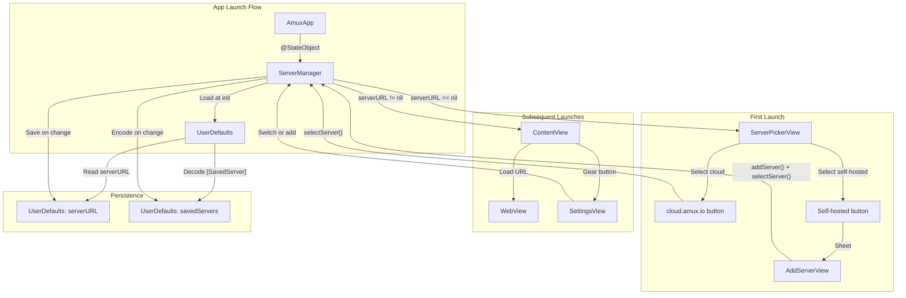
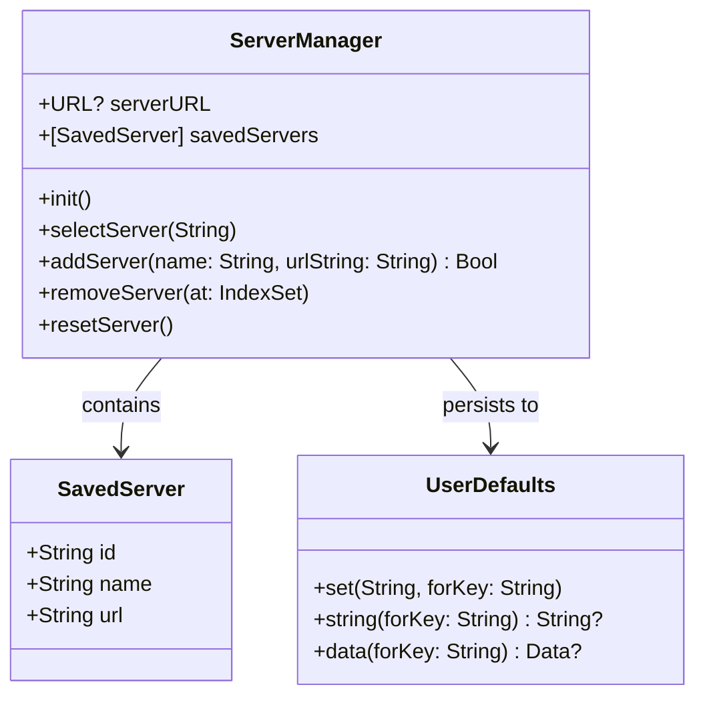
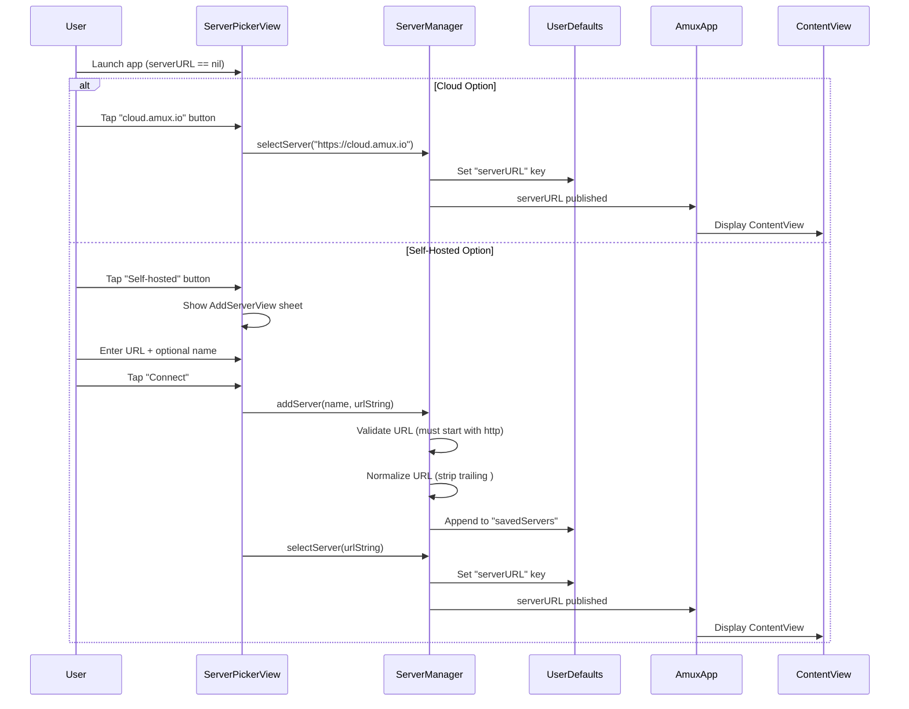
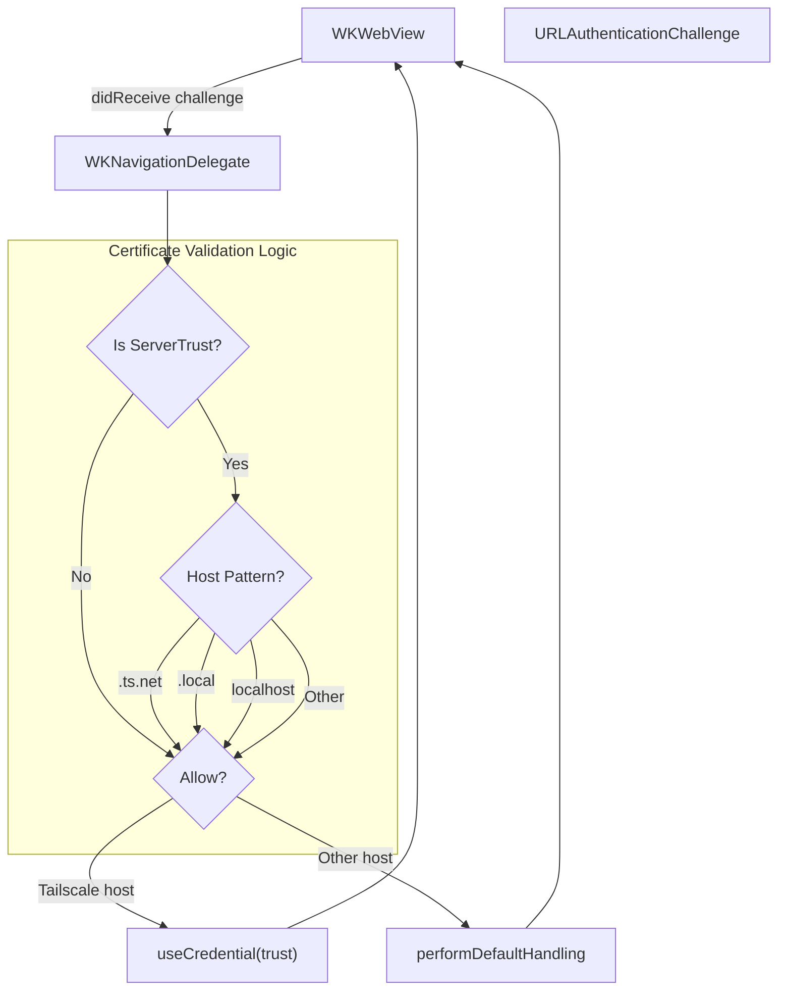
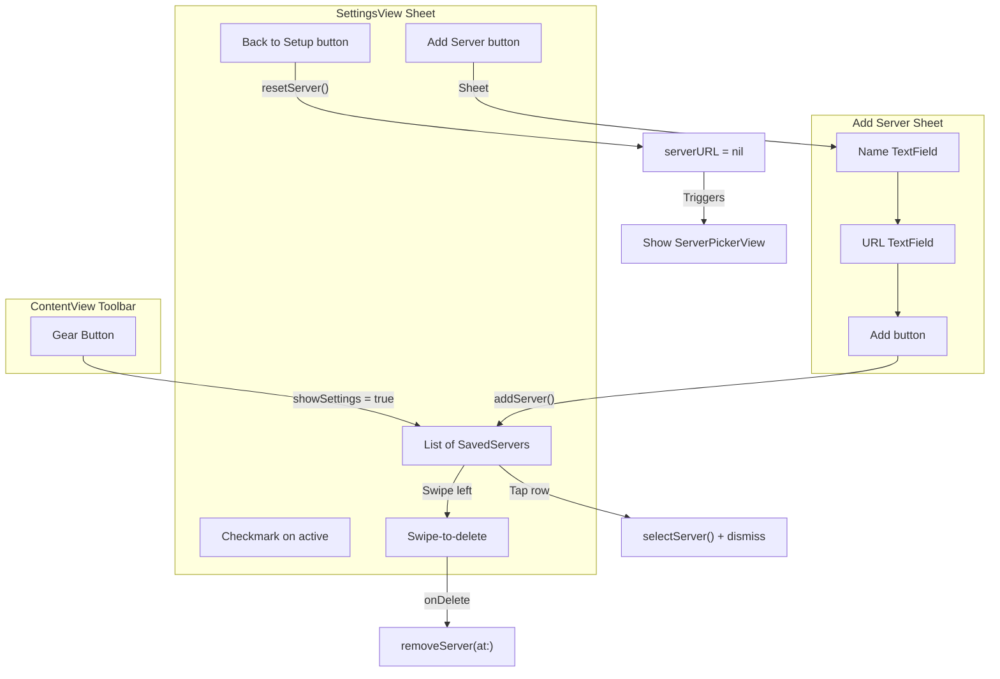
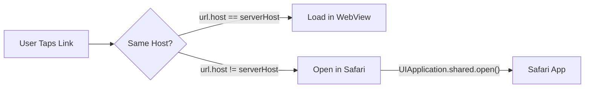

<!-- source: DeepWiki mcp.deepwiki.com · repo mixpeek/amux · page 9.2 Server Configuration · fetched 2026-10-26 -->

# Server Configuration

<details>
<summary>Relevant source files</summary>

The following files were used as context for generating this wiki page:

- [ios/AmuxApp/AmuxApp.entitlements](ios/AmuxApp/AmuxApp.entitlements)
- [ios/AmuxApp/Assets.xcassets/AppIcon.appiconset/Contents.json](ios/AmuxApp/Assets.xcassets/AppIcon.appiconset/Contents.json)
- [ios/AmuxApp/Assets.xcassets/Contents.json](ios/AmuxApp/Assets.xcassets/Contents.json)
- [ios/AmuxApp/Info.plist](ios/AmuxApp/Info.plist)
- [ios/AmuxApp/Sources/AmuxApp.swift](ios/AmuxApp/Sources/AmuxApp.swift)
- [ios/AmuxApp/Sources/ContentView.swift](ios/AmuxApp/Sources/ContentView.swift)
- [ios/AmuxApp/Sources/ServerManager.swift](ios/AmuxApp/Sources/ServerManager.swift)
- [ios/AmuxApp/Sources/ServerPickerView.swift](ios/AmuxApp/Sources/ServerPickerView.swift)
- [ios/AmuxApp/Sources/WebView.swift](ios/AmuxApp/Sources/WebView.swift)

</details>


This page documents how the iOS app discovers and connects to amux servers. It covers the `ServerManager` class, the initial server selection flow, and support for both cloud-hosted and self-hosted deployments including Tailscale integration.

For information about the iOS app's overall architecture, see [App Architecture](#9.1). For details on iOS deployment and TestFlight distribution, see [iOS Deployment](#9.3).

---

## Overview

The iOS app supports two server deployment modes:

| Mode | URL Pattern | Authentication | Use Case |
|------|-------------|---------------|----------|
| **Cloud** | `https://cloud.amux.io` | Clerk JWT via WebView | Multi-tenant managed service |
| **Self-hosted** | `https://amux.tail-xxxx.ts.net:8822` or `https://192.168.1.x:8822` | None (Tailscale or local network) | Personal deployment on user's Mac |

The app stores multiple server configurations in `UserDefaults` and allows switching between them without re-entering URLs. On first launch, users choose between cloud and self-hosted modes via `ServerPickerView`.

**Sources:** [ios/AmuxApp/Sources/ServerManager.swift:1-67](), [ios/AmuxApp/Sources/ServerPickerView.swift:1-135]()

---

## Server Configuration Architecture



**Diagram: Server Configuration State Machine**

The app uses a reactive architecture where `ServerManager` is the single source of truth for server configuration. It publishes two properties: `serverURL` (the active server) and `savedServers` (the list of all configured servers). Changes to these properties automatically trigger persistence to `UserDefaults` and UI updates via SwiftUI's `@Published` mechanism.

**Sources:** [ios/AmuxApp/Sources/AmuxApp.swift:1-18](), [ios/AmuxApp/Sources/ServerManager.swift:4-39]()

---

## ServerManager Class

### Data Model



**Diagram: ServerManager Class Structure**

The `SavedServer` struct represents a single server configuration with a display name and URL. Its `id` property is the URL itself, enabling SwiftUI list identification. The struct conforms to `Codable` for JSON serialization to `UserDefaults`.

**Sources:** [ios/AmuxApp/Sources/ServerManager.swift:62-66]()

### Initialization and Default Server

```swift
// Pseudocode from ServerManager.swift:23-39
init() {
    // Load saved servers from UserDefaults or use cloud default
    if let data = UserDefaults.standard.data(forKey: "savedServers"),
       let servers = JSONDecoder.decode([SavedServer], from: data) {
        savedServers = servers
    } else {
        savedServers = [SavedServer(name: "cloud.amux.io", 
                                     url: "https://cloud.amux.io")]
    }
    
    // Load active URL
    if let urlString = UserDefaults.standard.string(forKey: "serverURL"),
       let url = URL(string: urlString) {
        serverURL = url
    } else {
        serverURL = nil  // Triggers ServerPickerView
    }
}
```

On first launch, `savedServers` is initialized with a single entry for `cloud.amux.io`. The active `serverURL` is `nil`, which causes `AmuxApp` to display `ServerPickerView` instead of `ContentView`.

**Sources:** [ios/AmuxApp/Sources/ServerManager.swift:23-39]()

### Server Selection and Persistence

The `@Published` property wrapper triggers automatic persistence on assignment:

```swift
// Pseudocode from ServerManager.swift:5-12
@Published var serverURL: URL? {
    didSet {
        if let url = serverURL {
            UserDefaults.standard.set(url.absoluteString, forKey: "serverURL")
        } else {
            UserDefaults.standard.removeObject(forKey: "serverURL")
        }
    }
}
```

Similarly, `savedServers` encodes the entire array to JSON on each modification. This ensures persistence survives app termination without requiring explicit save calls.

**Sources:** [ios/AmuxApp/Sources/ServerManager.swift:5-21]()

---

## Server Picker UI

### Initial Selection Flow



**Diagram: Server Selection Sequence**

The picker presents two primary options via `ServerOptionButton` components. Cloud selection is immediate; self-hosted selection opens a form sheet for URL entry.

**Sources:** [ios/AmuxApp/Sources/ServerPickerView.swift:12-101]()

### URL Validation

The `addServer()` method performs basic validation:

| Check | Condition | Error Message |
|-------|-----------|---------------|
| URL parsing | `URL(string:)` succeeds | "Invalid URL..." |
| Protocol | Starts with `http://` or `https://` | "Must start with http://" |
| Trailing slash | Remove if present | N/A (silent normalization) |

Validation failures return `false`, triggering error text in the UI at [ios/AmuxApp/Sources/ServerPickerView.swift:70-76]().

**Sources:** [ios/AmuxApp/Sources/ServerManager.swift:46-51](), [ios/AmuxApp/Sources/ServerPickerView.swift:85-94]()

---

## Tailscale Integration

### Certificate Validation Override

Self-hosted servers on Tailscale use self-signed certificates. The `WKWebView` coordinator implements custom challenge handling:



**Diagram: TLS Certificate Validation Flow**

The implementation at [ios/AmuxApp/Sources/WebView.swift:54-71]() checks three patterns:
- `*.ts.net` - Tailscale MagicDNS hostnames
- `*.local` - mDNS/Bonjour local network names
- `localhost` - Direct localhost access

For these patterns, the challenge is accepted with `.useCredential`. For all other hosts (including `cloud.amux.io`), the system performs standard certificate validation.

**Sources:** [ios/AmuxApp/Sources/WebView.swift:54-71]()

### Tailscale Hostname Format

Tailscale hostnames follow the pattern `amux.tail-XXXX.ts.net:8822` where:
- `amux` is the machine name configured in Tailscale
- `tail-XXXX` is the tailnet identifier (4 alphanumeric characters)
- `ts.net` is the Tailscale MagicDNS domain
- `8822` is the default amux-server.py port

The app displays this in the setup UI as a placeholder at [ios/AmuxApp/Sources/ServerPickerView.swift:59]() and [ios/AmuxApp/Sources/ContentView.swift:159]().

**Sources:** [ios/AmuxApp/Sources/ServerPickerView.swift:59-67](), [ios/AmuxApp/Sources/ContentView.swift:157-163]()

---

## Settings and Server Management

### Settings Sheet

After initial configuration, users access server management via the gear icon in `ContentView`:



**Diagram: Settings UI Flow**

The settings sheet at [ios/AmuxApp/Sources/ContentView.swift:82-143]() displays all saved servers with a checkmark indicator on the active one. Tapping a server switches to it immediately and dismisses the sheet. The "Back to Setup" button clears `serverURL`, returning to `ServerPickerView`.

**Sources:** [ios/AmuxApp/Sources/ContentView.swift:53-143]()

### Server Switching

When a user switches servers, `WebView.updateUIView()` detects the URL change and triggers a reload:

```swift
// Pseudocode from WebView.swift:37-42
func updateUIView(_ webView: WKWebView, context: Context) {
    if webView.url?.host != url.host || webView.url?.port != url.port {
        webView.load(URLRequest(url: url))
    }
}
```

This check compares `host` and `port` separately to avoid reloading on path changes (e.g., navigating within the dashboard). Only server switches trigger a full reload.

**Sources:** [ios/AmuxApp/Sources/WebView.swift:37-42]()

---

## Server Configuration Storage

### UserDefaults Keys

| Key | Type | Content | Example |
|-----|------|---------|---------|
| `serverURL` | `String` | Active server URL | `"https://cloud.amux.io"` |
| `savedServers` | `Data` | JSON-encoded `[SavedServer]` | `[{"name":"cloud","url":"https://..."},...]` |

The `savedServers` array is encoded with `JSONEncoder` on each modification and decoded with `JSONDecoder` at app launch. This provides type-safe persistence without manual serialization.

**Sources:** [ios/AmuxApp/Sources/ServerManager.swift:15-20](), [ios/AmuxApp/Sources/ServerManager.swift:25-29]()

### Data Migration

The app performs an implicit migration on first launch after update:
1. If `savedServers` key is missing, initialize with `cloud.amux.io` default
2. If `serverURL` key is missing, leave as `nil` (shows picker)

This ensures users upgrading from hypothetical older versions without multi-server support get a sensible default configuration.

**Sources:** [ios/AmuxApp/Sources/ServerManager.swift:23-39]()

---

## External Link Handling

The app prevents navigation to external domains, opening them in Safari instead:



**Diagram: External Link Policy**

This logic at [ios/AmuxApp/Sources/ContentView.swift:66-77]() compares the link's host with the configured server host. This ensures documentation links, GitHub links, or API docs open externally while keeping dashboard navigation internal.

**Sources:** [ios/AmuxApp/Sources/ContentView.swift:66-77]()

---

## Configuration Examples

### Cloud Configuration

```json
{
  "serverURL": "https://cloud.amux.io",
  "savedServers": [
    {
      "name": "cloud.amux.io",
      "url": "https://cloud.amux.io"
    }
  ]
}
```

This is the default configuration for cloud users. Authentication happens via Clerk JWT cookies managed by the WebView.

### Multi-Server Configuration

```json
{
  "serverURL": "https://amux.tail-a1b2.ts.net:8822",
  "savedServers": [
    {
      "name": "cloud.amux.io",
      "url": "https://cloud.amux.io"
    },
    {
      "name": "Home Mac",
      "url": "https://amux.tail-a1b2.ts.net:8822"
    },
    {
      "name": "Office Mac",
      "url": "https://192.168.1.50:8822"
    }
  ]
}
```

This configuration shows a user with cloud access plus two self-hosted servers (one via Tailscale, one via local network). The active server is the Tailscale instance.

**Sources:** [ios/AmuxApp/Sources/ServerManager.swift:62-66]()

---

## Summary

The iOS app's server configuration system provides:

1. **Unified Interface**: Single `ServerManager` class handles both cloud and self-hosted servers
2. **Persistent Storage**: Automatic `UserDefaults` persistence via `@Published` property observers
3. **Tailscale Support**: Custom certificate validation for `.ts.net` and `.local` hosts
4. **Multi-Server**: Store and switch between unlimited server configurations
5. **Safe Defaults**: Cloud server pre-configured for first-time users

The architecture enforces URL validation at the entry point ([ios/AmuxApp/Sources/ServerManager.swift:46-51]()), handles TLS certificate challenges at the WebView layer ([ios/AmuxApp/Sources/WebView.swift:54-71]()), and provides a clean settings UI for server management ([ios/AmuxApp/Sources/ContentView.swift:82-143]()).

---

