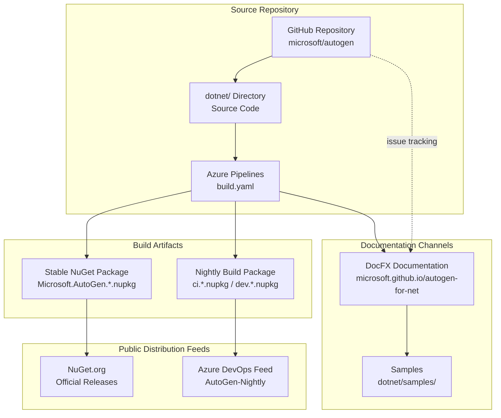
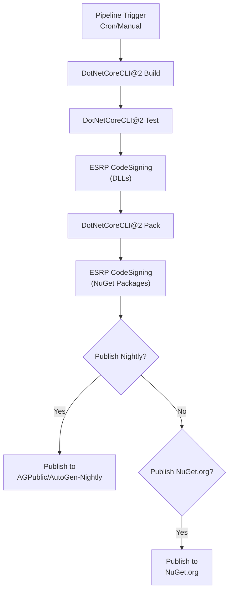
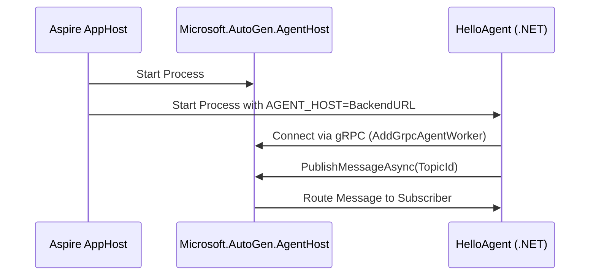

<!-- source: DeepWiki mcp.deepwiki.com · repo microsoft/autogen · page 8.2 .NET SDK Distribution · fetched 2026-10-26 -->

# .NET SDK Distribution

<details>
<summary>Relevant source files</summary>

The following files were used as context for generating this wiki page:

- [.azure/pipelines/build.yaml](.azure/pipelines/build.yaml)
- [.azure/pipelines/templates/build.yaml](.azure/pipelines/templates/build.yaml)
- [.azure/pipelines/templates/vars.yaml](.azure/pipelines/templates/vars.yaml)
- [docs/dotnet/.gitignore](docs/dotnet/.gitignore)
- [docs/dotnet/README.md](docs/dotnet/README.md)
- [docs/dotnet/core/differences-from-python.md](docs/dotnet/core/differences-from-python.md)
- [docs/dotnet/core/index.md](docs/dotnet/core/index.md)
- [docs/dotnet/core/protobuf-message-types.md](docs/dotnet/core/protobuf-message-types.md)
- [docs/dotnet/core/toc.yml](docs/dotnet/core/toc.yml)
- [docs/dotnet/core/tutorial.md](docs/dotnet/core/tutorial.md)
- [docs/dotnet/images/favicon.ico](docs/dotnet/images/favicon.ico)
- [docs/dotnet/index.md](docs/dotnet/index.md)
- [docs/dotnet/template/public/main.css](docs/dotnet/template/public/main.css)
- [dotnet/.config/dotnet-tools.json](dotnet/.config/dotnet-tools.json)
- [dotnet/.tools/run_all_notebook.ps1](dotnet/.tools/run_all_notebook.ps1)
- [dotnet/PACKAGING.md](dotnet/PACKAGING.md)
- [dotnet/README.md](dotnet/README.md)
- [dotnet/eng/MetaInfo.props](dotnet/eng/MetaInfo.props)
- [dotnet/nuget/README.md](dotnet/nuget/README.md)
- [dotnet/samples/Hello/HelloAIAgents/HelloAIAgent.cs](dotnet/samples/Hello/HelloAIAgents/HelloAIAgent.cs)
- [dotnet/samples/Hello/HelloAIAgents/HelloAIAgents.csproj](dotnet/samples/Hello/HelloAIAgents/HelloAIAgents.csproj)
- [dotnet/samples/Hello/HelloAIAgents/Program.cs](dotnet/samples/Hello/HelloAIAgents/Program.cs)
- [dotnet/samples/Hello/HelloAgent/HelloAgent.cs](dotnet/samples/Hello/HelloAgent/HelloAgent.cs)
- [dotnet/samples/Hello/HelloAgent/HelloAgent.csproj](dotnet/samples/Hello/HelloAgent/HelloAgent.csproj)
- [dotnet/samples/Hello/HelloAgent/Program.cs](dotnet/samples/Hello/HelloAgent/Program.cs)
- [dotnet/samples/Hello/HelloAgentState/HelloAgentState.csproj](dotnet/samples/Hello/HelloAgentState/HelloAgentState.csproj)
- [dotnet/samples/Hello/HelloAgentState/Program.cs](dotnet/samples/Hello/HelloAgentState/Program.cs)
- [dotnet/samples/Hello/README.md](dotnet/samples/Hello/README.md)
- [dotnet/src/Microsoft.AutoGen/AgentHost/Microsoft.AutoGen.AgentHost.csproj](dotnet/src/Microsoft.AutoGen/AgentHost/Microsoft.AutoGen.AgentHost.csproj)
- [dotnet/website/articles/Function-call-with-ollama-and-litellm.md](dotnet/website/articles/Function-call-with-ollama-and-litellm.md)
- [dotnet/website/articles/Installation.md](dotnet/website/articles/Installation.md)
- [dotnet/website/articles/OpenAIChatAgent-connect-to-third-party-api.md](dotnet/website/articles/OpenAIChatAgent-connect-to-third-party-api.md)
- [dotnet/website/articles/OpenAIChatAgent-use-json-mode.md](dotnet/website/articles/OpenAIChatAgent-use-json-mode.md)
- [dotnet/website/articles/getting-start.md](dotnet/website/articles/getting-start.md)
- [dotnet/website/articles/toc.yml](dotnet/website/articles/toc.yml)
- [dotnet/website/index.md](dotnet/website/index.md)
- [dotnet/website/release_note/0.0.17.md](dotnet/website/release_note/0.0.17.md)
- [dotnet/website/release_note/0.1.0.md](dotnet/website/release_note/0.1.0.md)
- [dotnet/website/release_note/0.2.0.md](dotnet/website/release_note/0.2.0.md)
- [dotnet/website/release_note/0.2.1.md](dotnet/website/release_note/0.2.1.md)
- [dotnet/website/release_note/toc.yml](dotnet/website/release_note/toc.yml)
- [dotnet/website/tutorial/Create-agent-with-tools.md](dotnet/website/tutorial/Create-agent-with-tools.md)

</details>


This document covers the distribution channels and consumption methods for the AutoGen for .NET SDK. It describes how to obtain the SDK packages, access documentation resources, and engage with the development community. For technical details about the .NET agent system architecture and APIs, see [.NET Agent System](./8.1).

---

## Overview

AutoGen for .NET is distributed through multiple channels to support different user scenarios. The repository currently maintains two sets of packages:
1. **`AutoGen.*`**: Older packages derived from AutoGen 0.2 for .NET. These are being gradually deprecated and ported [dotnet/README.md:3-4]().
2. **`Microsoft.AutoGen.*`**: New packages using the event-driven model. These APIs are currently in a pre-stable state [dotnet/README.md:5]().

The SDK enables developers to create LLM agents and construct multi-agent workflows with integrations for OpenAI, Semantic Kernel, LM Studio, Anthropic, Gemini, Ollama, and Mistral [dotnet/website/articles/Installation.md:7-18]().

**Sources**: [dotnet/README.md:1-12](), [dotnet/website/articles/Installation.md:1-20]()

---

## Distribution Architecture



**Distribution Flow Diagram**: Shows the path from source code in the GitHub repository through Azure Pipelines to public distribution channels (NuGet.org and the AutoGen-Nightly feed).

**Sources**: [.azure/pipelines/build.yaml:1-86](), [.azure/pipelines/templates/build.yaml:42-80](), [dotnet/eng/MetaInfo.props:1-12]()

---

## NuGet Package Distribution

### Package Layers
The SDK is modularized to allow developers to include only necessary dependencies.

| Package Name | Purpose | Key Classes/Functionality |
|-------------|---------|---------------------------|
| `Microsoft.AutoGen.Core` | Core Runtime | `BaseAgent`, `AgentsAppBuilder`, `IAgentRuntime` [docs/dotnet/core/index.md:23-45]() |
| `Microsoft.AutoGen.Contracts` | Contracts | Protobuf-generated message types [docs/dotnet/core/index.md:13]() |
| `Microsoft.AutoGen.Core.Grpc` | Distributed Runtime | `AddGrpcAgentWorker`, gRPC-based agent communication [docs/dotnet/core/index.md:63-67]() |
| `Microsoft.AutoGen.AgentHost` | Runtime Backend | `agenthost` CLI tool, Microsoft Orleans integration [docs/dotnet/core/index.md:74-100]() |
| `AutoGen.OpenAI` | OpenAI Adapter | `OpenAIChatAgent`, `OpenAIConfig` [dotnet/README.md:24-37]() |
| `AutoGen.SourceGenerator` | Tooling | Type-safe function definition generation [dotnet/website/articles/Installation.md:17]() |

### Official Release Packages
Stable releases are published to NuGet.org. The versioning is managed via `MetaInfo.props` [dotnet/eng/MetaInfo.props:4-5]().

### Nightly Build Feeds
Nightly builds are available via an Azure DevOps feed for early access to the latest features.
- **Feed URL**: `https://pkgs.dev.azure.com/AGPublish/AGPublic/_packaging/AutoGen-Nightly/nuget/v3/index.json` [dotnet/README.md:17]()
- **CI Configuration**: Builds are scheduled daily at midnight [ .azure/pipelines/build.yaml:1-3]().

**Sources**: [dotnet/README.md:9-17](), [dotnet/website/articles/Installation.md:33-48](), [.azure/pipelines/build.yaml:1-40]()

---

## Azure Pipeline Build and Publish

The build process is managed through Azure Pipelines, utilizing templates for code signing and artifact publication.



**Build Pipeline Implementation**:
- **SDK Setup**: Uses `UseDotNet@2` and installs the `aspire` workload for orchestration testing [.azure/pipelines/templates/build.yaml:83-102]().
- **Code Signing**: Uses `EsrpCodeSigning@5` for both DLLs and NuGet packages to ensure authenticity [.azure/pipelines/templates/build.yaml:142-152]().
- **Version Suffixes**: Nightly builds append `dev.$(Build.BuildNumber)` or `ci.$(Build.BuildNumber)` to the version [.azure/pipelines/build.yaml:24](), [.azure/pipelines/templates/build.yaml:16]().

**Sources**: [.azure/pipelines/build.yaml:1-86](), [.azure/pipelines/templates/build.yaml:1-192]()

---

## Documentation Site (DocFX)

The documentation is generated using DocFX and hosted on GitHub Pages. It integrates API references, conceptual articles, and tutorials.

- **URL**: [https://microsoft.github.io/autogen-for-net/](https://microsoft.github.io/autogen-for-net) [dotnet/eng/MetaInfo.props:7]()
- **Structure**:
    - **Articles**: Managed in `dotnet/website/articles/toc.yml`, covering installation, agents, and middleware [dotnet/website/articles/toc.yml:1-50]().
    - **Tutorials**: Step-by-step guides for creating agents with tools and group chats [dotnet/website/articles/toc.yml:41-50]().
    - **Release Notes**: Version history from 0.0.15 to 0.2.2 [dotnet/website/release_note/toc.yml:1-21]().

**Sources**: [dotnet/eng/MetaInfo.props:7](), [dotnet/website/articles/toc.yml:1-126](), [dotnet/website/release_note/toc.yml:1-21]()

---

## Hello Sample Walkthroughs

The SDK includes samples demonstrating both in-process and distributed agent execution.

### In-Process Execution
The simplest way to consume the SDK is using the `InProcessRuntime`.
```csharp
var appBuilder = new AgentsAppBuilder();
appBuilder.UseInProcessRuntime(deliverToSelf: true)
          .AddAgent<HelloAgent>("HelloAgent");
var app = await appBuilder.BuildAsync();
await app.StartAsync();
```
**File Source**: [dotnet/samples/Hello/HelloAgent/Program.cs:51-55]()

### Distributed Execution with .NET Aspire
For cloud-native scenarios, the SDK uses .NET Aspire to orchestrate the `AgentHost` (backend) and agent workers (clients).



**Implementation Details**:
- **Backend**: Started via `Microsoft.AutoGen.AgentHost` [docs/dotnet/core/index.md:81]().
- **Connection**: The client uses `appBuilder.AddGrpcAgentWorker(agentHost)` to connect to the gRPC gateway [dotnet/samples/Hello/HelloAgent/Program.cs:46]().
- **Cross-Language (XLang)**: The distributed runtime supports Python agents communicating with .NET agents over gRPC/CloudEvents [docs/dotnet/core/index.md:61](), [docs/dotnet/core/index.md:121-127]().

**Sources**: [dotnet/samples/Hello/HelloAgent/Program.cs:37-69](), [docs/dotnet/core/index.md:59-136]()

---

