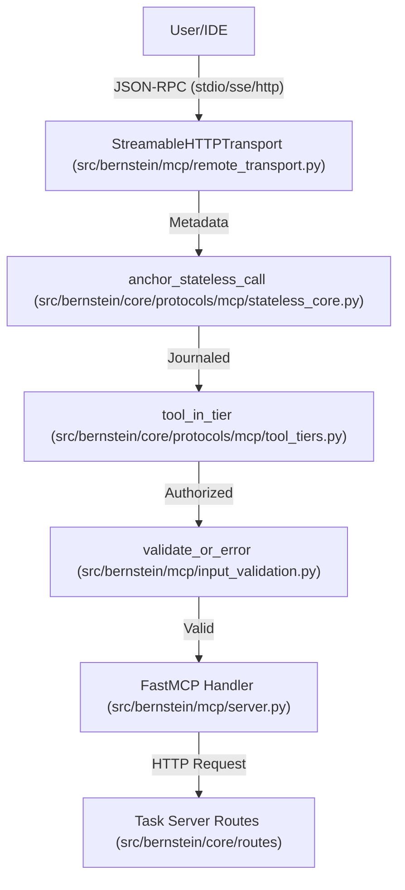
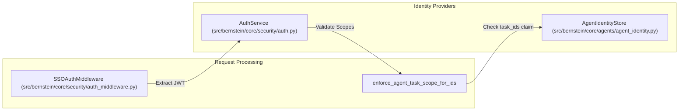

<!-- source: DeepWiki mcp.deepwiki.com · repo sipyourdrink-ltd/bernstein · page 10.1 MCP, A2A, and Protocol Integrations · fetched 2026-10-26 -->

# MCP, A2A, and Protocol Integrations

Relevant source files

The following files were used as context for generating this wiki page:

- [docs/mcp/server.md](docs/mcp/server.md)
- [docs/mcp/tool_tiers.md](docs/mcp/tool_tiers.md)
- [docs/operations/autofix-tier3.md](docs/operations/autofix-tier3.md)
- [docs/orchestration/federation.md](docs/orchestration/federation.md)
- [src/bernstein/cli/commands/citation_cmd.py](src/bernstein/cli/commands/citation_cmd.py)
- [src/bernstein/core/approval/gate.py](src/bernstein/core/approval/gate.py)
- [src/bernstein/core/autofix/tier3.py](src/bernstein/core/autofix/tier3.py)
- [src/bernstein/core/orchestration/federation.py](src/bernstein/core/orchestration/federation.py)
- [src/bernstein/core/orchestration/federation_contract.py](src/bernstein/core/orchestration/federation_contract.py)
- [src/bernstein/core/protocols/mcp/claim_receipt.py](src/bernstein/core/protocols/mcp/claim_receipt.py)
- [src/bernstein/core/protocols/mcp/tool_tiers.py](src/bernstein/core/protocols/mcp/tool_tiers.py)
- [src/bernstein/core/quality/citation_verifier.py](src/bernstein/core/quality/citation_verifier.py)
- [src/bernstein/core/routes/task_claim_receipt.py](src/bernstein/core/routes/task_claim_receipt.py)
- [src/bernstein/core/security/auth_middleware.py](src/bernstein/core/security/auth_middleware.py)
- [src/bernstein/core/security/permission_policy.py](src/bernstein/core/security/permission_policy.py)
- [src/bernstein/core/security/promptware_detector.py](src/bernstein/core/security/promptware_detector.py)
- [src/bernstein/core/server/server_middleware.py](src/bernstein/core/server/server_middleware.py)
- [src/bernstein/mcp/oauth.py](src/bernstein/mcp/oauth.py)
- [src/bernstein/mcp/remote_transport.py](src/bernstein/mcp/remote_transport.py)
- [src/bernstein/mcp/server.py](src/bernstein/mcp/server.py)
- [src/bernstein/mcp/signal_paths.py](src/bernstein/mcp/signal_paths.py)
- [tests/integration/quality/__init__.py](tests/integration/quality/__init__.py)
- [tests/integration/quality/test_citation_verifier_http.py](tests/integration/quality/test_citation_verifier_http.py)
- [tests/property/test_citation_verifier_properties.py](tests/property/test_citation_verifier_properties.py)
- [tests/unit/autofix/test_tier3_shadow.py](tests/unit/autofix/test_tier3_shadow.py)
- [tests/unit/mcp/test_claim_update_tools.py](tests/unit/mcp/test_claim_update_tools.py)
- [tests/unit/mcp/test_oauth_discovery.py](tests/unit/mcp/test_oauth_discovery.py)
- [tests/unit/mcp/test_tool_tiering.py](tests/unit/mcp/test_tool_tiering.py)
- [tests/unit/orchestration/test_federation.py](tests/unit/orchestration/test_federation.py)
- [tests/unit/quality/test_citation_verifier.py](tests/unit/quality/test_citation_verifier.py)
- [tests/unit/security/test_promptware_detector.py](tests/unit/security/test_promptware_detector.py)
- [tests/unit/test_mcp_pull_worker_loop.py](tests/unit/test_mcp_pull_worker_loop.py)
- [tests/unit/test_mcp_remote_transport.py](tests/unit/test_mcp_remote_transport.py)
- [tests/unit/test_mcp_server.py](tests/unit/test_mcp_server.py)
- [tests/unit/test_mcp_tasks.py](tests/unit/test_mcp_tasks.py)
- [tests/unit/test_path_containment.py](tests/unit/test_path_containment.py)
- [tests/unit/test_permission_policy.py](tests/unit/test_permission_policy.py)
- [tests/unit/test_sonar_regex_hygiene.py](tests/unit/test_sonar_regex_hygiene.py)
- [tests/unit/test_sonar_s8495_typing_annotations.py](tests/unit/test_sonar_s8495_typing_annotations.py)

This page describes Bernstein's external communication interfaces and federation protocols. Bernstein implements several industry-standard and internal protocols to enable IDE integration, cross-cluster coordination, and secure node-to-node communication.

## Model Context Protocol (MCP)

Bernstein exposes its orchestration capabilities via the **Model Context Protocol (MCP)**. This allows MCP-compatible clients (e.g., Cursor, Claude Desktop, VS Code) to use Bernstein as a tool-providing backend.

### Implementation Details
The MCP server is implemented using the `FastMCP` framework [src/bernstein/mcp/server.py:70-70](). It supports three transport modes: `stdio` for local IDE integration, `sse` for remote/web integration, and a **Streamable HTTP** transport for stateless remote deployment with cancellation support [src/bernstein/mcp/server.py:7-9](), [src/bernstein/mcp/remote_transport.py:1-4]().

Key features include:
- **Stateless Serving**: The server maintains no per-client session store. Continuity is anchored in the run journal and audit chain [src/bernstein/mcp/remote_transport.py:6-10]().
- **Tool Tiering**: A "context-budget knob" allows operators to limit the number of advertised tools (Tiers: `core`, `standard`, `all`) to save LLM context tokens [src/bernstein/core/protocols/mcp/tool_tiers.py:1-17]().
- **Validation**: Input payloads are validated against JSON schemas using `validate_or_error` [src/bernstein/mcp/server.py:108-108]().
- **OAuth Discovery**: Supports RFC 9728 discovery via `/.well-known/oauth-protected-resource` to facilitate PKCE flows with external IdPs [docs/mcp/server.md:63-72]().

### Exposed Tools
Tools are cumulative by tier. `standard` is the default [src/bernstein/core/protocols/mcp/tool_tiers.py:41-41]().

| Tool Name | Tier | Purpose |
| :--- | :--- | :--- |
| `bernstein_run` | core | Starts an orchestration run (optionally as a subtask) [src/bernstein/mcp/server.py:18-19](). |
| `bernstein_status` | core | Returns liveness, task counts, and cost [src/bernstein/mcp/server.py:20-21](). |
| `bernstein_run_status` | core | Verifiable run handle, polled by run ID [src/bernstein/mcp/server.py:22-22](). |
| `bernstein_approve` | standard | Approves a pending/blocked task [src/bernstein/mcp/server.py:29-29](). |
| `bernstein_claim` | standard | Claims the next dependency-gated task [src/bernstein/mcp/server.py:24-24](). |
| `load_skill` | standard | Loads a skill pack body or script [src/bernstein/mcp/server.py:31-31](). |
| `bernstein_scenario` | all | List or run scenarios via an action selector [src/bernstein/mcp/server.py:35-36](). |

**Sources:** [src/bernstein/mcp/server.py:1-54](), [src/bernstein/core/protocols/mcp/tool_tiers.py:1-75](), [src/bernstein/mcp/remote_transport.py:1-46](), [docs/mcp/server.md:1-55]()

## A2A (Agent-to-Agent) Federation

The A2A protocol allows multiple Bernstein clusters to federate, enabling agents in one cluster to pull tickets and cross-reference data from many configured tracker adapters.

### Federation Layer
The federation is handled by the `FederationBuilder` and `FederationDispatcher` [src/bernstein/core/orchestration/federation.py:18-23]().
1. **Link Detection**: The `LinkDetector` protocol supports `URLDetector` (URI prefixes), `CustomFieldDetector` (tracker fields), and `CommentMentionDetector` [src/bernstein/core/orchestration/federation.py:14-15]().
2. **Graph Assembly**: `FederatedTicketGraph` assembles a graph of `(tracker, ticket_id)` nodes [src/bernstein/core/orchestration/federation.py:16-17]().
3. **Audit**: Each cross-tracker write produces a `CrossTrackerAuditRecord` stored in `.sdd/lineage/cross-tracker-audit.jsonl` [src/bernstein/core/orchestration/federation.py:34-42]().

**Sources:** [src/bernstein/core/orchestration/federation.py:1-80](), [src/bernstein/core/orchestration/federation_contract.py:1-10]()

## Security and Authentication

Bernstein protects its protocol endpoints via a multi-layered security stack including multi-strategy authentication and fail-closed permission policies.

### Multi-Strategy Authentication
The `SSOAuthMiddleware` supports several identity types [src/bernstein/core/security/auth_middleware.py:1-11]():
- **JWT Tokens**: From SSO/OIDC login.
- **Agent Identity JWTs**: Zero-trust, task-scoped tokens. The middleware validates that the requested `task_id` appears in the token's `task_ids` claim [src/bernstein/core/security/auth_middleware.py:24-26]().
- **HMAC Paths**: Webhook paths (e.g., `/webhooks/github`) validate their own HMAC signatures and are exempt from Bearer checks [src/bernstein/core/server/server_middleware.py:77-85]().

### Permission Policy
The `PolicyChecker` enforces declarative rules defined in `bernstein.yaml` [src/bernstein/core/security/permission_policy.py:8-12]().
- **Built-in Profiles**: `read-only`, `builder`, and `reviewer` [src/bernstein/core/security/permission_policy.py:58-62]().
- **Fail-Closed**: Profiles default to `deny` unless explicitly configured otherwise [src/bernstein/core/security/permission_policy.py:103-103]().
- **Scoping**: Rules can restrict `allow_tools`, `allow_paths`, `allow_hosts`, and `shell_allowlist` [src/bernstein/core/security/permission_policy.py:88-109]().

**Sources:** [src/bernstein/core/security/auth_middleware.py:1-68](), [src/bernstein/core/security/permission_policy.py:1-126](), [src/bernstein/core/server/server_middleware.py:30-66]()

## Protocol Mapping: Natural Language to Code Entities

### MCP Request Lifecycle
Title: MCP Tool Request and Validation Flow

**Sources:** [src/bernstein/mcp/server.py:108-108](), [src/bernstein/mcp/remote_transport.py:31-35](), [src/bernstein/core/protocols/mcp/tool_tiers.py:173-174]()

### Zero-Trust Auth Flow
Title: Zero-Trust Task Scoping Architecture

**Sources:** [src/bernstein/core/security/auth_middleware.py:24-42](), [src/bernstein/core/security/auth_middleware.py:116-116]()

---

