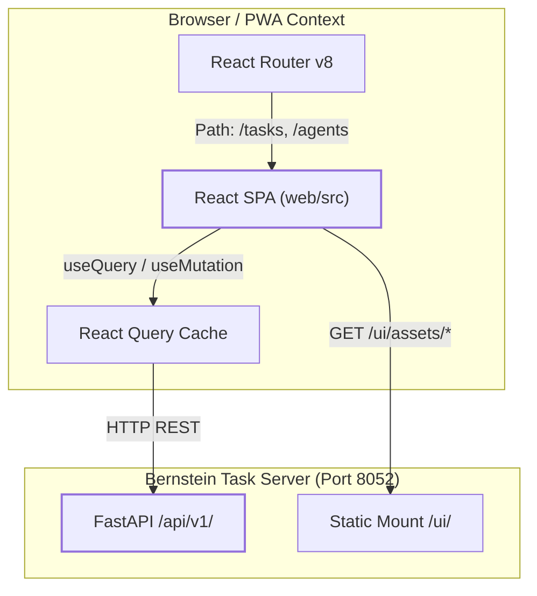
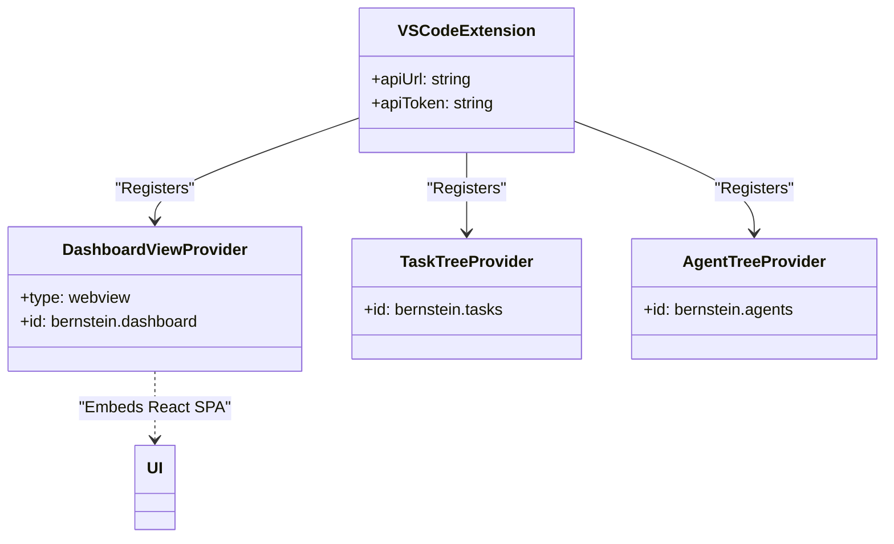

<!-- source: DeepWiki mcp.deepwiki.com · repo sipyourdrink-ltd/bernstein · page 4.2 Web Dashboard (React) · fetched 2026-10-26 -->

# Web Dashboard (React)

Relevant source files

The following files were used as context for generating this wiki page:

- [.github/workflows/adapter-conformance-canary.yml](.github/workflows/adapter-conformance-canary.yml)
- [.github/workflows/coverage-ratchet-weekly.yml](.github/workflows/coverage-ratchet-weekly.yml)
- [.github/workflows/spa-bundle-freshness.yml](.github/workflows/spa-bundle-freshness.yml)
- [.github/workflows/typecheck-ts.yml](.github/workflows/typecheck-ts.yml)
- [docs/assets/tui-live.svg](docs/assets/tui-live.svg)
- [docs/assets/webui-agents.png](docs/assets/webui-agents.png)
- [docs/assets/webui-approvals.png](docs/assets/webui-approvals.png)
- [docs/assets/webui-audit.png](docs/assets/webui-audit.png)
- [docs/assets/webui-costs.png](docs/assets/webui-costs.png)
- [docs/assets/webui-fleet.png](docs/assets/webui-fleet.png)
- [docs/assets/webui-renders.json](docs/assets/webui-renders.json)
- [docs/assets/webui-settings.png](docs/assets/webui-settings.png)
- [docs/assets/webui-tasks.png](docs/assets/webui-tasks.png)
- [docs/contributing/render-freshness.md](docs/contributing/render-freshness.md)
- [docs/release-notes/v2.9.0.md](docs/release-notes/v2.9.0.md)
- [packages/vscode/.vscodeignore](packages/vscode/.vscodeignore)
- [packages/vscode/package-lock.json](packages/vscode/package-lock.json)
- [packages/vscode/package.json](packages/vscode/package.json)
- [packages/vscode/tsconfig.json](packages/vscode/tsconfig.json)
- [scripts/bind_webui_renders.py](scripts/bind_webui_renders.py)
- [scripts/render_tui_snapshot.py](scripts/render_tui_snapshot.py)
- [sdk/typescript/package-lock.json](sdk/typescript/package-lock.json)
- [sdk/typescript/package.json](sdk/typescript/package.json)
- [sdk/typescript/tsconfig.json](sdk/typescript/tsconfig.json)
- [src/bernstein/gui/static/index.html](src/bernstein/gui/static/index.html)
- [templates/cloudflare-mcp-server/package.json](templates/cloudflare-mcp-server/package.json)
- [templates/cloudflare-mcp-server/tsconfig.json](templates/cloudflare-mcp-server/tsconfig.json)
- [tests/fixtures/tui_live_frame.json](tests/fixtures/tui_live_frame.json)
- [tests/unit/test_tui_render_freshness.py](tests/unit/test_tui_render_freshness.py)
- [tests/unit/test_typecheck_ts_workflow_yaml.py](tests/unit/test_typecheck_ts_workflow_yaml.py)
- [tests/unit/test_web_node_floor.py](tests/unit/test_web_node_floor.py)
- [tests/unit/test_webui_render_binding.py](tests/unit/test_webui_render_binding.py)
- [typos.toml](typos.toml)
- [web/package-lock.json](web/package-lock.json)
- [web/package.json](web/package.json)

The Bernstein Web Dashboard provides a real-time, high-fidelity interface for monitoring multi-agent orchestration. It serves as a visual alternative to the Terminal UI (TUI), offering advanced features such as Kanban views for tasks, interactive dependency graphs, and PWA (Progressive Web App) support for mobile and desktop installation.

## Architecture and Mounting

The dashboard is implemented as a modern React 19 Single Page Application (SPA) located in `web/src/` [web/package.json:25-25](). It is built using Vite 8 [web/package.json:41-41]() and TypeScript 7 [web/package.json:40-40](). For distribution, the production build is bundled into the Python package at `src/bernstein/gui/static/` [web/package.json:8-8](), [src/bernstein/gui/static/index.html:24-25]().

The dashboard is integrated into the Bernstein Task Server using a FastAPI mount point. This mounting process also registers metadata endpoints and serves PWA assets required for browser installation [src/bernstein/gui/static/index.html:12-18]().

### Data Flow: Server to Dashboard

The dashboard utilizes `@tanstack/react-query` for state management and synchronization with the orchestrator [web/package.json:20-20]().

1.  **SSE (Server-Sent Events):** Used for streaming live updates of task state changes and agent logs.
2.  **REST API:** The dashboard fetches full state snapshots from the `/api/v1/` routes.
3.  **Client-Side Routing:** Managed via `react-router` v8 [web/package.json:25-25]().

Sources: [web/package.json:12-30](), [src/bernstein/gui/static/index.html:24-25]()

## Key Routes and Views

The dashboard is organized into several functional areas, primarily driven by the state of the orchestrator. The navigation is structured around the following views:

| View | Purpose | Implementation Details |
| :--- | :--- | :--- |
| **Tasks** | Lifecycle monitoring | Displays tasks across states: `OPEN`, `CLAIMED`, `IN_PROGRESS`, `DONE` [docs/assets/webui-tasks.png](). |
| **Agents** | Fleet management | Shows active agents and their assigned roles [docs/assets/webui-agents.png](). |
| **Approvals** | Human-in-the-loop | Interface for reviewing task completions and signaling `APPROVE` or `REJECT` [docs/assets/webui-approvals.png](). |
| **Audit** | Compliance | Visualizes the HMAC audit chain and lineage for every agent action [docs/assets/webui-audit.png](). |
| **Costs** | Financials | Real-time tracking of token usage and monetary spend [docs/assets/webui-costs.png](). |
| **Fleet** | Infrastructure | Monitors spawned processes and Docker sandboxes [docs/assets/webui-fleet.png](). |
| **Settings** | Configuration | API URL and token management [docs/assets/webui-settings.png](). |

Sources: [docs/assets/webui-renders.json:2-11](), [web/package.json:25-25]()

## Component Library and Theme

The dashboard utilizes a sophisticated UI stack based on Radix UI primitives and Tailwind CSS for a "Decision-Grade Quiet" design [web/package.json:13-30]().

*   **Radix UI:** Used for accessible primitives like Dialogs, Dropdown Menus, and Tabs [web/package.json:11-18]().
*   **Tailwind CSS:** Handles styling with `tailwind-merge` and `tailwindcss-animate` for smooth transitions [web/package.json:27-30]().
*   **Icons:** Powered by `lucide-react` [web/package.json:24-24]().
*   **Charts:** Uses `recharts` for visualizing cost and performance metrics [web/package.json:28-28]().

### Theme Configuration
The UI supports automatic dark/light mode switching using CSS variables and the `color-scheme` meta tag [src/bernstein/gui/static/index.html:6-6](). The default theme color is set to `#111111` for a dark-first experience [src/bernstein/gui/static/index.html:18-18]().

Sources: [web/package.json:12-30](), [src/bernstein/gui/static/index.html:6-27]()

## PWA and Mobile GUI

Bernstein includes first-class support for Progressive Web Apps, allowing the dashboard to be installed on mobile and desktop devices.

### PWA Configuration
The dashboard includes a web manifest and Apple-touch icons for native-like behavior [src/bernstein/gui/static/index.html:12-16]().
*   **Manifest:** `/manifest.webmanifest` [src/bernstein/gui/static/index.html:12-12]().
*   **Icons:** `/ui/icon-192.png` [src/bernstein/gui/static/index.html:13-13]().
*   **Status Bar:** Configured as `black-translucent` for iOS [src/bernstein/gui/static/index.html:15-15]().

Sources: [src/bernstein/gui/static/index.html:10-23]()

## VS Code Extension Integration

The Web Dashboard is also accessible directly within VS Code as a Webview [packages/vscode/package.json:47-47](). The extension acts as a bridge between the editor and the Task Server.

### Core Extension Entities

Sources: [packages/vscode/package.json:17-49](), [packages/vscode/package.json:21-35]()

### Command Mapping
The extension registers several commands that interact with the dashboard and orchestrator:
*   `bernstein.showDashboard`: Opens the React dashboard in a Webview panel [packages/vscode/package.json:53-53]().
*   `bernstein.approveTask`: Sends an approval signal to the Task Server [packages/vscode/package.json:60-60]().
*   `bernstein.killAgent`: Terminates an active agent process via the API [packages/vscode/package.json:54-54]().
*   `bernstein.refresh`: Triggers a state refresh across all views [packages/vscode/package.json:52-52]().

Sources: [packages/vscode/package.json:50-81]()

---

