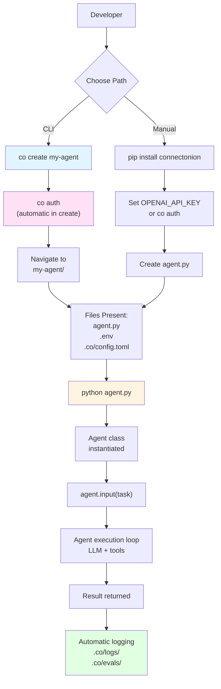
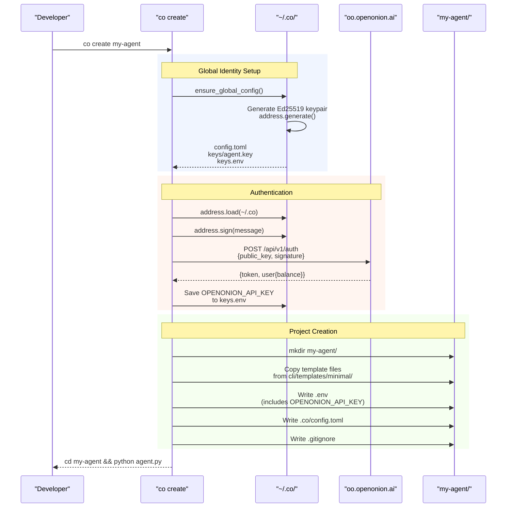
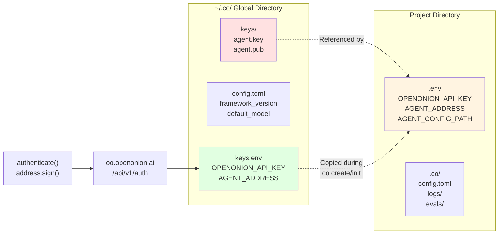
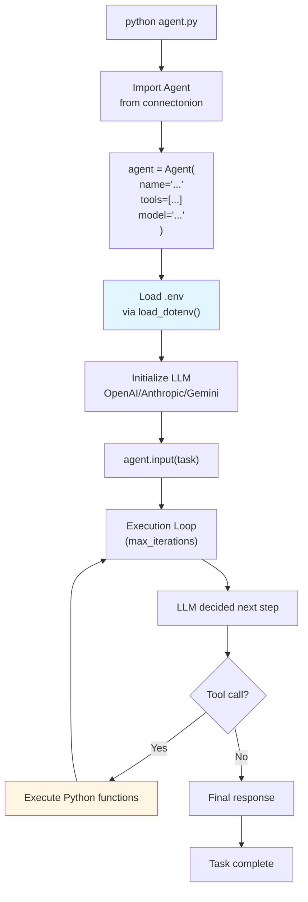

<!-- source: DeepWiki mcp.deepwiki.com · repo openonion/connectonion · page 2 Getting Started · fetched 2026-10-26 -->

# Getting Started

<details>
<summary>Relevant source files</summary>

The following files were used as context for generating this wiki page:

- [README.md](README.md)
- [connectonion/cli/commands/auth_commands.py](connectonion/cli/commands/auth_commands.py)
- [connectonion/cli/commands/create.py](connectonion/cli/commands/create.py)
- [connectonion/cli/commands/init.py](connectonion/cli/commands/init.py)
- [connectonion/cli/commands/project_cmd_lib.py](connectonion/cli/commands/project_cmd_lib.py)
- [connectonion/cli/commands/reset_commands.py](connectonion/cli/commands/reset_commands.py)
- [connectonion/cli/commands/status_commands.py](connectonion/cli/commands/status_commands.py)
- [docs/README.md](docs/README.md)
- [docs/quickstart.md](docs/quickstart.md)
- [docs/templates/README.md](docs/templates/README.md)
- [docs/templates/meta-agent.md](docs/templates/meta-agent.md)
- [docs/templates/minimal.md](docs/templates/minimal.md)
- [docs/templates/playwright.md](docs/templates/playwright.md)
- [docs/templates/web-research.md](docs/templates/web-research.md)

</details>


This page provides an overview of the ConnectOnion installation and initial setup workflow. It covers the essential steps needed to create and run your first agent, including installation, project creation, authentication, and basic usage patterns.

For detailed information on specific topics:
- Installation requirements and environment setup: see [Installation](#2.1)
- Step-by-step tutorial for creating your first agent: see [Your First Agent](#2.2)
- Understanding the `.co/` directory and project organization: see [Project Structure](#2.3)
- CLI command reference: see [CLI Reference](#7)

---

## Overview: Two Development Paths

ConnectOnion supports two approaches to getting started, both using the same underlying framework.

| Approach | Best For | Key Command | Result |
|----------|----------|-------------|--------|
| **CLI-Managed** | Quick start, templates | `co create my-agent` | New directory with template files |
| **Manual** | Existing projects, custom setup | `pip install connectonion` | Import framework directly |

Both paths result in the same core workflow: define an `Agent` with tools, provide a task via `agent.input()`, and inspect results.

**Sources:** [README.md:28-63](), [docs/quickstart.md:5-26](), [docs/README.md:70-101]()

---

## Quick Start Workflow



**Diagram: Quick Start Workflow - From Installation to First Run**

The workflow converges at runtime by instantiating an `Agent` and calling `input()` to execute tasks. CLI templates like `minimal` or `coder` provide a pre-configured `agent.py` to accelerate this process.

**Sources:** [docs/quickstart.md:11-26](), [connectonion/cli/commands/create.py:118-128](), [docs/README.md:194-228]()

---

## CLI-Managed Path: Project Creation Flow

The CLI commands automate project setup, authentication, and configuration management.



**Diagram: CLI Project Creation - Code Entity Flow**

Key functions involved in this flow:
- `ensure_global_config()` at [connectonion/cli/commands/create.py:45-115]() creates the global identity in `~/.co/`.
- `authenticate()` at [connectonion/cli/commands/auth_commands.py:84-150]() performs signature-based login to obtain a JWT.
- `validate_project_name()` at [connectonion/cli/commands/project_cmd_lib.py:50-68]() ensures directory names are safe.

**Sources:** [connectonion/cli/commands/create.py:118-150](), [connectonion/cli/commands/auth_commands.py:103-130](), [connectonion/cli/commands/project_cmd_lib.py:50-68]()

---

## Authentication System

ConnectOnion uses Ed25519 signature-based authentication to provide managed LLM API keys.

### Global Identity Model



**Diagram: Global Identity and Project Configuration**

- One Ed25519 keypair per developer is stored in `~/.co/keys/` via `ensure_global_config()` [connectonion/cli/commands/init.py:47-69]().
- `OPENONION_API_KEY` is stored in `~/.co/keys.env` and copied to project `.env` files during `co init` or `co create`.
- Managed models (e.g., `co/gemini-2.5-pro`) use this key for authentication [connectonion/cli/commands/init.py:83]().

**Sources:** [connectonion/cli/commands/init.py:47-117](), [connectonion/cli/commands/auth_commands.py:30-82](), [connectonion/cli/commands/status_commands.py:23-55]()

---

## Manual Path: Direct Framework Import

For existing projects, you can skip the CLI and import the framework directly.

### Minimal Working Example

```python
from connectonion import Agent

# Define a tool as a regular function
def calculate(expression: str) -> str:
    """Do math calculations."""
    return str(eval(expression))

# Create your agent
agent = Agent(
    "assistant", 
    tools=[calculate],
    max_iterations=5
)

# Use it!
result = agent.input("What is 42 * 17?")
print(result)
```

This minimal example demonstrates the core framework API:
- `Agent` class: main orchestrator [docs/quickstart.md:39]().
- Function-based tools: automatic schema generation from docstrings [docs/quickstart.md:34-36]().
- `agent.input()`: synchronous task execution [docs/quickstart.md:46]().

**Sources:** [docs/quickstart.md:30-48](), [README.md:28-34]()

---

## Project Structure Overview

After running `co create` or `co init`, a ConnectOnion project contains:

```
my-agent/
├── agent.py                    # Main agent implementation
├── .env                        # API keys (auto-configured)
├── .gitignore                  # Excludes .env and logs
├── .co/                        # Framework metadata
│   ├── config.toml            # Project configuration
│   └── docs/                  # Framework documentation for AI
└── co-vibecoding-principles-docs-contexts-all-in-one.md  # Reference doc
```

The `.co/` directory is automatically created and managed. The `co-vibecoding-principles...` file is a flattened documentation source designed to provide context to LLM coding assistants [connectonion/cli/commands/init.py:5]().

**Sources:** [docs/quickstart.md:210-222](), [docs/templates/README.md:59-71](), [connectonion/cli/commands/init.py:5]()

---

## First Agent Execution

When you run `python agent.py`, the agent enters an execution loop:



**Diagram: Agent Execution Loop - Runtime Flow**

This loop is governed by the `max_iterations` parameter (default: 100), which prevents infinite tool-call loops [docs/quickstart.md:78]().

**Sources:** [docs/README.md:194-228](), [docs/quickstart.md:75-84]()

---

## Next Steps

1. **Installation Details**: For system requirements and dependency management, see [Installation](#2.1).
2. **Create Your First Agent**: Follow the step-by-step tutorial at [Your First Agent](#2.2).
3. **Understand Project Organization**: Learn about the `.co/` directory and config files at [Project Structure](#2.3).
4. **Account Management**: Use `co status` [connectonion/cli/commands/status_commands.py:77]() to check your balance or `co reset` [connectonion/cli/commands/reset_commands.py:26]() to refresh your identity.

**Sources:** [connectonion/cli/commands/status_commands.py:77-87](), [connectonion/cli/commands/reset_commands.py:26-35]()

---

