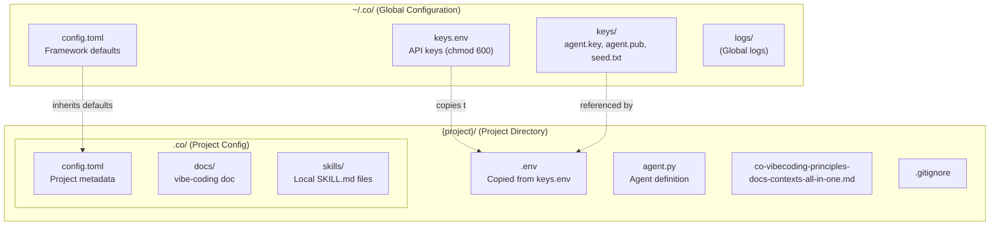
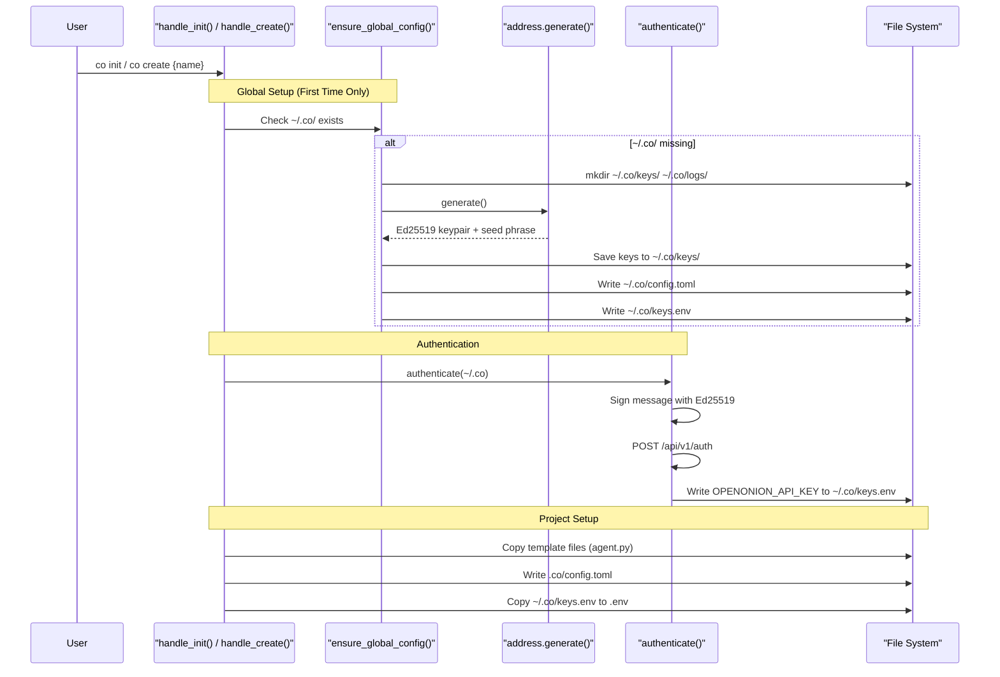
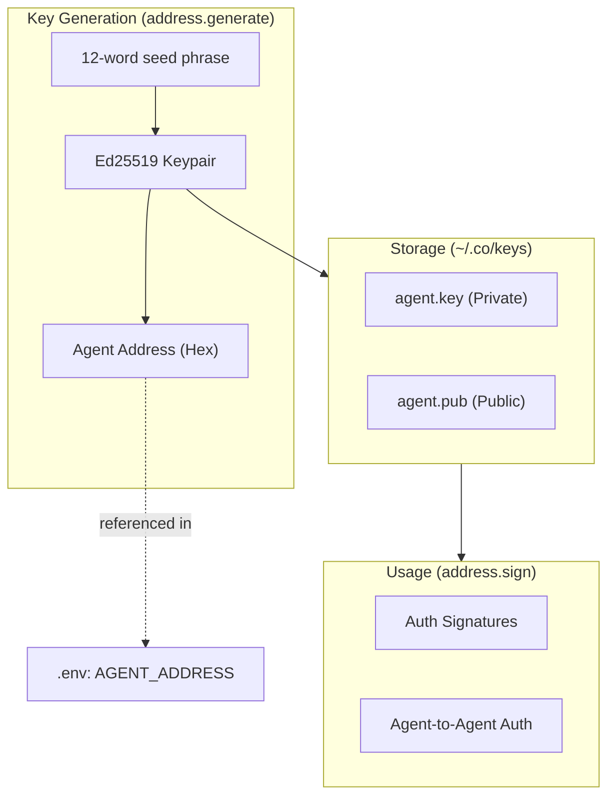

<!-- source: DeepWiki mcp.deepwiki.com · repo openonion/connectonion · page 2.3 Project Structure · fetched 2026-10-26 -->

# Project Structure

<details>
<summary>Relevant source files</summary>

The following files were used as context for generating this wiki page:

- [connectonion/cli/commands/auth_commands.py](connectonion/cli/commands/auth_commands.py)
- [connectonion/cli/commands/copy_commands.py](connectonion/cli/commands/copy_commands.py)
- [connectonion/cli/commands/create.py](connectonion/cli/commands/create.py)
- [connectonion/cli/commands/init.py](connectonion/cli/commands/init.py)
- [connectonion/cli/commands/project_cmd_lib.py](connectonion/cli/commands/project_cmd_lib.py)
- [connectonion/cli/commands/reset_commands.py](connectonion/cli/commands/reset_commands.py)
- [connectonion/cli/commands/status_commands.py](connectonion/cli/commands/status_commands.py)
- [connectonion/useful_skills/__init__.py](connectonion/useful_skills/__init__.py)
- [connectonion/useful_skills/ship-feature/SKILL.md](connectonion/useful_skills/ship-feature/SKILL.md)

</details>


This page documents the directory structure and configuration files used by ConnectOnion projects, including both global configuration (shared across all projects) and project-local configuration (specific to each agent).

For information about CLI commands that create and manage projects, see [Project Commands](#7.1). For authentication and key management concepts, see [Trust & Authentication](#5.3).

---

## Overview

ConnectOnion uses a two-tier configuration architecture:

| Level | Location | Purpose | Created By |
|-------|----------|---------|------------|
| **Global** | `~/.co/` | User identity, master keypair, shared credentials | `co auth`, `co init`, `co create` |
| **Project** | `{project}/.co/` | Project metadata, logs, evaluation data | `co init`, `co create` |

This design provides:
- **Single Identity**: One Ed25519 keypair per developer (stored globally) [connectonion/cli/commands/init.py:67-68]().
- **Project Isolation**: Each project has its own logs and configuration [connectonion/cli/commands/init.py:361-393]().
- **Credential Sharing**: API keys from global config are copied to project `.env` files [connectonion/cli/commands/init.py:247-330]().

Sources: [connectonion/cli/commands/init.py:46-116](), [connectonion/cli/commands/create.py:44-114]()

---

## Global Configuration (`~/.co/`)

The global configuration directory is created automatically on first use of `co init`, `co create`, or `co auth`. It contains your developer identity and shared credentials.

### Directory Structure

```
~/.co/
├── config.toml          # Framework and agent defaults
├── keys.env             # API keys and agent address (chmod 600)
├── keys/                # Ed25519 keypair
│   ├── agent.key        # Private key (binary)
│   ├── agent.pub        # Public key (binary)
│   └── seed.txt         # 12-word recovery phrase
└── logs/                # Global logs
```

Sources: [connectonion/cli/commands/init.py:61-65](), [connectonion/cli/commands/create.py:59-63]()

### `config.toml` Schema

```toml
[connectonion]
framework_version = "1.0.0"
created = "2024-01-15T10:30:00"

[cli]
version = "1.0.0"

[agent]
algorithm = "ed25519"
default_model = "co/gemini-2.5-pro"  # Managed keys with free credits
max_iterations = 10
created_at = "2024-01-15T10:30:00"
```

The global config stores framework metadata and default agent settings. Individual projects inherit these defaults but can override them in their local config [connectonion/cli/commands/init.py:73-87]().

Sources: [connectonion/cli/commands/init.py:73-91](), [connectonion/cli/commands/create.py:71-89]()

### `keys.env` Contents

```bash
AGENT_CONFIG_PATH=/home/user/.co
AGENT_ADDRESS=0x04e1c4ae3c57d716383153479dae869e51e86d43d88db8dfa22fba7533f3968d
# Your agent address (Ed25519 public key) is used for:
#   - Secure agent communication (encrypt/decrypt with private key)
#   - Authentication with OpenOnion managed LLM provider
#   - Email address: 04e1c4ae3c@mail.openonion.ai

OPENONION_API_KEY=eyJ0eXAiOiJKV1QiLCJhbGciOiJIUzI1NiJ9...
AGENT_EMAIL=04e1c4ae3c@mail.openonion.ai
```

This file has restricted permissions (`chmod 0o600` on Unix/Mac) to protect credentials [connectonion/cli/commands/init.py:105](). It serves as the source of truth for managed API keys [connectonion/cli/commands/auth_commands.py:134-160]().

Sources: [connectonion/cli/commands/init.py:93-115](), [connectonion/cli/commands/auth_commands.py:134-160]()

### Ed25519 Keypair

The `keys/` directory contains your cryptographic identity:
- **`agent.key`**: Private key (Ed25519 format)
- **`agent.pub`**: Public key
- **`seed.txt`**: 12-word recovery phrase

The public key serves as your agent address. The private key is used to sign messages for authentication with `https://oo.openonion.ai/api/v1/auth` [connectonion/cli/commands/auth_commands.py:108-115]().

Sources: [connectonion/cli/commands/init.py:67-68](), [connectonion/cli/commands/reset_commands.py:85-98]()

---

## Project Configuration (`.co/`)

Each ConnectOnion project contains a `.co/` directory with project-specific metadata and runtime data.

### Directory Structure

```
{project}/.co/
├── config.toml                                  # Project metadata
├── docs/
│   └── co-vibecoding-principles-docs-contexts-all-in-one.md  # Development reference
├── logs/
│   └── {agent-name}.log                        # Plain text execution logs
└── skills/                                      # Local skill definitions
```

Sources: [connectonion/cli/commands/init.py:332-393](), [connectonion/cli/commands/copy_commands.py:187-190]()

### `config.toml` Schema

```toml
[connectonion]
framework_version = "1.0.0"
created = "2024-01-15T11:00:00"

[agent]
algorithm = "ed25519"
default_model = "co/gemini-2.5-pro"
max_iterations = 10
created_at = "2024-01-15T11:00:00"
```

Sources: [connectonion/cli/commands/init.py:369-391](), [connectonion/cli/commands/create.py:383-406]()

---

## Project Root Files

### `.env` File

API keys and configuration variables are stored here (copied from global `~/.co/keys.env` or environment) [connectonion/cli/commands/init.py:247-330]().

```bash
AGENT_CONFIG_PATH=/home/user/.co
AGENT_ADDRESS=0x04e1c4ae3c57d716383153479dae869e51e86d43d88db8dfa22fba7533f3968d
AGENT_EMAIL=04e1c4ae3c@mail.openonion.ai
OPENONION_API_KEY=eyJ0eXAiOiJKV1QiLCJhbGciOiJIUzI1NiJ9...
```

Sources: [connectonion/cli/commands/auth_commands.py:30-82](), [connectonion/cli/commands/init.py:247-330]()

### `agent.py` File

The main entry point for your agent, created from templates such as `minimal`, `playwright`, or `coder` [connectonion/cli/commands/project_cmd_lib.py:118-124]().

### `co-vibecoding-principles-docs-contexts-all-in-one.md`

Development reference documentation copied to both project root and `.co/docs/`. Contains best practices for building agents [connectonion/cli/commands/init.py:342-358]().

---

## Complete File Hierarchy



Sources: [connectonion/cli/commands/init.py:46-417](), [connectonion/cli/commands/create.py:44-512]()

---

## Configuration Initialization Flow



Sources: [connectonion/cli/commands/init.py:119-454](), [connectonion/cli/commands/create.py:117-512](), [connectonion/cli/commands/auth_commands.py:84-208]()

---

## Key Management Architecture

ConnectOnion uses a **global identity model** where all projects share a single Ed25519 keypair:



Sources: [connectonion/cli/commands/init.py:46-116](), [connectonion/cli/commands/auth_commands.py:84-208](), [connectonion/cli/commands/reset_commands.py:85-98]()

---

## Environment Variable Resolution

ConnectOnion uses a cascading lookup for configuration and API keys [connectonion/cli/commands/status_commands.py:23-56]():

| Priority | Location | Purpose |
|----------|----------|---------|
| 1 | Environment variables | Runtime overrides |
| 2 | Project `.env` | Project-specific config |
| 3 | Global `~/.co/keys.env` | Shared fallback credentials |

Sources: [connectonion/cli/commands/status_commands.py:23-56](), [connectonion/cli/commands/auth_commands.py:30-82]()

---

## Managed Files and Skills

ConnectOnion allows copying built-in assets into your project for customization using `co copy` [connectonion/cli/commands/copy_commands.py:103-109]().

### Skills Directory
Skills are stored in `.co/skills/` and contain a `SKILL.md` file that defines a high-level workflow for the agent [connectonion/useful_skills/ship-feature/SKILL.md:1-17]().

Sources: [connectonion/cli/commands/copy_commands.py:187-190](), [connectonion/useful_skills/ship-feature/SKILL.md:1-17]()

---

