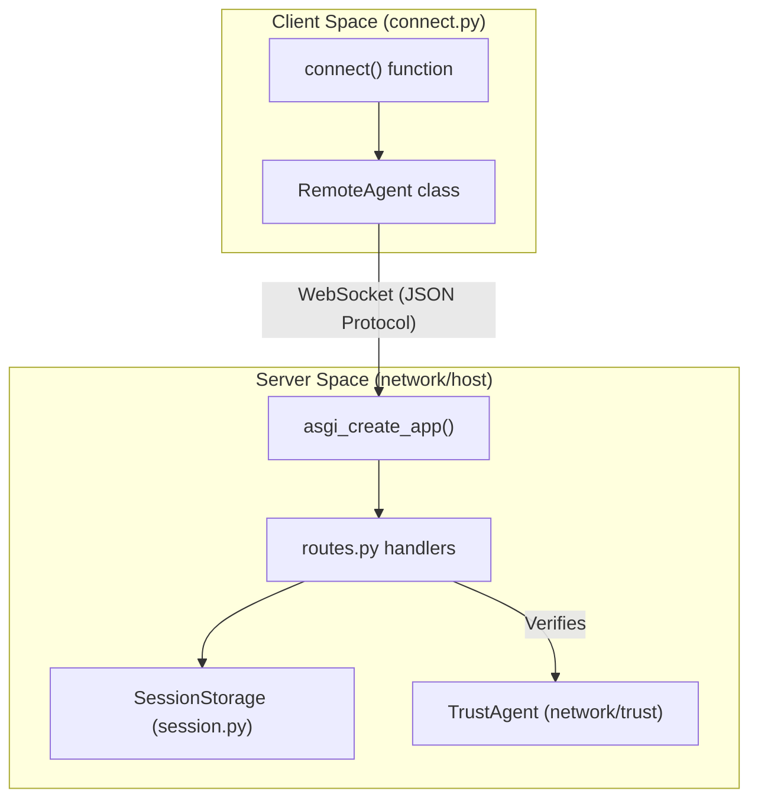
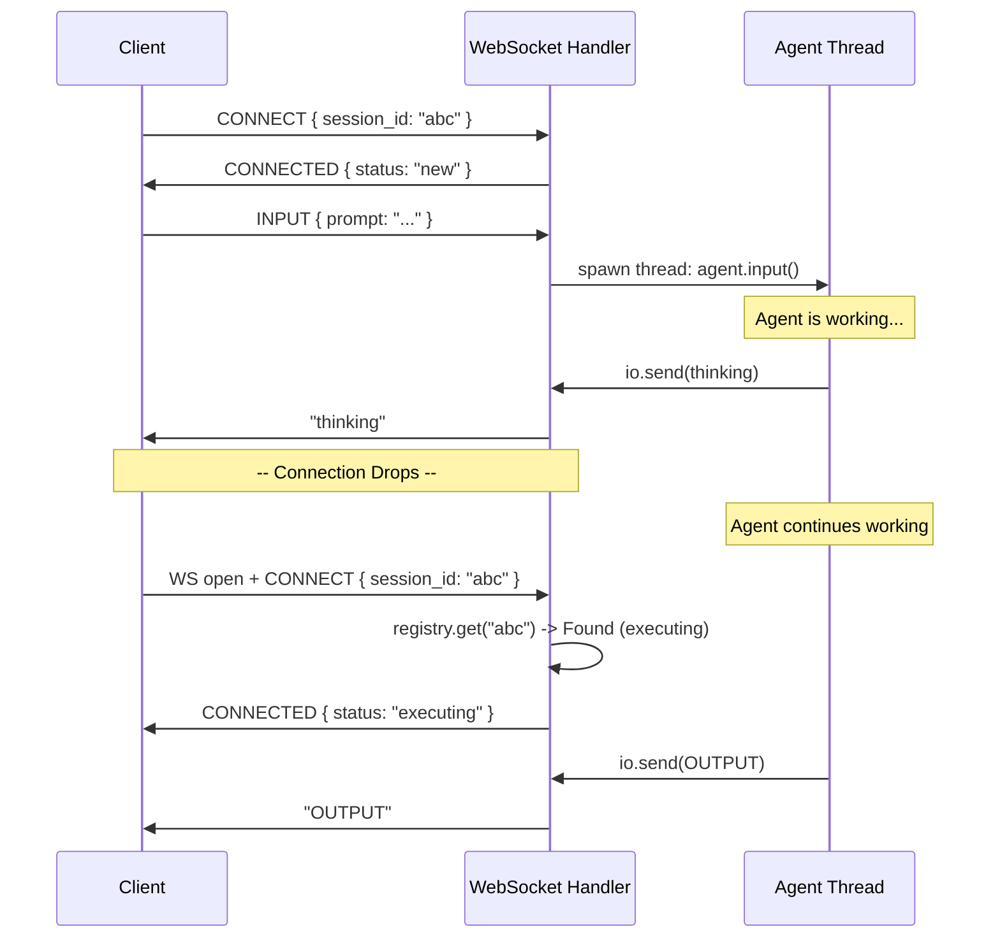

<!-- source: DeepWiki mcp.deepwiki.com · repo openonion/connectonion · page 9.4 Networking API · fetched 2026-10-26 -->

# Networking API

<details>
<summary>Relevant source files</summary>

The following files were used as context for generating this wiki page:

- [connectonion/network/asgi/http.py](connectonion/network/asgi/http.py)
- [connectonion/network/asgi/websocket.py](connectonion/network/asgi/websocket.py)
- [connectonion/network/connect.py](connectonion/network/connect.py)
- [connectonion/network/host/routes.py](connectonion/network/host/routes.py)
- [connectonion/network/host/server.py](connectonion/network/host/server.py)
- [connectonion/network/io/base.py](connectonion/network/io/base.py)
- [connectonion/network/io/websocket.py](connectonion/network/io/websocket.py)
- [docs/network/session-reconnect.md](docs/network/session-reconnect.md)
- [docs/network/websocket-protocol.md](docs/network/websocket-protocol.md)
- [tests/unit/test_asgi_http.py](tests/unit/test_asgi_http.py)
- [tests/unit/test_host_routes.py](tests/unit/test_host_routes.py)

</details>


This page documents the public API for deploying agents as network services and connecting to remote agents. The networking layer enables distributed agent systems through two primary functions: `host()` for serving agents and `connect()` for accessing them.

---

## Overview

The networking API provides the primitives for agent-to-agent and client-to-agent communication. It abstracts away the complexities of WebSocket state management, session persistence, and cryptographic authentication.

| Component | Purpose | Location |
|-----------|---------|----------|
| `host()` | Deploy an agent factory as an HTTP/WebSocket service | [connectonion/network/host/server.py:10-10]() |
| `connect()` | Create a `RemoteAgent` proxy to interact with a remote address | [connectonion/network/connect.py:129-143]() |
| `RemoteAgent` | Client-side proxy class for real-time interaction | [connectonion/network/connect.py:111-127]() |
| `IO` | Abstract interface for bidirectional communication | [connectonion/network/io/base.py:17-37]() |

**Sources:** [connectonion/network/host/server.py](), [connectonion/network/connect.py](), [connectonion/network/io/base.py]()

---

## host() Function

The `host()` function serves an agent over HTTP and WebSockets. Unlike a single agent instance, `host()` takes a factory function (`create_agent`) to ensure worker isolation—each request or WebSocket connection receives a fresh agent instance to prevent state bleeding between users [connectonion/network/host/server.py:22-26]().

### Function Signature

```python
def host(
    create_agent: Callable[[], Agent],
    port: int = 8000,
    trust: Union[str, Agent] = None,
    result_ttl: int = 3600,
    relay_url: str = "wss://oo.openonion.ai"
) -> None
```

**Sources:** [connectonion/network/host/server.py:10-26]()

### Parameters

| Parameter | Type | Default | Description |
|-----------|------|---------|-------------|
| `create_agent`| `Callable` | required | Factory function returning a fresh `Agent` instance per request. |
| `port` | `int` | `8000` | Port to bind the HTTP server. |
| `trust` | `str`/`Agent`| `None` | Trust policy: `"open"`, `"careful"`, `"strict"`, or a custom `TrustAgent`. |
| `result_ttl` | `int` | `3600` | Seconds to retain session results in memory. |
| `relay_url` | `str` | production | URL for the P2P relay server for agent discovery. |

**Sources:** [connectonion/network/host/server.py:5-8](), [connectonion/network/host/server.py:117-128]()

---

## HTTP/WebSocket Architecture

The hosting system is built on a custom ASGI implementation that routes requests to specific handlers.

**Title: Networking Entity Mapping**



**Sources:** [connectonion/network/host/server.py:5-8](), [connectonion/network/connect.py:7-15]()

### Endpoint Routing

| Method | Path | Handler | Purpose |
|--------|------|---------|---------|
| `POST` | `/input` | `input_handler` | Synchronous agent execution [connectonion/network/host/routes.py:27-52]() |
| `GET` | `/sessions` | `sessions_handler` | List all active session IDs [connectonion/network/host/routes.py:124-126]() |
| `GET` | `/sessions/{id}`| `session_handler` | Retrieve specific session state [connectonion/network/host/routes.py:118-121]() |
| `GET` | `/info` | `info_handler` | Get agent metadata (tools, model, address) [connectonion/network/host/routes.py:134-145]() |
| `WS` | `/ws` | `handle_websocket` | Real-time bidirectional streaming [connectonion/network/asgi/websocket.py:39-61]() |

**Sources:** [connectonion/network/host/server.py:39-56](), [connectonion/network/host/routes.py:1-17]()

---

## Session Management & Reconnection

ConnectOnion uses a two-layer session system to handle connection drops. The `ActiveSessionRegistry` keeps agent threads alive in memory, while `SessionStorage` persists final results to disk [docs/network/session-reconnect.md:9-23]().

**Title: WebSocket Reconnection Flow**



**Sources:** [docs/network/session-reconnect.md:68-102](), [connectonion/network/asgi/websocket.py:125-170]()

### Session Storage
Sessions are stored in `.co/session_results.jsonl`. Each entry includes the full conversation context, tool traces, and execution metadata [connectonion/network/host/routes.py:93-101]().

---

## Bidirectional IO Interface

The `IO` class allows hosted agents to communicate with clients in real-time. When an agent is hosted, the server injects a `WebSocketIO` instance into `agent.io` [connectonion/network/host/routes.py:54-55]().

### IO Methods

| Method | Signature | Description |
|--------|-----------|-------------|
| `log` | `log(type, **data)` | Send a one-way event (e.g., "thinking") [connectonion/network/io/base.py:78-90]() |
| `request_approval`| `request_approval(tool, args)` | Block agent execution and wait for user permission [connectonion/network/io/base.py:93-111]() |
| `send` | `send(event)` | Low-level primitive to send any JSON dict [connectonion/network/io/base.py:43-50]() |
| `receive` | `receive()` | Block until a message arrives from the client [connectonion/network/io/base.py:53-59]() |

**Sources:** [connectonion/network/io/base.py:17-37](), [connectonion/network/io/websocket.py:21-28]()

---

## connect() and RemoteAgent

The `connect()` function returns a `RemoteAgent` instance, which acts as a local proxy for a remote agent address.

### Usage Example
```python
from connectonion import connect

# Connect via agent address
agent = connect("0x123...")

# Send input (blocks until result or question)
response = agent.input("Analyze this file", files=[{"name": "data.txt", "data": "..."}])

print(response.text)
if not response.done:
    # Agent asked a question, provide answer
    agent.input("Use the CSV format")
```

**Sources:** [connectonion/network/connect.py:166-193]()

### Endpoint Resolution
`RemoteAgent` resolves the best endpoint for an agent by:
1. Querying the relay server for known endpoints [connectonion/network/connect.py:65-72]().
2. Sorting by priority (localhost > local network > public) [connectonion/network/connect.py:77-78]().
3. Verifying the agent's identity via the `/info` endpoint [connectonion/network/connect.py:83-92]().

**Sources:** [connectonion/network/connect.py:40-56]()

---

## Authentication & Trust

Networking requests are secured using Ed25519 signatures. The `extract_and_authenticate` function verifies that the request comes from the claimed identity and targets the correct agent [connectonion/network/host/auth.py:5-9]().

### Request Verification Steps
1. **Format Check**: Ensure payload, identity (`from`), and `signature` are present.
2. **Identity Verification**: Verify the Ed25519 signature against the canonical JSON payload [connectonion/network/host/routes.py:15-16]().
3. **Trust Policy**: Consult the `TrustAgent` to determine if the verified identity has permission to perform the requested action [connectonion/network/host/server.py:12-13]().

**Sources:** [connectonion/network/asgi/websocket.py:125-142](), [connectonion/network/host/server.py:38-38]()

---

