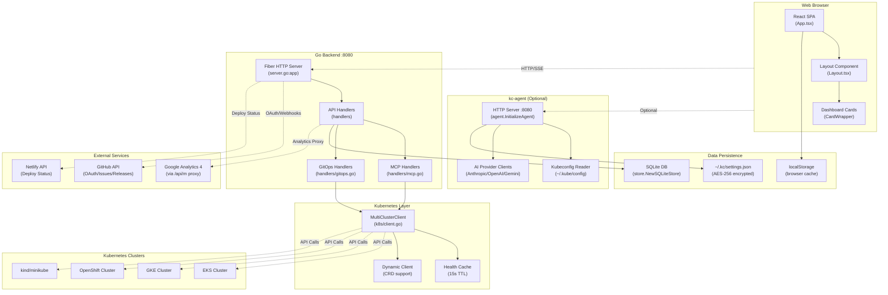
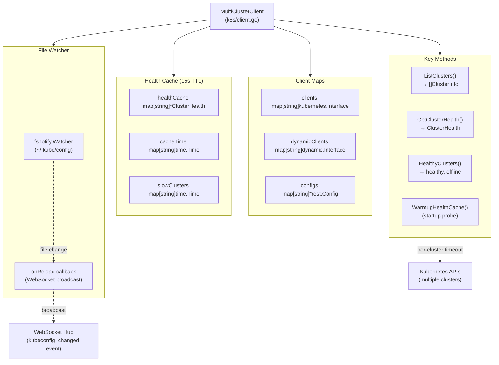
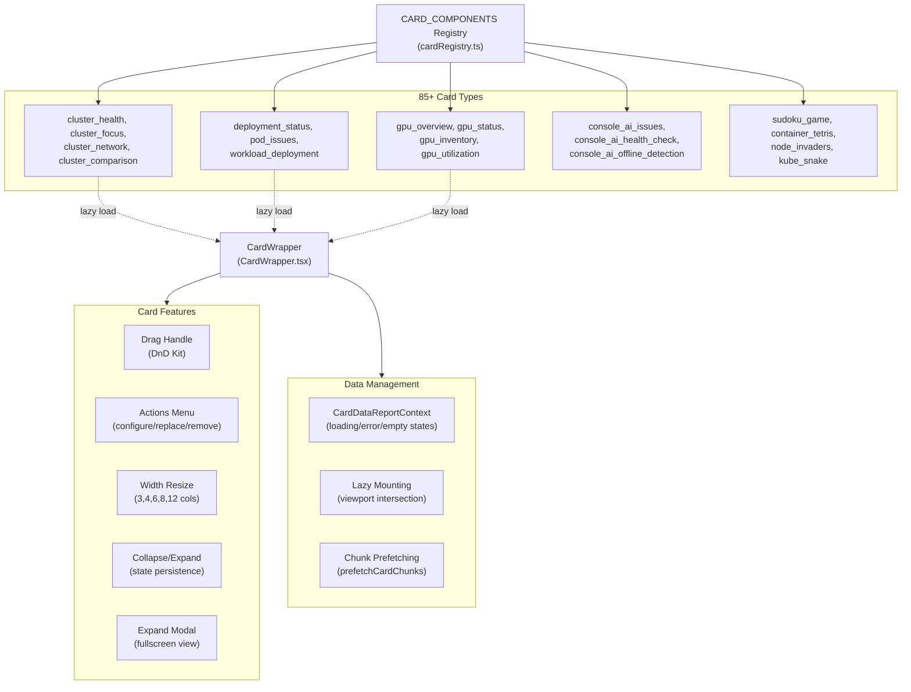
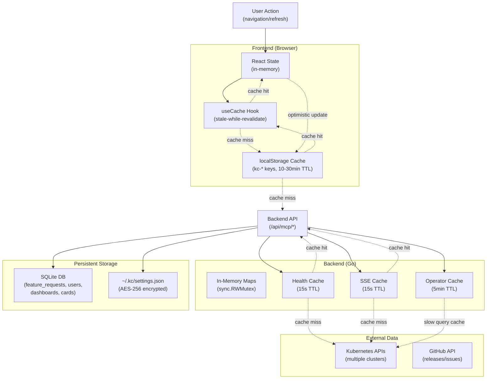

<!-- source: DeepWiki mcp.deepwiki.com · repo kubestellar/console · page 1 Overview · fetched 2026-10-26 -->

# Overview

<details>
<summary>Relevant source files</summary>

The following files were used as context for generating this wiki page:

- [pkg/api/handlers/demo_data.go](pkg/api/handlers/demo_data.go)
- [pkg/api/handlers/gitops.go](pkg/api/handlers/gitops.go)
- [pkg/api/handlers/mcp.go](pkg/api/handlers/mcp.go)
- [pkg/api/handlers/sse.go](pkg/api/handlers/sse.go)
- [pkg/api/server.go](pkg/api/server.go)
- [pkg/k8s/client.go](pkg/k8s/client.go)
- [web/src/App.tsx](web/src/App.tsx)
- [web/src/components/cards/CardWrapper.tsx](web/src/components/cards/CardWrapper.tsx)
- [web/src/components/cards/ProactiveGPUNodeHealthMonitor.tsx](web/src/components/cards/ProactiveGPUNodeHealthMonitor.tsx)
- [web/src/components/clusters/ClusterDetailModal.tsx](web/src/components/clusters/ClusterDetailModal.tsx)
- [web/src/components/clusters/Clusters.tsx](web/src/components/clusters/Clusters.tsx)
- [web/src/components/clusters/ResourceDetailModals.tsx](web/src/components/clusters/ResourceDetailModals.tsx)
- [web/src/components/clusters/components/ClusterGrid.tsx](web/src/components/clusters/components/ClusterGrid.tsx)
- [web/src/components/clusters/components/GPUDetailModal.tsx](web/src/components/clusters/components/GPUDetailModal.tsx)
- [web/src/components/compute/ClusterComparisonPage.tsx](web/src/components/compute/ClusterComparisonPage.tsx)
- [web/src/components/dashboard/CustomDashboard.tsx](web/src/components/dashboard/CustomDashboard.tsx)
- [web/src/components/dashboard/Dashboard.tsx](web/src/components/dashboard/Dashboard.tsx)
- [web/src/components/layout/Layout.tsx](web/src/components/layout/Layout.tsx)
- [web/src/components/ui/CloudProviderIcon.tsx](web/src/components/ui/CloudProviderIcon.tsx)
- [web/src/config/cards/gpu-node-health.ts](web/src/config/cards/gpu-node-health.ts)
- [web/src/config/dashboards/gpu.ts](web/src/config/dashboards/gpu.ts)
- [web/src/hooks/mcp/types.ts](web/src/hooks/mcp/types.ts)
- [web/src/hooks/useCertManager.ts](web/src/hooks/useCertManager.ts)
- [web/src/hooks/useMCP.ts](web/src/hooks/useMCP.ts)
- [web/src/lib/sseClient.ts](web/src/lib/sseClient.ts)

</details>


## Purpose & Scope

KubeStellar Console is a **web-based Kubernetes management platform** that provides unified visibility and control across multiple Kubernetes clusters. The system combines a React-based frontend with a Go backend to deliver real-time cluster monitoring, multi-cluster operations, GitOps drift detection, GPU resource management, and AI-powered troubleshooting capabilities.

This document provides a high-level architectural overview of the entire codebase. For detailed information about specific subsystems:
- Frontend architecture and component hierarchy → [Frontend Architecture](#2.1)
- Backend API server and handler structure → [Backend Architecture](#2.2)
- Card-based dashboard UI system → [Card-Based UI System](#3)
- Multi-cluster Kubernetes client implementation → [Multi-Cluster Kubernetes Management](#4)

**Key Capabilities:**
- **Multi-cluster management**: Connects to N Kubernetes clusters simultaneously via kubeconfig
- **Card-based dashboards**: 85+ lazy-loaded card components for customizable views
- **Real-time streaming**: SSE-based data streaming for live cluster updates
- **Local-first architecture**: Works offline with optional cloud features
- **AI integration**: Anthropic/OpenAI/Gemini providers for troubleshooting and automation
- **GitOps monitoring**: Drift detection for Helm, Flux Kustomizations, and OLM operators
- **Progressive enhancement**: Demo mode → kubeconfig access → AI features

Sources: [pkg/api/server.go:1-227](), [web/src/App.tsx:1-411](), High-Level System Architecture Diagrams (Diagram 1)

---

## Deployment Modes

The console supports three deployment configurations:

| Mode | Description | Components | Use Case |
|------|-------------|------------|----------|
| **Local Development** | Full-stack on localhost | Go backend `:8080` + Vite dev server `:5174` + optional `kc-agent` `:8080` | Development and local cluster monitoring |
| **Containerized** | Helm chart deployment | Backend pod + static frontend served from `./web/dist` + optional agent | Production on-cluster deployment |
| **Netlify Preview** | Serverless demo | Netlify Functions + static hosting (demo data only) | Public demo and PR previews |

**Local Development Setup:**
```bash
# Backend
cd pkg && go run cmd/server/main.go

# Frontend  
cd web && npm run dev

# Optional: Local agent for kubeconfig access
brew install kubestellar/tap/kc-agent && kc-agent
```

**Containerized Deployment:**
```bash
helm install kubestellar-console ./charts/console \
  --set backend.image=kubestellar/console:latest
```

The backend server initializes with a temporary loading page to avoid "connection refused" errors during startup, then performs heavy initialization (database, Kubernetes clients, MCP bridge) before serving the full application.

Sources: [pkg/api/server.go:94-252](), [pkg/api/server.go:43-74]()

---

## High-Level System Architecture



**Architecture Overview: Code to Component Mapping**

Sources: [pkg/api/server.go:94-227](), [web/src/App.tsx:317-408](), [web/src/components/layout/Layout.tsx:1-514](), [pkg/k8s/client.go:1-318](), High-Level System Architecture Diagrams (Diagram 1)

---

## Core Components

### Frontend Application

The frontend is a React SPA built with Vite, consisting of:

**1. Application Shell**
- **Entry point**: [web/src/App.tsx:317-408]() — Router with 13 nested context providers
- **Layout**: [web/src/components/layout/Layout.tsx:108-514]() — Navbar, sidebar, main content area with banner stacking
- **Routing**: Lazy-loaded route chunks with `React.lazy()` and `Suspense` fallbacks

**2. Dashboard System**
- **Main Dashboard**: [web/src/components/dashboard/Dashboard.tsx:76-816]() — Drag-and-drop card grid
- **Custom Dashboards**: Multiple user-created dashboards with per-dashboard card persistence
- **Card Registry**: [web/src/components/cards/cardRegistry.ts]() — 85+ card types with lazy loading

**3. State Management**
- **React Context**: 13-layer provider hierarchy in [web/src/App.tsx:319-404]()
- **localStorage**: Browser persistence for cache, settings, and dashboard layouts
- **SWR Pattern**: Memory cache → localStorage → API with stale-while-revalidate

**4. Data Hooks**
- **useMCP**: [web/src/hooks/useMCP.ts:1-4]() (barrel export) — Multi-cluster data fetching
- **useLocalAgent**: Connection status and fallback detection
- **useDemoMode**: Automatic demo mode when agent unavailable

Sources: [web/src/App.tsx:1-411](), [web/src/components/layout/Layout.tsx:1-514](), [web/src/components/dashboard/Dashboard.tsx:1-816](), [web/src/hooks/useMCP.ts:1-4]()

### Backend Services

The backend is a Go application using the Fiber framework:

**1. HTTP Server**
- **Main server**: [pkg/api/server.go:76-227]() — Fiber app with middleware stack
- **Loading server**: [pkg/api/server.go:231-252]() — Temporary HTTP server during initialization
- **Health check**: [pkg/api/server.go:313-338]() — Returns version, OAuth status, install method

**2. API Handlers**
- **MCP handlers**: [pkg/api/handlers/mcp.go:50-621]() — Multi-cluster operations
- **GitOps handlers**: [pkg/api/handlers/gitops.go:35-1268]() — Drift detection and Helm/Flux
- **Feedback handlers**: Feature request submission and GitHub issue integration
- **Auth handlers**: GitHub OAuth flow and JWT token management

**3. Middleware Stack** ([pkg/api/server.go:254-271]()):
- **Recovery**: Panic handler
- **Logger**: Request logging with latency tracking
- **CORS**: Cross-origin configuration for dev/prod
- **JWT Auth**: Token validation for protected routes

**4. WebSocket Hub**
- **Real-time updates**: Cluster config changes, deployment progress, mission updates
- **Connection tracking**: Active user count for analytics

Sources: [pkg/api/server.go:1-767](), [pkg/api/handlers/mcp.go:1-621](), [pkg/api/handlers/gitops.go:1-1268]()

### Multi-Cluster Client

The `MultiClusterClient` manages connections to N Kubernetes clusters:

**Core Implementation**: [pkg/k8s/client.go:44-318]()



**Health Cache Strategy**:
- **15s TTL**: Prevents repeated health checks within short window ([pkg/k8s/client.go:35]())
- **Slow cluster tracking**: Clusters with consecutive timeouts get reduced timeout (3s vs 8s)
- **Warmup on startup**: [pkg/api/server.go:149]() probes all clusters before serving requests
- **Skip offline clusters**: `HealthyClusters()` filters out unreachable clusters for faster queries

**Cluster Discovery**:
- Reads kubeconfig from `~/.kube/config` or in-cluster ServiceAccount
- Supports multiple contexts in a single kubeconfig
- Detects cloud provider from server URL and namespaces
- Deduplicates clusters with same API server but different context names

Sources: [pkg/k8s/client.go:44-318](), [pkg/api/server.go:140-163](), High-Level System Architecture Diagrams (Diagram 2)

### Card System

The card-based UI is the core of the dashboard interface:

**Card Components**: [web/src/components/cards/CardWrapper.tsx:124-1045]()



**Card Architecture**:
- **Generic wrapper**: [web/src/components/cards/CardWrapper.tsx:124-173]() provides chrome (title, icons, actions)
- **Registry**: Lazy-loaded components via `React.lazy()` for bundle chunking
- **Demo mode**: All cards support demo data fallback via `DEMO_EXEMPT_CARDS` and `DEMO_DATA_CARDS`
- **State persistence**: Card collapsed state and width saved to localStorage per-dashboard

**Card Lifecycle**:
1. User adds card → `Dashboard.tsx` creates Card record with position
2. `CardWrapper` renders card chrome and drag handle
3. Lazy component loads on mount (or from cache if prefetched)
4. Card data hooks fetch from backend or serve from cache
5. State changes (collapse/width) persist to localStorage immediately

Sources: [web/src/components/cards/CardWrapper.tsx:1-1045](), [web/src/components/cards/cardRegistry.ts](), [web/src/components/dashboard/Dashboard.tsx:76-816]()

---

## Data Flow & Caching

### Multi-Tier Caching Strategy

The system implements aggressive caching to minimize API calls and maintain responsiveness:



**Cache TTLs by Data Type**:

| Data Type | Frontend TTL | Backend TTL | Reason |
|-----------|--------------|-------------|--------|
| Cluster health | 10s | 15s | Fast-changing, frequent access |
| Pod/deployment lists | 15s | 15s | Moderate volatility |
| OLM operators | 30s | 5min | Slow queries (90-100s for 1000+ operators) |
| GitHub releases | 10min | N/A | Infrequent updates |
| Nightly E2E status | 2min | N/A | Periodic workflow data |

**Cache Invalidation**:
- **Time-based**: Automatic expiration after TTL
- **Event-driven**: Kubeconfig file watch triggers cache clear + WebSocket broadcast
- **Manual**: UI refresh button bypasses cache with `Cache-Control: no-cache` header
- **Optimistic**: Frontend updates cache immediately, background sync validates

Sources: [web/src/lib/sseClient.ts:1-144](), [pkg/api/handlers/sse.go:1-261](), [pkg/k8s/client.go:30-41](), High-Level System Architecture Diagrams (Diagram 5)

### SSE Streaming Architecture

Server-Sent Events provide real-time cluster data streaming:

**SSE Client**: [web/src/lib/sseClient.ts:42-144]()

**Flow**:
1. Frontend opens SSE connection to `/api/mcp/pods/stream?cluster=...`
2. Backend calls `HealthyClusters()` to filter out offline clusters
3. Offline clusters emit instant `cluster_skipped` events
4. Healthy clusters spawn goroutines with per-cluster timeout (10s)
5. Each cluster's data emits `cluster_data` event as it arrives
6. `done` event fires when all complete or 30s overall deadline reached

**Optimizations**:
- **Response cache**: 15s TTL serves cached results instantly
- **In-flight dedup**: Prevents duplicate concurrent requests to same URL
- **Slow cluster tracking**: Reduced timeout (3s) for recently-timed-out clusters
- **Selective queries**: Only healthy clusters are queried; offline skipped immediately

Sources: [web/src/lib/sseClient.ts:1-144](), [pkg/api/handlers/sse.go:73-261](), [pkg/api/handlers/mcp.go:14-48]()

---

## Key Architectural Patterns

### Local-First Design

The console prioritizes local-first operation:

**Offline Capabilities**:
- **kubeconfig access**: Direct cluster access without cloud dependencies
- **localStorage persistence**: Dashboard layouts, settings, cache survive page refresh
- **SQLite database**: Local feedback queue, user data, dashboards
- **Demo mode fallback**: Automatic switch to demo data when agent unavailable

**Progressive Enhancement**:
```
Base: Demo data (no dependencies)
  ↓
+ kc-agent: Real cluster access via kubeconfig
  ↓
+ API keys: AI troubleshooting (Anthropic/OpenAI/Gemini)
  ↓  
+ GitHub OAuth: Contribution rewards, feedback tracking
```

Sources: [web/src/components/layout/Layout.tsx:166-209](), [web/src/hooks/useDemoMode.ts](), [pkg/api/server.go:95-114]()

### Card-Based Modularity

The card system enables extreme flexibility:

**Card Registration** ([web/src/components/cards/cardRegistry.ts]()):
- Each card is a lazy-loaded React component
- Registry maps `card_type` string to component loader
- Bundle chunking: Each card becomes a separate JS chunk
- Demo data: All cards implement demo mode with `DEMO_DATA_CARDS` fallback

**Card Configuration**:
- Generic `config: Record<string, unknown>` allows arbitrary card-specific settings
- Stored in dashboard JSON alongside position and title
- Passed directly to card component as props

**Card Actions**:
- Configure: Opens modal for card-specific settings
- Replace: Swap with different card type (preserves position)
- Remove: Delete from dashboard (undo via card history)
- Resize: 5 width options (3, 4, 6, 8, 12 columns)
- Collapse: Hide content, show title only
- Expand: Open fullscreen modal

Sources: [web/src/components/cards/CardWrapper.tsx:124-1045](), [web/src/components/dashboard/Dashboard.tsx:76-816]()

### Multi-Cluster Streaming

The `MultiClusterClient` parallelizes cluster queries for speed:

**Parallel Query Pattern** ([pkg/api/handlers/sse.go:73-261]()):
```go
// 1. Filter offline clusters
healthy, offline, err := h.k8sClient.HealthyClusters(ctx)

// 2. Skip offline instantly  
for _, cl := range offline {
    writeSSEEvent(w, "cluster_skipped", fiber.Map{"cluster": cl.Name})
}

// 3. Query healthy in parallel
var wg sync.WaitGroup
for _, cl := range healthy {
    wg.Add(1)
    go func(clusterName string) {
        defer wg.Done()
        data, err := fetchFn(ctx, clusterName)
        if err == nil {
            writeSSEEvent(w, "cluster_data", data)
        }
    }(cl.Name)
}
```

**Timeout Strategy**:
- **Per-cluster**: 10s normal, 3s for slow clusters
- **Overall deadline**: 30s max for entire request
- **Early return**: Partial results if deadline hit

Sources: [pkg/api/handlers/sse.go:73-261](), [pkg/k8s/client.go:30-41]()

---

## Technology Stack

### Frontend
- **React 18**: Component library with Suspense and lazy loading
- **Vite**: Build tool and dev server
- **TypeScript**: Type safety
- **Tailwind CSS**: Utility-first styling
- **DnD Kit**: Drag-and-drop for dashboard cards
- **React Router**: Client-side routing
- **i18next**: Internationalization (9 languages)

### Backend
- **Go 1.21+**: Backend language
- **Fiber v2**: Express-like HTTP framework
- **SQLite**: Embedded database
- **client-go**: Kubernetes Go client
- **fsnotify**: File watcher for kubeconfig changes

### Infrastructure
- **Kubernetes**: Target platform (multi-cluster)
- **Helm**: Deployment packaging
- **GitHub Actions**: CI/CD automation
- **Netlify**: Preview deployments

Sources: [web/package.json](), [go.mod]()

---

## Repository Structure

```
kubestellar/console/
├── web/                          # React frontend
│   ├── src/
│   │   ├── components/          # UI components
│   │   │   ├── cards/          # 85+ card components
│   │   │   ├── dashboard/      # Dashboard management
│   │   │   ├── clusters/       # Cluster views
│   │   │   └── layout/         # Layout shell
│   │   ├── hooks/              # Custom React hooks
│   │   │   ├── useMCP.ts       # Multi-cluster data
│   │   │   ├── useDemoMode.ts  # Demo mode detection
│   │   │   └── useLocalAgent.ts # Agent connection
│   │   ├── lib/                # Utilities
│   │   │   ├── api.ts          # Backend API client
│   │   │   ├── sseClient.ts    # SSE streaming
│   │   │   └── demoMode.ts     # Demo data generator
│   │   └── App.tsx             # Application entry
│   └── public/                  # Static assets
├── pkg/                          # Go backend
│   ├── api/
│   │   ├── server.go           # HTTP server setup
│   │   ├── handlers/           # API handlers
│   │   │   ├── mcp.go         # Multi-cluster operations
│   │   │   ├── gitops.go      # GitOps drift detection
│   │   │   ├── feedback.go    # Feature requests
│   │   │   └── sse.go         # SSE streaming helpers
│   │   └── middleware/         # Auth, CORS, WebSocket
│   ├── k8s/
│   │   └── client.go           # MultiClusterClient
│   ├── store/
│   │   └── sqlite.go           # SQLite persistence
│   ├── mcp/
│   │   └── bridge.go           # MCP tool integration
│   └── cmd/
│       └── server/
│           └── main.go         # Main entry point
├── charts/                       # Helm charts
├── .github/workflows/            # CI/CD automation
└── docs/                         # Documentation
```

Sources: Repository file structure

---

## Getting Started

**Prerequisites**:
- Go 1.21+ (backend)
- Node.js 18+ (frontend)
- kubectl with valid kubeconfig (for real cluster access)
- Optional: `kc-agent` for AI features

**Quick Start**:
```bash
# Clone repository
git clone https://github.com/kubestellar/console.git
cd console

# Start backend
cd pkg
go run cmd/server/main.go

# Start frontend (separate terminal)
cd web
npm install
npm run dev

# Access at http://localhost:5174
```

**First Run**:
1. Console opens in demo mode (sample data)
2. Connect real clusters via Settings → Kubeconfig
3. Optional: Install `kc-agent` for AI troubleshooting
4. Optional: Configure GitHub OAuth for contribution tracking

For detailed setup instructions, see [Development Setup](#14.1).

Sources: [README.md](), [pkg/cmd/server/main.go](), [web/package.json]()

---

