<!-- source: DeepWiki mcp.deepwiki.com · repo kubestellar/console · page 14.2 Adding New Cards · fetched 2026-10-26 -->

# Adding New Cards

<details>
<summary>Relevant source files</summary>

The following files were used as context for generating this wiki page:

- [web/src/App.tsx](web/src/App.tsx)
- [web/src/components/cards/CardWrapper.tsx](web/src/components/cards/CardWrapper.tsx)
- [web/src/components/cards/cardRegistry.ts](web/src/components/cards/cardRegistry.ts)
- [web/src/components/cards/flatcar_status/demoData.ts](web/src/components/cards/flatcar_status/demoData.ts)
- [web/src/components/cards/flatcar_status/index.tsx](web/src/components/cards/flatcar_status/index.tsx)
- [web/src/components/cards/flatcar_status/useFlatcarStatus.ts](web/src/components/cards/flatcar_status/useFlatcarStatus.ts)
- [web/src/components/cards/flatcar_status/versionUtils.ts](web/src/components/cards/flatcar_status/versionUtils.ts)
- [web/src/components/cards/llmd/index.ts](web/src/components/cards/llmd/index.ts)
- [web/src/components/compute/ClusterComparisonPage.tsx](web/src/components/compute/ClusterComparisonPage.tsx)
- [web/src/components/dashboard/AddCardModal.tsx](web/src/components/dashboard/AddCardModal.tsx)
- [web/src/components/dashboard/CustomDashboard.tsx](web/src/components/dashboard/CustomDashboard.tsx)
- [web/src/components/dashboard/Dashboard.tsx](web/src/components/dashboard/Dashboard.tsx)
- [web/src/components/dashboard/templates.ts](web/src/components/dashboard/templates.ts)
- [web/src/components/layout/Layout.tsx](web/src/components/layout/Layout.tsx)
- [web/src/components/llmd-benchmarks/LLMdBenchmarks.tsx](web/src/components/llmd-benchmarks/LLMdBenchmarks.tsx)
- [web/src/hooks/useCertManager.ts](web/src/hooks/useCertManager.ts)
- [web/src/locales/en/cards.json](web/src/locales/en/cards.json)

</details>


## Purpose and Scope

This guide explains how to create new dashboard cards for the KubeStellar Console. Cards are modular UI components that display cluster data, metrics, or other information in the dashboard grid. This document covers the complete process from component creation through registration and integration.

For information about card layout and positioning, see [Dashboard Management](#3.2). For dynamic card generation via AI, see [Card Factory & AI Creation](#3.4).

---

## Card Architecture Overview

### Card Component Lifecycle

```mermaid
graph TB
    Create["Create Card Component<br/>(web/src/components/cards)"]
    Register["Register in cardRegistry.ts<br/>(CARD_COMPONENTS)"]
    Catalog["Add to Card Catalog<br/>(AddCardModal.tsx)"]
    I18n["Add Translations<br/>(locales/en/cards.json)"]
    
    Create --> Register
    Register --> Catalog
    Catalog --> I18n
    
    Lazy["Lazy Load via React.lazy()"]
    Wrapper["CardWrapper Component<br/>(CardWrapper.tsx)"]
    Suspense["Suspense Boundary<br/>(shows CardSkeleton)"]
    Render["Render on Dashboard"]
    
    I18n --> Lazy
    Lazy --> Wrapper
    Wrapper --> Suspense
    Suspense --> Render
    
    Cache["useCache Hook<br/>(fetches + caches data)"]
    Context["CardDataReportContext<br/>(reports isDemoData)"]
    
    Render --> Cache
    Render --> Context
    
    style Register fill:#333
    style Wrapper fill:#333
    style Cache fill:#333
```



**Sources:** [web/src/components/cards/cardRegistry.ts:1-455](), [web/src/components/cards/CardWrapper.tsx:1-100](), [web/src/components/dashboard/AddCardModal.tsx:1-50]()

---

## File Structure for a New Card

A complete card implementation typically includes:

```
web/src/components/cards/
├── MyNewCard.tsx              # Main component
├── my-new-card/              # (Optional) Complex cards
│   ├── index.tsx             # Barrel export
│   ├── useMyNewCard.ts       # Data fetching hook
│   ├── demoData.ts           # Demo mode data
│   └── versionUtils.ts       # Helper utilities
└── cardRegistry.ts           # Register here
```

**Sources:** [web/src/components/cards/flatcar_status/index.tsx:1-140](), [web/src/components/cards/flatcar_status/useFlatcarStatus.ts:1-161](), [web/src/components/cards/flatcar_status/demoData.ts:1-34]()

---

## Step-by-Step: Creating a New Card

### Step 1: Create the Card Component

Create a new file `web/src/components/cards/MyNewCard.tsx`:

```typescript
import { useCache } from '../../lib/cache'
import { useCardLoadingState } from './CardDataContext'
import { Skeleton } from '../ui/Skeleton'

interface MyCardData {
  value: number
  label: string
}

const CACHE_KEY = 'my-new-card'
const INITIAL_DATA: MyCardData = { value: 0, label: '' }
const DEMO_DATA: MyCardData = { value: 42, label: 'Demo Value' }

async function fetchMyCardData(): Promise<MyCardData> {
  const resp = await fetch('/api/mcp/my-endpoint')
  if (!resp.ok) throw new Error(`HTTP ${resp.status}`)
  return resp.json()
}

export function MyNewCard({ config }: { config?: Record<string, unknown> }) {
  const { data, isLoading, isFailed, consecutiveFailures, isDemoFallback } = 
    useCache<MyCardData>({
      key: CACHE_KEY,
      category: 'default',
      initialData: INITIAL_DATA,
      demoData: DEMO_DATA,
      persist: true,
      fetcher: fetchMyCardData,
    })

  const { showSkeleton, showEmptyState } = useCardLoadingState({
    isLoading,
    hasAnyData: data.value > 0,
    isFailed,
    consecutiveFailures,
    isDemoData: isDemoFallback,
  })

  if (showSkeleton) {
    return <Skeleton variant="rounded" height={200} />
  }

  if (showEmptyState) {
    return <div className="text-muted-foreground">No data available</div>
  }

  return (
    <div className="h-full flex flex-col min-h-card content-loaded">
      <div className="text-3xl font-bold">{data.value}</div>
      <div className="text-sm text-muted-foreground">{data.label}</div>
    </div>
  )
}
```

**Key patterns:**
- Accept `config?: Record<string, unknown>` prop for card configuration
- Use `useCache` hook for data fetching with demo fallback
- Use `useCardLoadingState` for skeleton/empty state logic
- Apply `content-loaded` class when data is ready (prevents skeleton flash on cached data)
- Use `min-h-card` class for consistent minimum height

**Sources:** [web/src/components/cards/flatcar_status/useFlatcarStatus.ts:131-160](), [web/src/components/cards/flatcar_status/index.tsx:41-140]()

---

### Step 2: Register in Card Registry

Add lazy import and register in `web/src/components/cards/cardRegistry.ts`:

```typescript
// Near top of file with other imports
const MyNewCard = lazy(() => import('./MyNewCard').then(m => ({ default: m.MyNewCard })))

// In RAW_CARD_COMPONENTS object (around line 210)
const RAW_CARD_COMPONENTS: Record<string, CardComponent> = {
  // ... existing cards ...
  my_new_card: MyNewCard,
}
```

For cards that should **always use demo data** (no live backend support yet):

```typescript
// In DEMO_DATA_CARDS set (around line 473)
export const DEMO_DATA_CARDS = new Set([
  // ... existing cards ...
  'my_new_card',
])
```

For **game/arcade cards** that should never show demo indicators:

```typescript
// In DEMO_EXEMPT_CARDS set (around line 542)
export const DEMO_EXEMPT_CARDS = new Set([
  // ... existing cards ...
  'my_new_card',
])
```

**Sources:** [web/src/components/cards/cardRegistry.ts:1-30](), [web/src/components/cards/cardRegistry.ts:210-452](), [web/src/components/cards/cardRegistry.ts:473-536]()

---

### Step 3: Add Card Metadata in CardWrapper

Add display title, description, and icon in `CardWrapper.tsx`:

```typescript
// In CARD_TITLES object (around line 175)
export const CARD_TITLES: Record<string, string> = {
  // ... existing titles ...
  my_new_card: 'My New Card',
}

// In CARD_DESCRIPTIONS object (around line 381)
export const CARD_DESCRIPTIONS: Record<string, string> = {
  // ... existing descriptions ...
  my_new_card: 'Shows my custom metric with real-time updates',
}

// In CARD_ICONS object (around line 534)
const CARD_ICONS: Record<string, { icon: ComponentType<{ className?: string }>, color: string }> = {
  // ... existing icons ...
  my_new_card: { icon: Activity, color: 'text-purple-400' },
}
```

**Available icons:** `Activity`, `AlertCircle`, `AlertTriangle`, `Box`, `Cpu`, `Database`, `GitBranch`, `Server`, `Shield`, `TrendingUp`, etc. (imported from `lucide-react`)

**Color classes:** `text-purple-400`, `text-blue-400`, `text-green-400`, `text-red-400`, `text-orange-400`, `text-cyan-400`, etc.

**Sources:** [web/src/components/cards/CardWrapper.tsx:175-378](), [web/src/components/cards/CardWrapper.tsx:381-531](), [web/src/components/cards/CardWrapper.tsx:534-731]()

---

### Step 4: Add to Card Catalog

Add card to the appropriate category in `AddCardModal.tsx`:

```typescript
// In CARD_CATALOG object (around line 12)
const CARD_CATALOG = {
  'Cluster Health': [
    // ... existing cards ...
    { 
      type: 'my_new_card', 
      title: 'My New Card', 
      description: 'Shows my custom metric with real-time updates',
      visualization: 'gauge' // or 'status', 'table', 'timeseries', 'bar', 'donut', 'events'
    },
  ],
  // ... other categories ...
}
```

**Available categories:**
- `'Cluster Admin'`, `'Cluster Health'`, `'Workloads'`, `'Compute'`, `'Storage'`, `'Network'`
- `'GitOps'`, `'ArgoCD'`, `'Operators'`, `'Namespaces'`, `'Crossplane'`
- `'Security & Events'`, `'Live Trends'`, `'AI Agents'`, `'AI Assistant'`
- `'Alerting'`, `'Cost Management'`, `'Security Posture'`, `'Data Compliance'`
- `'Games'`, `'Utilities'`, `'CI/CD'`

**Sources:** [web/src/components/dashboard/AddCardModal.tsx:12-200]()

---

### Step 5: Add Translations

Add title and description to `web/src/locales/en/cards.json`:

```json
{
  "titles": {
    "my_new_card": "My New Card"
  },
  "descriptions": {
    "my_new_card": "Shows my custom metric with real-time updates"
  }
}
```

For cards with custom UI text, add nested keys:

```json
{
  "myNewCard": {
    "healthy": "Healthy",
    "degraded": "Degraded",
    "totalNodes": "Total Nodes",
    "fetchError": "Failed to fetch data"
  }
}
```

Access translations in component:

```typescript
const { t } = useTranslation('cards')
const title = t('myNewCard.healthy')
```

**Sources:** [web/src/locales/en/cards.json:1-50](), [web/src/locales/en/cards.json:97-256]()

---

## Data Fetching Patterns

### Using the useCache Hook

The `useCache` hook provides caching, demo fallback, and background refresh:

```typescript
const { data, isLoading, isFailed, consecutiveFailures, isDemoFallback } = 
  useCache<MyCardData>({
    key: 'my-card-unique-key',           // localStorage cache key
    category: 'default',                 // 'default', 'events', or 'trends'
    initialData: INITIAL_DATA,           // Shown while first fetch loads
    demoData: DEMO_DATA,                 // Used in demo mode
    persist: true,                       // Save to localStorage
    fetcher: fetchMyCardData,            // Async function that fetches data
    refreshInterval: 30000,              // Optional: auto-refresh every 30s
  })
```

**Cache categories:**
- `'default'` - General cluster data (30s refresh)
- `'events'` - Event streams (15s refresh)
- `'trends'` - Time-series data (60s refresh)

**Sources:** [web/src/components/cards/flatcar_status/useFlatcarStatus.ts:132-141]()

---

### Creating a Custom Data Hook

For complex data fetching, create a dedicated hook:

```typescript
// web/src/hooks/useMyCardData.ts
import { useState, useEffect } from 'react'
import { useClusters } from './useMCP'
import { kubectlProxy } from '../lib/kubectlProxy'

interface MyCardData {
  items: MyItem[]
  total: number
}

export function useMyCardData() {
  const { deduplicatedClusters } = useClusters()
  const [data, setData] = useState<MyCardData>({ items: [], total: 0 })
  const [isLoading, setIsLoading] = useState(true)

  useEffect(() => {
    async function fetchData() {
      setIsLoading(true)
      try {
        const results = await Promise.all(
          deduplicatedClusters.map(async (cluster) => {
            const response = await kubectlProxy(
              cluster.name,
              '/api/v1/namespaces'
            )
            return response.items || []
          })
        )
        const items = results.flat()
        setData({ items, total: items.length })
      } catch (error) {
        console.error('Failed to fetch data:', error)
      } finally {
        setIsLoading(false)
      }
    }
    
    fetchData()
  }, [deduplicatedClusters])

  return { data, isLoading }
}
```

**Sources:** [web/src/hooks/useCertManager.ts:1-50](), [web/src/hooks/useCertManager.ts:186-230]()

---

## Card Component Patterns

### Skeleton Loading State

Show skeleton while initial data loads:

```typescript
const { showSkeleton } = useCardLoadingState({
  isLoading,
  hasAnyData: data.items.length > 0,
  isFailed,
  consecutiveFailures,
  isDemoData: isDemoFallback,
})

if (showSkeleton) {
  return (
    <div className="h-full flex flex-col min-h-card gap-3">
      <Skeleton variant="rounded" height={36} />
      <Skeleton variant="rounded" height={80} />
      <Skeleton variant="rounded" height={60} />
    </div>
  )
}
```

**Skeleton variants:**
- `'text'` - Text placeholder
- `'rounded'` - Rounded rectangle
- `'circular'` - Circle (for avatars)

**Sources:** [web/src/components/cards/flatcar_status/index.tsx:46-59]()

---

### Empty State

Show message when no data is available:

```typescript
if (showEmptyState) {
  return (
    <div className="h-full flex flex-col items-center justify-center min-h-card text-muted-foreground gap-2">
      <AlertTriangle className="w-6 h-6 text-orange-400" />
      <p className="text-sm">No data available</p>
      <p className="text-xs">Check your cluster connections</p>
    </div>
  )
}
```

**Sources:** [web/src/components/cards/flatcar_status/index.tsx:61-70]()

---

### Content-Loaded State

Apply `content-loaded` class to trigger CSS animations once data is ready:

```typescript
return (
  <div className="h-full flex flex-col min-h-card content-loaded gap-4">
    {/* Card content */}
  </div>
)
```

This prevents skeleton from flashing when cached data is available on page load.

**Sources:** [web/src/components/cards/flatcar_status/index.tsx:81]()

---

## Advanced Features

### Card Configuration

Cards can accept configuration through the `config` prop:

```typescript
export function MyNewCard({ config }: { config?: Record<string, unknown> }) {
  const selectedCluster = config?.cluster as string | undefined
  const threshold = config?.threshold as number ?? 80
  
  // Use config values...
}
```

Configuration is set through the "Configure" button in CardWrapper and stored per-card instance.

**Sources:** [web/src/components/cards/CardWrapper.tsx:124-173]()

---

### Expandable Modal View

For cards with detailed views, handle expansion:

```typescript
import { useCardExpanded } from '../CardWrapper'

export function MyNewCard() {
  const { isExpanded } = useCardExpanded()
  
  return (
    <div className="h-full">
      {isExpanded ? (
        <DetailedView />
      ) : (
        <SummaryView />
      )}
    </div>
  )
}
```

Configure large modal for complex visualizations:

```typescript
// In CardWrapper.tsx (around line 61)
const LARGE_EXPANDED_CARDS = new Set([
  'my_new_card',  // Uses 95vh height and 7xl width
])

// Or fullscreen for games/maps
const FULLSCREEN_EXPANDED_CARDS = new Set([
  'my_new_card',  // Uses 95vh height and 90vw width
])
```

**Sources:** [web/src/components/cards/CardWrapper.tsx:59-82](), [web/src/components/cards/CardWrapper.tsx:90-93]()

---

### Demo Data Strategy

Provide realistic demo data for Netlify previews and demo mode:

```typescript
// demoData.ts
export const MY_CARD_DEMO_DATA = {
  totalNodes: 24,
  healthyNodes: 20,
  degradedNodes: 4,
  lastCheckTime: new Date(Date.now() - 3 * 60 * 1000).toISOString(),
}

// In component
const DEMO_DATA = {
  value: MY_CARD_DEMO_DATA.totalNodes,
  healthy: MY_CARD_DEMO_DATA.healthyNodes,
}
```

Demo data should:
- Represent realistic production scenarios
- Be internally consistent (totals match sums)
- Include edge cases (mixed states, warnings)

**Sources:** [web/src/components/cards/flatcar_status/demoData.ts:1-34]()

---

## Bundle Optimization

### Barrel Exports for Related Cards

Group related cards in a subdirectory with barrel export:

```typescript
// web/src/components/cards/my-cards/index.ts
export { CardOne } from './CardOne'
export { CardTwo } from './CardTwo'
export { CardThree } from './CardThree'
```

In `cardRegistry.ts`, load all cards from one bundle:

```typescript
const _myCardsBundle = import('./my-cards')
const CardOne = lazy(() => _myCardsBundle.then(m => ({ default: m.CardOne })))
const CardTwo = lazy(() => _myCardsBundle.then(m => ({ default: m.CardTwo })))
const CardThree = lazy(() => _myCardsBundle.then(m => ({ default: m.CardThree })))
```

This shares one HTTP request for all cards instead of N separate requests.

**Sources:** [web/src/components/cards/llmd/index.ts:1-23](), [web/src/components/cards/cardRegistry.ts:134-160]()

---

### Chunk Preloading

Add preloader for eager loading:

```typescript
// In CARD_CHUNK_PRELOADERS map (around line 580)
const CARD_CHUNK_PRELOADERS: Record<string, () => Promise<unknown>> = {
  my_new_card: () => import('./MyNewCard'),
}
```

Cards are preloaded based on dashboard visibility to optimize navigation.

**Sources:** [web/src/components/cards/cardRegistry.ts:580-620]()

---

## Dashboard Integration

### Adding to Dashboard Templates

Include card in pre-configured templates:

```typescript
// web/src/components/dashboard/templates.ts
export const DASHBOARD_TEMPLATES: DashboardTemplate[] = [
  {
    id: 'my-custom-template',
    name: 'My Custom Dashboard',
    description: 'Custom monitoring view',
    icon: '🎯',
    category: 'custom',
    cards: [
      { card_type: 'my_new_card', position: { w: 4, h: 3 } },
      { card_type: 'cluster_health', position: { w: 4, h: 2 } },
    ],
  },
]
```

**Card sizes (w in grid columns out of 12):**
- `w: 3` - Small (1/4 width)
- `w: 4` - Medium (1/3 width)
- `w: 6` - Large (1/2 width)
- `w: 8` - Wide (2/3 width)
- `w: 12` - Full width

**Sources:** [web/src/components/dashboard/templates.ts:1-50]()

---

## Data Flow Architecture

```mermaid
graph TB
    subgraph "Card Component"
        Component["MyNewCard.tsx<br/>React Component"]
        Config["config prop<br/>(user settings)"]
        CardExpanded["useCardExpanded()<br/>(expansion state)"]
    end
    
    subgraph "Data Layer"
        UseCache["useCache<MyCardData><br/>(caching + demo)"]
        Fetcher["fetchMyCardData()<br/>(async fetch)"]
        LocalStorage["localStorage<br/>(kc-my-card-cache)"]
        DemoData["DEMO_DATA<br/>(fallback)"]
    end
    
    subgraph "Backend API"
        MCPProxy["/api/mcp/*<br/>(cluster proxy)"]
        Clusters["K8s Clusters<br/>(multiple)"]
    end
    
    subgraph "Loading States"
        LoadingState["useCardLoadingState()"]
        Skeleton["<Skeleton />"]
        EmptyState["Empty State"]
        Content["<Content />"]
    end
    
    Component --> UseCache
    Component --> CardExpanded
    Component --> LoadingState
    Config --> Component
    
    UseCache --> Fetcher
    UseCache --> LocalStorage
    UseCache --> DemoData
    
    Fetcher --> MCPProxy
    MCPProxy --> Clusters
    
    LoadingState --> Skeleton
    LoadingState --> EmptyState
    LoadingState --> Content
    
    style UseCache fill:#333
    style LoadingState fill:#333
    style Component fill:#333
```



**Key data flow:**
1. Component calls `useCache` with fetcher function
2. Hook checks localStorage for cached data
3. If cache miss, executes fetcher to call backend API
4. Backend proxies requests to multiple K8s clusters
5. Hook updates cache and returns data
6. Component uses `useCardLoadingState` to determine UI state
7. CardWrapper provides chrome (title, actions, expansion)

**Sources:** [web/src/components/cards/flatcar_status/useFlatcarStatus.ts:131-161](), [web/src/components/cards/CardWrapper.tsx:1-100]()

---

## Testing Checklist

Before submitting a new card:

- [ ] Component renders without errors in isolation
- [ ] Skeleton state shows while loading
- [ ] Empty state displays when no data available
- [ ] Demo data is realistic and internally consistent
- [ ] Card registered in `cardRegistry.ts`
- [ ] Metadata added to `CardWrapper.tsx` (title, description, icon)
- [ ] Card appears in `AddCardModal.tsx` catalog
- [ ] Translations added to `cards.json`
- [ ] Works in both live mode and demo mode
- [ ] Cached data shows immediately on page load (no skeleton flash)
- [ ] Responsive layout at different card widths (w: 3, 4, 6, 8, 12)
- [ ] Expanded modal view works (if applicable)
- [ ] Configuration options saved and loaded (if applicable)

**Sources:** [web/src/components/cards/cardRegistry.ts:1-455](), [web/src/components/cards/CardWrapper.tsx:1-100](), [web/src/components/dashboard/AddCardModal.tsx:1-200]()

---

## Example: Complete Card Implementation

Here's the Flatcar Container Linux status card as a complete reference:

```
web/src/components/cards/flatcar_status/
├── index.tsx              # Main component (140 lines)
├── useFlatcarStatus.ts    # Data fetching hook (161 lines)
├── demoData.ts            # Demo data constants (34 lines)
└── versionUtils.ts        # Version comparison utility (19 lines)
```

**Key implementation details:**

1. **Component** (`index.tsx`):
   - Uses `useFlatcarStatus()` hook for data
   - Shows skeleton → empty state → content based on loading state
   - Displays metrics in tile layout
   - Sorts versions with custom comparison function

2. **Data Hook** (`useFlatcarStatus.ts`):
   - Fetches from `/api/mcp/nodes` endpoint
   - Filters for Flatcar nodes by `osImage` field
   - Aggregates version distribution
   - Detects updating/outdated nodes
   - Returns computed health status

3. **Demo Data** (`demoData.ts`):
   - Realistic 24-node cluster
   - Mixed versions (18 latest, 4 outdated, 2 updating)
   - Consistent totals and health status

4. **Utilities** (`versionUtils.ts`):
   - Semver comparison for sorting
   - Handles "unknown" version edge case

**Sources:** [web/src/components/cards/flatcar_status/index.tsx:1-140](), [web/src/components/cards/flatcar_status/useFlatcarStatus.ts:1-161](), [web/src/components/cards/flatcar_status/demoData.ts:1-34](), [web/src/components/cards/flatcar_status/versionUtils.ts:1-19]()

---

