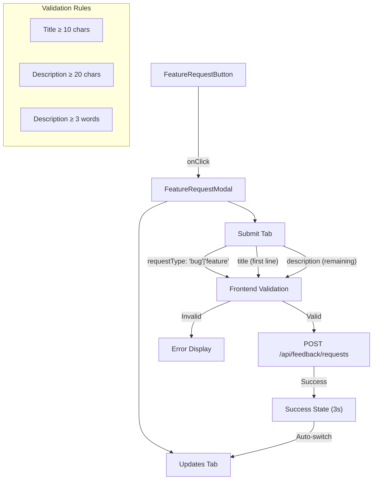
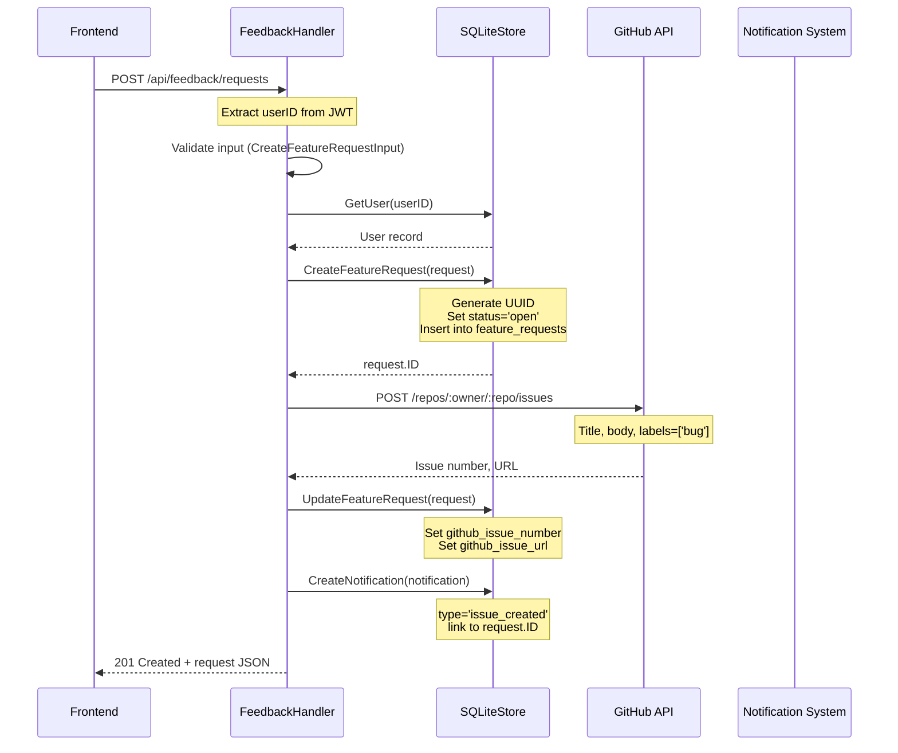
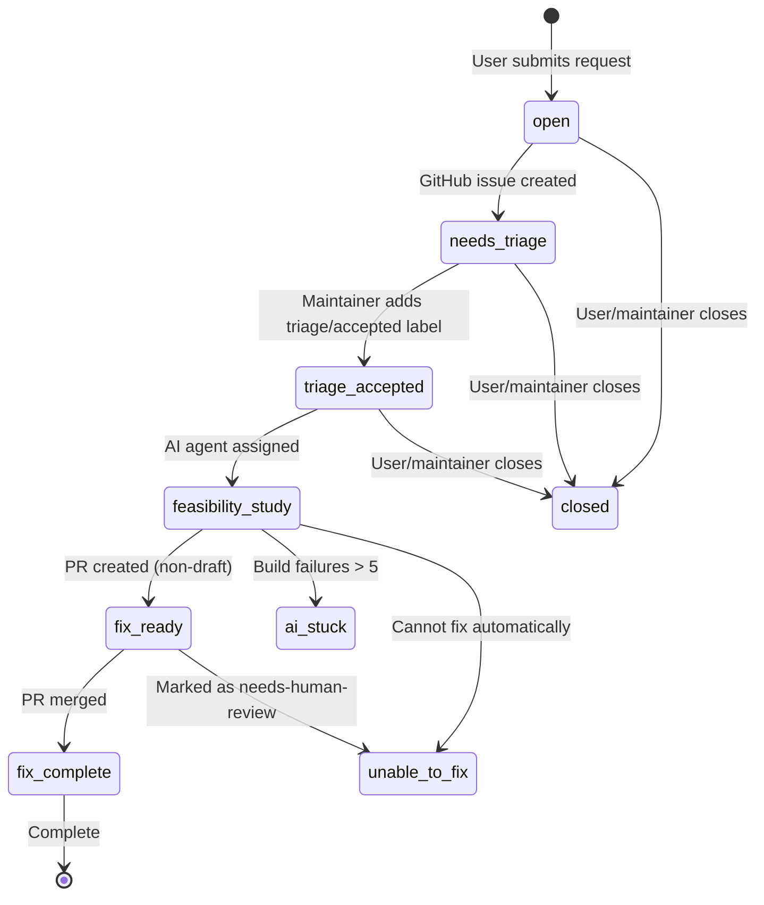
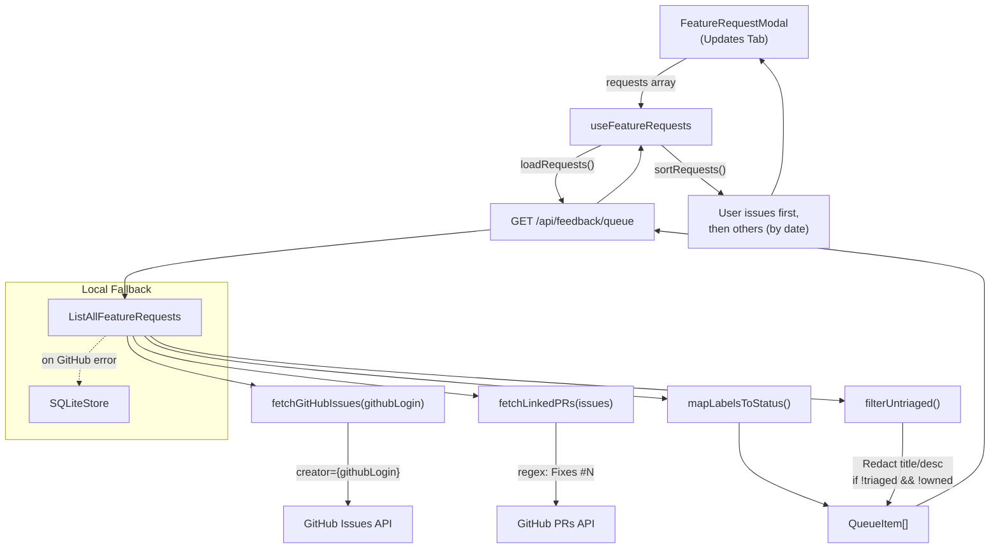
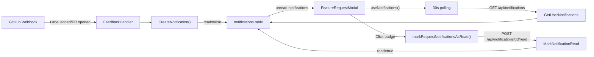

<!-- source: DeepWiki mcp.deepwiki.com · repo kubestellar/console · page 6.1 Feature Request Flow · fetched 2026-10-26 -->

# Feature Request Flow

<details>
<summary>Relevant source files</summary>

The following files were used as context for generating this wiki page:

- [pkg/api/handlers/feedback.go](pkg/api/handlers/feedback.go)
- [pkg/api/handlers/gpu.go](pkg/api/handlers/gpu.go)
- [pkg/api/handlers/rewards.go](pkg/api/handlers/rewards.go)
- [pkg/models/feedback.go](pkg/models/feedback.go)
- [pkg/models/gpu.go](pkg/models/gpu.go)
- [pkg/store/sqlite.go](pkg/store/sqlite.go)
- [pkg/store/store.go](pkg/store/store.go)
- [web/src/components/charts/BarChart.tsx](web/src/components/charts/BarChart.tsx)
- [web/src/components/charts/PieChart.tsx](web/src/components/charts/PieChart.tsx)
- [web/src/components/feedback/FeatureRequestButton.tsx](web/src/components/feedback/FeatureRequestButton.tsx)
- [web/src/components/feedback/FeatureRequestModal.tsx](web/src/components/feedback/FeatureRequestModal.tsx)
- [web/src/hooks/useFeatureRequests.ts](web/src/hooks/useFeatureRequests.ts)
- [web/src/hooks/useGPUReservations.ts](web/src/hooks/useGPUReservations.ts)

</details>


## Purpose and Scope

This page documents the **feature request submission and lifecycle tracking system**. It covers how users report bugs and request features through the UI, how these requests are persisted locally and synchronized with GitHub Issues, and how the system tracks their progress through the AI-driven fix pipeline.

For information about GitHub webhook processing and status updates, see [GitHub Webhook Integration](#6.2). For contribution rewards and point tracking, see [Rewards & Contribution Tracking](#6.3). For the underlying database schema, see [Data Persistence](#6.4).

---

## System Overview

The feature request system implements a **dual-tracked feedback mechanism**:
- **Local persistence** in SQLite for offline resilience
- **GitHub Issues** as the source of truth for public visibility and AI processing

Users can submit bug reports and feature suggestions directly from the Console UI. The system automatically creates corresponding GitHub issues, tracks their status through labels, and notifies users of progress via an in-app notification system.

---

## Request Submission Flow

### User Interface Entry Points

Users can submit feature requests through two primary entry points:

1. **Global Bug Button**: The `FeatureRequestButton` component in the top navigation bar displays a bug icon with an unread notification badge
2. **Card-Level Bug Reports**: Individual cards can pre-fill the request modal with context (card type and title)

**Diagram: Request Submission UI Flow**



**Sources:**
- [web/src/components/feedback/FeatureRequestModal.tsx:80-253]()
- [web/src/components/feedback/FeatureRequestButton.tsx:1-41]()
- [web/src/hooks/useFeatureRequests.ts:291-303]()

---

### Frontend Validation

The `FeatureRequestModal` component performs validation before submission:

**Validation Rules Table:**

| Field | Rule | Implementation |
|-------|------|----------------|
| Title | ≥ 10 characters | First line of description input |
| Description | ≥ 20 characters | Full input after title extraction |
| Word Count | ≥ 3 words | `split(/\s+).filter(Boolean).length` |
| Request Type | `'bug'` or `'feature'` | Radio button selection |

```typescript
// Frontend validation logic
const lines = trimmed.split('\n')
const extractedTitle = lines[0].trim().substring(0, 200)
const extractedDesc = lines.length > 1 ? lines.slice(1).join('\n').trim() || extractedTitle : extractedTitle

if (extractedTitle.length < 10) {
  setError('Title (first line) must be at least 10 characters')
  return
}
if (extractedDesc.length < 20) {
  setError('Description must be at least 20 characters')
  return
}
if (extractedDesc.split(/\s+).filter(Boolean).length < 3) {
  setError('Description must contain at least 3 words')
  return
}
```

**Sources:**
- [web/src/components/feedback/FeatureRequestModal.tsx:190-214]()

---

### Backend Request Processing

**Diagram: Backend Processing Pipeline**



**Sources:**
- [pkg/api/handlers/feedback.go:58-131]()
- [pkg/store/sqlite.go:768-815]()

---

### API Endpoint Specification

**Route:** `POST /api/feedback/requests`

**Authentication:** Required (JWT Bearer token)

**Request Body:**
```typescript
{
  title: string        // 10-200 characters
  description: string  // 20-5000 characters, 3+ words
  request_type: "bug" | "feature"
}
```

**Response (201 Created):**
```typescript
{
  id: string                    // UUID
  user_id: string               // UUID
  title: string
  description: string
  request_type: "bug" | "feature"
  github_issue_number?: number
  github_issue_url?: string     // GitHub issue URL
  status: "open"                // Initial status
  created_at: string            // ISO 8601 timestamp
}
```

**Error Responses:**

| Status | Condition | Message |
|--------|-----------|---------|
| 400 | Title < 10 chars | "Title must be at least 10 characters" |
| 400 | Description < 20 chars | "Description must be at least 20 characters" |
| 400 | Description < 3 words | "Description must contain at least 3 words" |
| 400 | Invalid request_type | "Request type must be 'bug' or 'feature'" |
| 500 | User lookup failed | "Failed to get user" |
| 500 | Database error | "Failed to create feature request" |

**Sources:**
- [pkg/api/handlers/feedback.go:58-131]()
- [pkg/models/feedback.go:98-103]()

---

## GitHub Issue Creation

### Issue Template Construction

When a feature request is created, the backend constructs a GitHub issue:

**Issue Components:**

| Component | Source | Example |
|-----------|--------|---------|
| Title | `request.Title` | "Dashboard not loading cluster data" |
| Body | `request.Description` + metadata | User description + submitter info |
| Labels | Based on `request_type` | `["bug"]` or `["enhancement"]` |
| Assignees | Empty (await triage) | `[]` |

**Issue Body Format:**
```markdown
{description}

---
**Submitted by:** @{github_login}
**Request ID:** {uuid}
**Type:** {bug|feature}
```

**Sources:**
- [pkg/api/handlers/feedback.go:100-111]()
- [pkg/api/handlers/feedback.go:1085-1153]()

---

### GitHub API Integration

The `createGitHubIssue` function handles issue creation:

**Key Implementation Details:**

```go
func (h *FeedbackHandler) createGitHubIssue(request *models.FeatureRequest, user *models.User) (int, string, error) {
    // Construct issue body with metadata
    body := fmt.Sprintf("%s\n\n---\n**Submitted by:** @%s\n**Request ID:** %s\n**Type:** %s",
        request.Description, user.GitHubLogin, request.ID, request.RequestType)
    
    // Determine labels based on request type
    labels := []string{}
    if request.RequestType == models.RequestTypeBug {
        labels = append(labels, "bug")
    } else {
        labels = append(labels, "enhancement")
    }
    
    // Create issue via GitHub API
    issuePayload := map[string]interface{}{
        "title":  request.Title,
        "body":   body,
        "labels": labels,
    }
    
    // POST to /repos/{owner}/{repo}/issues
    // Returns issue number and URL
}
```

**HTTP Request:**
- **Method:** `POST`
- **URL:** `https://api.github.com/repos/{owner}/{repo}/issues`
- **Headers:** 
  - `Authorization: Bearer {GITHUB_TOKEN}`
  - `Accept: application/vnd.github.v3+json`
- **Timeout:** 10 seconds

**Sources:**
- [pkg/api/handlers/feedback.go:1085-1153]()

---

## Request Status Lifecycle

### Status State Machine

**Diagram: Request Status Transitions**



**Status Definitions Table:**

| Status | Label(s) | Description | User Visibility |
|--------|----------|-------------|-----------------|
| `open` | (none) | Issue just created | Own issues only |
| `needs_triage` | (default) | Awaiting maintainer review | Own issues only |
| `triage_accepted` | `triage/accepted` | Accepted for AI processing | All users |
| `feasibility_study` | `ai-processing`, `ai-awaiting-fix` | AI agent working on fix | All users |
| `fix_ready` | `ai-pr-ready` | PR ready for review | All users |
| `fix_complete` | `ai-processing-complete` + merged PR | Fix merged to main | All users |
| `unable_to_fix` | `unable-to-fix`, `needs-human-review` | Requires human developer | All users |
| `closed` | State: closed | Manually closed | All users |

**Sources:**
- [pkg/models/feedback.go:17-30]()
- [pkg/api/handlers/feedback.go:229-275]()
- [web/src/hooks/useFeatureRequests.ts:78-109]()

---

### Label-to-Status Mapping

The system determines status from GitHub issue labels:

**Priority Order (first match wins):**

1. Check for merged PR → `fix_complete`
2. Check for draft PR → `feasibility_study`
3. Check for open PR → `fix_ready`
4. Check labels in priority order:
   - `fix-complete`, `ai-processing-complete` → `fix_complete`
   - `fix-ready`, `copilot/fix-ready`, `ai-pr-ready` → `fix_ready`
   - `unable-to-fix`, `needs-human-review`, `ai-needs-human` → `unable_to_fix`
   - `copilot/working`, `feasibility-study`, `ai-processing`, `ai-awaiting-fix` → `feasibility_study`
   - `triage/accepted` → `triage_accepted`

**Implementation:**
```go
// Determine status based on labels
status := "needs_triage"
for _, label := range issue.Labels {
    switch label.Name {
    case "triage/accepted":
        if status == "needs_triage" {
            status = "triage_accepted"
        }
    case "copilot/working", "feasibility-study", "ai-processing", "ai-awaiting-fix":
        status = "feasibility_study"
    case "fix-ready", "copilot/fix-ready", "ai-pr-ready", "ai-pr-draft":
        status = "fix_ready"
    case "fix-complete", "ai-processing-complete":
        status = "fix_complete"
    case "unable-to-fix", "needs-human-review", "ai-needs-human":
        status = "unable_to_fix"
    // ...
    }
}
```

**Sources:**
- [pkg/api/handlers/feedback.go:229-249]()

---

## Queue View System

### Queue Data Flow

**Diagram: Queue Data Aggregation**



**Sources:**
- [pkg/api/handlers/feedback.go:200-310]()
- [web/src/hooks/useFeatureRequests.ts:239-260]()

---

### Queue Item Structure

The queue returns **GitHub-sourced items** with the ID format `gh-{issue_number}`:

```typescript
interface QueueItem {
  id: string                     // Format: "gh-123" or UUID
  user_id: string                // Format: "gh-{user_id}"
  github_login: string           // Issue author's GitHub login
  title: string                  // Redacted if !triaged && !owned
  description: string            // Redacted if !triaged && !owned
  request_type: "bug" | "feature"
  github_issue_number: number
  github_issue_url: string
  status: RequestStatus
  pr_number?: number             // Linked PR number
  pr_url?: string                // Linked PR URL
  netlify_preview_url?: string   // Fetched on-demand
  closed_by_user?: boolean       // True if closed by current user
  created_at: string
  updated_at?: string
}
```

**Sources:**
- [pkg/api/handlers/feedback.go:180-198]()

---

### Untriaged Request Redaction

To prevent abuse (profanity, spam), the system **redacts untriaged requests** that don't belong to the current user:

**Redaction Logic:**
```go
isOwnedByUser := issue.User.Login == currentGitHubLogin
isTriaged := status != "needs_triage"

title := issue.Title
description := issue.Body

// Blur untriaged issues that aren't owned by the current user
if !isTriaged && !isOwnedByUser {
    title = "[Pending Review]"
    description = "This request is pending maintainer review."
}
```

**Frontend Blur Effect:**
The frontend applies CSS blur to untriaged, non-owned items:
```typescript
const shouldBlur = !isTriaged(request.status) && !isOwnedByUser
// Apply: className="blur-sm select-none"
```

**Sources:**
- [pkg/api/handlers/feedback.go:277-286]()
- [web/src/components/feedback/FeatureRequestModal.tsx:522-523]()

---

### Request Ownership Detection

**Priority Rules:**
1. For GitHub-sourced items: compare `github_login` field
2. For local DB items: compare `user_id` UUID

```typescript
// Ownership check
const isOwnedByUser = request.github_login
  ? request.github_login === currentGitHubLogin
  : request.user_id === currentGitHubLogin
```

**Sources:**
- [web/src/hooks/useFeatureRequests.ts:204-228]()
- [web/src/components/feedback/FeatureRequestModal.tsx:517-521]()

---

## Notifications System

### Notification Creation

When key events occur (issue created, triage accepted, PR ready, etc.), the system creates notifications:

**Notification Types:**

| Type | Trigger | Title Example |
|------|---------|---------------|
| `issue_created` | Issue created on GitHub | "Issue #42 Created" |
| `triage_accepted` | `triage/accepted` label added | "Issue Accepted for Review" |
| `feasibility_study` | `ai-processing` label added | "AI is Analyzing Your Issue" |
| `fix_ready` | PR opened | "PR Ready: Add dark mode toggle" |
| `preview_ready` | Netlify deploy succeeds | "Preview Available for PR #87" |
| `fix_complete` | PR merged | "Merged: Export dashboard as PDF" |
| `unable_to_fix` | `unable-to-fix` label added | "Issue Requires Human Review" |

**Notification Record:**
```go
notification := &models.Notification{
    UserID:           userID,
    FeatureRequestID: &request.ID,
    NotificationType: models.NotificationTypeIssueCreated,
    Title:            fmt.Sprintf("Issue #%d Created", *request.GitHubIssueNumber),
    Message:          fmt.Sprintf("Your %s request '%s' has been submitted.", request.RequestType, request.Title),
    ActionURL:        githubIssueURL,
}
```

**Sources:**
- [pkg/api/handlers/feedback.go:113-129]()
- [pkg/models/feedback.go:40-54]()
- [pkg/store/sqlite.go:1020-1081]()

---

### Unread Notification Tracking

**Frontend Display Logic:**
- Global unread count in `FeatureRequestButton` badge
- Per-request unread count in queue list
- Click badge to mark as read

**Diagram: Notification State Management**



**Sources:**
- [web/src/hooks/useFeatureRequests.ts:366-527]()
- [web/src/components/feedback/FeatureRequestModal.tsx:551-564]()
- [pkg/store/sqlite.go:1042-1081]()

---

## User Actions

### Request Update Action

Users can **ping an issue** to request a status update:

**API Route:** `POST /api/feedback/requests/:id/request-update`

**Effect:**
1. Add comment to GitHub issue: "The user has requested an update on this issue."
2. No status change
3. Maintainers receive notification via GitHub

**Frontend Implementation:**
```typescript
const handleRequestUpdate = async (requestId: string) => {
  try {
    setActionLoading(requestId)
    await requestUpdate(requestId)
    // Request updated in-place, no full refresh
  } catch (err) {
    showToast('Failed to request update', 'error')
  } finally {
    setActionLoading(null)
  }
}
```

**Sources:**
- [pkg/api/handlers/feedback.go:650-699]()
- [web/src/components/feedback/FeatureRequestModal.tsx:159-172]()

---

### Close Request Action

Users can **close their own requests**:

**API Route:** `POST /api/feedback/requests/:id/close`

**Effects:**
1. Update local database: `closed_by_user = true`
2. Close GitHub issue via API (PATCH state: closed)
3. Status changes to `closed`
4. Badge displays "Closed by You"

**Confirmation Flow:**
```typescript
// Show confirmation dialog
setConfirmClose(requestId)

// On confirm:
await closeRequest(requestId)
// Request updated in-place with status='closed'
```

**Sources:**
- [pkg/api/handlers/feedback.go:591-648]()
- [web/src/components/feedback/FeatureRequestModal.tsx:174-188]()

---

## Preview URL Detection

For PRs with Netlify deployments, users can check preview availability:

**API Route:** `GET /api/feedback/preview/:pr_number`

**Implementation Flow:**

1. Query GitHub Deployments API for environment `deploy-preview-{pr_number}`
2. Fetch deployment status (latest status record)
3. Return preview URL only when `state: "success"`
4. Frontend waits 30 seconds after success before showing link (warmup period)

**Response Structure:**
```json
{
  "status": "ready",
  "preview_url": "https://deploy-preview-87--kubestellar-console.netlify.app",
  "ready_at": "2024-01-15T10:30:00Z"
}
```

**Warmup Logic:**
```typescript
const PREVIEW_WARMUP_SECONDS = 30
const secondsSinceReady = (Date.now() - readyAt.getTime()) / 1000
const isWarmingUp = secondsSinceReady < PREVIEW_WARMUP_SECONDS

if (isWarmingUp) {
  // Show countdown: "Preview warming up (23s)"
} else {
  // Show link: "Test Preview"
}
```

**Sources:**
- [pkg/api/handlers/feedback.go:312-407]()
- [web/src/components/feedback/FeatureRequestModal.tsx:121-136]()
- [web/src/components/feedback/FeatureRequestModal.tsx:733-784]()

---

## Demo Mode

The system includes **comprehensive demo data** for Netlify preview deployments:

**Demo Data:**
- 3 mock feature requests (1 fix_ready, 1 feasibility_study, 1 fix_complete)
- 2 mock notifications (1 unread, 1 read)
- Mutable notification state (persists across hook instances)

**Demo Detection:**
```typescript
function isDemoUser(): boolean {
  const token = localStorage.getItem(STORAGE_KEY_TOKEN)
  return !token || token === 'demo-token'
}
```

**Demo Behavior:**
- Requests loading returns mock data immediately
- Submit actions are no-ops (throw errors gracefully)
- Notifications persist in module-level state
- Polling disabled

**Sources:**
- [web/src/hooks/useFeatureRequests.ts:6-9]()
- [web/src/hooks/useFeatureRequests.ts:121-184]()
- [web/src/hooks/useFeatureRequests.ts:239-260]()

---

## Error Handling

### Frontend Error Display

**Validation Errors:**
- Displayed inline above form submit button
- Red text with error icon
- Auto-clear on successful submission

**Network Errors:**
- Caught in `catch` blocks
- Parse JSON error message from Fiber responses
- Fallback to generic "Submit failed" message

```typescript
try {
  const result = await createRequest(input)
  // Success handling
} catch (err) {
  const message = err instanceof Error ? err.message : ''
  try {
    const parsed = JSON.parse(message)
    setError(parsed.message || t('feedback.submitFailed'))
  } catch {
    setError(message || t('feedback.submitFailed'))
  }
}
```

**Sources:**
- [web/src/components/feedback/FeatureRequestModal.tsx:232-241]()

---

### Backend Error Responses

**Common Error Patterns:**

| Error | Status | Response Format |
|-------|--------|-----------------|
| Invalid JSON | 400 | `fiber.NewError(400, "Invalid request body")` |
| Validation failure | 400 | `fiber.NewError(400, "Description must be...")` |
| User lookup fail | 500 | `fiber.NewError(500, "Failed to get user")` |
| Database error | 500 | `fiber.NewError(500, "Failed to create feature request")` |
| GitHub API error | (logged, continues) | Issue creation is best-effort |

**GitHub API Resilience:**
- Issue creation errors are logged but don't fail the request
- User still gets a local database record
- GitHub issue number remains `null` until webhook confirms creation

**Sources:**
- [pkg/api/handlers/feedback.go:63-98]()
- [pkg/api/handlers/feedback.go:100-111]()

---

## Integration Points

### Links to Other Systems

1. **GitHub Webhook Processing:** Status updates arrive via webhooks → [GitHub Webhook Integration](#6.2)
2. **Contribution Rewards:** Issues/PRs earn points → [Rewards & Contribution Tracking](#6.3)
3. **SQLite Persistence:** Feature requests table → [Data Persistence](#6.4)
4. **CI/CD Automation:** Triage triggers AI fix workflow → [Issue Triage & Assignment](#7.1)

**Sources:**
- [pkg/api/handlers/feedback.go:896-1084]() (webhook handling)
- [pkg/store/sqlite.go:118-134]() (feature_requests table)

---

