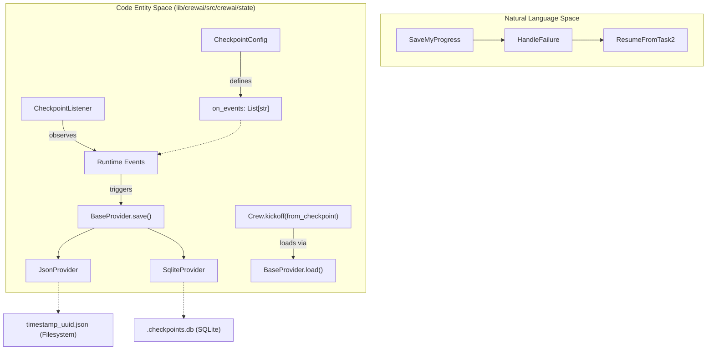
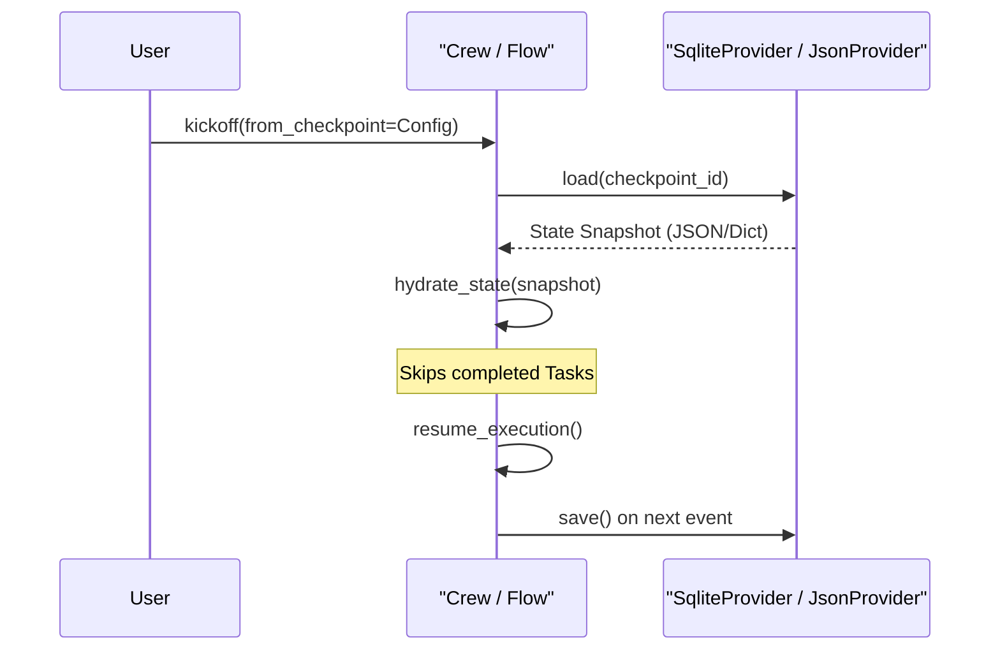
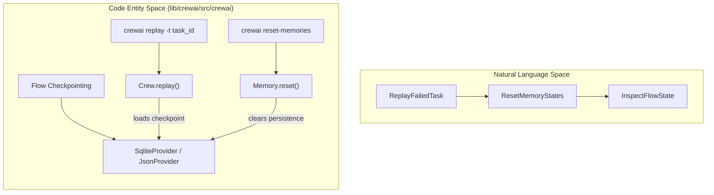

<!-- source: DeepWiki mcp.deepwiki.com · repo crewAIInc/crewAI · page 8.2 Checkpointing and Flow Recovery · fetched 2026-10-26 -->

# Checkpointing and Flow Recovery

<details>
<summary>Relevant source files</summary>

The following files were used as context for generating this wiki page:

- [docs/edge/ar/api-reference/resume.mdx](docs/edge/ar/api-reference/resume.mdx)
- [docs/edge/ar/concepts/checkpointing.mdx](docs/edge/ar/concepts/checkpointing.mdx)

</details>


Checkpointing in CrewAI provides an event-driven system for capturing the execution state of Crews, Flows, and Agents. It allows for automatic recovery after failures, long-running process interruption, or the creation of alternative execution branches (forking) without re-running completed work [docs/edge/ar/concepts/checkpointing.mdx:8-8]().

### Core Architecture and State Persistence

The checkpointing system is located in `lib/crewai/src/crewai/state/` and is built around a provider-based architecture that captures a snapshot of the execution. This snapshot includes the full configuration, agent memory, knowledge sources, task progress, intermediate outputs, and internal attributes [docs/edge/ar/concepts/checkpointing.mdx:27-29]().

#### Key Classes and Configuration
- **`CheckpointConfig`**: The primary configuration object used to define storage locations, event triggers, and retention policies [docs/edge/ar/concepts/checkpointing.mdx:20-21](), [docs/edge/ar/concepts/checkpointing.mdx:116-121]().
- **`CheckpointListener`**: Subscribes to runtime events and triggers the persistence logic [docs/edge/ar/concepts/checkpointing.mdx:33-35]().
- **`BaseProvider`**: An abstract interface for storage backends. CrewAI includes two native implementations:
    - **`JsonProvider`**: Writes individual JSON files per checkpoint, optimized for readability [docs/edge/ar/concepts/checkpointing.mdx:41-41](), [docs/edge/ar/concepts/checkpointing.mdx:127-139]().
    - **`SqliteProvider`**: Uses a single SQLite database with Write-Ahead Logging (WAL) enabled for concurrent reads/writes, optimized for high-frequency checkpointing [docs/edge/ar/concepts/checkpointing.mdx:42-42](), [docs/edge/ar/concepts/checkpointing.mdx:157-159]().

### Natural Language Space to Code Entity Space: Persistence Logic

The following diagram maps the conceptual "Save State" action to the specific code entities that manage the persistence lifecycle in `crewai/state/`.


Sources: [docs/edge/ar/concepts/checkpointing.mdx:27-44](), [docs/edge/ar/concepts/checkpointing.mdx:125-154]()

### Data Flow and Recovery Process

Checkpointing is **event-driven**. The runtime subscribes to events defined in the `on_events` parameter of `CheckpointConfig`. By default, the system uses `task_completed` to balance precision with performance [docs/edge/ar/concepts/checkpointing.mdx:33-35]().

#### Recovery and Forking
1. **Restore**: When a Flow or Crew is resumed using `from_checkpoint`, the system rehydrates the state, skips completed tasks, and restores agent memory [docs/edge/ar/concepts/checkpointing.mdx:31-31](), [docs/edge/ar/concepts/checkpointing.mdx:83-94]().
2. **Forking**: The `fork()` method allows restoring a checkpoint under a new lineage (branch). This prevents the new execution from overwriting the original run's checkpoints [docs/edge/ar/concepts/checkpointing.mdx:31-31](), [docs/edge/ar/concepts/checkpointing.mdx:175-185]().

**State Recovery Flow**

Sources: [docs/edge/ar/concepts/checkpointing.mdx:31-31](), [docs/edge/ar/concepts/checkpointing.mdx:83-94]()

### Natural Language Space to Code Entity Space: Flow Recovery & TUI Mapping

The following diagram maps user-facing recovery and CLI interaction concepts to their underlying code routines and management commands.


Sources: [docs/edge/ar/concepts/checkpointing.mdx:39-44]()

### Flow Checkpointing and SQLite Persistence

Flows integrate deeply with `crewai/state/` to persist typed state across steps. When utilizing `SqliteProvider`, SQLite Write-Ahead Logging (WAL) is enabled to allow high-frequency concurrent read and write operations without blocking execution threads [docs/edge/ar/concepts/checkpointing.mdx:157-159]().

```python
from crewai.flow.flow import Flow, start, listen
from crewai import CheckpointConfig
from crewai.state import SqliteProvider

class PersistedFlow(Flow):
    @start()
    def initialize_state(self):
        self.state.counter = 0
        return self.state.counter

    @listen(initialize_state)
    def increment_state(self, val):
        self.state.counter += 1
        return self.state.counter
```
Sources: [docs/edge/ar/concepts/checkpointing.mdx:200-221]()

### Checkpoint TUI and CLI Integration

The CrewAI CLI provides tools to manage the lifecycle of checkpoints and tasks. While the core checkpointing logic handles state, the CLI facilitates replaying and logging.

| Command | Purpose |
| :--- | :--- |
| `crewai replay -t <task_id>` | Re-executes a crew from a specific task ID, utilizing saved state for previous tasks. |
| `crewai log-tasks-outputs` | Retrieves the latest task outputs from the last `kickoff()`. |
| `crewai reset-memories` | Clears long-term, short-term, and entity memories, effectively resetting the agent state used in checkpoints. |

Sources: [docs/edge/ar/concepts/checkpointing.mdx:20-21]()

### Implementation Examples

#### Basic Checkpointing in a Crew
By setting `checkpoint=True`, a Crew defaults to using the `JsonProvider` saving to `./.checkpoints/` on every `task_completed` event [docs/edge/ar/concepts/checkpointing.mdx:101-106]().

```python
crew = Crew(
    agents=[researcher, writer],
    tasks=[task1, task2],
    checkpoint=True # Uses default JsonProvider
)
```
Sources: [docs/edge/ar/concepts/checkpointing.mdx:101-106]()

#### Advanced SQLite Configuration
For high-frequency events like `llm_call_completed`, the `SqliteProvider` is recommended to handle concurrent I/O efficiently [docs/edge/ar/concepts/checkpointing.mdx:141-154]().

```python
from crewai.state import SqliteProvider

checkpoint_config = CheckpointConfig(
    location="./state.db",
    provider=SqliteProvider(),
    on_events=["task_completed", "llm_call_completed"],
    max_checkpoints=50
)

crew = Crew(..., checkpoint=checkpoint_config)
```
Sources: [docs/edge/ar/concepts/checkpointing.mdx:141-154]()

#### Checkpointing in Flows
Flows can also implement checkpointing by passing a `CheckpointConfig` during initialization. This allows for state recovery across flow steps [docs/edge/ar/concepts/checkpointing.mdx:200-221]().

```python
from crewai.flow.flow import Flow, start, listen
from crewai import CheckpointConfig

class MyFlow(Flow):
    @start()
    def step_one(self):
        return "data"

    @listen(step_one)
    def step_two(self, data):
        return process(data)

flow = MyFlow(
    checkpoint=CheckpointConfig(
        location="./flow_cp",
        on_events=["method_execution_finished"]
    )
)
```
Sources: [docs/edge/ar/concepts/checkpointing.mdx:200-221]()

---

