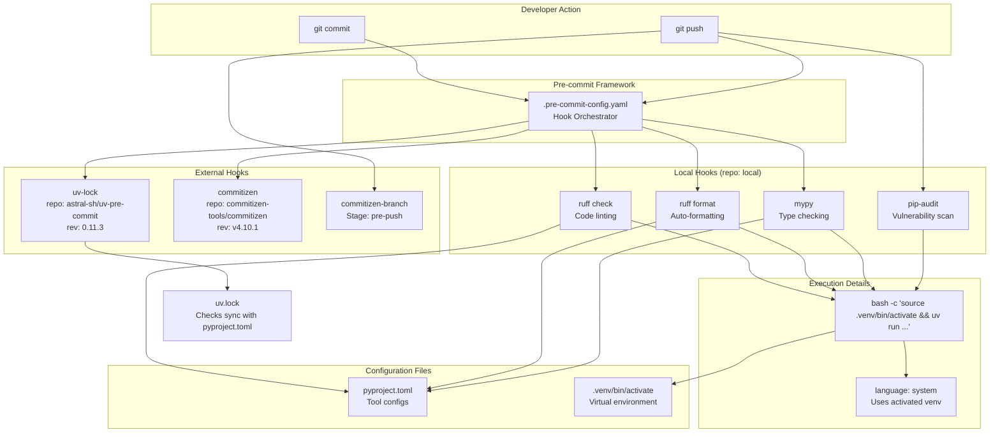
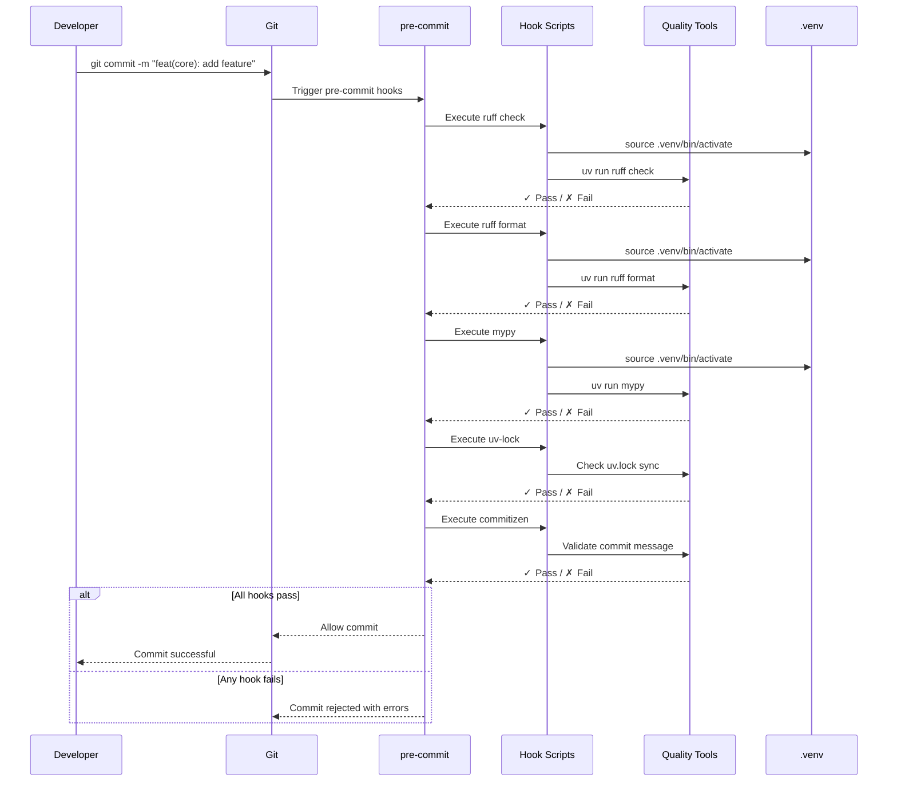
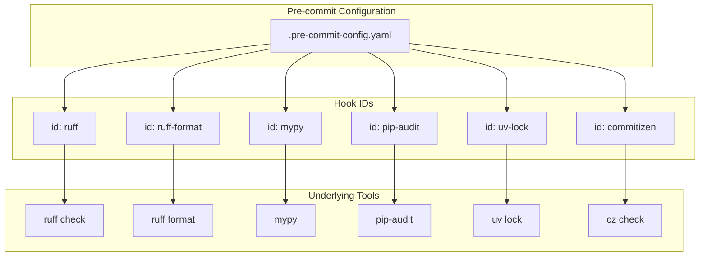

<!-- source: DeepWiki mcp.deepwiki.com · repo crewAIInc/crewAI · page 9.4 Pre-commit Hooks · fetched 2026-10-26 -->

# Pre-commit Hooks

<details>
<summary>Relevant source files</summary>

The following files were used as context for generating this wiki page:

- [.github/CONTRIBUTING.md](.github/CONTRIBUTING.md)
- [.pre-commit-config.yaml](.pre-commit-config.yaml)

</details>


This page documents the local quality gates enforced through pre-commit hooks before code is committed to the repository. These hooks provide immediate feedback to developers and ensure code quality standards are met before changes enter the CI/CD pipeline.

For information about the CI/CD workflows that run on pull requests, see **9.2 CI/CD Workflows**. For detailed configuration of individual tools, see **9.3 Code Quality Tools**.

## Purpose and Scope

Pre-commit hooks in CrewAI enforce six categories of quality checks on every commit or push:

1.  **Code Linting**: Detect style issues and potential bugs with `ruff check` [[.pre-commit-config.yaml:4-9]]().
2.  **Code Formatting**: Auto-format Python code with `ruff format` [[.pre-commit-config.yaml:10-15]]().
3.  **Type Checking**: Validate type annotations with `mypy` [[.pre-commit-config.yaml:16-22]]().
4.  **Dependency Integrity**: Ensure lock file synchronization with `uv-lock` [[.pre-commit-config.yaml:23-26]]().
5.  **Security Auditing**: Scan for known vulnerabilities in dependencies with `pip-audit` [[.pre-commit-config.yaml:29-62]]().
6.  **Commit Message Standards**: Validate commit message format with `commitizen` [[.pre-commit-config.yaml:63-68]]().

These hooks run automatically before each commit (or push for branch and security validation) and block the action if any check fails. Developers are explicitly instructed not to use `--no-verify` to skip these hooks [[.github/CONTRIBUTING.md:91]]().

## Pre-commit Hook Architecture

The pre-commit framework orchestrates local system tools and external repositories to validate changes.

### Pre-commit Workflow Diagram

**Sources:** [[.pre-commit-config.yaml:1-70]](), [[.github/CONTRIBUTING.md:59-69]]()

## Local Code Quality Hooks

### Ruff Check Hook
The `ruff` hook performs linting to detect code style issues, potential bugs, and enforce Python best practices. It is configured to use the project's `pyproject.toml` for rule selection [[.pre-commit-config.yaml:6]]().

**Key Characteristics:**
- **Execution**: Runs via `uv run` after activating the local virtual environment [[.pre-commit-config.yaml:6]]().
- **Scope**: All Python files passed as arguments during the commit process [[.pre-commit-config.yaml:8-9]]().
- **Manual Command**: `uv run ruff check lib/` [[.github/CONTRIBUTING.md:62]]().

**Sources:** [[.pre-commit-config.yaml:4-9]](), [[.github/CONTRIBUTING.md:62]]()

### Ruff Format Hook
The `ruff-format` hook automatically formats Python code to maintain consistent style across the codebase, specifically adhering to the Google-style docstrings and built-in generics requirements [[.github/CONTRIBUTING.md:71-78]]().

**Key Characteristics:**
- **Execution**: Uses `uv run ruff format` with the project-wide `pyproject.toml` configuration [[.pre-commit-config.yaml:12]]().
- **Target**: Operates on all modified Python files [[.pre-commit-config.yaml:14-15]]().
- **Manual Command**: `uv run ruff format lib/` [[.github/CONTRIBUTING.md:64]]().

**Sources:** [[.pre-commit-config.yaml:10-15]](), [[.github/CONTRIBUTING.md:64]]()

### Mypy Type Checking Hook
The `mypy` hook validates type annotations to ensure type safety across the monorepo. The project enforces strict mypy checks [[.github/CONTRIBUTING.md:126]]().

**Excluded Directories:**
To maintain performance and avoid checking non-source or template code, several paths are excluded from pre-commit type checking:
- `lib/crewai/src/crewai/cli/templates/` [[.pre-commit-config.yaml:22]]()
- `lib/cli/src/crewai_cli/templates/` [[.pre-commit-config.yaml:22]]()
- `lib/cli/tests/` [[.pre-commit-config.yaml:22]]()
- `lib/crewai/tests/` [[.pre-commit-config.yaml:22]]()
- `lib/crewai-tools/tests/` [[.pre-commit-config.yaml:22]]()
- `lib/crewai-files/tests/` [[.pre-commit-config.yaml:22]]()
- `lib/devtools/tests/` [[.pre-commit-config.yaml:22]]()

**Sources:** [[.pre-commit-config.yaml:16-22]](), [[.github/CONTRIBUTING.md:66]]()

## Security and Dependency Management

### Pip Audit Hook
The `pip-audit` hook scans the environment for known vulnerabilities. It is configured to run during the `pre-push` stage or manually [[.pre-commit-config.yaml:63]]().

**Configuration:**
- **Exclusions**: It ignores specific vulnerability IDs (e.g., `PYSEC-2024-277`, `GHSA-f4j7-r4q5-qw2c`) that have been triaged by the team [[.pre-commit-config.yaml:34-60]]().
- **Sync**: The ignore list is kept in sync with the `vulnerability-scan.yml` CI workflow [[.pre-commit-config.yaml:31]]().
- **Flags**: Uses `--skip-editable` to focus on external dependencies [[.pre-commit-config.yaml:33]]().

**Sources:** [[.pre-commit-config.yaml:29-63]]()

### UV Lock Hook
The `uv-lock` hook ensures that the `uv.lock` file is up-to-date with changes in `pyproject.toml`. This prevents broken builds in CI due to out-of-sync dependency locks [[.pre-commit-config.yaml:23-26]](). UV is the mandatory dependency manager for the project [[.github/CONTRIBUTING.md:16]]().

**Sources:** [[.pre-commit-config.yaml:23-26]](), [[.github/CONTRIBUTING.md:150-163]]()

## Commit Message Validation

### Commitizen Hooks
CrewAI uses Commitizen to enforce the [Conventional Commits](https://www.conventionalcommits.org) standard [[.github/CONTRIBUTING.md:80-82]]().

**Two-Stage Validation:**
1.  **Commit Stage**: The `commitizen` hook validates the message format of the current commit [[.pre-commit-config.yaml:67]]().
2.  **Push Stage**: The `commitizen-branch` hook validates the branch naming conventions before pushing to remote [[.pre-commit-config.yaml:68-69]]().

**Required Format:**
```
<type>(<optional scope>): <lowercase description>
```
Valid types include: `feat`, `fix`, `docs`, `style`, `refactor`, `perf`, `test`, `chore`, `ci` [[.github/CONTRIBUTING.md:53]]().

**Sources:** [[.pre-commit-config.yaml:63-70]](), [[.github/CONTRIBUTING.md:45-56]](), [[.github/CONTRIBUTING.md:80-98]]()

## Development Workflow Integration

### Setup and Installation
To enable the hooks locally, developers must install `pre-commit` and run the install command after syncing the environment:
```bash
uv sync --all-groups --all-extras
uv run pre-commit install
```
**Sources:** [[.github/CONTRIBUTING.md:21-28]]()

### Commit Validation Sequence

**Sources:** [[.pre-commit-config.yaml:1-70]](), [[.github/CONTRIBUTING.md:59-69]]()

## Configuration Mapping

The following diagram maps the `pre-commit` configuration to the specific code entities and tools they invoke.

### Configuration to Code Entity Mapping

**Sources:** [[.pre-commit-config.yaml:1-70]]()

---

