# Page: Introduction to CrewAI

# Introduction to CrewAI

<details>
<summary>Relevant source files</summary>

The following files were used as context for generating this wiki page:

- [README.md](README.md)
- [docs/edge/ar/index.mdx](docs/edge/ar/index.mdx)
- [docs/edge/ar/introduction.mdx](docs/edge/ar/introduction.mdx)

</details>


## Purpose and Scope

This document provides a high-level overview of the CrewAI framework, its architectural philosophy, and the structure of its codebase. It covers the fundamental distinction between **Crews** (autonomous agent teams) and **Flows** (event-driven orchestration), explains the monorepo organization, and introduces core packages and components.

As a parent page, this document keeps technical details high-level and delegates deep-dive explanations to child pages:
- For workspace layout and uv workspace management, see [Workspace and Monorepo Architecture](#1.1).
- For internal package structures, optional extras, and version synchronization, see [Package Structure and Dependencies](#1.2).
- For fundamental runtime concepts like Agents, Tasks, Crews, Flows, and Memory, see [Core Concepts Overview](#1.3).

Sources: [README.md:56-65](), [docs/edge/ar/introduction.mdx:10-18]()

## What is CrewAI?

CrewAI is an open-source Python framework designed for building production-ready multi-agent workflows. It provides high-level abstractions and low-level APIs to enable autonomous agent collaboration and precise, event-driven control [README.md:58-60]().

**Key Characteristics:**
- **Framework Type:** Multi-agent automation framework [README.md:56-58]().
- **Language Target:** Python 3.10–3.14 (development targets 3.12) [.github/CONTRIBUTING.md:15]().
- **License:** MIT [README.md:39-41]().
- **Package Manager:** `uv` workspace and dependency management [.github/CONTRIBUTING.md:16]().

Sources: [README.md:56-65](), [.github/CONTRIBUTING.md:13-17]()

## Core Architecture Philosophy: Crews vs Flows

CrewAI balances autonomy with determinism by separating collaborative agent intelligence from event-driven control flow [docs/edge/ar/introduction.mdx:27-29]().

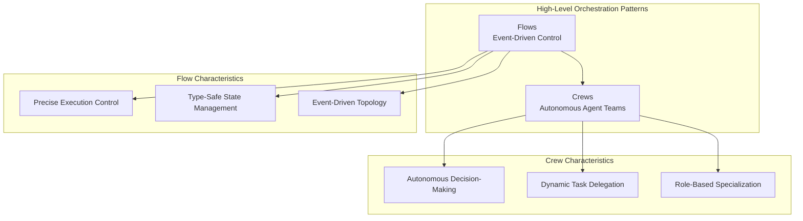

**Comparison Table:**

| Feature | Crews | Flows |
| :--- | :--- | :--- |
| **Primary Goal** | Autonomous Collaboration [README.md:61]() | Event-Driven Control [README.md:62]() |
| **State** | Managed via Task context | Persistent State Management [docs/edge/ar/introduction.mdx:42]() |
| **Logic** | Role-based delegation [docs/edge/ar/introduction.mdx:59]() | Conditional branching, loops [docs/edge/ar/introduction.mdx:44]() |
| **Unit of Work** | `Task` | `Step` (can be a Crew or Python function) |

Sources: [README.md:56-65](), [docs/edge/ar/introduction.mdx:27-69]()

## Monorepo and Package Architecture

CrewAI is structured as a monorepo managed via `uv` workspaces under the `lib/` directory [.github/CONTRIBUTING.md:30-32](). The repository contains several internal packages (`crewai`, `crewai-tools`, `crewai-files`, `crewai-core`, `cli`, `devtools`) that separate concerns between core execution, tool integrations, file handling, and developer tooling.

For complete details on internal packages, optional extras, and workspace dependency management, see [Workspace and Monorepo Architecture](#1.1) and [Package Structure and Dependencies](#1.2).

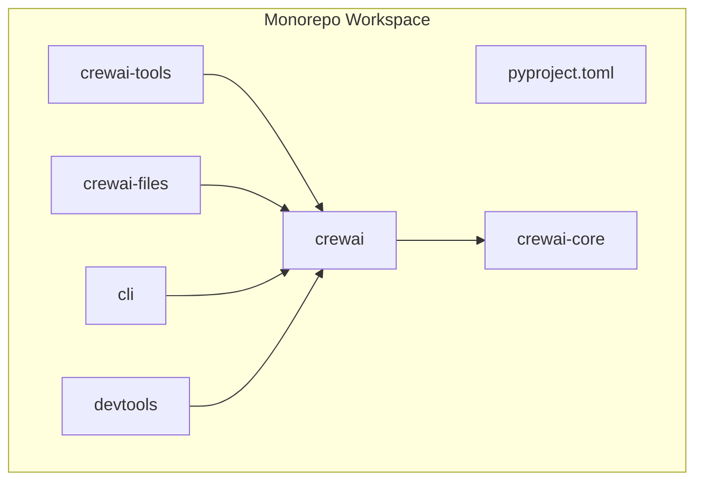

Sources: [.github/CONTRIBUTING.md:30-40]()

## Core Concepts Overview

CrewAI revolves around several interconnected primitives that bridge natural language requirements to precise code entities. 

For a deep dive into how Agents, Tasks, Crews, Flows, Processes, and Memory relate at runtime, see [Core Concepts Overview](#1.3).

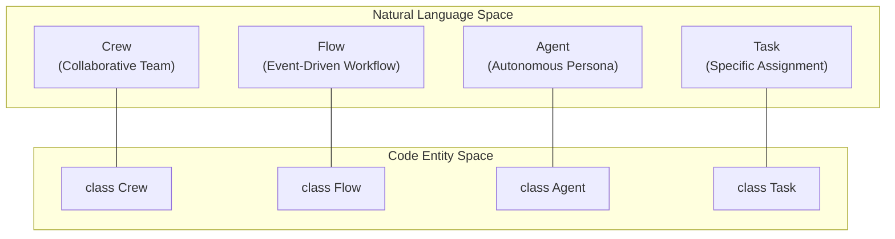

Sources: [.github/CONTRIBUTING.md:36](), [docs/edge/ar/introduction.mdx:14-15]()

## Enterprise and Deployment (AMP)

For production environments requiring commercial control planes, monitoring, and governance, CrewAI provides the **CrewAI AMP Suite** [README.md:69](). AMP offers managed cloud or on-premise deployments [README.md:81](), real-time tracing [README.md:75](), role-based access control, and enterprise integration connectors [README.md:77]().

Sources: [README.md:67-84]()

---

# Page: Workspace and Monorepo Architecture

# Workspace and Monorepo Architecture

<details>
<summary>Relevant source files</summary>

The following files were used as context for generating this wiki page:

- [.github/CONTRIBUTING.md](.github/CONTRIBUTING.md)
- [.github/codeql/codeql-config.yml](.github/codeql/codeql-config.yml)
- [AGENTS.md](AGENTS.md)

</details>


## Purpose and Scope

This document describes the UV-based workspace architecture of the CrewAI repository, including the internal framework packages (`crewai`, `crewai-tools`, `crewai-files`, `crewai-core`, `cli`, `devtools`), their dependency relationships, and how development tooling is configured at the workspace level. This architecture enables a monorepo workflow where multiple interdependent packages are developed, tested, and versioned in a unified environment.

Sources: [.github/CONTRIBUTING.md:1-40](), [.github/codeql/codeql-config.yml:1-33]()

## Workspace Structure

CrewAI uses [UV](https://github.com/astral-sh/uv) as its workspace manager, defining a monorepo with packages managed under the `lib/` directory [.github/CONTRIBUTING.md:30-40](). The workspace configuration ensures that all internal packages can reference each other as editable workspace members during development.

### Physical Directory Layout

The following diagram maps the physical file structure to the logical package entities defined in the codebase.

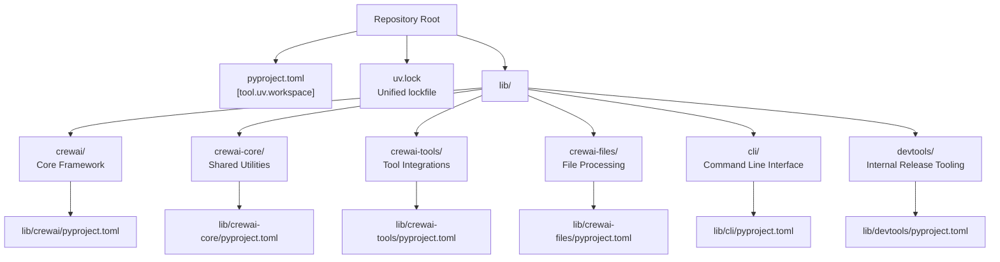

All workspace members share a single `uv.lock` file at the repository root, ensuring consistent dependency resolution across the entire suite of packages.

Sources: [.github/CONTRIBUTING.md:30-40](), [.github/codeql/codeql-config.yml:21-26]()

## Package Dependency Graph

The workspace packages are architected with specific inter-dependencies to maintain a separation of concerns between the core orchestration engine, shared utilities, external tool integrations, and multimodal file handling.

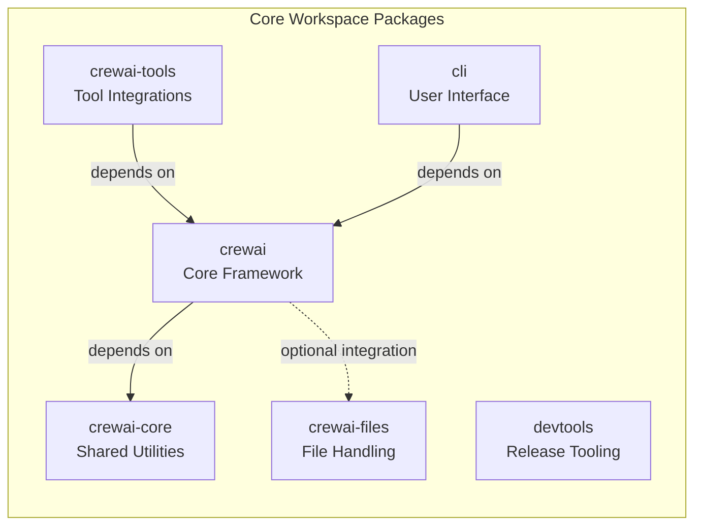

| Package | Path | Description |
| :--- | :--- | :--- |
| `crewai` | `lib/crewai/` | The core framework containing orchestration logic for Agents, Tasks, and Crews [.github/CONTRIBUTING.md:36](). |
| `crewai-core` | `lib/crewai-core/` | Shared utilities, base models, and internal logic used across the ecosystem [.github/codeql/codeql-config.yml:23](). |
| `crewai-tools` | `lib/crewai-tools/` | A collection of tool integrations and the `BaseTool` interface [.github/CONTRIBUTING.md:37](). |
| `crewai-files` | `lib/crewai-files/` | Specialized package for multimodal file handling and processing [.github/CONTRIBUTING.md:38](). |
| `cli` | `lib/cli/` | Command-line interface for project scaffolding, execution, and deployment [.github/codeql/codeql-config.yml:21](). |
| `devtools` | `lib/devtools/` | Internal utilities for release management and repository maintenance [.github/CONTRIBUTING.md:39](). |

Sources: [.github/CONTRIBUTING.md:34-40](), [.github/codeql/codeql-config.yml:21-26]()

## Development Workflow and Dependency Management

The monorepo uses `uv` to manage both runtime and development dependencies. Development tools are installed at the workspace level to ensure consistent linting and testing environments [.github/CONTRIBUTING.md:13-28]().

### Code Quality Stack

The repository enforces strict code quality standards through a centralized configuration in the root and package-level `pyproject.toml` files.

*   **Linting & Formatting**: `ruff` is used for linting and formatting across the `lib/` directory [.github/CONTRIBUTING.md:61-64]().
*   **Static Type Checking**: `mypy` is used for strict type checking. CI runs mypy on Python versions 3.10 through 3.13 for every PR [.github/CONTRIBUTING.md:126-137]().
*   **Git Hooks**: `pre-commit` is used to run `ruff` and `mypy` automatically before commits [.github/CONTRIBUTING.md:27-28]().

### Dependency Commands

Developers use the following `uv` commands to manage the workspace:

| Action | Command |
| :--- | :--- |
| **Initial Setup** | `uv sync --all-groups --all-extras` [.github/CONTRIBUTING.md:25]() |
| **Install Hooks** | `uv run pre-commit install` [.github/CONTRIBUTING.md:27]() |
| **Add Runtime Dep** | `uv add --package crewai <package>` [.github/CONTRIBUTING.md:155]() |
| **Add Dev Dep** | `uv add --dev <package>` [.github/CONTRIBUTING.md:158]() |
| **Run Tests** | `uv run pytest lib/crewai/tests/` [.github/CONTRIBUTING.md:113]() |

Sources: [.github/CONTRIBUTING.md:19-28](), [.github/CONTRIBUTING.md:57-69](), [.github/CONTRIBUTING.md:124-136](), [.github/CONTRIBUTING.md:150-161]()

## Continuous Integration and Security

The monorepo architecture is supported by automated workflows that validate code changes across all packages.

*   **CodeQL Analysis**: Configured to include all source code from `lib/cli/src/**`, `lib/crewai/src/**`, `lib/crewai-core/src/**`, `lib/crewai-tools/src/**`, `lib/crewai-files/src/**`, and `lib/devtools/src/**` [.github/codeql/codeql-config.yml:21-26](). It explicitly ignores experimental features like `a2a` (Agent-to-Agent) and test cassettes to focus on core logic [.github/codeql/codeql-config.yml:3-14]().
*   **Test Isolation**: Tests are organized by package, allowing for targeted execution (e.g., `uv run pytest lib/crewai-tools/tests/`) [.github/CONTRIBUTING.md:109-123]().

Sources: [.github/codeql/codeql-config.yml:1-33](), [.github/CONTRIBUTING.md:109-123]()

---

# Page: Package Structure and Dependencies

# Package Structure and Dependencies

<details>
<summary>Relevant source files</summary>

The following files were used as context for generating this wiki page:

- [.github/CONTRIBUTING.md](.github/CONTRIBUTING.md)
- [docs/edge/ar/installation.mdx](docs/edge/ar/installation.mdx)

</details>


This document details the internal package structure of the CrewAI monorepo, dependency relationships between packages, external dependencies, the optional extras system, and version synchronization mechanisms. For information about the monorepo workspace configuration and development tooling, see [Workspace and Monorepo Architecture](1.1). For dependency management with `uv` in user projects, see [Dependency Management with UV](8.3).

## Package Overview

The CrewAI monorepo is managed as a `uv` workspace containing four primary internal packages located in the `lib/` directory. These packages are developed in tandem to provide the core framework, specialized tools, and utility services.

Title: Monorepo Workspace Structure
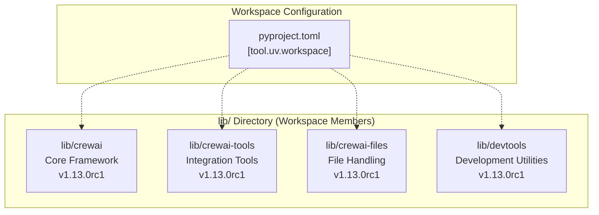

**Sources:** [.github/CONTRIBUTING.md:30-40](), [lib/crewai/src/crewai/__init__.py:45](), [lib/devtools/src/crewai_devtools/__init__.py:3](), [lib/crewai-files/src/crewai_files/__init__.py:155]()

The workspace members serve the following roles:

| Package | Path | Version | Purpose |
|---------|------|---------|---------|
| `crewai` | `lib/crewai` | 1.13.0rc1 | Primary framework containing `Agent`, `Task`, `Crew`, and `Flow` implementations. |
| `crewai-tools` | `lib/crewai-tools` | 1.13.0rc1 | A collection of 100+ pre-built tools for agents (Web search, DBs, etc.). |
| `crewai-files` | `lib/crewai-files` | 1.13.0rc1 | Multimodal file handling and provider-specific constraint management. |
| `crewai-devtools` | `lib/devtools` | 1.13.0rc1 | Internal tooling for releases, testing, and development automation. |

**Sources:** [.github/CONTRIBUTING.md:32-40]()

## Package Dependency Graph

The following diagram illustrates the dependency flow within the monorepo and how external user projects consume these packages.

Title: Internal and External Dependency Flow
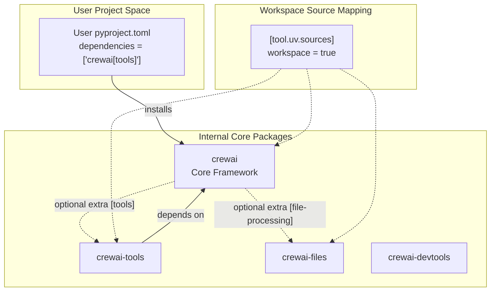

**Sources:** [.github/CONTRIBUTING.md:32-40](), [.github/CONTRIBUTING.md:150-161]()

### Key Dependency Characteristics

- **Tight Coupling of Tools**: `crewai-tools` depends directly on `crewai` to ensure that tool schemas and execution logic remain compatible with the core agent executor.
- **Multimodal Integration**: The `crewai-files` package provides the logic for handling complex file types (images, audio) and is integrated into `crewai` via the `file-processing` extra [lib/crewai-files/src/crewai_files/__init__.py:85-155]().
- **Local Development**: When developing inside the monorepo, `uv` uses workspace sources to link packages locally, ensuring changes in `crewai` are immediately available to `crewai-tools` [.github/CONTRIBUTING.md:150-161]().

**Sources:** [.github/CONTRIBUTING.md:32-40](), [.github/CONTRIBUTING.md:150-161](), [lib/crewai-files/src/crewai_files/__init__.py:85-155]()

## Core Framework Structure

The `crewai` package is organized into functional modules that handle specific aspects of agentic orchestration.

Title: Core Framework Internal Organization
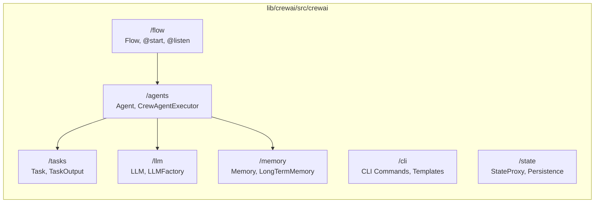

**Sources:** [.github/CONTRIBUTING.md:32-36](), [.github/codeql/codeql-config.yml:21]()

### External Core Dependencies

The framework leverages several critical third-party libraries:
- **Pydantic**: Used for all configuration objects, state management, and data validation [lib/crewai/src/crewai/agents/agent_builder/base_agent.py:1-50]().
- **Instructor**: Facilitates structured outputs from LLMs.
- **LanceDB / ChromaDB**: Default backends for the memory system.
- **Textual**: Powers the interactive Checkpoint TUI for Flow recovery.

**Sources:** [lib/crewai/src/crewai/agents/agent_builder/base_agent.py:1-50]()

## Optional Extras System

CrewAI utilizes an "extras" system to keep the base installation lightweight. Users install specific groups of dependencies based on their needs.

| Extra Name | Purpose | Key Dependencies |
|------------|---------|------------------|
| `tools` | Integration tools | `crewai-tools` |
| `file-processing` | Multimodal support | `crewai-files` |
| `mem0` | Advanced memory | `mem0ai` |
| `qdrant` | Vector storage | `qdrant-client` |
| `a2a` | Agent-to-Agent protocol | `pydantic`, `nkeys` |
| `google-genai` | Google models | `google-generativeai` |

**Sources:** [.github/CONTRIBUTING.md:25](), [.github/codeql/codeql-config.yml:14]()

## Files Package: `crewai-files`

The `crewai-files` package is a specialized utility for multimodal inputs. It manages the lifecycle of files and ensures they meet provider-specific requirements.

- **Entity Definitions**: Defines `ImageFile`, `AudioFile`, `VideoFile`, and `PDFFile` [lib/crewai-files/src/crewai_files/__init__.py:92-131]().
- **Provider Constraints**: Contains hardcoded limits for different LLM providers (e.g., `OPENAI_CONSTRAINTS`, `ANTHROPIC_CONSTRAINTS`) to prevent API errors during file uploads [lib/crewai-files/src/crewai_files/__init__.py:86-89]().
- **Resolution Logic**: The `FileResolver` class handles the mapping of file paths to provider-ready objects [lib/crewai-files/src/crewai_files/__init__.py:105-144]().

**Sources:** [lib/crewai-files/src/crewai_files/__init__.py:85-155]()

## Version Synchronization

To maintain stability across the ecosystem, all internal packages are version-locked. When a new version of the core framework is released, all sibling packages are updated to the same version number.

Title: Monorepo Version Lock
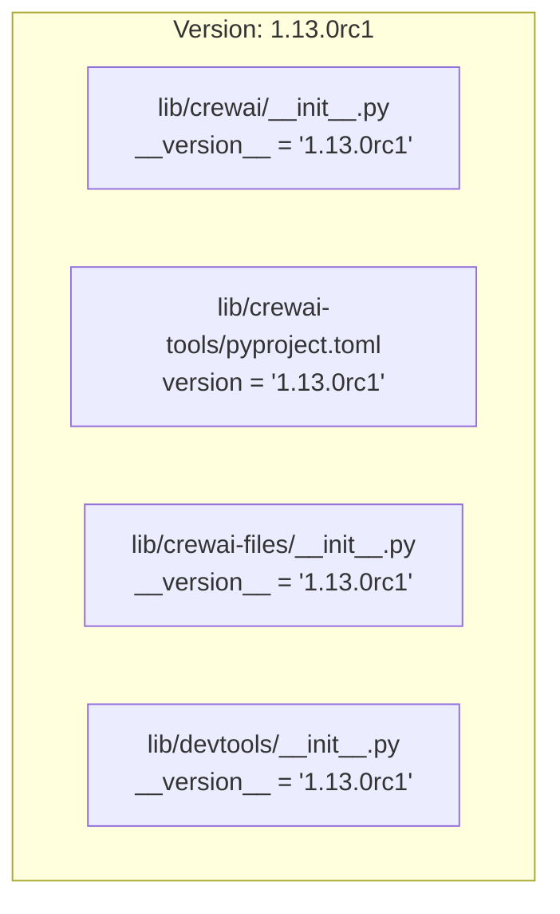

**Sources:** [lib/crewai/src/crewai/__init__.py:45](), [lib/crewai-files/src/crewai_files/__init__.py:155](), [lib/devtools/src/crewai_devtools/__init__.py:3]()

---

# Page: Core Concepts Overview

# Core Concepts Overview

<details>
<summary>Relevant source files</summary>

The following files were used as context for generating this wiki page:

- [docs/edge/ar/concepts/agents.mdx](docs/edge/ar/concepts/agents.mdx)
- [docs/edge/ar/concepts/crews.mdx](docs/edge/ar/concepts/crews.mdx)
- [docs/edge/ar/concepts/flows.mdx](docs/edge/ar/concepts/flows.mdx)
- [docs/edge/ar/concepts/processes.mdx](docs/edge/ar/concepts/processes.mdx)

</details>


## Purpose and Scope

This page introduces the fundamental building blocks of the CrewAI framework and explains how they relate to each other. These concepts form the foundation for building multi-agent AI systems in CrewAI.

Core concepts covered:
- **Agents**: Autonomous AI entities with defined roles, goals, and backstories [docs/edge/ar/concepts/agents.mdx:10-17]().
- **Tasks**: Units of work with clear descriptions and expected outputs [docs/edge/ar/concepts/tasks.mdx:10-15]().
- **Crews**: Orchestration mechanism for teams of agents executing tasks [docs/edge/ar/concepts/crews.mdx:10-12]().
- **Processes**: Execution strategies (Sequential, Hierarchical) that determine task delegation [docs/edge/ar/concepts/processes.mdx:17-18]().
- **Flows**: Event-driven orchestration for production workflows and state management [docs/edge/ar/concepts/flows.mdx:10-12]().
- **Memory**: Context preservation and knowledge sharing across executions [docs/edge/ar/concepts/memory.mdx:10-12]().

---

## Conceptual Architecture

CrewAI provides two complementary orchestration paradigms: **Crews** for autonomous agent collaboration and **Flows** for controlled workflow orchestration. Both leverage the same underlying primitives: Agents and Tasks.

### High-Level Component Relationships

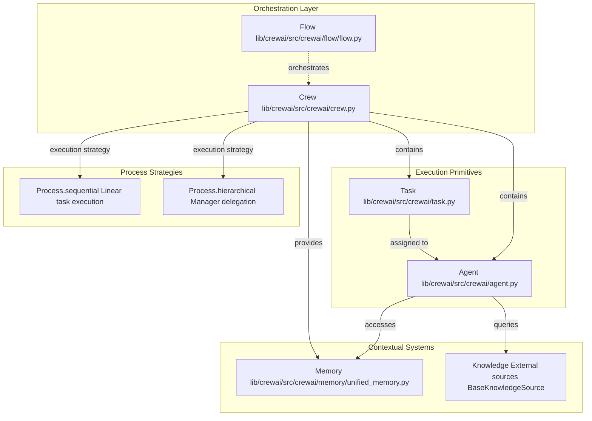

Sources: [docs/edge/ar/concepts/flows.mdx:10-21](), [docs/edge/ar/concepts/crews.mdx:14-35](), [docs/edge/ar/concepts/memory.mdx:10-13]()

---

## Agents: Autonomous AI Entities

Agents are the fundamental execution units. In CrewAI, an `Agent` is a specialized unit capable of making decisions based on its role and goal, using tools, and collaborating with others [docs/edge/ar/concepts/agents.mdx:10-17]().

### Agent Core Attributes

| Attribute | Parameter | Type | Purpose |
|-----------|-----------|------|---------|
| **Role** | `role` | `str` | Defines function and expertise [docs/edge/ar/concepts/agents.mdx:42](). |
| **Goal** | `goal` | `str` | Individual objective guiding decisions [docs/edge/ar/concepts/agents.mdx:43](). |
| **Backstory** | `backstory` | `str` | Provides context and personality [docs/edge/ar/concepts/agents.mdx:44](). |
| **LLM** | `llm` | `Union[str, LLM, Any]` | The language model powering the agent [docs/edge/ar/concepts/agents.mdx:45](). |
| **Tools** | `tools` | `List[BaseTool]` | Capabilities available to the agent [docs/edge/ar/concepts/agents.mdx:46](). |
| **Memory** | `memory` | `bool` | Whether the agent uses memory [docs/edge/ar/concepts/agents.mdx:16](). |

### Agent Class Hierarchy

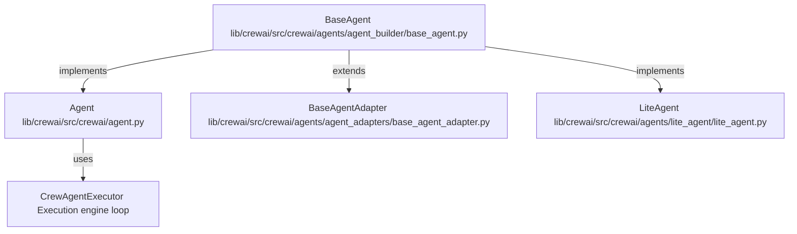

Sources: [docs/edge/ar/concepts/agents.mdx:40-69](), [docs/edge/ar/concepts/agents.mdx:10-17]()

---

## Tasks: Units of Work

A `Task` is a specific assignment completed by an agent. It provides all necessary details for execution, including description and expected output [docs/edge/ar/concepts/tasks.mdx:10-12]().

### Task Core Attributes

| Attribute | Parameter | Type | Purpose |
|-----------|-----------|------|---------|
| **Description** | `description` | `str` | Clear statement of what the task entails [docs/edge/ar/concepts/tasks.mdx:50](). |
| **Expected Output** | `expected_output` | `str` | Detailed description of completion criteria [docs/edge/ar/concepts/tasks.mdx:51](). |
| **Agent** | `agent` | `Optional[BaseAgent]` | Responsible agent for the task [docs/edge/ar/concepts/tasks.mdx:53](). |
| **Context** | `context` | `List[Task]` | Tasks whose output is used as context [docs/edge/ar/concepts/tasks.mdx:55](). |
| **Guardrail** | `guardrail` | `Callable` | Function to validate task output [docs/edge/ar/concepts/tasks.mdx:65](). |

### Task Execution Flow

Tasks can be executed **Sequentially** (in order of definition) or **Hierarchically** (assigned by a manager based on expertise) [docs/edge/ar/concepts/tasks.mdx:31-35]().

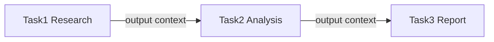

Sources: [docs/edge/ar/concepts/tasks.mdx:48-67](), [docs/edge/ar/concepts/tasks.mdx:31-35]()

---

## Crews: Agent Team Orchestration

A `Crew` represents a collaborative group of agents working together to achieve a set of tasks. It defines the execution strategy and overall workflow [docs/edge/ar/concepts/crews.mdx:10]().

### Crew Class Structure

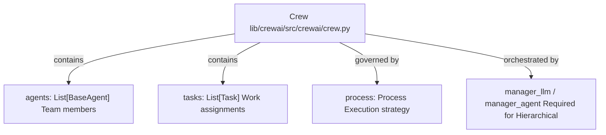

### Key Execution Methods
- `kickoff()`: Starts the crew execution [docs/edge/ar/concepts/crews.mdx:47]().
- `kickoff_async()`: Non-blocking execution.
- `train()`: Training the crew on specific data.

Sources: [docs/edge/ar/concepts/crews.mdx:14-35](), [docs/edge/ar/concepts/crews.mdx:41-47]()

---

## Processes: Execution Strategies

Processes coordinate task execution, similar to project management in human teams [docs/edge/ar/concepts/processes.mdx:11]().

| Process Type | Description | Requirements |
|--------------|-------------|--------------|
| **Sequential** | Tasks are executed one after another in the defined order [docs/edge/ar/concepts/processes.mdx:17](). | Default process. |
| **Hierarchical** | Tasks are delegated by a manager agent based on agent skills [docs/edge/ar/concepts/processes.mdx:18](). | Requires `manager_llm` or `manager_agent` [docs/edge/ar/concepts/processes.mdx:18](). |

Sources: [docs/edge/ar/concepts/processes.mdx:15-18](), [docs/edge/ar/concepts/processes.mdx:36-46]()

---

## Flows: Event-Driven Orchestration

Flows allow developers to combine multiple crews and custom logic into a structured, event-driven workflow. They provide built-in state management and execution control [docs/edge/ar/concepts/flows.mdx:10-12]().

### Flow Components
- **State**: A type-safe Pydantic model shared across the flow [docs/edge/ar/concepts/flows.mdx:188-192]().
- **@start()**: Defines entry points [docs/edge/ar/concepts/flows.mdx:102]().
- **@listen()**: Triggers methods based on the completion of others [docs/edge/ar/concepts/flows.mdx:110]().
- **@router()**: Implements conditional branching logic.

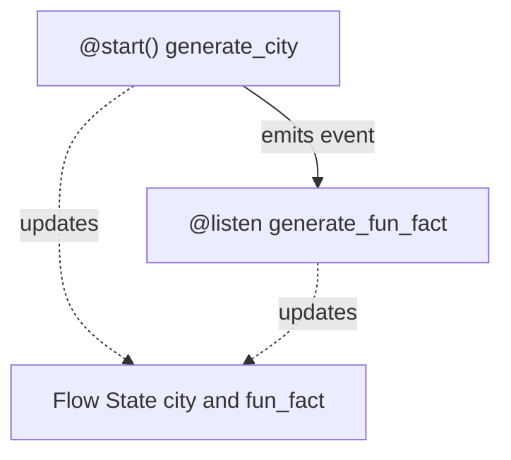

Sources: [docs/edge/ar/concepts/flows.mdx:28-84](), [docs/edge/ar/concepts/flows.mdx:100-113]()

---

## Memory: Context Preservation

CrewAI features a **Unified Memory System** that uses an LLM to analyze and store content with inferred scope and importance [docs/edge/ar/concepts/memory.mdx:10]().

### Hierarchical Scopes
Memories are organized in a tree-like structure (e.g., `/project/alpha`, `/agent/researcher`), providing context-aware retrieval [docs/edge/ar/concepts/memory.mdx:163-180]().

### Memory Operations
- `remember(content, scope)`: Stores information; LLM infers metadata [docs/edge/ar/concepts/memory.mdx:22]().
- `recall(query)`: Retrieves ranked matches based on semantic similarity, recency, and importance [docs/edge/ar/concepts/memory.mdx:25]().
- `extract_memories(text)`: Extracts atomic facts from raw text [docs/edge/ar/concepts/memory.mdx:65]().

Sources: [docs/edge/ar/concepts/memory.mdx:10-12](), [docs/edge/ar/concepts/memory.mdx:16-38](), [docs/edge/ar/concepts/memory.mdx:163-180]()

---

## Code Entity Reference

| Concept | Class / Interface | File Path |
|---------|-------------------|-----------|
| **Agent** | `Agent` | [lib/crewai/src/crewai/agent.py:1-96]() |
| **Task** | `Task` | [lib/crewai/src/crewai/task.py:1-120]() |
| **Crew** | `Crew` | [lib/crewai/src/crewai/crew.py:129-306]() |
| **Flow** | `Flow` | [lib/crewai/src/crewai/flow/flow.py:1-47]() |
| **Process** | `Process` (Enum) | [lib/crewai/src/crewai/process.py:1-11]() |
| **Memory** | `Memory` | [lib/crewai/src/crewai/memory/unified_memory.py:1-50]() |

Sources: [docs/edge/ar/concepts/agents.mdx:40-69](), [docs/edge/ar/concepts/tasks.mdx:48-67](), [docs/edge/ar/concepts/crews.mdx:14-35]()

---

# Page: Crews: Autonomous Agent Orchestration

# Crews: Autonomous Agent Orchestration

<details>
<summary>Relevant source files</summary>

The following files were used as context for generating this wiki page:

- [docs/edge/ar/concepts/collaboration.mdx](docs/edge/ar/concepts/collaboration.mdx)
- [docs/edge/ar/concepts/crews.mdx](docs/edge/ar/concepts/crews.mdx)

</details>


## Purpose and Scope

This page provides a high-level overview of **Crews**, CrewAI's primary mechanism for orchestrating teams of autonomous AI agents to collaborate, execute tasks, and achieve complex goals [lib/crewai/src/crewai/crew.py:136-172](). As a parent architectural overview, this page introduces the core components of crew orchestration and links to specialized child pages for deep technical details.

For detailed information on specific subsystems, refer to the child pages:
- **Crew Configuration & Orchestration**: See [Crew Configuration and Orchestration](#2.1)
- **Agents**: See [Agents](#2.2)
- **Tasks**: See [Tasks](#2.3)
- **Agent-to-Agent (A2A) Protocol**: See [Agent-to-Agent (A2A) Protocol](#2.4)
- **Human-in-the-Loop & Collaboration**: See [Human-in-the-Loop and Collaboration](#2.5)
- **Agent Evaluation & Testing**: See [Agent Evaluation and Testing](#2.6)
- **Agent Skills**: See [Agent Skills](#2.7)

**Sources**: [lib/crewai/src/crewai/crew.py:136-172]()

---

## Crew System Architecture

The Crew system coordinates multi-agent workflows through three primary abstractions: `Crew`, `BaseAgent`, and `Task` [lib/crewai/src/crewai/crew.py:136-172](), [lib/crewai/src/crewai/agents/agent_builder/base_agent.py:73-121](), [lib/crewai/src/crewai/task.py:87-110]().

### Crew Class Hierarchy

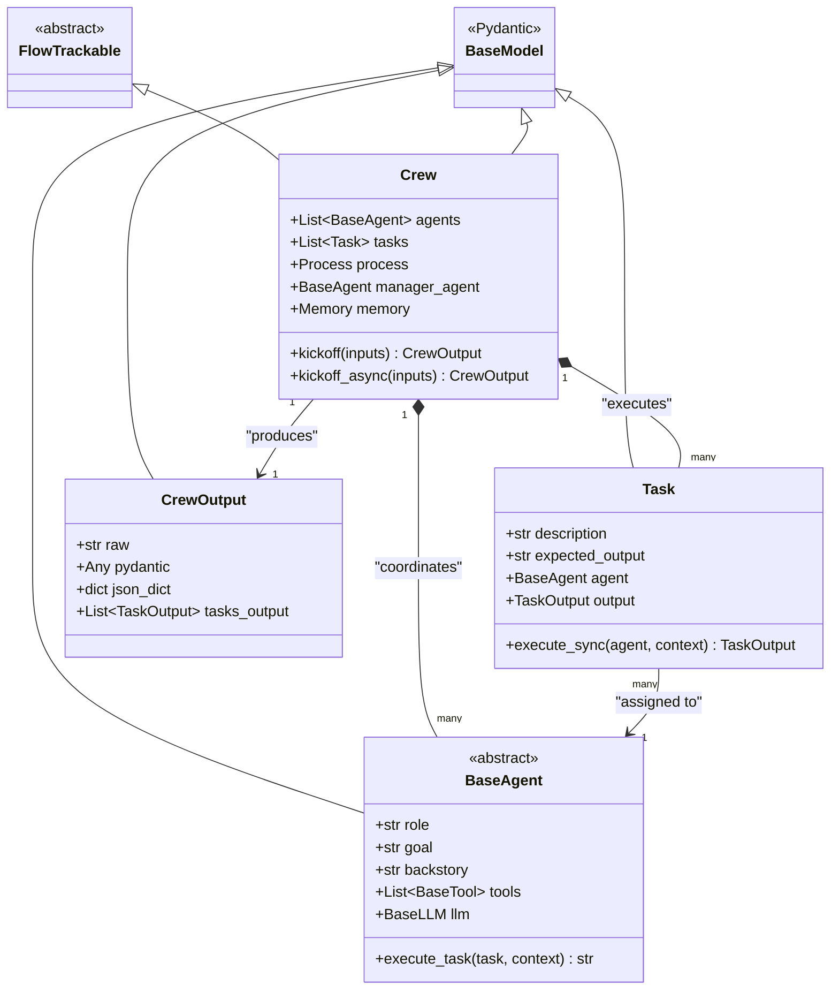

**Sources**: [lib/crewai/src/crewai/crew.py:136-172](), [lib/crewai/src/crewai/agents/agent_builder/base_agent.py:73-121](), [lib/crewai/src/crewai/task.py:87-110]()

---

## Crew Execution Lifecycle

The execution pipeline manages input interpolation, process selection (`sequential` or `hierarchical`), task-level guardrail evaluation, and hook execution [lib/crewai/src/crewai/crew.py:668-748]().

### Execution Sequence

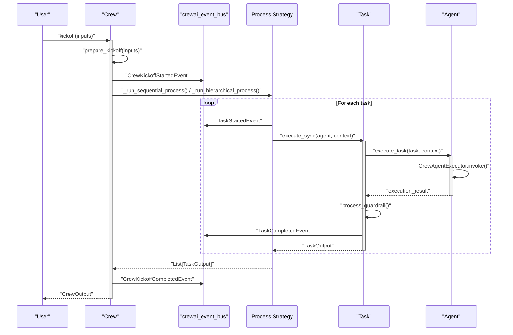

**Sources**: [lib/crewai/src/crewai/crew.py:668-748](), [lib/crewai/src/crewai/crews/utils.py:11-94]()

---

## Subsystem Overviews and Child Pages

### 2.1 Crew Configuration and Orchestration
Crews are configured either via Python code or modern JSONC/YAML configuration files [docs/edge/ar/concepts/crews.mdx:45-47](). They manage execution state, token usage, rate limits (`max_rpm`), caching, and process strategies (`sequential` or `hierarchical`) [docs/edge/ar/concepts/crews.mdx:14-35](). 
*For complete details on initialization options, kickoff methods, training, and async execution, see [Crew Configuration and Orchestration](#2.1).*

### 2.2 Agents
Agents represent autonomous actor entities configured with a specific `role`, `goal`, and `backstory` [lib/crewai/src/crewai/agents/agent_builder/base_agent.py:132-134](). They are equipped with tools and execute tasks via the `CrewAgentExecutor` reasoning loop.
*For details on agent configuration, tool assignment, execution engines, hooks, and `LiteAgent`, see [Agents](#2.2).*

### 2.3 Tasks
Tasks define discrete units of work with explicit descriptions, expected outputs, and assigned agents [lib/crewai/src/crewai/task.py:87-110](). They support execution guardrails, validation retry loops, and context passing between tasks.
*For details on task structure, the `@task` decorator, YAML configurations, and guardrails, see [Tasks](#2.3).*

### 2.4 Agent-to-Agent (A2A) Protocol
The Agent-to-Agent protocol enables secure delegation and communication between agents across different runtimes and enterprise boundaries, featuring `A2AClientConfig`, `A2AServerConfig`, and automatic `AgentCard` generation.
*For setup, authentication schemes, and enterprise A2A patterns, see [Agent-to-Agent (A2A) Protocol](#2.4).*

### 2.5 Human-in-the-Loop and Collaboration
Crews support collaborative patterns where agents dynamically delegate work or ask questions of coworkers [docs/edge/ar/concepts/collaboration.mdx:10-10](). Additionally, human-in-the-loop workflows pause execution for user review or feedback during task processing.
*For collaborative delegation models and human intervention hooks, see [Human-in-the-Loop and Collaboration](#2.5).*

### 2.6 Agent Evaluation and Testing
Evaluating agent reliability and performance is essential for production deployments. The experimental `AgentEvaluator` framework provides metrics, experiment runners, and automated testing utilities to benchmark agent behaviors.
*For testing methodologies and evaluation metrics, see [Agent Evaluation and Testing](#2.6).*

### 2.7 Agent Skills
The Skills system allows developers to inject domain-specific context and instructions directly into agent prompts using structured `SKILL.md` files with progressive disclosure levels managed by the skills loader.
*For prompt injection mechanics and skill management, see [Agent Skills](#2.7).*

**Sources**: [lib/crewai/src/crewai/crew.py:136-172](), [lib/crewai/src/crewai/agents/agent_builder/base_agent.py:73-121](), [lib/crewai/src/crewai/task.py:87-110](), [docs/edge/ar/concepts/crews.mdx:14-35](), [docs/edge/ar/concepts/collaboration.mdx:10-52]()

---

# Page: Crew Configuration and Orchestration

# Crew Configuration and Orchestration

<details>
<summary>Relevant source files</summary>

The following files were used as context for generating this wiki page:

- [docs/edge/ar/concepts/crews.mdx](docs/edge/ar/concepts/crews.mdx)
- [docs/edge/ar/concepts/planning.mdx](docs/edge/ar/concepts/planning.mdx)
- [docs/edge/ar/concepts/processes.mdx](docs/edge/ar/concepts/processes.mdx)
- [docs/edge/ar/concepts/training.mdx](docs/edge/ar/concepts/training.mdx)
- [docs/edge/ar/learn/hierarchical-process.mdx](docs/edge/ar/learn/hierarchical-process.mdx)

</details>


This page covers how to configure and orchestrate Crews in CrewAI. A Crew represents a collaborative group of agents working together to achieve a set of tasks. This documentation includes defining crews using JSONC/YAML or decorators, configuring process types (sequential vs hierarchical), managing the planning feature, executing crews via various kickoff methods, and managing lifecycles including training and async execution.

---

## Crew Class Overview

The `Crew` class [lib/crewai/src/crewai/crew.py:136-306]() is the central orchestration component. It manages agents, tasks, and their execution flow, inheriting from `FlowTrackable` and `BaseModel` for workflow integration and Pydantic validation.

### Core Attributes

| Attribute | Type | Default | Description |
|-----------|------|---------|-------------|
| `agents` | `list[BaseAgent]` | `[]` | List of agents in the crew [lib/crewai/src/crewai/crew.py:143]() |
| `tasks` | `list[Task]` | `[]` | List of tasks to be executed [lib/crewai/src/crewai/crew.py:142]() |
| `process` | `Process` | `Process.sequential` | Execution process (sequential/hierarchical) [lib/crewai/src/crewai/crew.py:152-153]() |
| `verbose` | `bool` | `False` | Level of logging detail [lib/crewai/src/crewai/crew.py:154]() |
| `memory` | `bool` | `False` | Enable unified memory features [lib/crewai/src/crewai/crew.py:146-147]() |
| `cache` | `bool` | `True` | Cache tool execution results [lib/crewai/src/crewai/crew.py:148-149]() |
| `planning` | `bool` | `False` | Generate step-by-step plans before execution [lib/crewai/src/crewai/crew.py:167]() |
| `max_rpm` | `int \| None` | `None` | Overrides individual agent RPM limits [lib/crewai/src/crewai/crew.py:156-157]() |
| `manager_llm` | `BaseLLM \| None` | `None` | LLM for the manager agent in hierarchical processes [lib/crewai/src/crewai/crew.py:144]() |
| `knowledge_sources` | `list` | `None` | Knowledge sources accessible to all agents in the crew [docs/edge/ar/concepts/crews.mdx:34]() |
| `stream` | `bool` | `False` | Enable streaming output for real-time updates [docs/edge/ar/concepts/crews.mdx:35]() |

Sources: [lib/crewai/src/crewai/crew.py:136-306](), [docs/edge/ar/concepts/crews.mdx:14-35]()

### Validation and Constraints

The Crew class performs strict validation at initialization [lib/crewai/src/crewai/crew.py:404-564]():
- **Hierarchical Process**: Requires either a `manager_llm` or a `manager_agent` [lib/crewai/src/crewai/crew.py:404-426]().
- **Sequential Process**: Every task must have an assigned agent [lib/crewai/src/crewai/crew.py:449-460]().
- **Task Dependencies**: Context dependencies cannot reference future tasks [lib/crewai/src/crewai/crew.py:548-564]().
- **Async Tasks**: Only one async task is permitted, and it must be the last in the list [lib/crewai/src/crewai/crew.py:462-481]().

Sources: [lib/crewai/src/crewai/crew.py:404-564]()

---

## Configuration Methods

CrewAI supports three primary methods for configuration: JSONC/YAML (recommended for new projects), the `@CrewBase` decorator, and direct instantiation.

### Natural Language to Code Entity Mapping: Crew Initialization

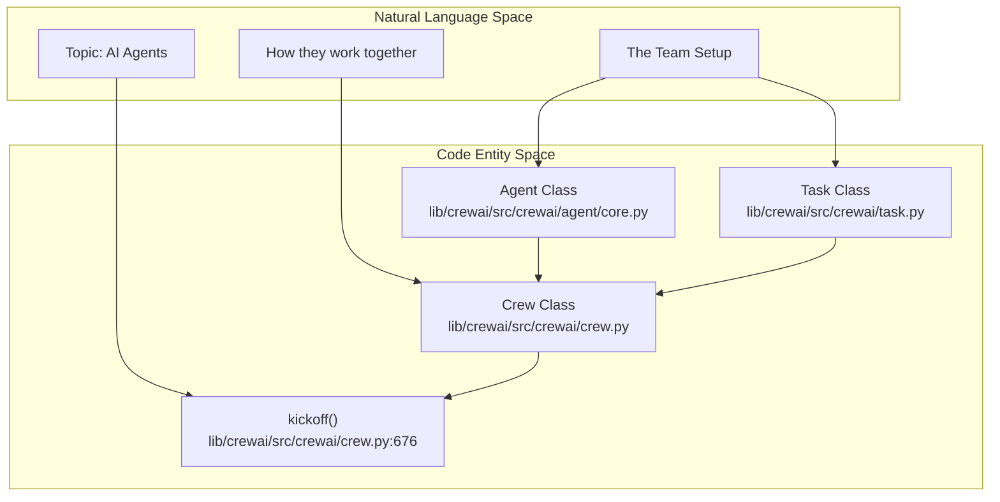

Sources: [lib/crewai/src/crewai/crew.py:136-172](), [lib/crewai/src/crewai/agent/core.py:126-151](), [lib/crewai/src/crewai/task.py:87-110]()

### JSONC/YAML Configuration (Recommended)

New projects created via `crewai create crew <name>` use `crew.jsonc` or `crew.json` to define settings [docs/edge/ar/concepts/crews.mdx:45-49](). The CLI tool `crewai run` automatically detects these files and loads the referenced agents and tasks [docs/edge/ar/concepts/crews.mdx:47]().

Sources: [docs/edge/ar/concepts/crews.mdx:41-49]()

### Decorator-Based Configuration (CrewBase)

The `@CrewBase` pattern uses methods to define agents and tasks.
- `@agent`: Marks a method that returns an `Agent` [lib/crewai/tests/test_project.py:43-89]().
- `@task`: Marks a method that returns a `Task` [lib/crewai/tests/test_project.py:43-89]().
- `@crew`: Marks the method that instantiates the `Crew` using `self.agents` and `self.tasks` [lib/crewai/tests/test_project.py:43-89]().

Sources: [lib/crewai/tests/test_project.py:43-89]()

---

## Execution and Orchestration

### Natural Language to Code Entity Mapping: Crew Execution

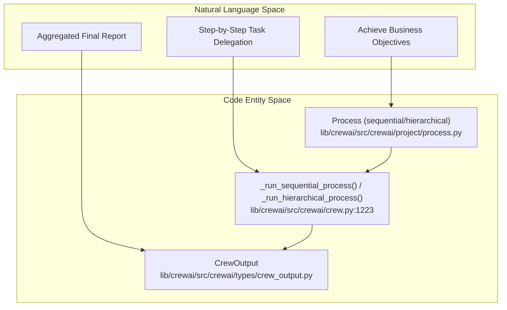

Sources: [lib/crewai/src/crewai/crew.py:1223-1320](), [lib/crewai/src/crewai/types/crew_output.py:1-50]()

### Execution Data Flow

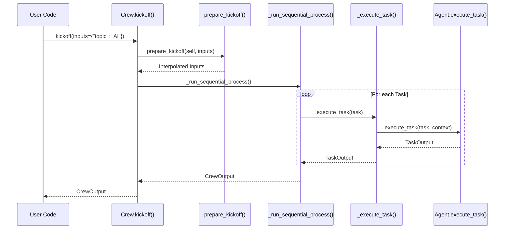

Sources: [lib/crewai/src/crewai/crew.py:676-735](), [lib/crewai/src/crewai/crew.py:1223-1320](), [lib/crewai/src/crewai/crews/utils.py:60-63]()

### Kickoff Methods

CrewAI provides multiple ways to trigger execution, ranging from synchronous to native asynchronous methods [docs/edge/ar/learn/kickoff-async.mdx:13-19]():

- **`kickoff()`**: Synchronous execution. Handles input interpolation and routes execution to sequential or hierarchical logic [lib/crewai/src/crewai/crew.py:676-735]().
- **`akickoff()`**: Native asynchronous implementation. Uses `async/await` across the entire chain, including memory and knowledge operations [docs/edge/ar/learn/kickoff-async.mdx:24-32]().
- **`kickoff_async()`**: Thread-based asynchronous execution. Wraps the synchronous `kickoff()` in `asyncio.to_thread` [docs/edge/ar/learn/kickoff-async.mdx:162-168]().
- **`kickoff_for_each()`**: Executes the crew for each set of inputs in a list [lib/crewai/src/crewai/crew.py:737-762]().
- **`akickoff_for_each()`**: Native async version of `kickoff_for_each` for processing multiple input sets concurrently [docs/edge/ar/learn/kickoff-async.mdx:121-123]().

Sources: [lib/crewai/src/crewai/crew.py:676-762](), [docs/edge/ar/learn/kickoff-async.mdx:13-168]()

---

## Advanced Features

### Planning
When `planning=True` is set [docs/edge/ar/concepts/planning.mdx:15-27](), the crew sends information to an `AgentPlanner` before execution. The planner generates a step-by-step plan for each task [docs/edge/ar/concepts/planning.mdx:10-11]().
- **`planning_llm`**: Users can specify a custom LLM for planning (default is `gpt-4o-mini`) [docs/edge/ar/concepts/planning.mdx:33-55]().

Sources: [docs/edge/ar/concepts/planning.mdx:1-55]()

### Training and Lifecycle Management
The training feature allows improving agent performance through human feedback [docs/edge/ar/concepts/training.mdx:8-15]().
- **CLI**: `crewai train -n <n_iterations> -f <filename.pkl>` [docs/edge/ar/concepts/training.mdx:24-26]().
- **Process**: During training, tasks are set to `human_input = True` and delegation is disabled [docs/edge/ar/concepts/training.mdx:67]().
- **Output**: After iterations, the system consolidates feedback into `suggestions` that are automatically loaded in subsequent non-training runs to guide the agent [docs/edge/ar/concepts/training.mdx:101-106]().

### Training Data Flow

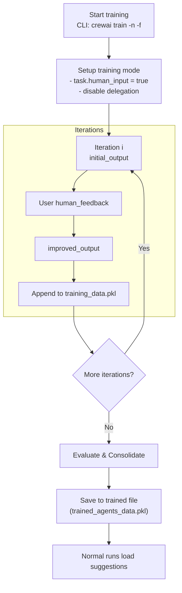

Sources: [docs/edge/ar/concepts/training.mdx:65-87]()

---

## Callbacks and Hooks

| Callback | Attribute | Timing |
|----------|-----------|--------|
| **Task Callback** | `task_callback` | Executed after each task finishes [lib/crewai/src/crewai/crew.py:222-225]() |
| **Step Callback** | `step_callback` | Executed after every agent step [lib/crewai/src/crewai/crew.py:218-222]() |
| **Kickoff Hooks** | `before_kickoff_callbacks` / `after_kickoff_callbacks` | Run before the crew starts or after it completes [lib/crewai/src/crewai/crew.py:226-241]() |

Sources: [lib/crewai/src/crewai/crew.py:218-241](), [docs/edge/ar/concepts/crews.mdx:27-28]()

---

# Page: Agents

# Agents

<details>
<summary>Relevant source files</summary>

The following files were used as context for generating this wiki page:

- [docs/edge/ar/concepts/agent-capabilities.mdx](docs/edge/ar/concepts/agent-capabilities.mdx)
- [docs/edge/ar/concepts/agents.mdx](docs/edge/ar/concepts/agents.mdx)
- [docs/edge/ar/guides/agents/crafting-effective-agents.mdx](docs/edge/ar/guides/agents/crafting-effective-agents.mdx)
- [docs/edge/ar/learn/customizing-agents.mdx](docs/edge/ar/learn/customizing-agents.mdx)

</details>


## Purpose and Scope

This document describes the agent architecture in CrewAI, focusing on the `Agent` class, its configuration, execution model, and capability assignments. Agents are autonomous AI workers designed to execute tasks using language models, tool integrations, and memory systems.

As a parent page, this section provides a high-level overview of agent configuration, class hierarchies, capabilities, and the `@agent` decorator pattern. For deep technical details on specialized execution mechanics, extensions, and alternative agent types, refer to the child pages:
- For execution loops and ReAct vs native function calling, see [Agent Execution Engine](#2.2.1).
- For agent hooks and custom adapter implementations, see [Agent Hooks and Extensibility](#2.2.2).
- For direct LLM interactions without crew overhead, see [LiteAgent](#2.2.3).

Sources: [lib/crewai/src/crewai/agent/core.py:126-151](), [docs/edge/ar/concepts/agents.mdx:10-23]()

---

## Agent Overview and Configuration

Agents in CrewAI are autonomous entities defined by three core attributes forming the Role-Goal-Backstory framework:
- **Role**: The agent's function or specialized position within the crew (`role: str`).
- **Goal**: The individual objective that guides the agent's decision-making (`goal: str`).
- **Backstory**: Context, experience, and personality that enriches interactions and shapes reasoning (`backstory: str`).

```mermaid
title "Natural Language Space to Code Entity Space: Agent Configuration"
graph LR
    subgraph "NaturalLanguageSpace"
        Role["role: str<br/>\"Senior Researcher\""]
        Goal["goal: str<br/>\"Find and compile market data\""]
        Backstory["backstory: str<br/>\"Expert market analyst with 10 years experience\""]
    end

    subgraph "CodeEntitySpace"
        AgentClass["Agent<br/>lib/crewai/src/crewai/agent/core.py"]
    end

    Role --> AgentClass
    Goal --> AgentClass
    Backstory --> AgentClass
```

Sources: [docs/edge/ar/concepts/agents.mdx:42-44](), [docs/edge/ar/guides/agents/crafting-effective-agents.mdx:41-90](), [lib/crewai/src/crewai/agent/core.py:126-170]()

---

## Agent Class Hierarchy

The agent architecture centers around an abstract base class (`BaseAgent`) which defines the contract for concrete implementations like `Agent` and `LiteAgent`.

```mermaid
title "Agent Class Hierarchy and Composition"
graph TB
    BaseAgent["BaseAgent<br/>agents/agent_builder/base_agent.py"]
    Agent["Agent<br/>agent/core.py"]
    LiteAgent["LiteAgent<br/>lite_agent.py"]
    FlowTrackable["FlowTrackable<br/>flow/flow_trackable.py"]
    CrewAgentExecutor["CrewAgentExecutor<br/>agents/crew_agent_executor.py"]
    
    BaseAgent -->|"inherits"| Agent
    FlowTrackable -->|"mixin"| Agent
    FlowTrackable -->|"mixin"| LiteAgent
    Agent -->|"instantiates"| CrewAgentExecutor
```

### BaseAgent Interface
The `BaseAgent` interface requires concrete classes to implement key methods for task execution, tool setup, and output conversion.

| Method | Purpose |
|--------|---------|
| `execute_task()` | Synchronous task execution handler. |
| `create_agent_executor()` | Initialize the execution engine (e.g., `CrewAgentExecutor`). |
| `get_delegation_tools()` | Configure inter-agent delegation and questioning capabilities. |
| `get_platform_tools()` | Load platform-managed integrations. |
| `get_mcp_tools()` | Load tools from Model Context Protocol servers. |

Sources: [lib/crewai/src/crewai/agents/agent_builder/base_agent.py:73-121](), [lib/crewai/src/crewai/agent/core.py:126-200]()

---

## Agent Capabilities

CrewAI agents support five distinct types of capabilities divided into **Action** (doing things) and **Context** (knowing things):

```mermaid
title "Natural Language Space to Code Entity Space: Agent Capabilities"
graph TB
    subgraph "Capabilities Space"
        Tools["Tools<br/>BaseTool instances"]
        MCP["MCP Servers<br/>Remote tool servers"]
        Apps["Apps<br/>SaaS integrations"]
        Skills["Skills<br/>SKILL.md instructions"]
        Knowledge["Knowledge<br/>RAG sources"]
    end

    subgraph "Agent Entity"
        Agent["Agent<br/>lib/crewai/src/crewai/agent/core.py"]
    end

    Tools --> Agent
    MCP --> Agent
    Apps --> Agent
    Skills --> Agent
    Knowledge --> Agent
```

| Type | Category | Parameter | Description |
| :--- | :--- | :--- | :--- |
| **Tools** | Action | `tools` | Local Python functions/classes inheriting from `BaseTool`. |
| **MCP** | Action | `mcps` | Remote tool servers via Model Context Protocol. |
| **Apps** | Action | `apps` | Platform integrations (e.g., Gmail, Slack). |
| **Skills** | Context | `skills` | Domain expertise injected via `SKILL.md` files. |
| **Knowledge** | Context | `knowledge_sources` | RAG-based facts from files or URLs. |

Sources: [docs/edge/ar/concepts/agent-capabilities.mdx:10-52](), [lib/crewai/src/crewai/agent/core.py:158-220]()

---

## The @agent Decorator Pattern

In CrewAI projects, agents are frequently defined declaratively inside classes annotated with `@CrewBase` using the `@agent` decorator. This pattern handles memoization, automatic instantiation, and configuration mapping from configuration files (such as `agents.yaml` or `agents.jsonc`).

```python
from crewai import Agent, Crew, Task
from crewai.project import CrewBase, agent, task, crew

@CrewBase
class MyCrew:
    @agent
    def researcher(self) -> Agent:
        return Agent(
            config=self.agents_config['researcher'],
            tools=[]
        )
```

Sources: [lib/crewai/src/crewai/project/annotations.py](), [lib/crewai/tests/test_project.py:24-28]()

---

## Sub-Topics and Child Pages

For more in-depth technical details on specific agent subsystems, refer to the following child pages:

- **[Agent Execution Engine](#2.2.1)**: Explores `CrewAgentExecutor`, the execution loop, ReAct vs native function calling patterns, and multi-turn conversation handling.
- **[Agent Hooks and Extensibility](#2.2.2)**: Details agent hooks for extending behavior and the `BaseAgentAdapter` pattern for custom agent integrations.
- **[LiteAgent](#2.2.3)**: Documents the `LiteAgent` class, its `kickoff(messages)` interface, and lightweight use cases.

Sources: [lib/crewai/src/crewai/agents/crew_agent_executor.py](), [lib/crewai/src/crewai/agents/lite_agent.py]()

---

# Page: Agent Execution Engine

# Agent Execution Engine

<details>
<summary>Relevant source files</summary>

The following files were used as context for generating this wiki page:

- [docs/edge/ar/concepts/agents.mdx](docs/edge/ar/concepts/agents.mdx)
- [docs/edge/ar/concepts/reasoning.mdx](docs/edge/ar/concepts/reasoning.mdx)

</details>


The Agent Execution Engine is the core component that orchestrates agent behavior through an iterative loop of LLM calls, tool execution, and decision-making. It manages the lifecycle of agent execution within both Crews and standalone LiteAgents [lib/crewai/src/crewai/agents/crew_agent_executor.py:92-174]().

This document focuses on the execution mechanics—how agents process tasks through iterative reasoning loops, manage context windows, enforce rate limits, and handle edge cases like infinite loops or parsing errors.

Sources: [lib/crewai/src/crewai/agents/crew_agent_executor.py:92-174]()

## Executor Architecture

The execution engine is implemented through the `CrewAgentExecutor` class, which manages agent execution within a Crew context, providing full orchestration capabilities [lib/crewai/src/crewai/agents/crew_agent_executor.py:92-105]().

Title: CrewAgentExecutor Initialization and State Architecture
```mermaid
graph TB
    subgraph "CodeEntitySpace"
        Init["CrewAgentExecutor.__init__()"]
        LLM["BaseLLM"]
        Task["Task"]
        Agent["Agent"]
        Crew["Crew"]
        Tools["CrewStructuredTool"]
        
        Init --> LLM
        Init --> Task
        Init --> Agent
        Init --> Crew
        Init --> Tools
    end
    
    subgraph "NaturalLanguageSpace"
        Prompt["SystemPromptResult"]
        Messages["LLMMessageList"]
        UserInput["UserIntentAndContext"]
        
        Prompt --> Init
        Messages --> Init
        UserInput --> Init
    end
```
Sources: [lib/crewai/src/crewai/agents/crew_agent_executor.py:92-174]()

| Parameter | Type | Purpose |
|-----------|------|---------|
| `llm` | `BaseLLM` | Language model for generating responses [lib/crewai/src/crewai/agents/crew_agent_executor.py:137]() |
| `task` | `Task` | Current task being executed [lib/crewai/src/crewai/agents/crew_agent_executor.py:138]() |
| `agent` | `Agent` | Agent instance executing the task [lib/crewai/src/crewai/agents/crew_agent_executor.py:139]() |
| `max_iter` | `int` | Maximum iterations before forcing answer [lib/crewai/src/crewai/agents/crew_agent_executor.py:145]() |
| `tools` | `list[CrewStructuredTool]` | Available tools for execution [lib/crewai/src/crewai/agents/crew_agent_executor.py:142]() |
| `respect_context_window` | `bool` | Whether to summarize on context overflow [lib/crewai/src/crewai/agents/crew_agent_executor.py:153]() |

Sources: [lib/crewai/src/crewai/agents/crew_agent_executor.py:137-153]()

## Execution Loop (ReAct Pattern)

The execution loop implements the ReAct (Reason + Act) pattern, alternating between thinking via LLM calls and acting via tool execution [lib/crewai/src/crewai/agents/crew_agent_executor.py:184-209]().

Title: ReAct Execution Loop Bridging Natural Language and Code Entities
```mermaid
graph TB
    subgraph "NaturalLanguageSpace"
        UserTask["TaskDescriptionAndContext"]
        LLMThoughts["GeneratedReasoningAndThought"]
        ToolOutputText["RawToolExecutionResultString"]
    end

    subgraph "CodeEntitySpace"
        Invoke["CrewAgentExecutor.invoke()"]
        Setup["_setup_messages()"]
        Loop["_invoke_loop()"]
        CallLLM["BaseLLM.get_llm_response()"]
        ExecTool["ToolUsage.execute()"]
        
        Invoke --> Setup
        Setup --> Loop
        Loop --> CallLLM
        CallLLM --> LLMThoughts
        LLMThoughts --> ExecTool
        ExecTool --> ToolOutputText
        ToolOutputText --> Loop
    end
```
Sources: [lib/crewai/src/crewai/agents/crew_agent_executor.py:184-317]()

## Tool Calling Patterns

CrewAI supports two primary tool calling patterns: Native Function Calling and ReAct manual parsing [lib/crewai/src/crewai/utilities/agent_utils.py:144-210]().

Title: Native Tool Schema Conversion
```mermaid
graph LR
    subgraph "CodeEntitySpace"
        CT["CrewStructuredTool"]
        Conv["convert_tools_to_openai_schema()"]
        Mapping["tool_name_mapping"]
        
        CT --> Conv
        Conv --> Schema["OpenAIJSONSchema"]
        Conv --> Mapping
    end

    subgraph "NaturalLanguageSpace"
        API["LLMProviderAPI"]
        API -->|"ExpectsSchema"| Schema
        API -->|"ReturnsToolCall"| ToolCall["ToolCallRequest"]
    end
```
Sources: [lib/crewai/src/crewai/utilities/agent_utils.py:144-210]()

### Tool Execution Pipeline

When an agent decides to use a tool, the `ToolUsage` class handles parsing and execution:
1. Selection: `_select_tool(tool_name)` finds the tool in the agent's toolbox [lib/crewai/src/crewai/tools/tool_usage.py:138]().
2. Validation: Arguments are validated against the tool's schema [lib/crewai/src/crewai/tools/base_tool.py:156-177]().
3. Execution: The tool's `_run` or `_arun` method is invoked [lib/crewai/src/crewai/tools/base_tool.py:198-215]().

Sources: [lib/crewai/src/crewai/tools/tool_usage.py:126-163](), [lib/crewai/src/crewai/tools/base_tool.py:57-98]()

## Multi-Turn Conversation Handling

The executor maintains a conversation history in the `messages` list, which grows with each iteration [lib/crewai/src/crewai/agents/crew_agent_executor.py:92-174]().

Title: Message Summarization Flow
```mermaid
sequenceDiagram
    participant Loop as _invoke_loop
    participant Utils as agent_utils.py
    participant LLM as BaseLLM
    
    Loop->>Utils: is_context_length_exceeded()
    Utils-->>Loop: True
    Loop->>Utils: handle_context_length()
    Utils->>Utils: summarize_messages()
    Utils->>LLM: _asummarize_chunks()
    LLM-->>Utils: Summarized content
    Utils-->>Loop: Updated messages
```
Sources: [lib/crewai/src/crewai/utilities/agent_utils.py:464-567]()

## Iteration Control and Rate Limiting

### Max Iterations
The `max_iter` parameter prevents infinite loops. Once reached, `handle_max_iterations_exceeded` forces the agent to provide a final answer based on current context [lib/crewai/src/crewai/utilities/agent_utils.py:124-181]().

### RPM Rate Limiting
The `enforce_rpm_limit` function uses a controller to ensure the agent does not exceed allowed Requests Per Minute [lib/crewai/src/crewai/utilities/agent_utils.py:220-229]().

Sources: [lib/crewai/src/crewai/utilities/agent_utils.py:124-229]()

## Asynchronous Execution

The engine provides full async support via `ainvoke` and `_ainvoke_loop` [lib/crewai/src/crewai/agents/crew_agent_executor.py:319-465]().

| Sync Method | Async Equivalent | Purpose |
|-------------|------------------|---------|
| `invoke` | `ainvoke` | Main entry point [lib/crewai/src/crewai/agents/crew_agent_executor.py:319]() |
| `_invoke_loop` | `_ainvoke_loop` | Execution loop [lib/crewai/src/crewai/agents/crew_agent_executor.py:372]() |
| `get_llm_response` | `aget_llm_response` | Async LLM interaction [lib/crewai/src/crewai/utilities/agent_utils.py:284]() |
| `execute_tool...` | `aexecute_tool...` | Async tool call [lib/crewai/src/crewai/utilities/tool_utils.py:63]() |

Sources: [lib/crewai/src/crewai/agents/crew_agent_executor.py:319-465](), [lib/crewai/src/crewai/utilities/tool_utils.py:63]()

---

# Page: Agent Hooks and Extensibility

# Agent Hooks and Extensibility

<details>
<summary>Relevant source files</summary>

The following files were used as context for generating this wiki page:

- [docs/edge/ar/learn/before-and-after-kickoff-hooks.mdx](docs/edge/ar/learn/before-and-after-kickoff-hooks.mdx)
- [docs/edge/ar/learn/bring-your-own-agent.mdx](docs/edge/ar/learn/bring-your-own-agent.mdx)
- [docs/edge/ar/learn/execution-boundary-hooks.mdx](docs/edge/ar/learn/execution-boundary-hooks.mdx)
- [docs/edge/ar/learn/execution-hooks.mdx](docs/edge/ar/learn/execution-hooks.mdx)

</details>


This page documents the agent hook system and the extensibility patterns in CrewAI. These mechanisms provide extension points for modifying agent behavior, intercepting execution cycles, and implementing custom agent logic without modifying core framework code.

## Purpose and Scope

The hook system provides primary extension mechanisms for the CrewAI runtime:
- **LLM Hooks**: Intercept and modify LLM interactions (messages sent, responses received) [lib/crewai/src/crewai/hooks/llm_hooks.py:157-158]().
- **Tool Hooks**: Intercept and modify tool executions (inputs, outputs) [lib/crewai/src/crewai/hooks/tool_hooks.py:120-121]().
- **Execution Boundary Hooks**: Intercept runtime boundaries (`EXECUTION_START`, `INPUT`, `OUTPUT`, `EXECUTION_END`) using the `@on` decorator [docs/edge/ar/learn/execution-boundary-hooks.mdx:7-11]().
- **BaseAgentAdapter**: A pattern for integrating agents from other frameworks (e.g., LangGraph, OpenAI Agents) into CrewAI [docs/edge/ar/learn/bring-your-own-agent.mdx:8-20]().

Sources: [lib/crewai/src/crewai/hooks/llm_hooks.py:157-158](), [lib/crewai/src/crewai/hooks/tool_hooks.py:120-121](), [docs/edge/ar/learn/execution-boundary-hooks.mdx:7-11](), [docs/edge/ar/learn/bring-your-own-agent.mdx:8-20]()

---

## Hook System Architecture

The hook system uses a global registration pattern. Hooks are registered once and automatically loaded into all agent executors (`CrewAgentExecutor`, `LiteAgent`) and LLM calls throughout the system [lib/crewai/src/crewai/hooks/llm_hooks.py:164-168]().

### Agent Hooks Component Mapping

The following diagram bridges natural language concepts to the specific code entities that implement the hook system.

```mermaid
graph TB
    subgraph "Natural Language Space"
        GlobalRegistry["Global Registry"]
        ContextObj["Hook Context"]
        ExecPoint["Execution Point"]
    end

    subgraph "Code Entity Space"
        LLMBefore["_before_llm_call_hooks<br/>(llm_hooks.py)"]
        LLMAfter["_after_llm_call_hooks<br/>(llm_hooks.py)"]
        ToolBefore["_before_tool_call_hooks<br/>(tool_hooks.py)"]
        ToolAfter["_after_tool_call_hooks<br/>(tool_hooks.py)"]
        
        LLMContext["LLMCallHookContext<br/>(llm_hooks.py)"]
        ToolContext["ToolCallHookContext<br/>(tool_hooks.py)"]
        
        Executor["CrewAgentExecutor<br/>(crew_agent_executor.py)"]
        LiteAgent["LiteAgent<br/>(lite_agent.py)"]
    end

    GlobalRegistry --- LLMBefore
    GlobalRegistry --- LLMAfter
    GlobalRegistry --- ToolBefore
    GlobalRegistry --- ToolAfter
    
    ContextObj --- LLMContext
    ContextObj --- ToolContext
    
    ExecPoint --- Executor
    ExecPoint --- LiteAgent

    LLMBefore -.->|"injected into"| Executor
    LLMAfter -.->|"injected into"| LiteAgent
```
Sources: [lib/crewai/src/crewai/hooks/llm_hooks.py:157-158](), [lib/crewai/src/crewai/hooks/tool_hooks.py:120-121](), [lib/crewai/src/crewai/hooks/llm_hooks.py:23-48](), [lib/crewai/src/crewai/hooks/tool_hooks.py:23-42]()

---

## LLM Hooks

LLM hooks intercept every call to the language model. They enable modification of messages before sending and responses after receiving, executing within the agent's loop with full access to conversation history [lib/crewai/src/crewai/hooks/llm_hooks.py:23-58]().

### LLMCallHookContext

The `LLMCallHookContext` class provides complete access to the execution state.

| Attribute | Type | Description |
|-----------|------|-------------|
| `executor` | `CrewAgentExecutor \| AgentExecutor \| LiteAgent \| None` | Reference to the executor instance [lib/crewai/src/crewai/hooks/llm_hooks.py:50]() |
| `messages` | `list[LLMMessage]` | **Mutable reference** to conversation messages [lib/crewai/src/crewai/hooks/llm_hooks.py:51]() |
| `agent` | `Any` | Agent instance executing the task [lib/crewai/src/crewai/hooks/llm_hooks.py:52]() |
| `task` | `Any` | Task instance being executed [lib/crewai/src/crewai/hooks/llm_hooks.py:53]() |
| `crew` | `Any` | Crew instance [lib/crewai/src/crewai/hooks/llm_hooks.py:54]() |
| `llm` | `BaseLLM \| None \| str \| Any` | LLM instance being called [lib/crewai/src/crewai/hooks/llm_hooks.py:55]() |
| `iterations` | `int` | Current iteration count in agent loop [lib/crewai/src/crewai/hooks/llm_hooks.py:56]() |
| `response` | `str \| None` | LLM response string (after_llm_call hooks only) [lib/crewai/src/crewai/hooks/llm_hooks.py:57]() |

**Warning:** You must modify `messages` in-place (e.g., `context.messages.append(...)`). Replacing the list reference entirely will prevent the executor from seeing the changes [lib/crewai/src/crewai/hooks/llm_hooks.py:37-40]().

Sources: [lib/crewai/src/crewai/hooks/llm_hooks.py:23-58](), [lib/crewai/src/crewai/hooks/llm_hooks.py:80-110]()

---

## Tool Hooks

Tool hooks provide access to the tool being called and its input parameters.

### ToolCallHookContext

| Attribute | Type | Description |
|-----------|------|-------------|
| `tool_name` | `str` | Name of the tool being called [lib/crewai/src/crewai/hooks/tool_hooks.py:30]() |
| `tool_input` | `dict[str, Any]` | **Mutable** tool input parameters [lib/crewai/src/crewai/hooks/tool_hooks.py:31]() |
| `tool` | `CrewStructuredTool` | Reference to the tool instance [lib/crewai/src/crewai/hooks/tool_hooks.py:36]() |
| `tool_result` | `str \| None` | Result (only for after_tool_call hooks) [lib/crewai/src/crewai/hooks/tool_hooks.py:40]() |

- **Before Hooks**: Can modify `tool_input` in-place or return `False` to block execution [lib/crewai/src/crewai/hooks/tool_hooks.py:134-136]().
- **After Hooks**: Can modify the tool result by returning a new string [lib/crewai/src/crewai/hooks/tool_hooks.py:171-174]().

Sources: [lib/crewai/src/crewai/hooks/tool_hooks.py:23-42](), [lib/crewai/src/crewai/hooks/tool_hooks.py:124-181]()

---

## Execution Boundary Hooks

Execution boundary hooks intercept the outer boundaries of crew and flow execution using the `@on` decorator [docs/edge/ar/learn/execution-boundary-hooks.mdx:7-11]().

### Interception Points

| Interception Point | Timing | Payload (`ctx.payload`) |
|--------------------|--------|--------------------------|
| `EXECUTION_START` | Crew or Flow about to start | Input `dict` [docs/edge/ar/learn/execution-boundary-hooks.mdx:18]() |
| `INPUT` | Resolved execution inputs | Input `dict` [docs/edge/ar/learn/execution-boundary-hooks.mdx:19]() |
| `OUTPUT` | Final result ready | Output object (`CrewOutput` or flow result) [docs/edge/ar/learn/execution-boundary-hooks.mdx:20]() |
| `EXECUTION_END` | Execution finished (success or failure) | Output object or `None` on failure [docs/edge/ar/learn/execution-boundary-hooks.mdx:21]() |

Hooks can mutate `ctx.payload` in place, return a replacement value, or raise `HookAborted(reason, source)` to halt execution [docs/edge/ar/learn/execution-boundary-hooks.mdx:32-36]().

Sources: [docs/edge/ar/learn/execution-boundary-hooks.mdx:7-42]()

---

## Agent Interoperability: BaseAgentAdapter

CrewAI allows the use of agents from other frameworks within a Crew by using the adapter pattern [docs/edge/ar/learn/bring-your-own-agent.mdx:8-12]().

### Custom Agent Implementation

To integrate a third-party agent, you must implement a class inheriting from `BaseAgentAdapter`. This abstract class extends `BaseAgent` to maintain compatibility while providing translation layers for external requirements [docs/edge/ar/learn/bring-your-own-agent.mdx:18-20]().

| Required Method | Description |
|-----------------|-------------|
| `configure_tools` | Translates CrewAI tools to the format expected by the external agent [docs/edge/ar/learn/bring-your-own-agent.mdx:24]() |
| `configure_structured_output` | Maps CrewAI's output expectations to the external agent's schema [docs/edge/ar/learn/bring-your-own-agent.mdx:25]() |

Ready-to-use adapters are provided for:
1. **LangGraph** [docs/edge/ar/learn/bring-your-own-agent.mdx:36]()
2. **OpenAI Agents** [docs/edge/ar/learn/bring-your-own-agent.mdx:37]()

### Adapter Component Mapping

The following diagram bridges natural language adapter concepts to concrete code entities in the adapter layer.

```mermaid
graph TB
    subgraph "Natural Language Space"
        OrchestrationLayer["Orchestration Layer"]
        CompatibilityLayer["Compatibility Layer"]
        ExternalAgentRuntime["External Agent Runtime"]
    end

    subgraph "Code Entity Space"
        Crew["Crew"]
        Task["Task"]
        Adapter["BaseAgentAdapter<br/>(bring-your-own-agent.mdx)"]
        ToolAdapter["BaseToolAdapter<br/>(bring-your-own-agent.mdx)"]
        Converter["BaseConverter<br/>(bring-your-own-agent.mdx)"]
        ExtAgent["LangGraph / OpenAI Agents"]
    end

    OrchestrationLayer --- Crew
    OrchestrationLayer --- Task
    CompatibilityLayer --- Adapter
    CompatibilityLayer --- ToolAdapter
    CompatibilityLayer --- Converter
    ExternalAgentRuntime --- ExtAgent

    Crew --> Task
    Task --> Adapter
    Adapter --> ToolAdapter
    Adapter --> Converter
    Adapter -->|"Translates Schema"| ExtAgent
    ExtAgent -->|"Returns Result"| Adapter
```

Sources: [docs/edge/ar/learn/bring-your-own-agent.mdx:8-41]()

---

## CrewBase and Project Hooks

When using the `@CrewBase` decorator pattern, additional lifecycle hooks are available to manage the orchestration flow.

### Project Lifecycle Hooks
- `@before_kickoff`: Executes logic before the crew begins any tasks. It receives the input dictionary and can modify it before execution [docs/edge/ar/learn/before-and-after-kickoff-hooks.mdx:9-23]().
- `@after_kickoff`: Executes logic after the crew completes all tasks. It receives the final result object [docs/edge/ar/learn/before-and-after-kickoff-hooks.mdx:25-39]().
- `@before_llm_call_crew`: Registers a hook specifically within the scope of a decorated project [docs/edge/ar/learn/execution-hooks.mdx:58-61]().

Sources: [docs/edge/ar/learn/before-and-after-kickoff-hooks.mdx:7-47](), [docs/edge/ar/learn/execution-hooks.mdx:49-67]()

---

# Page: LiteAgent

# LiteAgent

<details>
<summary>Relevant source files</summary>

The following files were used as context for generating this wiki page:

- [docs/edge/ar/concepts/agents.mdx](docs/edge/ar/concepts/agents.mdx)

</details>


## Purpose and Scope

`LiteAgent` is a specialized agent execution model designed for direct message processing without the full task orchestration overhead of the standard `Agent` class. It provides a lightweight alternative for scenarios where you need LLM-powered tool usage and message processing but don't require task delegation, crew coordination, or complex memory systems.

While `LiteAgent` exists as a standalone class in [lib/crewai/src/crewai/lite_agent.py:177-189](), it is also the underlying engine for the `Agent().kickoff(messages)` interface, which allows standard agents to perform lightweight, message-based interactions [lib/crewai/src/crewai/agent.py:448-468]().

Use `LiteAgent` (or `Agent.kickoff`) when you need:
- Direct message-to-response processing without creating a `Task`.
- Tool usage with LLM guidance in a simple loop [lib/crewai/src/crewai/lite_agent.py:348-430]().
- Lightweight agent execution within **Flows**.
- Low-overhead LLM interactions that still benefit from CrewAI's tool-calling logic and telemetry.

Sources: [lib/crewai/src/crewai/lite_agent.py:177-189](), [lib/crewai/src/crewai/lite_agent.py:102-174](), [lib/crewai/src/crewai/agent.py:448-468]()

---

## Architecture Overview

`LiteAgent` implements a streamlined execution model that bypasses the `CrewAgentExecutor` infrastructure while maintaining compatibility with the broader CrewAI ecosystem through shared utilities and event emission.

### Class Structure and Key Components

Title: LiteAgent Class Hierarchy and Data Flow
```mermaid
graph TB
    subgraph "LiteAgentClassHierarchy"
        FlowTrackable["FlowTrackable<br/>lib/crewai/flow/flow_trackable.py"]
        BaseModel["BaseModel<br/>(Pydantic)"]
        LiteAgent["LiteAgent<br/>lib/crewai/lite_agent.py"]
    end
    
    subgraph "CoreAttributes"
        Fields["Public Fields:<br/>role, goal, backstory<br/>llm: BaseLLM<br/>tools: list[BaseTool]<br/>max_iterations: int<br/>response_format: BaseModel"]
        PrivateAttrs["Private Attributes:<br/>_parsed_tools: list[CrewStructuredTool]<br/>_messages: list[LLMMessage]<br/>_iterations: int<br/>_token_process: TokenProcess"]
    end
    
    subgraph "SupportingClasses"
        LiteAgentOutput["LiteAgentOutput<br/>lib/crewai/lite_agent_output.py"]
        BaseLLM["BaseLLM<br/>lib/crewai/llm.py"]
        CrewStructuredTool["CrewStructuredTool<br/>lib/crewai/utilities/crew_pydantic_tools.py"]
        TokenProcess["TokenProcess<br/>lib/crewai/agents/agent_builder/base_token_process.py"]
    end
    
    subgraph "SharedUtilities"
        AgentUtils["agent_utils.py:<br/>parse_tools()<br/>get_llm_response()<br/>handle_agent_action_core()"]
    end
    
    FlowTrackable --> LiteAgent
    BaseModel --> LiteAgent
    LiteAgent --> Fields
    LiteAgent --> PrivateAttrs
    
    LiteAgent -->|"returns"| LiteAgentOutput
    LiteAgent -->|"uses"| BaseLLM
    LiteAgent -->|"contains"| CrewStructuredTool
    LiteAgent -->|"tracks tokens"| TokenProcess
    LiteAgent -->|"calls"| AgentUtils
```

Sources: [lib/crewai/src/crewai/lite_agent.py:177-220](), [lib/crewai/src/crewai/lite_agent_output.py:1-25](), [lib/crewai/src/crewai/flow/flow_trackable.py:7-22](), [lib/crewai/src/crewai/utilities/agent_utils.py:1-20]()

---

## Initialization and Configuration

### Constructor and Field Validation

`LiteAgent` uses Pydantic validators to ensure proper configuration. It inherits from `FlowTrackable`, allowing it to automatically capture flow context if instantiated within a CrewAI Flow step [lib/crewai/src/crewai/lite_agent.py:177-189]().

| Field | Type | Default | Description |
|-------|------|---------|-------------|
| `id` | `UUID4` | auto-generated | Unique identifier (frozen). |
| `role` | `str` | required | Agent's role description. |
| `goal` | `str` | required | Agent's objective. |
| `backstory` | `str` | required | Agent's context/history. |
| `llm` | `BaseLLM` | `None` | Language model instance. |
| `tools` | `list[BaseTool]` | `[]` | Available tools for the agent. |
| `max_iterations` | `int` | 15 | Max tool usage cycles before forced stop. |
| `response_format` | `type[BaseModel]` | `None` | Structured output schema for the final answer. |
| `verbose` | `bool` | `False` | Enable detailed execution logging. |

### Model Initialization Flow

Title: LiteAgent Initialization Logic
```mermaid
graph LR
    Init["LiteAgent.model_post_init()"]
    SetupLLM["_setup_llm()"]
    ParseTools["parse_tools()"]
    FlowContext["_set_flow_context()"]
    
    Init --> SetupLLM
    Init --> ParseTools
    Init --> FlowContext
    
    SetupLLM -->|"creates"| LLMInstance["BaseLLM instance<br/>via create_llm()"]
    ParseTools -->|"converts"| StructuredTools["list[CrewStructuredTool]<br/>stored in _parsed_tools"]
    FlowContext -->|"captures"| Context["current_flow_id<br/>current_flow_request_id"]
```

Sources: [lib/crewai/src/crewai/lite_agent.py:202-230](), [lib/crewai/src/crewai/flow/flow_trackable.py:15-22](), [lib/crewai/src/crewai/utilities/agent_utils.py:83-86]()

---

## Execution Model

### Kickoff Interface

The `kickoff()` method is the primary entry point. It supports both raw string queries and structured `LLMMessage` lists, facilitating multi-turn conversations [lib/crewai/src/crewai/lite_agent.py:277-347]().

Title: LiteAgent Kickoff Data Flow
```mermaid
graph TB
    Start["kickoff(messages, response_format)"]
    
    subgraph "EventEmission"
        EmitStart["Emit LiteAgentExecutionStartedEvent"]
    end
    
    subgraph "A2ASupport"
        A2ACheck{{"a2a enabled?"}}
        A2ADelegation["_kickoff_with_a2a_support()"]
    end
    
    subgraph "Execution"
        FormatMessages["_format_messages()"]
        ExecuteCore["_execute_core()"]
    end
    
    subgraph "Completion"
        EmitComplete["Emit LiteAgentExecutionCompletedEvent"]
        Return["Return LiteAgentOutput"]
    end
    
    Start --> EmitStart
    EmitStart --> A2ACheck
    A2ACheck -->|"yes"| A2ADelegation
    A2ACheck -->|"no"| FormatMessages
    FormatMessages --> ExecuteCore
    ExecuteCore --> EmitComplete
    EmitComplete --> Return
```

Sources: [lib/crewai/src/crewai/lite_agent.py:277-347](), [lib/crewai/src/crewai/lite_agent.py:102-174]()

### Core Execution Loop

The `_execute_core()` method implements a ReAct-style agent-tool interaction loop. It manages the iteration count and handles tool execution results through the `agent_utils` module [lib/crewai/src/crewai/lite_agent.py:348-430]().

| Step | Component | Action |
|------|-----------|--------|
| 1 | `_build_system_prompt` | Constructs system instructions including persona (role/goal/backstory) and tool definitions [lib/crewai/src/crewai/lite_agent.py:448-478](). |
| 2 | `get_llm_response` | Calls the LLM with current message history and system prompt [lib/crewai/src/crewai/utilities/agent_utils.py:71-86](). |
| 3 | `process_llm_response` | Parses the LLM response into an `AgentAction` (tool call) or `AgentFinish` (final answer). |
| 4 | `handle_agent_action_core`| Executes the requested tool and appends the observation to the message history. |
| 5 | `_convert_to_pydantic` | If `response_format` is provided, parses the final answer into the requested Pydantic model [lib/crewai/src/crewai/lite_agent.py:431-446](). |

Sources: [lib/crewai/src/crewai/lite_agent.py:348-478](), [lib/crewai/src/crewai/utilities/agent_utils.py:71-86](), [lib/crewai/src/crewai/lite_agent.py:431-446]()

---

## Natural Language to Code Mapping

Title: LiteAgent Execution and Natural Language Mapping
```mermaid
graph LR
    subgraph "NaturalLanguageSpace"
        UserQuery["DirectUserMessage<br/>orConversationHistory"]
        NaturalGoal["AgentRoleAndGoal<br/>PlainEnglishPersona"]
    end
    
    subgraph "CodeEntitySpace"
        LiteAgentClass["LiteAgent<br/>lib/crewai/lite_agent.py"]
        KickoffMethod["kickoff()<br/>lib/crewai/lite_agent.py:277-347"]
        AgentUtilsCall["agent_utils.py<br/>handle_agent_action_core()"]
        EventBus["crewai_event_bus<br/>lib/crewai/events/"]
    end
    
    UserQuery --> KickoffMethod
    NaturalGoal --> LiteAgentClass
    KickoffMethod --> AgentUtilsCall
    KickoffMethod --> EventBus
```

Sources: [lib/crewai/src/crewai/lite_agent.py:277-347](), [lib/crewai/src/crewai/utilities/agent_utils.py:1-20]()

---

## Tool Integration and Memory

While `LiteAgent` is a standalone class, when accessed via the `Agent().kickoff()` wrapper, it can utilize the framework's **Unified Memory** system through specific tools [lib/crewai/src/crewai/agent.py:448-468]().

### Unified Memory Access in Agent.kickoff()

When an `Agent` executes a lightweight kickoff, it can utilize `Memory` through specific tools injected into its toolset.

| Tool | Class | Description |
|------|-------|-------------|
| **Search memory** | `RecallMemoryTool` | Allows the agent to query the vector database for relevant past experiences [lib/crewai/src/crewai/tools/memory_tools.py:25-82](). |
| **Save to memory** | `RememberTool` | Allows the agent to explicitly persist facts or observations to the memory store [lib/crewai/src/crewai/tools/memory_tools.py:85-130](). |

Sources: [lib/crewai/src/crewai/tools/memory_tools.py:25-130](), [lib/crewai/src/crewai/memory/unified_memory.py:56-137]()

### Hierarchical Memory Scoping

Memories saved or retrieved during agent execution are automatically scoped. For example, a researcher agent in a specific crew will have its memories stored under a path like `/crew/research-crew/agent/researcher` [lib/crewai/src/crewai/memory/memory_scope.py:19-183]().

Sources: [lib/crewai/src/crewai/agents/agent_builder/base_agent_executor_mixin.py:29-67](), [lib/crewai/src/crewai/memory/memory_scope.py:19-183]()

---

## Comparison with Standard Agent Execution

| Feature | LiteAgent (`kickoff`) | Standard Agent (`execute_task`) |
|---------|-----------------------|---------------------------------|
| **Orchestration** | Direct message loop | Task-based via `CrewAgentExecutor` |
| **Memory** | Optional (via tools) | Native context injection and retrieval |
| **Delegation** | Limited (A2A only) | Full peer-to-peer delegation within Crew |
| **Output** | `LiteAgentOutput` | `TaskOutput` |
| **State** | Message history | Task status + Crew state + Memory |

Sources: [lib/crewai/src/crewai/lite_agent.py:177-200](), [lib/crewai/src/crewai/agents/agent_builder/base_agent_executor_mixin.py:19-28](), [lib/crewai/src/crewai/agent.py:448-468]()

---

## Telemetry and Events

`LiteAgent` is fully integrated into the `crewai_event_bus`. It emits specific events that allow for granular tracking of lightweight executions.

- **LiteAgentExecutionStartedEvent:** Triggered at the start of `kickoff()`, containing the initial messages and agent metadata [lib/crewai/src/crewai/lite_agent.py:295-303]().
- **LiteAgentExecutionCompletedEvent:** Triggered when the agent reaches an `AgentFinish` state, containing the final output and token usage [lib/crewai/src/crewai/lite_agent.py:340-346]().
- **LiteAgentExecutionErrorEvent:** Triggered if an unhandled exception occurs during the execution loop.

Sources: [lib/crewai/src/crewai/lite_agent.py:46-57](), [lib/crewai/src/crewai/lite_agent.py:295-303](), [lib/crewai/src/crewai/lite_agent.py:340-346]()

---

# Page: Tasks

# Tasks

<details>
<summary>Relevant source files</summary>

The following files were used as context for generating this wiki page:

- [docs/edge/ar/concepts/tasks.mdx](docs/edge/ar/concepts/tasks.mdx)
- [docs/edge/ar/learn/conditional-tasks.mdx](docs/edge/ar/learn/conditional-tasks.mdx)

</details>


## Purpose and Scope

In the CrewAI framework, a `Task` is a specific assignment completed by an `Agent`. Tasks provide all necessary details for execution, such as a description, the agent responsible, required tools, and more, facilitating a wide range of action complexities [docs/edge/ar/concepts/tasks.mdx:10-12]().

Tasks can be collaborative, requiring multiple agents to work together, and are orchestrated by the Crew's process [docs/edge/ar/concepts/tasks.mdx:14-15](). This document covers task definition, configuration, execution patterns, and output formats.

For details on validation and retry mechanisms, see [Task Guardrails and Validation](#2.3.1).

---

## Task Class Architecture

The `Task` class in `lib/crewai/src/crewai/task.py` is the core work unit implementation built on Pydantic's `BaseModel` for type safety and validation.

### Task Entity Relationship
This diagram bridges the Natural Language "Task" concept to the `Task` class and its primary associations.

```mermaid
graph TB
    Task["Task<br/>(lib/crewai/src/crewai/task.py)"]
    
    subgraph "Input Configuration"
        Desc["description: str<br/>Assignment details"]
        ExpOut["expected_output: str<br/>Success criteria"]
        Context["context: list[Task]<br/>Input dependencies"]
    end
    
    subgraph "Execution Entities"
        Agent["agent: BaseAgent<br/>Assigned executor"]
        Tools["tools: list[BaseTool]<br/>Task-specific tools"]
    end
    
    subgraph "Output Entities"
        TaskOutput["TaskOutput<br/>(lib/crewai/src/crewai/tasks/task_output.py)"]
        OutputPydantic["output_pydantic: type[BaseModel]"]
        OutputJSON["output_json: type[BaseModel]"]
    end
    
    Task --> Desc
    Task --> ExpOut
    Task --> Context
    Task --> Agent
    Task --> Tools
    Task --> TaskOutput
    TaskOutput --> OutputPydantic
    TaskOutput --> OutputJSON
```

**Sources:** [lib/crewai/src/crewai/task.py:63-205](), [lib/crewai/src/crewai/tasks/task_output.py:14-47](), [docs/edge/ar/concepts/tasks.mdx:48-67]()

---

## Task Definition and Configuration

### Configuration Formats
CrewAI supports multiple ways to define tasks depending on the project structure:
*   **JSONC (Recommended)**: New projects created via `crewai create crew` define tasks in `crew.jsonc` [docs/edge/ar/concepts/tasks.mdx:80-82]().
*   **YAML (Classic)**: Projects created with the `--classic` flag use `config/tasks.yaml`. Variables (e.g., `{topic}`) are replaced with values provided during `kickoff()` [docs/edge/ar/concepts/tasks.mdx:111-120]().

### The @task Decorator
In the `CrewBase` pattern, tasks are defined as methods decorated with `@task`. These methods typically return `Task` instances by loading configurations from `self.tasks_config` [docs/edge/ar/concepts/tasks.mdx:134-144]().

### Key Task Attributes

| Attribute | Type | Description |
| :--- | :--- | :--- |
| `description` | `str` | A clear statement of what the task entails [docs/edge/ar/concepts/tasks.mdx:50](). |
| `expected_output` | `str` | A detailed description of what completion looks like [docs/edge/ar/concepts/tasks.mdx:51](). |
| `agent` | `BaseAgent` | The agent responsible for execution [docs/edge/ar/concepts/tasks.mdx:53](). |
| `tools` | `List[BaseTool]` | Tools limited to this specific task [docs/edge/ar/concepts/tasks.mdx:54](). |
| `async_execution` | `bool` | Whether the task runs asynchronously (default: False) [docs/edge/ar/concepts/tasks.mdx:56](). |
| `context` | `List[Task]` | Other tasks whose outputs serve as context [docs/edge/ar/concepts/tasks.mdx:55](). |
| `guardrail` | `Callable` | Function to validate output before proceeding [docs/edge/ar/concepts/tasks.mdx:65](). |
| `guardrails` | `List[Callable]` | List of guardrails for validation [docs/edge/ar/concepts/tasks.mdx:66](). |

**Sources:** [docs/edge/ar/concepts/tasks.mdx:48-67](), [docs/edge/ar/concepts/tasks.mdx:134-144]()

---

## Execution Methods

Tasks are executed within a `Crew` context. The execution flow is determined by the `Process` type defined in the crew [docs/edge/ar/concepts/tasks.mdx:29-44]().

### Task Execution Flow
This diagram maps the high-level execution logic to the internal method calls within the `Task` class.

```mermaid
sequenceDiagram
    participant Crew as "Crew (lib/crewai/src/crewai/crew.py)"
    participant Task as "Task (lib/crewai/src/crewai/task.py)"
    participant Agent as "Agent (lib/crewai/src/crewai/agent/core.py)"
    
    Note over Crew, Agent: "Execution Start"
    
    alt "Sync Execution"
        Crew->>Task: "execute_sync(agent, context)"
        Task->>Task: "_execute_core()"
    else "Async Execution"
        Crew->>Task: "execute_async(agent, context)"
        Task->>Task: "_execute_task_async()"
    end
    
    Task->>Agent: "execute_task(task, context)"
    Agent-->>Task: "raw_string_result"
    
    Task->>Task: "_export_output(raw_string_result)"
    Note right of Task: "Creates TaskOutput object"
    
    Task-->>Crew: "TaskOutput"
```

### Execution Patterns
*   **Sequential**: Tasks are executed in the order they are defined [docs/edge/ar/concepts/tasks.mdx:33]().
*   **Hierarchical**: Tasks are assigned to agents by a manager based on roles and expertise [docs/edge/ar/concepts/tasks.mdx:34]().
*   **Asynchronous**: Tasks with `async_execution=True` run in separate threads, allowing the crew to proceed while the task finishes in the background [lib/crewai/src/crewai/task.py:474-487]().
*   **Conditional**: `ConditionalTask` allows dynamic workflow adaptation based on the outcomes of previous tasks [docs/edge/ar/learn/conditional-tasks.mdx:10]().

### Tool Output as Result
It is possible to force a tool's output to be the final result of a task by setting `result_as_answer=True` when defining the tool for an agent [docs/edge/ar/learn/force-tool-output-as-result.mdx:10-14]().

**Sources:** [lib/crewai/src/crewai/task.py:451-510](), [docs/edge/ar/concepts/tasks.mdx:29-44](), [docs/edge/ar/learn/conditional-tasks.mdx:10](), [docs/edge/ar/learn/force-tool-output-as-result.mdx:10-14]()

---

## Task Outputs

Every task execution results in a `TaskOutput` object [lib/crewai/src/crewai/tasks/task_output.py:14-15]().

### TaskOutput Structure
The `TaskOutput` class encapsulates the following [lib/crewai/src/crewai/tasks/task_output.py:17-27]():
*   **raw**: The direct string output from the agent.
*   **pydantic**: A Pydantic model instance if `output_pydantic` was configured.
*   **json_dict**: A dictionary if `output_json` was configured.
*   **agent**: The role of the agent that executed the task.
*   **messages**: The list of `LLMMessage` objects exchanged during execution [lib/crewai/src/crewai/tasks/task_output.py:46]().

### Output Persistence
Tasks can save results to a file using `output_file` [docs/edge/ar/concepts/tasks.mdx:60](). The framework can automatically create directories if `create_directory` is enabled [docs/edge/ar/concepts/tasks.mdx:61]().

**Sources:** [lib/crewai/src/crewai/tasks/task_output.py:14-47](), [docs/edge/ar/concepts/tasks.mdx:60-63]()

---

# Page: Task Guardrails and Validation

# Task Guardrails and Validation

<details>
<summary>Relevant source files</summary>

The following files were used as context for generating this wiki page:

- [docs/edge/ar/concepts/tasks.mdx](docs/edge/ar/concepts/tasks.mdx)
- [docs/edge/ar/learn/force-tool-output-as-result.mdx](docs/edge/ar/learn/force-tool-output-as-result.mdx)

</details>


## Purpose and Scope

This document describes CrewAI's task guardrail system, which validates and optionally transforms task outputs before they are accepted as final results. Guardrails provide programmatic or LLM-based quality control, ensuring task outputs meet specified criteria before proceeding to subsequent tasks in a workflow.

The system includes support for single guardrails, sequential pipelines of multiple guardrails, and specialized enterprise features like the **Hallucination Guardrail**, which specifically detects AI-generated content not supported by reference context.

---

## Guardrail Overview

Guardrails are validation functions that execute immediately after an agent completes a task. They evaluate the `TaskOutput` and return a tuple indicating success/failure and optionally transformed output. If validation fails, the task is retried with error context until it passes or exceeds the retry limit.

### Key Characteristics

| Feature | Description |
|---------|-------------|
| **Execution Timing** | After agent task execution, before output finalization [lib/crewai/src/crewai/task.py:512-603]() |
| **Validation Type** | Programmatic (callable) or LLM-based (string description/HallucinationGuardrail) |
| **Retry Behavior** | Automatic retry with error feedback on validation failure [lib/crewai/src/crewai/task.py:785-794]() |
| **Output Transformation** | Can modify/transform output during validation [lib/crewai/src/crewai/task.py:649-657]() |
| **Multiple Guardrails** | Sequential processing with independent retry tracking [lib/crewai/src/crewai/task.py:713-715]() |

### Guardrail Architecture

The following diagram illustrates the data flow from task execution through the guardrail validation loop.

**Task Guardrail Execution Flow**
```mermaid
graph TB
    subgraph "TaskExecutionFlow"
        TaskStart["Task_execute_sync<br/>lib/crewai/src/crewai/task.py"]
        AgentExec["agent_execute_task<br/>Returns raw output"]
        OutputCreation["Create_TaskOutput<br/>with raw result"]
    end
    
    subgraph "GuardrailProcessing"
        CheckGuardrails{"Has_guardrails?"}
        ProcessSingle["_invoke_guardrail_function<br/>Single guardrail"]
        ProcessMultiple["Loop_through_guardrails<br/>Sequential processing"]
        GuardrailCall["guardrail_task_output<br/>Returns bool and Any"]
        
        CheckSuccess{"Validation_passed?"}
        Transform["Transform_output<br/>if modified"]
        RetryCheck{"Retry_count_lt_max?"}
        AddContext["Add_error_to_task_context"]
        RetryTask["Retry_agent_execute_task<br/>with error context"]
        RaiseError["Raise_Exception<br/>Max retries exceeded"]
    end
    
    subgraph "Finalization"
        SaveOutput["self_output_equals_task_output"]
        EmitEvent["Emit_TaskCompletedEvent"]
    end
    
    TaskStart --> AgentExec
    AgentExec --> OutputCreation
    OutputCreation --> CheckGuardrails
    
    CheckGuardrails -->|No| SaveOutput
    CheckGuardrails -->|Yes| ProcessSingle
    CheckGuardrails -->|Yes| ProcessMultiple
    
    ProcessSingle --> GuardrailCall
    ProcessMultiple --> GuardrailCall
    
    GuardrailCall --> CheckSuccess
    CheckSuccess -->|Yes| Transform
    Transform --> SaveOutput
    
    CheckSuccess -->|No| RetryCheck
    RetryCheck -->|Yes| AddContext
    AddContext --> RetryTask
    RetryTask --> AgentExec
    
    RetryCheck -->|No| RaiseError
    
    SaveOutput --> EmitEvent
```

Sources:
- [lib/crewai/src/crewai/task.py:604-691]()
- [lib/crewai/src/crewai/task.py:512-603]()
- [docs/edge/ar/concepts/tasks.mdx:65-72]()

---

## Guardrail Types

CrewAI supports programmatic validation, string-based LLM validation, and specialized hallucination detection.

### Callable Guardrails

Callable guardrails are Python functions that receive a `TaskOutput` and return a validation result.

**Signature:**
```python
def guardrail_function(task_output: TaskOutput) -> tuple[bool, Any]:
    """
    Args:
        task_output: TaskOutput object with raw result and metadata
    
    Returns:
        Tuple of (success: bool, result: str | TaskOutput)
    """
```

**Validation Logic** ([lib/crewai/src/crewai/task.py:207-264]()):
The `Task` class uses Pydantic field validators to ensure the guardrail function accepts exactly one parameter and returns the correct tuple structure.

### Hallucination Guardrail (Enterprise)

The `HallucinationGuardrail` is an enterprise-grade validator that compares task output against reference context to ensure factual accuracy [docs/edge/ar/enterprise/features/hallucination-guardrail.mdx:10-20]().

- **Context Comparison**: Evaluates faithfulness to source material.
- **Thresholding**: Supports a custom faithfulness score (0-10) [docs/edge/ar/enterprise/features/hallucination-guardrail.mdx:59-68]().
- **Tool Integration**: Can include tool execution results in the reference context for more accurate verification [docs/edge/ar/enterprise/features/hallucination-guardrail.mdx:72-81]().

### Type Definitions and Mapping

**Guardrail Type Mapping**
```mermaid
graph LR
    subgraph "NaturalLanguageSpace"
        StringDesc["str<br/>'Ensure output is JSON'"]
        ContextDesc["str<br/>'Reference Context'"]
    end

    subgraph "CodeEntitySpace"
        GuardrailType["GuardrailType<br/>Union[GuardrailCallable, str]"]
        LLMGuardrail["class LLMGuardrail<br/>lib/crewai/src/crewai/tasks/llm_guardrail.py"]
        HallucinationGuardrail["class HallucinationGuardrail<br/>lib/crewai/src/crewai/tasks/hallucination_guardrail.py"]
        GuardrailCallable["GuardrailCallable<br/>Callable[[TaskOutput], tuple[bool, Any]]"]
    end
    
    StringDesc -.->|Converts to| LLMGuardrail
    ContextDesc -.->|Input for| HallucinationGuardrail
    LLMGuardrail --|>|Implements| GuardrailCallable
    HallucinationGuardrail --|>|Implements| GuardrailCallable
    GuardrailType --> GuardrailCallable
```

Sources:
- [lib/crewai/src/crewai/task.py:167-174]()
- [lib/crewai/src/crewai/tasks/llm_guardrail.py:32-51]()
- [docs/edge/ar/enterprise/features/hallucination-guardrail.mdx:25-39]()

---

## LLM-Based Guardrails Implementation

The `LLMGuardrail` class validates task output using a specialized internal "Guardrail Agent".

### Execution Logic

1.  **Agent Creation**: Instantiates an internal `Agent` with the role "Guardrail Agent" [lib/crewai/src/crewai/tasks/llm_guardrail.py:53-58]().
2.  **Prompt Construction**: Builds a query containing the task result and the natural language guardrail description [lib/crewai/src/crewai/tasks/llm_guardrail.py:60-74]().
3.  **Structured Kickoff**: Executes `agent.kickoff()` with `response_format=LLMGuardrailResult` to ensure the response is machine-readable [lib/crewai/src/crewai/tasks/llm_guardrail.py:76]().
4.  **Result Parsing**: Returns `True` if valid, or `False` with the LLM's feedback to trigger a task retry [lib/crewai/src/crewai/tasks/llm_guardrail.py:98-100]().

### Data Models

The `LLMGuardrailResult` Pydantic model defines the schema for the LLM's validation response [lib/crewai/src/crewai/tasks/llm_guardrail.py:22-30]().

| Field | Type | Description |
|-------|------|-------------|
| `valid` | `bool` | Whether the task output complies with the guardrail |
| `feedback` | `str \| None` | Feedback about the output if it is not valid |

Sources:
- [lib/crewai/src/crewai/tasks/llm_guardrail.py:52-79]()

---

## Multiple Guardrails and Sequential Processing

The `guardrails` field accepts a list of validation functions that process sequentially. Each guardrail receives the output of the previous guardrail, enabling transformation pipelines.

### Sequential Processing Logic

When multiple guardrails are configured, they execute in order. Each guardrail receives the output from the previous guardrail, allowing for transformation chains [lib/crewai/src/crewai/task.py:649-657]().

Each guardrail maintains its own retry count in the `_guardrail_retry_counts` dictionary, ensuring that one failing guardrail doesn't prematurely exhaust the retry budget for the entire task [lib/crewai/src/crewai/task.py:713]().

Sources:
- [lib/crewai/src/crewai/task.py:171-174]()
- [lib/crewai/src/crewai/task.py:298-350]()
- [lib/crewai/src/crewai/task.py:713-715]()

---

## Validation and Retry Mechanism

The retry mechanism automatically re-executes the task when validation fails, providing error context to the agent for correction.

### Implementation Details

**Guardrail Invocation** ([lib/crewai/src/crewai/task.py:693-844]()):
The `_invoke_guardrail_function` handles the retry loop:
1.  **Event Emission**: Emits `LLMGuardrailStartedEvent` via the `crewai_event_bus` [lib/crewai/src/crewai/task.py:706-709]().
2.  **Execution**: Calls the guardrail function [lib/crewai/src/crewai/task.py:719]().
3.  **Failure Handling**: If `success` is `False`, it checks if `retry_count < guardrail_max_retries` [lib/crewai/src/crewai/task.py:750]().
4.  **Agent Re-kickoff**: If retries are available, it calls `agent.execute_task()` with a `context` string describing the validation failure [lib/crewai/src/crewai/task.py:785-794]().
5.  **Recursion**: The method calls itself recursively with the new output to re-validate [lib/crewai/src/crewai/task.py:808-814]().

### Event Observability

The system uses the `EventListener` to track guardrail status and report it to telemetry or the console.

| Event | Trigger |
|-------|---------|
| `LLMGuardrailStartedEvent` | Before calling the guardrail function [lib/crewai/src/crewai/task.py:706]() |
| `LLMGuardrailCompletedEvent` | After validation succeeds or fails [lib/crewai/src/crewai/task.py:751]() |

Sources:
- [lib/crewai/src/crewai/task.py:693-844]()
- [lib/crewai/src/crewai/events/event_listener.py:68-71]()
- [docs/edge/ar/enterprise/features/hallucination-guardrail.mdx:138-145]()

---

# Page: Agent-to-Agent (A2A) Protocol

# Agent-to-Agent (A2A) Protocol

<details>
<summary>Relevant source files</summary>

The following files were used as context for generating this wiki page:

- [.github/codeql/codeql-config.yml](.github/codeql/codeql-config.yml)
- [docs/edge/ar/learn/a2a-agent-delegation.mdx](docs/edge/ar/learn/a2a-agent-delegation.mdx)

</details>


## Purpose and Scope

This document details the implementation of the Agent-to-Agent (A2A) protocol within CrewAI. The A2A protocol establishes a standardized mechanism for autonomous agents to delegate tasks, exchange structured payloads, maintain multi-turn conversations across system boundaries, and expose agent instances as A2A-compliant servers. 

For general agent configuration, refer to [Agents](#2.2). For task execution semantics, see [Tasks](#2.3). For state persistence during long-running delegation sequences, refer to [Checkpointing and Flow Recovery](#8.2).

Sources: `[docs/edge/ar/learn/a2a-agent-delegation.mdx:10-25]`, `[lib/crewai/src/crewai/a2a/wrapper.py:1-51]`

---

## Overview and Architecture

CrewAI treats the A2A protocol as a first-class delegation primitive. When an agent is configured with A2A parameters, it dynamically evaluates incoming tasks to decide whether to execute them locally or delegate them to a remote A2A-compliant agent.

Below is a diagram mapping the conceptual delegation flow (Natural Language Space) to the concrete execution functions and classes in the codebase (Code Entity Space).

### Diagram: Natural Language to Code Entity Mapping for A2A Delegation

```mermaid
graph TB
    subgraph "NaturalLanguageSpace"
        NL_Init["Agent Setup with Remote Endpoint"]
        NL_Eval["Task Evaluation & Decision"]
        NL_Delegate["Remote Agent Delegation"]
        NL_Turn["Multi-Turn Conversation"]
    end

    subgraph "CodeEntitySpace"
        CE_Config["A2AClientConfig<br/>lib/crewai/src/crewai/a2a/config.py"]
        CE_Wrapper["wrap_agent_with_a2a_instance()<br/>lib/crewai/src/crewai/a2a/wrapper.py"]
        CE_Exec["_execute_task_with_a2a()<br/>lib/crewai/src/crewai/a2a/wrapper.py"]
        CE_Delegation["execute_a2a_delegation()<br/>lib/crewai/src/crewai/a2a/utils/delegation.py"]
    end

    NL_Init --> CE_Config
    CE_Config --> CE_Wrapper
    NL_Eval --> CE_Exec
    CE_Wrapper --> CE_Exec
    NL_Delegate --> CE_Delegation
    CE_Exec --> CE_Delegation
    NL_Turn --> CE_Delegation
```

Sources: `[lib/crewai/src/crewai/a2a/config.py:458-538]`, `[lib/crewai/src/crewai/a2a/wrapper.py:97-238]`, `[lib/crewai/src/crewai/a2a/utils/delegation.py:89-118]`

---

## Configuration Types

CrewAI provides explicit configuration dataclasses and Pydantic models for managing client connections and server exposures.

### A2AClientConfig

The `A2AClientConfig` class configures an agent to discover and communicate with remote A2A agents.

| Field | Type | Default | Description |
|-------|------|---------|-------------|
| `endpoint` | `str` | *required* | Target endpoint URL (typically `.well-known/agent-card.json`) |
| `auth` | `ClientAuthScheme \| None` | `None` | Authentication scheme (Bearer, API Key, OAuth2) |
| `timeout` | `int` | `120` | Request timeout in seconds |
| `max_turns` | `int` | `10` | Maximum conversation turns with the remote agent |
| `response_model` | `type[BaseModel] \| None` | `None` | Optional Pydantic model for strict structured validation |
| `fail_fast` | `bool` | `True` | Raise connection errors immediately vs. failing soft |
| `trust_remote_completion_status` | `bool` | `False` | Return remote agent payload directly upon completion |
| `updates` | `UpdateConfig` | `StreamingConfig()` | Update mechanism (Streaming, Polling, or Push Notifications) |
| `accepted_output_modes` | `list[str]` | `["application/json"]` | Supported MIME types |
| `extensions` | `list[str]` | `[]` | Protocol extension URIs |
| `transport` | `ClientTransportConfig` | *(defaults)* | Transport configuration parameters |

Sources: `[lib/crewai/src/crewai/a2a/config.py:458-538]`

### A2AServerConfig

The `A2AServerConfig` class exposes an agent as a standardized A2A server instance.

| Field | Type | Default | Description |
|-------|------|---------|-------------|
| `name` | `str \| None` | *(agent role)* | Human-readable server name |
| `description` | `str \| None` | *(goal + backstory)* | Description of agent skills |
| `version` | `str` | `"1.0.0"` | Agent Card version string |
| `skills` | `list[AgentSkill]` | `[]` | Exposed agent capabilities |
| `capabilities` | `AgentCapabilities` | `AgentCapabilities(...)` | Feature flags (streaming, push notifications) |
| `protocol_version` | `ProtocolVersion` | `"0.3.0"` | A2A protocol spec version |
| `signing_config` | `AgentCardSigningConfig \| None` | `None` | JWS cryptographic signing settings |
| `transport` | `ServerTransportConfig` | *(defaults)* | Transport and binding settings |
| `auth` | `ServerAuthScheme \| None` | `None` | Server-side authentication schemes |

Sources: `[lib/crewai/src/crewai/a2a/config.py:540-691]`

### Authentication Schemes and AgentCardSigningConfig

Authentication is handled via modular auth schemes defined in configuration. Cryptographic signing of `AgentCard` metadata uses `AgentCardSigningConfig`.

```mermaid
classDiagram
    class AgentCardSigningConfig {
        +private_key_path: FilePath
        +private_key_pem: SecretStr
        +key_id: str
        +algorithm: SigningAlgorithm
        +get_private_key() str
    }
    class SigningAlgorithm <<enumeration>> {
        RS256
        RS384
        RS512
        ES256
        PS256
    }
    AgentCardSigningConfig ..> SigningAlgorithm
```

Sources: `[lib/crewai/src/crewai/a2a/config.py:71-131]`

---

## Agent Wrapping, Method Injection, and AgentCard Generation

### Diagram: Method Wrapping and Agent Card Generation Mapping

```mermaid
graph TB
    subgraph "NaturalLanguageSpace"
        NL_Expose["Expose Agent as Server"]
        NL_CardGen["Generate AgentCard Metadata"]
        NL_Wrap["Wrap Agent for A2A Delegation"]
    end

    subgraph "CodeEntitySpace"
        CE_ServerConfig["A2AServerConfig<br/>lib/crewai/src/crewai/a2a/config.py"]
        CE_CardUtil["to_agent_card()<br/>lib/crewai/src/crewai/a2a/utils/agent_card.py"]
        CE_Wrapper["wrap_agent_with_a2a_instance()<br/>lib/crewai/src/crewai/a2a/wrapper.py"]
    end

    NL_Expose --> CE_ServerConfig
    NL_CardGen --> CE_CardUtil
    CE_ServerConfig --> CE_CardUtil
    NL_Wrap --> CE_Wrapper
```

Sources: `[lib/crewai/src/crewai/a2a/config.py:540-691]`, `[lib/crewai/src/crewai/a2a/utils/agent_card.py:1-100]`, `[lib/crewai/src/crewai/a2a/wrapper.py:38-39]`

When an agent is initialized with an `A2AServerConfig`, `inject_a2a_server_methods()` injects the `to_agent_card()` builder method. For client instances, `wrap_agent_with_a2a_instance()` intercepts `execute_task`, `aexecute_task`, `kickoff`, and `kickoff_async` to inject prompt augmentations and delegation handlers.

Sources: `[lib/crewai/src/crewai/a2a/wrapper.py:97-238]`, `[lib/crewai/src/crewai/a2a/utils/agent_card.py:1-100]`

---

## Delegation Flow and Multi-Turn Conversations

1. **Agent Card Discovery**: Remote agent cards are fetched concurrently via `_fetch_agent_cards_concurrently()` with caching enabled (`cache_ttl`).
2. **Prompt Augmentation**: `_augment_prompt_with_a2a()` inserts remote capability manifests into the agent prompt context.
3. **Execution Routing**: When the LLM chooses delegation (`is_a2a=true`), `execute_a2a_delegation()` or `aexecute_a2a_delegation()` orchestrates the remote procedure call.
4. **Multi-Turn Handling**: Conversation state is tracked via `DelegationState` to handle back-and-forth communication across multiple turns up to `max_turns`.

Sources: `[lib/crewai/src/crewai/a2a/wrapper.py:61-95]`, `[lib/crewai/src/crewai/a2a/utils/agent_card.py:103-154]`, `[lib/crewai/src/crewai/a2a/utils/delegation.py:89-200]`

---

## Transport Protocols and Update Mechanisms

CrewAI supports JSON-RPC, gRPC, and HTTP+JSON transports. Transport negotiation is managed by `negotiate_transport()` comparing client configuration against remote server agent cards.

Update mechanisms are registered in `HANDLER_REGISTRY`:
- `StreamingConfig` -> `StreamingHandler` (Server-Sent Events)
- `PollingConfig` -> `PollingHandler` (Periodic polling)
- `PushNotificationConfig` -> `PushNotificationHandler` (Webhooks)

Sources: `[lib/crewai/src/crewai/a2a/config.py:132-359]`, `[lib/crewai/src/crewai/a2a/types.py:100-104]`, `[lib/crewai/src/crewai/a2a/utils/delegation.py:63-133]`

---

## Events and Error Handling

### Events
The A2A system emits fine-grained telemetry events through the event bus:
- `A2ADelegationStartedEvent`
- `A2AMessageSentEvent`
- `A2AResponseReceivedEvent`
- `A2AConversationCompletedEvent`

Sources: `[lib/crewai/src/crewai/events/types/a2a_events.py:57-190]`, `[lib/crewai/src/crewai/events/event_types.py:1-26]`

### Error Codes
A2A errors conform to JSON-RPC 2.0 conventions alongside specialized framework extensions:
- `-32700`: Parse error
- `-32601`: Method not found
- `-32001`: Task not found
- `-32015`: Transport negotiation failed

Sources: `[lib/crewai/src/crewai/a2a/errors.py:25-100]`

---

## Enterprise A2A Features

Enterprise deployments leverage secure mutual TLS (mTLS), JWS-signed agent card verification, and centralized secrets management via CrewAI AMP to govern multi-organization agent federation. Enterprise runners enforce strict audit logging and prompt injection guardrails on all incoming A2A message payloads.

Sources: `[lib/crewai/src/crewai/a2a/config.py:71-131]`, `[lib/crewai/src/crewai/a2a/wrapper.py:1-51]`

---

# Page: Human-in-the-Loop and Collaboration

# Human-in-the-Loop and Collaboration

<details>
<summary>Relevant source files</summary>

The following files were used as context for generating this wiki page:

- [docs/edge/ar/concepts/collaboration.mdx](docs/edge/ar/concepts/collaboration.mdx)
- [docs/edge/ar/learn/custom-manager-agent.mdx](docs/edge/ar/learn/custom-manager-agent.mdx)
- [docs/edge/ar/learn/human-in-the-loop.mdx](docs/edge/ar/learn/human-in-the-loop.mdx)
- [docs/edge/ar/learn/human-input-on-execution.mdx](docs/edge/ar/learn/human-input-on-execution.mdx)

</details>


## Purpose and Scope
This document covers the architectural patterns and implementation details for Human-in-the-Loop (HITL) workflows, agent-to-agent collaboration, delegation protocols, and custom manager agent configurations within CrewAI. It bridges the conceptual design of multi-agent collaboration with underlying codebase parameters and configuration interfaces.

Sources: `docs/edge/ar/concepts/collaboration.mdx:10-12`, `docs/edge/ar/learn/human-input-on-execution.mdx:8-12`

---

## 1. Human-in-the-Loop (HITL) Execution Mechanics

Human-in-the-Loop integration allows agents to pause execution, request user clarifications, or validate intermediate outputs before finalizing a `Task`. CrewAI supports multiple modalities for human intervention, ranging from runtime console prompts during local execution to webhook-driven interruptions for production environments.

### Task-Level Runtime Input (`human_input`)
When configuring a `Task`, setting the `human_input` parameter to `True` forces the execution engine to prompt the user for validation and context before the task output is marked complete [docs/edge/ar/learn/human-input-on-execution.mdx:15-16]. 

```python
task = Task(
    description="Analyze quantum computing market trends and formulate a report.",
    expected_output="Detailed research summary.",
    agent=researcher,
    human_input=True
)
```

### Webhook-Based and Flow-Based HITL
For asynchronous or enterprise deployments, HITL operates through state interruption:
1. **State Pause**: The system transitions to a `Pending Human Input` state upon reaching a designated review barrier [docs/edge/ar/learn/human-in-the-loop.mdx:39-40].
2. **Webhook Notification**: Payloads are emitted via configured webhook URLs containing task metadata and current outputs [docs/edge/ar/learn/human-in-the-loop.mdx:30-36].
3. **Resumption**: Execution resumes via resume endpoints or flow decorators (`@human_feedback`) once feedback is ingested [docs/edge/ar/learn/human-in-the-loop.mdx:43-48].

Sources: `docs/edge/ar/learn/human-in-the-loop.mdx:10-58`, `docs/edge/ar/learn/human-input-on-execution.mdx:13-72`

```mermaid
graph TD
    sub5["Natural Language Space: Task Review & Intervention"]
    sub6["Code Entity Space: Task & Crew Execution State"]
    
    TaskDesc["Task Description & Requirements"] --> TaskEntity["Task(human_input=True)"]
    TaskEntity --> AgentExec["CrewAgentExecutor Loop"]
    AgentExec --> CheckInput{"human_input enabled?"}
    CheckInput -- Yes --> PauseState["State: Pending Human Input"]
    PauseState --> Webhook["Webhook / Console Prompt"]
    Webhook --> ResumeAPI["Crew Resume / Feedback Ingestion"]
    ResumeAPI --> NextTask["Proceed to Subsequent Task or Finalize"]

    sub5 -.-> sub6
```
*Diagram 1: HITL Execution Topology bridging natural language verification requirements to codebase execution parameters.*

Sources: `docs/edge/ar/learn/human-in-the-loop.mdx:23-58`, `docs/edge/ar/learn/human-input-on-execution.mdx:62-72`

---

## 2. Agent-to-Agent (A2A) Collaboration and Delegation

Collaboration enables agents to dynamically assign sub-tasks, query peer agents, and share contextual expertise. When `allow_delegation=True` is configured on an `Agent` instance, the runtime automatically injects collaboration tool definitions into the agent's toolset [docs/edge/ar/concepts/collaboration.mdx:10-11].

### Injected Delegation Tools
1. **Delegate Work Tool**: Enables an agent to assign specific sub-tasks to a coworker with specialized expertise [docs/edge/ar/concepts/collaboration.mdx:46-52].
   - Signature pattern: `Delegate work to coworker(task: str, context: str, coworker: str)`
2. **Ask Question Tool**: Allows an agent to query a peer directly for information without transferring task ownership [docs/edge/ar/concepts/collaboration.mdx:57-60].
   - Signature pattern: `Ask question to coworker(question: str, context: str, coworker: str)`

```python
researcher = Agent(
    role="Research Specialist",
    goal="Gather accurate information",
    backstory="Expert data retriever.",
    allow_delegation=True
)
```

Sources: `docs/edge/ar/concepts/collaboration.mdx:10-60`

---

## 3. Custom Manager Agents and Hierarchical Orchestration

Under the hierarchical process model (`Process.hierarchical`), a coordinating entity oversees task allocation, quality assurance, and inter-agent synchronization [docs/edge/ar/concepts/collaboration.mdx:162-209]. This manager can be configured using either a dedicated custom `Agent` via `manager_agent` or an LLM reference via `manager_llm` [docs/edge/ar/learn/custom-manager-agent.mdx:12-76].

### Configuration Patterns
- **Custom Manager Agent**: Instantiated as a standard `Agent` with `allow_delegation=True` and passed to the `Crew` constructor [docs/edge/ar/learn/custom-manager-agent.mdx:39-51].
- **Manager LLM**: Directly passing an `LLM` instance when a specialized custom persona is unnecessary [docs/edge/ar/learn/custom-manager-agent.mdx:67-76].

```python
manager = Agent(
    role="Project Manager",
    goal="Coordinate team efforts and ensure project success",
    backstory="Experienced project manager skilled at delegation and quality control",
    allow_delegation=True
)

crew = Crew(
    agents=[researcher, writer],
    tasks=[task],
    manager_agent=manager,
    process=Process.hierarchical
)
```

Sources: `docs/edge/ar/concepts/collaboration.mdx:162-210`, `docs/edge/ar/learn/custom-manager-agent.mdx:12-81`

```mermaid
graph TD
    sub7["Natural Language Space: Multi-Agent Collaboration"]
    sub8["Code Entity Space: Crew & Process Orchestration Classes"]

    UserGoal["Complex Project Goal"] --> CrewInit["Crew(process=Process.hierarchical)"]
    CrewInit --> ManagerConfig{"Manager Configuration"}
    ManagerConfig -- "manager_agent" --> CustomManager["Agent(role='Project Manager', allow_delegation=True)"]
    ManagerConfig -- "manager_llm" --> LLMManager["LLM(model='gpt-4o')"]
    
    CustomManager --> DelegateLoop["Delegate Work & Ask Question Tools"]
    LLMManager --> DelegateLoop
    
    DelegateLoop --> WorkerAgents["Worker Agents: Agent(allow_delegation=False)"]
    WorkerAgents --> TaskOutput["Task Execution Results"]

    sub7 -.-> sub8
```
*Diagram 2: Hierarchical collaboration structure mapping high-level managerial intent to `Crew`, `Agent`, and `Process` entities.*

Sources: `docs/edge/ar/concepts/collaboration.mdx:162-210`, `docs/edge/ar/learn/custom-manager-agent.mdx:12-76`

---

## 4. Collaboration Patterns and Best Practices

When architecting multi-agent crews with delegation or hierarchical processes, adherence to strict role boundaries prevents recursive deadlock and hallucinated task handoffs.

### Recommended Collaboration Topologies
1. **Sequential Chaining with Context**: Utilizing `Task(context=[prev_task])` alongside `allow_delegation=False` for predictable linear data flows [docs/edge/ar/concepts/collaboration.mdx:125-146].
2. **Autonomous Peer Collaboration**: Designating a lead agent with `allow_delegation=True` to query specialized researchers and writers dynamically during execution [docs/edge/ar/concepts/collaboration.mdx:97-121].

Sources: `docs/edge/ar/concepts/collaboration.mdx:123-226`

---

# Page: Agent Evaluation and Testing

# Agent Evaluation and Testing

<details>
<summary>Relevant source files</summary>

The following files were used as context for generating this wiki page:

- [docs/edge/ar/concepts/testing.mdx](docs/edge/ar/concepts/testing.mdx)
- [docs/edge/ar/guides/concepts/evaluating-use-cases.mdx](docs/edge/ar/guides/concepts/evaluating-use-cases.mdx)

</details>


This page documents the experimental `AgentEvaluator` framework, evaluation metrics, the experiment runner, and how to test agent performance using built-in CLI and hook mechanisms within CrewAI.

## CLI-Based Testing

The `crewai test` command allows for automated, multi-iteration testing of a crew to establish performance baselines and identify regressions.

### Execution and Metrics
Running `crewai test` executes the crew for a specified number of iterations (defaulting to 2) using a designated evaluator model (defaulting to `gpt-4o-mini`) [docs/edge/ar/concepts/testing.mdx:12-14]().

The command generates a performance table summarizing:
*   **Task Scores**: A 1-10 rating for each task completed by the agents [docs/edge/ar/concepts/testing.mdx:36-45]().
*   **Crew Score**: An aggregated average performance score for the entire crew [docs/edge/ar/concepts/testing.mdx:46]().
*   **Execution Time**: The total duration in seconds for each run [docs/edge/ar/concepts/testing.mdx:47]().

```bash
# Run 5 iterations using GPT-4o as the evaluator
crewai test --n_iterations 5 --model gpt-4o
```
Sources: [docs/edge/ar/concepts/testing.mdx:20-30]()

## AgentEvaluator Framework

The `AgentEvaluator` is the central orchestrator for running deep evaluations on one or more agents within a `Crew`. It manages the execution state, coordinates specialized evaluators, and aggregates results.

### Key Components and Data Flow
The `AgentEvaluator` operates by listening to the `crewai_event_bus` for agent-related events. When an agent completes a task, the evaluator triggers the configured metrics.

1.  **Initialization**: The `AgentEvaluator` is initialized with a list of `Agent` instances and a collection of `BaseEvaluator` implementations [lib/crewai/tests/experimental/evaluation/test_agent_evaluator.py:60-62]().
2.  **Execution State**: It maintains an internal `_execution_state` to track iterations, which is used for multi-run testing and training cycles [lib/crewai/tests/experimental/evaluation/test_agent_evaluator.py:54-55]().
3.  **Event Handling**: It emits and listens for specific lifecycle events:
    *   `AgentEvaluationStartedEvent`: Triggered when a metric begins analysis [lib/crewai/tests/experimental/evaluation/test_agent_evaluator.py:151-154]().
    *   `AgentEvaluationCompletedEvent`: Triggered upon successful scoring and feedback generation [lib/crewai/tests/experimental/evaluation/test_agent_evaluator.py:156-164]().
    *   `AgentEvaluationFailedEvent`: Triggered if an error occurs during the evaluation process [lib/crewai/tests/experimental/evaluation/test_agent_evaluator.py:165-166]().

### Agent Evaluation Architecture

Title: "Agent Evaluation System Components"
```mermaid
graph TD
    subgraph "Evaluation Logic [lib/crewai/tests/experimental/evaluation/]"
        AE["AgentEvaluator"]
        BE["BaseEvaluator"]
        AER["AgentEvaluationResult"]
    end

    subgraph "Core Entities [lib/crewai/src/crewai/]"
        AG["Agent"]
        TK["Task"]
        CR["Crew"]
    end

    subgraph "Event System [lib/crewai/src/crewai/events/]"
        EB["crewai_event_bus"]
        ECE["AgentEvaluationCompletedEvent"]
    end

    CR --> AG
    CR --> TK
    AE --> AG
    AE --> BE
    BE --> AER
    AE -- "listens to" --> EB
    EB -- "notifies" --> ECE
    ECE -- "contains" --> AER
```
Sources: [lib/crewai/tests/experimental/evaluation/test_agent_evaluator.py:12-27](), [lib/crewai/tests/experimental/evaluation/test_agent_evaluator.py:48-49]()

## Evaluation Metrics

CrewAI provides several built-in evaluators, each focusing on a specific `MetricCategory`. These metrics return an `EvaluationScore` containing a numerical value (1-5) and text-based feedback.

| Evaluator Class | Metric Category | Focus Area |
| :--- | :--- | :--- |
| `GoalAlignmentEvaluator` | `GOAL_ALIGNMENT` | How well output matches the agent's goal and task description [lib/crewai/tests/experimental/evaluation/test_agent_evaluator.py:113](). |
| `SemanticQualityEvaluator` | `SEMANTIC_QUALITY` | Linguistic quality and coherence of the response [lib/crewai/tests/experimental/evaluation/test_agent_evaluator.py:114](). |
| `ToolSelectionEvaluator` | `TOOL_SELECTION` | Whether the agent chose the correct tool for the context [lib/crewai/tests/experimental/evaluation/test_agent_evaluator.py:115](). |
| `ToolInvocationEvaluator` | `TOOL_INVOCATION` | Correctness of the parameters passed to tools [lib/crewai/tests/experimental/evaluation/test_agent_evaluator.py:117](). |
| `ReasoningEfficiencyEvaluator` | `REASONING_EFFICIENCY` | Logical steps taken and number of iterations used [lib/crewai/tests/experimental/evaluation/test_agent_evaluator.py:118](). |
| `ParameterExtractionEvaluator` | `PARAMETER_EXTRACTION` | Accuracy in extracting structured data from context [lib/crewai/tests/experimental/evaluation/test_agent_evaluator.py:116](). |

The utility function `create_default_evaluator(agents=...)` can be used to quickly instantiate an `AgentEvaluator` equipped with all standard metrics [lib/crewai/tests/experimental/evaluation/test_agent_evaluator.py:108-125]().

Sources: [lib/crewai/tests/experimental/evaluation/test_agent_evaluator.py:108-125]()

## Training as a Testing Mechanism

The `crewai train` feature serves as a specialized testing loop where human feedback is used to evaluate and correct agent behavior.

### Training Data Flow
During training, the system captures `initial_output`, `human_feedback`, and `improved_output` [docs/edge/ar/concepts/training.mdx:91-94](). This data is stored in `training_data.pkl` before being consolidated into `trained_agents_data.pkl` [docs/edge/ar/concepts/training.mdx:110-117]().

Title: "Training and Feedback Loop"
```mermaid
sequenceDiagram
    participant CLI as crewai_train_command
    participant C as Crew
    participant AG as Agent
    participant U as User
    participant PKL as training_data.pkl

    CLI->>C: train(n_iterations)
    C->>AG: Execute Task (human_input=True)
    AG->>U: Request Feedback (initial_output)
    U->>AG: Provide Feedback (human_feedback)
    AG->>AG: Refine Output
    AG->>PKL: Store (agent_id, iteration, results)
    Note over PKL: Consolidates to trained_agents_data.pkl
```
Sources: [docs/edge/ar/concepts/training.mdx:65-87](), [docs/edge/ar/concepts/training.mdx:95-97]()

### Model Requirements for Evaluation
When using smaller LLMs (≤7B parameters) for training evaluation, performance may degrade in areas like JSON output accuracy and reasoning depth [docs/edge/ar/concepts/training.mdx:125-140](). It is recommended to use models like `gpt-4o` or `claude-3-sonnet` for reliable training assessments [docs/edge/ar/concepts/training.mdx:154-156]().

## Hook-Based Testing

For granular technical testing, developers can use hooks to intercept execution state.

*   **`LLMCallHookContext`**: Provides access to `messages` (conversation history), `response` (raw LLM string), and `model_name` [lib/crewai/src/crewai/hooks/llm_hooks.py:51-57]().
*   **`ToolCallHookContext`**: Provides access to `tool_name` and `tool_input` (arguments passed) [lib/crewai/src/crewai/hooks/tool_hooks.py:44-47]().

These can be registered via `register_before_llm_call_hook` or `register_before_tool_call_hook` to validate behavior during automated tests [lib/crewai/src/crewai/hooks/llm_hooks.py:161-164](), [lib/crewai/src/crewai/hooks/tool_hooks.py:124-127]().

Sources:
- `docs/edge/ar/concepts/testing.mdx`
- `docs/edge/ar/concepts/training.mdx`
- `lib/crewai/tests/experimental/evaluation/test_agent_evaluator.py`
- `lib/crewai/src/crewai/hooks/llm_hooks.py`
- `lib/crewai/src/crewai/hooks/tool_hooks.py`

---

# Page: Agent Skills

# Agent Skills

<details>
<summary>Relevant source files</summary>

The following files were used as context for generating this wiki page:

- [docs/edge/ar/concepts/skills.mdx](docs/edge/ar/concepts/skills.mdx)

</details>


The Agent Skills system in CrewAI provides a mechanism for injecting domain-specific context, behavioral guidelines, and specialized instructions into an agent's prompt. Unlike static backstories, skills are filesystem-based packages that provide expertise without requiring code changes, allowing for modularity and specialized "playbooks" for agent behavior.

## Purpose and Scope

The purpose of this page is to document the Agent Skills architecture, covering how domain-specific context is injected via `SKILL.md` files, progressive disclosure levels, the `SkillsLoader` implementation, and its integration with the `Agent` execution lifecycle.

Sources: [docs/edge/ar/concepts/skills.mdx:10-21](), [lib/crewai/src/crewai/skills/loader.py:81-81]()

---

## Overview

Skills are defined as modular units of expertise that an agent can "activate." This system uses a combination of filesystem-based discovery (via `SKILL.md` files) and a structured loading process to enhance the `Agent`'s system prompt with relevant context.

### Skills vs. Tools
A critical distinction in the framework is the difference between a Skill and a Tool:
- **Skills**: Inject *instructions and context* (e.g., a code review checklist). They tell the agent *how to think* [docs/edge/ar/concepts/skills.mdx:17-17]().
- **Tools**: Provide *callable functions* (e.g., `SerperDevTool`). They allow the agent to *take action* [docs/edge/ar/concepts/skills.mdx:18-18]().

### Key Components

| Component | Description |
| :--- | :--- |
| **SkillModel** | A Pydantic representation of a skill, containing instructions and YAML metadata [lib/crewai/src/crewai/skills/models.py:82-82](). |
| **SkillsLoader** | Responsible for discovering and activating skills from project directories [lib/crewai/src/crewai/skills/loader.py:81-81](). |
| **SKILL.md** | The source file for a skill, containing a YAML frontmatter for metadata and Markdown for instructions [docs/edge/ar/concepts/skills.mdx:185-201](). |
| **SkillActivatedEvent** | An event emitted when a skill is successfully injected into an agent's execution context [lib/crewai/src/crewai/agent/core.py:71-71](). |

Sources: [lib/crewai/src/crewai/agent/core.py:71-82](), [lib/crewai/src/crewai/skills/models.py:82-82](), [lib/crewai/src/crewai/skills/loader.py:81-81](), [docs/edge/ar/concepts/skills.mdx:10-21]()

---

## Data Flow and Implementation

The integration of skills occurs during the agent's initialization and task preparation phases. The `Agent` class utilizes utility functions to append skill-related context to the final prompt sent to the LLM.

### Skill Activation Sequence

The following diagram illustrates how the `Agent` interacts with the `SkillsLoader` to inject context into the execution flow.

Agent Skill Injection Flow
```mermaid
sequenceDiagram
    participant A as "Agent [core.py]"
    participant L as "SkillsLoader [loader.py]"
    participant E as "EventBus [event_bus.py]"
    participant U as "AgentUtils [utils.py]"

    Note over A: "Initialization"
    A->>L: "discover_skills(path)"
    L-->>A: "List[SkillModel]"
    
    Note over A: "During Task Execution"
    
    A->>L: "activate_skill(skill_id)"
    L->>E: "emit(SkillActivatedEvent)"
    L-->>A: "Skill Content"
    
    A->>U: "append_skill_context(prompt, skills)"
    U-->>A: "Enhanced Prompt"
```
Sources: [lib/crewai/src/crewai/agent/core.py:81-81](), [lib/crewai/src/crewai/agent/utils.py:37-37](), [lib/crewai/src/crewai/skills/loader.py:81-81](), [lib/crewai/src/crewai/events/event_bus.py:52-52]()

### Prompt Enhancement
The function `append_skill_context` is the primary entry point for modifying the agent's prompt with skill data [lib/crewai/src/crewai/agent/utils.py:37-37](). It takes the base prompt and the activated `SkillModel` instances to produce a unified instruction set that is injected into the agent's instructions [docs/edge/ar/concepts/skills.mdx:12-12]().

Sources: [lib/crewai/src/crewai/agent/utils.py:37-37](), [docs/edge/ar/concepts/skills.mdx:12-12]()

---

## Technical Architecture

The relationship between the Agent and its skills is managed through the `BaseAgent` abstraction and implemented concretely in the `Agent` class.

Skill System Class Relationships
```mermaid
classDiagram
    class BaseAgent {
        <<abstract>>
        +id: UUID4
        +role: str
        +goal: str
    }
    class Agent {
        +knowledge: Knowledge
        +skills: List[str]
        +execute_task(task)
    }
    class SkillModel {
        +id: str
        +name: str
        +description: str
        +instructions: str
        +metadata: dict
    }
    class SkillsLoader {
        +discover_skills(path)
        +activate_skill(agent, skill)
    }

    BaseAgent <|-- Agent
    Agent "1" *-- "n" SkillModel : "references"
    SkillsLoader ..> SkillModel : "instantiates"
    Agent ..> SkillsLoader : "invokes"
```
Sources: [lib/crewai/src/crewai/agents/agent_builder/base_agent.py:73-121](), [lib/crewai/src/crewai/agent/core.py:126-151](), [lib/crewai/src/crewai/skills/models.py:82-82](), [docs/edge/ar/concepts/skills.mdx:70-76]()

---

## Skill Configuration and Structure

A skill is a directory containing a mandatory `SKILL.md` file and optional supporting assets.

### Folder Structure
```text
skills/
└── code-review/
    ├── SKILL.md          # Required: Metadata + Instructions
    ├── references/       # Optional: Reference documents
    ├── scripts/          # Optional: Supporting scripts
    └── assets/           # Optional: Static files
```
Sources: [docs/edge/ar/concepts/skills.mdx:38-44]()

### SKILL.md Format
The `SKILL.md` file uses a YAML frontmatter to define the skill's identity and requirements.

| Field | Required | Description |
| :--- | :--- | :--- |
| `name` | Yes | 1-64 chars. Identifies the skill [docs/edge/ar/concepts/skills.mdx:50-50](). |
| `description` | Yes | Describes the purpose and guidelines [docs/edge/ar/concepts/skills.mdx:51-51](). |
| `metadata` | No | Arbitrary key-value pairs (author, version) [docs/edge/ar/concepts/skills.mdx:52-55](). |

Sources: [docs/edge/ar/concepts/skills.mdx:38-55]()

---

## Skill Lifecycle and CLI

Skills are managed via the `crewai` CLI, which supports creation, publishing, and installation.

### Commands
- **Create**: `crewai skill create <name>` generates the folder structure and template [docs/edge/ar/concepts/skills.mdx:32-32]().
- **Publish**: `crewai skill publish` pushes the skill to the CrewAI registry, scoped to your organization [docs/edge/ar/concepts/skills.mdx:193-193]().
- **Install**: `crewai skill install @org/name` pulls the skill into the local project or global cache [docs/edge/ar/concepts/skills.mdx:208-208]().

### Local vs. Global Storage
- **In-Project**: Installed in `./skills/{name}/` within a CrewAI project [docs/edge/ar/concepts/skills.mdx:211-211]().
- **Global Cache**: Stored in `~/.crewai/skills/{org}/{name}/` when installed outside a project [docs/edge/ar/concepts/skills.mdx:211-211]().

Sources: [docs/edge/ar/concepts/skills.mdx:175-212]()

---

## AGENTS.md for External Tools

While `SKILL.md` is for CrewAI agents, the framework also supports `AGENTS.md` for guiding external coding tools like Cursor, Windsurf, or Claude Code.

- **Purpose**: Provides project-specific instructions (conventions, commands, architecture notes) to external AI assistants [docs/edge/ar/guides/coding-tools/agents-md.mdx:10-10]().
- **Integration**: Can be renamed to `CLAUDE.md` or `GEMINI.md` to support specific tool requirements [docs/edge/ar/guides/coding-tools/agents-md.mdx:40-50]().

Sources: [docs/edge/ar/guides/coding-tools/agents-md.mdx:8-61]()

---

## Observability

The activation of skills is tracked via the CrewAI telemetry and event system. Every time a skill is added to an agent's context, a `SkillActivatedEvent` is triggered [lib/crewai/src/crewai/agent/core.py:71-71](). This allows developers to trace which skills were active during a specific task execution.

| Event Type | Trigger Point | Data Captured |
| :--- | :--- | :--- |
| `SkillActivatedEvent` | During `activate_skill` call | Skill ID, Agent ID, Timestamp |

Sources: [lib/crewai/src/crewai/agent/core.py:71-71](), [lib/crewai/src/crewai/events/event_bus.py:52-52]()

---

# Page: Flows: Event-Driven Orchestration

# Flows: Event-Driven Orchestration

<details>
<summary>Relevant source files</summary>

The following files were used as context for generating this wiki page:

- [docs/edge/ar/concepts/flows.mdx](docs/edge/ar/concepts/flows.mdx)
- [docs/edge/ar/concepts/production-architecture.mdx](docs/edge/ar/concepts/production-architecture.mdx)

</details>


## Purpose and Scope

Flows provide event-driven, deterministic workflow orchestration with precise control over execution paths, structured state management, and conditional branching. Unlike Crews, which emphasize autonomous agent collaboration ([Crews: Autonomous Agent Orchestration](#2)), Flows offer explicit control over when and how each step executes, making them the recommended production architecture for building robust AI applications [docs/edge/ar/concepts/production-architecture.mdx:8-12]().

This page introduces the Flows paradigm, its architecture, and core concepts. As a parent overview, this page summarizes the high-level design; detailed deep-dives are available in the child pages:
- Flow class structure and the Flow-First mindset: [Flow Creation and Structure](#3.1)
- Decorators and execution topology: [Flow Decorators](#3.2)
- Thread-safe state proxies and persistence: [State Management and Persistence](#3.3)
- Embedding Crews within Flows: [Composing Crews within Flows](#3.4)
- Visualization and lifecycle events: [Flow Visualization and Events](#3.5)
- Human feedback and resume mechanics: [Human Feedback in Flows](#3.6)

Sources: [docs/edge/ar/concepts/production-architecture.mdx:8-12]()

---

## Flow Architecture Overview

Flows are implemented as Python classes that inherit from `Flow[T]`, where `T` (the state) is typically a Pydantic `BaseModel` [lib/crewai/src/crewai/flow/flow.py:47](). Execution flow is controlled through core decorators: `@start`, `@listen`, and `@router` [lib/crewai/src/crewai/flow/flow.py:47]().

The flow execution model maintains internal registries to manage the execution topology, mapping methods, listeners, routers, and start methods [lib/crewai/src/crewai/flow/flow.py:47]().

```mermaid
graph TB
    subgraph "Flow Class [lib/crewai/src/crewai/flow/flow.py]"
        FlowClass["Flow[T]"]
        StateModel["Pydantic BaseModel<br/>self.state"]
        Methods["Flow Methods<br/>decorated callables"]
        InternalStructure["_methods: dict<br/>_listeners: dict<br/>_routers: set<br/>_start_methods: list"]
    end
    
    subgraph "Decorator Registry [lib/crewai/src/crewai/flow/flow_wrappers.py]"
        Start["@start()<br/>StartMethod"]
        Listen["@listen(trigger)<br/>ListenMethod"]
        Router["@router(method)<br/>RouterMethod"]
        HumanFeedback["@human_feedback()<br/>HumanFeedbackMethod"]
    end
    
    subgraph "Logical Operators [lib/crewai/src/crewai/flow/flow.py]"
        OrOp["or_(c1, c2, ...)<br/>FlowCondition type=OR"]
        AndOp["and_(c1, c2, ...)<br/>FlowCondition type=AND"]
    end
    
    subgraph "Execution Components"
        Kickoff["kickoff(inputs)<br/>entry point"]
        EventLoop["_execute_method()"]
        StateAccess["StateProxy"]
    end
    
    FlowClass -->|"contains"| StateModel
    FlowClass -->|"contains"| Methods
    FlowClass -->|"maintains"| InternalStructure
    
    Methods -->|"wrapped by"| Start
    Methods -->|"wrapped by"| Listen
    Methods -->|"wrapped by"| Router
    Methods -->|"wrapped by"| HumanFeedback
    
    Listen -->|"accepts"| OrOp
    Listen -->|"accepts"| AndOp
    
    Kickoff -->|"invokes"| Start
    Start -->|"completion triggers"| Listen
    Router -->|"routes to"| Listen
    
    Methods -->|"read/write via"| StateAccess
```

**Diagram: Flow Class Architecture with Code Entity Mapping**

Sources: [lib/crewai/src/crewai/flow/flow.py:47](), [lib/crewai/src/crewai/flow/flow_wrappers.py:41-160](), [lib/crewai/src/crewai/flow/human_feedback.py:193-207]()

---

## 3.1 Flow Creation and Structure

Flow classes combine typed state (via Pydantic `BaseModel`) with event-driven methods to establish deterministic business logic. For production applications, the **Flow-First Mindset** recommends encapsulating Crews and individual processing steps inside structured `Flow` subclasses rather than standalone scripts [docs/edge/ar/concepts/production-architecture.mdx:8-12]().

For details on defining custom states, inheritance patterns, and structural best practices, see [Flow Creation and Structure](#3.1).

Sources: [docs/edge/ar/concepts/production-architecture.mdx:8-12](), [lib/crewai/src/crewai/flow/flow.py:47]()

---

## 3.2 Flow Decorators

Flow execution topology is entirely declared through Python decorators. `@start` marks entry points [lib/crewai/src/crewai/flow/flow.py:47](), `@listen` binds downstream steps to upstream completions [lib/crewai/src/crewai/flow/flow.py:47](), and `@router` enables conditional branching [lib/crewai/src/crewai/flow/flow.py:47](). Logical operators (`or_`, `and_`) allow complex multi-trigger dependencies.

```mermaid
graph LR
    Start["@start()<br/>fetch_data"]
    Listen1["@listen(fetch_data)<br/>process_data"]
    Router["@router(process_data)<br/>determine_path"]
    Listen2A["@listen('high_priority')<br/>urgent_action"]
    Listen2B["@listen('low_priority')<br/>standard_action"]
    Listen3["@listen(or_(urgent_action, standard_action))<br/>finalize"]
    
    Start -->|"MethodExecutionFinished"| Listen1
    Listen1 -->|"MethodExecutionFinished"| Router
    Router -->|"return 'high_priority'"| Listen2A
    Router -->|"return 'low_priority'"| Listen2B
    Listen2A -->|"MethodExecutionFinished"| Listen3
    Listen2B -->|"MethodExecutionFinished"| Listen3
```

**Diagram: Event-Driven Method Triggering with Router Branching**

For comprehensive details on decorator configurations and conditional logic, see [Flow Decorators](#3.2).

Sources: [lib/crewai/src/crewai/flow/flow.py:47](), [docs/edge/ar/concepts/flows.mdx:100-132]()

---

## 3.3 State Management and Persistence

Flow state is wrapped in a thread-safe `StateProxy` [lib/crewai/src/crewai/flow/flow.py:47]() that secures nested mutations using `LockedListProxy` and `LockedDictProxy` [lib/crewai/src/crewai/flow/flow.py:47](). The `@persist` decorator enables state snapshots to be saved to SQLite or custom databases, supporting flow recovery, checkpointing, and branch branching via `restore_from_state_id` [docs/edge/ar/concepts/production-architecture.mdx:143-155]().

For deep dives into persistence configuration and state locking, see [State Management and Persistence](#3.3).

Sources: [lib/crewai/src/crewai/flow/flow.py:47](), [docs/edge/ar/concepts/production-architecture.mdx:140-155]()

---

## 3.4 Composing Crews within Flows

While Flows manage control flow and state, Crews handle autonomous agent collaboration. Developers can embed Crews as steps inside Flow methods, passing state variables dynamically into crew inputs and writing results back into `self.state` [docs/edge/ar/concepts/production-architecture.mdx:68-80]().

For examples of mixing deterministic flow routing with agentic crew tasks, see [Composing Crews within Flows](#3.4).

Sources: [docs/edge/ar/concepts/production-architecture.mdx:68-80]()

---

## 3.5 Flow Visualization and Events

Flows provide built-in visualization capabilities via `flow.plot()`, generating interactive topological diagrams of method dependencies [lib/crewai/src/crewai/flow/visualization/builder.py:178-343](). Additionally, flows emit lifecycle events that integrate with the event bus for monitoring and telemetry.

For instructions on generating plots and tracking event lifecycles, see [Flow Visualization and Events](#3.5).

Sources: [lib/crewai/src/crewai/flow/visualization/builder.py:178-343]()

---

## 3.6 Human Feedback in Flows

Flows support human-in-the-loop workflows through the `@human_feedback` decorator [lib/crewai/src/crewai/flow/human_feedback.py:193-207](). When invoked, the flow pauses execution, raises a `HumanFeedbackPending` exception, persists state, and awaits external resume calls [docs/edge/ar/concepts/production-architecture.mdx:141-142]().

```mermaid
sequenceDiagram
    participant Flow
    participant Provider as "HumanFeedbackProvider"
    participant User as "Human"
    
    Flow->>Flow: Execute @human_feedback method
    Flow->>Provider: request_feedback(context)
    Note over Provider: Console, Slack, etc.
    Provider-->>Flow: Raise HumanFeedbackPending
    Flow->>Flow: Emit FlowPausedEvent & Persist State
    User->>Flow: flow.resume(feedback_result)
    Flow->>Flow: Determine Outcome (LLM)
    Flow->>Flow: Trigger @listen(outcome)
```

**Diagram: Human Feedback Lifecycle**

For detailed guides on implementing blocking/non-blocking feedback providers and resuming paused flows, see [Human Feedback in Flows](#3.6).

Sources: [lib/crewai/src/crewai/flow/human_feedback.py:127-207](), [docs/edge/ar/concepts/production-architecture.mdx:141-142]()

---

# Page: Flow Creation and Structure

# Flow Creation and Structure

<details>
<summary>Relevant source files</summary>

The following files were used as context for generating this wiki page:

- [docs/edge/ar/concepts/flows.mdx](docs/edge/ar/concepts/flows.mdx)
- [docs/edge/ar/guides/flows/first-flow.mdx](docs/edge/ar/guides/flows/first-flow.mdx)
- [docs/edge/ar/guides/flows/inputs-id-deprecation.mdx](docs/edge/ar/guides/flows/inputs-id-deprecation.mdx)

</details>


## Purpose and Scope

This document explains the `Flow` class architecture, including how to create flows with typed state management, thread-safe state proxies, and the metaclass-based method registration system. It covers the foundational structure needed to build event-driven workflows in CrewAI.

For information about flow decorators (`@start`, `@listen`, `@router`), see [Flow Decorators](3.2). For state persistence and recovery, see [State Management and Persistence](3.3). For composing Crews within Flows, see [Composing Crews within Flows](3.4).

Sources: [docs/edge/ar/concepts/flows.mdx:8-21](), [lib/crewai/src/crewai/flow/flow.py:47]()

## Flow Class Overview

The `Flow` class is the base for all event-driven workflows in CrewAI. It provides structured orchestration over multiple Crews with state management, conditional execution, and routing capabilities. Flows are the recommended production architecture pattern because they offer precise control, state management, and observability.

### Code Entity Space: Flow Architecture
This diagram maps the natural language concepts of "State" and "Execution" to their specific code entities in `crewai.flow.flow`.

```mermaid
graph TB
    subgraph "FlowGenericTypeSystem"
        FlowClass["Flow[T]"]
        DictState["Flow[dict[str, Any]]"]
        PydanticState["Flow[MyState]"]
    end
    
    FlowClass --> DictState
    FlowClass --> PydanticState
    
    subgraph "StateManagementEntities"
        StateProxy["StateProxy[T]"]
        LockedDict["LockedDictProxy"]
        LockedList["LockedListProxy"]
        FlowStateBase["FlowState"]
    end
    
    subgraph "ExecutionContext"
        FlowID["current_flow_id"]
        RequestID["current_flow_request_id"]
    end

    DictState -.-> StateProxy
    PydanticState -.-> FlowStateBase
    PydanticState -.-> StateProxy
    StateProxy --> LockedDict
    StateProxy --> LockedList
```

Sources: [lib/crewai/src/crewai/flow/flow.py:47](), [lib/crewai/src/crewai/flow/flow.py:47](), [lib/crewai/src/crewai/flow/flow.py:47](), [lib/crewai/src/crewai/flow/flow_context.py:1-15]()

### Basic Flow Structure

A minimal Flow requires:
1. Inheritance from `Flow` (optionally parameterized with state type)
2. At least one `@start()` method to define an entry point
3. Optional `@listen()` and `@router()` methods to define execution topology

```python
from crewai.flow.flow import Flow, start, listen

class SimpleFlow(Flow):
    @start()
    def first_step(self):
        print("Flow started")
        return "data"
    
    @listen(first_step)
    def second_step(self, data):
        print(f"Received: {data}")
```

The `Flow` class uses a metaclass `FlowMeta` that automatically discovers and registers all decorated methods at class creation time.

Sources: [lib/crewai/src/crewai/flow/flow.py:47](), [lib/crewai/src/crewai/flow/flow.py:47]()

## State Management

Flows manage state in two ways: **unstructured** (plain dictionaries) or **structured** (Pydantic `BaseModel`). Both approaches are wrapped in thread-safe proxies to prevent race conditions when parallel listeners modify state.

### Unstructured State (dict)

When no type parameter is provided, the Flow uses a plain dictionary for state. Every unstructured state automatically receives a unique `id` field (UUID) for tracking executions, generated during state initialization.

Sources: [lib/crewai/src/crewai/flow/flow.py:47]()

### Structured State (Pydantic BaseModel)

For type safety and validation, parameterize `Flow` with a Pydantic model. This ensures all state fields are typed and validated. All Pydantic state models automatically inherit from `FlowState`, which adds a unique `id` field for tracking.

Sources: [lib/crewai/src/crewai/flow/flow.py:47](), [lib/crewai/src/crewai/flow/flow.py:47]()

### Thread-Safe State Proxies

All state access goes through proxy classes to ensure thread safety when parallel listeners modify state concurrently.

```mermaid
graph TB
    User["FlowMethodCall"]
    User --> StateProxy["StateProxy[T]"]
    
    subgraph "ProxyLayer"
        StateProxy --> CheckType{"Check value type"}
        CheckType -->|dict| WrapDict["LockedDictProxy"]
        CheckType -->|list| WrapList["LockedListProxy"]
        CheckType -->|other| ReturnDirect["Direct value"]
    end
    
    subgraph "LockManagement"
        Lock["threading.Lock"]
        WrapDict -.->|acquires| Lock
        WrapList -.->|acquires| Lock
        StateProxy -.->|acquires on setattr| Lock
    end
```

Sources: [lib/crewai/src/crewai/flow/flow.py:47](), [lib/crewai/src/crewai/flow/flow.py:47](), [lib/crewai/src/crewai/flow/flow.py:47]()

#### StateProxy Implementation

The `StateProxy` class wraps either a dict or Pydantic model and uses `__setattr__` and `__getattr__` to control access:
- **Reads**: Direct access to underlying state.
- **Writes**: Acquire `_proxy_lock` before modification.
- **Nested collections**: Automatically wrapped in `LockedDictProxy` or `LockedListProxy`.

Sources: [lib/crewai/src/crewai/flow/flow.py:47]()

## Flow Initialization and Lifecycle

### Flow.__init__ Signature

```python
def __init__(
    self,
    persistence: FlowPersistence | None = None,
    tracing: bool | None = None,
    suppress_flow_events: bool = False,
    **kwargs: Any,
) -> None
```

Sources: [lib/crewai/src/crewai/flow/flow.py:47]()

### Initialization Sequence

1. **Instance Setup**: Initializes `_methods`, `_state_lock`, and `_pending_and_listeners`.
2. **State Creation**: Calls `_create_initial_state()` to determine if state is structured or unstructured and wraps it in a `StateProxy`.
3. **Tracing**: Configures OpenTelemetry tracing via `should_enable_tracing()`.
4. **Event Emission**: Emits `FlowCreatedEvent` via the `crewai_event_bus`.
5. **Memory**: Auto-creates a `Memory` instance unless `_skip_auto_memory` is set.

Sources: [lib/crewai/src/crewai/flow/flow.py:47](), [lib/crewai/src/crewai/events/types/flow_events.py:23-28]()

### Code Entity Space: Initialization and Events
This diagram connects the initialization lifecycle to the specific Event classes emitted during execution.

```mermaid
graph LR
    subgraph "LifecycleMethods"
        Init["Flow.__init__"]
        Kickoff["Flow.kickoff"]
        MethodExec["_execute_method"]
    end

    subgraph "EventClasses"
        CreatedEv["FlowCreatedEvent"]
        StartedEv["FlowStartedEvent"]
        MStartedEv["MethodExecutionStartedEvent"]
        MFinishedEv["MethodExecutionFinishedEvent"]
        FinishedEv["FlowFinishedEvent"]
    end

    Init --> CreatedEv
    Kickoff --> StartedEv
    MethodExec --> MStartedEv
    MethodExec --> MFinishedEv
    Kickoff --> FinishedEv
```

Sources: [lib/crewai/src/crewai/flow/flow.py:47](), [lib/crewai/src/crewai/flow/flow.py:47](), [lib/crewai/src/crewai/events/types/flow_events.py:8-92]()

## The FlowMeta Metaclass

The `FlowMeta` metaclass inspects the class definition during class creation and registers all flow-related methods. This registration happens **once per class definition**, not per instance.

### Metaclass Registration Process

The metaclass looks for these attributes on methods (set by decorators):
- `__is_start_method__`: Marks method as entry point.
- `__trigger_methods__`: List of methods that trigger this listener.
- `__is_router__`: Marks method as a router.
- `__router_paths__`: Possible return values for routing.

Sources: [lib/crewai/src/crewai/flow/flow.py:47]()

## Flow-First Mindset for Production

CrewAI recommends starting with Flows for production applications, even when orchestrating a single Crew. Wrapping Crews in Flows provides structure, control, and observability.

### Why Use Flows in Production

| Benefit | Description |
|---------|-------------|
| **State Management** | Typed state (Pydantic) persists across steps, passed to Crews as inputs. |
| **Control Flow** | Loops, conditionals, branching via `@router()` and `@listen()` decorators. |
| **Persistence** | `@persist` decorator and `FlowPersistence` backends enable pause/resume. |
| **Human-in-the-Loop** | `@human_feedback` decorator pauses for human review and routing. |
| **Observability** | Structured events emitted at Flow, Crew, and Task levels. |

Sources: [lib/crewai/src/crewai/flow/flow.py:47](), [lib/crewai/src/crewai/flow/human_feedback.py:1-54](), [lib/crewai/src/crewai/events/types/flow_events.py:1-213]()

### Human-in-the-Loop (HITL) Integration

The `@human_feedback` decorator allows flows to pause and wait for human input. This can be synchronous (blocking) using the `ConsoleProvider` or asynchronous (non-blocking) using custom providers that raise `HumanFeedbackPending`.

Sources: [lib/crewai/src/crewai/flow/human_feedback.py:193-207](), [lib/crewai/src/crewai/flow/async_feedback/types.py:141-188](), [lib/crewai/src/crewai/flow/async_feedback/providers.py:19-57]()

---

# Page: Flow Decorators

# Flow Decorators

<details>
<summary>Relevant source files</summary>

The following files were used as context for generating this wiki page:

- [docs/edge/ar/concepts/flows.mdx](docs/edge/ar/concepts/flows.mdx)

</details>


Flow decorators provide a declarative syntax for defining event-driven workflow execution paths in CrewAI Flows. They transform standard class methods into execution nodes by injecting metadata that the `FlowMeta` metaclass uses to construct an execution topology.

## Decorator Architecture

The flow system uses a wrapper pattern to store metadata on methods before the `Flow` class is instantiated. When a method is decorated, it is wrapped in a specialized class from `crewai.flow.flow_wrappers`.

### Code Entity Space to Natural Language Space
This diagram maps the internal Python classes used for decoration to their conceptual roles in a Flow topology.

```mermaid
graph TB
    subgraph "Decorator Application (Code Space)"
        UserMethod["User-defined method<br/>def step_1(self)"]
        Decorator["@start() or @listen() or @router()"]
        Wrapper["FlowMethod wrapper<br/>StartMethod / ListenMethod / RouterMethod"]
        
        UserMethod --> Decorator
        Decorator --> Wrapper
    end
    
    subgraph "Wrapper Attributes (Metadata Space)"
        Wrapper --> Attrs1["__is_start_method__: bool"]
        Wrapper --> Attrs2["__is_router__: bool"]
        Wrapper --> Attrs3["__trigger_methods__: list[str]"]
        Wrapper --> Attrs4["__condition_type__: 'OR' | 'AND'"]
        Wrapper --> Attrs5["__trigger_condition__: dict"]
    end
    
    subgraph "Metaclass Processing (FlowMeta)"
        FlowMeta["FlowMeta.__new__"]
        Registry["Class-level registries"]
        
        Attrs1 --> FlowMeta
        Attrs2 --> FlowMeta
        Attrs3 --> FlowMeta
        Attrs4 --> FlowMeta
        Attrs5 --> FlowMeta
        
        FlowMeta --> Registry
    end
    
    subgraph "Execution Topology (Natural Language Space)"
        Registry --> StartMethods["_start_methods: Entry Points"]
        Registry --> Listeners["_listeners: Event Handlers"]
        Registry --> Routers["_routers: Decision Nodes"]
        Registry --> RouterPaths["_router_paths: Edge Definitions"]
    end
```
**Sources**: [lib/crewai/src/crewai/flow/flow.py:47](), [lib/crewai/src/crewai/flow/flow_wrappers.py:41-160]()

### Decorator Wrapper Classes

| Wrapper Class | Base Class | Purpose | Decorator |
|---------------|------------|---------|-----------|
| `StartMethod` | `FlowMethod` | Entry point method | `@start` |
| `ListenMethod` | `FlowMethod` | Condition-triggered method | `@listen` |
| `RouterMethod` | `FlowMethod` | Conditional routing method | `@router` |
| `HumanFeedbackMethod` | `FlowMethod` | Human-in-the-loop node | `@human_feedback` |

**Sources**: [lib/crewai/src/crewai/flow/flow_wrappers.py:144-160](), [lib/crewai/src/crewai/flow/human_feedback.py:193-207]()

## @start Decorator

The `@start` decorator marks a method as a flow entry point. Flows can have multiple start methods that execute in parallel when `kickoff()` or `kickoff_async()` is called [lib/crewai/src/crewai/flow/flow.py:47]().

### Syntax and Implementation
The decorator parses the `condition` to populate `__trigger_methods__` and `__condition_type__` on the `StartMethod` instance. If no condition is provided, it fires immediately upon flow start [lib/crewai/src/crewai/flow/flow.py:47]().

```mermaid
graph TB
    Condition{"Condition<br/>provided?"}
    
    Condition -->|None| NoCondition["Sets no trigger methods<br/>Executes on kickoff()"]
    Condition -->|str| StringCond["__trigger_methods__ = [condition]<br/>__condition_type__ = OR_CONDITION"]
    Condition -->|Callable| CallableCond["__trigger_methods__ = [condition.__name__]<br/>__condition_type__ = OR_CONDITION"]
    Condition -->|FlowCondition| DictCond["Extracts trigger methods via<br/>_extract_all_methods()"]
    
    DictCond --> CheckDict{"Dict has<br/>'conditions'?"}
    CheckDict -->|Yes| Nested["__trigger_condition__ = condition<br/>__condition_type__ = condition['type']"]
    CheckDict -->|No| Simple["__trigger_methods__ = condition['methods']<br/>__condition_type__ = condition['type']"]
```
**Sources**: [lib/crewai/src/crewai/flow/flow.py:47](), [lib/crewai/src/crewai/flow/flow_wrappers.py:144-152]()

## @listen Decorator

The `@listen` decorator creates a method that executes when specified trigger conditions are met [lib/crewai/src/crewai/flow/flow.py:47](). It is the primary mechanism for chaining flow execution.

### Logic Condition Handling
The flow execution engine handles two primary condition types imported from `crewai.flow.constants`:

| Type | Constant | Evaluation Logic |
|------|----------|------------------|
| **OR** | `OR_CONDITION` | Executes when **ANY** trigger method completes. Uses `_fired_or_listeners` and `_or_listeners_lock` to prevent race conditions [lib/crewai/src/crewai/flow/flow.py:47](). |
| **AND** | `AND_CONDITION` | Executes when **ALL** trigger methods complete. Tracks progress in `_pending_and_listeners` [lib/crewai/src/crewai/flow/flow.py:47](). |

**Sources**: [lib/crewai/src/crewai/flow/flow.py:47](), [lib/crewai/src/crewai/flow/flow.py:47](), [lib/crewai/src/crewai/flow/types.py:90-95]()

## @router Decorator

The `@router` decorator defines a decision node. The method returns a string which the flow engine matches against listeners [lib/crewai/src/crewai/flow/flow.py:47]().

### Router Execution Flow
When a router completes, its return value is treated as a completed virtual "method name". This allows for dynamic branching based on LLM output or logic [lib/crewai/src/crewai/flow/flow.py:47]().

```mermaid
graph TB
    Trigger["Upstream method completes"]
    Router["RouterMethod execution"]
    Return["Return value (str)"]
    
    subgraph "Routing Outcomes"
        Const1["'success'"]
        Const2["'failure'"]
        NoneReturn["None"]
    end
    
    subgraph "Code Entities (Listeners)"
        L1["@listen('success')<br/>def handle_ok(self)"]
        L2["@listen('failure')<br/>def handle_err(self)"]
    end
    
    Trigger --> Router
    Router --> Return
    Return --> Const1
    Return --> Const2
    Return --> NoneReturn
    
    Const1 --> L1
    Const2 --> L2
```
**Sources**: [lib/crewai/src/crewai/flow/flow.py:47](), [lib/crewai/tests/test_flow.py:164-192]()

## @human_feedback Decorator

The `@human_feedback` decorator enables human-in-the-loop (HITL) workflows. It can act as a standard step or a router depending on the `emit` parameter [lib/crewai/src/crewai/flow/human_feedback.py:168-175]().

### Logic and Routing
If `emit` is provided, the method is marked with `__is_router__ = True` [lib/crewai/src/crewai/flow/human_feedback.py:193-207](). The framework uses an LLM (default `gpt-4o-mini`) to map free-text human feedback into one of the specified `emit` outcomes [lib/crewai/src/crewai/flow/human_feedback.py:108-115]().

| Parameter | Description |
|-----------|-------------|
| `message` | Prompt shown to the human |
| `emit` | List of possible routing outcomes (e.g., `["approve", "reject"]`) |
| `llm` | LLM used to categorize feedback into `emit` outcomes |
| `provider` | Custom provider for async/non-blocking feedback (e.g., Slack, Email) |

**Sources**: [lib/crewai/src/crewai/flow/human_feedback.py:168-207]()

## Condition Combinators

The `or_()` and `and_()` functions are utility helpers that generate `FlowCondition` structures for complex triggering logic [lib/crewai/src/crewai/flow/flow.py:47]().

- **`or_(*conditions)`**: Creates a condition dictionary with `type: "OR"` [lib/crewai/src/crewai/flow/flow.py:47]().
- **`and_(*conditions)`**: Creates a condition dictionary with `type: "AND"` [lib/crewai/src/crewai/flow/flow.py:47]().

### Complex Logic Example
```python
@listen(or_(and_("task_a", "task_b"), "emergency_stop"))
def handle_completion(self):
    # Executes if (task_a AND task_b) are done, OR if emergency_stop is triggered
    pass
```
**Sources**: [lib/crewai/tests/test_flow.py:967-1037]()

## Event Lifecycle
Decorators trigger specific events on the `crewai_event_bus` to enable observability and tracing [lib/crewai/src/crewai/flow/flow.py:47]().

| Event | Trigger Point |
|-------|---------------|
| `MethodExecutionStartedEvent` | Just before calling the wrapped function [lib/crewai/src/crewai/flow/flow.py:47]() |
| `MethodExecutionFinishedEvent` | After successful function completion [lib/crewai/src/crewai/flow/flow.py:47]() |
| `MethodExecutionFailedEvent` | If the function raises an unhandled exception [lib/crewai/src/crewai/flow/flow.py:47]() |
| `MethodExecutionPausedEvent` | When HITL feedback is requested via `HumanFeedbackPending` [lib/crewai/src/crewai/flow/flow.py:47]() |

**Sources**: [lib/crewai/src/crewai/events/types/flow_events.py:44-72](), [lib/crewai/src/crewai/flow/flow.py:47]()

---

# Page: State Management and Persistence

# State Management and Persistence

<details>
<summary>Relevant source files</summary>

The following files were used as context for generating this wiki page:

- [docs/edge/ar/concepts/checkpointing.mdx](docs/edge/ar/concepts/checkpointing.mdx)
- [docs/edge/ar/guides/flows/mastering-flow-state.mdx](docs/edge/ar/guides/flows/mastering-flow-state.mdx)

</details>


## Purpose and Scope

This document details how state is managed, synchronized, and persisted across CrewAI Flows and Crews. The state management architecture provides typed structured state with Pydantic, thread-safe collection proxies for parallel execution, distributed/local locking via `LockStore`, automatic persistence using the `@persist` decorator and event-driven Checkpointing, and flow recovery mechanisms (`from_pending()`, `resume()`, and state branching via `restore_from_state_id`).

**Sources:** [lib/crewai/src/crewai/flow/flow.py:47](), [lib/crewai/src/crewai/flow/flow.py:47](), [lib/crewai/src/crewai/flow/flow.py:47](), [lib/crewai/src/crewai/utilities/lock_store.py:1-17](), [docs/edge/ar/concepts/checkpointing.mdx:7-48](), [docs/edge/ar/guides/flows/mastering-flow-state.mdx:121-129]()

## State Model Definition

Flow state is defined using Pydantic `BaseModel` subclasses, providing strict type validation and structured data access. CrewAI provides a `FlowState` base class that automatically injects a unique flow identifier into the state model.

### FlowState Base Model

```python
class FlowState(BaseModel):
    """Base model for all flow states, ensuring each state has a unique ID."""
    id: str = Field(
        default_factory=lambda: str(uuid4()),
        description="Unique identifier for the flow state",
    )
```

**Sources:** [lib/crewai/src/crewai/flow/flow.py:47]()

### State Definition to Code Entity Mapping

The diagram below bridges natural language concepts of state management with their corresponding code entities.

Title: State Definition to Code Entity Mapping

```mermaid
graph TB
    subgraph "Natural_Language_Space"
        UserDef[""User Flow State Definition""]
        DataShape[""Structured Data Validation""]
        SafeAccess[""Thread-Safe Concurrent Access""]
    end

    subgraph "Code_Entity_Space"
        BaseModel[""pydantic.BaseModel""]
        FlowState[""FlowState (flow.py:108)""]
        StateProxy[""StateProxy (flow.py:582)""]
        LockedList[""LockedListProxy (flow.py:419)""]
        LockedDict[""LockedDictProxy (flow.py:499)""]
    end

    UserDef --> FlowState
    DataShape --> BaseModel
    SafeAccess --> StateProxy
    StateProxy --> LockedList
    StateProxy --> LockedDict
```

**Sources:** [lib/crewai/src/crewai/flow/flow.py:47](), [lib/crewai/src/crewai/flow/flow.py:47](), [lib/crewai/src/crewai/flow/flow.py:47](), [lib/crewai/src/crewai/flow/flow.py:47]()

## Thread-Safe State Access

The `StateProxy` class wraps flow state objects to intercept attribute access and ensure thread-safe operations during parallel execution. When state attributes contain lists or dictionaries, `StateProxy` automatically wraps them in `LockedListProxy` and `LockedDictProxy`.

### StateProxy and Collection Proxy Architecture

Title: StateProxy and Collection Proxy Architecture

```mermaid
graph TB
    subgraph "StateProxy[T]"
        StateProxyClass[""StateProxy[T]<br/>_proxy_state: T<br/>_proxy_lock: threading.Lock""]
        GetAttr[""__getattr__(name)<br/>Returns LockedListProxy<br/>or LockedDictProxy""]
        SetAttr[""__setattr__(name, value)<br/>Acquires _proxy_lock""]
    end
    
    subgraph "LockedListProxy[T]"
        ListProxyClass[""LockedListProxy[T]<br/>Subclasses list<br/>_list: list[T]<br/>_lock: threading.Lock""]
        ListAppend[""append(item)<br/>with _lock""]
    end
    
    subgraph "LockedDictProxy[T]"
        DictProxyClass[""LockedDictProxy[T]<br/>Subclasses dict<br/>_dict: dict[str, T]<br/>_lock: threading.Lock""]
        DictSetItem[""__setitem__(key, value)<br/>with _lock""]
    end
    
    GetAttr -->|"if value is list"| ListProxyClass
    GetAttr -->|"if value is dict"| DictProxyClass
```

**Sources:** [lib/crewai/src/crewai/flow/flow.py:47](), [lib/crewai/src/crewai/flow/flow.py:47](), [lib/crewai/src/crewai/flow/flow.py:47]()

## Centralized Locking (LockStore)

For persistence operations and state modifications across multiple threads or processes, CrewAI uses a centralized locking utility.

### Lock Selection Logic

The `lock` function in `lock_store.py` selects a backend based on environment configuration:
1. **Redis Lock**: If `REDIS_URL` is configured and the `redis` package is present, it provisions a `portalocker.RedisLock`.
2. **File Lock**: Otherwise, it falls back to a local file-based `portalocker.Lock`.

Title: Distributed vs Local Locking Logic

```mermaid
graph TD
    Start[""lock(name) call""]
    CheckRedis["_redis_available()?"]
    RedisLock["portalocker.RedisLock<br/>(via Redis connection)"]
    FileLock["portalocker.Lock<br/>(via tempfile path)"]
    Yield["yield while held"]

    Start --> CheckRedis
    CheckRedis -- "Yes" --> RedisLock
    CheckRedis -- "No" --> FileLock
    RedisLock --> Yield
    FileLock --> Yield
```

**Sources:** [lib/crewai/src/crewai/utilities/lock_store.py:17]()

## The `@persist` Decorator and State Persistence

The `@persist()` decorator enables automatic state snapshotting at key execution milestones in CrewAI Flows. 

When applied to a `Flow` subclass, state updates are automatically captured and committed to storage. `@persist` supports resuming execution under the same state identifier (`inputs["id"]`) or branching into a new lineage using `restore_from_state_id`.

**Sources:** [docs/edge/ar/guides/flows/mastering-flow-state.mdx:96-129]()

## Checkpointing System

The Checkpointing system captures the full execution snapshot of a `Crew`, `Flow`, or `Agent`, including configurations, agent memory, task progress, and intermediate outputs.

### Event-Driven Snapshots
Checkpointing is triggered by events defined in `CheckpointConfig`. The default trigger is `task_completed`, which saves a snapshot after each completed task. High-frequency triggers like `llm_call_completed` are also supported.

### Storage Providers
- **JsonProvider**: Serializes each checkpoint into an individual JSON file.
- **SqliteProvider**: Commits checkpoints to a single SQLite database configured with WAL mode for high-frequency writes.

**Sources:** [docs/edge/ar/concepts/checkpointing.mdx:27-44](), [docs/edge/ar/concepts/checkpointing.mdx:125-160]()

## Persistence Implementations

### SQLite Flow Persistence
`SQLiteFlowPersistence` manages flow state snapshots and pending human-in-the-loop feedback context within a local SQLite database, backed by thread-safe locking mechanisms.

**Key Tables:**
- `flow_states`: Holds history of state snapshots per execution.
- `pending_feedback`: Stores context for flows paused awaiting feedback.

**Sources:** [lib/crewai/src/crewai/flow/persistence/sqlite.py:74-120]()

### Memory Storage (LanceDB)
The unified memory system utilizes `LanceDBStorage` for vector-backed persistence, featuring optimistic concurrency control and automatic conflict retries.

**Sources:** [lib/crewai/src/crewai/memory/storage/lancedb_storage.py:41-152]()

## Flow Recovery, Resumption, and State Branching

### Resuming vs. Forking State

CrewAI distinguishes between extending an existing execution history and branching off a historical snapshot.

| Feature | Parameter | Behavior | Use Case |
| :--- | :--- | :--- | :--- |
| **Resume** | `inputs={"id": <uuid>}` | Writes continue under the same UUID, extending history. | Recovering a failed flow or continuing a long-running process. |
| **Fork** | `restore_from_state_id` | Hydrates state from snapshot, but writes under a new `state.id`. | Running experiments or parallel branches from a common baseline. |

**Sources:** [docs/edge/ar/guides/flows/inputs-id-deprecation.mdx:33-38](), [docs/edge/ar/guides/flows/mastering-flow-state.mdx:121-129]()

### Flow.from_pending()
Restores a suspended flow instance from persistent storage using a `flow_id`, reloading `state_data` and `PendingFeedbackContext` to re-initialize execution.

**Sources:** [lib/crewai/src/crewai/flow/flow.py:47]()

### Flow.resume()
Resumes flow execution by processing pending feedback and routing to subsequent `@listen` methods based on emitted signals.

**Sources:** [lib/crewai/src/crewai/flow/flow.py:47]()

## State Serialization

Flows use `_copy_and_serialize_state()` to transform complex state structures (including Pydantic models and thread-safe proxies) into plain Python dictionaries for serialization.

Title: State Serialization Data Flow

```mermaid
graph LR
    subgraph "Input_State"
        SP["StateProxy"]
        BM["BaseModel"]
        LD["LockedDict"]
    end

    subgraph "Processing"
        Unwrap["_unwrap()"]
        Dump["model_dump()"]
        DeepCopy["copy.deepcopy()"]
    end

    subgraph "Output"
        PlainDict["dict[str, Any]"]
    end

    SP --> Unwrap
    Unwrap --> BM
    BM --> Dump
    LD --> DeepCopy
    Dump --> PlainDict
    DeepCopy --> PlainDict
```

**Sources:** [lib/crewai/src/crewai/flow/flow.py:47]()

---

# Page: Composing Crews within Flows

# Composing Crews within Flows

<details>
<summary>Relevant source files</summary>

The following files were used as context for generating this wiki page:

- [docs/edge/ar/concepts/crews.mdx](docs/edge/ar/concepts/crews.mdx)
- [docs/edge/ar/concepts/flows.mdx](docs/edge/ar/concepts/flows.mdx)
- [docs/edge/ar/guides/flows/conversational-flows.mdx](docs/edge/ar/guides/flows/conversational-flows.mdx)

</details>


This page explains how to embed `Crew` instances as execution units within a `Flow`, combining the autonomous multi-agent collaboration of Crews with the structured orchestration and control flow of Flows. This pattern is the recommended production architecture for complex AI applications.

---

## Why Embed Crews in Flows

Crews provide autonomous multi-agent collaboration for complex tasks (research, writing, analysis), while Flows provide structured orchestration, state management, and control flow. Composing them together gives you:

- **Precise control**: Use Flow decorators (`@start`, `@listen`, `@router`) to define when and how Crews execute [docs/edge/ar/concepts/flows.mdx:100-132]().
- **State management**: Pass data between Crews via Flow state typed with Pydantic models [docs/edge/ar/concepts/flows.mdx:184-192]().
- **Conditional execution**: Use `@router` to execute different Crews based on runtime conditions [docs/edge/ar/concepts/flows.mdx:20-21]().
- **Error boundaries**: Handle Crew failures at the Flow level using task guardrails or standard Python logic.
- **Observability**: Flow events capture the complete execution hierarchy including Crew operations [docs/edge/ar/concepts/flows.mdx:10-13]().
- **Persistence**: Use state persistence to save flow state and resume execution between crew steps [docs/edge/ar/concepts/flows.mdx:88-96]().

The "Flow-First" mindset emphasizes starting with a Flow and embedding Crews as task-specific units rather than running Crews standalone [docs/edge/ar/concepts/flows.mdx:10-12]().

Sources: [docs/edge/ar/concepts/flows.mdx:10-21](), [docs/edge/ar/concepts/flows.mdx:88-96](), [docs/edge/ar/concepts/flows.mdx:184-192]()

---

## Basic Pattern: Crew as a Flow Method

The fundamental pattern is to instantiate and kick off a Crew inside a Flow method. The Flow method controls when the Crew executes and what inputs it receives from the Flow state.

**Diagram: Flow-to-Crew Execution Bridge**
This diagram associates the logical flow of a method with the specific code entities involved in execution.

```mermaid
graph LR
    subgraph "Natural Language Space (Logic)"
        LogicStart["Start Workflow"]
        LogicTask["Run Research Crew"]
        LogicEnd["Store Result"]
    end

    subgraph "Code Entity Space (Implementation)"
        FlowStart["@start()"]
        FlowMethod["ExampleFlow.run_research_crew()"]
        CrewClass["Crew(agents=..., tasks=...)"]
        Kickoff["crew.kickoff()"]
        State["BaseModel (Flow State)"]
    end

    LogicStart -.-> FlowStart
    FlowStart --> FlowMethod
    LogicTask -.-> CrewClass
    FlowMethod --> CrewClass
    CrewClass --> Kickoff
    Kickoff --> State
    State -.-> LogicEnd
```
Sources: [docs/edge/ar/concepts/flows.mdx:28-59](), [docs/edge/ar/concepts/flows.mdx:184-192]()

---

## Flow State and Crew Inputs

Flow state acts as the data pipeline between Crews. Using a Pydantic `BaseModel` ensures type safety when passing intermediate results from one crew to another.

**Diagram: Data Flow between Entities**

```mermaid
graph TD
    subgraph "State Definition"
        FS["ExampleState (BaseModel)"]
        SP["self.state (StateProxy)"]
    end

    subgraph "Execution Steps"
        M1["Method1: generate_city"]
        M2["Method2: generate_fun_fact"]
    end

    FS --> SP
    M1 -->|update state| SP
    SP -->|read city| M2
    M2 -->|kickoff| C["Crew instance"]
    C -->|return| CO["CrewOutput.raw"]
    CO -->|update fun_fact| SP
```

The `Flow` class manages state access across listeners, ensuring that when a Crew finishes and updates the state, the next listener receives the most recent data [docs/edge/ar/concepts/flows.mdx:16-18](), [docs/edge/ar/concepts/flows.mdx:176-180]().

Sources: [docs/edge/ar/concepts/flows.mdx:16-18](), [docs/edge/ar/concepts/flows.mdx:54-56](), [docs/edge/ar/concepts/flows.mdx:176-180]()

---

## Sequential Crew Execution with @listen

Use `@listen(previous_method)` to execute Crews in sequence. Each listener method can receive the return value of the previous method as an argument, or pull data directly from `self.state`.

| Feature | Description | Source |
| :--- | :--- | :--- |
| **Triggering** | `@listen()` triggers when the specified method completes. | [docs/edge/ar/concepts/flows.mdx:110-113]() |
| **Data Passing** | Receives the output of the previous step as a parameter. | [docs/edge/ar/concepts/flows.mdx:152-154]() |
| **Last Step** | The output of the final completed method is returned by `kickoff()`. | [docs/edge/ar/concepts/flows.mdx:137-140]() |

Sources: [docs/edge/ar/concepts/flows.mdx:110-132](), [docs/edge/ar/concepts/flows.mdx:137-173]()

---

## Conditional Crew Execution with @router

Use `@router()` to select which Crew to execute based on runtime conditions. The router method returns a string outcome that triggers specific listeners.

**Diagram: Router Routing to Crews**

```mermaid
graph TD
    R["RouterMethod(@router)"]
    R -->|"return 'valid'"| L1["ListenValid(@listen('valid'))"]
    R -->|"return 'invalid'"| L2["ListenInvalid(@listen('invalid'))"]
    
    L1 --> C1["ResearchCrew.kickoff()"]
    L2 --> C2["EndFlow()"]
```

This pattern is essential for handling edge cases and ensuring predictable application behavior [docs/edge/ar/concepts/flows.mdx:20-21]().

Sources: [docs/edge/ar/concepts/flows.mdx:20-21](), [docs/edge/ar/concepts/flows.mdx:100-110]()

---

## Human-in-the-Loop (HITL) with Crews

Flows support pausing execution for human feedback. This is particularly useful between Crew steps to validate a Crew's output before passing it to the next one.

**Integration Pattern:**
- Use flow methods or state checks to determine when human intervention is required.
- The flow can be persisted using state mechanisms to allow resuming after the human provides input [docs/edge/ar/concepts/flows.mdx:88-96]().
- If a flow needs to be resumed, use `Flow.kickoff(inputs=...)` to restore the state [docs/edge/ar/concepts/flows.mdx:81-83]().

Sources: [docs/edge/ar/concepts/flows.mdx:81-96]()

---

## Advanced Composition Patterns

### 1. Task Guardrails
Before passing Crew output back to the Flow state, use task guardrails to validate the results. This ensures that the agents produced high-quality, expected data [docs/edge/ar/concepts/crews.mdx:53-65]().

### 2. Structured Outputs
Always use structured outputs (`output_pydantic` or `output_json`) in the Crew's Tasks when passing data between Flow steps. This prevents parsing errors and ensures type safety within the Flow [docs/edge/ar/concepts/crews.mdx:49-65]().

### 3. Async Execution
For long-running crews, use asynchronous kickoff methods within the Flow to avoid blocking the execution thread, allowing for better scalability in production environments.

### 4. Flow Visualization
Use `flow.plot()` to generate an HTML file visualizing the orchestration of Crews and methods. This is vital for debugging complex topologies [docs/edge/ar/concepts/flows.mdx:80-85](), [docs/edge/ar/concepts/flows.mdx:174-175]().

Sources: [docs/edge/ar/concepts/crews.mdx:49-65](), [docs/edge/ar/concepts/flows.mdx:80-85](), [docs/edge/ar/concepts/flows.mdx:174-175]()

---

# Page: Flow Visualization and Events

# Flow Visualization and Events

<details>
<summary>Relevant source files</summary>

The following files were used as context for generating this wiki page:

- [docs/edge/ar/concepts/event-listener.mdx](docs/edge/ar/concepts/event-listener.mdx)
- [docs/edge/ar/concepts/flows.mdx](docs/edge/ar/concepts/flows.mdx)

</details>


This document details the flow visualization engine and the event emission lifecycle for CrewAI Flows. The visualization system inspects flow definitions to generate interactive HTML artifacts representing flow topology, method relationships, and control paths. The event system emits structured Pydantic models through the internal event bus to support monitoring, observability, and human-in-the-loop coordination.

## Flow Visualization System

### The `plot()` Method

The `Flow` class exposes a `plot()` method that initiates structural analysis of the flow and invokes the interactive rendering pipeline. This method inspects decorated methods, routers, and trigger listeners to build a graph description.

Title: Flow Visualization Data Flow
```mermaid
graph TD
    FlowInstance["Flow"]
    plot["Flow.plot()"]
    build_flow_structure["build_flow_structure()"]
    render_interactive["render_interactive()"]
    HTMLOutput["InteractiveHTMLFile"]
    
    FlowInstance --> plot
    plot --> build_flow_structure
    build_flow_structure --> FlowStructure["FlowStructure"]
    FlowStructure --> render_interactive
    render_interactive --> HTMLOutput
    
    FlowStructure --> nodes["nodes: Dict[str, NodeMetadata]"]
    FlowStructure --> edges["edges: List[StructureEdge]"]
    FlowStructure --> start_methods["start_methods: List[str]"]
    FlowStructure --> router_methods["router_methods: List[str]"]
```

**Sources:** [lib/crewai/src/crewai/flow/flow.py:47](), [lib/crewai/src/crewai/flow/visualization/builder.py:178-210](), [lib/crewai/src/crewai/flow/visualization/__init__.py:13-17]()

The `plot()` method parameters and return values:

| Parameter | Type | Default | Description |
|-----------|------|---------|-------------|
| `filename` | `str` | `"flow_structure.html"` | Target output filename for the rendered HTML report |
| `show` | `bool` | `True` | Automatically open the generated HTML file in the default browser |

**Returns:** `str` representing the absolute path to the generated HTML file in a temporary system directory.

**Sources:** [lib/crewai/src/crewai/flow/flow.py:47]()

### Flow Structure Building

The `build_flow_structure()` function extracts the static topology of a `Flow` instance. It introspects internal attributes like `flow._methods`, `flow._listeners`, `flow._routers`, and `flow._router_paths`.

Title: Flow Structure Analysis
```mermaid
graph TD
    Flow["Flow"]
    Methods["flow._methods"]
    Listeners["flow._listeners"]
    Routers["flow._routers"]
    RouterPaths["flow._router_paths"]
    
    Flow --> Methods
    Flow --> Listeners
    Flow --> Routers
    Flow --> RouterPaths
    
    Methods --> ExtractNodes["Extract Nodes"]
    Listeners --> BuildEdges["Build Edges"]
    Routers --> RouterEdges["Router Path Edges"]
    RouterPaths --> RouterEdges
    
    ExtractNodes --> NodeMetadata["NodeMetadata"]
    BuildEdges --> StructureEdge["StructureEdge"]
    RouterEdges --> StructureEdge
    
    NodeMetadata --> FlowStructure["FlowStructure"]
    StructureEdge --> FlowStructure
```

**Sources:** [lib/crewai/src/crewai/flow/visualization/builder.py:178-210](), [lib/crewai/src/crewai/flow/visualization/types.py:10-40]()

#### Node Metadata Extraction

During introspection, the engine extracts comprehensive metadata for every node:

| Metadata Field | Type | Description |
|----------------|------|-------------|
| `type` | `str` | Categorization: `"start"`, `"listen"`, or `"router"` [lib/crewai/src/crewai/flow/visualization/types.py:10-30]() |
| `is_router` | `bool` | Indicates whether the node functions as a router [lib/crewai/src/crewai/flow/visualization/types.py:10-30]() |
| `router_paths` | `List[str]` | Enumerated string keys representing possible return paths [lib/crewai/src/crewai/flow/visualization/types.py:10-30]() |
| `trigger_methods` | `List[str]` | Methods required to trigger this listener [lib/crewai/src/crewai/flow/visualization/types.py:10-30]() |
| `condition_type` | `str \| None` | Logical evaluation mode: `"OR"`, `"AND"`, or `"IF"` [lib/crewai/src/crewai/flow/visualization/types.py:10-30]() |
| `method_signature` | `dict` | Parameter definitions and return type annotations [lib/crewai/src/crewai/flow/visualization/types.py:10-30]() |
| `source_code` | `str` | Raw string representation of the method source [lib/crewai/src/crewai/flow/visualization/types.py:10-30]() |
| `has_human_feedback` | `bool` | Flag detected via `_has_human_feedback` introspection [lib/crewai/src/crewai/flow/flow_serializer.py:161-171]() |

**Sources:** [lib/crewai/src/crewai/flow/visualization/types.py:10-30](), [lib/crewai/src/crewai/flow/visualization/builder.py:192-208](), [lib/crewai/src/crewai/flow/flow_serializer.py:161-171]()

#### Edge Construction

Edges represent dependency links. The builder maps conditional decorators to specific edge properties:

Title: Condition Edge Mapping
```mermaid
graph LR
    ListenDecorator["ListenDecorator"]
    ConditionType["ConditionType"]
    
    ListenDecorator --> ConditionType
    
    ConditionType -->|String| SimpleEdge["SimpleEdge"]
    ConditionType -->|or_function| OREdges["OREdges"]
    ConditionType -->|and_function| ANDEdges["ANDEdges"]
    ConditionType -->|RouterPath| RouterEdge["RouterEdge"]
```

**Sources:** [lib/crewai/src/crewai/flow/visualization/builder.py:108-175](), [lib/crewai/src/crewai/flow/visualization/types.py:32-40]()

#### Router Path Inference

Router paths are dynamically resolved via AST parsing helpers. The `get_possible_return_constants()` utility inspects:
- **Type Annotations:** `Literal["a", "b"]` or union types `"a" | "b"`. [lib/crewai/src/crewai/flow/utils.py:44-126]()
- **Enum Members:** Extracting string definitions from `Enum` subclasses. [lib/crewai/src/crewai/flow/utils.py:69-97]()
- **Hardcoded Return Statements:** Static string literals like `return "next_step"`. [lib/crewai/src/crewai/flow/utils.py:154-174]()

**Sources:** [lib/crewai/src/crewai/flow/utils.py:154-210](), [lib/crewai/src/crewai/flow/visualization/builder.py:204-208]()

### Interactive HTML Generation

The renderer writes three localized assets to a temporary directory prefixed with `crewai_flow_`:
1. **HTML Template:** Jinja2-rendered markup using `interactive_flow.html.j2` [lib/crewai/src/crewai/flow/visualization/renderers/interactive.py:204-466]().
2. **Cascading Stylesheet:** UI presentation styling from `style.css` [lib/crewai/src/crewai/flow/visualization/renderers/interactive.py:204-466]().
3. **JavaScript Controller:** Interactive graph renderer via `interactive.js`, populated with embedded JSON payloads for `nodeData` and `dagData` [lib/crewai/src/crewai/flow/visualization/renderers/interactive.py:204-466]().

**Sources:** [lib/crewai/src/crewai/flow/visualization/renderers/interactive.py:204-466]()

---

## Flow Lifecycle Events

Flow execution emits typed Pydantic events through the global `crewai_event_bus` instance [docs/edge/ar/concepts/event-listener.mdx:14-20]().

### Event Hierarchy

Title: Flow Event Entity Space
```mermaid
classDiagram
    class BaseEvent
    class FlowEvent {
        +str type
        +str flow_name
    }
    class FlowStartedEvent {
        +dict inputs
    }
    class MethodExecutionStartedEvent {
        +str method_name
        +dict state
        +dict params
    }
    class FlowPausedEvent {
        +str flow_id
        +str method_name
        +str message
        +list emit
    }
    class FlowFinishedEvent {
        +Any result
        +dict state
    }

    BaseEvent <|-- FlowEvent
    FlowEvent <|-- FlowStartedEvent
    FlowEvent <|-- FlowCreatedEvent
    FlowEvent <|-- MethodExecutionStartedEvent
    FlowEvent <|-- MethodExecutionFinishedEvent
    FlowEvent <|-- FlowPausedEvent
    FlowEvent <|-- FlowFinishedEvent
```

**Sources:** [lib/crewai/src/crewai/events/types/flow_events.py:8-115]()

### Lifecycle Event Emission

Events are dispatched at defined transitions throughout `kickoff_async` execution loops.

| Event Type | Emitted At | Key Attributes |
|------------|------------|----------------|
| `FlowCreatedEvent` | Inside `Flow.__init__` | `flow_name` [lib/crewai/src/crewai/events/types/flow_events.py:23-28]() |
| `FlowStartedEvent` | Beginning of execution | `inputs` [lib/crewai/src/crewai/events/types/flow_events.py:15-21]() |
| `MethodExecutionStartedEvent` | Prior to method invocation | `method_name`, `state`, `params` [lib/crewai/src/crewai/events/types/flow_events.py:30-38]() |
| `MethodExecutionFinishedEvent` | Upon successful return | `result`, `state` [lib/crewai/src/crewai/events/types/flow_events.py:40-48]() |
| `FlowPausedEvent` | When `@human_feedback` raises `HumanFeedbackPending` | `flow_id`, `method_name`, `message` [lib/crewai/src/crewai/events/types/flow_events.py:93-115]() |
| `FlowFinishedEvent` | Successful flow termination | `result`, `state` [lib/crewai/src/crewai/events/types/flow_events.py:84-91]() |
| `FlowFailedEvent` | Execution termination via unhandled exception | `flow_name`, `error` [docs/edge/ar/concepts/event-listener.mdx:160]() |

**Sources:** [lib/crewai/src/crewai/events/types/flow_events.py:8-115](), [docs/edge/ar/concepts/event-listener.mdx:156-162]()

### Human Feedback and Input Events

Interactive pausing and resumption trigger dedicated event models:

* **`FlowInputRequestedEvent`**: Emitted when `Flow.ask()` pauses execution for user input [lib/crewai/src/crewai/events/types/flow_events.py:123-142]().
* **`FlowInputReceivedEvent`**: Emitted when input is successfully captured [lib/crewai/src/crewai/events/types/flow_events.py:144-167]().
* **`HumanFeedbackRequestedEvent`**: Dispatched by feedback providers (e.g., `ConsoleProvider.request_feedback`) during human review checkpoints [lib/crewai/src/crewai/events/types/flow_events.py:169-191]().
* **`HumanFeedbackReceivedEvent`**: Emitted when review feedback is submitted [lib/crewai/src/crewai/events/types/flow_events.py:193-213]().

Title: Human Interaction Sequence
```mermaid
sequenceDiagram
    participant Flow as Flow Method
    participant Provider as ConsoleProvider
    participant Bus as crewai_event_bus
    participant User as Human User

    Flow->>Provider: request_feedback(context, flow)
    Provider->>Bus: emit(HumanFeedbackRequestedEvent)
    Provider->>User: Display output + message
    User->>Provider: Type feedback string
    Provider->>Bus: emit(HumanFeedbackReceivedEvent)
    Provider-->>Flow: return feedback
```

**Sources:** [lib/crewai/src/crewai/flow/async_feedback/providers.py:68-140](), [lib/crewai/src/crewai/events/types/flow_events.py:169-213]()

### Observability Context Variables

The event and execution layers utilize Python `contextvars` to maintain contextual correlation across asynchronous tasks:

* **`current_flow_id`**: Identifies the unique execution run. [lib/crewai/src/crewai/flow/flow_context.py:14-16]()
* **`current_flow_method_name`**: Tracks the currently executing method name. [lib/crewai/src/crewai/flow/flow_context.py:18-20]()
* **`current_flow_request_id`**: Correlates external platform requests to local executions. [lib/crewai/src/crewai/flow/flow_context.py:10-12]()

**Sources:** [lib/crewai/src/crewai/flow/flow_context.py:1-21]()

---

# Page: Human Feedback in Flows

# Human Feedback in Flows

<details>
<summary>Relevant source files</summary>

The following files were used as context for generating this wiki page:

- [docs/edge/ar/api-reference/resume.mdx](docs/edge/ar/api-reference/resume.mdx)
- [docs/edge/ar/learn/human-feedback-in-flows.mdx](docs/edge/ar/learn/human-feedback-in-flows.mdx)

</details>


This document explains the human feedback system in CrewAI Flows, which enables human-in-the-loop (HITL) workflows. The `@human_feedback` decorator allows flows to pause execution, present output for human review, collect feedback, and optionally route to different execution paths based on the feedback outcome. This system is essential for quality assurance gates, approval workflows, and interactive refinement of AI outputs.

For information about flows in general, see [Flow Creation and Structure](#3.1). For information about flow decorators (`@start`, `@listen`, `@router`), see [Flow Decorators](#3.2). For information about state management in flows, see [State Management and Persistence](#3.3).

---

## Architecture Overview

The human feedback system integrates tightly with the flow execution engine (`lib/crewai/src/crewai/flow/flow.py`). When a method decorated with `@human_feedback` (`lib/crewai/src/crewai/flow/human_feedback.py`) completes, the flow pauses and presents the output to a human reviewer. The system supports two modes: **non-routing mode** (simple feedback collection) and **routing mode** (LLM-driven outcome mapping that triggers specific listeners).

### Human Feedback Execution Flow

```mermaid
flowchart TB
    A["Method decorated with @human_feedback executes"] --> B["Method returns output"]
    B --> C["Flow emits MethodExecutionFinishedEvent"]
    C --> D["HumanFeedbackMethod wrapper intercepts execution"]
    D --> E["Output displayed to human via HumanFeedbackProvider"]
    E --> F{"Human provides feedback"}
    F --> G{"emit parameter specified?"}
    G -->|No| H["Create HumanFeedbackResult with feedback"]
    G -->|Yes| I["LLM analyzes feedback text"]
    I --> J["LLM maps to one of emit outcomes"]
    J --> K["Create HumanFeedbackResult with outcome"]
    H --> L["Store in flow.human_feedback_history"]
    K --> L
    L --> M{"Routing mode?"}
    M -->|No| N["Pass HumanFeedbackResult to next listener"]
    M -->|Yes| O["Emit outcome as router return value"]
    O --> P["Trigger @listen listeners for that outcome"]
```

Sources: [lib/crewai/src/crewai/flow/flow.py:47](), [lib/crewai/src/crewai/flow/human_feedback.py:193-209](), [docs/edge/ar/learn/human-feedback-in-flows.mdx:14-21]()

### Flow State and Feedback Storage

The `Flow` class maintains internal state to track feedback history and handle the context required for pausing and resuming execution.

```mermaid
flowchart LR
    subgraph FlowInstance["Flow instance"]
        STATE["self.state"]
        HISTORY["self.human_feedback_history"]
        LAST["self.last_human_feedback"]
        PENDING["self._pending_feedback_context"]
    end
    
    subgraph FeedbackResult["HumanFeedbackResult"]
        OUTPUT["output: Any"]
        FEEDBACK["feedback: str"]
        OUTCOME["outcome: str | None"]
        TIMESTAMP["timestamp: datetime"]
        METHOD["method_name: str"]
        META["metadata: dict"]
    end
    
    HISTORY -->|"appends each"| FeedbackResult
    LAST -->|"updated to latest"| FeedbackResult
    PENDING -->|"set during pause"| CONTEXT["PendingFeedbackContext"]
```

Sources: [lib/crewai/src/crewai/flow/flow.py:47](), [lib/crewai/src/crewai/flow/human_feedback.py:128-165](), [docs/edge/ar/learn/human-feedback-in-flows.mdx:93-98]()

---

## The @human_feedback Decorator

The `@human_feedback` decorator is implemented as a method wrapper that intercepts the return value of a flow method, presents it for human review, and manages the feedback collection and routing logic. It requires **CrewAI 1.8.0 or later** [docs/edge/ar/learn/human-feedback-in-flows.mdx:10-12]().

### Decorator Parameters

| Parameter | Type | Required | Purpose |
|-----------|------|----------|---------|
| `message` | `str` | Yes | Prompt text displayed to the human alongside the output [lib/crewai/src/crewai/flow/human_feedback.py:173-174]() |
| `emit` | `Sequence[str]` | No | List of possible outcome strings. Enables routing mode [lib/crewai/src/crewai/flow/human_feedback.py:175-176]() |
| `llm` | `str \| BaseLLM` | When `emit` provided | LLM instance for interpreting feedback and mapping to outcomes [lib/crewai/src/crewai/flow/human_feedback.py:177-178]() |
| `default_outcome` | `str` | No | Outcome to use when no feedback provided (must be in `emit`) [lib/crewai/src/crewai/flow/human_feedback.py:179-180]() |
| `metadata` | `dict` | No | Additional context data attached to `HumanFeedbackResult` [lib/crewai/src/crewai/flow/human_feedback.py:181-182]() |
| `provider` | `HumanFeedbackProvider` | No | Custom feedback provider for async/non-blocking collection [lib/crewai/src/crewai/flow/human_feedback.py:183-186]() |
| `learn` | `bool` | No | Enable HITL learning (distill lessons from feedback) [lib/crewai/src/crewai/flow/human_feedback.py:187-188]() |
| `learn_limit` | `int` | No | Max past lessons to recall for pre-review (default 5) [lib/crewai/src/crewai/flow/human_feedback.py:189-191]() |

Sources: [lib/crewai/src/crewai/flow/human_feedback.py:168-191](), [docs/edge/ar/learn/human-feedback-in-flows.mdx:46-62]()

### Decorator Stacking Order

The `@human_feedback` decorator must be placed as the innermost decorator (closest to the function definition) so it can intercept the return value before the flow system processes it [lib/crewai/src/crewai/flow/human_feedback.py:193-209]():

```python
# Correct order
@start()
@human_feedback(message="Review this:")
def my_method(self):
    return "output"
```

Sources: [lib/crewai/src/crewai/flow/human_feedback.py:193-209]()

---

## Non-Routing Mode (Simple Feedback Collection)

When `emit` is not specified, the decorator operates in non-routing mode. It collects the human's feedback text and passes a `HumanFeedbackResult` object to the next listener without any LLM interpretation.

### Execution Flow

```mermaid
sequenceDiagram
    participant M as Method
    participant D as @human_feedback
    participant P as HumanFeedbackProvider
    participant H as Human
    participant L as Next Listener
    
    M->>D: return output
    D->>P: request_feedback(context, flow)
    P->>H: show output + prompt message
    H->>P: type feedback text
    P->>D: feedback string
    D->>D: create HumanFeedbackResult(outcome=None)
    D->>L: pass HumanFeedbackResult
```

Sources: [lib/crewai/src/crewai/flow/human_feedback.py:128-165](), [docs/edge/ar/learn/human-feedback-in-flows.mdx:35-38]()

### HumanFeedbackResult Structure

The `HumanFeedbackResult` dataclass captures all information about the feedback interaction:

```python
@dataclass
class HumanFeedbackResult:
    output: Any              # Original method return value
    feedback: str            # Raw feedback text from human
    outcome: str | None      # Mapped outcome (None in non-routing mode)
    timestamp: datetime      # When feedback was received
    method_name: str         # Name of decorated method
    metadata: dict           # Decorator metadata parameter
```

Sources: [lib/crewai/src/crewai/flow/human_feedback.py:128-165](), [docs/edge/ar/learn/human-feedback-in-flows.mdx:35-38]()

---

## Routing Mode (LLM-Driven Outcome Mapping)

When the `emit` parameter is provided, the decorator operates in routing mode. The human's free-form feedback text is interpreted by an LLM, which maps it to one of the specified outcomes [docs/edge/ar/learn/human-feedback-in-flows.mdx:46-47]().

### Routing Execution Flow

```mermaid
sequenceDiagram
    participant M as Method
    participant D as @human_feedback
    participant P as HumanFeedbackProvider
    participant H as Human
    participant LLM as BaseLLM
    participant R as FlowRouter
    participant L1 as ListenerApproved
    
    M->>D: return output
    D->>P: request_feedback(context, flow)
    P->>H: show output + prompt message
    H->>P: "Looks good!"
    P->>D: feedback="Looks good!"
    D->>LLM: map feedback to emit=["approved", "rejected"]
    LLM->>D: outcome="approved"
    D->>D: create HumanFeedbackResult(outcome="approved")
    D->>R: emit "approved"
    R->>L1: trigger with HumanFeedbackResult
```

Sources: [lib/crewai/src/crewai/flow/human_feedback.py:214-221](), [docs/edge/ar/learn/human-feedback-in-flows.mdx:46-74]()

### LLM Outcome Mapping

The LLM uses structured outputs to ensure the response is exactly one of the specified `emit` outcomes. The chosen outcome is stored in `HumanFeedbackResult.outcome` and used to route execution to the corresponding `@listen` decorators [lib/crewai/src/crewai/flow/human_feedback.py:214-221]().

Sources: [lib/crewai/src/crewai/flow/human_feedback.py:214-221](), [docs/edge/ar/learn/human-feedback-in-flows.mdx:46-74]()

---

## Flow Pause and Resume Mechanism

When a flow encounters a `@human_feedback` decorated method with an asynchronous or non-blocking provider, it transitions to a paused state.

### Pause State Transitions

```mermaid
stateDiagram-v2
    [*] --> Running: kickoff()
    Running --> ExecutingMethod: method executes
    ExecutingMethod --> WaitingForFeedback: @human_feedback intercepts
    WaitingForFeedback --> PausedState: HumanFeedbackPending exception
    PausedState --> WaitingForFeedback: provider.request_feedback()
    WaitingForFeedback --> ProcessingFeedback: feedback received
    ProcessingFeedback --> ExecutingLLM: emit specified
    ExecutingLLM --> Routing: outcome determined
    ProcessingFeedback --> NextListener: no emit
    Routing --> NextListener: @listen triggered
    NextListener --> Running: continue execution
    Running --> [*]: flow completes
```

Sources: [lib/crewai/src/crewai/flow/async_feedback/types.py:141-188](), [docs/edge/ar/learn/human-in-the-loop.mdx:38-40]()

### HumanFeedbackPending Exception

The `HumanFeedbackPending` exception is a control flow signal used by providers to pause execution. When raised, the flow framework stops execution and returns the exception object to the caller, containing the `PendingFeedbackContext` [lib/crewai/src/crewai/flow/async_feedback/types.py:141-188]().

### Pending Feedback Context

The `PendingFeedbackContext` captures all information required to reconstruct and resume a flow, including `flow_id`, `method_name`, and the `method_output` that needs review [lib/crewai/src/crewai/flow/async_feedback/types.py:19-64]().

Sources: [lib/crewai/src/crewai/flow/async_feedback/types.py:19-188](), [docs/edge/ar/learn/human-in-the-loop.mdx:38-40]()

---

## Accessing Feedback History

The `Flow` class maintains two attributes for accessing human feedback throughout execution:

### last_human_feedback

The `last_human_feedback` attribute provides access to the most recent `HumanFeedbackResult` [lib/crewai/src/crewai/flow/flow.py:47]().

### human_feedback_history

The `human_feedback_history` attribute is a list containing all `HumanFeedbackResult` objects collected during the flow execution [lib/crewai/src/crewai/flow/flow.py:47](). This preserves a complete audit trail of human interventions.

Sources: [lib/crewai/src/crewai/flow/flow.py:47](), [docs/edge/ar/learn/human-feedback-in-flows.mdx:85]()

---

## Feedback Providers

The system uses a `HumanFeedbackProvider` protocol to support different collection mechanisms, such as console-based blocking input or webhook-based asynchronous input.

### Provider Architecture

```mermaid
flowchart TB
    subgraph Interface["HumanFeedbackProvider Protocol"]
        REQ["request_feedback(context, flow)"]
    end
    
    subgraph Implementations
        CONSOLE["ConsoleProvider"]
        CUSTOM["CustomProvider"]
    end
    
    CONSOLE -.implements.-> Interface
    CUSTOM -.implements.-> Interface
    
    DECORATOR["@human_feedback"] --> Interface
```

Sources: [lib/crewai/src/crewai/flow/async_feedback/types.py:228-243](), [lib/crewai/src/crewai/flow/async_feedback/console_provider.py:10-15](), [docs/edge/ar/learn/human-feedback-in-flows.mdx:87-89]()

---

## HITL Learning

The `learn=True` parameter enables Human-In-The-Loop learning, where the system distills lessons from human feedback and uses them to improve future outputs [docs/edge/ar/learn/human-feedback-in-flows.mdx:76-78]().

### Learning Workflow

```mermaid
flowchart LR
    subgraph FirstExecution["First Execution"]
        M1["Method returns output"]
        H1["@human_feedback displays"]
        F1["Human provides feedback"]
        L1["Lesson extracted and stored"]
    end
    
    subgraph SubsequentExecution["Subsequent Execution"]
        M2["Method returns output"]
        R["Recall past lessons"]
        P["LLM pre-reviews output against lessons"]
        C{"Issues found?"}
        C -->|Yes| A["Auto-revise output"]
        C -->|No| H2["@human_feedback displays"]
        A --> H2
        H2 --> F2["Human feedback"]
    end
    
    F1 --> L1
    L1 -.stored in memory.-> R
```

Sources: [lib/crewai/src/crewai/flow/human_feedback.py:187-191](), [docs/edge/ar/learn/human-feedback-in-flows.mdx:76-78]()

---

# Page: LLM Integration

# LLM Integration

<details>
<summary>Relevant source files</summary>

The following files were used as context for generating this wiki page:

- [docs/edge/ar/concepts/llms.mdx](docs/edge/ar/concepts/llms.mdx)
- [docs/edge/ar/learn/custom-llm.mdx](docs/edge/ar/learn/custom-llm.mdx)

</details>


## Overview

The LLM Integration system provides a unified abstraction layer for interacting with multiple Large Language Model providers in CrewAI [lib/crewai/src/crewai/llm.py:351-442](). Using a factory pattern, the system routes model requests to native SDK implementations for optimal performance and feature support, while maintaining automatic fallback to LiteLLM for broader model coverage [lib/crewai/src/crewai/llm.py:439-442](). This allows agents and tasks to interface with diverse models consistently while preserving provider-specific capabilities like tool calling, structured outputs, and extended thinking.

**Related Pages**: For details on LLM factory routing, the `BaseLLM` abstract interface, and LiteLLM fallback, see [LLM Architecture and Providers](#4.1). For provider-specific integrations, see [Provider-Specific Implementations](#4.2). For interception and hooks, see [LLM Hooks System](#4.3). For execution modes and streaming, see [Tool Calling and Streaming](#4.4). For normalization requirements, see [Message Formatting Across Providers](#4.5).

---

## LLM Architecture and Providers

The `LLM` class implements a factory pattern that determines which provider implementation to instantiate based on model string prefixes, explicit provider arguments, or pattern matching [lib/crewai/src/crewai/llm.py:351-442](). All provider implementations inherit from the `BaseLLM` abstract base class in [lib/crewai/src/crewai/llms/base_llm.py:84-101](), which defines unified synchronous and asynchronous call interfaces.

### Factory Routing and Execution Bridge

```mermaid
graph TB
    UserCode["UserCode<br/>LLM(model='gpt-4o')"]
    Factory["LLM.__new__<br/>[lib/crewai/src/crewai/llm.py:354-442]"]
    
    subgraph "Routing Logic"
        ExplicitProvider{"provider kwarg<br/>present?"}
        SlashCheck{"model contains<br/>'/'?"}
        ValidateConstants["_validate_model_in_constants<br/>[lib/crewai/src/crewai/llm.py:489-522]"]
        InferProvider["_infer_provider_from_model<br/>[lib/crewai/src/crewai/llm.py:525-553]"]
    end
    
    subgraph "Native Providers"
        GetNative["_get_native_provider<br/>[lib/crewai/src/crewai/llm.py:556-580]"]
        OpenAI["OpenAICompletion<br/>[lib/crewai/src/crewai/llms/providers/openai/completion.py:149]"]
        Anthropic["AnthropicCompletion<br/>[lib/crewai/src/crewai/llms/providers/anthropic/completion.py:120]"]
    end
    
    Fallback["LiteLLM Instance<br/>[lib/crewai/src/crewai/llm.py:439-442]"]
    
    UserCode --> Factory
    Factory --> ExplicitProvider
    ExplicitProvider -->|yes| ValidateConstants
    ExplicitProvider -->|no| SlashCheck
    SlashCheck -->|yes| ValidateConstants
    SlashCheck -->|no| InferProvider
    ValidateConstants -->|in constants| GetNative
    InferProvider --> GetNative
    GetNative -->|openai| OpenAI
    GetNative -->|anthropic| Anthropic
    GetNative -->|unsupported| Fallback
```

For details, see [LLM Architecture and Providers](#4.1).

Sources: [lib/crewai/src/crewai/llm.py:351-603](), [lib/crewai/src/crewai/llms/base_llm.py:84-101]()

---

## Provider-Specific Implementations

CrewAI prioritizes native SDK integrations for major providers to ensure robust feature support, while supporting self-hosted and alternative endpoints via OpenAI-compatible layers [lib/crewai/src/crewai/llms/providers/openai_compatible/completion.py:111-187]().

- **OpenAI Provider**: Native integration supporting Chat Completions and stateful Responses API [lib/crewai/src/crewai/llms/providers/openai/completion.py:149]().
- **Azure Provider**: Enterprise Azure OpenAI configuration via `AzureCompletion` [lib/crewai/src/crewai/llms/providers/azure/completion.py:72]().
- **Anthropic Provider**: Native Messages API support with extended thinking and tool blocks [lib/crewai/src/crewai/llms/providers/anthropic/completion.py:120]().
- **Gemini Provider**: Google Gen AI SDK integration for direct API and Vertex AI [lib/crewai/src/crewai/llms/providers/gemini/completion.py:40]().
- **Bedrock Provider**: AWS Bedrock Converse API integration [lib/crewai/src/crewai/llms/providers/bedrock/completion.py:208]().
- **Snowflake and OpenAI-Compatible**: Support for Cortex AI and custom endpoints.

For details, see [Provider-Specific Implementations](#4.2).

Sources: [lib/crewai/src/crewai/llms/providers/openai/completion.py:149](), [lib/crewai/src/crewai/llms/providers/anthropic/completion.py:120]()

---

## LLM Hooks System

The LLM hooks system enables interception of execution flows before and after model invocation [lib/crewai/src/crewai/llms/base_llm.py:494-528](). 

- **`before_llm_call`**: Allows modifying input messages, injecting context, or blocking requests [lib/crewai/src/crewai/llms/base_llm.py:494-517]().
- **`after_llm_call`**: Facilitates response sanitization, logging, and token verification before results are returned to agents [lib/crewai/src/crewai/llms/base_llm.py:519-528]().

For details, see [LLM Hooks System](#4.3).

Sources: [lib/crewai/src/crewai/llms/base_llm.py:494-528]()

---

## Tool Calling and Streaming

CrewAI manages structured tool execution and real-time output generation across providers.

- **Streaming**: Implemented via `LLMStreamChunkEvent` to stream responses chunk-by-chunk [lib/crewai/src/crewai/llm.py:33]() for responsive UIs and logging.
- **Tool Calling**: Managed through native provider capabilities or orchestrated by `CrewAgentExecutor` [lib/crewai/src/crewai/llms/base_llm.py:530-593]().
- **Token Usage Tracking**: Consistently extracted across all providers and aggregated into metrics [lib/crewai/src/crewai/llms/base_llm.py:475-492]().

For details, see [Tool Calling and Streaming](#4.4).

Sources: [lib/crewai/src/crewai/llm.py:33](), [lib/crewai/src/crewai/llms/base_llm.py:475-593]()

---

## Message Formatting Across Providers

Because different model APIs expect specific payload structures, role definitions, and tool result formats, the base layer normalizes messages prior to dispatch [lib/crewai/src/crewai/llms/base_llm.py:291-380]().

- **System Message Extraction**: Handled differently depending on whether the provider supports top-level system parameters or requires inline system roles.
- **Role Mapping**: Translates standard roles (`user`, `assistant`, `system`) to provider-specific equivalents (e.g., `model` role for Gemini).
- **Tool Result Structures**: Formats tool outputs into the exact JSON or block schemas required by Anthropic, OpenAI, Bedrock, or Gemini.

For details, see [Message Formatting Across Providers](#4.5).

Sources: [lib/crewai/src/crewai/llms/base_llm.py:291-380]()

---

# Page: LLM Architecture and Providers

# LLM Architecture and Providers

<details>
<summary>Relevant source files</summary>

The following files were used as context for generating this wiki page:

- [docs/edge/ar/concepts/llms.mdx](docs/edge/ar/concepts/llms.mdx)
- [docs/edge/ar/learn/custom-llm.mdx](docs/edge/ar/learn/custom-llm.mdx)

</details>


This document describes the LLM abstraction layer in CrewAI, including the factory pattern for provider routing, the base interface for LLM implementations, native provider integrations, and the fallback to LiteLLM. This architecture enables agents to interact with multiple LLM providers through a unified interface while leveraging provider-specific optimizations.

For information about how agents execute tasks using LLMs, see [Crews: Autonomous Agent Orchestration](). For tool execution patterns, see [Tool Calling and Streaming](). For observability and event emission, see [Observability and Monitoring]().

Sources: [lib/crewai/src/crewai/llm.py:354-442](), [docs/edge/ar/concepts/llms.mdx:1-30]()

---

## Factory Pattern and Provider Routing

The `LLM` class serves as a factory that routes model requests to native SDK implementations or falls back to LiteLLM for broader model support. The factory uses `__new__` to return instances of provider-specific classes rather than `LLM` instances [lib/crewai/src/crewai/llm.py:354-442]().

### Routing Logic

Title: LLM Factory Provider Selection Flow
```mermaid
graph TB
    User["UserCode"]
    Factory["LLM.__new__()"]
    
    ExplicitProvider["ExplicitProvider"]
    HasSlash["HasSlash"]
    
    InferProvider["_infer_provider_from_model()"]
    ValidateConstants["_validate_model_in_constants()"]
    
    GetNative["_get_native_provider()"]
    
    OpenAIComp["OpenAICompletion"]
    AnthropicComp["AnthropicCompletion"]
    GeminiComp["GeminiCompletion"]
    AzureComp["AzureCompletion"]
    BedrockComp["BedrockCompletion"]
    OpenAICompatible["OpenAICompatibleCompletion"]
    
    LiteLLMFallback["LiteLLMInstance"]
    
    User --> Factory
    Factory --> ExplicitProvider
    
    ExplicitProvider -->|Yes| GetNative
    ExplicitProvider -->|No| HasSlash
    
    HasSlash -->|Yes| ValidateConstants
    HasSlash -->|No| InferProvider
    
    InferProvider --> GetNative
    ValidateConstants --> GetNative
    
    GetNative -->|openai| OpenAIComp
    GetNative -->|anthropic| AnthropicComp
    GetNative -->|gemini| GeminiComp
    GetNative -->|azure| AzureComp
    GetNative -->|bedrock| BedrockComp
    GetNative -->|openrouter/deepseek/ollama| OpenAICompatible
    GetNative -->|Fallback| LiteLLMFallback
```
Sources: [lib/crewai/src/crewai/llm.py:354-442](), [lib/crewai/src/crewai/llm.py:525-580]()

The routing priority is:
1. **Explicit provider parameter**: `LLM(model="gpt-4o", provider="openai")` [lib/crewai/src/crewai/llm.py:365-367]()
2. **Provider prefix in model string**: `LLM(model="openai/gpt-4o")` [lib/crewai/src/crewai/llm.py:375-377]()
3. **Model pattern matching**: `LLM(model="gpt-4o")` → inferred as OpenAI [lib/crewai/src/crewai/llm.py:525-553]()
4. **LiteLLM fallback**: Used when no native provider matches and `crewai[litellm]` is installed [lib/crewai/src/crewai/llm.py:439-442]().

Sources: [lib/crewai/src/crewai/llm.py:354-442](), [lib/crewai/src/crewai/llm.py:525-580]()

### Provider Inference

The `_infer_provider_from_model()` method checks model names against provider constants and patterns [lib/crewai/src/crewai/llm.py:525-553]():

| Model Pattern | Inferred Provider | Constants Check |
|--------------|------------------|-----------------|
| `gpt-4`, `gpt-4o`, `o1-*`, `o3-*`, `o4-*` | `openai` | `OPENAI_MODELS` |
| `claude-*`, `anthropic.*` | `anthropic` | `ANTHROPIC_MODELS` |
| `gemini-*`, `gemma-*`, `learnlm-*` | `gemini` | `GEMINI_MODELS` |
| Contains `.` (e.g., `anthropic.claude-3`) | `bedrock` | `BEDROCK_MODELS` |
| `gpt-35-*`, `azure-*` | `azure` | Pattern-based |

The `_validate_model_in_constants()` method first checks hardcoded constants, then falls back to pattern matching to support new models and "latest" versions without requiring constant updates [lib/crewai/src/crewai/llm.py:489-522]().

Sources: [lib/crewai/src/crewai/llm.py:525-553](), [lib/crewai/src/crewai/llm.py:489-522]()

### Supported Native Providers

Native integrations communicate directly via provider SDKs, bypassing the LiteLLM translation layer for better performance and simpler debugging [docs/edge/ar/learn/litellm-removal-guide.mdx:21-27]().

The `SUPPORTED_NATIVE_PROVIDERS` constant defines providers that get native SDK implementations [lib/crewai/src/crewai/llm.py:318-328]():

```python
SUPPORTED_NATIVE_PROVIDERS = [
    "openai",
    "anthropic", 
    "claude",
    "azure",
    "azure_openai",
    "google",
    "gemini",
    "bedrock",
    "aws",
    "openrouter",
    "deepseek",
    "ollama",
    "ollama_chat",
    "hosted_vllm",
    "cerebras",
    "dashscope",
]
```

When a model routes to a native provider, the factory imports the provider-specific class. If the specific SDK (e.g., `openai`, `anthropic`) is not installed, the system will attempt to use LiteLLM if available or raise an error [lib/crewai/src/crewai/llm.py:556-580]().

Sources: [lib/crewai/src/crewai/llm.py:318-328](), [lib/crewai/src/crewai/llm.py:556-580]()

---

## BaseLLM Abstract Interface

All LLM implementations extend `BaseLLM`, which defines the contract for interacting with language models [lib/crewai/src/crewai/llms/base_llm.py:84-552]().

Title: BaseLLM Architecture and Implementation
```mermaid
graph TB
    BaseLLM["BaseLLM"]
    
    CoreMethods["CoreMethods"]
    EventEmission["EventEmission"]
    MessageFormatting["MessageFormatting"]
    ToolExecution["ToolExecution"]
    TokenTracking["TokenTracking"]
    HookSystem["HookSystem"]
    
    BaseLLM --> CoreMethods
    BaseLLM --> EventEmission
    BaseLLM --> MessageFormatting
    BaseLLM --> ToolExecution
    BaseLLM --> TokenTracking
    BaseLLM --> HookSystem
    
    OpenAIComp["OpenAICompletion"]
    AnthropicComp["AnthropicCompletion"]
    GeminiComp["GeminiCompletion"]
    AzureComp["AzureCompletion"]
    BedrockComp["BedrockCompletion"]
    OpenAICompatible["OpenAICompatibleCompletion"]
    LiteLLMClass["LLM_LiteLLM"]
    
    BaseLLM -.-> OpenAIComp
    BaseLLM -.-> AnthropicComp
    BaseLLM -.-> GeminiComp
    BaseLLM -.-> AzureComp
    BaseLLM -.-> BedrockComp
    BaseLLM -.-> OpenAICompatible
    BaseLLM -.-> LiteLLMClass
```
Sources: [lib/crewai/src/crewai/llms/base_llm.py:84-552]()

### Core Interface Methods

The abstract `call()` method signature defines the contract [lib/crewai/src/crewai/llms/base_llm.py:164-201]():

```python
@abstractmethod
def call(
    self,
    messages: str | list[LLMMessage],
    tools: list[dict[str, BaseTool]] | None = None,
    callbacks: list[Any] | None = None,
    available_functions: dict[str, Any] | None = None,
    from_task: Task | None = None,
    from_agent: Agent | None = None,
    response_model: type[BaseModel] | None = None,
) -> str | Any:
```

The `acall()` method provides async support with the same interface [lib/crewai/src/crewai/llms/base_llm.py:202-238]().

Sources: [lib/crewai/src/crewai/llms/base_llm.py:164-238]()

### Event Emission Integration

All LLM calls emit events through the `crewai_event_bus` using a call context manager `llm_call_context` [lib/crewai/src/crewai/llms/base_llm.py:62-70]().

Title: LLM Call Event Flow
```mermaid
graph LR
    CallContext["llm_call_context"]
    
    StartEvent["LLMCallStartedEvent"]
    CompletedEvent["LLMCallCompletedEvent"]
    FailedEvent["LLMCallFailedEvent"]
    StreamChunk["LLMStreamChunkEvent"]
    
    CallContext --> StartEvent
    CallContext --> CompletedEvent
    CallContext --> FailedEvent
    CallContext --> StreamChunk
    
    EventBus["crewai_event_bus"]
    
    StartEvent --> EventBus
    CompletedEvent --> EventBus
    FailedEvent --> EventBus
    StreamChunk --> EventBus
```
Sources: [lib/crewai/src/crewai/llms/base_llm.py:62-82](), [lib/crewai/src/crewai/llms/base_llm.py:485-551]()

---

## OpenAI-Compatible Providers

CrewAI includes a dedicated implementation for OpenAI-compatible APIs. This allows connecting to local inference servers (Ollama, vLLM) or third-party providers using the `openai/` prefix and a custom `base_url` [docs/edge/ar/learn/litellm-removal-guide.mdx:231-252]().

### Provider Registry

The `OPENAI_COMPATIBLE_PROVIDERS` registry in `OpenAICompatibleCompletion` maps provider names to `ProviderConfig` objects [lib/crewai/src/crewai/llms/providers/openai_compatible/completion.py:43-90]():

| Provider | Base URL | API Key Env | Key Required |
|----------|----------|-------------|--------------|
| `openrouter` | `https://openrouter.ai/api/v1` | `OPENROUTER_API_KEY` | Yes |
| `deepseek` | `https://api.deepseek.com/v1` | `DEEPSEEK_API_KEY` | Yes |
| `ollama` | `http://localhost:11434/v1` | `OLLAMA_API_KEY` | No |
| `cerebras` | `https://api.cerebras.ai/v1` | `CEREBRAS_API_KEY` | Yes |
| `dashscope` | `https://dashscope-intl.aliyuncs.com/compatible-mode/v1` | `DASHSCOPE_API_KEY` | Yes |

Sources: [lib/crewai/src/crewai/llms/providers/openai_compatible/completion.py:43-90]()

### Implementation Details

The `OpenAICompatibleCompletion` class inherits from `OpenAICompletion` and resolves the correct `base_url`, `api_key`, and `default_headers` based on the provider configuration [lib/crewai/src/crewai/llms/providers/openai_compatible/completion.py:111-187]().

For Ollama, it includes a helper `_normalize_ollama_base_url` to ensure the `/v1` suffix is present [lib/crewai/src/crewai/llms/providers/openai_compatible/completion.py:93-108]().

Sources: [lib/crewai/src/crewai/llms/providers/openai_compatible/completion.py:93-187]()

---

## LiteLLM Fallback

LiteLLM serves as a translation layer for over 100 providers not natively integrated. It is used as a fallback when the `LLM` factory cannot match a native provider [docs/edge/ar/learn/litellm-removal-guide.mdx:10-15]().

Title: LiteLLM Fallback Decision Flow
```mermaid
graph TB
    FactoryCheck["FactoryCheck"]
    
    NativeAvailable["NativeAvailable"]
    NativeUnavailable["NativeUnavailable"]
    
    LiteLLMCheck["LiteLLMCheck"]
    
    CreateInstance["CreateLiteLLMInstance"]
    
    RaiseError["RaiseError"]
    
    LiteLLMCall["LiteLLMCall"]
    
    FactoryCheck -->|Yes| NativeAvailable
    FactoryCheck -->|No| NativeUnavailable
    
    NativeUnavailable --> LiteLLMCheck
    
    LiteLLMCheck -->|Yes| CreateInstance
    LiteLLMCheck -->|No| RaiseError
    
    CreateInstance --> LiteLLMCall
```
Sources: [lib/crewai/src/crewai/llm.py:406-442](), [lib/crewai/src/crewai/llm.py:584-724]()

The fallback logic in `__new__` checks `LITELLM_AVAILABLE` before attempting instantiation [lib/crewai/src/crewai/llm.py:431-442](). When LiteLLM is used, the `call()` method routes through `litellm.completion()` [lib/crewai/src/crewai/llm.py:584-724]().

Sources: [lib/crewai/src/crewai/llm.py:406-442](), [lib/crewai/src/crewai/llm.py:584-724]()

---

## Context Window and Token Tracking

CrewAI maintains an internal map of context window sizes for popular models to prevent overflow errors [lib/crewai/src/crewai/llm.py:173-250]().

### Context Window Sizes

| Model Group | Examples | Context Window |
|-------------|----------|----------------|
| OpenAI | `gpt-4o`, `gpt-4-turbo`, `o1-preview` | 128,000 |
| Gemini | `gemini-1.5-pro`, `gemini-2.0-flash` | 1,048,576 - 2,097,152 |
| Llama (Groq) | `llama-3.1-70b-versatile` | 131,072 |
| DeepSeek | `deepseek-chat` | 128,000 |

Sources: [lib/crewai/src/crewai/llm.py:173-250]()

### Token Tracking Implementation

The `BaseLLM` class tracks usage metrics in a `_token_usage` dictionary [lib/crewai/src/crewai/llms/base_llm.py:105-111](). These metrics are updated via `_track_token_usage_internal()` and can be retrieved using `get_usage_metrics()` [lib/crewai/src/crewai/llms/base_llm.py:416-451]().

Sources: [lib/crewai/src/crewai/llms/base_llm.py:105-152](), [lib/crewai/src/crewai/llms/base_llm.py:416-451]()

---

## Provider Configuration Options

When initializing an `LLM` via the factory or YAML, several parameters control behavior across providers [docs/edge/ar/concepts/llms.mdx:72-97]():

| Parameter | Type | Description |
|-----------|------|-------------|
| `model` | `str` | The model identifier (e.g., `openai/gpt-4o`) |
| `temperature` | `float` | Controls randomness (0.0 to 1.0) |
| `max_tokens` | `int` | Maximum length of generated response |
| `timeout` | `int` | Request timeout in seconds |
| `response_format` | `dict` | For structured outputs (e.g., `{"type": "json"}`) |
| `base_url` | `str` | Custom API endpoint |

Sources: [docs/edge/ar/concepts/llms.mdx:72-97]()

---

# Page: Provider-Specific Implementations

# Provider-Specific Implementations

<details>
<summary>Relevant source files</summary>

The following files were used as context for generating this wiki page:

- [docs/edge/ar/concepts/llms.mdx](docs/edge/ar/concepts/llms.mdx)

</details>


This page provides an overview of the native SDK implementations for each supported LLM provider in CrewAI. Each provider class extends `BaseLLM` and interfaces directly with the respective provider's Python SDK, enabling optimized performance, native function calling, streaming, and provider-specific capabilities [docs/edge/ar/concepts/llms.mdx:10](). While many providers are supported via LiteLLM fallback, core providers feature dedicated implementations [docs/edge/ar/concepts/llms.mdx:101-108]().

For information on the factory pattern and model routing, see [LLM Architecture and Providers](#4.1).

Title: Provider Factory and Native Implementations Architecture
```mermaid
graph TD
    A["UserPrompt"] --> B["LLMFactory"]
    B --> C["BaseLLM"]
    C --> D["OpenAICompletion"]
    C --> E["AnthropicCompletion"]
    C --> F["GeminiCompletion"]
    C --> G["AzureCompletion"]
    C --> H["BedrockCompletion"]
    C --> I["SnowflakeCompletion"]
```
Sources: [docs/edge/ar/concepts/llms.mdx:10-108]()

---

## 4.2.1 OpenAI Provider

The OpenAI integration provides native support for `OpenAICompletion`, handling Chat Completions and Responses APIs, built-in tools, `auto_chain`, and zero-data-retention (ZDR) compliance configurations.

For detailed documentation, configuration parameters, and code examples, see [OpenAI Provider](#4.2.1).

Sources: [docs/edge/ar/concepts/llms.mdx:120-188]()

---

## 4.2.2 Azure Provider

The Azure integration manages enterprise-grade deployments through `AzureCompletion` and `ChatCompletionsClient`, supporting custom endpoints, deployment naming conventions, and specific API version parameters.

For detailed setup instructions, see [Azure Provider](#4.2.2).

Sources: [docs/edge/ar/concepts/llms.mdx:10-108]()

---

## 4.2.3 Anthropic Provider

The Anthropic integration utilizes `AnthropicCompletion` to handle complex tool use blocks, extended thinking configurations, and precise system message formatting required by Claude models.

For implementation details, see [Anthropic Provider](#4.2.3).

Sources: [docs/edge/ar/concepts/llms.mdx:10-108]()

---

## 4.2.4 Gemini Provider

The Gemini integration bridges direct API usage and Google Cloud Vertex AI through `GeminiCompletion`, handling `FunctionDeclaration` structures and specific multi-modal role mappings.

For deeper technical information, see [Gemini Provider](#4.2.4).

Sources: [docs/edge/ar/concepts/llms.mdx:10-108]()

---

## 4.2.5 Bedrock Provider

The AWS Bedrock integration implements `BedrockCompletion` using the unified Converse API, supporting enterprise guardrail configurations and `toolSpec` formatting.

For architecture and configuration guides, see [Bedrock Provider](#4.2.5).

Sources: [docs/edge/ar/concepts/llms.mdx:10-108]()

---

## 4.2.6 Snowflake and OpenAI-Compatible Providers

This section covers specialized execution environments, including `SnowflakeCompletion` for Snowflake Cortex AI models and the general OpenAI-compatible provider interface for self-hosted or custom model endpoints.

For details on custom integrations, see [Snowflake and OpenAI-Compatible Providers](#4.2.6).

Title: Model Routing and Provider Resolution
```mermaid
graph TD
    N["ModelStringParsing"] --> O["ProviderRouter"]
    O --> P["NativeSDKClient"]
    O --> Q["LiteLLMFallback"]
```
Sources: [docs/edge/ar/concepts/llms.mdx:100-108]()

---

# Page: OpenAI Provider

# OpenAI Provider

<details>
<summary>Relevant source files</summary>

The following files were used as context for generating this wiki page:

- [docs/edge/ar/concepts/llms.mdx](docs/edge/ar/concepts/llms.mdx)

</details>


The OpenAI Provider provides native integration with OpenAI's Python SDK, supporting both the Chat Completions API and the Responses API. This implementation offers direct access to OpenAI-specific features including built-in tools (web search, file search, code interpreter), stateful multi-turn conversations, and Zero Data Retention (ZDR) compliance for reasoning models.

## Architecture Overview

The `OpenAICompletion` class provides the native implementation for OpenAI models, extending the `BaseLLM` abstract base class. The implementation is automatically selected by the LLM factory when using OpenAI model identifiers.

```mermaid
graph TB
    subgraph "NaturalLanguageSpace"
        A["Model Selection & Provider Routing"]
        B["API Call Execution & Client Management"]
    end

    subgraph "CodeEntitySpace"
        subgraph "Factory Layer"
            LLM["LLM Factory<br/>crewai.llms.llm.LLM"]
            INFER["_infer_provider_from_model<br/>crewai.llms.llm.LLM._infer_provider_from_model"]
            VALIDATE["_validate_model_in_constants<br/>crewai.llms.llm.LLM._validate_model_in_constants"]
        end
        
        subgraph "OpenAI Implementation"
            OPENAI["OpenAICompletion<br/>crewai.llms.providers.openai.completion.OpenAICompletion"]
            CLIENT["OpenAI Client<br/>openai.OpenAI"]
            ASYNC_CLIENT["AsyncOpenAI Client<br/>openai.AsyncOpenAI"]
        end
        
        subgraph "API Selection"
            COMPLETIONS["_call_completions<br/>crewai.llms.providers.openai.completion.OpenAICompletion._call_completions"]
            RESPONSES["_call_responses<br/>crewai.llms.providers.openai.completion.OpenAICompletion._call_responses"]
        end
        
        subgraph "Base Components"
            BASELLM["BaseLLM<br/>crewai.llms.base_llm.BaseLLM"]
            EVENTS["Event Bus<br/>LLMCallStartedEvent / LLMCallCompletedEvent / LLMStreamChunkEvent"]
            HOOKS["LLM Hooks<br/>before_llm_call / after_llm_call"]
        end
    end

    A --> LLM
    B --> OPENAI
    
    LLM --> INFER
    INFER --> VALIDATE
    VALIDATE -->|"gpt-4o, o1-, etc"| OPENAI
    
    OPENAI --> BASELLM
    OPENAI --> CLIENT
    OPENAI --> ASYNC_CLIENT
    
    OPENAI -->|"api='completions'"| COMPLETIONS
    OPENAI -->|"api='responses'"| RESPONSES
    
    OPENAI --> EVENTS
    OPENAI --> HOOKS
```

**Diagram: OpenAI Provider Architecture**

Sources: [lib/crewai/src/crewai/llms/providers/openai/completion.py:149-264](), [lib/crewai/src/crewai/llms/base_llm.py:85-175]()

## Initialization and Configuration

The `OpenAICompletion` class is instantiated through the LLM factory or directly. Configuration includes API credentials, client parameters, and model-specific settings.

```mermaid
graph TB
    subgraph "NaturalLanguageSpace"
        C["User Configuration & Parameter Mapping"]
    end

    subgraph "CodeEntitySpace"
        subgraph "Configuration Parameters"
            MODEL["model<br/>gpt-4o, o1-preview, etc"]
            API_KEY["api_key<br/>OPENAI_API_KEY env"]
            BASE_URL["base_url<br/>OPENAI_BASE_URL env"]
            TIMEOUT["timeout<br/>Request timeout"]
            TEMP["temperature<br/>Sampling temperature"]
            MAX_TOKENS["max_tokens<br/>max_completion_tokens"]
            STREAM["stream<br/>Enable streaming"]
            API_SELECT["api<br/>'completions' or 'responses'"]
        end
        
        subgraph "Responses API Parameters"
            INSTRUCTIONS["instructions<br/>System-level instructions"]
            STORE["store<br/>Store responses"]
            PREV_RESP["previous_response_id<br/>Multi-turn linking"]
            INCLUDE["include<br/>Additional data"]
            BUILTIN["builtin_tools<br/>web_search, file_search, etc"]
            AUTO_CHAIN["auto_chain<br/>Auto-track response IDs"]
            AUTO_REASON["auto_chain_reasoning<br/>ZDR compliance"]
        end
        
        subgraph "Client Setup"
            CLIENT_PARAMS["_get_client_params<br/>crewai.llms.providers.openai.completion.OpenAICompletion._get_client_params"]
            OPENAI_CLIENT["OpenAI client<br/>openai.OpenAI"]
            ASYNC_CLIENT["AsyncOpenAI client<br/>openai.AsyncOpenAI"]
        end
    end

    C --> MODEL
    MODEL --> CLIENT_PARAMS
    API_KEY --> CLIENT_PARAMS
    BASE_URL --> CLIENT_PARAMS
    TIMEOUT --> CLIENT_PARAMS
    
    CLIENT_PARAMS --> OPENAI_CLIENT
    CLIENT_PARAMS --> ASYNC_CLIENT
    
    API_SELECT -.->|"if 'responses'"| INSTRUCTIONS
    API_SELECT -.->|"if 'responses'"| BUILTIN
    API_SELECT -.->|"if 'responses'"| AUTO_CHAIN
```

**Diagram: OpenAI Configuration Flow**

### Basic Initialization

```python
from crewai import LLM

# Automatic provider inference
llm = LLM(model="gpt-4o")

# Advanced configuration with detailed parameters
llm = LLM(
    model="openai/gpt-4o",
    temperature=0.7,
    timeout=120,
    max_tokens=4000,
    api_key="sk-...",
    reasoning_effort="medium"  # For o1 models
)
```

### Client Parameters

| Parameter | Type | Description | Default |
|-----------|------|-------------|---------|
| `model` | `str` | Model identifier (gpt-4o, o1-preview, etc) | `"gpt-4o"` |
| `api_key` | `str` | OpenAI API key | `OPENAI_API_KEY` env |
| `base_url` | `str` | Custom API base URL | `OPENAI_BASE_URL` env |
| `organization` | `str` | OpenAI organization ID | `None` |
| `project` | `str` | OpenAI project ID | `None` |
| `timeout` | `float` | Request timeout in seconds | `None` |
| `max_retries` | `int` | Maximum retry attempts | `2` |

### Completion Parameters

| Parameter | Type | Description | Default |
|-----------|------|-------------|---------|
| `temperature` | `float` | Sampling temperature (0-2) | `None` |
| `top_p` | `float` | Nucleus sampling parameter | `None` |
| `max_tokens` | `int` | Maximum tokens (legacy) | `None` |
| `max_completion_tokens` | `int` | Maximum completion tokens (for newer models) | `None` |
| `stream` | `bool` | Enable streaming responses | `False` |
| `reasoning_effort` | `str` | Effort for o1 models: low, medium, high | `None` |

Sources: [docs/edge/ar/concepts/llms.mdx:148-172](), [lib/crewai/src/crewai/llms/providers/openai/completion.py:186-248](), [lib/crewai/src/crewai/llms/providers/openai/completion.py:332-359]()

## Chat Completions API vs Responses API

OpenAI offers two API primitives: the traditional Chat Completions API and the newer Responses API. The `api` parameter determines which is used.

```mermaid
graph TB
    subgraph "API Selection"
        CALL["call method<br/>crewai.llms.providers.openai.completion.OpenAICompletion.call"]
        CHECK{api parameter}
        
        CALL --> CHECK
        CHECK -->|"api='completions'"| COMP_PATH["_call_completions<br/>crewai.llms.providers.openai.completion.OpenAICompletion._call_completions"]
        CHECK -->|"api='responses'"| RESP_PATH["_call_responses<br/>crewai.llms.providers.openai.completion.OpenAICompletion._call_responses"]
    end
    
    subgraph "Chat Completions API"
        COMP_PATH --> PREP_COMP["_prepare_completion_params<br/>crewai.llms.providers.openai.completion.OpenAICompletion._prepare_completion_params"]
        PREP_COMP --> COMP_API["client.chat.completions.create"]
        COMP_API --> HANDLE_COMP["_handle_completion<br/>crewai.llms.providers.openai.completion.OpenAICompletion._handle_completion"]
    end
    
    subgraph "Responses API"
        RESP_PATH --> PREP_RESP["_prepare_responses_params<br/>crewai.llms.providers.openai.completion.OpenAICompletion._prepare_responses_params"]
        PREP_RESP --> RESP_API["client.responses.create"]
        RESP_API --> HANDLE_RESP["_handle_responses<br/>crewai.llms.providers.openai.completion.OpenAICompletion._handle_responses"]
    end
```

**Diagram: API Selection and Features**

### Chat Completions API (Default)

The traditional API supporting custom function calling and streaming. It is the standard interface for most GPT models.

### Responses API

The newer API with built-in tools and stateful conversations. It supports specific features like `web_search` and `file_search` natively. The Responses API is designed for multimodal native support, including text, images, and audio as core components.

Sources: [lib/crewai/src/crewai/llms/providers/openai/completion.py:149-177](), [lib/crewai/src/crewai/llms/providers/openai/completion.py:361-428](), [lib/crewai/src/crewai/llms/providers/openai/completion.py:618-738](), [docs/edge/ar/concepts/llms.mdx:191-193]()

## Built-in Tools (Responses API)

The Responses API provides access to OpenAI's built-in tools without requiring external implementations.

```mermaid
graph TB
    subgraph "Built-in Tool Types"
        WEB["web_search<br/>BUILTIN_TOOL_TYPES: web_search_preview"]
        FILE["file_search<br/>BUILTIN_TOOL_TYPES: file_search"]
        CODE["code_interpreter<br/>BUILTIN_TOOL_TYPES: code_interpreter"]
        COMPUTER["computer_use<br/>BUILTIN_TOOL_TYPES: computer_use_preview"]
    end
    
    subgraph "Configuration"
        INIT["builtin_tools parameter<br/>crewai.llms.providers.openai.completion.OpenAICompletion"]
        PARAMS["_prepare_responses_params<br/>crewai.llms.providers.openai.completion.OpenAICompletion._prepare_responses_params"]
    end
    
    subgraph "Result Extraction"
        PARSE["parse_tool_outputs parameter<br/>crewai.llms.providers.openai.completion.OpenAICompletion"]
        EXTRACT["_extract_builtin_tool_outputs<br/>crewai.llms.providers.openai.completion.OpenAICompletion._extract_builtin_tool_outputs"]
        RESULT["ResponsesAPIResult<br/>crewai.llms.providers.openai.completion.ResponsesAPIResult"]
    end
    
    INIT --> PARAMS
    PARAMS --> WEB
    PARAMS --> FILE
    PARAMS --> CODE
    PARAMS --> COMPUTER
    
    PARSE --> EXTRACT
    EXTRACT --> RESULT
```

**Diagram: Built-in Tools Architecture**

### ResponsesAPIResult Structure

The `ResponsesAPIResult` dataclass provides structured access to tool outputs including `web_search_results`, `file_search_results`, and `code_interpreter_results`.

Sources: [lib/crewai/src/crewai/llms/providers/openai/completion.py:112-147](), [lib/crewai/src/crewai/llms/providers/openai/completion.py:1074-1156]()

## Auto-chaining for Multi-turn Conversations

The `auto_chain` feature automatically tracks and uses response IDs to maintain stateful conversations. When enabled, the provider stores the `_last_response_id` and injects it as `previous_response_id` in subsequent calls.

```mermaid
graph TB
    subgraph "Auto-chain Flow"
        ENABLE["auto_chain=True<br/>crewai.llms.providers.openai.completion.OpenAICompletion"]
        FIRST_CALL["First call()<br/>No previous_response_id"]
        RESPONSE1["Response with ID<br/>response.id"]
        STORE["Store to _last_response_id<br/>crewai.llms.providers.openai.completion.OpenAICompletion"]
        SECOND_CALL["Second call()"]
        USE["Use stored ID as<br/>previous_response_id<br/>crewai.llms.providers.openai.completion.OpenAICompletion._prepare_responses_params"]
    end
    
    ENABLE --> FIRST_CALL
    FIRST_CALL --> RESPONSE1
    RESPONSE1 --> STORE
    STORE --> SECOND_CALL
    SECOND_CALL --> USE
```

Sources: [lib/crewai/src/crewai/llms/providers/openai/completion.py:219](), [lib/crewai/src/crewai/llms/providers/openai/completion.py:294-310](), [lib/crewai/src/crewai/llms/providers/openai/completion.py:669-671](), [lib/crewai/src/crewai/llms/providers/openai/completion.py:795-796]()

## Zero Data Retention (ZDR) Compliance

The `auto_chain_reasoning` feature enables Zero Data Retention compliance for reasoning models by preserving encrypted reasoning content. It extracts reasoning items using `_extract_reasoning_items` and prepends them to the input of the next call to preserve the chain-of-thought without unencrypted server storage.

Sources: [lib/crewai/src/crewai/llms/providers/openai/completion.py:169-177](), [lib/crewai/src/crewai/llms/providers/openai/completion.py:648-651](), [lib/crewai/src/crewai/llms/providers/openai/completion.py:799-802](), [lib/crewai/src/crewai/llms/providers/openai/completion.py:1158-1185]()

## Streaming and Usage Tracking

The provider supports streaming responses via `LLMStreamChunkEvent`. Token usage is tracked internally using `_track_token_usage_internal` and can be retrieved via `get_usage_metrics()`.

Sources: [lib/crewai/src/crewai/llms/base_llm.py:541-567](), [lib/crewai/src/crewai/llms/base_llm.py:578-623](), [lib/crewai/src/crewai/llms/providers/openai/completion.py:1385-1514]()

---

# Page: Azure Provider

# Azure Provider

<details>
<summary>Relevant source files</summary>

The following files were used as context for generating this wiki page:

- [.env.test](.env.test)
- [docs/edge/ar/concepts/llms.mdx](docs/edge/ar/concepts/llms.mdx)

</details>


## Purpose and Scope

The Azure Provider implements native integration between CrewAI and the `azure-ai-inference` SDK, enabling direct communication with Azure OpenAI models and other models deployed via Azure AI Studio or Azure Machine Learning. This provider offers optimized performance through the Azure-native SDK rather than through the LiteLLM abstraction layer.

For information about the general LLM architecture and factory routing, see [LLM Integration](). For other provider implementations, see [OpenAI Provider](), [Anthropic Provider](), [Gemini Provider](), and [Bedrock Provider]().

The Azure Provider supports:
- Direct `ChatCompletionsClient` integration [lib/crewai/src/crewai/llms/providers/azure/completion.py:24-29]()
- Azure OpenAI model deployments and generic Azure AI Inference endpoints [lib/crewai/src/crewai/llms/providers/azure/completion.py:178-182]()
- Native function calling with OpenAI models [lib/crewai/src/crewai/llms/providers/azure/completion.py:486-518]()
- Streaming and non-streaming responses [lib/crewai/src/crewai/llms/providers/azure/completion.py:407-484]()
- Structured output validation via Pydantic [lib/crewai/src/crewai/llms/providers/azure/completion.py:567-605]()
- Comprehensive error handling for Azure-specific status codes [lib/crewai/src/crewai/llms/providers/azure/completion.py:207-243]()

Sources: [lib/crewai/src/crewai/llms/providers/azure/completion.py:1-100]()

## Architecture Overview

The Azure Provider integrates into CrewAI's LLM abstraction layer through the factory pattern. When a model string indicates Azure (via prefix or explicit provider), the `LLM` factory instantiates `AzureCompletion` instead of falling back to LiteLLM.

### Natural Language to Code Entity Space: Factory Routing

The following diagram bridges the user's intent (model string) to the specific code entities responsible for Azure integration.

```mermaid
graph TB
    subgraph "NaturalLanguageSpace"
        USER_INTENT["'azure/gpt-4o'<br/>'azure_openai/gpt-4'"]
    end
    
    subgraph "CodeEntitySpace"
        LLM_CLASS["LLM class<br/>(llm.py)"]
        FACTORY["LLM.__new__"]
        AZURE_COMP["AzureCompletion<br/>(completion.py)"]
        SDK_CLIENT["ChatCompletionsClient<br/>(azure.ai.inference)"]
    end
    
    USER_INTENT -.->|"instantiates"| LLM_CLASS
    LLM_CLASS --> FACTORY
    FACTORY -->|"detects provider"| AZURE_COMP
    AZURE_COMP -->|"wraps"| SDK_CLIENT
```

**Diagram: Azure Provider Factory Routing**

The factory routes to Azure when:
1. Model string contains `azure/` or `azure_openai/` prefix.
2. Explicit `provider="azure"` parameter is passed to the `LLM` constructor.
3. Model name matches Azure patterns (e.g., `gpt-4`, `gpt-35-turbo`).

Sources: [lib/crewai/src/crewai/llms/providers/azure/completion.py:72-182](), [lib/crewai/tests/llms/azure/test_azure.py:24-46]()

## Configuration and Initialization

### Required Parameters

The `AzureCompletion` class requires specific configuration to connect to Azure services:

| Parameter | Type | Description | Environment Variable |
|-----------|------|-------------|---------------------|
| `model` | `str` | Azure deployment name or model name | - |
| `api_key` | `str \| None` | Azure API key | `AZURE_API_KEY` |
| `endpoint` | `str \| None` | Azure endpoint URL | `AZURE_ENDPOINT`, `AZURE_OPENAI_ENDPOINT`, `AZURE_API_BASE` |

### Optional Parameters

| Parameter | Type | Default | Description |
|-----------|------|---------|-------------|
| `api_version` | `str \| None` | `"2024-06-01"` | Azure API version [lib/crewai/src/crewai/llms/providers/azure/completion.py:137]() |
| `timeout` | `float \| None` | `None` | Request timeout in seconds |
| `max_retries` | `int` | `2` | Maximum retry attempts |
| `temperature` | `float \| None` | `None` | Sampling temperature (0-2) |
| `top_p` | `float \| None` | `None` | Nucleus sampling parameter |
| `frequency_penalty` | `float \| None` | `None` | Frequency penalty (-2 to 2) |
| `presence_penalty` | `float \| None` | `None` | Presence penalty (-2 to 2) |
| `max_tokens` | `int \| None` | `None` | Maximum tokens in response |
| `stop` | `list[str] \| None` | `None` | Stop sequences |
| `stream` | `bool` | `False` | Enable streaming responses |
| `response_format` | `type[BaseModel] \| None` | `None` | Pydantic model for structured output |

Sources: [lib/crewai/src/crewai/llms/providers/azure/completion.py:79-173](), [lib/crewai/tests/llms/azure/test_azure.py:150-173](), [.env.test:28-32]()

## Endpoint URL Validation and Construction

Azure OpenAI endpoints follow a specific format. The `AzureCompletion` class automatically validates and constructs proper endpoint URLs via `_validate_and_fix_endpoint` [lib/crewai/src/crewai/llms/providers/azure/completion.py:151]().

```mermaid
graph TB
    INPUT["Endpoint Input:<br/>'https://res.openai.azure.com'"]
    VALIDATE["_validate_and_fix_endpoint()"]
    CHECK_FORMAT{"Contains<br/>'openai.azure.com'?"}
    HAS_DEPLOYMENT{"Has<br/>'/openai/deployments/'?"}
    CONSTRUCT["Append:<br/>'/openai/deployments/' + model"]
    FINAL["Final Endpoint:<br/>'.../openai/deployments/gpt-4'"]
    
    INPUT --> VALIDATE
    VALIDATE --> CHECK_FORMAT
    CHECK_FORMAT -->|Yes| HAS_DEPLOYMENT
    CHECK_FORMAT -->|No| FINAL
    HAS_DEPLOYMENT -->|No| CONSTRUCT
    HAS_DEPLOYMENT -->|Yes| FINAL
    CONSTRUCT --> FINAL
```

**Diagram: Azure Endpoint URL Construction Flow**

The validation logic ensures that Azure OpenAI endpoints include the full deployment path. If the endpoint is missing `/openai/deployments/{deployment-name}`, it is automatically appended using the model name.

Sources: [lib/crewai/src/crewai/llms/providers/azure/completion.py:183-205]()

## Core Implementation Details

### AzureCompletion Class Structure

`AzureCompletion` inherits from `BaseLLM` and implements the required `call` and `acall` methods.

```mermaid
graph TB
    subgraph "CodeEntitySpace"
        INIT["__init__<br/>(Initializes Clients)"]
        CALL["call<br/>(Sync Request)"]
        ACALL["acall<br/>(Async Request)"]
        PREPARE["_prepare_completion_params"]
        FORMAT["_format_messages_for_azure"]
        PROC["_process_completion_response"]
    end
    
    subgraph "ExternalSDKSpace"
        SYNC_CLIENT["ChatCompletionsClient"]
        ASYNC_CLIENT["AsyncChatCompletionsClient"]
    end
    
    INIT --> SYNC_CLIENT
    INIT --> ASYNC_CLIENT
    CALL --> FORMAT
    FORMAT --> PREPARE
    PREPARE --> SYNC_CLIENT
    SYNC_CLIENT --> PROC
    
    ACALL --> FORMAT
    FORMAT --> PREPARE
    PREPARE --> ASYNC_CLIENT
    ASYNC_CLIENT --> PROC
```

**Diagram: AzureCompletion Data Flow**

### Client Initialization

The initializer creates both synchronous and asynchronous clients using `AzureKeyCredential` [lib/crewai/src/crewai/llms/providers/azure/completion.py:154-165]().

Sources: [lib/crewai/src/crewai/llms/providers/azure/completion.py:154-165]()

## Message Formatting for Azure

Azure AI Inference has specific requirements for message formatting, handled by `_format_messages_for_azure` [lib/crewai/src/crewai/llms/providers/azure/completion.py:520]().

### Key Message Formatting Rules

1. **Tool Messages**: Must include `tool_call_id` and use role `"tool"` [lib/crewai/src/crewai/llms/providers/azure/completion.py:541-551]().
2. **Assistant Messages with Tool Calls**: Preserve the `tool_calls` array [lib/crewai/src/crewai/llms/providers/azure/completion.py:553-560]().
3. **Content Handling**: Ensures `content` is a string (defaulting to `""` if `None`) to satisfy SDK requirements [lib/crewai/src/crewai/llms/providers/azure/completion.py:536]().

Sources: [lib/crewai/src/crewai/llms/providers/azure/completion.py:520-565]()

## Tool Calling Support

The Azure Provider converts CrewAI's tool format to Azure's `ChatCompletionsToolDefinition` using `_convert_tools_for_interference` [lib/crewai/src/crewai/llms/providers/azure/completion.py:486]().

When `available_functions` are provided, `AzureCompletion` handles the tool execution loop internally via `_handle_tool_execution` [lib/crewai/src/crewai/llms/providers/azure/completion.py:640-674]().

Sources: [lib/crewai/src/crewai/llms/providers/azure/completion.py:486-518](), [lib/crewai/src/crewai/llms/providers/azure/completion.py:640-674]()

## Streaming Support

Streaming is handled by `_handle_streaming_completion` (sync) [lib/crewai/src/crewai/llms/providers/azure/completion.py:701]() and `_ahandle_streaming_completion` (async) [lib/crewai/src/crewai/llms/providers/azure/completion.py:794]().

### Streaming Chunk Processing

The `_process_streaming_update` method handles individual `StreamingChatCompletionsUpdate` objects:

1. **Content Deltas**: Appends to `full_response` and emits `LLMStreamChunkEvent` [lib/crewai/src/crewai/llms/providers/azure/completion.py:734-742]().
2. **Tool Call Deltas**: Accumulates tool name and arguments across chunks [lib/crewai/src/crewai/llms/providers/azure/completion.py:744-775]().
3. **Usage Data**: Tracks token usage if the update contains `usage` metadata [lib/crewai/src/crewai/llms/providers/azure/completion.py:787-792]().

Sources: [lib/crewai/src/crewai/llms/providers/azure/completion.py:725-792](), [lib/crewai/src/crewai/llms/providers/azure/completion.py:407-484]()

## Structured Output Support

Structured outputs are supported for OpenAI models deployed on Azure. The provider uses `JsonSchemaFormat` to enforce schemas at the API level [lib/crewai/src/crewai/llms/providers/azure/completion.py:432-442]().

Sources: [lib/crewai/src/crewai/llms/providers/azure/completion.py:174-182](), [lib/crewai/src/crewai/llms/providers/azure/completion.py:567-605]()

## Error Handling

The provider maps `HttpResponseError` to descriptive error messages and specifically handles context window issues [lib/crewai/src/crewai/llms/providers/azure/completion.py:207-270]().

| Error Code | Logic/Action |
|------------|--------------|
| `401` | Authentication failure message [lib/crewai/src/crewai/llms/providers/azure/completion.py:217](). |
| `404` | Endpoint not found message [lib/crewai/src/crewai/llms/providers/azure/completion.py:219](). |
| `429` | Rate limit exceeded message [lib/crewai/src/crewai/llms/providers/azure/completion.py:223](). |
| Context Length | Raised as `LLMContextLengthExceededError` [lib/crewai/src/crewai/llms/providers/azure/completion.py:252](). |

Sources: [lib/crewai/src/crewai/llms/providers/azure/completion.py:207-270](), [lib/crewai/src/crewai/utilities/agent_utils.py:1-50]()

---

# Page: Anthropic Provider

# Anthropic Provider

<details>
<summary>Relevant source files</summary>

The following files were used as context for generating this wiki page:

- [docs/edge/ar/concepts/llms.mdx](docs/edge/ar/concepts/llms.mdx)

</details>


## Purpose and Scope

The `AnthropicCompletion` class provides a native integration with Anthropic's Claude models through the `anthropic` Python SDK. This implementation handles the specific requirements of the Messages API, including system message extraction, mandatory `max_tokens` parameters, and specialized features like extended thinking (reasoning) and tool use blocks. This provider is designed to bypass the generic LiteLLM path for Claude models to support advanced features like thinking budgets and beta headers.

Sources: [lib/crewai/src/crewai/llms/providers/anthropic/completion.py:1-40](), [docs/edge/ar/concepts/llms.mdx:101-108]()

## Architecture Overview

The Anthropic provider is implemented in `lib/crewai/src/crewai/llms/providers/anthropic/completion.py` and inherits from `BaseLLM`. It manages both synchronous and asynchronous clients using the official Anthropic SDK.

```mermaid
graph TD
    subgraph "CrewAI LLM Layer"
        BaseLLM["BaseLLM"]
        AnthropicCompletion["AnthropicCompletion"]
    end

    subgraph "Anthropic SDK"
        AnthropicClient["Anthropic"]
        AsyncAnthropicClient["AsyncAnthropic"]
    end

    subgraph "Transport & Interceptors"
        HTTPTransport["HTTPTransport"]
        AsyncHTTPTransport["AsyncHTTPTransport"]
        BaseInterceptor["BaseInterceptor"]
    end

    BaseLLM --> AnthropicCompletion
    AnthropicCompletion --> AnthropicClient
    AnthropicCompletion --> AsyncAnthropicClient
    AnthropicClient --> HTTPTransport
    AsyncAnthropicClient --> AsyncHTTPTransport
    HTTPTransport --> BaseInterceptor
```

**Diagram: Anthropic Provider Component Architecture**

Sources: [lib/crewai/src/crewai/llms/providers/anthropic/completion.py:146-151](), [lib/crewai/src/crewai/llms/base_llm.py:85-102](), [lib/crewai/src/crewai/llms/providers/anthropic/completion.py:20-32]()

## Initialization and Configuration

The `AnthropicCompletion` constructor requires `max_tokens` (default 4096) as it is a mandatory parameter for the Anthropic API [lib/crewai/src/crewai/llms/providers/anthropic/completion.py:154-154](). Users can initialize the provider directly via the `LLM` class by specifying the `anthropic/` prefix in the model string [docs/edge/ar/concepts/llms.mdx:75-88]().

| Entity | Class/Type | Purpose |
| :--- | :--- | :--- |
| **Thinking Config** | `AnthropicThinkingConfig` | Configures Claude's extended thinking (reasoning) capabilities and budget tokens. |
| **Tool Search** | `AnthropicToolSearchConfig` | Configures server-side tool discovery (regex or bm25) for deferred tool loading. |
| **Interceptor** | `BaseInterceptor` | Allows modifying HTTP requests/responses at the transport level for logging or security. |

Sources: [lib/crewai/src/crewai/llms/providers/anthropic/completion.py:125-145](), [lib/crewai/src/crewai/llms/providers/anthropic/completion.py:153-171](), [docs/edge/ar/concepts/llms.mdx:60-62]()

## Message Formatting and System Messages

Anthropic's Messages API requires a specific structure where the `system` message is passed as a top-level parameter, and the `messages` array must alternate between `user` and `assistant` roles.

```mermaid
graph LR
    subgraph "Natural Language Space"
        SystemMsg["System Instructions"]
        UserPrompt["User Prompt"]
    end

    subgraph "Code Entity Space"
        LLMMessage["LLMMessage (List[Dict])"]
        FormatFunc["_format_messages_for_anthropic()"]
        AnthropicAPI["anthropic.resources.Messages.create()"]
    end

    SystemMsg --> LLMMessage
    UserPrompt --> LLMMessage
    LLMMessage --> FormatFunc
    FormatFunc -->|"system='...'"| AnthropicAPI
    FormatFunc -->|"messages=[{'role': 'user', ...}]"| AnthropicAPI
```

**Diagram: Transformation from LLMMessage to Anthropic API Format**

The `_format_messages_for_anthropic` method performs the following:
1.  **System Extraction**: Iterates through the message list, extracts all messages with `role: "system"`, and joins them into a single string [lib/crewai/src/crewai/llms/providers/anthropic/completion.py:515-535]().
2.  **Role Normalization**: Ensures the first message is "user" and that roles alternate. If the first message is from the assistant, a dummy user message is prepended [lib/crewai/src/crewai/llms/providers/anthropic/completion.py:549-565]().
3.  **Tool Result Handling**: Converts "tool" role messages into `tool_result` content blocks within a "user" message, associating them with the correct `tool_use_id` [lib/crewai/src/crewai/llms/providers/anthropic/completion.py:567-585]().

Sources: [lib/crewai/src/crewai/llms/providers/anthropic/completion.py:515-585]()

## Tool Use and Structured Outputs

Anthropic supports native tool use via `tool_use` blocks. CrewAI maps its internal tool definitions to Anthropic's expected schema using `transform_schema` [lib/crewai/src/crewai/llms/providers/anthropic/completion.py:1370-1393]().

### Native Structured Outputs
For Claude 4.5+ models, the provider uses native structured outputs by adding the `anthropic-beta: structured-outputs-2025-11-13` header [lib/crewai/src/crewai/llms/providers/anthropic/completion.py:70-84](). The models identified as supporting native structured outputs are defined in `NATIVE_STRUCTURED_OUTPUT_MODELS` [lib/crewai/src/crewai/llms/providers/anthropic/completion.py:47-67]().

### Tool Search Configuration
The `AnthropicToolSearchConfig` allows Claude to dynamically discover tools marked with `defer_loading=True` [lib/crewai/src/crewai/llms/providers/anthropic/completion.py:130-145]().

| Type | Description |
| :--- | :--- |
| `regex` | Claude constructs regex patterns to search tool names/descriptions. |
| `bm25` | Claude uses natural language queries to search tools using the BM25 algorithm. |

Sources: [lib/crewai/src/crewai/llms/providers/anthropic/completion.py:47-84](), [lib/crewai/src/crewai/llms/providers/anthropic/completion.py:130-145](), [lib/crewai/src/crewai/llms/providers/anthropic/completion.py:1370-1393]()

## Extended Thinking Handling

When `thinking` is enabled via `AnthropicThinkingConfig`, the model produces `ThinkingBlock` objects. This allows the model to perform internal reasoning before generating the final response.

1.  **Extraction**: `_extract_thinking_block` identifies `ThinkingBlock` or `BetaThinkingBlock` in the response content [lib/crewai/src/crewai/llms/providers/anthropic/completion.py:487-513]().
2.  **Persistence**: Extracted thinking blocks are stored in `self.previous_thinking_blocks` to maintain state across turns [lib/crewai/src/crewai/llms/providers/anthropic/completion.py:589-599]().
3.  **Context Injection**: In multi-turn conversations, these blocks are prepended to the assistant's response in subsequent turns to maintain the model's chain of thought [lib/crewai/src/crewai/llms/providers/anthropic/completion.py:593-597]().

Sources: [lib/crewai/src/crewai/llms/providers/anthropic/completion.py:487-513](), [lib/crewai/src/crewai/llms/providers/anthropic/completion.py:589-599]()

## Files API Integration

The provider checks for `file_id` references in content blocks using `_contains_file_id_reference` [lib/crewai/src/crewai/llms/providers/anthropic/completion.py:102-122](). If found, it automatically injects the `files-api-2025-04-14` beta header into the request [lib/crewai/src/crewai/llms/providers/anthropic/completion.py:44]().

Sources: [lib/crewai/src/crewai/llms/providers/anthropic/completion.py:44](), [lib/crewai/src/crewai/llms/providers/anthropic/completion.py:102-122]()

## Token Usage and Caching

The `_extract_anthropic_token_usage` function maps Anthropic's `usage` object to CrewAI's internal tracking, specifically capturing cache hits and creation tokens [lib/crewai/src/crewai/llms/providers/anthropic/completion.py:1395-1411]().

```python
def _extract_anthropic_token_usage(self, response: Message) -> dict[str, int]:
    return {
        "prompt_tokens": response.usage.input_tokens,
        "completion_tokens": response.usage.output_tokens,
        "total_tokens": response.usage.input_tokens + response.usage.output_tokens,
        "cached_prompt_tokens": (
            getattr(response.usage, "cache_read_input_tokens", 0) +
            getattr(response.usage, "cache_creation_input_tokens", 0)
        ),
    }
```

Sources: [lib/crewai/src/crewai/llms/providers/anthropic/completion.py:1395-1411]()

---

# Page: Gemini Provider

# Gemini Provider

<details>
<summary>Relevant source files</summary>

The following files were used as context for generating this wiki page:

- [docs/edge/ar/concepts/llms.mdx](docs/edge/ar/concepts/llms.mdx)

</details>


## Purpose and Scope

This document covers the native Google Gemini provider implementation in CrewAI, including authentication mechanisms, message formatting requirements, tool calling, structured outputs, and streaming support. The Gemini provider offers direct integration with the Google Gen AI Python SDK (`genai.Client`) and supports both Gemini API and Vertex AI endpoints.

For general LLM provider architecture and routing logic, see [LLM Architecture and Providers](). For other provider implementations, see [Provider-Specific Implementations]().

Sources: [lib/crewai/src/crewai/llms/providers/gemini/completion.py:40-102]()

## Architecture Overview

The Gemini provider implements native integration with Google's Generative AI SDK, providing optimized support for Gemini models through the `GeminiCompletion` class (`lib/crewai/src/crewai/llms/providers/gemini/completion.py`). This provider is automatically selected by the factory layer when using model names prefixed with `google/`, `gemini/`, or matching Gemini model patterns.

### Gemini Provider Component Flow

```mermaid
graph TB
    subgraph "LLM Factory Layer"
        FACTORY["LLM.__init__"]
        INFER["ProviderInference"]
    end
    
    subgraph "Gemini Provider"
        GEMINI_CLASS["GeminiCompletion"]
        CLIENT["genai.Client"]
        INIT["_initialize_client"]
    end
    
    subgraph "Authentication Modes"
        API_KEY["APIKeyAuth<br/>GOOGLE_API_KEY"]
        VERTEX_ADC["VertexAI_ADC<br/>GOOGLE_CLOUD_PROJECT"]
        VERTEX_EXPRESS["VertexAI_Express<br/>API Key + use_vertexai=True"]
    end
    
    subgraph "Message & Tool Handling"
        FORMAT["_format_messages_for_gemini"]
        TOOLS["_convert_tools_for_interference"]
        SYSTEM["system_instruction"]
    end
    
    subgraph "Generation Config"
        CONFIG["_prepare_generation_config"]
        STRUCTURED["response_schema"]
        PARAMS["temperature, top_p, top_k"]
    end
    
    FACTORY --> INFER
    INFER -->|"google/ or gemini/"| GEMINI_CLASS
    GEMINI_CLASS --> INIT
    INIT --> API_KEY
    INIT --> VERTEX_ADC
    INIT --> VERTEX_EXPRESS
    
    GEMINI_CLASS --> CLIENT
    GEMINI_CLASS --> FORMAT
    GEMINI_CLASS --> TOOLS
    GEMINI_CLASS --> CONFIG
    
    FORMAT --> SYSTEM
    CONFIG --> STRUCTURED
    CONFIG --> PARAMS
```

Sources: [lib/crewai/src/crewai/llms/providers/gemini/completion.py:40-102](), [lib/crewai/src/crewai/llms/providers/gemini/completion.py:166-239](), [lib/crewai/src/crewai/llms/providers/gemini/completion.py:437-523]()

## Class Structure and Initialization

The `GeminiCompletion` class (`lib/crewai/src/crewai/llms/providers/gemini/completion.py`) is the main entry point for Gemini provider functionality. It extends `BaseLLM` and handles initialization, authentication, and API execution.

### Initialization Parameters

| Parameter | Type | Default | Description |
|-----------|------|---------|-------------|
| `model` | `str` | `"gemini-2.0-flash-001"` | Gemini model name |
| `api_key` | `str \| None` | `None` | API key for authentication (`GOOGLE_API_KEY` or `GEMINI_API_KEY`) |
| `project` | `str \| None` | `None` | Google Cloud project ID for Vertex AI with ADC |
| `location` | `str \| None` | `"us-central1"` | Google Cloud location for Vertex AI |
| `temperature` | `float \| None` | `None` | Sampling temperature (0-2) |
| `top_p` | `float \| None` | `None` | Nucleus sampling parameter |
| `top_k` | `int \| None` | `None` | Top-k sampling parameter |
| `max_output_tokens` | `int \| None` | `None` | Maximum tokens in response |
| `stop_sequences` | `list[str] \| None` | `None` | Stop sequences for generation |
| `stream` | `bool` | `False` | Enable streaming responses |
| `safety_settings` | `dict[str, Any] \| None` | `None` | Safety filter configuration |
| `use_vertexai` | `bool \| None` | `None` | Whether to use Vertex AI (`GOOGLE_GENAI_USE_VERTEXAI`) |
| `thinking_config` | `types.ThinkingConfig \| None` | `None` | Config for thinking models (Gemini 2.0+) |

Sources: [lib/crewai/src/crewai/llms/providers/gemini/completion.py:47-102]()

### Model Version Detection

The provider automatically inspects model versions via regex matching to enable version-specific behaviors such as tool support and structured output formatting:

```python
version_match = re.search(r"gemini-(\d+(?:\.\d+)?)", model.lower())
self.supports_tools = bool(
    version_match and float(version_match.group(1)) >= 1.5
)
self.is_gemini_2_0 = bool(
    version_match and float(version_match.group(1)) >= 2.0
)
```

Sources: [lib/crewai/src/crewai/llms/providers/gemini/completion.py:139-145]()

## Authentication Mechanisms

`GeminiCompletion` initializes the underlying `genai.Client` via `_initialize_client()` [lib/crewai/src/crewai/llms/providers/gemini/completion.py:166-239]() supporting three distinct authentication modes:

### Mode 1: API Key Authentication (Gemini API)
Uses `generativelanguage.googleapis.com` with API key authentication (`GOOGLE_API_KEY` or `GEMINI_API_KEY`). Selected by default when `use_vertexai` is not explicitly `True`.

Sources: [lib/crewai/src/crewai/llms/providers/gemini/completion.py:117-126](), [lib/crewai/src/crewai/llms/providers/gemini/completion.py:166-198]()

### Mode 2: Vertex AI with Application Default Credentials (ADC)
Uses Vertex AI endpoint (`aiplatform.googleapis.com`) with OAuth2/ADC. Requires `project` (or `GOOGLE_CLOUD_PROJECT`) and `use_vertexai=True`.

Sources: [lib/crewai/src/crewai/llms/providers/gemini/completion.py:120-126](), [lib/crewai/src/crewai/llms/providers/gemini/completion.py:200-212]()

### Mode 3: Vertex AI Express (API Key + Vertex AI)
Uses Vertex AI endpoint with API key authentication by setting `http_options` with `api_version="v1"` when combining an API key with `use_vertexai=True`.

Sources: [lib/crewai/src/crewai/llms/providers/gemini/completion.py:214-226]()

## Message Formatting

Gemini requires specific message formatting using `types.Content` and `types.Part` objects. The `_format_messages_for_gemini()` method performs this mapping [lib/crewai/src/crewai/llms/providers/gemini/completion.py:547-572]().

### Role Mapping and System Instructions
- **Assistant → Model**: Gemini expects assistant outputs under the `"model"` role.
- **System Instructions**: System messages are stripped from message lists and passed directly as `system_instruction` to `GenerateContentConfig`.

Sources: [lib/crewai/src/crewai/llms/providers/gemini/completion.py:547-572](), [lib/crewai/src/crewai/llms/providers/gemini/completion.py:662-668]()

### Tool Result Handling Flow

Tool results (`role="tool"`) are mapped to `types.Part.from_function_response()` objects via `_format_messages_for_gemini()`:

```mermaid
graph LR
    TOOL_MSG["LLMMessage<br/>role='tool'"]
    PARSE["json.loads(content)"]
    FUNC_RESP["types.Part.from_function_response<br/>name=tool_name<br/>response=data"]
    USER_CONTENT["types.Content<br/>role='user'<br/>parts=[func_resp]"]
    
    TOOL_MSG --> PARSE
    PARSE --> FUNC_RESP
    FUNC_RESP --> USER_CONTENT
```

Sources: [lib/crewai/src/crewai/llms/providers/gemini/completion.py:601-623]()

## Tool Calling Support

Gemini supports function calling through `types.FunctionDeclaration` objects. The `_convert_tools_for_interference()` method transforms CrewAI tool definitions into Gemini tool declarations [lib/crewai/src/crewai/llms/providers/gemini/completion.py:525-545](). It leverages `safe_tool_conversion()` to extract name, description, and parameter JSON schemas.

Sources: [lib/crewai/src/crewai/llms/providers/gemini/completion.py:525-545]()

## Structured Output Support

Structured outputs are managed differently across Gemini versions [lib/crewai/src/crewai/llms/providers/gemini/completion.py:437-523]():
- **Gemini 1.5**: Configures `response_schema` with the target Pydantic model.
- **Gemini 2.0+**: Configures `response_json_schema` and injects `propertyOrdering` keys to guarantee deterministic adherence.
- **Tool Workaround**: When tools and response models are requested simultaneously, a pseudo-tool named `structured_output` is injected into the tool declarations.

Sources: [lib/crewai/src/crewai/llms/providers/gemini/completion.py:437-523](), [lib/crewai/src/crewai/llms/providers/gemini/completion.py:686-715]()

## Streaming Support and Thinking Models

Streaming is handled by invoking `client.models.generate_content_stream()` when `stream=True` [lib/crewai/src/crewai/llms/providers/gemini/completion.py:785-814](). Chunks are iterated and dispatched via `LLMStreamChunkEvent` [lib/crewai/src/crewai/llms/providers/gemini/completion.py:826-876](). For Gemini 2.0+, `ThinkingConfig` exposes reasoning blocks through `LLMThinkingChunkEvent` [lib/crewai/src/crewai/events/types/llm_events.py:91-97]().

Sources: [lib/crewai/src/crewai/llms/providers/gemini/completion.py:97-101](), [lib/crewai/src/crewai/llms/providers/gemini/completion.py:785-876](), [lib/crewai/src/crewai/events/types/llm_events.py:91-97]()

## Summary of Model Capabilities

| Feature | Gemini 1.5 | Gemini 2.0+ |
|---------|------------|-------------|
| Native Function Calling | ✓ | ✓ |
| response_schema | ✓ | ✗ (use json_schema) |
| response_json_schema | ✗ | ✓ |
| propertyOrdering | ✗ | Required |
| Thinking Support | ✗ | ✓ |

Sources: [lib/crewai/src/crewai/llms/providers/gemini/completion.py:139-153](), [lib/crewai/src/crewai/llms/providers/gemini/completion.py:437-523]()

---

# Page: Bedrock Provider

# Bedrock Provider

<details>
<summary>Relevant source files</summary>

The following files were used as context for generating this wiki page:

- [docs/edge/ar/concepts/llms.mdx](docs/edge/ar/concepts/llms.mdx)

</details>


## Purpose and Scope

The Bedrock provider is implemented via the `BedrockCompletion` class, which serves as a native integration with AWS Bedrock. It utilizes the modern **Converse API** to provide a unified interface across diverse model families including Anthropic Claude, Amazon Nova, and Meta Llama. This implementation manages complex message formatting requirements, provides deep integration with AWS Bedrock Guardrails, and implements specialized preprocessing for structured outputs to handle model-specific formatting quirks.

Sources: [lib/crewai/src/crewai/llms/providers/bedrock/completion.py:208-228]()

## BedrockCompletion Class Architecture

The `BedrockCompletion` class extends `BaseLLM` and manages both synchronous and asynchronous communication with the AWS Bedrock Runtime. It abstracts the underlying `boto3` (sync) and `aiobotocore` (async) client management.

```mermaid
graph TB
    subgraph "Factory Layer [lib/crewai/src/crewai/llm.py]"
        LLM["LLM.__new__"]
        INFER["_infer_provider_from_model"]
    end
    
    subgraph "BedrockCompletion Class [lib/crewai/src/crewai/llms/providers/bedrock/completion.py]"
        INIT["__init__<br/>Initialize boto3/aiobotocore"]
        CALL["call()<br/>Sync Converse API"]
        ACALL["acall()<br/>Async Converse API"]
        
        FORMAT_MSG["_format_messages_for_converse()"]
        FORMAT_TOOLS["_format_tools_for_converse()"]
        PREPROCESS["_preprocess_structured_data()"]
    end
    
    subgraph "AWS SDK Space"
        BOTO["boto3.client('bedrock-runtime')"]
        AIOBOTO["aiobotocore.create_client('bedrock-runtime')"]
    end
    
    LLM --> INFER
    INFER -->|"bedrock/ prefix"| INIT
    INIT --> BOTO
    INIT --> AIOBOTO
    
    CALL --> FORMAT_MSG
    CALL --> FORMAT_TOOLS
    CALL --> BOTO
    
    ACALL --> FORMAT_MSG
    ACALL --> FORMAT_TOOLS
    ACALL --> AIOBOTO
    
    BOTO --> PREPROCESS
    AIOBOTO --> PREPROCESS
```

**Bedrock Provider Entity Mapping**

Sources: [lib/crewai/src/crewai/llms/providers/bedrock/completion.py:208-343](), [lib/crewai/src/crewai/llm.py:354-442]()

## Authentication and Configuration

### AWS Credentials and Session

The class supports standard AWS authentication via the `boto3` credentials chain. If specific keys are provided during initialization, they override environment variables.

| Parameter | Environment Variable | Role |
|-----------|---------------------|------|
| `aws_access_key_id` | `AWS_ACCESS_KEY_ID` | Primary authentication key |
| `aws_secret_access_key` | `AWS_SECRET_ACCESS_KEY` | Secret key |
| `aws_session_token` | `AWS_SESSION_TOKEN` | Temporary session token |
| `region_name` | `AWS_DEFAULT_REGION` | AWS Region (e.g., `us-east-1`) |

Sources: [lib/crewai/src/crewai/llms/providers/bedrock/completion.py:231-343](), [.env.test:21-23]()

### Advanced Inference Parameters

The provider uses `EnhancedInferenceConfigurationTypeDef` to pass parameters to the Converse API. This includes `topK` support, which is critical for Anthropic models but often omitted in standard Bedrock type definitions.

Sources: [lib/crewai/src/crewai/llms/providers/bedrock/completion.py:133-158]()

## Converse API Implementation

### Message Formatting Logic

The `_format_messages_for_converse` method performs a critical transformation of CrewAI's internal `LLMMessage` list into the Converse API's strict structure.

1.  **System Message Extraction**: System messages are moved to a top-level `system` parameter [lib/crewai/src/crewai/llms/providers/bedrock/completion.py:910-915]().
2.  **Role Mapping**: CrewAI roles are mapped to `user` or `assistant`.
3.  **Tool Handling**: `tool_calls` are converted to `toolUse` blocks, and `tool_results` are converted to `toolResult` blocks within a `user` role message [lib/crewai/src/crewai/llms/providers/bedrock/completion.py:1012-1065]().

```mermaid
sequenceDiagram
    participant C as "CrewAgentExecutor"
    participant B as "BedrockCompletion"
    participant A as "Bedrock Converse API"
    
    C->>B: "call(messages, tools)"
    B->>B: "_format_messages_for_converse()"
    Note over B: Move 'system' to system param<br/>Map tool results to 'user'
    B->>B: "_format_tools_for_converse()"
    B->>A: "client.converse(messages, system, toolConfig)"
    A-->>B: "ConverseResponse"
    B->>B: "_preprocess_structured_data()"
    B-->>C: "LLMResponse"
```

**Converse API Data Flow**

Sources: [lib/crewai/src/crewai/llms/providers/bedrock/completion.py:891-1074]()

### Tool Specification (toolSpec)

Tools are defined using the `toolSpec` TypedDict. The provider converts JSON schemas into the `inputSchema` format required by Bedrock.

Sources: [lib/crewai/src/crewai/llms/providers/bedrock/completion.py:166-172](), [lib/crewai/src/crewai/llms/providers/bedrock/completion.py:1076-1118]()

## Structured Output Preprocessing

Bedrock models occasionally return list-type data as Markdown strings (e.g., using bullet points) instead of JSON arrays. The `_preprocess_structured_data` function sanitizes this output before Pydantic validation by:
*   Detecting fields expected to be `list` types in the `response_model` [lib/crewai/src/crewai/llms/providers/bedrock/completion.py:78-85]().
*   Regex-stripping bullet points (`-`, `*`, `•`) and numbered list prefixes [lib/crewai/src/crewai/llms/providers/bedrock/completion.py:102-108]().

Sources: [lib/crewai/src/crewai/llms/providers/bedrock/completion.py:52-117]()

## Guardrail Integration

The provider natively supports **AWS Bedrock Guardrails**. If a `guardrail_config` is provided, it is injected into the Converse API request body, enabling automated PII redaction and content filtering.

```python
if self.guardrail_config:
    body["guardrailConfig"] = cast(
        "GuardrailConfigurationTypeDef",
        cast(object, self.guardrail_config),
    )
```

Sources: [lib/crewai/src/crewai/llms/providers/bedrock/completion.py:404-411](), [lib/crewai/src/crewai/llms/providers/bedrock/completion.py:189-189]()

## Streaming Architecture

Streaming is implemented via `_handle_streaming` (sync) and `_handle_async_streaming` (async). It processes the Bedrock `EventStream` and translates events into `LLMStreamChunkEvent`.

*   **contentBlockDelta**: Captured for both text and tool call increments [lib/crewai/src/crewai/llms/providers/bedrock/completion.py:702-740]().
*   **messageStop**: Used to identify the `stopReason` (e.g., `tool_use` or `end_turn`) [lib/crewai/src/crewai/llms/providers/bedrock/completion.py:754-765]().
*   **metadata**: Captures final token usage statistics [lib/crewai/src/crewai/llms/providers/bedrock/completion.py:767-785]().

Sources: [lib/crewai/src/crewai/llms/providers/bedrock/completion.py:670-849]()

---

# Page: Snowflake and OpenAI-Compatible Providers

# Snowflake and OpenAI-Compatible Providers

<details>
<summary>Relevant source files</summary>

The following files were used as context for generating this wiki page:

- [.env.test](.env.test)
- [docs/edge/ar/concepts/llms.mdx](docs/edge/ar/concepts/llms.mdx)

</details>


This page documents the integration of Snowflake Cortex AI and OpenAI-compatible providers within the CrewAI framework. These integrations allow agents to leverage Snowflake's managed LLM services or any self-hosted/third-party endpoint that adheres to the OpenAI API specification.

## Overview

CrewAI provides native support for Snowflake Cortex AI through the `SnowflakeCompletion` class and a flexible OpenAI-compatible interface for providers like OpenRouter, Together AI, or local instances (e.g., Ollama, vLLM). These integrations are managed via the `LLM` factory class, which routes requests based on the model string prefix [lib/crewai/src/crewai/llm.py:1-200]().

Sources: [lib/crewai/src/crewai/llm.py:1-200]()

## Snowflake Cortex AI Integration

The Snowflake integration utilizes the `SnowflakeCompletion` class to interact with Snowflake Cortex AI. This allows users to run LLMs directly within their Snowflake environment, leveraging governed data and infrastructure [lib/crewai/src/crewai/llm.py:650-750]().

### Data Flow and Architecture

When a model string starting with `snowflake/` is provided, the `LLM` class initializes a `SnowflakeCompletion` instance [lib/crewai/src/crewai/llm.py:650-680](). This instance manages the connection to Snowflake using `snowflake-connector-python` and executes SQL functions (specifically `snowflake.cortex.complete`) to generate responses [lib/crewai/src/crewai/llm.py:681-720]().

#### Snowflake System to Code Entity Mapping
The following diagram illustrates how natural language concepts in Snowflake map to specific code entities in the CrewAI implementation.

**Diagram: Snowflake Cortex AI Integration Map**
```mermaid
graph TD
    subgraph "NaturalLanguageSpace"
        SnowflakeAccount["Snowflake Account Context"]
        CortexAI["Cortex AI Services"]
        SQLExecution["SQL Query Engine"]
    end

    subgraph "CodeEntitySpace"
        LLMClass["LLM (crewai/src/crewai/llm.py)"]
        SnowflakeCompletion["SnowflakeCompletion (crewai/src/crewai/llm.py)"]
        SnowflakeConn["snowflake.connector.connect"]
        CortexFunction["snowflake.cortex.complete"]
    end

    SnowflakeAccount -.-> SnowflakeConn
    CortexAI -.-> SnowflakeCompletion
    SQLExecution -.-> CortexFunction
    
    LLMClass -- "Instantiates" --> SnowflakeCompletion
    SnowflakeCompletion -- "Uses" --> SnowflakeConn
    SnowflakeConn -- "Invokes" --> CortexFunction
```
Sources: [lib/crewai/src/crewai/llm.py:1-200](), [lib/crewai/src/crewai/llm.py:650-750]()

### Configuration
Configuration is handled via environment variables or direct parameters passed to the `LLM` class [lib/crewai/src/crewai/llm.py:660-680]().

| Parameter | Environment Variable | Description |
| :--- | :--- | :--- |
| `user` | `SNOWFLAKE_USER` | Snowflake username [ .env.test:97]() |
| `password` | `SNOWFLAKE_PASSWORD` | Snowflake password [ .env.test:98]() |
| `account` | `SNOWFLAKE_ACCOUNT` | Snowflake account identifier [ .env.test:99]() |
| `warehouse` | `SNOWFLAKE_WAREHOUSE` | Virtual warehouse for compute [ .env.test:100]() |
| `database` | `SNOWFLAKE_DATABASE` | Database context [ .env.test:101]() |
| `schema` | `SNOWFLAKE_SCHEMA` | Schema context [ .env.test:102]() |

Sources: [.env.test:97-103](), [lib/crewai/src/crewai/llm.py:660-680]()

## OpenAI-Compatible Providers

CrewAI supports any provider that implements the OpenAI API schema [docs/edge/ar/concepts/llms.mdx:100-108](). This is commonly used for self-hosted models or aggregators like OpenRouter [lib/crewai/src/crewai/llm.py:350-400]().

### Implementation Detail
The `OpenAICompletion` class serves as the base for these interactions [lib/crewai/src/crewai/llm.py:350-380](). When a non-standard OpenAI model is used, the `base_url` parameter is modified to point to the provider's endpoint [lib/crewai/src/crewai/llm.py:381-410]().

#### OpenAI-Compatible Endpoint Mapping
The following diagram illustrates how natural language concepts for OpenAI-compatible endpoints map to code entities in the framework.

**Diagram: OpenAI-Compatible Endpoint Mapping**
```mermaid
graph TD
    subgraph "NaturalLanguageSpace"
        SelfHostedEndpoint["Self-Hosted Endpoint (e.g. Ollama/vLLM)"]
        ModelAggregator["Model Aggregator (e.g. OpenRouter)"]
        APISpecification["OpenAI API Specification"]
    end

    subgraph "CodeEntitySpace"
        LLMClass["LLM (crewai/src/crewai/llm.py)"]
        OpenAICompletion["OpenAICompletion (crewai/src/crewai/llm.py)"]
        BaseURLOverride["base_url Parameter"]
    end

    SelfHostedEndpoint -.-> BaseURLOverride
    ModelAggregator -.-> BaseURLOverride
    APISpecification -.-> OpenAICompletion
    
    LLMClass -- "Instantiates" --> OpenAICompletion
    OpenAICompletion -- "RoutesTo" --> BaseURLOverride
```
Sources: [lib/crewai/src/crewai/llm.py:350-450](), [docs/edge/ar/concepts/llms.mdx:100-108]()

### Logic Flow for OpenAI-Compatible Endpoints
1. **Model Detection**: The `LLM` class parses the model string [lib/crewai/src/crewai/llm.py:100-150]().
2. **Base URL Override**: If a `base_url` is provided in the `LLM` constructor or environment, it overrides the default endpoint [ .env.test:43-44]().
3. **Request Dispatch**: The `OpenAICompletion` class formats messages and tools into the standard OpenAI JSON schema and sends them to the configured `base_url` [lib/crewai/src/crewai/llm.py:400-440]().

Sources: [lib/crewai/src/crewai/llm.py:350-450](), [docs/edge/ar/concepts/llms.mdx:120-159]()

### Key Providers and Configurations

#### OpenRouter
Used by prefixing the model with `openrouter/` and setting the `OPENROUTER_API_KEY` [.env.test:16]().
- **Base URL**: `https://openrouter.ai/api/v1` [lib/crewai/src/crewai/llm.py:350-400]()
- **Key Function**: `OpenAICompletion.call` handles request dispatching [lib/crewai/src/crewai/llm.py:380-420]()

#### Local Endpoints (Ollama/vLLM)
For local providers, the `base_url` must be explicitly set in the `LLM` configuration [docs/edge/ar/concepts/llms.mdx:75-88]():
```python
llm = LLM(
    model="openai/custom-model",
    base_url="http://localhost:11434/v1",
    api_key="na"
)
```
Sources: [docs/edge/ar/concepts/llms.mdx:75-88](), [lib/crewai/src/crewai/llm.py:100-150]()

## Technical Reference

### SnowflakeCompletion Class
Defined in `lib/crewai/src/crewai/llm.py` [lib/crewai/src/crewai/llm.py:650-750]().

- **`__init__`**: Establishes the Snowflake connection using credentials retrieved from the environment or passed arguments [lib/crewai/src/crewai/llm.py:655-675]().
- **`call(messages, tools, ...)`**: 
    1. Converts conversation history into a format suitable for the `snowflake.cortex.complete` function [lib/crewai/src/crewai/llm.py:680-700]().
    2. Executes a SQL query: `SELECT snowflake.cortex.complete(model, messages)` [lib/crewai/src/crewai/llm.py:701-720]().
    3. Parses the JSON result back into a standard completion format [lib/crewai/src/crewai/llm.py:721-740]().

Sources: [lib/crewai/src/crewai/llm.py:650-750]()

### OpenAICompletion Class
Defined in `lib/crewai/src/crewai/llm.py` [lib/crewai/src/crewai/llm.py:350-450]().

- **`call`**: The main entry point for all OpenAI-compatible calls. It handles the mapping of `max_tokens`, `temperature`, and `stop` sequences [lib/crewai/src/crewai/llm.py:380-410]().
- **Tool Mapping**: Automatically converts CrewAI tools into the `tools` and `tool_choice` format expected by the OpenAI API [lib/crewai/src/crewai/llm.py:420-440]().

Sources: [lib/crewai/src/crewai/llm.py:350-450]()

---

# Page: LLM Hooks System

# LLM Hooks System

<details>
<summary>Relevant source files</summary>

The following files were used as context for generating this wiki page:

- [docs/edge/ar/concepts/llms.mdx](docs/edge/ar/concepts/llms.mdx)
- [docs/edge/ar/learn/execution-hooks.mdx](docs/edge/ar/learn/execution-hooks.mdx)

</details>


## Purpose and Scope

The LLM Hooks System provides a mechanism for intercepting and modifying the interaction cycle between CrewAI Agents and Large Language Models (LLMs). This system allows for fine-grained control over the runtime behavior, enabling developers to:
1.  **Modify Prompts**: Intercept messages before they reach the LLM to inject context or apply guardrails. [docs/edge/ar/learn/llm-hooks.mdx:17-25]()
2.  **Sanitize Responses**: Transform or redact sensitive information from LLM outputs before the agent processes them. [docs/edge/ar/learn/llm-hooks.mdx:34-41]()
3.  **Monitor Execution**: Track token usage, log iterations, or implement human-in-the-loop approval gates. [docs/edge/ar/learn/llm-hooks.mdx:162-176]()

The system operates at two levels: high-level **Agent Hooks** (via the execution loop) and low-level **HTTP Interceptors** (via `httpx`).

Sources: [docs/edge/ar/learn/llm-hooks.mdx:1-41]()

---

## Agent-Level Execution Hooks

Agent-level hooks are integrated directly into the `CrewAgentExecutor` lifecycle. They allow developers to modify the `LLMMessage` list or the raw response string using the `LLMCallHookContext`.

### LLMCallHookContext Entity
The `LLMCallHookContext` object provides the hook function with a comprehensive view of the current execution state, including references to the agent, task, and crew. [docs/edge/ar/learn/llm-hooks.mdx:56-65]()

```mermaid
graph TD
    subgraph "Execution_Context_LLMCallHookContext"
        Context["LLMCallHookContext<br/>crewai/hooks/llm_hooks.py"]
        
        subgraph "Internal_State_References"
            AgentRef["agent: Agent"]
            TaskRef["task: Task"]
            CrewRef["crew: Crew"]
            LLMRef["llm: BaseLLM"]
            Iter["iterations: int"]
            Msgs["messages: list"]
            Resp["response: str | None"]
        end
    end

    Context --> AgentRef
    Context --> TaskRef
    Context --> CrewRef
    Context --> LLMRef
    Context --> Iter
    Context --> Msgs
    Context --> Resp

    AgentRef --- AgentClass["Agent Class<br/>crewai/agent.py"]
    TaskRef --- TaskClass["Task Class<br/>crewai/task.py"]
    Msgs --- MessageFlow["Prompt Construction Loop"]
```
Sources: [docs/edge/ar/learn/llm-hooks.mdx:56-65](), [lib/crewai/src/crewai/hooks/llm_hooks.py:5-15]()

### Hook Execution Flow
The `CrewAgentExecutor` invokes these hooks during its main execution loop.

1.  **Before Hook**: Executes before the LLM call. If it returns `False`, execution is blocked. [docs/edge/ar/learn/llm-hooks.mdx:28-32]()
2.  **After Hook**: Executes after the LLM returns a result. It can return a modified string to replace the original response. [docs/edge/ar/learn/llm-hooks.mdx:45-49]()

```mermaid
sequenceDiagram
    participant E as CrewAgentExecutor
    participant H as LLM Hooks Registry
    participant L as LLM Provider

    E->>H: get_before_llm_call_hooks()
    alt iteration check / guardrails
        H-->>E: return bool | None
    end

    Note over E: Modify context.messages in-place

    E->>L: call(messages)
    L-->>E: raw_response string

    E->>H: get_after_llm_call_hooks(context)
    H-->>E: modified_response | None
    
    Note over E: Parse modified_response for Action/Finish
```
Sources: [lib/crewai/src/crewai/agents/crew_agent_executor.py:160-163](), [docs/edge/ar/learn/llm-hooks.mdx:11-15]()

---

## Hook Registration Methods

CrewAI supports three distinct ways to register LLM hooks, ranging from global scope to crew-specific scope.

### 1. Global Functional Registration
Registered using `register_before_llm_call_hook` or `register_after_llm_call_hook`. These apply to all agents in all crews within the application. [docs/edge/ar/learn/llm-hooks.mdx:83-95]()

### 2. Decorator Pattern (Recommended)
Developers can use `@before_llm_call` and `@after_llm_call` for clean, modular hook definitions. [docs/edge/ar/learn/llm-hooks.mdx:101-116]()

### 3. Crew-Specific Hooks
Defined within a `@CrewBase` class using `@before_llm_call_crew` and `@after_llm_call_crew`. These are scoped only to the specific project crew. [docs/edge/ar/learn/llm-hooks.mdx:118-146]()

Sources: [docs/edge/ar/learn/llm-hooks.mdx:81-146](), [lib/crewai/src/crewai/hooks/llm_hooks.py:1-40]()

---

## HTTP-Level Interceptors

Low-level interceptors use `httpx` transport to modify the raw bytes/JSON of API requests. This is independent of the agent's internal state logic.

### BaseInterceptor Interface
The `BaseInterceptor` defines the contract for transport-layer modification. [lib/crewai/src/crewai/llms/base_llm.py:42-46]()

| Method | Signature | Role |
| :--- | :--- | :--- |
| `on_outbound` | `(message: TRequest) -> TRequest` | Modifies the raw `httpx.Request` before sending. |
| `on_inbound` | `(message: TResponse) -> TResponse` | Modifies the raw `httpx.Response` before parsing by the provider SDK. |

### Provider Support Matrix
The interceptor system requires native integration within the provider's completion class to wrap the HTTP client. [lib/crewai/src/crewai/llms/providers/openai/completion.py:251-262]()

| Provider | Status | Implementation Detail |
| :--- | :--- | :--- |
| **OpenAI** | Supported | Uses `HTTPTransport` in `client_config`. [lib/crewai/src/crewai/llms/providers/openai/completion.py:251-262]() |
| **Anthropic** | Supported | Injected via `client_params["http_client"]`. [lib/crewai/src/crewai/llms/providers/anthropic/completion.py:236-239]() |
| **Azure** | Not Supported | Raises `NotImplementedError`. [lib/crewai/src/crewai/llms/providers/azure/completion.py:120-124]() |
| **Gemini** | Not Supported | Raises `NotImplementedError`. [lib/crewai/src/crewai/llms/providers/gemini/completion.py:98-102]() |

Sources: [lib/crewai/src/crewai/llms/base_llm.py:42-46](), [lib/crewai/src/crewai/llms/providers/openai/completion.py:251-262]()

---

## Implementation Details

### Message In-Place Modification
When using Agent Hooks, `context.messages` must be modified **in-place**. Reassigning the list (`context.messages = [...]`) will not reflect changes in the executor because it breaks the reference. [docs/edge/ar/learn/llm-hooks.mdx:67-79]()

### Response Sanitization Example
The `after_llm_call` hook is typically used to redact sensitive information (e.g., PII, API Keys) from the LLM output before it is parsed by the agent. [docs/edge/ar/learn/llm-hooks.mdx:191-206]()

Sources: [docs/edge/ar/learn/llm-hooks.mdx:67-206]()

## Summary of Key Entities

| Entity | Location | Role |
| :--- | :--- | :--- |
| `CrewAgentExecutor` | `crewai/agents/crew_agent_executor.py` | Core loop that triggers agent-level hooks. |
| `LLMCallHookContext` | `crewai/hooks/llm_hooks.py` | Data container passed to hook functions. |
| `BaseInterceptor` | `crewai/llms/base_llm.py` | Interface for low-level HTTP interception. |
| `HTTPTransport` | `crewai/llms/hooks/transport.py` | `httpx` wrapper for transport interception. |

Sources: [lib/crewai/src/crewai/agents/crew_agent_executor.py:32-163](), [lib/crewai/src/crewai/hooks/llm_hooks.py:5-40](), [lib/crewai/src/crewai/llms/base_llm.py:42-46]()

---

# Page: Tool Calling and Streaming

# Tool Calling and Streaming

<details>
<summary>Relevant source files</summary>

The following files were used as context for generating this wiki page:

- [docs/edge/ar/concepts/event-listener.mdx](docs/edge/ar/concepts/event-listener.mdx)
- [docs/edge/ar/concepts/tools.mdx](docs/edge/ar/concepts/tools.mdx)

</details>


This page documents the tool calling and streaming mechanisms in CrewAI's LLM integration layer. It covers how agents invoke tools through LLM function calling, how streaming responses are handled, and how events are emitted throughout the process for observability and telemetry.

For information about the overall LLM architecture and provider abstraction, see [LLM Architecture and Providers](). For details on LLM hooks for intercepting calls, see [LLM Hooks System](). For tool system design and custom tool development, see [Tool System Overview]().

## Tool Calling Architecture

All LLM providers in CrewAI implement a unified tool calling mechanism that converts CrewAI's tool definitions into provider-specific formats, executes tools when requested by the LLM, and emits events for monitoring.

### Tool Format Conversion

Each provider translates CrewAI tool schemas into the provider's native format. This typically involves converting Pydantic-based tool definitions into JSON schemas or provider-specific objects.

| Provider | Implementation Class | Primary Tool Format |
|----------|----------------------|---------------------|
| OpenAI | `OpenAICompletion` | Function calling schema with `type: "function"` |
| Anthropic | `AnthropicCompletion` | Tool use format with `input_schema` |
| Azure | `AzureCompletion` | `ChatCompletionsToolDefinition` objects |
| Gemini | `GeminiCompletion` | `FunctionDeclaration` objects |
| Bedrock | `BedrockCompletion` | Converse API `ToolSpec` format |

Providers use the common `generate_model_description` utility to extract tool parameters from CrewAI tool definitions before applying provider-specific formatting.

Title: Tool Calling Conversion Flow
```mermaid
graph TB
    subgraph "Natural Language Space"
        UserIntent["User Request<br/>'Search for AI news'"]
    end

    subgraph "Code Entity Space"
        subgraph "CrewAI Core"
            Agent["Agent"]
            BaseTool["BaseTool<br/>(crewai.tools.base_tool)"]
        end

        subgraph "LLM Providers"
            OpenAI["OpenAICompletion<br/>(llms/providers/openai/completion.py)"]
            Anthropic["AnthropicCompletion<br/>(llms/providers/anthropic/completion.py)"]
            Gemini["GeminiCompletion<br/>(llms/providers/gemini/completion.py)"]
            Bedrock["BedrockCompletion<br/>(llms/providers/bedrock/completion.py)"]
        end

        subgraph "Native SDK Schemas"
            OASchema["OpenAI Function Schema"]
            AntSchema["Anthropic ToolUseBlock"]
            GemSchema["Gemini Tool/FunctionDeclaration"]
            BedSchema["Bedrock ToolSpec"]
        end
    end
    
    UserIntent --> Agent
    Agent --> BaseTool
    BaseTool --> OpenAI
    BaseTool --> Anthropic
    BaseTool --> Gemini
    BaseTool --> Bedrock

    OpenAI --> OASchema
    Anthropic --> AntSchema
    Gemini --> GemSchema
    Bedrock --> BedSchema
```

**Sources:**
- [lib/crewai/src/crewai/llms/providers/openai/completion.py:149-185]()
- [lib/crewai/src/crewai/llms/providers/anthropic/completion.py:146-170]()
- [lib/crewai/src/crewai/llms/providers/azure/completion.py:72-128]()
- [lib/crewai/src/crewai/llms/providers/gemini/completion.py:40-111]()
- [lib/crewai/src/crewai/llms/providers/bedrock/completion.py:208-250]()

### Tool Execution Flow

When an LLM requests a tool call, the provider extracts tool information from the response and delegates execution. CrewAI supports two primary modes:
1. **Executor-Orchestrated**: The `CrewAgentExecutor` receives the tool call request, executes the tool, and sends the result back in the next LLM turn.
2. **Direct Execution**: Native providers can execute tools immediately within the `call()` or `acall()` loop if `available_functions` are provided. This is handled by the `_handle_tool_execution` method in `BaseLLM`.

Title: LLM-Driven Tool Execution Flow
```mermaid
graph TB
    subgraph "Execution Loop"
        LLMResponse["LLM Response<br/>(contains tool_calls)"]
        
        subgraph "BaseLLM Logic"
            HandleExec["_handle_tool_execution()"]
            EmitStart["Emit ToolUsageStartedEvent"]
            ExecuteFunc["Execute function<br/>(from available_functions)"]
            EmitFinish["Emit ToolUsageFinishedEvent"]
            EmitError["Emit ToolUsageErrorEvent"]
        end
        
        ReturnResult["Return tool result to LLM"]
    end
    
    LLMResponse --> HandleExec
    HandleExec --> EmitStart
    EmitStart --> ExecuteFunc
    ExecuteFunc -->|"Success"| EmitFinish
    ExecuteFunc -->|"Failure"| EmitError
    EmitFinish --> ReturnResult
    EmitError --> ReturnResult
```

**Sources:**
- [lib/crewai/src/crewai/llms/base_llm.py:188-210]()
- [lib/crewai/src/crewai/events/types/tool_usage_events.py:31-48]()
- [lib/crewai/src/crewai/agents/agent_builder/base_agent_executor_mixin.py:118-125]()

## Streaming Response Architecture

CrewAI implements a robust streaming architecture that surfaces real-time updates from LLMs. This is powered by a central event bus and provider-specific stream iterators.

### LLMStreamChunkEvent

During streaming, providers emit `LLMStreamChunkEvent` for every chunk received from the upstream API. This event includes:
- `chunk`: The raw text or JSON delta.
- `tool_call`: A `ToolCall` object if the chunk is part of a function call.
- `call_type`: `LLMCallType.LLM_CALL` or `LLMCallType.TOOL_CALL`.
- `response_id`: A unique identifier for the streaming session.

Title: Streaming Event Architecture from User Intent to Event Bus
```mermaid
graph TB
    subgraph "Natural Language Space"
        UserQuery["User Streaming Prompt<br/>'Stream search results'"]
    end

    subgraph "Code Entity Space"
        subgraph "Execution Layer"
            AgentExec["CrewAgentExecutor"]
        end
        subgraph "LLM Provider Layer"
            BaseLLMStream["BaseLLM.call() / stream()"]
        end
        subgraph "Event System"
            StreamChunkEvent["LLMStreamChunkEvent<br/>(crewai/events/types/llm_events.py)"]
            EventBus["CrewAIEventsBus"]
            EventListener["BaseEventListener"]
        end
    end

    UserQuery --> AgentExec
    AgentExec --> BaseLLMStream
    BaseLLMStream --> StreamChunkEvent
    StreamChunkEvent --> EventBus
    EventBus --> EventListener
```

**Sources:**
- [lib/crewai/src/crewai/events/types/llm_events.py:81-89]()
- [lib/crewai/src/crewai/llms/base_llm.py:23-30]()

### Streaming Workflow by Provider

Each native provider implements a specialized streaming loop to handle the unique data structures returned by different SDKs.

#### OpenAI and Azure
OpenAI uses `ChatCompletionChunk` objects. The `OpenAICompletion` class iterates over the stream, accumulating `content` for text and `tool_calls` for function requests.

**Sources:**
- [lib/crewai/src/crewai/llms/providers/openai/completion.py:11-16]()
- [lib/crewai/src/crewai/llms/providers/azure/completion.py:30-37]()

#### Anthropic
Anthropic provides a specialized `MessageStream`. CrewAI's `AnthropicCompletion` handles `TextBlock`, `ThinkingBlock`, and `ToolUseBlock` updates. It also supports **Thinking/Reasoning chunks** via `LLMThinkingChunkEvent`.

**Sources:**
- [lib/crewai/src/crewai/llms/providers/anthropic/completion.py:25-31]()
- [lib/crewai/src/crewai/events/types/llm_events.py:91-97]()

#### Gemini and Bedrock
Gemini uses a `GenerateContentResponse` iterator. Bedrock utilizes the AWS Converse Stream API, processing events like `messageStart`, `contentBlockDelta`, and `messageStop`.

**Sources:**
- [lib/crewai/src/crewai/llms/providers/gemini/completion.py:27-30]()
- [lib/crewai/src/crewai/llms/providers/bedrock/completion.py:194-206]()

## Token Usage Tracking

CrewAI tracks token usage meticulously across both synchronous and streaming calls. This data is essential for the `UsageMetrics` reported at the end of a Crew kickoff.

### Usage Tracking Logic

1. **Context Management**: Every LLM call is wrapped in a `llm_call_context` which generates a unique `call_id` using `uuid.uuid4()`.
2. **Event Emission**: When a call completes, an `LLMCallCompletedEvent` is emitted containing the final `response` and metadata.
3. **Internal Accumulation**: The `BaseLLM` class maintains an internal `_token_usage` dictionary.
4. **Metrics Extraction**:
   - **OpenAI**: Extracted from `completion.usage`.
   - **Anthropic**: Extracted from `message.usage`.
   - **Gemini**: Extracted from `response.usage_metadata`.
   - **Bedrock**: Extracted from `metadata["usage"]`.

Title: Token Usage Data Flow
```mermaid
graph LR
    subgraph "LLM Call Context"
        CallID["call_id (ContextVar)"]
    end

    subgraph "Provider Implementation"
        SDKCall["Native SDK Call"]
        ExtractUsage["_extract_token_usage()"]
    end

    subgraph "State Management"
        BaseLLM["BaseLLM._token_usage"]
        EventBus["LLMCallCompletedEvent"]
    end

    subgraph "Final Output"
        UsageMetrics["UsageMetrics object"]
    end

    CallID --> SDKCall
    SDKCall --> ExtractUsage
    ExtractUsage --> BaseLLM
    ExtractUsage --> EventBus
    BaseLLM --> UsageMetrics
```

**Sources:**
- [lib/crewai/src/crewai/llms/base_llm.py:58-82]()
- [lib/crewai/src/crewai/llms/base_llm.py:147-153]()
- [lib/crewai/src/crewai/types/usage_metrics.py:1-10]()
- [lib/crewai/src/crewai/llms/providers/openai/completion.py:13-16]()

## Implementation Details

### call_id and ContextVars
To ensure events are correctly associated with specific tasks and agents in a concurrent environment, CrewAI uses `contextvars` to store the `_current_call_id`. This ID is injected into every `LLMEventBase` subclass.

**Sources:**
- [lib/crewai/src/crewai/llms/base_llm.py:58-61]()
- [lib/crewai/src/crewai/events/types/llm_events.py:9-13]()

### Handling Context Window Errors
All native providers include logic to detect and raise `LLMContextLengthExceededError` when the LLM signals that the input is too long, using the `is_context_length_exceeded` utility.

**Sources:**
- [lib/crewai/src/crewai/llms/providers/anthropic/completion.py:13-16]()
- [lib/crewai/src/crewai/llms/providers/openai/completion.py:22-25]()
- [lib/crewai/src/crewai/llms/providers/gemini/completion.py:14-17]()

---

# Page: Message Formatting Across Providers

# Message Formatting Across Providers

<details>
<summary>Relevant source files</summary>

The following files were used as context for generating this wiki page:

- [docs/edge/ar/concepts/llms.mdx](docs/edge/ar/concepts/llms.mdx)

</details>


## Purpose and Scope

This document explains how CrewAI's LLM providers transform messages from the internal unified format into provider-specific formats required by different LLM APIs. Each provider (OpenAI, Azure, Gemini, Anthropic, Bedrock) has unique requirements for message structure, role names, system message handling, and tool call/result formatting.

For general information about LLM integration and the factory pattern, see [LLM Architecture and Providers](4.1). For tool calling specifics, see [Tool Calling and Streaming](4.4).

Sources: [lib/crewai/src/crewai/llms/base_llm.py:381-456]()

---

## Message Format Transformation Overview

CrewAI maintains an internal unified message format (`LLMMessage`) defined in `crewai.utilities.types`. This format is transformed by each provider into the format required by its respective SDK. This transformation typically happens in the `_format_messages()` method or provider-specific formatting methods.

### Message Transformation Pipeline

```mermaid
graph TB
    subgraph "Natural Language Space"
        PROMPT["Agent Prompt / Task Description"]
    end

    subgraph "Code Entity Space"
        INPUT["Input Messages (str or list[LLMMessage])"]
        BASE["BaseLLM._format_messages() [lib/crewai/src/crewai/llms/base_llm.py:381-456]"]
        PROVIDER_FORMAT["Provider-Specific Formatting"]
        
        subgraph "Provider Transformations"
            OPENAI_FORMAT["OpenAICompletion _format_messages_for_openai() [lib/crewai/src/crewai/llms/providers/openai/completion.py:430-460]"]
            AZURE_FORMAT["AzureCompletion _format_messages_for_azure() [lib/crewai/src/crewai/llms/providers/azure/completion.py:520-565]"]
            GEMINI_FORMAT["GeminiCompletion _format_messages_for_gemini() [lib/crewai/src/crewai/llms/providers/gemini/completion.py:547-669]"]
            ANTHROPIC_FORMAT["AnthropicCompletion _format_messages_for_anthropic() [lib/crewai/src/crewai/llms/providers/anthropic/completion.py:515-620]"]
            BEDROCK_FORMAT["BedrockCompletion _format_messages_for_converse() [lib/crewai/src/crewai/llms/providers/bedrock/completion.py:672-818]"]
        end
    end
    
    OPENAI_API["OpenAI SDK ChatCompletion"]
    RESPONSES_API["OpenAI Responses API instructions: str"]
    AZURE_API["Azure AI Inference SDK ChatCompletionsClient"]
    GEMINI_API["Google Gen AI SDK types.Content"]
    ANTHROPIC_API["Anthropic SDK system: str"]
    BEDROCK_API["AWS Bedrock Converse API MessageTypeDef"]
    
    PROMPT --> INPUT
    INPUT --> BASE
    BASE --> PROVIDER_FORMAT
    
    PROVIDER_FORMAT --> OPENAI_FORMAT
    PROVIDER_FORMAT --> AZURE_FORMAT
    PROVIDER_FORMAT --> GEMINI_FORMAT
    PROVIDER_FORMAT --> ANTHROPIC_FORMAT
    PROVIDER_FORMAT --> BEDROCK_FORMAT
    
    OPENAI_FORMAT --> OPENAI_API
    OPENAI_FORMAT --> RESPONSES_API
    AZURE_FORMAT --> AZURE_API
    GEMINI_FORMAT --> GEMINI_API
    ANTHROPIC_FORMAT --> ANTHROPIC_API
    BEDROCK_FORMAT --> BEDROCK_API
```

Sources: [lib/crewai/src/crewai/llms/base_llm.py:381-456](), [lib/crewai/src/crewai/llms/providers/openai/completion.py:361-420](), [lib/crewai/src/crewai/llms/providers/azure/completion.py:520-565](), [lib/crewai/src/crewai/llms/providers/gemini/completion.py:547-669](), [lib/crewai/src/crewai/llms/providers/anthropic/completion.py:515-620](), [lib/crewai/src/crewai/llms/providers/bedrock/completion.py:672-818]()

---

## System Message Extraction

Different providers handle system messages in fundamentally different ways. Some include them in the message array, while others require them as separate top-level parameters.

### System Message Handling by Provider

| Provider | System Message Location | Extraction Method | Multiple System Messages |
|----------|------------------------|-------------------|-------------------------|
| **OpenAI Chat Completions** | In `messages` array | No extraction needed | Concatenated if multiple |
| **OpenAI Responses API** | Separate `instructions` parameter | Extracted from messages | Concatenated with `\n\n` |
| **Azure** | In `messages` array | No extraction needed | Concatenated if multiple |
| **Gemini** | Separate `system_instruction` | Extracted and converted to Content | Concatenated with `\n\n` |
| **Anthropic** | Separate `system` parameter | Extracted from messages | Concatenated with `\n\n` |
| **Bedrock** | Separate `system` array | Extracted to `SystemContentBlockTypeDef` | Separate blocks maintained |

### OpenAI Responses API System Message Extraction

The Responses API extracts system messages and concatenates them into the `instructions` parameter in `OpenAICompletion._call_responses_api()` [lib/crewai/src/crewai/llms/providers/openai/completion.py:632-646]().

```python
instructions: str | None = self.instructions
input_messages: list[LLMMessage] = []

for message in messages:
    if message.get("role") == "system":
        content = message.get("content", "")
        content_str = content if isinstance(content, str) else str(content)
        if instructions:
            instructions = f"{instructions}\n\n{content_str}"
        else:
            instructions = content_str
    else:
        input_messages.append(message)
```

### Gemini System Instruction Conversion

Gemini extracts system messages in `GeminiCompletion._format_messages_for_gemini()` [lib/crewai/src/crewai/llms/providers/gemini/completion.py:595-600]() and converts them to a `types.Content` object in the generation config [lib/crewai/src/crewai/llms/providers/gemini/completion.py:465-470]().

Sources: [lib/crewai/src/crewai/llms/providers/openai/completion.py:618-680](), [lib/crewai/src/crewai/llms/providers/gemini/completion.py:547-669](), [lib/crewai/src/crewai/llms/providers/gemini/completion.py:437-523]()

---

## Role Mapping Differences

Each provider uses different role names for messages, requiring transformation from CrewAI's internal format.

### Role Name Mapping Table

| Internal Role | OpenAI/Azure | Gemini | Anthropic | Bedrock |
|--------------|-------------|---------|-----------|---------|
| `system` | `system` | *(extracted)* | *(extracted)* | *(extracted)* |
| `user` | `user` | `user` | `user` | `user` |
| `assistant` | `assistant` | `model` | `assistant` | `assistant` |
| `tool` | `tool` | `user` (with function_response) | `user` (with tool_result) | `user` (with toolResult) |

### Gemini Role Transformation
Gemini specifically maps `assistant` to `model` [lib/crewai/src/crewai/llms/providers/gemini/completion.py:661-667]().

Sources: [lib/crewai/src/crewai/llms/providers/gemini/completion.py:547-669]()

---

## Tool Message Formatting

Tool calls and results are the most varied structures across providers.

### Tool Message Format Comparison

```mermaid
graph TB
    subgraph "OpenAI Chat Completions"
        OAI_ASST["assistant message with tool_calls"]
        OAI_TOOL["tool message with tool_call_id and content"]
    end
    
    subgraph "Azure AI Inference"
        AZ_ASST["assistant message with tool_calls"]
        AZ_TOOL["tool message with tool_call_id and content"]
    end
    
    subgraph "Gemini"
        GEM_MODEL["model message parts with function_call"]
        GEM_USER["user message parts with function_response"]
    end
    
    subgraph "Anthropic"
        ANT_ASST["assistant message content tool_use"]
        ANT_USER["user message content tool_result"]
    end
    
    subgraph "Bedrock"
        BED_ASST["assistant message content toolUse"]
        BED_USER["user message content toolResult"]
    end
```

### Anthropic Tool Message Flush
Anthropic requires tool results to be flushed as a user message before any subsequent assistant message [lib/crewai/src/crewai/llms/providers/anthropic/completion.py:560-565]().

### Bedrock Structured Data Preprocessing
`BedrockCompletion` includes a unique `_preprocess_structured_data` function [lib/crewai/src/crewai/llms/providers/bedrock/completion.py:52-117]() that handles common Claude-on-Bedrock issues where array fields are returned as markdown-formatted strings instead of proper JSON arrays.

Sources: [lib/crewai/src/crewai/llms/providers/openai/completion.py:430-460](), [lib/crewai/src/crewai/llms/providers/azure/completion.py:520-565](), [lib/crewai/src/crewai/llms/providers/gemini/completion.py:547-669](), [lib/crewai/src/crewai/llms/providers/anthropic/completion.py:515-620](), [lib/crewai/src/crewai/llms/providers/bedrock/completion.py:672-818](), [lib/crewai/src/crewai/llms/providers/bedrock/completion.py:52-117]()

---

## Tool Format Conversion

Each provider has a specific conversion method to transform CrewAI's tool dictionaries into provider-native schemas.

### Tool Definition Schemas

| Provider | Conversion Method | Native Type |
|----------|-------------------|-------------|
| **Azure** | `_convert_tools_for_interference` | `ChatCompletionsToolDefinition` |
| **Gemini** | `_convert_tools_for_interference` | `types.Tool` |
| **Anthropic** | `_convert_tools_for_interference` | `dict` (Anthropic format) |
| **Bedrock** | `_format_tools_for_converse` | `ConverseToolTypeDef` |

### Conversion Entity Bridge

```mermaid
graph LR
    subgraph "Natural Language Space"
        TOOL_DESC["Tool Description and Args Schema"]
    end

    subgraph "Code Entity Space"
        TOOL_OBJ["BaseTool / CrewStructuredTool [lib/crewai/src/crewai/tools/base_tool.py:57]"]
        SCHEMA_CONV["convert_tools_to_openai_schema() [lib/crewai/src/crewai/utilities/agent_utils.py:144-211]"]
        
        subgraph "Provider Adapters"
            AZ_CONV["AzureCompletion._convert_tools_for_interference() [lib/crewai/src/crewai/llms/providers/azure/completion.py:486-518]"]
            GEM_CONV["GeminiCompletion._convert_tools_for_interference() [lib/crewai/src/crewai/llms/providers/gemini/completion.py:525-545]"]
            ANT_CONV["AnthropicCompletion._convert_tools_for_interference() [lib/crewai/src/crewai/llms/providers/anthropic/completion.py:450-485]"]
            BED_CONV["BedrockCompletion._format_tools_for_converse() [lib/crewai/src/crewai/llms/providers/bedrock/completion.py:820-862]"]
        end
    end

    TOOL_DESC --> TOOL_OBJ
    TOOL_OBJ --> SCHEMA_CONV
    SCHEMA_CONV --> AZ_CONV
    SCHEMA_CONV --> GEM_CONV
    SCHEMA_CONV --> ANT_CONV
    SCHEMA_CONV --> BED_CONV
```

Sources: [lib/crewai/src/crewai/utilities/agent_utils.py:144-211](), [lib/crewai/src/crewai/llms/providers/azure/completion.py:486-518](), [lib/crewai/src/crewai/llms/providers/gemini/completion.py:525-545](), [lib/crewai/src/crewai/llms/providers/anthropic/completion.py:450-485](), [lib/crewai/src/crewai/llms/providers/bedrock/completion.py:820-862]()

---

## Content Structure Requirements

### Gemini Parts-Based Content
Gemini converts all content (text and multimodal) into `types.Part` objects within `types.Content` [lib/crewai/src/crewai/llms/providers/gemini/completion.py:573-592]().

### Azure Content Normalization
Azure requires string content and explicitly converts `None` values to empty strings [lib/crewai/src/crewai/llms/providers/azure/completion.py:536-563]().

### Anthropic Thinking Blocks
Anthropic provider supports extended thinking configurations. The `_extract_thinking_block` method [lib/crewai/src/crewai/llms/providers/anthropic/completion.py:487-513]() extracts `ThinkingBlock` or `redacted_thinking` data from content blocks.

Sources: [lib/crewai/src/crewai/llms/providers/gemini/completion.py:547-669](), [lib/crewai/src/crewai/llms/providers/azure/completion.py:520-565](), [lib/crewai/src/crewai/llms/providers/anthropic/completion.py:487-513]()

---

# Page: Tools and Integrations

# Tools and Integrations

<details>
<summary>Relevant source files</summary>

The following files were used as context for generating this wiki page:

- [.github/workflows/generate-tool-specs.yml](.github/workflows/generate-tool-specs.yml)
- [docs/edge/ar/concepts/tools.mdx](docs/edge/ar/concepts/tools.mdx)

</details>


Tools in CrewAI provide Agents with **callable functions** to perform actions beyond text generation. This ecosystem bridges the gap between LLM reasoning and real-world execution, enabling agents to browse the web, read local files, interact with databases, and connect to enterprise platforms.

The tool ecosystem is composed of several specialized layers:
*   **Built-in Tools**: High-performance utilities provided by the `crewai-tools` package.
*   **External Protocols**: Integration with the Model Context Protocol (MCP) for remote tool hosting.
*   **Custom Development**: Frameworks for building domain-specific tools using the `BaseTool` interface or `@tool` decorator.
*   **Enterprise Connectors**: Managed integrations for platforms like Slack, Salesforce, and Jira via CrewAI AMP.
*   **File Handling**: Specialized multimodal support via `crewai-files`.

### Tool Execution Architecture

The following diagram illustrates how an `Agent` interacts with different tool types through the `CrewAgentExecutor`, bridging natural language intent to code entities.

**Diagram: Agent Tool Interaction Flow**
```mermaid
graph TD
    subgraph "Natural Language Space"
        A["Agent (crewai.agent.Agent)"] -- "thinks" --> T["Task (crewai.task.Task)"]
    end

    subgraph "Code Entity Space"
        A -- "uses" --> CAE["CrewAgentExecutor (crewai.agents.executor.CrewAgentExecutor)"]
        CAE -- "dispatches" --> B["BaseTool (crewai.tools.base_tool.BaseTool)"]
        
        B -- "Inherited by" --> CT["Built-in Tool (crewai_tools.tools)"]
        B -- "Inherited by" --> CUST["Custom Tool (@tool decorator)"]
        
        CAE -- "resolves" --> MCP["MCPServerAdapter (crewai.utilities.mcp.MCPServerAdapter)"]
        CAE -- "accesses" --> CF["FileResolver (crewai_files.resolver.FileResolver)"]
    end

    CT -- "API Call" --> Internet["External Services"]
    MCP -- "stdio/SSE" --> MCPServer["Remote MCP Server"]
    CF -- "Multimodal" --> LLM["LLM Provider (OpenAI/Anthropic)"]
```
Sources: [docs/edge/ar/concepts/tools.mdx:10-21](), [docs/edge/ar/concepts/tools.mdx:117-145]()

---

## crewai-tools Package
The `crewai-tools` package is a standalone library containing over 100 pre-built tools. It is designed to be installed as an extra to the core framework via `pip install 'crewai[tools]'` [docs/edge/ar/concepts/tools.mdx:45-49]().

Key capabilities include:
*   **Web & Search**: `SerperDevTool`, `WebsiteSearchTool`, and `FirecrawlSearchTool` for real-time information retrieval [docs/edge/ar/concepts/tools.mdx:60-61](), [docs/edge/ar/concepts/tools.mdx:138-142]().
*   **Data Processing**: `CSVSearchTool`, `JSONSearchTool`, and `DirectoryReadTool` for structured data analysis [docs/edge/ar/concepts/tools.mdx:131-135]().
*   **Development**: `CodeInterpreterTool` for executing Python code and `GithubSearchTool` for repository interaction [docs/edge/ar/concepts/tools.mdx:129-129](), [docs/edge/ar/concepts/tools.mdx:141-141]().

For details, see [crewai-tools Package](#5.2).

Sources: [docs/edge/ar/concepts/tools.mdx:43-62](), [docs/edge/ar/concepts/tools.mdx:124-145]()

---

## Model Context Protocol (MCP)
CrewAI supports the Model Context Protocol, allowing agents to connect to remote MCP servers. This enables the use of tools that are hosted outside the primary Python environment, providing specialized context or proprietary data access [docs/edge/ar/concepts/tools.mdx:13-15]().

The integration utilizes:
*   `MCPServerAdapter`: Manages the connection to the MCP host.
*   `mcp_native_tool`: Allows agents to treat MCP resources as native tools.
*   **Transport Support**: Includes `stdio`, `SSE`, and `streamable-http`.

For details, see [Model Context Protocol (MCP)](#5.3).

Sources: [docs/edge/ar/concepts/tools.mdx:13-15]()

---

## Custom Tool Development
When built-in tools are insufficient, developers can create custom tools by inheriting from `BaseTool` or using the `@tool` decorator [docs/edge/ar/learn/create-custom-tools.mdx:16-47](). This requires defining a Pydantic schema for arguments, ensuring the Agent understands how to provide the correct inputs.

**Diagram: Custom Tool Development Flow**
```mermaid
graph LR
    subgraph "Development Process"
        D["Define Input Schema (Pydantic BaseModel)"] --> I["Inherit BaseTool / Use @tool"]
        I --> R["Implement _run() / async _arun()"]
        R --> C["Add cache_function (Optional)"]
    end
    
    subgraph "Code Entities"
        BT["BaseTool (crewai.tools.BaseTool)"]
        TS["tool (crewai.tools.tool)"]
        AIS["args_schema (pydantic.BaseModel)"]
    end
    
    I -.-> BT
    D -.-> AIS
```
Sources: [docs/edge/ar/learn/create-custom-tools.mdx:20-47](), [docs/edge/ar/learn/create-custom-tools.mdx:51-77]()

For details, see [Custom Tool Development](#5.4).

Sources: [docs/edge/ar/concepts/tools.mdx:34-41](), [docs/edge/ar/learn/create-custom-tools.mdx:16-77]()

---

## Enterprise Integrations Catalog
The Agent Management Platform (AMP) provides an Enterprise Integrations Catalog with 28+ managed connectors. These tools are pre-configured for high-security environments and include built-in OAuth handling [docs/edge/ar/concepts/tools.mdx:23-32]().

**Available Integrations include:**
*   **Communication**: Slack, Microsoft Teams, Gmail.
*   **CRM/Sales**: Salesforce, HubSpot.
*   **Engineering**: Jira, GitHub, Notion.
*   **Data**: Snowflake, Google Drive, AWS S3.

For details, see [Enterprise Integrations Catalog](#5.5).

Sources: [docs/edge/ar/concepts/tools.mdx:23-32]()

---

## File Handling (crewai-files)
The `crewai-files` package provides a robust layer for multimodal file handling. It manages the lifecycle of files across different LLM providers (OpenAI, Anthropic, Gemini, Bedrock).

**Features:**
*   `FileResolver`: Automatically routes files to the appropriate provider-specific storage or upload mechanism.
*   `FileInput`: Typed structures for handling images, documents, and spreadsheets.
*   **Caching**: Intelligent caching of uploaded files to reduce latency and API costs [docs/edge/ar/concepts/tools.mdx:40-41]().

For details, see [File Handling (crewai-files)](#5.6).

Sources: [docs/edge/ar/concepts/tools.mdx:40-41]()

---

## Tool Feature Matrix

| Feature | Built-in Tools | MCP Tools | Custom Tools | Enterprise (AMP) |
| :--- | :--- | :--- | :--- | :--- |
| **Source** | `crewai-tools` | Remote Server | User Code | AMP Catalog |
| **Complexity** | Low (Ready to use) | Medium | High | Low (Managed) |
| **Persistence** | In-memory | Remote | User-defined | Managed |
| **Caching** | Supported [docs/edge/ar/concepts/tools.mdx:120-120]() | Provider-dependent | Optional [docs/edge/ar/learn/create-custom-tools.mdx:49-61]() | Built-in |
| **Async Support** | Yes | Yes | Yes [docs/edge/ar/learn/create-custom-tools.mdx:63-77]() | Yes |

Sources: [docs/edge/ar/concepts/tools.mdx:34-41](), [docs/edge/ar/concepts/tools.mdx:119-120](), [docs/edge/ar/learn/create-custom-tools.mdx:49-77]()

---

# Page: crewai-tools Package

# crewai-tools Package

<details>
<summary>Relevant source files</summary>

The following files were used as context for generating this wiki page:

- [.github/CONTRIBUTING.md](.github/CONTRIBUTING.md)
- [docs/edge/ar/concepts/tools.mdx](docs/edge/ar/concepts/tools.mdx)

</details>


## Purpose and Scope

The `crewai-tools` package provides a comprehensive library of over 100 pre-built tools that extend agent capabilities within the CrewAI framework. This package operates as a separate installable dependency that integrates with the core `crewai` framework to provide agents with access to external services, APIs, databases, search engines, and automation platforms.

This document covers the package structure, installation methods, and high-level organization of tools. For detailed information about individual tool capabilities and categories, see [Tool Categories and Capabilities](#5.2.1). For optional dependency configurations, see [Optional Tool Dependencies](#5.2.2). For tool execution mechanics and lifecycle hooks, see [Tool System Overview](#5.1). For creating custom tools, see [Custom Tool Development](#5.4).

Sources: [lib/crewai-tools/pyproject.toml:1-151](), [lib/crewai-tools/src/crewai_tools/__init__.py:1-160]()

## Package Architecture

The `crewai-tools` package is distributed as a standalone package within the CrewAI monorepo workspace (`lib/crewai-tools/`), allowing users to install tool functionality independently from the core framework or selectively install only the tools they need through optional dependencies.

### Diagram: Natural Language to Code Entities in Tool Architecture

```mermaid
graph TB
    subgraph "NaturalLanguageSpace"
        [CoreFramework]
        [WebSearchTool]
        [VectorDatabaseTool]
        [CloudAutomationTool]
    end

    subgraph "CodeEntitySpace"
        [crewai_pkg]:::code
        [SerperDevTool]:::code
        [MySQLSearchTool]:::code
        [BedrockInvokeAgentTool]:::code
        [crewai_tools_pkg]:::code
    end

    [CoreFramework] --> [crewai_pkg]
    [WebSearchTool] --> [SerperDevTool]
    [VectorDatabaseTool] --> [MySQLSearchTool]
    [CloudAutomationTool] --> [BedrockInvokeAgentTool]
    [crewai_pkg] -->|"optional dependency"| [crewai_tools_pkg]

    classDef code font-family:monospace
```

Sources: [lib/crewai-tools/pyproject.toml:1-143](), [lib/crewai/pyproject.toml:56-58](), [lib/crewai-tools/src/crewai_tools/__init__.py:1-160]()

## Installation Methods

The `crewai-tools` package can be installed through multiple pathways depending on project requirements:

| Installation Method | Command | Tools Included | Use Case |
|---------------------|---------|----------------|----------|
| **Core Only** | `pip install crewai` | None | Minimal installation for custom tools only |
| **With All Core Tools** | `pip install 'crewai[tools]'` | All tools with core dependencies | Standard development workflow |
| **Selective Tools** | `pip install crewai-tools[firecrawl-py,selenium]` | Only specified integrations | Production optimization |
| **Template Projects** | `crewai create crew my-project` | Automatic via `crewai[tools]` | CLI-generated projects |

### Core Dependencies vs Optional Dependencies

The package maintains a two-tier dependency structure to minimize installation footprint:

**Core Dependencies** (always installed with `crewai-tools`):
- `pytube~=15.0.0` - YouTube video handling [lib/crewai-tools/pyproject.toml:11]()
- `tiktoken~=0.8.0` - Token counting utilities [lib/crewai-tools/pyproject.toml:15]()
- `beautifulsoup4~=4.13.4` - HTML parsing [lib/crewai-tools/pyproject.toml:16]()
- `python-docx~=1.2.0` - DOCX file handling [lib/crewai-tools/pyproject.toml:17]()
- `pymupdf~=1.26.6` - PDF processing [lib/crewai-tools/pyproject.toml:19]()
- `youtube-transcript-api~=1.2.2` - YouTube transcripts [lib/crewai-tools/pyproject.toml:18]()
- `requests~=2.32.5` - HTTP client [lib/crewai-tools/pyproject.toml:12]()
- `docker~=7.1.0` - Container management [lib/crewai-tools/pyproject.toml:13]()

**Optional Dependencies** (installed per-tool as needed):
For detailed optional dependency groups, see [Optional Tool Dependencies](#5.2.2).

Sources: [lib/crewai-tools/pyproject.toml:10-20](), [lib/crewai-tools/pyproject.toml:29-143](), [lib/crewai/pyproject.toml:55-58](), [docs/edge/ar/concepts/tools.mdx:45-49]()

## Tool Organization and Export Structure

The package exports 100+ tools through a centralized `__init__.py` module (`lib/crewai-tools/src/crewai_tools/__init__.py`), organized into functional categories. All tools are accessible through direct imports from the `crewai_tools` namespace.

### Diagram: Tool Namespace Imports to Code Classes

```mermaid
graph LR
    subgraph "NaturalLanguageSpace"
        [SearchModule]
        [FileModule]
        [AdapterModule]
    end

    subgraph "CodeEntitySpace"
        [crewai_tools_init]:::code
        [SerperDevTool]:::code
        [FileReadTool]:::code
        [MCPServerAdapter]:::code
    end

    [SearchModule] --> [crewai_tools_init]
    [FileModule] --> [crewai_tools_init]
    [AdapterModule] --> [crewai_tools_init]
    
    [crewai_tools_init] --> [SerperDevTool]
    [crewai_tools_init] --> [FileReadTool]
    [crewai_tools_init] --> [MCPServerAdapter]

    classDef code font-family:monospace
```

Sources: [lib/crewai-tools/src/crewai_tools/__init__.py:1-160]()

### Tool Categories Summary

The package provides tools across multiple functional categories. For detailed descriptions and capability breakdowns, refer to [Tool Categories and Capabilities](#5.2.1).

Sources: [lib/crewai-tools/src/crewai_tools/__init__.py:1-160](), [docs/edge/ar/concepts/tools.mdx:124-145]()

## Package Structure

The `crewai-tools` package follows a hierarchical directory structure organizing tools by functional domain under `lib/crewai-tools/`:

```
lib/crewai-tools/
├── pyproject.toml                          # Package metadata, dependencies
├── src/crewai_tools/
│   ├── __init__.py                         # Central exports
│   ├── generate_tool_specs.py              # Script to generate tool.specs.json
│   ├── adapters/                           # MCPServerAdapter, EnterpriseActionTool
│   ├── aws/                                # Bedrock and S3 tools
│   └── tools/                              # Individual tool directories
```

Sources: [lib/crewai-tools/src/crewai_tools/__init__.py:1-160](), [.github/workflows/generate-tool-specs.yml:47-49]()

## Version Management and Synchronization

The `crewai-tools` package maintains strict version synchronization with the core `crewai` package to ensure compatibility across releases:

| Aspect | Implementation | Location |
|--------|----------------|----------|
| **Version Source** | `__version__ = "1.13.0rc1"` in `__init__.py` | [lib/crewai-tools/src/crewai_tools/__init__.py:159]() |
| **Build System** | Hatchling with dynamic version extraction | [lib/crewai-tools/pyproject.toml:146-151]() |
| **Dependency Pin** | `crewai==1.13.0rc1` in core dependencies | [lib/crewai-tools/pyproject.toml:14]() |
| **Optional Install** | `tools = ["crewai-tools==1.13.0rc1"]` in core package | [lib/crewai/pyproject.toml:57]() |

Sources: [lib/crewai-tools/src/crewai_tools/__init__.py:159](), [lib/crewai-tools/pyproject.toml:146-151](), [lib/crewai/pyproject.toml:56-58](), [lib/crewai/src/crewai/__init__.py:45]()

## Relationship to Related Packages

The `crewai-tools` package operates within the broader monorepo workspace:

| Package | Relationship | Purpose |
|---------|--------------|---------|
| **crewai** | Parent framework | Provides `Agent`, `Task`, `Crew` abstractions that consume tools [lib/crewai/src/crewai/__init__.py:7-16]() |
| **crewai-files** | Sibling package | Specialized file processing for audio, image, PDF, video [lib/crewai-files/src/crewai_files/__init__.py:1-83]() |
| **devtools** | Development package | Internal development tools [lib/devtools/src/crewai_devtools/__init__.py:1-3]() |

Sources: [lib/crewai/pyproject.toml:56-111](), [lib/crewai-tools/pyproject.toml:1-143](), [lib/crewai-files/src/crewai_files/__init__.py:1-155]()

---

# Page: Tool Categories and Capabilities

# Tool Categories and Capabilities

<details>
<summary>Relevant source files</summary>

The following files were used as context for generating this wiki page:

- [.env.test](.env.test)
- [docs/edge/ar/concepts/tools.mdx](docs/edge/ar/concepts/tools.mdx)

</details>


## Purpose and Scope

This page catalogs the 100+ pre-built tools available in the `crewai-tools` package, organized by functional category and capability. Each tool provides specific functionality that agents can invoke to accomplish tasks, from web scraping and search to database queries and AI services. Tools in CrewAI are callable functions that grant agents the ability to take actions, working alongside MCP servers, Skills, and Knowledge bases [docs/edge/ar/concepts/tools.mdx:13-15]().

For information on the tool execution lifecycle, caching mechanisms, and the `ToolUsage` system, see [Enterprise Integrations Catalog](#5.5). For details on managing optional dependencies that tools require, see [Optional Tool Dependencies](#5.2.2). For guidance on creating custom tools, see [Custom Tool Development](#5.4).

---

## Tool Organization in Code

The `crewai-tools` package exports all tools through a centralized `__init__.py` file, with optional dependencies defined in `pyproject.toml` to minimize dependency bloat [lib/crewai-tools/src/crewai_tools/__init__.py:1-295](), [lib/crewai-tools/pyproject.toml:31-145]().

### Tool Export Architecture

```mermaid
graph TB
    subgraph "crewai-tools Package Structure"
        InitFile[""crewai_tools/__init__.py (Exports 100+ tools)""]
        PyProject[""crewai-tools/pyproject.toml ([project.optional-dependencies])""]
        
        subgraph "Tool Categories"
            WebTools[""tools/*/web scraping tools""]
            SearchTools[""tools/*/search tools""]
            FileTools[""tools/*/file tools""]
            DBTools[""tools/*/database tools""]
            AITools[""tools/*/AI/ML tools""]
            CloudTools[""aws/*/cloud tools""]
            IntegrationTools[""tools/*/integration tools""]
            AdapterTools[""adapters/*""]
        end
        
        subgraph "Optional Dependencies"
            Scrapfly[""scrapfly-sdk""]
            SQLAlchemy[""sqlalchemy""]
            Multion[""multion""]
            Firecrawl[""firecrawl-py""]
            Composio[""composio-core""]
            Browserbase[""browserbase""]
            Others[""serpapi, tavily-python, exa-py, stagehand, apify, mongodb, etc.""]
        end
    end
    
    InitFile --> WebTools
    InitFile --> SearchTools
    InitFile --> FileTools
    InitFile --> DBTools
    InitFile --> AITools
    InitFile --> CloudTools
    InitFile --> IntegrationTools
    InitFile --> AdapterTools
    
    PyProject --> Scrapfly
    PyProject --> SQLAlchemy
    PyProject --> Multion
    PyProject --> Firecrawl
    PyProject --> Composio
    PyProject --> Browserbase
    PyProject --> Others
    
    WebTools -.requires.-> Scrapfly
    WebTools -.requires.-> Firecrawl
    WebTools -.requires.-> Browserbase
    IntegrationTools -.requires.-> Composio
    IntegrationTools -.requires.-> Multion
    DBTools -.requires.-> SQLAlchemy
```

Sources: [lib/crewai-tools/src/crewai_tools/__init__.py:1-295](), [lib/crewai-tools/pyproject.toml:31-145]()

---

## Tool Categories

### Category Distribution

```mermaid
graph LR
    subgraph "Tool Categories by Count"
        WebScraping[""Web Scraping & Browsing (15 tools)""]
        Search[""Search & Discovery (16 tools)""]
        Files[""File & Document Ops (13 tools)""]
        Database[""Database & Vector Search (8 tools)""]
        AI[""AI & ML Services (7 tools)""]
        Cloud[""Cloud & AWS (4 tools)""]
        Integration[""Automation & Integration (7 tools)""]
        Knowledge[""Knowledge & Research (4 tools)""]
        Specialized[""Specialized Tools (18 tools)""]
    end
    
    WebScraping --> WebScrapingList[""BrowserbaseLoadTool, HyperbrowserLoadTool, SeleniumScrapingTool, ScrapeWebsiteTool, ScrapegraphScrapeTool, ScrapflyScrapeWebsiteTool, JinaScrapeWebsiteTool, SerperScrapeWebsiteTool, ScrapeElementFromWebsiteTool, FirecrawlScrapeWebsiteTool, FirecrawlCrawlWebsiteTool, SpiderTool, StagehandTool, OxylabsUniversalScraperTool, BrightDataWebUnlockerTool""]
    
    Search --> SearchList[""BraveSearchTool, EXASearchTool, LinkupSearchTool, SerperDevTool, TavilySearchTool, SerpApiGoogleSearchTool, FirecrawlSearchTool, SerplyWebSearchTool, WebsiteSearchTool, OxylabsGoogleSearchScraperTool, BrightDataSearchTool (+ 5 more)""]
```

Sources: [lib/crewai-tools/src/crewai_tools/__init__.py:1-295](), [docs/edge/ar/concepts/tools.mdx:124-145]()

---

## 1. Web Scraping & Browsing Tools

Tools for extracting content from websites, handling JavaScript rendering, and navigating web pages.

| Tool Name | Primary Capability | Key Features | Optional Dependency |
|-----------|-------------------|--------------|---------------------|
| `BrowserbaseLoadTool` | Headless browser automation | Cloud-based browser, JavaScript rendering | `browserbase>=1.0.5` |
| `HyperbrowserLoadTool` | Advanced web scraping | AI-powered extraction | `hyperbrowser>=0.18.0` |
| `SeleniumScrapingTool` | Browser automation | Local Selenium control | `selenium>=4.27.1` |
| `ScrapeWebsiteTool` | Basic HTML scraping | BeautifulSoup-based | Built-in |
| `ScrapegraphScrapeTool` | Graph-based scraping | Structured data via graph patterns | `scrapegraph-py>=1.9.0` |
| `ScrapflyScrapeWebsiteTool` | Managed scraping service | Proxy rotation, CAPTCHA solving | `scrapfly-sdk>=0.8.19` |
| `JinaScrapeWebsiteTool` | Markdown conversion | Converts web pages to clean markdown | Built-in |
| `SerperScrapeWebsiteTool` | Serper-powered scraping | Uses Serper API for scraping | Built-in |
| `ScrapeElementFromWebsiteTool` | Targeted element extraction | CSS selector-based extraction | Built-in |
| `FirecrawlScrapeWebsiteTool` | Single page scraping | Firecrawl API integration | `firecrawl-py>=1.8.0` |
| `FirecrawlCrawlWebsiteTool` | Multi-page crawling | Recursive site crawling | `firecrawl-py>=1.8.0` |
| `SpiderTool` | High-performance scraping | Fast, distributed scraping | `spider-client>=0.1.25` |
| `StagehandTool` | Browser automation with AI | Natural language browser control | `stagehand>=0.4.1` |
| `OxylabsUniversalScraperTool` | Universal scraping | Handles any website via proxy | `oxylabs==2.0.0` |
| `BrightDataWebUnlockerTool` | Anti-bot bypass | Unlocks protected websites | Built-in |

Sources: [lib/crewai-tools/src/crewai_tools/__init__.py:21-23,67-73,80-82,86-88,100-111,129-144,177-178](), [lib/crewai-tools/pyproject.toml:32-79,109-111,123-125](), [docs/edge/ar/concepts/tools.mdx:127,138-140]()

---

## 2. Search & Discovery Tools

Tools for finding information across the web, academic databases, and specialized search engines.

| Tool Name | Primary Capability | Search Type | Optional Dependency |
|-----------|-------------------|-------------|---------------------|
| `BraveSearchTool` | Privacy-focused web search | General web | Built-in |
| `EXASearchTool` | Neural search engine | Semantic search | `exa-py>=1.8.7` |
| `LinkupSearchTool` | Real-time web search | Current information | `linkup-sdk>=0.2.2` |
| `SerperDevTool` | Google Search API | Google results | Built-in |
| `TavilySearchTool` | AI-optimized search | Research-focused | `tavily-python>=0.5.4` |
| `SerpApiGoogleSearchTool` | Google Search scraping | Organic results | `serpapi>=0.1.5` |
| `FirecrawlSearchTool` | Firecrawl search | Web search with crawling | `firecrawl-py>=1.8.0` |
| `SerplyWebSearchTool` | Serply web search | General web | Built-in |
| `ArxivPaperTool` | Academic paper retrieval | arXiv repository | Built-in |
| `WebsiteSearchTool` | RAG-based site search | Search within a specific URL | Built-in |

Sources: [lib/crewai-tools/src/crewai_tools/__init__.py:12-17,61,73-75,90,145-170,182,186](), [lib/crewai-tools/pyproject.toml:56-79,89-91,123-125](), [docs/edge/ar/concepts/tools.mdx:61,72,136,138,142]()

---

## 3. File & Document Operations

Tools for reading, writing, searching, and processing various file formats.

### File I/O Tools

| Tool Name | Primary Capability | Key Logic | File Path |
|-----------|-------------------|-----------|-----------|
| `FileReadTool` | Read file contents | Basic file reading | [lib/crewai-tools/src/crewai_tools/tools/file_read_tool/file_read_tool.py:1-10]() |
| `FileWriterTool` | Write file contents | Path traversal protection, resolve() | [lib/crewai-tools/src/crewai_tools/tools/file_writer_tool/file_writer_tool.py:27-72]() |
| `FileCompressorTool` | Compress/archive files | ZIP, TAR, GZIP | [lib/crewai-tools/src/crewai_tools/tools/files_compressor_tool/files_compressor_tool.py:1-10]() |
| `DirectoryReadTool` | List directory contents | Recursive traversal | [lib/crewai-tools/src/crewai_tools/tools/directory_read_tool/directory_read_tool.py:1-10]() |

### Document Search Tools (RAG)

| Tool Name | Format | Description |
|-----------|--------|-------------|
| `CSVSearchTool` | CSV | RAG tool for structured CSV data [docs/edge/ar/concepts/tools.mdx:131]() |
| `PDFSearchTool` | PDF | RAG tool for PDF documents |
| `DOCXSearchTool` | DOCX | RAG tool for Word documents [docs/edge/ar/concepts/tools.mdx:134]() |
| `JSONSearchTool` | JSON | RAG tool for structured JSON data [docs/edge/ar/concepts/tools.mdx:144]() |
| `TXTSearchTool` | TXT | RAG tool for unstructured text files [docs/edge/ar/concepts/tools.mdx:143]() |
| `MDXSearchTool` | MDX | RAG tool for Markdown/MDX files [docs/edge/ar/concepts/tools.mdx:146]() |

Sources: [lib/crewai-tools/src/crewai_tools/__init__.py:24-26,49,54-60,62-63,89,92,124,183,187](), [docs/edge/ar/concepts/tools.mdx:131-146]()

---

## 4. Database & Vector Search Tools

Tools for querying relational databases and vector stores.

### Relational Database Tools

| Tool Name | Database Type | Optional Dependency |
|-----------|---------------|---------------------|
| `MySQLSearchTool` | MySQL | `pymysql>=1.1.1` |
| `SnowflakeSearchTool` | Snowflake | `snowflake-connector-python>=3.12.4` |
| `DatabricksQueryTool` | Databricks | `databricks-sdk>=0.46.0` |
| `NL2SQLTool` | Generic SQL | `sqlalchemy>=2.0.35` |

### Vector Database Tools

| Tool Name | Vector DB | Key Implementation |
|-----------|-----------|-------------------|
| `QdrantVectorSearchTool` | Qdrant | `client.query_points`, `score_threshold` |
| `MongoDBVectorSearchTool` | MongoDB Atlas | `MongoDBVectorSearchConfig` |
| `WeaviateVectorSearchTool` | Weaviate | `weaviate-client>=4.10.2` |

### Code Entity Diagram: Qdrant Integration (Natural Language to Code Entity Space)

```mermaid
classDiagram
    class QdrantVectorSearchTool {
        +QdrantConfig qdrant_config
        +ImportString qdrant_package
        +_run(query, filter_by, filter_value)
        -_setup_qdrant()
    }
    class QdrantConfig {
        +str qdrant_url
        +str collection_name
        +int limit
        +float score_threshold
    }
    class QdrantToolSchema {
        +str query
        +str filter_by
        +Any filter_value
    }
    QdrantVectorSearchTool --> QdrantConfig
    QdrantVectorSearchTool ..> QdrantToolSchema : args_schema
```

Sources: [lib/crewai-tools/src/crewai_tools/tools/qdrant_vector_search_tool/qdrant_search_tool.py:14-138](), [lib/crewai-tools/pyproject.toml:90-92]()

---

## 5. AI & ML Services

| Tool Name | Primary Capability | Function |
|-----------|-------------------|----------|
| `DallETool` | Image generation | Generates images from text prompts via OpenAI API [docs/edge/ar/learn/dalle-image-generation.mdx:8,40]() |
| `VisionTool` | Image analysis | GPT-4 Vision integration |
| `OCRTool` | Text extraction | Optical Character Recognition |
| `CodeInterpreterTool` | Code execution | Python sandbox for code interpretation [docs/edge/ar/concepts/tools.mdx:129]() |
| `PatronusEvalTool` | Output evaluation | Quality assessment |

Sources: [lib/crewai-tools/src/crewai_tools/__init__.py:27-29,50,103,117-123,184](), [docs/edge/ar/learn/dalle-image-generation.mdx:8-40](), [docs/edge/ar/concepts/tools.mdx:129,132]()

---

## 6. Cloud & AWS Tools

| Tool Name | Service | Capability |
|-----------|---------|------------|
| `S3ReaderTool` | Amazon S3 | Read files from S3 |
| `S3WriterTool` | Amazon S3 | Write files to S3 |
| `BedrockInvokeAgentTool` | Amazon Bedrock | Invoke Bedrock agents |
| `BedrockKBRetrieverTool` | Amazon Bedrock | Query Bedrock knowledge bases |

Sources: [lib/crewai-tools/src/crewai_tools/__init__.py:4-9](), [lib/crewai-tools/pyproject.toml:135-140]()

---

## 7. Automation & Integration Platforms

| Tool Name | Platform | Optional Dependency |
|-----------|----------|---------------------|
| `ComposioTool` | Composio | Integration for Composio toolsets [docs/edge/ar/concepts/tools.mdx:130]() |
| `ZapierActionTool` | Zapier | Built-in |
| `MultiOnTool` | MultiOn | `multion>=1.1.0` |
| `MCPServerAdapter` | MCP | `mcp>=1.6.0`, `mcpadapt>=0.1.9` |
| `ApifyActorsTool` | Apify | Web scraping and automation actors [docs/edge/ar/concepts/tools.mdx:126]() |

### Code Entity Diagram: Tool Implementation Pattern (Natural Language to Code Entity Space)

```mermaid
graph LR
    subgraph "Base Tool Layer (crewai core)"
        BaseTool[""BaseTool (crewai.tools)""]
    end
    
    subgraph "Implementation Layer (crewai-tools)"
        FileWriter[""FileWriterTool<br/>file_writer_tool.py""]
        QdrantSearch[""QdrantVectorSearchTool<br/>qdrant_search_tool.py""]
        MCPServer[""MCPServerAdapter<br/>mcp_adapter.py""]
    end
    
    BaseTool <|-- FileWriter
    BaseTool <|-- QdrantSearch
    BaseTool <|-- MCPServer
    
    FileWriter -- uses --> Path[""pathlib.Path""]
    QdrantSearch -- uses --> QdrantClient[""qdrant_client.QdrantClient""]
```

Sources: [lib/crewai-tools/src/crewai_tools/tools/file_writer_tool/file_writer_tool.py:27-32](), [lib/crewai-tools/src/crewai_tools/tools/qdrant_vector_search_tool/qdrant_search_tool.py:41-50](), [lib/crewai-tools/src/crewai_tools/__init__.py:1-3](), [docs/edge/ar/concepts/tools.mdx:126,130]()

---

## Tool Dependencies Summary

Tools are organized with optional dependencies in `pyproject.toml` to minimize installation footprint [lib/crewai-tools/pyproject.toml:31-145]().

| Group Name | Major Tools | Installation |
|------------|-------------|--------------|
| `scrapfly-sdk` | `ScrapflyScrapeWebsiteTool` | `pip install crewai-tools[scrapfly-sdk]` |
| `firecrawl-py` | `FirecrawlScrapeWebsiteTool` | `pip install crewai-tools[firecrawl-py]` |
| `composio-core` | `ComposioTool` | `pip install crewai-tools[composio-core]` |
| `qdrant-client` | `QdrantVectorSearchTool` | `pip install crewai-tools[qdrant-client]` |
| `mcp` | `MCPServerAdapter` | `pip install crewai-tools[mcp]` |

Sources: [lib/crewai-tools/pyproject.toml:31-145]()

---

# Page: Optional Tool Dependencies

# Optional Tool Dependencies

<details>
<summary>Relevant source files</summary>

The following files were used as context for generating this wiki page:

- [.env.test](.env.test)
- [docs/edge/ar/concepts/tools.mdx](docs/edge/ar/concepts/tools.mdx)

</details>


## Purpose and Scope

This page documents the optional dependency management system for the CrewAI tools ecosystem. Both the `crewai-tools` and `crewai` packages use modular optional dependencies to enable selective installation of features and integrations. This architecture allows users to maintain a minimal footprint by installing only the specific dependencies required for their use case, such as specialized scrapers (Scrapfly, Firecrawl), automation platforms (MultiOn, Composio), or specific LLM provider SDKs.

For information about the tools themselves and their capabilities, see [Tool Categories and Capabilities](5.2.1). For general package structure and core dependencies, see [Package Structure and Dependencies](1.2).

Sources: [lib/crewai-tools/pyproject.toml:1-150](), [docs/edge/ar/concepts/tools.mdx:43-50]()

## Dependency Architecture

The CrewAI ecosystem employs a minimal base installation strategy. The base `crewai` package includes core orchestration logic, while specialized tool capabilities are offloaded to `crewai-tools` and its various "extras" groups.

- **Minimal footprint**: Base installation includes only core dependencies like `pydantic`, `openai`, and `instructor` [lib/crewai/pyproject.toml:10-14]().
- **Selective feature enabling**: Users install only the dependencies needed for specific tools (e.g., `firecrawl-py` for web crawling) [lib/crewai-tools/pyproject.toml:39-41]().
- **Version stability**: Optional groups pin compatible versions to prevent dependency conflicts.
- **Organized modularity**: Dependencies are grouped by functional category (Scrapers, Databases, Vector Stores).

### Natural Language to Code Entity Space: Dependency Mapping
The following diagram maps high-level "Natural Language" requirements to specific "Code Entities" (Optional Groups and Classes).

```mermaid
graph TD
    subgraph "NaturalLanguageRequirements"
        ReqScrape["'I need to scrape complex JS websites'"]
        ReqDB["'I need to query my SQL database'"]
        ReqMCP["'I want to use MCP server tools'"]
        ReqCloud["'I need to search Snowflake data'"]
        ReqAuto["'I need agentic web automation'"]
    end

    subgraph "CodeEntitySpaceExtras"
        GroupScrapfly["scrapfly-sdk"]
        GroupSQL["sqlalchemy"]
        GroupMCP["mcp"]
        GroupSnowflake["snowflake"]
        GroupMultion["multion"]
    end

    subgraph "CodeEntitySpaceClasses"
        ClassScrapfly["ScrapflyScrapeWebsiteTool"]
        ClassNL2SQL["NL2SQLTool"]
        ClassMCP["MCPServerAdapter"]
        ClassSnowflake["SnowflakeSearchTool"]
        ClassMultion["MultiOnTool"]
    end

    ReqScrape --> GroupScrapfly
    GroupScrapfly --> ClassScrapfly
    
    ReqDB --> GroupSQL
    GroupSQL --> ClassNL2SQL
    
    ReqMCP --> GroupMCP
    GroupMCP --> ClassMCP
    
    ReqCloud --> GroupSnowflake
    GroupSnowflake --> ClassSnowflake

    ReqAuto --> GroupMultion
    GroupMultion --> ClassMultion
```
**Diagram: Requirement to Code Entity Mapping**
Sources: [lib/crewai-tools/pyproject.toml:30-143](), [docs/edge/ar/concepts/tools.mdx:124-145]()

## Installation Patterns

Optional dependencies are installed using the pip/uv extras syntax. This is the standard method for enabling tools like `firecrawl`, `scrapfly`, and `composio`.

```bash
# Install crewai with the tools package included
pip install crewai[tools]

# Install specific tool dependencies for Scrapfly and Firecrawl
pip install crewai-tools[scrapfly-sdk,firecrawl-py]

# Install crewai with specific LLM provider support
pip install crewai[anthropic,google-genai]
```

Sources: [lib/crewai/pyproject.toml:55-111](), [docs/edge/ar/concepts/tools.mdx:43-50]()

## crewai-tools Optional Dependencies

The `crewai-tools` package defines over 30 optional dependency groups. Each group corresponds to a set of specialized tools that require external libraries not included in the base installation.

### Detailed Group Specifications

The following table provides the technical specifications for common tool integrations including `scrapfly`, `multion`, `firecrawl`, and `composio` as defined in `pyproject.toml`:

| Group Name | Dependencies | Version | Implementation Class |
| :--- | :--- | :--- | :--- |
| `scrapfly-sdk` | `scrapfly-sdk` | `>=0.8.19` | `ScrapflyScrapeWebsiteTool` |
| `multion` | `multion` | `>=1.1.0` | `MultiOnTool` |
| `firecrawl-py` | `firecrawl-py` | `>=1.8.0` | `FirecrawlScrapeWebsiteTool`, `FirecrawlSearchTool` |
| `composio-core` | `composio-core` | `>=0.6.11.post1` | `ComposioTool` |
| `mcp` | `mcp`, `mcpadapt` | `mcp>=1.6.0` | `MCPServerAdapter` |
| `selenium` | `selenium` | `>=4.27.1` | `SeleniumScrapingTool` |
| `github` | `gitpython`, `PyGithub` | `PyGithub==1.59.1` | `GithubSearchTool` |
| `rag` | `python-docx`, `lxml` | `lxml>=5.3.0,<5.4.0` | `RagTool` |
| `mongodb` | `pymongo` | `>=4.13` | `MongoDBVectorSearchTool` |
| `snowflake` | `snowflake-sqlalchemy` | `>=1.7.3` | `SnowflakeSearchTool` |

Sources: [lib/crewai-tools/pyproject.toml:29-143](), [docs/edge/ar/concepts/tools.mdx:124-145]()

## crewai Core Optional Dependencies

The core `crewai` package defines optional groups primarily for LLM provider SDKs and specialized framework features like advanced memory or file processing.

### LLM Provider and Feature Groups

| Group Name | Dependencies | Purpose |
| :--- | :--- | :--- |
| `anthropic` | `anthropic~=0.73.0` | Native Anthropic Claude support [lib/crewai/pyproject.toml:97-99]() |
| `google-genai` | `google-genai~=1.65.0` | Native Gemini support [lib/crewai/pyproject.toml:91-93]() |
| `bedrock` | `boto3~=1.40.45` | AWS Bedrock LLM support [lib/crewai/pyproject.toml:88-90]() |
| `docling` | `docling~=2.75.0` | Advanced document parsing [lib/crewai/pyproject.toml:69-71]() |
| `mem0` | `mem0ai~=0.1.94` | External memory provider [lib/crewai/pyproject.toml:68]() |
| `a2a` | `a2a-sdk`, `httpx-auth` | Agent-to-Agent communication [lib/crewai/pyproject.toml:100-105]() |
| `file-processing`| `crewai-files` | Multimodal file handling [lib/crewai/pyproject.toml:106-108]() |

Sources: [lib/crewai/pyproject.toml:55-111]()

## Tool Execution and Dependency Resolution

When a tool is initialized, the system relies on the presence of these optional dependencies. Some tools, like the `CodeInterpreterTool`, have complex internal logic for environment isolation.

```mermaid
graph TD
    subgraph "ToolInitializationLogic"
        BaseTool["BaseTool (crewai.tools)"]
        CITool["CodeInterpreterTool (crewai_tools.tools)"]
    end

    subgraph "ExecutionEnvironments"
        DockerEnv["Docker Container (Isolated)"]
        RestrictedSandbox["SandboxPython (Restricted)"]
        UnsafeMode["Subprocess (Unsafe)"]
    end

    subgraph "ExternalDependencies"
        DockerLib["docker (Python Lib)"]
        SystemPython["sys.executable"]
    end

    CITool -- "default" --> DockerEnv
    DockerEnv -- "requires" --> DockerLib
    
    CITool -- "unsafe_mode=True" --> UnsafeMode
    UnsafeMode -- "uses" --> SystemPython

    CITool -- "fallback/deprecated" --> RestrictedSandbox
```
**Diagram: CodeInterpreterTool Execution Flow and Dependencies**
Sources: [lib/crewai-tools/pyproject.toml:13-14](), [docs/edge/ar/concepts/tools.mdx:128-130]()

### Special Handling: CodeInterpreterTool
The `CodeInterpreterTool` requires the `docker` library (included in `crewai-tools` base dependencies) to run code in an isolated container. If `unsafe_mode` is enabled, it uses `subprocess.run` to execute code directly on the host system using the current `sys.executable`.

Sources: [lib/crewai-tools/pyproject.toml:10-15](), [docs/edge/ar/concepts/tools.mdx:128-130]()

## Configuration and Environment

Many optional tools require API keys configured in the environment to function correctly. These are often validated during tool execution or initialization.

| Tool | Required Environment Variable |
| :--- | :--- |
| `FirecrawlSearchTool` | `FIRECRAWL_API_KEY` [.env.test:52]() |
| `ScrapflyScrapeWebsiteTool` | `SCRAPFLY_API_KEY` [.env.test:76]() |
| `MultiOnTool` | `MULTION_API_KEY` [.env.test:83]() |
| `SerperDevTool` | `SERPER_API_KEY` [.env.test:49]() |

Sources: [.env.test:49-83]()

## Version Synchronization

The CrewAI ecosystem maintains strict version synchronization across its packages to ensure that optional tool dependencies remain compatible with the core framework.

- **Package Versioning**: `crewai`, `crewai-tools`, and `crewai-files` share coordinated version strings across releases.
- **Inter-dependency**: `crewai-tools` explicitly requires the matching version tier of `crewai`.
- **CLI Templates**: Generated projects via `crewai create` automatically pin the `crewai[tools]` extra to the current framework version.

Sources: [lib/crewai/pyproject.toml:57](), [lib/crewai-tools/pyproject.toml:14]()

---

# Page: Model Context Protocol (MCP)

# Model Context Protocol (MCP)

<details>
<summary>Relevant source files</summary>

The following files were used as context for generating this wiki page:

- [docs/edge/ar/concepts/tools.mdx](docs/edge/ar/concepts/tools.mdx)

</details>


The Model Context Protocol (MCP) is an open protocol that enables CrewAI agents to access external tools and services through standardized server adapters. MCP provides a unified way to integrate third-party applications, databases, and APIs into your crews without writing custom tool wrappers for each integration [docs/edge/ar/concepts/tools.mdx:13-15]().

CrewAI provides two primary integration paths: a high-level **Simple DSL Integration** via the `mcps` field on Agents, and a low-level **MCPServerAdapter** for manual connection management.

Sources: [docs/edge/ar/concepts/tools.mdx:13-15]()

---

## Protocol Overview

MCP is a standardized protocol specification that defines how tools, resources, and prompts are exposed by servers and consumed by clients. In CrewAI's context:

- **MCP Servers** expose tools with standardized schemas describing their capabilities [docs/edge/ar/concepts/tools.mdx:13-15]().
- **MCPToolResolver** acts as the primary orchestrator, converting MCP tool definitions into CrewAI-compatible `MCPNativeTool` objects which inherit from `BaseTool` [lib/crewai/src/crewai/mcp/tool_resolver.py:47-48]().
- **Agents** use these tools transparently, with automatic discovery and lifecycle management.

Sources: [docs/edge/ar/concepts/tools.mdx:13-15](), [lib/crewai/src/crewai/mcp/tool_resolver.py:47-48]()

---

## Architecture and Data Flow

The MCP integration is centered around the `MCPToolResolver`, which handles three types of references: native configurations (Stdio/HTTP/SSE), external HTTPS URLs, and AMP (Agent Management Platform) catalog references [lib/crewai/src/crewai/mcp/tool_resolver.py:3-9]().

### MCP Tool Resolution and Execution

```mermaid
sequenceDiagram
    participant A as ["Agent"]
    participant R as ["MCPToolResolver"]
    participant C as ["MCPClient"]
    participant T as ["Transport"]
    participant S as ["MCPServer"]

    A->>R: "resolve(mcps_list)"
    R->>C: "Create Discovery Client"
    C->>T: "connect()"
    T->>S: "Establish Connection"
    C->>S: "list_tools()"
    S-->>C: "Tool Definitions"
    C-->>R: "Tool List"
    R->>A: "List of MCPNativeTool instances"
    
    Note over A, S: "Tool Execution (Per Invocation)"
    
    A->>A: "_run_async(kwargs)"
    A->>C: "Create Fresh Client"
    C->>T: "connect()"
    C->>S: "call_tool(name, args)"
    S-->>C: "Result"
    C->>T: "disconnect()"
    C-->>A: "Formatted String Result"
```

**Title: MCP Tool Discovery and Execution Sequence**

Sources: [lib/crewai/src/crewai/mcp/tool_resolver.py:69-89](), [lib/crewai/src/crewai/tools/mcp_native_tool.py:113-119](), [lib/crewai/src/crewai/mcp/client.py:142-153]()

### Code Entity Mapping

The following diagram bridges the natural language space to code entity space by mapping logical MCP components to their specific class implementations within the codebase.

```mermaid
graph TD
    subgraph "CrewAI Core Entity Space"
        AgentClass["Agent"]
        BaseToolClass["BaseTool"]
    end

    subgraph "MCP Implementation Space"
        Resolver["MCPToolResolver"]
        NativeTool["MCPNativeTool"]
        Client["MCPClient"]
    end

    subgraph "Transport Implementations"
        StdioT["StdioTransport"]
        HTTPT["HTTPTransport"]
        SSET["SSETransport"]
    end

    AgentClass -- "uses" --> Resolver
    Resolver -- "generates" --> NativeTool
    NativeTool -- "inherits" --> BaseToolClass
    NativeTool -- "creates per-call" --> Client
    Client -- "manages" --> StdioT
    Client -- "manages" --> HTTPT
    Client -- "manages" --> SSET
```

**Title: MCP System Class Relationships**

Sources: [lib/crewai/src/crewai/mcp/tool_resolver.py:46-58](), [lib/crewai/src/crewai/tools/mcp_native_tool.py:16-24](), [lib/crewai/src/crewai/mcp/client.py:56-70]()

---

## Key Components

### MCPToolResolver
The `MCPToolResolver` [lib/crewai/src/crewai/mcp/tool_resolver.py:46-58]() is responsible for the lifecycle of MCP connections. It converts server references into `BaseTool` instances and ensures that all client connections are properly closed during cleanup [lib/crewai/src/crewai/mcp/tool_resolver.py:46-58]().
- **`resolve()`**: Dispatches to specific resolution methods based on the input type: StdioConfig, HTTPConfig, SSEConfig, or a string URL/slug [lib/crewai/src/crewai/mcp/tool_resolver.py:69-89]().
- **`cleanup()`**: Iterates through all active clients and calls `disconnect()` asynchronously to prevent resource leaks [lib/crewai/src/crewai/mcp/tool_resolver.py:91-106]().

### MCPNativeTool
The `MCPNativeTool` [lib/crewai/src/crewai/tools/mcp_native_tool.py:16-24]() acts as a proxy for remote MCP tools. Unlike standard tools, it creates a fresh `MCPClient` and transport for every invocation [lib/crewai/src/crewai/tools/mcp_native_tool.py:16-24](). This design ensures that parallel tool calls do not share mutable connection state, avoiding concurrency errors in the underlying `anyio` cancel scopes [lib/crewai/src/crewai/tools/mcp_native_tool.py:101-112]().

### MCPClient
The `MCPClient` [lib/crewai/src/crewai/mcp/client.py:56-70]() manages the `ClientSession` from the base `mcp` SDK. It handles:
- **Initialization**: Calls `session.initialize()` which is required by the MCP protocol for capability negotiation [lib/crewai/src/crewai/mcp/client.py:189-194]().
- **Tool Execution**: Wraps `call_tool` and handles result formatting, extracting text from complex MCP content items [lib/crewai/src/crewai/tools/mcp_native_tool.py:121-132]().
- **Timeouts**: Enforces default timeouts for connection (30s), execution (30s), and discovery (30s) to ensure agent responsiveness [lib/crewai/src/crewai/mcp/client.py:43-47]().

Sources: [lib/crewai/src/crewai/mcp/tool_resolver.py:46-106](), [lib/crewai/src/crewai/tools/mcp_native_tool.py:16-132](), [lib/crewai/src/crewai/mcp/client.py:43-194]()

---

## Transport Mechanisms

CrewAI supports three primary transport mechanisms for MCP communication:

| Transport | Implementation Class | Use Case |
| :--- | :--- | :--- |
| **Stdio** | `StdioTransport` | Local servers communicating via standard input/output (e.g., `npx` or `python` scripts) [lib/crewai/src/crewai/mcp/transports/stdio.py]() |
| **SSE** | `SSETransport` | Remote servers providing real-time data streaming via Server-Sent Events [lib/crewai/src/crewai/mcp/transports/sse.py]() |
| **HTTP** | `HTTPTransport` | Remote servers using flexible (potentially bi-directional) HTTPS communication [lib/crewai/src/crewai/mcp/transports/http.py]() |

Sources: [lib/crewai/src/crewai/mcp/tool_resolver.py:26-29](), [lib/crewai/src/crewai/mcp/client.py:56-70]()

---

## Observability and Events

The MCP system emits granular events through the `crewai_event_bus` to allow for monitoring and tracing [lib/crewai/src/crewai/mcp/client.py:20-28]().

- **Connection Events**: `MCPConnectionStartedEvent`, `MCPConnectionCompletedEvent`, and `MCPConnectionFailedEvent` track the lifecycle of the server link [lib/crewai/src/crewai/events/__init__.py:67-69]().
- **Execution Events**: `MCPToolExecutionStartedEvent`, `MCPToolExecutionCompletedEvent`, and `MCPToolExecutionFailedEvent` provide visibility into tool inputs, outputs, and errors [lib/crewai/src/crewai/events/__init__.py:70-72]().

Sources: [lib/crewai/src/crewai/events/__init__.py:65-73](), [lib/crewai/src/crewai/mcp/client.py:159-170]()

---

## Configuration and Usage

MCP tools can be added to an agent using the `mcps` parameter, which accepts a list of server configurations or URLs.

```python
from crewai import Agent
from crewai.mcp import StdioConfig

agent = Agent(
    role="Data Specialist",
    goal="Query the database for user trends",
    backstory="Expert in data retrieval.",
    mcps=[
        StdioConfig(
            command="npx",
            args=["-y", "@modelcontextprotocol/server-postgres", "postgresql://localhost/db"]
        )
    ]
)
```

Sources: [docs/edge/ar/concepts/tools.mdx:13-15](), [lib/crewai/src/crewai/mcp/tool_resolver.py:26-29]()

---

# Page: Custom Tool Development

# Custom Tool Development

<details>
<summary>Relevant source files</summary>

The following files were used as context for generating this wiki page:

- [docs/edge/ar/guides/tools/publish-custom-tools.mdx](docs/edge/ar/guides/tools/publish-custom-tools.mdx)
- [docs/edge/ar/learn/create-custom-tools.mdx](docs/edge/ar/learn/create-custom-tools.mdx)
- [docs/edge/ar/learn/dalle-image-generation.mdx](docs/edge/ar/learn/dalle-image-generation.mdx)

</details>


This page provides a comprehensive guide for developing custom tools that extend agent capabilities in CrewAI. Custom tools enable agents to interact with external APIs, perform computations, access databases, manipulate files, or execute any specialized logic required for your use case [docs/edge/ar/learn/create-custom-tools.mdx:8-10]().

For information about the built-in tool ecosystem, see [Tool Categories and Capabilities](#5.2.1). For details on tool execution internals and caching, see [Tool Calling and Streaming](#4.4). For MCP-based tool integration, see [Model Context Protocol (MCP)](#5.3).

---

## Tool Architecture Overview

CrewAI's tool system is built around two primary abstractions: `BaseTool` (the user-facing base class for custom tools) and `CrewStructuredTool` (the internal representation used during execution). When you assign tools to an agent, they are automatically converted to structured format for LLM interaction and execution tracking.

### Code Entity Space to Natural Language Space

The following diagram maps high-level tool concepts to their specific implementation classes and functions within the codebase.

Title: Tool Implementation and Execution Mapping
```mermaid
graph TB
    subgraph "ToolDefinitionSpace"
        [CUSTOM] ["Custom Class<br/>extends BaseTool"]
        [DECORATOR] ["@tool decorator<br/>in crewai.tools"]
    end
    
    subgraph "CoreInterface"
        [BASETOOL] ["BaseTool class<br/>[docs/edge/ar/learn/create-custom-tools.mdx]"]
    end
    
    subgraph "InternalRepresentation"
        [STRUCTURED] ["CrewStructuredTool<br/>[crewai/utilities/agent_utils.py]"]
    end
    
    subgraph "LLMSchemaSpace"
        [OPENAI_SCHEMA] ["OpenAI Function Schema<br/>via to_openai_schema()"]
    end
    
    subgraph "ExecutionEngine"
        [EXECUTOR] ["CrewAgentExecutor<br/>[crewai/agents/executor.py]"]
        [USAGE] ["ToolUsage class<br/>[crewai/tools/tool_usage.py]"]
    end
    
    [CUSTOM] --> [BASETOOL]
    [DECORATOR] --> [BASETOOL]
    [BASETOOL] -->|"parse_tools()"| [STRUCTURED]
    [STRUCTURED] -->|"convert_to_openai_schema()"| [OPENAI_SCHEMA]
    [EXECUTOR] -->|"calls execute()"| [USAGE]
    [USAGE] --> [STRUCTURED]
```
Sources: [docs/edge/ar/learn/create-custom-tools.mdx:16-36](), [docs/edge/ar/guides/tools/publish-custom-tools.mdx:22-43]()

---

## Creating Tools with BaseTool Class

Subclassing `BaseTool` is the recommended approach for creating complex tools that require explicit input validation, environment variable management, or both synchronous and asynchronous implementations [docs/edge/ar/learn/create-custom-tools.mdx:16-18]().

### Essential Attributes and Methods

To create a tool by subclassing, you must define:

| Attribute/Method | Description |
| :--- | :--- |
| `name` | A short, descriptive identifier for the tool. [docs/edge/ar/guides/tools/publish-custom-tools.mdx:37-37]() |
| `description` | Detailed instructions telling the agent when and how to use the tool. [docs/edge/ar/guides/tools/publish-custom-tools.mdx:38-38]() |
| `args_schema` | A Pydantic `BaseModel` defining the input parameters for validation. [docs/edge/ar/guides/tools/publish-custom-tools.mdx:39-39]() |
| `_run()` | The synchronous execution logic. [docs/edge/ar/guides/tools/publish-custom-tools.mdx:41-42]() |

### Implementation Example

```python
from crewai.tools import BaseTool
from pydantic import BaseModel, Field

class MyToolInput(BaseModel):
    """Input schema for MyCustomTool."""
    argument: str = Field(..., description="Description of the argument.")

class MyCustomTool(BaseTool):
    name: str = "Name of my tool"
    description: str = "What this tool does. It's vital for effective utilization."
    args_schema: type[BaseModel] = MyToolInput

    def _run(self, argument: str) -> str:
        # Synchronous logic
        return "Tool's result"
```
Sources: [docs/edge/ar/learn/create-custom-tools.mdx:20-36](), [docs/edge/ar/guides/tools/publish-custom-tools.mdx:26-43]()

---

## Creating Tools with @tool Decorator

The `@tool` decorator provides a concise way to transform a function into a tool. This is ideal for simpler utilities where a full class definition is unnecessary [docs/edge/ar/learn/create-custom-tools.mdx:38-47]().

### Decorator Requirements

When using the `@tool` decorator:
1. The function **must** have a docstring, which CrewAI uses as the tool's description [docs/edge/ar/guides/tools/publish-custom-tools.mdx:47-47]().
2. The function **must** use type annotations for all parameters and the return value [docs/edge/ar/guides/tools/publish-custom-tools.mdx:66-66]().
3. The function can be either `def` (sync) or `async def` (async) [docs/edge/ar/learn/create-custom-tools.mdx:71-77]().

### Sync and Async Decorator Examples

```python
from crewai.tools import tool
import aiohttp

# Synchronous simple tool
@tool("Tool Name")
def my_simple_tool(question: str) -> str:
    """Tool description for clarity."""
    return "Tool output"

# Asynchronous tool for I/O bound tasks
@tool("Async Web Fetcher")
async def fetch_webpage(url: str) -> str:
    """Fetch content from a webpage asynchronously."""
    async with aiohttp.ClientSession() as session:
        async with session.get(url) as response:
            return await response.text()
```
Sources: [docs/edge/ar/learn/create-custom-tools.mdx:40-47](), [docs/edge/ar/learn/create-custom-tools.mdx:67-77]()

---

## Tool Configuration and Advanced Features

### Input Validation with args_schema

Defining an explicit `args_schema` using Pydantic is highly recommended. It ensures the agent provides correctly typed data and generates clearer documentation for the LLM [docs/edge/ar/learn/create-custom-tools.mdx:18-18]().

### Error Handling and Caching

CrewAI tools include built-in mechanisms for robustness and performance:
- **Caching**: All tools support caching to reuse results. Users can define a `cache_function` for granular control over when to cache a result based on arguments and output [docs/edge/ar/learn/create-custom-tools.mdx:49-61]().

```python
@tool("Tool with Caching")
def cached_tool(argument: str) -> str:
    """Tool functionality description."""
    return "Cacheable result"

def my_cache_strategy(arguments: dict, result: str) -> bool:
    # Custom logic to decide whether to cache
    return True if some_condition else False

cached_tool.cache_function = my_cache_strategy
```
Sources: [docs/edge/ar/learn/create-custom-tools.mdx:49-61]()

---

## Data Flow: From Agent to Tool Execution

The following diagram illustrates the data flow when an `Agent` decides to use a custom tool.

Title: Tool Execution Sequence
```mermaid
sequenceDiagram
    participant [A] as "Agent [crewai.Agent]"
    participant [E] as "Executor [CrewAgentExecutor]"
    participant [TU] as "ToolUsage [crewai.tools.ToolUsage]"
    participant [BT] as "CustomTool [BaseTool subclass]"

    [A]->>[E]: Task + List of Tools
    [E]->>[E]: LLM identifies tool & args
    [E]->>[TU]: execute(tool_name, args)
    [TU]->>[TU]: Validate args against args_schema
    [TU]->>[TU]: Check Cache [cache_function]
    alt Cache Hit
        [TU]-->>[E]: Return Cached Result
    else Cache Miss
        [TU]->>[BT]: _run(**args) OR async logic
        [BT]-->>[TU]: Return result (string)
        [TU]->>[TU]: Write to Cache
        [TU]-->>[E]: Return Result
    end
    [E]-->>[A]: Observation for next step
```
Sources: [docs/edge/ar/learn/create-custom-tools.mdx:34-35](), [docs/edge/ar/learn/create-custom-tools.mdx:57-61]()

---

## Packaging and Distribution

If you build a tool that could benefit the community, you can package it as a standalone Python library and publish it to PyPI [docs/edge/ar/guides/tools/publish-custom-tools.mdx:8-10]().

### Package Structure
A standard CrewAI tool package should follow this structure [docs/edge/ar/guides/tools/publish-custom-tools.mdx:69-80]%:
```text
crewai-custom-tool/
├── pyproject.toml
├── LICENSE
├── README.md
└── src/
    └── crewai_custom_tool/
        ├── __init__.py
        └── tools.py
```
Sources: [docs/edge/ar/guides/tools/publish-custom-tools.mdx:69-80]()

### Publishing to PyPI
Using `uv`, you can build and publish your tool [docs/edge/ar/guides/tools/publish-custom-tools.mdx:84-90]%:
```bash
# Build the package
uv build

# Publish to PyPI
uv publish
```
Sources: [docs/edge/ar/guides/tools/publish-custom-tools.mdx:82-90]()

---

# Page: Enterprise Integrations Catalog

# Enterprise Integrations Catalog

<details>
<summary>Relevant source files</summary>

The following files were used as context for generating this wiki page:

- [.env.test](.env.test)
- [docs/edge/ar/concepts/tools.mdx](docs/edge/ar/concepts/tools.mdx)

</details>


The Enterprise Integrations Catalog documents the suite of managed connectors available within the CrewAI Agent Management Platform (AMP). These integrations allow agents to interact with third-party enterprise applications—such as Salesforce, Slack, and Google Drive—using OAuth-based authentication and standardized tool interfaces.

Sources: `[.env.test:120-131]`, `[docs/edge/ar/concepts/tools.mdx:23-32]`

## Integration Architecture and Data Flow

Enterprise integrations in CrewAI function by bridging the CrewAI AMP control plane with the local execution environment of an agent. When an agent is configured with `apps`, it utilizes a platform-provided token (`CREWAI_PLATFORM_INTEGRATION_TOKEN`) to authenticate requests against the AMP integration gateway, which then proxies the tool calls to the respective third-party API.

### Authentication and Connectivity Flow

The following diagram illustrates the flow from the request in an agent to the execution of an enterprise action, mapping the relationship between the `Agent` configuration and the platform integration token.

**Diagram: Enterprise Integration Execution Flow**

```mermaid
graph TD
    subgraph "LocalExecutionEnvironment"
        Agent["Agent(apps=['gmail/send_email'])"]
        Executor["CrewAgentExecutor"]
        PlatformToken["CREWAI_PLATFORM_INTEGRATION_TOKEN"]
    end

    subgraph "CrewAIAMPCloud"
        Gateway["IntegrationGateway"]
        OAuthStore["OAuthCredentialsStore"]
    end

    subgraph "ThirdPartyProvider"
        GmailAPI["GmailAPI"]
    end

    Agent -->|"RequestAction"| Executor
    Executor -->|"ValidateToken"| PlatformToken
    Executor -->|"APICall"| Gateway
    Gateway -->|"RetrieveOAuthToken"| OAuthStore
    Gateway -->|"ExecuteRESTCall"| GmailAPI
    GmailAPI -->|"Response"| Gateway
    Gateway -->|"ToolResult"| Executor
    Executor -->|"Observation"| Agent
```

Sources: `[.env.test:120-131]`, `[docs/edge/ar/concepts/tools.mdx:23-32]`

## Configuration and Setup

To use enterprise integrations, developers must link their accounts via the CrewAI AMP dashboard and configure their local environment to communicate with the platform.

### 1. Platform Connection
Users must navigate to the Integrations section of the CrewAI dashboard and complete the OAuth flow for the desired service. This authorizes CrewAI AMP to manage tokens on behalf of the agents.

### 2. Environment Configuration
The execution environment requires the `crewai-tools` package and specific environment variables to authenticate with the enterprise gateway.

| Requirement | Value / Command |
| :--- | :--- |
| **Package** | `pip install 'crewai[tools]'` |
| **Auth Variable** | `CREWAI_PLATFORM_INTEGRATION_TOKEN` |
| **Personal Access** | `CREWAI_PERSONAL_ACCESS_TOKEN` |

Sources: `[.env.test:128-129]`, `[docs/edge/ar/concepts/tools.mdx:43-49]`

## Using Integrations with Agents

Agents access these integrations through the `apps` parameter in the `Agent` constructor. This parameter accepts canonical names for entire applications or specific actions within those applications.

### Implementation Example
The following code demonstrates how to initialize an agent with specific Gmail capabilities, utilizing tools from the `crewai_tools` package.

```python
from crewai import Agent, Task, Crew
from crewai_tools import SerperDevTool

# Agent configured with specific enterprise app actions
email_agent = Agent(
    role="Email Manager",
    goal="Manage and organize email communications",
    backstory="An AI assistant specialized in email management.",
    apps=['gmail', 'gmail/send_email'],  # Canonical app name and specific action
    tools=[SerperDevTool()] # Combining standard tools with Enterprise Apps
)

# Task utilizing the enterprise tool
email_task = Task(
    description="Draft and send a follow-up email to john@example.com",
    agent=email_agent,
    expected_output="Confirmation of sent email"
)
```
Sources: `[docs/edge/ar/concepts/tools.mdx:53-81]`, `[docs/edge/ar/concepts/tools.mdx:124-142]`

## Integration Catalog

The following table categorizes the primary enterprise connectors available in the catalog and their associated environment configurations for testing and production.

| Category | Supported Integrations | Key Capabilities | Relevant Env Keys |
| :--- | :--- | :--- | :--- |
| **Communication** | Gmail, Slack, Microsoft Teams | Sending emails, workspace alerts, channel management. | `ZAPIER_API_KEY` |
| **Project Management** | Jira, ClickUp, Asana, Notion, GitHub | Issue tracking, task updates, repository management. | `GITHUB_API_KEY` |
| **CRM** | Salesforce, HubSpot, Zendesk | Lead management, pipeline tracking. | `HUBSPOT_API_KEY` |
| **Data & Warehouse** | Snowflake, Databricks, SingleStore | Querying enterprise data, RAG on structured data. | `SNOWFLAKE_ACCOUNT`, `DATABRICKS_TOKEN` |
| **Search & Web** | Serper, Exa, Firecrawl, Browserbase | Web scraping, structured search, automated browsing. | `SERPER_API_KEY`, `FIRECRAWL_API_KEY` |

Sources: `[.env.test:47-57]`, `[.env.test:89-112]`, `[docs/edge/ar/concepts/tools.mdx:124-145]`

## Internal Tools and Repository
Beyond third-party integrations, the platform allows for the deployment of "Internal Tools." These are custom tools developed locally using the `BaseTool` interface and published to the CrewAI AMP Tool Repository.

**Diagram: Internal Tool Lifecycle and Code Mapping**

This diagram maps the development workflow to the underlying code entities, class definitions, and CLI commands.

```mermaid
graph LR
    subgraph "LocalDevelopmentSpace"
        Create["crewai_tool_create"]
        BaseTool["class_MyTool_BaseTool"]
        Logic["def_run_kwargs"]
    end

    subgraph "AMPToolRepository"
        Publish["crewai_tool_publish"]
        Registry["ToolRegistry"]
    end

    subgraph "AgentExecutionRuntime"
        Usage["Agent(tools=[MyTool()])"]
        Cache["Tool_cache_function"]
    end

    Create --> BaseTool
    BaseTool --> Logic
    Logic --> Publish
    Publish --> Registry
    Registry --> Usage
    Usage --> Cache
```

Sources: `[docs/edge/ar/concepts/tools.mdx:119-121]`, `[docs/edge/ar/concepts/tools.mdx:23-32]`

---

# Page: File Handling (crewai-files)

# File Handling (crewai-files)

<details>
<summary>Relevant source files</summary>

The following files were used as context for generating this wiki page:

- [docs/edge/ar/concepts/files.mdx](docs/edge/ar/concepts/files.mdx)

</details>


The `crewai-files` package provides comprehensive file handling capabilities for CrewAI agents working with multimodal content. This package manages ingestion, validation, processing, and formatting of audio, image, PDF, text, and video files with provider-specific constraints for OpenAI, Anthropic, Gemini, and Bedrock LLMs [docs/edge/ar/concepts/files.mdx:9-10]().

For information about using tools that process files, see [Tool System Overview](#5.1). For LLM integration details, see [LLM Architecture and Providers](#4.1).

## Package Architecture

The `crewai-files` package is an internal package within the CrewAI monorepo [lib/crewai-files/pyproject.toml:2](). It provides a modular architecture separating file type definitions, source resolution, processing, caching, and formatting.

**Diagram: crewai-files Package Architecture**

```mermaid
graph TB
    subgraph PublicAPI["Public API"]
        Init["__init__.py"] -- "Exports" --> FormApi["formatting/api.py"]
        FormApi -- "Entry Point" --> FormatFunc["format_multimodal_content"]
    end
    
    subgraph CoreTypeSystem["Core Type System"]
        TypesPy["core/types.py"] -- "Defines" --> TypeClasses["BaseFile, ImageFile, PDFFile, AudioFile, VideoFile, TextFile"]
        SourcesPy["core/sources.py"] -- "Handles" --> SourceClasses["FilePath, FileUrl, FileBytes"]
        ResolvedPy["core/resolved.py"] -- "Represents" --> ResolvedClasses["ResolvedFile, InlineBase64, FileReference"]
    end
    
    subgraph ResolutionLayer["Resolution Layer"]
        ResolverPy["resolution/resolver.py"] -- "Uses" --> FileResolver["FileResolver"]
    end
    
    subgraph ProcessingLayer["Processing Layer"]
        ProcessorPy["processing/processor.py"] -- "Calls" --> FileProcessor["FileProcessor"]
        ConstraintsPy["processing/constraints.py"] -- "Defines" --> ConstraintSets["OPENAI_CONSTRAINTS, ANTHROPIC_CONSTRAINTS, GEMINI_CONSTRAINTS, BEDROCK_CONSTRAINTS"]
        ValidatorsPy["processing/validators.py"] -- "Executes" --> ValidatorFuncs["validate_image, validate_pdf, validate_audio, validate_video"]
    end
    
    subgraph UploadSystem["Upload System"]
        UploaderFactory["uploaders/factory.py"] -- "Creates" --> ProviderUploader["ProviderUploader"]
        UploadCachePy["cache/upload_cache.py"] -- "Manages" --> UploadCache["UploadCache"]
    end
    
    subgraph FormattingLayer["Formatting Layer"

---

# Page: Observability and Monitoring

# Observability and Monitoring

<details>
<summary>Relevant source files</summary>

The following files were used as context for generating this wiki page:

- [docs/edge/ar/concepts/event-listener.mdx](docs/edge/ar/concepts/event-listener.mdx)

</details>


The CrewAI observability stack provides a multi-layered approach to monitoring agent execution, ranging from real-time console feedback to deep telemetry and third-party platform integrations. This system ensures that developers can track agent reasoning, monitor resource consumption, and debug complex multi-agent interactions across both local development and production environments.

## Core Observability Architecture

The observability system is built on an event-driven architecture that captures granular lifecycle events from Agents, Tasks, and Crews.

| Component | Role | Code Entity |
| :--- | :--- | :--- |
| **Event Bus** | Central hub for dispatching execution events | `CrewAIEventsBus` |
| **Base Event** | Abstract foundation for all system events | `BaseEvent` |
| **Event Listener** | Base class for building custom monitors | `BaseEventListener` |
| **Telemetry** | Internal system for usage and performance tracking | `Telemetry` |
| **Tracing** | Detailed execution path recording | `TraceCollectionListener` |
| **Formatting** | Visual representation of internal state for humans | `ConsoleFormatter` |

### System Event Flow
The following diagram illustrates how internal execution events are propagated from the "Natural Language Space" (Agent reasoning) into the "Code Entity Space" for monitoring.

**Diagram: Execution Event Propagation**
```mermaid
graph TD
    subgraph "Natural Language Space (Execution)"
        A["Agent Reasoning Loop"] -- "Thought/Action" --> B["Task Execution"]
        B -- "Result" --> C["Crew Completion"]
    end

    subgraph "Code Entity Space (Observability)"
        direction TB
        EB["CrewAIEventsBus"]
        TCL["TraceCollectionListener"]
        CF["ConsoleFormatter"]
        TBM["TraceBatchManager"]

        A -- "AgentExecutionStartedEvent" --> EB
        B -- "TaskCompletedEvent" --> EB
        C -- "CrewKickoffCompletedEvent" --> EB

        EB -- "Subscribe" --> TCL
        EB -- "Subscribe" --> CF
        TCL -- "Buffer Events" --> TBM
        TBM -- "Export" --> External["External Tracing Backend"]
    end
```
Sources: [docs/edge/ar/concepts/event-listener.mdx:14-20](), [docs/edge/ar/concepts/event-listener.mdx:49-74](), [docs/edge/ar/concepts/event-listener.mdx:102-103]()

---

## Event Bus and Listeners
The `crewai/events` package provides the core infrastructure for capturing and reacting to system actions. Developers can extend `BaseEventListener` to build custom listeners [docs/edge/ar/concepts/event-listener.mdx:17-18]() that subscribe to the `CrewAIEventsBus` [docs/edge/ar/concepts/event-listener.mdx:16-16]().

For details, see [Event Bus and Listeners](#6.1).

Sources: [docs/edge/ar/concepts/event-listener.mdx:14-20](), [docs/edge/ar/concepts/event-listener.mdx:41-45]()

---

## Built-in Tracing and Telemetry
CrewAI includes a native tracing system designed to capture the "thought process" of agents. This includes recording inputs, outputs, tool usage, and token consumption metrics. The system uses a batching mechanism to ensure that monitoring does not negatively impact the performance of the agent execution loop.

*   **Trace Collection**: Managed by `TraceCollectionListener`, which subscribes to the `CrewAIEventsBus` to capture events like `AgentReasoningStartedEvent` and `ToolUsageFinishedEvent` [docs/edge/ar/concepts/event-listener.mdx:129-130](), [docs/edge/ar/concepts/event-listener.mdx:179-180]().
*   **Performance Optimization**: The `TraceBatchManager` caches events and dispatches them in batches to reduce network overhead.
*   **Privacy & Control**: Users can manage tracing enablement and telemetry via the `OTEL_SDK_DISABLED` flag and standard consent flows.

For details, see [Built-in Tracing and Telemetry](#6.2).

Sources: [docs/edge/ar/concepts/event-listener.mdx:112-131](), [docs/edge/ar/concepts/event-listener.mdx:176-180]()

---

## Console Formatter and Output
For local development, CrewAI provides a rich console output experience. This system translates the complex, asynchronous operations of a Crew into a readable stream of updates.

*   **Rich Text Rendering**: The `ConsoleFormatter` class handles the color-coding and structural layout of agent "thoughts" and task transitions.
*   **Status Panels**: Real-time status updates show which agent is currently working and what tool is being invoked.
*   **Streaming**: Supports real-time streaming of LLM responses via `LLMStreamChunkEvent` to provide immediate feedback during long-running generations [docs/edge/ar/concepts/event-listener.mdx:168-168]().

For details, see [Console Formatter and Output](#6.3).

Sources: [docs/edge/ar/concepts/event-listener.mdx:167-168]()

---

## Third-Party Observability Integrations
CrewAI is designed to be extensible, allowing developers to pipe execution data into professional LLM observability platforms. These integrations provide advanced features like cost tracking, prompt versioning, and dataset generation for fine-tuning.

Supported integrations include:
*   **Tracing Platforms**: Langfuse, Portkey, Weave, and Langtrace.
*   **Agent Monitoring**: AgentOps and OpenLIT.
*   **Enterprise Observability**: Datadog, Arize Phoenix, Opik, Braintrust, and MLflow.

These integrations typically hook into the `BaseEventListener` system [docs/edge/ar/concepts/event-listener.mdx:18-18]() by implementing the `setup_listeners` method [docs/edge/ar/concepts/event-listener.mdx:41-42]() to transform CrewAI events into the specific schema required by each provider.

**Diagram: Integration Interface**
```mermaid
classDiagram
    class BaseEventListener {
        <<abstract>>
        +setup_listeners(event_bus)
    }
    class TraceCollectionListener {
        +on_task_started()
        +on_agent_execution()
    }
    class ThirdPartyIntegration {
        +export_to_provider()
    }
    BaseEventListener <|-- TraceCollectionListener
    BaseEventListener <|-- ThirdPartyIntegration
    TraceCollectionListener --> TraceBatchManager : uses
```

For details, see [Third-Party Observability Integrations](#6.4).

Sources: [docs/edge/ar/concepts/event-listener.mdx:18-18](), [docs/edge/ar/concepts/event-listener.mdx:37-45](), [docs/edge/ar/concepts/event-listener.mdx:49-74]()

---

# Page: Event Bus and Listeners

# Event Bus and Listeners

<details>
<summary>Relevant source files</summary>

The following files were used as context for generating this wiki page:

- [docs/edge/ar/concepts/event-listener.mdx](docs/edge/ar/concepts/event-listener.mdx)

</details>


## Purpose and Scope
This document covers the `crewai/events` package [docs/edge/ar/concepts/event-listener.mdx:1-10](), detailing the core event bus architecture, available event types across crew lifecycles, execution engines, tools, and flows, as well as guidelines for implementing and registering custom event listeners for monitoring and integration.

---

## 1. Architectural Components of the Event System

The CrewAI event system is built around a centralized publish-subscribe pattern that emits telemetry and lifecycle notifications during execution [docs/edge/ar/concepts/event-listener.mdx:12-14](). The architecture consists of three primary components:

- **`CrewAIEventsBus`**: The central event bus instance that manages listener registrations, event routing, and dispatcher hooks [docs/edge/ar/concepts/event-listener.mdx:16]().
- **`BaseEvent`**: The foundational data class from which all domain-specific events inherit, providing shared context and metadata [docs/edge/ar/concepts/event-listener.mdx:17]().
- **`BaseEventListener`**: An abstract base class utilized to structure custom listeners by implementing the `setup_listeners` interface [docs/edge/ar/concepts/event-listener.mdx:18]().

```mermaid
graph TD
    A["CrewAIEventsBus"] -->|Dispatches| B["BaseEvent"]
    C["BaseEventListener"] -->|RegistersHandlers| A
    B -->|Triggers| C
```
*Sources: [docs/edge/ar/concepts/event-listener.mdx:12-21]()*

---

## 2. Event Types Inventory

CrewAI categorizes events across different subsystems of agentic orchestration. Listeners can selectively bind to any subset of these events [docs/edge/ar/concepts/event-listener.mdx:96-98]().

### Crew and Test Events
- `CrewKickoffStartedEvent`, `CrewKickoffCompletedEvent`, `CrewKickoffFailedEvent` [docs/edge/ar/concepts/event-listener.mdx:102-104]()
- `CrewTestStartedEvent`, `CrewTestCompletedEvent`, `CrewTestFailedEvent` [docs/edge/ar/concepts/event-listener.mdx:105-107]()
- `CrewTrainStartedEvent`, `CrewTrainCompletedEvent`, `CrewTrainFailedEvent` [docs/edge/ar/concepts/event-listener.mdx:108-110]()

### Agent and Task Events
- `AgentExecutionStartedEvent`, `AgentExecutionCompletedEvent`, `AgentExecutionErrorEvent` [docs/edge/ar/concepts/event-listener.mdx:114-116]()
- `LiteAgentExecutionStartedEvent`, `LiteAgentExecutionCompletedEvent` [docs/edge/ar/concepts/event-listener.mdx:117-118]()
- `TaskStartedEvent`, `TaskCompletedEvent`, `TaskFailedEvent` [docs/edge/ar/concepts/event-listener.mdx:122-124]()

### Tool, MCP, and Knowledge Events
- `ToolUsageStartedEvent`, `ToolUsageFinishedEvent`, `ToolUsageErrorEvent` [docs/edge/ar/concepts/event-listener.mdx:128-130]()
- `MCPConnectionStartedEvent`, `MCPConnectionCompletedEvent`, `MCPConnectionFailedEvent` [docs/edge/ar/concepts/event-listener.mdx:134-136]()
- `MCPToolExecutionStartedEvent`, `MCPToolExecutionCompletedEvent`, `MCPToolExecutionFailedEvent` [docs/edge/ar/concepts/event-listener.mdx:137-139]()
- `KnowledgeRetrievalStartedEvent`, `KnowledgeRetrievalCompletedEvent` [docs/edge/ar/concepts/event-listener.mdx:143-144]()
- `KnowledgeQueryStartedEvent`, `KnowledgeQueryCompletedEvent`, `KnowledgeQueryFailedEvent` [docs/edge/ar/concepts/event-listener.mdx:145-147]()

### Flow, LLM, Memory, and A2A Events
- `FlowCreatedEvent`, `FlowStartedEvent`, `FlowFinishedEvent`, `FlowFailedEvent`, `FlowPausedEvent` [docs/edge/ar/concepts/event-listener.mdx:157-161]()
- `LLMCallStartedEvent`, `LLMCallCompletedEvent`, `LLMCallFailedEvent`, `LLMStreamChunkEvent` [docs/edge/ar/concepts/event-listener.mdx:165-168]()
- `MemoryQueryStartedEvent`, `MemoryQueryCompletedEvent`, `MemorySaveStartedEvent`, `MemorySaveCompletedEvent` [docs/edge/ar/concepts/event-listener.mdx:172-175]()
- `AgentReasoningStartedEvent`, `AgentReasoningCompletedEvent`, `AgentReasoningFailedEvent` [docs/edge/ar/concepts/event-listener.mdx:179-181]()
- `A2ADelegationStartedEvent`, `A2ADelegationCompletedEvent`, `A2AConversationStartedEvent` [docs/edge/ar/concepts/event-listener.mdx:185-187]()

*Sources: [docs/edge/ar/concepts/event-listener.mdx:96-187]()*

---

## 3. Building and Registering Custom Listeners

To create a custom listener, developers must subclass `BaseEventListener`, implement the `setup_listeners` method, and decorate inner functions using `@crewai_event_bus.on()` [docs/edge/ar/concepts/event-listener.mdx:37-60]().

```mermaid
graph TD
    Sub["MyCustomListener"] -->|InheritsFrom| BEL["BaseEventListener"]
    BEL -->|Defines| SL["setup_listeners(crewai_event_bus)"]
    SL -->|Decorates| Deco["@crewai_event_bus.on(EventClass)"]
    Deco -->|Registers| Bus["CrewAIEventsBus"]
```
*Sources: [docs/edge/ar/concepts/event-listener.mdx:37-74]()*

### Registration Pattern
Listeners must be instantiated within application entrypoints (such as crew definition files) so that their subscriptions are initialized on the event bus prior to kickoff execution [docs/edge/ar/concepts/event-listener.mdx:76-94]().

*Sources: [docs/edge/ar/concepts/event-listener.mdx:37-94]()*

---

# Page: Built-in Tracing and Telemetry

# Built-in Tracing and Telemetry

<details>
<summary>Relevant source files</summary>

The following files were used as context for generating this wiki page:

- [.env.test](.env.test)
- [docs/edge/ar/concepts/event-listener.mdx](docs/edge/ar/concepts/event-listener.mdx)

</details>


## Purpose and Scope

This document describes CrewAI's event-driven tracing and telemetry system, which collects execution traces for observability and debugging. The system is built on a dual architecture: a high-level **Event-Driven Tracing** system using `TraceCollectionListener` to capture framework events, and a low-level **OpenTelemetry (OTEL) Integration** that provides standardized performance spans.

The system respects user privacy through configurable opt-in mechanisms, first-time user consent flows, and a global kill switch via the `OTEL_SDK_DISABLED` flag.

**Sources:** [lib/crewai/src/crewai/telemetry/telemetry.py:1-53](), [lib/crewai/src/crewai/events/listeners/tracing/trace_listener.py:1-115]()

---

## Tracing Architecture Overview

The tracing system captures events from the `CrewAIEventsBus` [docs/edge/ar/concepts/event-listener.mdx:16-16]() and processes them through two distinct paths: framework-specific trace collection and standardized OpenTelemetry spans.

### High-Level Architecture

Title: "Tracing Architecture and Code Entities"

```mermaid
graph TB
    subgraph "Execution Layer"
        CrewKickoff["Crew.kickoff()"]
        TaskExec["Task.execute()"]
        AgentExec["Agent.execute_task()"]
        LLMCall["LLM.call()"]
    end
    
    subgraph "Event System"
        EventBus["CrewAIEventsBus"]
        CrewEvents["CrewKickoffStartedEvent<br/>CrewKickoffCompletedEvent"]
        TaskEvents["TaskStartedEvent<br/>TaskCompletedEvent"]
    end
    
    subgraph "Tracing Listeners"
        EventListener["EventListener<br/>(lib/crewai/src/crewai/events/event_listener.py)"]
        TraceListener["TraceCollectionListener<br/>(lib/crewai/src/crewai/events/listeners/tracing/trace_listener.py)"]
        TelemetrySDK["Telemetry<br/>(lib/crewai/src/crewai/telemetry/telemetry.py)"]
    end
    
    subgraph "Data Management"
        BatchManager["TraceBatchManager"]
        OTELProvider["TracerProvider<br/>(BatchSpanProcessor)"]
    end
    
    subgraph "Export"
        Backend["Telemetry Backend<br/>(HTTP POST)"]
        OTLP["SafeOTLPSpanExporter<br/>(lib/crewai/src/crewai/telemetry/telemetry.py)"]
    end
    
    CrewKickoff --> EventBus
    TaskExec --> EventBus
    LLMCall --> EventBus
    
    EventBus --> EventListener
    EventListener --> TraceListener
    EventListener --> TelemetrySDK
    
    TraceListener --> BatchManager
    BatchManager --> Backend
    
    TelemetrySDK --> OTELProvider
    OTELProvider --> OTLP
```

**Key Components:**

| Component | Location | Purpose |
|-----------|----------|---------|
| `Telemetry` | [lib/crewai/src/crewai/telemetry/telemetry.py:88-137]() | Singleton managing OpenTelemetry SDK initialization and OTEL spans. |
| `TraceCollectionListener` | [lib/crewai/src/crewai/events/listeners/tracing/trace_listener.py:115-694]() | Singleton orchestrating high-level framework trace collection. |
| `EventListener` | [lib/crewai/src/crewai/events/event_listener.py:119-148]() | Primary listener that bridges events to both `Telemetry` and `TraceCollectionListener`. |
| `SafeOTLPSpanExporter` | [lib/crewai/src/crewai/telemetry/telemetry.py:65-86]() | Wrapper for `OTLPSpanExporter` that prevents telemetry failures from crashing the app. |
| `CrewAIEventsBus` | [docs/edge/ar/concepts/event-listener.mdx:16-16]() | Unique event bus that manages registration and dispatching of events. |

**Sources:** [lib/crewai/src/crewai/telemetry/telemetry.py:88-137](), [lib/crewai/src/crewai/events/event_listener.py:119-148](), [docs/edge/ar/concepts/event-listener.mdx:16-20]()

---

## Tracing Enablement and OTEL_SDK_DISABLED

Tracing and telemetry can be disabled globally or specifically via environment variables.

### Enablement Priority System

Title: "Telemetry Disablement Priority Flow"

```mermaid
graph TD
    CheckTelemetry["Telemetry._is_telemetry_disabled()"]
    EnvOTEL{"OTEL_SDK_DISABLED<br/>=='true'?"}
    EnvCrew{"CREWAI_DISABLE_TELEMETRY<br/>=='true'?"}
    EnvTrack{"CREWAI_DISABLE_TRACKING<br/>=='true'?"}
    
    ReturnTrue["Return True<br/>(Disabled)"]
    ReturnFalse["Return False<br/>(Enabled)"]
    
    CheckTelemetry --> EnvOTEL
    EnvOTEL -->|"Yes"| ReturnTrue
    EnvOTEL -->|"No"| EnvCrew
    EnvCrew -->|"Yes"| ReturnTrue
    EnvCrew -->|"No"| EnvTrack
    EnvTrack -->|"Yes"| ReturnTrue
    EnvTrack -->|"No"| ReturnFalse
```

**Global Kill Switches:**

*   **`OTEL_SDK_DISABLED`**: Standard OpenTelemetry flag. If set to `true`, the `Telemetry` class will not initialize the `TracerProvider` [lib/crewai/src/crewai/telemetry/telemetry.py:146-152]().
*   **`CREWAI_DISABLE_TELEMETRY`**: Framework-specific flag to disable all telemetry collection [lib/crewai/src/crewai/telemetry/telemetry.py:150-150]().
*   **`CREWAI_TESTING`**: In test environments, telemetry is typically disabled via `.env.test` [/.env.test:143-146]().

**Sources:** [lib/crewai/src/crewai/telemetry/telemetry.py:146-156](), [/.env.test:143-146]()

---

## OpenTelemetry Implementation

The `Telemetry` class initializes a `TracerProvider` with a `BatchSpanProcessor` and a `SafeOTLPSpanExporter`.

### Initialization Flow

When `EventListener` is instantiated, it triggers `Telemetry.set_tracer()` [lib/crewai/src/crewai/events/event_listener.py:140-140]().

1.  **Resource Creation**: Defines the service name as `crewai-telemetry` [lib/crewai/src/crewai/telemetry/telemetry.py:121-123]().
2.  **Exporter Setup**: Uses `SafeOTLPSpanExporter` pointing to the CrewAI telemetry endpoint [lib/crewai/src/crewai/telemetry/telemetry.py:127-132]().
3.  **Span Processing**: Spans are batched using `BatchSpanProcessor` for performance [lib/crewai/src/crewai/telemetry/telemetry.py:127-134]().
4.  **Signal Handling**: Registers `atexit` and signal handlers (SIGTERM, SIGINT) to ensure spans are flushed on exit [lib/crewai/src/crewai/telemetry/telemetry.py:170-190]().

### Enterprise OpenTelemetry Export

CrewAI AMP supports exporting **Traces** and **Logs** directly to external OpenTelemetry collectors or backends like Datadog.

*   **Semantic Conventions**: Follows OpenTelemetry GenAI Semantic Conventions for standardizing LLM-related metadata.
*   **Fault Tolerance**: The `SafeOTLPSpanExporter` [lib/crewai/src/crewai/telemetry/telemetry.py:65-86]() catches all exceptions during the export process to ensure telemetry issues never block the primary agent logic.

**Sources:** [lib/crewai/src/crewai/telemetry/telemetry.py:109-137](), [lib/crewai/src/crewai/telemetry/telemetry.py:65-86]()

---

## User Consent and First-Time Flow

For high-level framework traces (managed by `TraceCollectionListener`), CrewAI implements a consent flow to balance developer experience with privacy.

### Consent Logic and Data Flow

Title: "User Consent and Trace Flow"

```mermaid
graph TD
    Start["Start Execution"]
    CheckFirst["Check is_first_execution()"]
    
    subgraph "Consent Check"
        CheckFirst -->|"Yes"| CollectInMemory["Collect Trace in Memory"]
        CheckFirst -->|"No"| CheckConsent{"Consent Given?"}
    end
    
    subgraph "Post-Execution"
        CollectInMemory --> PromptUser["Prompt User via Console"]
        PromptUser --> SaveChoice["Save to .crewai_user.json"]
    end
    
    CheckConsent -->|"Yes"| SendToBackend["Send to Telemetry Backend"]
    CheckConsent -->|"No"| Discard["Discard Trace"]
```

1.  **Detection**: User preferences are stored locally in `~/.crewai/storage/.crewai_user.json`.
2.  **Prompt**: A Rich-formatted panel asks the user if they want to enable tracing for debugging.
3.  **Persistence**: The choice is saved to `trace_consent` in the user data file.

**Sources:** [lib/crewai/src/crewai/events/listeners/tracing/trace_listener.py:115-694]()

---

## Trace Collection and Batching

The `TraceCollectionListener` handles framework-specific events like `CrewKickoffStartedEvent` or `AgentExecutionCompletedEvent` [docs/edge/ar/concepts/event-listener.mdx:102-115]().

### TraceBatchManager
The `TraceBatchManager` (internal to `TraceCollectionListener`) aggregates these events into a structured trace. It ensures that related events (e.g., all tasks within a specific crew kickoff) are grouped together before being sent to the telemetry backend via an HTTP POST request.

**Sources:** [lib/crewai/src/crewai/events/listeners/tracing/trace_listener.py:115-694](), [docs/edge/ar/concepts/event-listener.mdx:100-189]()

---

## System Signal Handling

The `Telemetry` class ensures that traces are not lost during unexpected shutdowns by hooking into system signals.

Title: "Signal Handling and Graceful Shutdown"

```mermaid
graph LR
    subgraph "OS Signals"
        SIGINT["SIGINT (Ctrl+C)"]
        SIGTERM["SIGTERM"]
    end
    
    subgraph "Telemetry Handler"
        SignalHandler["handler(signum, frame)"]
        EmitEvent["crewai_event_bus.emit(SigIntEvent)"]
        Shutdown["self._shutdown()"]
    end
    
    subgraph "Cleanup"
        FlushOTEL["provider.force_flush()"]
        FinalizeBatch["TraceBatchManager.finalize_batch()"]
    end
    
    SIGINT --> SignalHandler
    SIGTERM --> SignalHandler
    SignalHandler --> EmitEvent
    SignalHandler --> Shutdown
    Shutdown --> FlushOTEL
    Shutdown --> FinalizeBatch
```

**Implementation Details:**
*   **Main Thread Check**: Signal handlers are only registered if `Telemetry` is initialized in the main thread [lib/crewai/src/crewai/telemetry/telemetry.py:176-180]().
*   **Graceful Shutdown**: The `_shutdown` method calls `provider.shutdown()` on the OTEL TracerProvider to flush remaining spans [lib/crewai/src/crewai/telemetry/telemetry.py:220-225]().

**Sources:** [lib/crewai/src/crewai/telemetry/telemetry.py:170-225]()

---

## Summary

CrewAI's built-in tracing and telemetry system provides:

1.  **Dual-Layer Tracing**: High-level framework traces via `TraceCollectionListener` and standardized performance spans via OpenTelemetry.
2.  **Standardized OTEL Support**: Integrates with the OpenTelemetry ecosystem, respecting `OTEL_SDK_DISABLED`.
3.  **Fault Tolerance**: `SafeOTLPSpanExporter` ensures that network or backend failures do not interrupt agent execution.
4.  **Privacy First**: Anonymous collection by default, with clear user consent flows for detailed tracing.
5.  **Robust Cleanup**: Signal-aware flushing of trace batches and OTEL spans to prevent data loss on process exit.

---

# Page: Console Formatter and Output

# Console Formatter and Output

<details>
<summary>Relevant source files</summary>

The following files were used as context for generating this wiki page:

- [docs/edge/ar/concepts/event-listener.mdx](docs/edge/ar/concepts/event-listener.mdx)

</details>


The purpose of this page is to document the `ConsoleFormatter` component, its integration with CrewAI's event bus architecture, rich text terminal rendering, live streaming displays, status panels, version update notifications, and console suppression mechanisms.

---

## 1. Architecture and Integration

The `ConsoleFormatter` acts as the visual output layer within CrewAI's event-driven framework. It receives execution events dispatched through the internal event system and translates them into styled, readable terminal outputs using the `rich` library.

```mermaid
graph TB
    subgraph "EventSources"
        Crew["Crew Execution"]
        Flow["Flow Execution"]
        Agent["Agent / LiteAgent"]
        Task["Task Execution"]
    end
    
    subgraph "Orchestration"
        EventBus["CrewAIEventsBus"]
        TraceListener["TraceCollectionListener"]
    end
    
    subgraph "OutputLayer"
        ConsoleFormatter["ConsoleFormatter"]
        
        subgraph "RichComponents"
            Console["rich.console.Console"]
            Panel["rich.panel.Panel"]
            Live["rich.live.Live"]
            Text["rich.text.Text"]
        end
    end
    
    Crew -->|emits| EventBus
    Flow -->|emits| EventBus
    Agent -->|emits| EventBus
    Task -->|emits| EventBus
    
    EventBus -->|triggers| TraceListener
    TraceListener -->|calls| ConsoleFormatter
    
    ConsoleFormatter -->|uses| Console
    ConsoleFormatter -->|creates| Panel
    ConsoleFormatter -->|streams via| Live
    ConsoleFormatter -->|formats| Text
    
    Console -->|renders| Terminal["Terminal Display"]
```

Sources: [lib/crewai/src/crewai/events/utils/console_formatter.py:6-71](), [lib/crewai/src/crewai/events/listeners/tracing/trace_listener.py:129-175]()

---

## 2. ConsoleFormatter Class Structure

The `ConsoleFormatter` class is defined in `lib/crewai/src/crewai/events/utils/console_formatter.py` [44-63](). It manages terminal state, streaming contexts, and global metrics such as tool usage frequencies across multi-threaded executions.

| Attribute | Type | Purpose |
|-----------|------|---------|
| `console` | `Console` | An instance of `rich.console.Console` used for rendering output. |
| `verbose` | `bool` | Determines whether detailed logs are rendered to the terminal. |
| `_streaming_live` | `Live \| None` | Active `rich.live.Live` session for updating character streams. |
| `_is_streaming` | `bool` | Flag tracking whether an LLM token stream is currently active. |
| `tool_usage_counts` | `ClassVar[dict]` | Global mapping of tool identifiers to invocation totals. |
| `_tool_counts_lock` | `ClassVar[Lock]` | Thread synchronization lock for safe updates to `tool_usage_counts`. |

Sources: [lib/crewai/src/crewai/events/utils/console_formatter.py:44-63]()

---

## 3. Version and Tracing Notifications

The formatter handles environment status checks, alerting users about updates or missing configurations during initialization.

### Version Update Messages
The method `_show_version_update_message_if_needed` [73-127]() validates the local installation against PyPI using `is_newer_version_available()` and `is_current_version_yanked()`.
- **Update Available**: Renders a yellow notification panel if a newer version exists [113-118]().
- **Yanked Version**: Renders a red alert panel if the current package version has been pulled from PyPI due to critical issues [102-107]().
- **Bypass Conditions**: Checks are skipped when running in CI environments or if `CREWAI_DISABLE_VERSION_CHECK` is configured [75-76]().

### Tracing Status Messages
The `_show_tracing_disabled_message_if_needed` method [128-171]() evaluates `is_tracing_enabled_in_context()` and guides users on how to activate telemetry via environment variables or CLI configurations [137-171]().

Sources: [lib/crewai/src/crewai/events/utils/console_formatter.py:73-171](), [lib/crewai/src/crewai/cli/version.py:155-216]()

---

## 4. Output Control and Suppression

Programmatic executions or library integrations frequently require disabling terminal output. CrewAI manages this through context variables.

### Context-Aware Suppression
Two thread-local `ContextVar` instances govern suppression state [14-20]():
- `_disable_version_check`: Suppresses PyPI version verification notices.
- `_suppress_console_output`: Globally suppresses all invocations of `ConsoleFormatter.print()`.

### Helper Functions
- `set_suppress_console_output(suppress: bool)` [23-32](): Adjusts the suppression flag and returns a restoration token.
- `should_suppress_console_output()` [35-41](): Inspects current suppression status.

Sources: [lib/crewai/src/crewai/events/utils/console_formatter.py:14-42]()

---

## 5. Streaming and Status Panels

The formatter provides specialized utilities for encapsulating and streaming execution details.

### Standardized Content Creation
- `create_panel()` [64-71](): Wraps input strings within a `rich.panel.Panel` featuring predefined padding and borders.
- `create_status_content()` [172-195](): Generates `rich.text.Text` nodes featuring distinct headers and structured key-value parameters.

### Streaming Display Implementation
Streaming leverages `_streaming_live`. When a stream initiates, a `Live` render context is established. Subsequent chunks mutate panel data in-place without refreshing the entire buffer.

```mermaid
sequenceDiagram
    participant LLM as LLM Provider
    participant CF as ConsoleFormatter
    participant Live as rich.live.Live
    
    LLM->>CF: Send Stream Chunk
    alt _is_streaming is False
        CF->>Live: Initialize Live(Panel)
        CF->>CF: Set _is_streaming = True
    else _is_streaming is True
        CF->>Live: Update Panel Content
    end
    Note over Live: Terminal updates in-place
    LLM->>CF: End of Stream
    CF->>Live: Stop Live session
    CF->>CF: Set _is_streaming = False
```

Sources: [lib/crewai/src/crewai/events/utils/console_formatter.py:59-71](), [lib/crewai/src/crewai/events/utils/console_formatter.py:197-205]()

---

## 6. Tool Usage and A2A Formatting

Tool executions and agent handoffs track state to produce coherent chronological output.

### Tool Iteration Tracking
The `tool_usage_counts` dictionary [45]() records tool execution counts, enabling labels like `Tool Name (Attempt #2)`. Modifications are protected by `_tool_counts_lock` [46]() to prevent race conditions during concurrent crew executions.

### A2A Interaction State
Agent-to-Agent (A2A) dialogues utilize tracking attributes such as:
- `current_a2a_turn_count` [48]()
- `_pending_a2a_message` [49]()
- `_current_a2a_agent_name` [52]()

Sources: [lib/crewai/src/crewai/events/utils/console_formatter.py:45-52]()

---

## 7. Reasoning Output

When agents execute with reasoning enabled (`reasoning=True`) [docs/edge/ar/concepts/reasoning.mdx:14](), the `ConsoleFormatter` intercepts and presents cognitive reflection logs, including:
1.  **Task Understanding**: Interpretation of input constraints [docs/edge/ar/concepts/reasoning.mdx:122-124]().
2.  **Key Steps**: The projected sequence of actions [docs/edge/ar/concepts/reasoning.mdx:125-131]().
3.  **Challenge Approach**: Planned mitigation for ambiguous inputs [docs/edge/ar/concepts/reasoning.mdx:132-136]().
4.  **Tool Selection**: Rationale for chosen tools [docs/edge/ar/concepts/reasoning.mdx:137-141]().

Sources: [docs/edge/ar/concepts/reasoning.mdx:14-148]()

---

## 8. Integration with Event System

Decoupled publishing and subscription occur via the framework event bus, bridging event occurrences to concrete formatting logic.

```mermaid
graph LR
    subgraph "NaturalLanguageSpace"
        E1["Crew Started Event"]
        E2["Agent Finished Task"]
        E3["Tool Error"]
        E4["LLM Chunk Received"]
        E5["Agent Reasoning Started"]
    end

    subgraph "CodeEntitySpace"
        C1["CrewKickoffStartedEvent"]
        C2["AgentExecutionCompletedEvent"]
        C3["ToolUsageErrorEvent"]
        C4["LLMStreamChunkEvent"]
        C5["AgentReasoningStartedEvent"]
        
        BUS["CrewAIEventsBus"]
        LISTENER["BaseEventListener"]
        FORMAT["ConsoleFormatter"]
    end

    E1 -.-> C1
    E2 -.-> C2
    E3 -.-> C3
    E4 -.-> C4
    E5 -.-> C5

    C1 --> BUS
    C2 --> BUS
    C3 --> BUS
    C4 --> BUS
    C5 --> BUS

    BUS --> LISTENER
    LISTENER --> FORMAT
```

Sources: [docs/edge/ar/concepts/event-listener.mdx:16-18](), [docs/edge/ar/concepts/event-listener.mdx:102-181]()

---

## 9. Integration with TraceListener

The `TraceCollectionListener` interfaces with `ConsoleFormatter` to provide telemetry feedback:
- **Initialization**: Accepts an optional formatter instance during instantiation [151-175]().
- **First-Time UX**: Uses `FirstTimeTraceHandler` to prompt users about trace visibility [53-61]().
- **Trace URLs**: Renders ephemerally tracked trace URLs inside styled panels [149-191]().

Sources: [lib/crewai/src/crewai/events/listeners/tracing/trace_listener.py:151-175](), [lib/crewai/src/crewai/events/listeners/tracing/first_time_trace_handler.py:149-191]()

---

# Page: Third-Party Observability Integrations

# Third-Party Observability Integrations

<details>
<summary>Relevant source files</summary>

The following files were used as context for generating this wiki page:

- [.env.test](.env.test)
- [docs/edge/ar/concepts/event-listener.mdx](docs/edge/ar/concepts/event-listener.mdx)

</details>


## Purpose and Scope

This document describes CrewAI's integrations with external observability platforms for monitoring, tracing, and analyzing AI agent execution. These third-party integrations leverage CrewAI's internal event bus architecture to provide enterprise-grade monitoring, distributed tracing, and performance analytics beyond the built-in telemetry system.

For information about CrewAI's internal event system architecture, see [6.1 Event System Architecture](). For details on the built-in tracing and telemetry capabilities, see [6.2 Built-in Tracing and Telemetry](). For CrewAI AMP enterprise observability features, see [10.4 Control Plane and Monitoring]().

## Supported Platforms

CrewAI integrates with several major observability platforms through a standardized event-driven listener pattern:

| Platform | Focus Area | Key Features |
|:---|:---|:---|
| **Langfuse** | LLM application observability | Token usage tracking, prompt management, evaluation |
| **Portkey** | AI gateway and observability | Multi-provider routing, caching, analytics |
| **Weave** | ML experiment tracking | Dataset versioning, model evaluation, comparisons |
| **AgentOps** | Agent-specific monitoring | Multi-agent coordination, task flows, debugging |
| **MLflow** | ML lifecycle management | Experiment tracking, model registry, deployment |
| **OpenLIT** | OpenTelemetry-based tracing | Standards-based monitoring, cost analysis |
| **Langtrace** | LangChain/LLM tracing | Request tracing, latency analysis, prompt tracking |
| **Opik** | LLM Evaluation & Tracing | Comet ML integration, trace visualization |
| **Arize Phoenix** | AI Observability & Eval | Notebook-first tracing, evaluation, and data versioning |
| **Datadog** | Full-stack observability | Infrastructure monitoring alongside LLM traces |
| **Braintrust** | AI Development Platform | Evaluation, logging, and data management |
| **Galileo** | LLM Evaluation | Guardrails, hallucination detection, and monitoring |

Sources: `docs/edge/ar/concepts/event-listener.mdx` [1-187]()

## Integration Architecture

Third-party observability platforms integrate with CrewAI through the `CrewAIEventsBus` [docs/edge/ar/concepts/event-listener.mdx:16-16](), which acts as a central hub for all execution events.

### High-Level Integration Pattern

The following diagram bridges the "Natural Language Space" of observability platforms to the "Code Entity Space" of CrewAI's event system.

**CrewAI Observability Data Flow**
```mermaid
graph TB
    subgraph "Execution_Layer"
        CREW["Crew.kickoff()"]
        AGENT["CrewAgentExecutor.invoke()"]
        TASK["Task.execute()"]
        LLM["LLM.call()"]
    end
    
    subgraph "Event_Generation"
        BUS["CrewAIEventsBus_(Singleton)"]
        E1["CrewKickoffStartedEvent"]
        E2["AgentExecutionStartedEvent"]
        E3["TaskStartedEvent"]
        E4["LLMCallStartedEvent"]
    end
    
    subgraph "Integration_Listeners"
        BASE["BaseEventListener"]
        L_OPS["AgentOpsListener"]
        L_WEAVE["WeaveListener"]
        L_MLF["MLflowListener"]
        L_PLUS["TraceCollectionListener"]
    end
    
    subgraph "External_Platforms"
        P_AO["AgentOps_Dashboard"]
        P_WV["Weights_&_Biases_(Weave)"]
        P_ML["MLflow_Tracking_Server"]
        P_AMP["CrewAI_AMP_(Plus_API)"]
    end
    
    CREW -- "emits" --> E1
    AGENT -- "emits" --> E2
    TASK -- "emits" --> E3
    LLM -- "emits" --> E4
    
    E1 & E2 & E3 & E4 --> BUS
    BUS -- "notifies" --> L_OPS & L_WEAVE & L_MLF & L_PLUS
    
    L_OPS -- "SDK_Call" --> P_AO
    L_WEAVE -- "SDK_Call" --> P_WV
    L_MLF -- "SDK_Call" --> P_ML
    L_PLUS -- "TraceBatchManager" --> P_AMP
```
Sources: `docs/edge/ar/concepts/event-listener.mdx` [14-20](), `docs/edge/ar/concepts/event-listener.mdx` [102-167]()

### Event Mapping Strategy

Integrations inherit from `BaseEventListener` [docs/edge/ar/concepts/event-listener.mdx:18-18]() and implement `setup_listeners(self, crewai_event_bus)` [docs/edge/ar/concepts/event-listener.mdx:42-42](). They map CrewAI's internal events to platform-specific spans and traces.

| CrewAI Event | Typical Platform Mapping |
|:---|:---|
| `CrewKickoffStartedEvent` | Start of a Trace or Session [docs/edge/ar/concepts/event-listener.mdx:102-102]() |
| `AgentExecutionStartedEvent` | Agent Span / Step [docs/edge/ar/concepts/event-listener.mdx:114-114]() |
| `TaskStartedEvent` | Task Span / Context [docs/edge/ar/concepts/event-listener.mdx:122-122]() |
| `ToolUsageStartedEvent` | Tool Execution Span [docs/edge/ar/concepts/event-listener.mdx:128-128]() |
| `LLMCallStartedEvent` | Generation / Completion Span [docs/edge/ar/concepts/event-listener.mdx:165-165]() |

Sources: `docs/edge/ar/concepts/event-listener.mdx` [100-170]()

## Platform-Specific Integrations

### AgentOps Integration
AgentOps specializes in multi-agent monitoring. It tracks agent roles, goals, and inter-agent delegations. It listens for `AgentExecutionStartedEvent` [docs/edge/ar/concepts/event-listener.mdx:114-114]() and `AgentExecutionCompletedEvent` [docs/edge/ar/concepts/event-listener.mdx:115-115]() to build a timeline of agent interactions.

### Weave (Weights & Biases)
Weave provides visual tracing for LLM applications. It captures prompts and completions through `LLMCallStartedEvent` [docs/edge/ar/concepts/event-listener.mdx:165-165]() and `LLMCallCompletedEvent` [docs/edge/ar/concepts/event-listener.mdx:166-166]().

### MLflow Integration
MLflow maps CrewAI executions to "Runs". 
- **Parameters**: Logged from `Crew` and `Agent` configurations.
- **Metrics**: Token usage and duration from `CrewKickoffCompletedEvent` [docs/edge/ar/concepts/event-listener.mdx:103-103]().
- **Artifacts**: Final outputs and task results.

### CrewAI AMP (Enterprise) Tracing
The CrewAI AMP platform provides built-in prompt tracing [docs/edge/ar/concepts/event-listener.mdx:22-25]().
- **Prompt Tracing Dashboard**: Visualizes all prompts, completions, and metadata [docs/edge/ar/concepts/event-listener.mdx:25-25]().
- **Capabilities**: View full history of prompts, track token usage/costs, and debug agent inference failures [docs/edge/ar/concepts/event-listener.mdx:29-31]().
- **Compliance**: Export traces for auditing and compliance [docs/edge/ar/concepts/event-listener.mdx:34-34]().

### Model Context Protocol (MCP) Observability
When using MCP servers, CrewAI emits specific events for connection and tool execution that third-party platforms can capture:
- `MCPConnectionStartedEvent` [docs/edge/ar/concepts/event-listener.mdx:134-134]()
- `MCPToolExecutionStartedEvent` [docs/edge/ar/concepts/event-listener.mdx:137-137]()

**MCP Integration Entity Map**
```mermaid
graph LR
    subgraph "CrewAI_Code_Entities"
        AGENT["Agent"]
        BUS["CrewAIEventsBus"]
    end
    
    subgraph "Observability_Events"
        CONN_E["MCPConnectionStartedEvent"]
        TOOL_E["MCPToolExecutionStartedEvent"]
    end
    
    subgraph "Platform_Listener"
        LISTENER["ThirdPartyMCPListener"]
    end
    
    AGENT -- "triggers_connection" --> CONN_E
    AGENT -- "uses_mcp_tool" --> TOOL_E
    CONN_E & TOOL_E --> BUS
    BUS -- "broadcasts" --> LISTENER
```
Sources: `docs/edge/ar/concepts/event-listener.mdx` [132-140]()

## Implementation Guide

To implement a custom integration or use an existing one, the listener must be instantiated in the application entry point to ensure it is registered with the singleton `CrewAIEventsBus` [docs/edge/ar/concepts/event-listener.mdx:78-86]().

### Registration Pattern
```python
# my_listeners.py
from crewai.events import BaseEventListener, CrewKickoffStartedEvent

class MyCustomObservability(BaseEventListener):
    def setup_listeners(self, crewai_event_bus):
        @crewai_event_bus.on(CrewKickoffStartedEvent)
        def handle_start(source, event):
            # Send data to external API
            print(f"Crew '{event.crew_name}' has started!")

# crew.py
from my_listeners import MyCustomListener
my_listener = MyCustomListener() # Instantiation registers it [docs/edge/ar/concepts/event-listener.mdx:86-86]
```

Sources: `docs/edge/ar/concepts/event-listener.mdx` [37-94]()

## Configuration and Environment

Many third-party integrations require specific environment variables for authentication and endpoint configuration. These are typically set in a `.env` file [.env.test:1-160]().

| Variable | Integration |
|:---|:---|
| `CREWAI_TRACING_ENABLED` | Global flag for CrewAI internal tracing [.env.test:146-146]() |
| `OTEL_SDK_DISABLED` | Disables OpenTelemetry SDK if set to true [.env.test:144-144]() |
| `CREWAI_DISABLE_TELEMETRY` | Disables CrewAI framework telemetry [.env.test:143-143]() |

Sources: `.env.test` [140-148]()

---

# Page: Memory and Knowledge Systems

# Memory and Knowledge Systems

<details>
<summary>Relevant source files</summary>

The following files were used as context for generating this wiki page:

- [docs/edge/ar/concepts/knowledge.mdx](docs/edge/ar/concepts/knowledge.mdx)
- [docs/edge/ar/concepts/memory.mdx](docs/edge/ar/concepts/memory.mdx)

</details>


## Purpose and Scope

This document describes CrewAI's unified memory and knowledge systems, which provide context-aware information storage and retrieval for agents, crews, and flows. The system uses LLM-driven analysis to organize memories into hierarchical scopes, supports adaptive-depth recall with composite scoring, and integrates external knowledge sources through RAG (Retrieval-Augmented Generation) patterns.

For information about how agents use memory during task execution, see [Agents](#2.2). For memory usage within flows, see [Flows: Event-Driven Orchestration](#3). For the underlying RAG infrastructure, see [RAG and Embedding Infrastructure](#7.5).

## System Architecture

The memory system consists of three primary components: the `Memory` class for storage and retrieval, the `RecallFlow` for intelligent query processing, and the `Knowledge` system for external data sources.

### Memory System Components

```mermaid
graph TB
    subgraph "Memory Core Space"
        Memory["Memory Class<br/>(unified_memory.py:42)"]
        MemoryScope["MemoryScope<br/>(unified_memory.py:560)"]
        MemorySlice["MemorySlice<br/>(unified_memory.py:658)"]
    end
    
    subgraph "Code Entity: Storage Layer"
        StorageBackend["StorageBackend Protocol<br/>(storage_backend.py)"]
        LanceDBStorage["LanceDBStorage<br/>(lancedb_storage.py)"]
        ChromaDBStorage["ChromaDBStorage<br/>(chromadb_storage.py)"]
        MemoryRecord["MemoryRecord Pydantic Model<br/>(types.py)"]
    end
    
    subgraph "Code Entity: Embedding Layer"
        Embedder["embedder_callable<br/>(RAG_system)"]
        EmbedderFactory["build_embedder()<br/>(factory.py)"]
    end
    
    subgraph "Code Entity: Analysis Layer"
        LLM["BaseLLM<br/>(for_analysis)"]
        AnalyzeModule["extract_memories_from_content()<br/>(analyze.py)"]
        RecallFlow["RecallFlow<br/>(recall_flow.py)"]
    end
    
    subgraph "Knowledge Integration"
        Knowledge["Knowledge System<br/>(knowledge/source)"]
    end
    
    Memory --> StorageBackend
    Memory --> Embedder
    Memory --> LLM
    Memory --> RecallFlow
    
    StorageBackend --> LanceDBStorage
    StorageBackend --> ChromaDBStorage
    StorageBackend --> MemoryRecord
    
    Embedder --> EmbedderFactory
    
    LLM --> AnalyzeModule
    RecallFlow --> LLM
    
    MemoryScope --> Memory
    MemorySlice --> Memory
    
    Knowledge -.->|"context_injection"| Memory
```

**Sources:** [lib/crewai/src/crewai/memory/unified_memory.py:1-850](), [docs/edge/ar/concepts/memory.mdx:8-38]()

### Integration with Crews, Agents, and Flows

```mermaid
graph TB
    subgraph "Natural Language Space: Crew Level"
        Crew["Crew Instance<br/>(memory=True)"]
        CrewMemory["crew._memory<br/>(Shared Context)"]
    end
    
    subgraph "Natural Language Space: Agent Level"
        Agent1["Agent (Default)<br/>(Uses Crew Memory)"]
        Agent2["Agent (Private)<br/>(memory=scope('/agent/x'))"]
        AgentMemory["agent.memory<br/>(MemoryScope)"]
    end
    
    subgraph "Natural Language Space: Flow Level"
        Flow["Flow Instance<br/>(auto-memory)"]
        FlowMethods["self.remember()<br/>self.recall()"]
    end
    
    subgraph "Code Entity Space: Unified Memory"
        Memory["Memory Object"]
        ScopeTree["Hierarchical Tree<br/>(unified_memory.py:765)"]
    end
    
    subgraph "Code Entity Space: Persistence"
        LanceDB["LanceDB Storage<br/>(.crewai/memory)"]
    end
    
    Crew --> CrewMemory
    CrewMemory --> Memory
    
    Agent1 -.->|"accesses"| CrewMemory
    Agent2 --> AgentMemory
    AgentMemory --> Memory
    
    Flow --> Memory
    FlowMethods --> Memory
    
    Memory --> ScopeTree
    ScopeTree --> LanceDB
```

**Sources:** [docs/edge/ar/concepts/memory.mdx:74-159](), [lib/crewai/src/crewai/memory/unified_memory.py:560-657]()

## Unified Memory Architecture

The `Memory` class [lib/crewai/src/crewai/memory/unified_memory.py:42]() replaces separate short-term, long-term, and entity memories with a single interface. It uses an LLM to analyze content during the `remember()` process to infer metadata like importance and categories.

- **Storage Backends**: Supports `LanceDB` (default) and `ChromaDB` through a pluggable `StorageBackend` protocol.
- **LLM-Driven Analysis**: Uses `extract_memories_from_content` to break down raw text into atomic facts [docs/edge/ar/concepts/memory.mdx:61-72]().

For details, see [Unified Memory Architecture](#7.1).

**Sources:** [lib/crewai/src/crewai/memory/unified_memory.py:50-144](), [docs/edge/ar/concepts/memory.mdx:10-38]()

## Memory Operations and Scopes

Memories are organized into a hierarchical, filesystem-like structure called **Scopes** [docs/edge/ar/concepts/memory.mdx:161-180]().

- **Scopes**: Paths like `/project/alpha` or `/agent/researcher` allow for context-restricted views.
- **MemoryScope**: A class [lib/crewai/src/crewai/memory/unified_memory.py:560]() that wraps a `Memory` instance to restrict all operations to a specific branch of the scope tree.
- **MemorySlice**: Allows read-only access to multiple disjoint scopes simultaneously [lib/crewai/src/crewai/memory/unified_memory.py:658]().

For details, see [Memory Operations and Scopes](#7.2).

**Sources:** [lib/crewai/src/crewai/memory/unified_memory.py:560-763](), [docs/edge/ar/concepts/memory.mdx:161-180]()

## Memory Recall and Consolidation

The system uses a **Composite Scoring** mechanism for retrieval [docs/edge/ar/concepts/memory.mdx:10](), combining:
1. **Semantic Similarity**: Vector distance between query and record.
2. **Recency**: Exponential decay based on `recency_half_life_days` [docs/edge/ar/concepts/memory.mdx:30]().
3. **Importance**: LLM-assigned weight (0.0 to 1.0).

The `RecallFlow` [lib/crewai/src/crewai/memory/recall_flow.py:10]() manages "Deep Recall," where the system performs multi-step searches with query expansion and time-hint analysis.

For details, see [Memory Recall and Consolidation](#7.3).

**Sources:** [lib/crewai/src/crewai/memory/unified_memory.py:218-526](), [docs/edge/ar/concepts/memory.mdx:483-513]()

## Knowledge Sources and Configuration

The `Knowledge` system provides agents with access to static external information [docs/edge/ar/concepts/knowledge.mdx:10-19](). Unlike the dynamic `Memory` system, `Knowledge` sources are typically pre-loaded.

- **Supported Sources**: `StringKnowledgeSource`, `TextFileKnowledgeSource`, `PDFKnowledgeSource`, `CSVKnowledgeSource`, `JSONKnowledgeSource`, `ExcelKnowledgeSource`, and `CrewDoclingSource` (for web content) [docs/edge/ar/concepts/knowledge.mdx:153-213]().
- **Configuration**: Managed via `KnowledgeConfig`, allowing agents to query these sources during task execution using RAG. Agents can have their own `knowledge_sources` independent of the crew [docs/edge/ar/concepts/knowledge.mdx:229-244]().

For details, see [Knowledge Sources and Configuration](#7.4).

**Sources:** [docs/edge/ar/concepts/knowledge.mdx:153-213](), [docs/edge/ar/concepts/knowledge.mdx:229-244]()

## RAG and Embedding Infrastructure

The infrastructure layer manages how text is vectorized and stored for retrieval.

- **Embedding Factory**: `build_embedder()` creates embedding functions from providers like OpenAI, Google Vertex, IBM WatsonX, and VoyageAI.
- **RAG Storage**: Provides abstractions for `ChromaDB` and `Qdrant` through `set_rag_config()` and `get_rag_client()` [docs/edge/ar/concepts/knowledge.mdx:28-61]().

For details, see [RAG and Embedding Infrastructure](#7.5).

**Sources:** [docs/edge/ar/concepts/knowledge.mdx:28-61](), [lib/crewai/src/crewai/rag/embeddings/providers/huggingface/huggingface_provider.py:11-35]()

---

# Page: Unified Memory Architecture

# Unified Memory Architecture

<details>
<summary>Relevant source files</summary>

The following files were used as context for generating this wiki page:

- [docs/edge/ar/concepts/memory.mdx](docs/edge/ar/concepts/memory.mdx)

</details>


This document describes the architectural design of CrewAI's unified memory system. It covers the core `Memory` class, its constituent components (LLM analyzer, embedder, storage backend), and how these pieces fit together to provide intelligent, context-aware memory for agents and flows.

The unified memory architecture replaces the legacy separate memory types (short-term, long-term, entity, external) with a single intelligent API that leverages LLM analysis for self-organization.

Sources: [lib/crewai/src/crewai/memory/unified_memory.py:56-108](), [docs/edge/ar/concepts/memory.mdx:8-13]()

---

## Overview

The unified memory system provides a single `Memory` class [lib/crewai/src/crewai/memory/unified_memory.py:56-62]() that replaces separate memory types with one intelligent API. Key features include:

- **LLM-driven analysis**: Uses an LLM to infer scope, categories, and importance when saving [docs/edge/ar/concepts/memory.mdx:10-10]().
- **Adaptive recall**: Supports `RecallFlow` for intelligent retrieval with composite scoring (semantic similarity, recency, and importance) [lib/crewai/src/crewai/memory/unified_memory.py:59-61]().
- **Pluggable storage**: Defaults to `LanceDBStorage` but supports custom backends via the `StorageBackend` protocol [lib/crewai/src/crewai/memory/unified_memory.py:70-73]().
- **Flexible embeddings**: Works with various providers through a unified factory [lib/crewai/src/crewai/memory/unified_memory.py:50-54]().
- **Standalone operation**: Functions independently of agents or crews [docs/edge/ar/concepts/memory.mdx:42-44]().

Sources: [lib/crewai/src/crewai/memory/unified_memory.py:56-108](), [docs/edge/ar/concepts/memory.mdx:8-13]()

---

## Core Components

### Memory Class

The `Memory` class is the central orchestrator for all memory operations. It manages the lifecycle of the LLM analyzer, the embedder, and the storage backend.

| Component | Role | Default |
| :--- | :--- | :--- |
| **LLM Analyzer** | Infers metadata, performs consolidation, and drives deep recall [lib/crewai/src/crewai/memory/unified_memory.py:66-69](). | `gpt-4o-mini` |
| **Embedder** | Generates vectors for semantic search [lib/crewai/src/crewai/memory/unified_memory.py:74-77](). | OpenAI `text-embedding-3-small` |
| **Storage Backend** | Persists records and manages vector indices [lib/crewai/src/crewai/memory/unified_memory.py:70-73](). | `LanceDBStorage` |
| **EncodingFlow** | Orchestrates batch-native saving, deduplication, and consolidation [lib/crewai/src/crewai/memory/encoding_flow.py:89-97](). | Internal |
| **RecallFlow** | Handles adaptive-depth retrieval with iterative deepening [lib/crewai/src/crewai/memory/recall_flow.py:58-64](). | Internal |

Sources: [lib/crewai/src/crewai/memory/unified_memory.py:56-89](), [lib/crewai/src/crewai/memory/encoding_flow.py:89-97](), [lib/crewai/src/crewai/memory/recall_flow.py:58-64]()

### Memory Initialization Logic

The system uses lazy initialization [lib/crewai/src/crewai/memory/unified_memory.py:168-173](). Components are only built when the first memory operation (save or recall) is triggered.

Diagram: Memory Component Initialization (Natural Language Space to Code Entity Space)

```mermaid
flowchart TD
    Init["Memory.__init__()"]
    Init --> Config["Set MemoryConfig (weights, thresholds)"]
    Init --> Pool["Init ThreadPoolExecutor ('memory-save')"]
    Init --> StorageSelect{"Storage Type?"}
    
    StorageSelect -->|"lancedb"| Lance["LanceDBStorage()"]
    StorageSelect -->|"qdrant-edge"| Qdrant["QdrantEdgeStorage()"]
    
    Config --> PostInit["model_post_init()"]
    PostInit --> LazyLLM["_llm_instance = None"]
    PostInit --> LazyEmb["_embedder_instance = None"]
    
    subgraph Execution["On First Call"]
        EnsureLLM["_ensure_llm()"] --> BuildLLM["Build BaseLLM"]
        EnsureEmb["_ensure_embedder()"] --> BuildEmb["Build Embedder via Factory"]
    end
```

Sources: [lib/crewai/src/crewai/memory/unified_memory.py:151-186](), [lib/crewai/src/crewai/memory/storage/lancedb_storage.py:44-78]()

---

## Architectural Layers

### Layer 1: Storage and Persistence

The `StorageBackend` defines the contract for memory persistence. `LanceDBStorage` is the default implementation, providing high-performance vector search and ACID-compliant storage.

Diagram: LanceDB Storage Implementation

```mermaid
graph TD
    subgraph "Code Entity Space"
        LDB["LanceDBStorage"]
        LDBConn["lancedb.connect()"]
        Table["_db.open_table('memories')"]
        Lock["store_lock('lancedb:path')"]
    end

    subgraph "Storage Layer"
        Filesystem["Local Disk ($CREWAI_STORAGE_DIR)"]
        Index["IVF_PQ Vector Index"]
        ScalarIndex["BTREE Scalar Index (scope)"]
    end

    LDB --> LDBConn
    LDBConn --> Table
    Table --> Filesystem
    LDB --> Lock
    Table -.-> Index
    Table -.-> ScalarIndex
```

Sources: [lib/crewai/src/crewai/memory/storage/lancedb_storage.py:41-114](), [lib/crewai/src/crewai/utilities/lock_store.py:17]()

### Layer 2: Processing Flows

Memory operations are handled by specialized `Flow` subclasses that manage complex multi-step logic.

#### The Encoding Pipeline (`EncodingFlow`)
Used by `remember()` and `remember_many()`, this pipeline processes items through five steps [lib/crewai/src/crewai/memory/encoding_flow.py:3-9]():
1. **Batch Embed**: Single call to the embedder for all items [lib/crewai/src/crewai/memory/encoding_flow.py:128-135]().
2. **Intra-batch Dedup**: Uses cosine similarity to drop near-exact duplicates within the batch [lib/crewai/src/crewai/memory/encoding_flow.py:141-160]().
3. **Parallel Find Similar**: Concurrent storage searches for existing similar records [lib/crewai/src/crewai/memory/encoding_flow.py:179-200]().
4. **Parallel Analyze**: LLM calls for field resolution (scope/importance) and consolidation planning [lib/crewai/src/crewai/memory/encoding_flow.py:24-29]().
5. **Execute Plans**: Batch storage writes and updates [lib/crewai/src/crewai/memory/encoding_flow.py:8-9]().

#### The Retrieval Pipeline (`RecallFlow`)
Used by `recall()`, it implements adaptive-depth retrieval [lib/crewai/src/crewai/memory/recall_flow.py:58-64]():
1. **Query Analysis**: Distills queries into targeted sub-queries [lib/crewai/src/crewai/memory/recall_flow.py:189-200]().
2. **Parallel Search**: Multi-query, multi-scope search across the storage backend [lib/crewai/src/crewai/memory/recall_flow.py:91-108]().
3. **Confidence Routing**: If top scores are below thresholds, triggers deeper exploration [lib/crewai/src/crewai/memory/recall_flow.py:112-118]().

Sources: [lib/crewai/src/crewai/memory/encoding_flow.py:3-100](), [lib/crewai/src/crewai/memory/recall_flow.py:58-200]()

---

## Agent and Crew Integration

Agents automatically interface with the unified memory system during task execution.

### Memory Scoping
Memories are organized into hierarchical scopes like `/crew/research/agent/researcher` [lib/crewai/src/crewai/agents/agent_builder/base_agent_executor_mixin.py:59-61]().

Diagram: Memory-Agent Association

```mermaid
sequenceDiagram
    participant Agent as "Agent (CrewAgentExecutorMixin)"
    participant Mem as "Memory (UnifiedMemory)"
    participant Store as "LanceDBStorage"

    Agent->>Mem: remember_many(extracted_facts, agent_role="Researcher")
    Note over Mem: LLM infers metadata if missing
    Mem->>Store: save_record(MemoryRecord)
    
    Note over Agent: Before next Task
    Agent->>Mem: recall(task_description)
    Mem->>Store: search_by_vector(query_vector)
    Store-->>Mem: matches
    Mem-->>Agent: list[MemoryMatch]
```

Sources: [lib/crewai/src/crewai/agents/agent_builder/base_agent_executor_mixin.py:29-67](), [lib/crewai/src/crewai/memory/memory_scope.py:19-24]()

---

## Component Interaction Summary

| Feature | Technical Implementation | File Reference |
| :--- | :--- | :--- |
| **Composite Scoring** | Blends semantic (0.5), recency (0.3), and importance (0.2). | [lib/crewai/src/crewai/memory/unified_memory.py:78-89]() |
| **Concurrency** | `portalocker` or Redis-based locking for storage access. | [lib/crewai/src/crewai/utilities/lock_store.py:17]() |
| **Background Saves** | `ThreadPoolExecutor` with worker `memory-save` handles writes. | [lib/crewai/src/crewai/memory/unified_memory.py:143-146]() |
| **Memory Tools** | `RecallMemoryTool` and `RememberTool` provided to agents. | [lib/crewai/src/crewai/tools/memory_tools.py:25-81]() |
| **Event Bus** | Emits `MemorySaveStartedEvent`, `MemoryQueryCompletedEvent`, etc. | [lib/crewai/src/crewai/memory/unified_memory.py:14-22]() |

Sources: [lib/crewai/src/crewai/memory/unified_memory.py:14-149](), [lib/crewai/src/crewai/tools/memory_tools.py:104-130]()

---

# Page: Memory Operations and Scopes

# Memory Operations and Scopes

<details>
<summary>Relevant source files</summary>

The following files were used as context for generating this wiki page:

- [docs/edge/ar/concepts/memory.mdx](docs/edge/ar/concepts/memory.mdx)

</details>


This page documents the technical implementation of saving and retrieving memories using the unified memory system, focusing on hierarchical scopes, restricted views (`MemoryScope`), and cross-scope access (`MemorySlice`).

## Overview

The `Memory` class provides a unified interface for all memory operations [lib/crewai/src/crewai/memory/unified_memory.py:56-62](). It uses an LLM to analyze content during saves to infer metadata like importance and categories, and it employs a sophisticated retrieval pipeline for recall. A key architectural feature is the filesystem-like hierarchical scope system, which allows for fine-grained organizational control [lib/crewai/src/crewai/memory/unified_memory.py:232-281]().

Sources: [lib/crewai/src/crewai/memory/unified_memory.py:56-62](), [lib/crewai/src/crewai/memory/unified_memory.py:232-281]()

## Core Memory Operations

The system provides three primary methods for interacting with the storage backend via the `Memory` class.

### remember() - Synchronous Save

The `remember()` method is used for saving a single memory record [lib/crewai/src/crewai/memory/unified_memory.py:232-281](). If parameters like `scope`, `categories`, or `importance` are omitted, the system triggers an LLM analysis of the content to infer these values using `analyze_memory()` [lib/crewai/src/crewai/memory/unified_memory.py:488-518]().

```python
record = memory.remember(
    content="The project deadline is moved to Friday.",
    scope="/projects/alpha",
    importance=0.9
)
```

Sources: [lib/crewai/src/crewai/memory/unified_memory.py:232-281](), [lib/crewai/src/crewai/memory/unified_memory.py:488-518]()

### remember_many() - Non-blocking Batch Save

For efficiency, `remember_many()` allows saving multiple items [lib/crewai/src/crewai/memory/unified_memory.py:283-333](). It performs intra-batch deduplication (filtering items with similarity > 0.98) and executes the saving process in a background thread pool (`_save_pool`) [lib/crewai/src/crewai/memory/unified_memory.py:143-147]().

```python
memory.remember_many([
    "Meeting notes from 10 AM...",
    "User feedback on the new UI..."
])
```

Sources: [lib/crewai/src/crewai/memory/unified_memory.py:283-333](), [lib/crewai/src/crewai/memory/unified_memory.py:143-147]()

### recall() - Retrieval

Retrieval uses a composite score combining semantic similarity, recency, and importance [lib/crewai/src/crewai/memory/unified_memory.py:335-402](). It supports two modes:
- **Shallow**: Direct vector search using `storage.search()`.
- **Deep**: Uses `RecallFlow` for adaptive-depth exploration and LLM-driven query refinement.

Sources: [lib/crewai/src/crewai/memory/unified_memory.py:335-402]()

## Hierarchical Scopes

Memories are organized in a tree structure using path strings (e.g., `/crew/research/agent/analyst`). This allows for context-dependent isolation and discovery.

### Automatic Agent Scoping

When an agent saves a task result to memory, the system automatically extends the `root_scope` to include the agent's role [lib/crewai/src/crewai/agents/agent_builder/base_agent_executor_mixin.py:29-67](). This ensures that memories generated by a specific agent are logically grouped under that agent's path within the crew's hierarchy.

```mermaid
graph TD
    subgraph "Natural Language Space"
        UserIntent["'Remember this for the Research Agent'"]
    end

    subgraph "Code Entity Space"
        Executor["CrewAgentExecutorMixin._save_to_memory()"]
        Sanitizer["sanitize_scope_name()"]
        MemClass["Memory.remember_many()"]
    end

    UserIntent --> Executor
    Executor --> Sanitizer
    Sanitizer -->|"Path: /root/agent/researcher"| MemClass
```
**Diagram: Agent-to-Scope Association**

Sources: [lib/crewai/src/crewai/agents/agent_builder/base_agent_executor_mixin.py:29-67](), [lib/crewai/src/crewai/memory/utils.py:1-20]()

### Scope Discovery and Inspection

The `Memory` class provides utility methods to navigate this hierarchy:
- `tree(path, max_depth)`: Returns a visual string representation of the scope tree [lib/crewai/src/crewai/memory/unified_memory.py:433-467]().
- `list_scopes(path)`: Lists child scopes under a specific path [lib/crewai/src/crewai/memory/unified_memory.py:433-467]().
- `info(path)`: Returns `ScopeInfo` containing record counts and categories [lib/crewai/src/crewai/memory/unified_memory.py:433-467]().

Sources: [lib/crewai/src/crewai/memory/unified_memory.py:433-467]()

## Restricted Views: MemoryScope

A `MemoryScope` provides a restricted view of the underlying `Memory` instance [lib/crewai/src/crewai/memory/memory_scope.py:19-183](). All operations performed through a `MemoryScope` are automatically prefixed with a `root_path`.

| Feature | Description |
| :--- | :--- |
| **Isolation** | Operations cannot "escape" the `root_path`. |
| **Relative Paths** | Passing `scope="/sub"` to a `MemoryScope` with root `/A` results in path `/A/sub`. |
| **Subscoping** | `subscope(path)` creates a narrower `MemoryScope`. |

```python
base_mem = Memory()
scoped_mem = base_mem.scope("/project/alpha")
scoped_mem.remember("Decision made.") # Saved to /project/alpha
```

Sources: [lib/crewai/src/crewai/memory/memory_scope.py:19-183]()

## Cross-Scope Access: MemorySlice

A `MemorySlice` allows an agent to access multiple disjoint branches of the scope tree simultaneously [lib/crewai/src/crewai/memory/memory_scope.py:185-288](). This is typically used to give an agent access to its private memory plus shared organizational knowledge.

- **Recall**: Aggregates results from all configured scopes by iterating through the internal `scopes` list [lib/crewai/src/crewai/memory/memory_scope.py:228-245]().
- **Read-Only**: Often configured as `read_only=True` to prevent agents from polluting shared knowledge bases while allowing them to learn from them.

```mermaid
graph LR
    subgraph "Memory Scopes"
        S1["/agent/writer"]
        S2["/company/style_guide"]
    end

    subgraph "MemorySlice Entity"
        Slice["MemorySlice"]
        Recall["recall()"]
    end

    Recall --> S1
    Recall --> S2
    Slice -.->|"Aggregates"| Recall
```
**Diagram: MemorySlice Multi-Scope Aggregation**

Sources: [lib/crewai/src/crewai/memory/memory_scope.py:185-288]()

## Memory Tools for Agents

Agents interact with memory through specialized tools defined in `crewai.tools.memory_tools`.

- **RecallMemoryTool**: Allows the agent to perform vector searches across its assigned scope/slice by invoking `memory.recall()` [lib/crewai/src/crewai/tools/memory_tools.py:65-72]().
- **RememberTool**: Allows the agent to explicitly save facts via `memory.remember()` [lib/crewai/src/crewai/tools/memory_tools.py:122-129](). This tool is omitted if the memory view is marked as `read_only`.

Sources: [lib/crewai/src/crewai/tools/memory_tools.py:25-130]()

## Summary of Scope Operations

| Class | Primary Use Case | Path Handling |
| :--- | :--- | :--- |
| `Memory` | Global management and root access. | Absolute paths. |
| `MemoryScope` | Restricted agent/task context. | Prefixes all paths with `root_path`. |
| `MemorySlice` | Multi-context retrieval (e.g., Private + Shared). | Iterates over a list of paths. |

Sources: [lib/crewai/src/crewai/memory/memory_scope.py:19-288](), [lib/crewai/src/crewai/memory/unified_memory.py:56-137]()

---

# Page: Memory Recall and Consolidation

# Memory Recall and Consolidation

<details>
<summary>Relevant source files</summary>

The following files were used as context for generating this wiki page:

- [docs/edge/ar/concepts/memory.mdx](docs/edge/ar/concepts/memory.mdx)

</details>


## Purpose and Scope

This page documents the recall and consolidation mechanisms in CrewAI's unified memory system. It explains how the `recall()` method retrieves relevant memories using composite scoring and adaptive-depth search via `RecallFlow`, and how the `EncodingFlow` prevents duplicate memories from accumulating through consolidation.

## Overview of Recall

The `recall()` method retrieves relevant memories by combining vector search with optional LLM-driven analysis. Results are ranked by a composite score that blends semantic similarity, recency, and importance. The method supports two modes: **shallow** (fast, direct vector search) and **deep** (intelligent, adaptive retrieval via `RecallFlow`).

Sources: [lib/crewai/src/crewai/memory/unified_memory.py:223-318](), [docs/edge/ar/concepts/memory.mdx:10-30]()

## Recall Modes: Shallow vs Deep

### Shallow Recall
Shallow recall performs a direct vector search against the storage backend (e.g., `LanceDBStorage`) followed by composite scoring. It bypasses LLM analysis, making it suitable for high-frequency, low-latency lookups.

```python
matches = memory.recall("PostgreSQL port", depth="shallow")
```

### Deep Recall (Default)
Deep recall utilizes `RecallFlow`, an event-driven orchestration that analyzes the query to produce targeted sub-queries and filters. It iteratively deepens exploration if initial results have low confidence.

```python
# Deep is the default depth
matches = memory.recall("Summarize all database decisions from last month")
```

### Smart LLM Skip
To optimize performance, queries shorter than the `query_analysis_threshold` (default 200 characters) skip the LLM analysis step even in deep mode. This saves ~1-3s for simple keyword lookups while preserving advanced reasoning for complex, long-form queries.

Sources: [lib/crewai/src/crewai/memory/unified_memory.py:65-85](), [lib/crewai/src/crewai/memory/recall_flow.py:189-210]()

## RecallFlow Architecture

`RecallFlow` implements an iterative retrieval pattern inspired by Retrieval-Augmented Language Models (RLM).

### Execution Pipeline

**RecallFlow Multi-Step Process**

```mermaid
graph TB
    Start["recall() called"] --> CheckLen["Query length < threshold?"]
    
    CheckLen -->|"Yes"| DirectEmbed["Embed raw query"]
    CheckLen -->|"No"| LLMAnalyze["analyze_query_step<br/>LLM distills sub-queries & filters"]
    
    DirectEmbed --> Search["do_search<br/>Parallel search across scopes"]
    LLMAnalyze --> Search
    
    Search --> Score["Compute composite scores"]
    Score --> Confidence{"Confidence check"}
    
    Confidence -->|"High (>= 0.8)"| Finalize["Return results"]
    Confidence -->|"Low (< 0.5)"| Explore["explore_deeper_step<br/>Generate new search strategy"]
    Confidence -->|"Mid"| Complexity{"Complex query?"}
    
    Complexity -->|"Yes"| Explore
    Complexity -->|"No"| Finalize
    
    Explore --> Search
```

Sources: [lib/crewai/src/crewai/memory/recall_flow.py:58-280](), [lib/crewai/src/crewai/memory/unified_memory.py:223-318]()

### Key Components of RecallFlow
- **Parallel Search**: Executes searches across multiple (embedding x scope) pairs concurrently using a `ThreadPoolExecutor` [lib/crewai/src/crewai/memory/recall_flow.py:152-180]().
- **Confidence Routing**: Uses `confidence_threshold_high` and `confidence_threshold_low` to decide if the current results are sufficient or if recursive exploration is required [lib/crewai/src/crewai/memory/recall_flow.py:230-260]().
- **Exploration Budget**: Limits the number of iterative deepening rounds (default 1) to prevent infinite loops [lib/crewai/src/crewai/memory/recall_flow.py:55-55]().

## Composite Scoring

Every `MemoryMatch` is ranked using a weighted sum of semantic similarity, temporal recency, and inferred importance.

### Scoring Formula
The `compute_composite_score` function calculates the final score:
`score = (sim * semantic_weight) + (recency * recency_weight) + (importance * importance_weight)`

| Signal | Logic | Default Weight |
| :--- | :--- | :--- |
| **Semantic** | `1 / (1 + distance)` from vector index | 0.5 |
| **Recency** | Exponential decay: `0.5^(age_days / half_life)` | 0.3 |
| **Importance** | LLM-assigned value (0.0 to 1.0) | 0.2 |

Sources: [lib/crewai/src/crewai/memory/types.py:126-150](), [docs/edge/ar/concepts/memory.mdx:90-96]()

## Memory Consolidation

Consolidation is the process of merging new information with existing memories to prevent redundancy and keep the memory store concise.

### EncodingFlow Pipeline
When `remember()` or `remember_many()` is called, the `EncodingFlow` manages the save pipeline:
1. **Batch Embed**: Generates vectors for all items in one call [lib/crewai/src/crewai/memory/encoding_flow.py:128-136]().
2. **Intra-batch Dedup**: Uses a cosine similarity matrix to drop near-exact duplicates (similarity >= 0.98) within the current batch [lib/crewai/src/crewai/memory/encoding_flow.py:141-172]().
3. **Parallel Find Similar**: Searches storage for records similar to the new items [lib/crewai/src/crewai/memory/encoding_flow.py:178-210]().
4. **Parallel Analyze**: LLM analyzes pairs of (new item, similar existing record) to create a `ConsolidationPlan` [lib/crewai/src/crewai/memory/encoding_flow.py:212-250]().
5. **Execute Plans**: Performs bulk updates, deletions, and inserts based on LLM decisions [lib/crewai/src/crewai/memory/encoding_flow.py:252-300]().

### Consolidation Actions
The LLM can choose four actions for each record:
- `keep`: Both records are distinct and accurate.
- `update`: Merge new info into the existing record.
- `delete`: New info supersedes/invalidates the old record.
- `insert_new`: Default action if no conflict exists.

Sources: [lib/crewai/src/crewai/memory/encoding_flow.py:23-97]()

## Background Saves and Read Barriers

### Asynchronous Execution
Memory saves are non-blocking. `remember_many()` submits the `EncodingFlow` to a `ThreadPoolExecutor` and returns immediately [lib/crewai/src/crewai/memory/unified_memory.py:170-195]().

### Read Barrier (drain_writes)
To ensure data consistency, `recall()` implements a **read barrier**. It calls `self.drain_writes()` before every search, which blocks until all pending background save operations are finished [lib/crewai/src/crewai/memory/unified_memory.py:245-255]().

Sources: [lib/crewai/src/crewai/memory/unified_memory.py:112-125]()

## Code Entity Space Mapping

The following diagrams map conceptual memory operations to specific classes and methods within the codebase.

**Recall and Storage Interaction**

```mermaid
sequenceDiagram
    participant "UnifiedMemory" as U
    participant "RecallFlow" as RF
    participant "LanceDBStorage" as S
    participant "LockStore" as L

    U->>U: "drain_writes()"
    U->>RF: "kickoff(query)"
    RF->>RF: "analyze_query_step()"
    RF->>S: "search(embedding, scope)"
    S->>L: "lock(lancedb:path)"
    L-->>S: "Acquired"
    S->>S: "_table.search().limit()"
    S-->>RF: "list[MemoryRecord]"
    RF->>RF: "compute_composite_score()"
    RF-->>U: "list[MemoryMatch]"
```

Sources: [lib/crewai/src/crewai/memory/unified_memory.py:223-318](), [lib/crewai/src/crewai/memory/storage/lancedb_storage.py:41-150](), [lib/crewai/src/crewai/utilities/lock_store.py:17]()

**Encoding and Consolidation Flow**

```mermaid
graph LR
    subgraph "EncodingFlow_Logic"
        BE["batch_embed"] --> ID["intra_batch_dedup"]
        ID --> FS["parallel_find_similar"]
        FS --> PA["parallel_analyze"]
        PA --> EP["execute_plans"]
    end

    subgraph "LanceDBStorage_Class"
        EP --> LS["save_many()"]
    end

    subgraph "MemoryAnalyzer_Functions"
        PA --> AS["analyze_for_save"]
        PA --> AC["analyze_for_consolidation"]
    end
```

Sources: [lib/crewai/src/crewai/memory/encoding_flow.py:89-300](), [lib/crewai/src/crewai/memory/analyze.py:23-29]()

## Configuration Reference

| Parameter | Default | Purpose |
| :--- | :--- | :--- |
| `query_analysis_threshold` | 200 | Min characters to trigger LLM query analysis |
| `confidence_threshold_high` | 0.8 | Score above which results are considered "High Confidence" |
| `confidence_threshold_low` | 0.5 | Score below which results are considered "Low Confidence" |
| `exploration_budget` | 1 | Max rounds of iterative deepening in RecallFlow |
| `consolidation_threshold` | 0.85 | Similarity required to trigger LLM consolidation |
| `batch_dedup_threshold` | 0.98 | Similarity for dropping items within a single batch |

Sources: [lib/crewai/src/crewai/memory/unified_memory.py:50-110](), [lib/crewai/src/crewai/memory/recall_flow.py:37-56]()

---

# Page: Knowledge Sources and Configuration

# Knowledge Sources and Configuration

<details>
<summary>Relevant source files</summary>

The following files were used as context for generating this wiki page:

- [docs/edge/ar/concepts/knowledge.mdx](docs/edge/ar/concepts/knowledge.mdx)

</details>


The Knowledge system in CrewAI provides agents with access to external information sources, effectively acting as a reference library during task execution. This system enables agents to ground their responses in domain-specific data, maintain context across interactions, and support decisions with real-world information.

### Core Architecture and Data Flow

The Knowledge system is integrated at both the `Agent` and `Crew` levels. When a `Crew` is initialized with `knowledge_sources`, it sets up a shared context that all participating agents can access. Alternatively, individual agents can be configured with specific knowledge sources for specialized expertise.

#### Knowledge Initialization Flow
The following diagram illustrates how knowledge sources are processed from raw data into a queryable format accessible by agents, bridging Natural Language Space to Code Entity Space.

**Knowledge Processing and Retrieval Pipeline**
```mermaid
graph TD
    subgraph "Data Sources [Natural Language Space]"
        DS1["StringKnowledgeSource"]
        DS2["TextFileKnowledgeSource"]
        DS3["PDFKnowledgeSource"]
        DS4["CSV/Excel/JSONSource"]
        DS5["CrewDoclingSource"]
    end

    subgraph "Code Entity Space: Processing"
        KP["BaseKnowledgeSource.save()"]
        CH["Chunking Logic"]
        EM["EmbedderConfig"]
    end

    subgraph "Code Entity Space: Storage"
        KS["KnowledgeStorage"]
        VDB["Vector Store (ChromaDB/Qdrant)"]
    end

    subgraph "Execution Flow"
        CAE["CrewAgentExecutor"]
        KC["KnowledgeConfig"]
        AR["Agent.execute_task()"]
    end

    DS1 & DS2 & DS3 & DS4 & DS5 --> KP
    KP --> CH
    CH --> EM
    EM --> VDB
    VDB --> KS
    KS --> KC
    KC --> CAE
    CAE --> AR
```
Sources: [docs/edge/ar/concepts/knowledge.mdx:10-101](), [lib/crewai/src/crewai/knowledge/source/base_knowledge_source.py:11-30]()

### Knowledge Sources

CrewAI supports a variety of knowledge sources, each specialized for different data formats. All sources inherit from the `BaseKnowledgeSource` abstract class.

| Source Class | Description | Requirements |
| :--- | :--- | :--- |
| `StringKnowledgeSource` | Processes raw strings directly into the knowledge base. | None |
| `TextFileKnowledgeSource` | Reads and indexes `.txt` files. | Files in `./knowledge` |
| `PDFKnowledgeSource` | Extracts and indexes content from `.pdf` documents. | `pypdf` |
| `CSVKnowledgeSource` | Processes structured `.csv` data. | `pandas` |
| `ExcelKnowledgeSource` | Indexes `.xlsx` or `.xls` spreadsheets. | `pandas`, `openpyxl` |
| `JSONKnowledgeSource` | Parses and indexes `.json` files. | None |
| `CrewDoclingSource` | Advanced source for web content and complex documents using Docling. | `docling` |

Sources: [docs/edge/ar/concepts/knowledge.mdx:153-213](), [lib/crewai/src/crewai/knowledge/source/base_knowledge_source.py:11-11]()

### Knowledge Configuration (`KnowledgeConfig`)

The `KnowledgeConfig` defines how agents interact with the stored knowledge. It governs parameters such as the number of chunks to retrieve and the threshold for relevance.

#### Key Configuration Parameters
*   **`top_k`**: The number of relevant document segments to retrieve for a given query.
*   **`score_threshold`**: The minimum similarity score required for a chunk to be included in the agent's context.

Agents access this configuration during the `kickoff` process. If a `Crew` has knowledge sources defined, it initializes a `KnowledgeStorage` instance which manages the underlying vector database. By default, CrewAI uses **ChromaDB**, but it also supports **Qdrant** [docs/edge/ar/concepts/knowledge.mdx:30-47]().

Sources: [docs/edge/ar/concepts/knowledge.mdx:30-47](), [lib/crewai/src/crewai/knowledge/storage/knowledge_storage.py:10-40]()

### Agent and Crew Integration

Knowledge can be scoped to either a specific agent or the entire crew.

1.  **Agent-Level Knowledge**: Configured via the `knowledge_sources` parameter in the `Agent` constructor. This is ideal for "Specialist" agents who require exclusive access to certain technical manuals or private data [docs/edge/ar/concepts/knowledge.mdx:229-244]().
2.  **Crew-Level Knowledge**: Configured in the `Crew` constructor. These sources are available to all agents within the crew, providing a shared "common sense" or project-wide context [docs/edge/ar/concepts/knowledge.mdx:92-98]().

**Entity Relationship: Knowledge to Code Entities**
```mermaid
classDiagram
    class Crew {
        +List[BaseKnowledgeSource] knowledge_sources
        +kickoff()
    }
    class Agent {
        +List[BaseKnowledgeSource] knowledge_sources
        +execute_task()
    }
    class BaseKnowledgeSource {
        <<abstract>>
        +save()
        +load()
    }
    class KnowledgeStorage {
        +search(query)
        +add(documents)
    }
    class CrewAgentExecutor {
        +context
        +_ask_knowledge_base()
    }

    Crew "1" *-- "many" BaseKnowledgeSource
    Agent "1" *-- "many" BaseKnowledgeSource
    Crew "1" --> "1" KnowledgeStorage
    CrewAgentExecutor --> KnowledgeStorage : queries
```
Sources: [lib/crewai/src/crewai/crew.py:55-100](), [lib/crewai/src/crewai/agent.py:45-90](), [lib/crewai/src/crewai/knowledge/storage/knowledge_storage.py:10-40]()

### Implementation Details: Retrieval Augmented Generation (RAG)

CrewAI provides a provider-agnostic RAG abstraction. You can configure the RAG system using `set_rag_config` with either `ChromaDBConfig` or `QdrantConfig` [docs/edge/ar/concepts/knowledge.mdx:30-59]().

When an agent executes a task, the `CrewAgentExecutor` uses the knowledge base to augment the prompt. This happens dynamically:
1.  **Query Generation**: The agent's task description and current context are used to generate a search query.
2.  **Retrieval**: The `KnowledgeStorage.search()` method retrieves the most relevant `top_k` chunks based on the `KnowledgeConfig`.
3.  **Augmentation**: These chunks are injected into the agent's system prompt or context window before the LLM call to provide factual grounding.

Sources: [docs/edge/ar/concepts/knowledge.mdx:61-63](), [lib/crewai/src/crewai/agents/executor.py:20-100]()

---

# Page: RAG and Embedding Infrastructure

# RAG and Embedding Infrastructure

<details>
<summary>Relevant source files</summary>

The following files were used as context for generating this wiki page:

- [.env.test](.env.test)
- [docs/edge/ar/concepts/knowledge.mdx](docs/edge/ar/concepts/knowledge.mdx)

</details>


The Retrieval-Augmented Generation (RAG) and Embedding infrastructure in CrewAI provides a standardized layer for converting natural language into vector representations and managing their storage. This system enables agents to maintain long-term memory, access external knowledge bases, and perform semantic searches across different storage backends and embedding providers.

## Embedding Factory and Provider System

The `EmbeddingFactory` is the central orchestration point for creating embedding functions. It abstracts away the complexities of different provider SDKs and provides a unified interface for the rest of the framework.

### Provider Resolution Data Flow

When a configuration dictionary is passed to the factory, it resolves the provider string to a specific implementation class using `PROVIDER_PATHS` [lib/crewai/src/crewai/rag/embeddings/factory.py:90-110](). The factory supports over 15 providers, including OpenAI, Google Vertex, IBM WatsonX, and VoyageAI.

The following diagram illustrates how natural language configuration is transformed into functional code entities within the codebase:

**Embedding Factory Implementation Flow**
```mermaid
graph TD
    subgraph "Natural Language Space (Config)"
        A["DictConfig: {'provider': 'openai', ...}"]
    end

    subgraph "Code Entity Space"
        B["EmbeddingFactory.build_embedder()"]
        C["EmbeddingFactory.import_and_validate_definition()"]
        D["PROVIDER_PATHS Mapping"]
        E["BaseEmbeddingsProvider Implementation"]
        F["EmbeddingFunction (Chroma/Custom)"]
    end

    A --> B
    B --> D
    D --> C
    C --> E
    E -->|".embedding_callable()"| F
    F -->| "Process Text" | G["Vector Embeddings"]
```
Sources: [lib/crewai/src/crewai/rag/embeddings/factory.py:113-182](), [lib/crewai/tests/rag/embeddings/test_embedding_factory.py:14-42]()

### Key Functions and Classes
- **`build_embedder(config: dict)`**: The primary entry point that takes a provider name and configuration to return an `EmbeddingFunction` [lib/crewai/src/crewai/rag/embeddings/factory.py:185-212]().
- **`BaseEmbeddingsProvider`**: An abstract base class that ensures all providers implement a consistent interface for dumping models and returning callables [lib/crewai/src/crewai/rag/embeddings/factory.py:113-125]().
- **`PROVIDER_PATHS`**: A registry mapping string identifiers (e.g., `"watsonx"`, `"voyageai"`) to their respective internal module paths [lib/crewai/src/crewai/rag/embeddings/factory.py:90-110]().

Sources: [lib/crewai/src/crewai/rag/embeddings/factory.py:1-212]()

## RAG Storage Layer

CrewAI provides a provider-neutral RAG client abstraction for vector stores. While ChromaDB is the default, Qdrant is also natively supported. This layer is separate from the internal memory storage and is used when direct control over vector collections is required.

### Vector Client Abstraction
The RAG configuration is managed via utility functions that handle the global state of the RAG client [docs/edge/ar/concepts/knowledge.mdx:37-59]().

| Feature | Description | Code Reference |
| :--- | :--- | :--- |
| **Storage Providers** | ChromaDB (Default), Qdrant | [docs/edge/ar/concepts/knowledge.mdx:32-35]() |
| **Configuration** | `set_rag_config(config)` | [docs/edge/ar/concepts/knowledge.mdx:41]() |
| **Client Retrieval** | `get_rag_client()` | [docs/edge/ar/concepts/knowledge.mdx:42]() |
| **API Uniformity** | `create_collection`, `add_documents`, `search` | [docs/edge/ar/concepts/knowledge.mdx:51-56]() |

The following diagram bridges user-facing storage declarations to concrete client code entities:

**RAG Storage Architecture**
```mermaid
graph TD
    subgraph "Natural Language Space (Storage Intent)"
        A["User Config: ChromaDB or Qdrant Selection"]
    end

    subgraph "Code Entity Space"
        B["ChromaDBConfig"]
        C["QdrantConfig"]
        D["set_rag_config()"]
        E["get_rag_client()"]
        F["ChromaDBClient"]
        G["QdrantClient"]
    end

    A --> B
    A --> C
    B --> D
    C --> D
    D --> E
    E --> F
    E --> G
```
Sources: [docs/edge/ar/concepts/knowledge.mdx:28-61]()

## Google Vertex AI Infrastructure

The Google Vertex AI implementation supports a dual-SDK architecture to handle both legacy and modern Google embedding models.

### Dual SDK Support
The `GoogleGenAIVertexEmbeddingFunction` automatically selects the appropriate SDK based on the `model_name` [lib/crewai/src/crewai/rag/embeddings/providers/google/genai_vertex_embedding.py:100-106]():
1.  **Legacy Models**: Uses `vertexai.language_models` for `textembedding-gecko` variants [lib/crewai/src/crewai/rag/embeddings/providers/google/genai_vertex_embedding.py:56-65]().
2.  **Modern Models**: Uses the `google-genai` SDK for `gemini-embedding-001` and `text-embedding-005` [lib/crewai/src/crewai/rag/embeddings/providers/google/genai_vertex_embedding.py:68-72]().

### Authentication Modes
The Vertex AI provider supports two primary authentication flows:
- **Project ID/Location**: Uses Application Default Credentials (ADC) for secure backend access [lib/crewai/src/crewai/rag/embeddings/providers/google/vertex.py:34]().
- **API Key**: Direct access via the new `google-genai` SDK [lib/crewai/src/crewai/rag/embeddings/providers/google/vertex.py:35]().

Sources: [lib/crewai/src/crewai/rag/embeddings/providers/google/genai_vertex_embedding.py:19-171](), [lib/crewai/src/crewai/rag/embeddings/providers/google/vertex.py:23-57]()

## Unified Memory Integration

The RAG infrastructure serves as the backbone for the unified `Memory` class. When `memory=True` is enabled for a Crew, the system automatically configures an embedder and storage backend.

### Data Flow: Memory Storage
When a Crew executes a task, the resulting content is processed for memory storage:
1.  **Extraction**: The `Memory` class uses an LLM to extract discrete facts from the task output.
2.  **Embedding**: The `Memory` class uses the configured `_embedder_instance` (resolved via `EmbeddingFactory`) to convert text to vectors.
3.  **Persistence**: The vectors are stored in the database associated with a specific memory scope.

Sources: [docs/edge/ar/concepts/knowledge.mdx:8-38](), [docs/edge/ar/concepts/knowledge.mdx:161-181]()

## Supported Providers Table

| Provider | Class Name | Model Alias | Key Config Fields |
| :--- | :--- | :--- | :--- |
| **OpenAI** | `OpenAIProvider` | `openai` | `api_key`, `model_name` |
| **Azure** | `AzureProvider` | `azure` | `api_base`, `api_version`, `deployment_id` |
| **Google Vertex** | `VertexAIProvider` | `google-vertex` | `project_id`, `location`, `task_type` |
| **IBM WatsonX** | `WatsonXProvider` | `watsonx` | `apikey`, `url`, `project_id` |
| **VoyageAI** | `VoyageAIProvider` | `voyageai` | `api_key`, `model_name` |
| **Ollama** | `OllamaProvider` | `ollama` | `url`, `model_name` |

Sources: [lib/crewai/src/crewai/rag/embeddings/factory.py:90-110](), [lib/crewai/src/crewai/rag/embeddings/providers/google/types.py:36-78](), [lib/crewai/tests/rag/embeddings/test_embedding_factory.py:54-65]()

## Implementation Details

### Google Vertex Predict Request
The infrastructure handles low-level formatting of requests to Google's AI Platform. Prediction requests are structured as POSTs to the `predict` endpoint [lib/crewai/tests/cassettes/rag/embeddings/test_crew_memory_with_google_vertex_project_id.yaml:24-25]().

```json
{
  "instances": [
    {
      "content": "text to embed",
      "task_type": "RETRIEVAL_DOCUMENT"
    }
  ]
}
```
The response contains a `values` array representing the high-dimensional vector [lib/crewai/tests/cassettes/rag/embeddings/test_crew_memory_with_google_vertex_project_id.yaml:29-88]().

Sources: [lib/crewai/src/crewai/rag/embeddings/providers/google/genai_vertex_embedding.py:1-171](), [lib/crewai/tests/cassettes/rag/embeddings/test_crew_memory_with_google_vertex_project_id.yaml:1-90]()

---

# Page: CLI and Project Tooling

# CLI and Project Tooling

<details>
<summary>Relevant source files</summary>

The following files were used as context for generating this wiki page:

- [docs/edge/ar/concepts/cli.mdx](docs/edge/ar/concepts/cli.mdx)

</details>


This page provides an overview of the `crewai` command-line interface, project scaffolding, and dependency management tooling. For detailed documentation on specific subsystems, refer to the child pages: [CLI Tools and Templates](#8.1), [Checkpointing and Flow Recovery](#8.2), and [Dependency Management with UV](#8.3).

## CLI Tools and Templates

The `crewai` CLI is the primary entry point for developers. It handles project initialization, execution, and lifecycle management. The CLI is packaged separately in the monorepo to maintain a lightweight footprint for the core library.

### Key Commands
The CLI provides a suite of commands to manage the development lifecycle:
- `crewai create`: Scaffolds a new project. It supports two main types: `crew` (agent-centric) and `flow` (event-driven). By default, it creates a JSON-first structure with `crew.jsonc` and `agents/*.jsonc`, but the `--classic` flag can be used for the legacy YAML/Python structure [docs/edge/ar/concepts/cli.mdx:37-55]().
- `crewai run`: The recommended way to execute projects. It automatically detects whether the project is a Crew or a Flow by inspecting the `pyproject.toml` file [docs/edge/ar/concepts/cli.mdx:133-146]().
- `crewai train` & `crewai test`: Used for iterative improvement. Training runs the crew for multiple iterations to save agent performance data, while testing evaluates results against a model like `gpt-4o-mini` [docs/edge/ar/concepts/cli.mdx:77-132]().
- `crewai chat`: Initiates an interactive session where a "chat LLM" (configured via `chat_llm`) prompts the user for necessary inputs before execution [docs/edge/ar/concepts/cli.mdx:148-183]().
- `crewai deploy`: Handles deployment to the CrewAI Agent Management Platform (AMP), including `create`, `push`, and `status` subcommands [docs/edge/ar/concepts/cli.mdx:185-224]().

For details, see [CLI Tools and Templates](#8.1).

**Sources:** [docs/edge/ar/concepts/cli.mdx:17-224]()

### CLI Execution Flow

The following diagram illustrates how CLI commands map to internal framework components and the state management system.

**CLI Execution Flow**
```mermaid
graph TD
    subgraph "Natural Language Space (User Commands)"
        "cmd_run"["crewai run"]
        "cmd_create"["crewai create"]
        "cmd_chat"["crewai chat"]
    end

    subgraph "Code Entity Space (Framework)"
        "CLI_Package"["lib/cli/"]
        "Flow_Class"["crewai.flow.flow.Flow"]
        "Crew_Class"["crewai.crew.Crew"]
        "State_Store"["crewai.state.state_persistence.SQLiteStorage"]
        "UV_Lock"["uv.lock"]
    end

    "cmd_run" --> "CLI_Package"
    "cmd_create" --> "CLI_Package"
    "CLI_Package" -- "Instantiates" --> "Flow_Class"
    "CLI_Package" -- "Instantiates" --> "Crew_Class"
    "Flow_Class" -- "Checkpoints to" --> "State_Store"
    "CLI_Package" -- "Ensures Env via" --> "UV_Lock"
```
**Sources:** [docs/edge/ar/concepts/cli.mdx:37-146]()

## Checkpointing and Flow Recovery

For long-running or complex orchestrations, CrewAI provides a checkpointing system. This is particularly critical for **Flows**, where execution might span multiple Crews or involve human-in-the-loop steps.

### Persistence Mechanism
The system utilizes a SQLite-based persistence layer located in `lib/crewai/src/crewai/state/`. This allows the framework to save the state of a Flow at specific intervals or after specific method executions.
- **`checkpoint_config`**: Defines the storage backend and frequency of saves.
- **`checkpoint_listener`**: Monitors flow events to trigger state persistence.

### Flow Resumption
If a flow is interrupted (e.g., due to a crash or a `HumanFeedbackPending` exception), the CLI and framework can use the saved checkpoints to resume from the last known good state. This is often managed via a Checkpoint TUI (Terminal User Interface) that allows developers to select which state to restore.

For details, see [Checkpointing and Flow Recovery](#8.2).

**Sources:** [docs/edge/ar/concepts/cli.mdx:17-146]()

## Dependency Management with UV

CrewAI standardizes on `uv` for high-performance dependency resolution and virtual environment management.

### The UV Integration
The CLI wraps `uv` commands to ensure that the environment is always synchronized with the `uv.lock` file.
- **Workspace Sources**: In the monorepo, `uv` manages internal package relationships using workspace sources, ensuring local changes are reflected immediately.
- **`crewai install`**: Internally runs `uv sync`, which installs all dependencies and ensures the `uv.lock` file is up to date.
- **`crewai uv add`**: A convenience wrapper for adding new dependencies to a project while handling authentication for the tools repository.

For details, see [Dependency Management with UV](#8.3).

**Sources:** [docs/edge/ar/concepts/cli.mdx:17-224]()

### Project Configuration Mapping

The CLI uses configuration files to bridge high-level intent to specific code instances.

**Configuration to Code Mapping**
```mermaid
graph LR
    subgraph "Configuration Files"
        "Agents_JSONC"["agents/researcher.jsonc"]
        "Crew_JSONC"["crew.jsonc"]
        "PyProject"["pyproject.toml"]
    end

    subgraph "Code Entities"
        "Agent_Factory"["crewai.agent.Agent"]
        "Task_Factory"["crewai.task.Task"]
        "Dep_Manager"["uv sync"]
    end

    "Agents_JSONC" -- "Defines attributes for" --> "Agent_Factory"
    "Crew_JSONC" -- "Defines tasks for" --> "Task_Factory"
    "PyProject" -- "Configures" --> "Dep_Manager"
```
**Sources:** [docs/edge/ar/concepts/cli.mdx:37-183]()

---

# Page: CLI Tools and Templates

# CLI Tools and Templates

<details>
<summary>Relevant source files</summary>

The following files were used as context for generating this wiki page:

- [.github/codeql/codeql-config.yml](.github/codeql/codeql-config.yml)
- [docs/edge/ar/concepts/cli.mdx](docs/edge/ar/concepts/cli.mdx)
- [docs/edge/ar/guides/crews/first-crew.mdx](docs/edge/ar/guides/crews/first-crew.mdx)

</details>


The purpose of this page is to document the CrewAI CLI package (`lib/cli`), available command-line interface commands, Crew versus Flow project templates, generated directory structures, and project execution mechanics.

---

## 1. The `lib/cli` Package Architecture

The CrewAI command-line interface is implemented within the monorepo inside the `lib/cli` package [.github/codeql/codeql-config.yml:21](). It provides project scaffolding, environment management via `uv`, command routing, and direct interaction with the CrewAI Agent Management Platform (AMP). 

The following diagram maps natural language CLI intents to their corresponding code entities within the CLI package:

```mermaid
graph TD
    subgraph "Natural Language Space"
        NL_Create["'crewai create crew'"]
        NL_Run["'crewai run'"]
        NL_Deploy["'crewai deploy push'"]
        NL_Traces["'crewai traces enable'"]
    end

    subgraph "Code Entity Space (lib/cli)"
        Code_Create["crewai_cli.create_crew()"]
        Code_Run["crewai_cli.run_project()"]
        Code_Deploy["crewai_cli.deploy_push()"]
        Code_Traces["crewai_cli.traces_enable()"]
    end

    NL_Create --> Code_Create
    NL_Run --> Code_Run
    NL_Deploy --> Code_Deploy
    NL_Traces --> Code_Traces
```

Sources: [.github/codeql/codeql-config.yml:21](), [docs/edge/ar/concepts/cli.mdx:37-268]()

---

## 2. CLI Command Overview

The CLI registers a console entry point (`crewai`) that dispatches execution based on arguments and options [docs/edge/ar/concepts/cli.mdx:27-33](). 

### Core Commands

| Command | Target / Purpose | Code Reference |
| :--- | :--- | :--- |
| `create` | Scaffolds a new Crew or Flow project | [docs/edge/ar/concepts/cli.mdx:37-55]() |
| `version` | Displays installed versions of `crewai` and dependencies | [docs/edge/ar/concepts/cli.mdx:67-76]() |
| `run` | Executes the active Crew or Flow (`src.main:run` or `src.main:kickoff`) | [docs/edge/ar/concepts/cli.mdx:133-146]() |
| `train` | Runs the agent training loop over specified iterations | [docs/edge/ar/concepts/cli.mdx:77-87]() |
| `replay` | Re-executes crew execution starting from a given task ID | [docs/edge/ar/concepts/cli.mdx:88-97]() |
| `test` | Evaluates crew performance against test suites | [docs/edge/ar/concepts/cli.mdx:123-132]() |
| `chat` | Starts an interactive chat session using `chat_llm` | [docs/edge/ar/concepts/cli.mdx:148-183]() |
| `reset-memories` | Clears local memory storage (short/long/entities/knowledge) | [docs/edge/ar/concepts/cli.mdx:106-121]() |
| `deploy` | Manages AMP deployments (`create`, `push`, `status`, `logs`) | [docs/edge/ar/concepts/cli.mdx:185-224]() |
| `traces` | Toggles or reports local tracing configuration status | [docs/edge/ar/concepts/cli.mdx:257-268]() |

Sources: [docs/edge/ar/concepts/cli.mdx:35-268]()

---

## 3. Project Templates and Scaffolding

CrewAI supports two primary project templates: **Crews** and **Flows**. Project generation is managed by the `crewai create` command [docs/edge/ar/concepts/cli.mdx:37-53]().

### Crew Project Template

Starting with version `0.140.0`, the default template for new crews is **JSON-first** [docs/edge/ar/concepts/cli.mdx:55](). 

**Generated Directory Structure:**
- `crew.jsonc`: Defines global crew settings, task execution sequence, process types, and default inputs [docs/edge/ar/guides/crews/first-crew.mdx:84-112]()
- `agents/*.jsonc`: Declarative configuration for individual agent roles, goals, backstories, assigned tools, and LLM configurations [docs/edge/ar/guides/crews/first-crew.mdx:49-76]()
- `knowledge/`: Local directory housing knowledge sources [docs/edge/ar/guides/crews/first-crew.mdx:34]()
- `tools/`: Python modules for custom tool implementations [docs/edge/ar/guides/crews/first-crew.mdx:38]()
- `skills/`: Optional markdown files defining agent domain skills [docs/edge/ar/guides/crews/first-crew.mdx:37]()

Legacy Python/YAML configurations (`crew.py`, `config/agents.yaml`, `config/tasks.yaml`) can be generated by passing the `--classic` flag [docs/edge/ar/guides/crews/first-crew.mdx:41-43]().

Sources: [docs/edge/ar/concepts/cli.mdx:55](), [docs/edge/ar/guides/crews/first-crew.mdx:27-43]()

---

## 4. Project Type Identification and Execution Topology

The CLI and underlying runtime identify project semantics by inspecting the `[tool.crewai]` metadata block inside `pyproject.toml`.

```mermaid
graph TD
    subgraph "Natural Language Space"
        CLI_Run["'crewai run'"]
    end

    subgraph "Code Entity Space"
        Parser["pyproject.toml [tool.crewai]"]
        Detect["detect_project_type()"]
        ExecCrew["src.main:run()"]
        ExecFlow["src.main:kickoff()"]
    end

    CLI_Run --> Parser
    Parser --> Detect
    Detect -->|type = crew| ExecCrew
    Detect -->|type = flow| ExecFlow
```

Sources: [docs/edge/ar/concepts/cli.mdx:133-146](), [docs/edge/ar/guides/crews/first-crew.mdx:35]()

---

## 5. Tracing and Configuration Management

The CLI stores local CLI configurations and telemetry preferences inside `~/.config/crewai/settings.json` [docs/edge/ar/concepts/cli.mdx:299]().

### Tracing Resolution Hierarchy
Tracing state is determined by evaluating settings in strict priority order:
1. **Explicit Code Flag**: `Crew(tracing=True/False)` [docs/edge/ar/concepts/cli.mdx:274-278]()
2. **Environment Variable**: `CREWAI_TRACING_ENABLED=true` [docs/edge/ar/concepts/cli.mdx:280]()
3. **CLI Preference**: Modified via `crewai traces enable` or `crewai traces disable` [docs/edge/ar/concepts/cli.mdx:265-266]()

Sources: [docs/edge/ar/concepts/cli.mdx:245-290]()

---

## 6. Deployment and AMP Integration

The CLI connects local projects to **CrewAI AMP** (Agent Management Platform) via authenticated endpoints [docs/edge/ar/concepts/cli.mdx:185-188](). 

- `crewai login`: Authenticates users via a secure device code flow [docs/edge/ar/concepts/cli.mdx:237-243]()
- `crewai deploy create`: Registers a new deployment context [docs/edge/ar/concepts/cli.mdx:197]()
- `crewai deploy push`: Bundles and uploads project files to AMP [docs/edge/ar/concepts/cli.mdx:202]()
- `crewai deploy status`: Inspects remote execution health and healthchecks [docs/edge/ar/concepts/cli.mdx:205-208]()

Sources: [docs/edge/ar/concepts/cli.mdx:185-244]()

---

# Page: Checkpointing and Flow Recovery

# Checkpointing and Flow Recovery

<details>
<summary>Relevant source files</summary>

The following files were used as context for generating this wiki page:

- [docs/edge/ar/api-reference/resume.mdx](docs/edge/ar/api-reference/resume.mdx)
- [docs/edge/ar/concepts/checkpointing.mdx](docs/edge/ar/concepts/checkpointing.mdx)

</details>


Checkpointing in CrewAI provides an event-driven system for capturing the execution state of Crews, Flows, and Agents. It allows for automatic recovery after failures, long-running process interruption, or the creation of alternative execution branches (forking) without re-running completed work [docs/edge/ar/concepts/checkpointing.mdx:8-8]().

### Core Architecture and State Persistence

The checkpointing system is located in `lib/crewai/src/crewai/state/` and is built around a provider-based architecture that captures a snapshot of the execution. This snapshot includes the full configuration, agent memory, knowledge sources, task progress, intermediate outputs, and internal attributes [docs/edge/ar/concepts/checkpointing.mdx:27-29]().

#### Key Classes and Configuration
- **`CheckpointConfig`**: The primary configuration object used to define storage locations, event triggers, and retention policies [docs/edge/ar/concepts/checkpointing.mdx:20-21](), [docs/edge/ar/concepts/checkpointing.mdx:116-121]().
- **`CheckpointListener`**: Subscribes to runtime events and triggers the persistence logic [docs/edge/ar/concepts/checkpointing.mdx:33-35]().
- **`BaseProvider`**: An abstract interface for storage backends. CrewAI includes two native implementations:
    - **`JsonProvider`**: Writes individual JSON files per checkpoint, optimized for readability [docs/edge/ar/concepts/checkpointing.mdx:41-41](), [docs/edge/ar/concepts/checkpointing.mdx:127-139]().
    - **`SqliteProvider`**: Uses a single SQLite database with Write-Ahead Logging (WAL) enabled for concurrent reads/writes, optimized for high-frequency checkpointing [docs/edge/ar/concepts/checkpointing.mdx:42-42](), [docs/edge/ar/concepts/checkpointing.mdx:157-159]().

### Natural Language Space to Code Entity Space: Persistence Logic

The following diagram maps the conceptual "Save State" action to the specific code entities that manage the persistence lifecycle in `crewai/state/`.

```mermaid
graph TD
    subgraph "Natural Language Space"
        A["SaveMyProgress"] --> B["HandleFailure"]
        B --> C["ResumeFromTask2"]
    end

    subgraph "Code Entity Space (lib/crewai/src/crewai/state)"
        direction TB
        D["CheckpointConfig"] -- "defines" --> E["on_events: List[str]"]
        F["CheckpointListener"] -- "observes" --> G["Runtime Events"]
        G -- "triggers" --> H["BaseProvider.save()"]
        
        H --> I["JsonProvider"]
        H --> J["SqliteProvider"]
        
        K["Crew.kickoff(from_checkpoint)"] -- "loads via" --> L["BaseProvider.load()"]
    end

    E -.-> G
    J -.-> M[".checkpoints.db (SQLite)"]
    I -.-> N["timestamp_uuid.json (Filesystem)"]
```
Sources: [docs/edge/ar/concepts/checkpointing.mdx:27-44](), [docs/edge/ar/concepts/checkpointing.mdx:125-154]()

### Data Flow and Recovery Process

Checkpointing is **event-driven**. The runtime subscribes to events defined in the `on_events` parameter of `CheckpointConfig`. By default, the system uses `task_completed` to balance precision with performance [docs/edge/ar/concepts/checkpointing.mdx:33-35]().

#### Recovery and Forking
1. **Restore**: When a Flow or Crew is resumed using `from_checkpoint`, the system rehydrates the state, skips completed tasks, and restores agent memory [docs/edge/ar/concepts/checkpointing.mdx:31-31](), [docs/edge/ar/concepts/checkpointing.mdx:83-94]().
2. **Forking**: The `fork()` method allows restoring a checkpoint under a new lineage (branch). This prevents the new execution from overwriting the original run's checkpoints [docs/edge/ar/concepts/checkpointing.mdx:31-31](), [docs/edge/ar/concepts/checkpointing.mdx:175-185]().

**State Recovery Flow**
```mermaid
sequenceDiagram
    participant User
    participant Entity as "Crew / Flow"
    participant Provider as "SqliteProvider / JsonProvider"
    
    User->>Entity: kickoff(from_checkpoint=Config)
    Entity->>Provider: load(checkpoint_id)
    Provider-->>Entity: State Snapshot (JSON/Dict)
    Entity->>Entity: hydrate_state(snapshot)
    Note over Entity: Skips completed Tasks
    Entity->>Entity: resume_execution()
    Entity->>Provider: save() on next event
```
Sources: [docs/edge/ar/concepts/checkpointing.mdx:31-31](), [docs/edge/ar/concepts/checkpointing.mdx:83-94]()

### Natural Language Space to Code Entity Space: Flow Recovery & TUI Mapping

The following diagram maps user-facing recovery and CLI interaction concepts to their underlying code routines and management commands.

```mermaid
graph TD
    subgraph "Natural Language Space"
        A["ReplayFailedTask"] --> B["ResetMemoryStates"]
        B --> C["InspectFlowState"]
    end

    subgraph "Code Entity Space (lib/crewai/src/crewai)"
        direction TB
        D["crewai replay -t task_id"] --> E["Crew.replay()"]
        F["crewai reset-memories"] --> G["Memory.reset()"]
        H["Flow Checkpointing"] --> I["SqliteProvider / JsonProvider"]
    end

    E -- "loads checkpoint" --> I
    G -- "clears persistence" --> I
```
Sources: [docs/edge/ar/concepts/checkpointing.mdx:39-44]()

### Flow Checkpointing and SQLite Persistence

Flows integrate deeply with `crewai/state/` to persist typed state across steps. When utilizing `SqliteProvider`, SQLite Write-Ahead Logging (WAL) is enabled to allow high-frequency concurrent read and write operations without blocking execution threads [docs/edge/ar/concepts/checkpointing.mdx:157-159]().

```python
from crewai.flow.flow import Flow, start, listen
from crewai import CheckpointConfig
from crewai.state import SqliteProvider

class PersistedFlow(Flow):
    @start()
    def initialize_state(self):
        self.state.counter = 0
        return self.state.counter

    @listen(initialize_state)
    def increment_state(self, val):
        self.state.counter += 1
        return self.state.counter
```
Sources: [docs/edge/ar/concepts/checkpointing.mdx:200-221]()

### Checkpoint TUI and CLI Integration

The CrewAI CLI provides tools to manage the lifecycle of checkpoints and tasks. While the core checkpointing logic handles state, the CLI facilitates replaying and logging.

| Command | Purpose |
| :--- | :--- |
| `crewai replay -t <task_id>` | Re-executes a crew from a specific task ID, utilizing saved state for previous tasks. |
| `crewai log-tasks-outputs` | Retrieves the latest task outputs from the last `kickoff()`. |
| `crewai reset-memories` | Clears long-term, short-term, and entity memories, effectively resetting the agent state used in checkpoints. |

Sources: [docs/edge/ar/concepts/checkpointing.mdx:20-21]()

### Implementation Examples

#### Basic Checkpointing in a Crew
By setting `checkpoint=True`, a Crew defaults to using the `JsonProvider` saving to `./.checkpoints/` on every `task_completed` event [docs/edge/ar/concepts/checkpointing.mdx:101-106]().

```python
crew = Crew(
    agents=[researcher, writer],
    tasks=[task1, task2],
    checkpoint=True # Uses default JsonProvider
)
```
Sources: [docs/edge/ar/concepts/checkpointing.mdx:101-106]()

#### Advanced SQLite Configuration
For high-frequency events like `llm_call_completed`, the `SqliteProvider` is recommended to handle concurrent I/O efficiently [docs/edge/ar/concepts/checkpointing.mdx:141-154]().

```python
from crewai.state import SqliteProvider

checkpoint_config = CheckpointConfig(
    location="./state.db",
    provider=SqliteProvider(),
    on_events=["task_completed", "llm_call_completed"],
    max_checkpoints=50
)

crew = Crew(..., checkpoint=checkpoint_config)
```
Sources: [docs/edge/ar/concepts/checkpointing.mdx:141-154]()

#### Checkpointing in Flows
Flows can also implement checkpointing by passing a `CheckpointConfig` during initialization. This allows for state recovery across flow steps [docs/edge/ar/concepts/checkpointing.mdx:200-221]().

```python
from crewai.flow.flow import Flow, start, listen
from crewai import CheckpointConfig

class MyFlow(Flow):
    @start()
    def step_one(self):
        return "data"

    @listen(step_one)
    def step_two(self, data):
        return process(data)

flow = MyFlow(
    checkpoint=CheckpointConfig(
        location="./flow_cp",
        on_events=["method_execution_finished"]
    )
)
```
Sources: [docs/edge/ar/concepts/checkpointing.mdx:200-221]()

---

# Page: Dependency Management with UV

# Dependency Management with UV

<details>
<summary>Relevant source files</summary>

The following files were used as context for generating this wiki page:

- [.github/CONTRIBUTING.md](.github/CONTRIBUTING.md)
- [.github/workflows/build-uv-cache.yml](.github/workflows/build-uv-cache.yml)
- [.python-version](.python-version)

</details>


This document explains how CrewAI uses UV for dependency management across its monorepo workspace and user projects. UV is a fast Python package installer and resolver written in Rust that provides reproducible builds through lock files and efficient workspace management.

For information about the overall workspace and monorepo architecture, see [1.1. Workspace and Monorepo Architecture](). For package structure details, see [1.2. Package Structure and Dependencies]().

## Purpose and Scope

UV serves as the primary dependency manager for:
- The CrewAI monorepo workspace containing internal packages.
- User-generated Crew and Flow projects via the CLI.
- Development dependencies shared across packages.
- Conflict resolution through dependency overrides.
- Reproducible builds via `uv.lock` files.

## UV as the Package Manager

CrewAI adopted UV for its performance and workspace management capabilities. UV provides:

- **Fast resolution**: Rust-based dependency resolver significantly faster than pip.
- **Workspace support**: Native monorepo management with shared dependencies.
- **Lock files**: Reproducible builds through `uv.lock` files that capture exact versions.
- **Override mechanism**: Ability to resolve transitive dependency conflicts.
- **Virtual environment management**: Integrated venv creation and management.

### Workspace Configuration

The monorepo defines a UV workspace in `pyproject.toml` [pyproject.toml:176-182]():

```toml
[tool.uv.workspace]
members = [
    "lib/crewai",
    "lib/crewai-tools",
    "lib/devtools",
    "lib/crewai-files",
]
```

This configuration establishes the internal packages as workspace members, allowing them to reference each other during development and testing.

Sources: [pyproject.toml:176-182]()

## Workspace Dependency Sources

UV workspace sources define how internal packages reference each other. The configuration in `pyproject.toml` [pyproject.toml:185-190]() establishes workspace dependencies:

| Package Name | Source Type | Purpose |
|--------------|-------------|---------|
| `crewai` | workspace | Core framework as workspace dependency |
| `crewai-tools` | workspace | Tools package as workspace dependency |
| `crewai-devtools` | workspace | Development utilities as workspace dependency |
| `crewai-files` | workspace | File handling package as workspace dependency |

When a workspace member declares a dependency on another member, UV resolves it to the local workspace source rather than fetching from PyPI. This enables live development across packages without reinstallation.

Sources: [pyproject.toml:185-190]()

## Override Dependencies for Conflict Resolution

UV's override mechanism resolves transitive dependency conflicts that would otherwise prevent installation. The configuration in `pyproject.toml` [pyproject.toml:168-174]() defines critical overrides:

### Dependency Overrides in Code

```toml
override-dependencies = [
    "rich>=13.7.1",
    "onnxruntime<1.24; python_version < '3.11'",
    "pillow>=12.1.1",
    "langchain-core>=1.2.11,<2",
    "urllib3>=2.6.3",
]
```

1.  **Rich**: Forces `rich>=13.7.1` to resolve conflicts between `composio-core` and `textual` [pyproject.toml:169-169]().
2.  **ONNX Runtime**: Caps `onnxruntime` at `<1.24` for Python versions below 3.11 to ensure compatibility with `qdrant[fastembed]` [pyproject.toml:170-170]().
3.  **Security Patches**: `langchain-core` is pinned to `>=1.2.11` to address security vulnerabilities [pyproject.toml:172-172]().
4.  **Pillow**: Forces `>=12.1.1` to ensure modern API availability despite transitive constraints [pyproject.toml:171-171]().

Sources: [pyproject.toml:163-174]()

## Workspace Architecture and Dependency Flow

### Diagram: UV Workspace Dependency Resolution

```mermaid
graph TB
    subgraph "UV_Workspace_Root"
        ROOT["pyproject.toml<br/>crewai-workspace"]
        DEVDEPS["[dependency-groups]<br/>dev = ruff, mypy, pytest"]
        OVERRIDE["[tool.uv]<br/>override-dependencies<br/>rich, onnxruntime, pillow"]
    end
    
    subgraph "Workspace_Members"
        CREWAI_PKG["lib/crewai"]
        TOOLS_PKG["lib/crewai-tools"]
        FILES_PKG["lib/crewai-files"]
        DEVTOOLS_PKG["lib/devtools"]
    end
    
    subgraph "Workspace_Sources"
        WS_CREWAI["crewai: { workspace = true }"]
        WS_TOOLS["crewai-tools: { workspace = true }"]
        WS_FILES["crewai-files: { workspace = true }"]
        WS_DEVTOOLS["crewai-devtools: { workspace = true }"]
    end
    
    ROOT --> DEVDEPS
    ROOT --> OVERRIDE
    ROOT --> CREWAI_PKG
    ROOT --> TOOLS_PKG
    ROOT --> FILES_PKG
    ROOT --> DEVTOOLS_PKG
    
    TOOLS_PKG --> CREWAI_PKG
    FILES_PKG --> CREWAI_PKG
    
    CREWAI_PKG -.-> WS_CREWAI
    TOOLS_PKG -.-> WS_TOOLS
    FILES_PKG -.-> WS_FILES
    DEVTOOLS_PKG -.-> WS_DEVTOOLS
    
    OVERRIDE -.->|applies_to| Workspace_Members
```

This diagram shows how UV resolves dependencies across the workspace. Workspace sources enable local package references, and `override-dependencies` resolve conflicts globally across all members.

Sources: [pyproject.toml:163-190](), [.github/CONTRIBUTING.md:32-39]()

## UV Command Workflows

### Development Workflow

For developers working in the CrewAI monorepo, `uv` is the mandatory tool for environment setup [.github/CONTRIBUTING.md:152-163]().

| Command | Purpose | Effect |
|---------|---------|--------|
| `uv sync --all-groups --all-extras` | Initialize development environment | Creates `.venv` with all workspace packages and extras [.github/CONTRIBUTING.md:25-25]() |
| `uv run pre-commit install` | Setup git hooks | Installs hooks defined in workspace [.github/CONTRIBUTING.md:27-27]() |
| `uv add --package crewai <pkg>` | Add package dependency | Updates specific member's `pyproject.toml` [.github/CONTRIBUTING.md:154-154]() |
| `uv run ruff check lib/` | Run linter | Executes `ruff` within the managed environment [.github/CONTRIBUTING.md:62-62]() |

### Lock File Requirements

The `uv.lock` file is critical for the CrewAI ecosystem. It ensures that every contributor and CI runner uses the exact same version of dependencies, preventing "it works on my machine" issues [.github/CONTRIBUTING.md:159-161]().

Sources: [.github/CONTRIBUTING.md:21-28](), [.github/CONTRIBUTING.md:152-163]()

## CI/CD and Cache Management

To optimize build times, CrewAI uses GitHub Actions to maintain a global UV cache. The `build-uv-cache.yml` workflow populates the cache for multiple Python versions (3.10 through 3.13) [build-uv-cache.yml:20-22]().

### Cache Population Logic
The workflow executes `uv sync --all-groups --all-extras --no-install-project` to fetch all possible dependencies without installing the local workspace members into the environment [build-uv-cache.yml:38](). This ensures that subsequent CI runs can pull from the cache rather than the network.

### Dependabot Integration
CrewAI uses Dependabot to monitor `uv` package ecosystem updates weekly [.github/dependabot.yml:5-9](). This includes security updates and minor/patch version bumps grouped for efficient review [.github/dependabot.yml:12-22]().

Sources: [.github/workflows/build-uv-cache.yml:1-48](), [.github/dependabot.yml:1-26]()

## Dependency Resolution Flow

### Diagram: UV Dependency Resolution Process

```mermaid
graph TB
    subgraph "Input_Configuration"
        PYPROJ["pyproject.toml"]
        LOCKFILE["uv.lock"]
    end
    
    subgraph "Resolution_Engine"
        PARSE["Parse dependencies"]
        WS_CHECK["Check Workspace Members"]
        OVER_APPLY["Apply Overrides"]
        VER_RES["Version Resolution"]
    end
    
    subgraph "Output_Artifacts"
        VENV[".venv/site-packages"]
        NEW_LOCK["Updated uv.lock"]
    end
    
    PYPROJ --> PARSE
    LOCKFILE --> VER_RES
    PARSE --> WS_CHECK
    WS_CHECK --> OVER_APPLY
    OVER_APPLY --> VER_RES
    VER_RES --> VENV
    VER_RES --> NEW_LOCK
```

This diagram illustrates how UV processes `pyproject.toml` configurations, applies overrides, and generates the final environment and lock file.

Sources: [pyproject.toml:163-190](), [.github/CONTRIBUTING.md:152-163]()

## Development Dependency Groups

The monorepo defines shared development dependencies in `pyproject.toml` [pyproject.toml:9-33]():

### Code Quality and Testing

| Category | Packages | Purpose |
|----------|----------|---------|
| **Linting/Formatting** | `ruff`, `pre-commit`, `commitizen` | Static analysis and commit standardization |
| **Type Checking** | `mypy`, `types-requests`, `types-pyyaml` | Strict type enforcement across the monorepo |
| **Security** | `bandit` | Security scanning for common vulnerabilities |
| **Testing** | `pytest`, `pytest-asyncio`, `vcrpy` | Unit and integration testing infrastructure |

Sources: [pyproject.toml:9-33](), [.github/CONTRIBUTING.md:62-69]()

## UV Configuration Reference

### Tool Configuration Structure

The complete UV configuration in `pyproject.toml` [pyproject.toml:163-190]() includes:

```toml
[tool.uv]
override-dependencies = [ ... ]

[tool.uv.workspace]
members = [ "lib/crewai", ... ]

[tool.uv.sources]
crewai = { workspace = true }
...
```

### Configuration Elements

| Section | Purpose | Scope |
|---------|---------|-------|
| `[tool.uv]` | Top-level UV settings | Global configuration |
| `override-dependencies` | Force specific versions | All workspace members and transitive deps |
| `[tool.uv.workspace]` | Define workspace members | Monorepo package list |
| `[tool.uv.sources]` | Package source mappings | Development-time resolution |

Sources: [pyproject.toml:163-190]()

---

# Page: Development Infrastructure

# Development Infrastructure

<details>
<summary>Relevant source files</summary>

The following files were used as context for generating this wiki page:

- [.editorconfig](.editorconfig)
- [.github/CONTRIBUTING.md](.github/CONTRIBUTING.md)
- [.gitignore](.gitignore)

</details>


The CrewAI monorepo uses a comprehensive development infrastructure built on `uv` for dependency management, `pytest` for testing with parallel execution and test splitting, `ruff` for linting/formatting, `mypy` for type checking, and GitHub Actions for CI/CD. All development tools are configured at the workspace root in `pyproject.toml` and apply uniformly across the workspace packages: `crewai`, `crewai-tools`, `crewai-files`, and `devtools`.

This page covers:
- **Testing Infrastructure (9.1)**: pytest configuration, test splitting across 8 groups, duration caching, network isolation
- **CI/CD Workflows (9.2)**: GitHub Actions workflows for testing, linting, type checking, and cache management
- **Code Quality Tools (9.3)**: ruff (30+ rule categories), mypy (strict mode), bandit (security scanning)
- **Pre-commit Hooks (9.4)**: Local validation hooks that run before commits and pushes
- **Documentation Infrastructure (9.5)**: Mintlify-based docs system with multi-locale support
- **Contribution Workflow and Governance (9.6)**: Rules for contributing, conventional commits, and issue/PR templates.

**Sources:** [.github/CONTRIBUTING.md:32-41]()

---

## Development Workflow Overview

The CrewAI development infrastructure implements a multi-layered quality assurance strategy that operates at three checkpoints: local development, pre-commit validation, and continuous integration.

### Development Flow Diagram
"Workflow from Local Development to CI/CD"
```mermaid
graph TB
    subgraph "Local Development"
        DevEnv["Developer Environment"]
        UVSync["uv sync --all-groups --all-extras"]
        LocalTest["uv run pytest"]
        LocalLint["uv run ruff check/format"]
        LocalType["uv run mypy"]
        
        DevEnv --> UVSync
        UVSync --> LocalTest
        UVSync --> LocalLint
        UVSync --> LocalType
    end
    
    subgraph "Pre-commit Hooks"
        GitCommit["git commit"]
        PreCommit[".pre-commit-config.yaml"]
        
        RuffCheck["ruff check hook"]
        RuffFormat["ruff format hook"]
        MypyCheck["mypy hook"]
        UVLock["uv-lock hook"]
        Commitizen["commitizen hook"]
        
        GitCommit --> PreCommit
        PreCommit --> RuffCheck
        PreCommit --> RuffFormat
        PreCommit --> MypyCheck
        PreCommit --> UVLock
        PreCommit --> Commitizen
        
        RuffCheck --> CommitBlock["Pass?"]
        RuffFormat --> CommitBlock
        MypyCheck --> CommitBlock
        UVLock --> CommitBlock
        Commitizen --> CommitBlock
    end
    
    subgraph "CI/CD Pipeline"
        GitPush["git push / Pull Request"]
        
        LinterWorkflow["linter.yml"]
        TypeCheckerWorkflow["type-checker.yml"]
        TestsWorkflow["tests.yml"]
        
        GitPush --> LinterWorkflow
        GitPush --> TypeCheckerWorkflow
        GitPush --> TestsWorkflow
        
        LinterWorkflow --> RuffCI["ruff check lib/"]
        TypeCheckerWorkflow --> MypyCI["mypy lib/"]
        TestsWorkflow --> PyTestCI["pytest split 8 groups"]
        
        RuffCI --> CIStatus["All Pass?"]
        MypyCI --> CIStatus
        PyTestCI --> CIStatus
    end
    
    CommitBlock -->|Fail| DevEnv
    CommitBlock -->|Pass| GitPush
    CIStatus -->|Fail| DevEnv
    CIStatus -->|Pass| Merge["Merge to main"]
```

**Sources:** [.github/CONTRIBUTING.md:19-28](), [.github/CONTRIBUTING.md:57-69]()

---

## Workspace Configuration

The development infrastructure is configured at the workspace root and applies to all packages in the monorepo.

### Core Configuration and Setup

The repository is a `uv` workspace. Developers set up the environment using:
```bash
uv sync --all-groups --all-extras
uv run pre-commit install
```
[.github/CONTRIBUTING.md:25-27]()

| Tool | Purpose | Primary Command |
|------|---------|-----------------|
| `ruff` | Linting and formatting | `uv run ruff check lib/` |
| `mypy` | Type checking | `uv run mypy lib/` |
| `pytest` | Testing | `uv run pytest lib/crewai/tests/` |
| `uv` | Dependency management | `uv add --package <pkg> <dep>` |

### CI Resource Management
"Mapping CI Workflows to Code Execution"
```mermaid
graph LR
    subgraph "GitHub Actions Runners"
        Runner["ubuntu-latest"]
    end

    subgraph "Workflows"
        Linter["linter.yml"]
        Tests["tests.yml"]
    end

    subgraph "Execution Commands"
        RuffCmd["uv run ruff check lib/"]
        PytestCmd["uv run pytest --splits 8 --group X"]
        MypyCmd["uv run mypy lib/"]
    end

    Runner --> Linter
    Runner --> Tests
    Linter --> RuffCmd
    Tests --> PytestCmd
    Linter -.-> MypyCmd
```

### Development Requirements

- **Python Versions**: Supports 3.10 through 3.14 (development target 3.12) [[.github/CONTRIBUTING.md:15]()]
- **Package Manager**: `uv` is required; direct `pip` usage is discouraged [[.github/CONTRIBUTING.md:160-163]()]
- **Strict Typing**: Full type annotations are required on all functions and classes [[.github/CONTRIBUTING.md:74]()]

**Sources:** [.github/CONTRIBUTING.md:13-28](), [.github/CONTRIBUTING.md:71-79](), [.github/CONTRIBUTING.md:150-161]()

---

## Testing Infrastructure

The testing infrastructure uses `pytest` to execute suites across multiple packages. In CI, tests are split to ensure fast feedback loops.

### Key Testing Features

- **Parallel Execution**: CI runs tests across 8 parallel groups per Python version.
- **Test Splitting**: Uses `pytest-split` logic via `--splits 8 --group ${{ matrix.group }}`.
- **Duration Caching**: CI attempts to restore test durations from `.test_durations_py*` to optimize splitting.
- **Multi-Package Testing**:
  - `lib/crewai/tests/` [[.github/CONTRIBUTING.md:112]()]
  - `lib/crewai-tools/tests/` [[.github/CONTRIBUTING.md:121]()]

For details, see [Testing Infrastructure](#9.1).

**Sources:** [.github/CONTRIBUTING.md:108-122]()

---

## CI/CD Workflows

CrewAI uses GitHub Actions to automate quality control and release processes.

### Workflow Matrix

| Workflow | Trigger | Description |
|----------|---------|-------------|
| `tests.yml` | `pull_request` | Runs the test matrix (4 Py versions x 8 groups) |
| `linter.yml` | `pull_request` | Executes `ruff` checks and formatting validation. |
| `type-checker.yml` | `pull_request` | Runs `mypy` across Python 3.10-3.13. |
| `build-uv-cache.yml` | `push`, `schedule` | Pre-builds the `uv` environment to speed up subsequent CI runs. |

For details, see [CI/CD Workflows](#9.2).

**Sources:** [.github/CONTRIBUTING.md:136-137]()

---

## Code Quality and Pre-commit

The project enforces high standards through automated linting and strict type checking.

- **Ruff**: Handles both linting and formatting. It enforces Google-style docstrings and specific rules for async/await correctness [[.github/CONTRIBUTING.md:62-75]()]
- **Mypy**: Configured for strict mode. It forbids bare `dict`/`list` without type parameters and requires built-in generics (e.g., `list[str]`) [[.github/CONTRIBUTING.md:73-78]()]
- **Pre-commit**: Automatically runs `ruff`, `mypy`, and `uv-lock` validation before every commit [[.github/CONTRIBUTING.md:59]()]

For details, see [Code Quality Tools](#9.3) and [Pre-commit Hooks](#9.4).

**Sources:** [.github/CONTRIBUTING.md:57-79](), [.github/CONTRIBUTING.md:124-134]()

---

## Documentation Infrastructure

Documentation is managed as code within the monorepo and deployed via Mintlify.

- **Location**: Docs live in the `docs/` directory [[.github/CONTRIBUTING.md:41]()]
- **Multi-locale**: Supports English (`en`), Arabic (`ar`), Korean (`ko`), and Brazilian Portuguese (`pt-BR`) [[.github/CONTRIBUTING.md:142]()]
- **Manifest**: Navigation and configuration are defined in `docs/docs.json` [[.github/CONTRIBUTING.md:140]()]

For details, see [Documentation Infrastructure](#9.5).

**Sources:** [.github/CONTRIBUTING.md:138-149]()

---

## Contribution Workflow and Governance

CrewAI encourages community contributions and maintains a structured workflow to ensure code quality and project consistency.

- **Conventional Commits**: All commits must follow the [Conventional Commits](https://www.conventionalcommits.org) specification, including type and scope [[.github/CONTRIBUTING.md:80-98]()]
- **Branching Strategy**: New features or fixes should be developed on branches named `<type>/<short-description>` off the `main` branch [[.github/CONTRIBUTING.md:45-55]()]
- **Pull Requests**: PRs should represent a single logical change, follow conventional commit titling, and link to an existing open issue for first-time contributors [[.github/CONTRIBUTING.md:100-108]()]
- **AI-Generated Contributions**: Any PR or issue created by an LLM or AI agent must be labeled `llm-generated` [[.github/CONTRIBUTING.md:1-7]()]
- **Issue Reporting**: Use provided GitHub issue templates for bug reports and feature requests [[.github/CONTRIBUTING.md:167-171]()]
- **Licensing**: Contributions are licensed under the [MIT License](LICENSE) [[.github/CONTRIBUTING.md:174]()]

For details, see [Contribution Workflow and Governance](#9.6).

**Sources:** [.github/CONTRIBUTING.md:1-7](), [.github/CONTRIBUTING.md:45-55](), [.github/CONTRIBUTING.md:80-98](), [.github/CONTRIBUTING.md:100-108](), [.github/CONTRIBUTING.md:167-171](), [.github/CONTRIBUTING.md:174]()

---

# Page: Testing Infrastructure

# Testing Infrastructure

<details>
<summary>Relevant source files</summary>

The following files were used as context for generating this wiki page:

- [.env.test](.env.test)
- [.github/workflows/tests.yml](.github/workflows/tests.yml)
- [.github/workflows/update-test-durations.yml](.github/workflows/update-test-durations.yml)
- [conftest.py](conftest.py)

</details>


## Purpose and Scope

This document covers the testing infrastructure for the CrewAI codebase, focusing on pytest configuration, test execution mechanisms, parallel testing strategies, VCR cassette recording for HTTP interaction mocking, network isolation, async test support, and test fixtures. This page describes how tests are configured and executed locally and in CI environments across the monorepo packages.

For CI/CD workflows and GitHub Actions configuration, see page 9.2. For code quality tools (ruff, mypy, bandit), see page 9.3. For pre-commit hooks, see page 9.4.

---

## Test Infrastructure Overview

CrewAI uses a comprehensive test infrastructure built on `pytest` with multiple plugins to enable parallel execution, test splitting, network blocking, and HTTP interaction recording. The infrastructure is designed to handle the core `crewai` package, `crewai-tools`, and `crewai-files`.

### Test Configuration

The workspace-level test configuration is defined in the root `pyproject.toml` and applies to all internal packages:

[pyproject.toml:130-144]()

```toml
[tool.pytest.ini_options]
markers = [
    "telemetry: mark test as a telemetry test (don't mock telemetry)",
]
testpaths = [
    "lib/crewai/tests",
    "lib/crewai-tools/tests",
    "lib/crewai-files/tests",
]
asyncio_mode = "strict"
asyncio_default_fixture_loop_scope = "function"
addopts = "--tb=short -n auto --timeout=60 --dist=loadfile --max-worker-restart=2 --block-network --import-mode=importlib"
```

**Key configuration options:**
- **Test paths**: Tests are located in `lib/crewai/tests`, `lib/crewai-tools/tests`, and `lib/crewai-files/tests` [pyproject.toml:134-138]().
- **Parallel execution**: `-n auto` uses `pytest-xdist` to automatically detect CPU cores for local execution [pyproject.toml:141]().
- **Timeout**: 60-second timeout per test to prevent hangs in LLM-related logic [pyproject.toml:141]().
- **Distribution strategy**: `--dist=loadfile` ensures all tests in a single file run on the same worker, preserving file-level fixture state [pyproject.toml:141]().
- **Network blocking**: `--block-network` prevents accidental external network calls to LLM providers during unit tests [pyproject.toml:141]().

### Test Dependencies

The development dependency group manages the testing stack:

| Package | Version | Purpose |
|---------|---------|---------|
| `pytest` | 8.4.2 | Core testing framework [pyproject.toml:15]() |
| `pytest-asyncio` | 1.3.0 | Async test support for Flows and Async Agents [pyproject.toml:16]() |
| `pytest-subprocess` | 1.5.3 | Mocking CLI commands and shell executions [pyproject.toml:17]() |
| `vcrpy` | 7.0.0 | HTTP interaction recording (pinned for compatibility) [pyproject.toml:18]() |
| `pytest-recording` | 0.13.4 | VCR cassette integration for pytest [pyproject.toml:19]() |
| `pytest-randomly` | 4.0.1 | Randomize test order to find hidden dependencies [pyproject.toml:20]() |
| `pytest-timeout` | 2.4.0 | Enforces execution limits [pyproject.toml:21]() |
| `pytest-xdist` | 3.8.0 | Multi-CPU parallel test execution [pyproject.toml:22]() |
| `pytest-split` | 0.10.0 | Test splitting for CI horizontal scaling [pyproject.toml:23]() |

**Sources:** [pyproject.toml:10-33](), [pyproject.toml:130-145]()

---

## Test Execution Architecture

The following diagram bridges the high-level testing requirements to the specific code entities and configurations that implement them.

### Testing System Mapping
```mermaid
graph TB
    subgraph "Execution Layer"
        CLI["uv run pytest"]
        XDist["pytest-xdist (Parallelism)"]
        Split["pytest-split (Sharding)"]
    end
    
    subgraph "Configuration Entities"
        PyProject["pyproject.toml"]
        IniOptions["tool.pytest.ini_options"]
        AddOpts["addopts string"]
    end
    
    subgraph "Security & Isolation"
        BlockNet["--block-network (Isolation)"]
        VCR["vcrpy (HTTP Mocking)"]
        SubMock["pytest-subprocess (CLI Mocking)"]
        EnvTest[".env.test (Mock API Keys)"]
    end
    
    subgraph "Test Domains"
        CoreTests["lib/crewai/tests"]
        ToolTests["lib/crewai-tools/tests"]
        FileTests["lib/crewai-files/tests"]
    end

    CLI --> PyProject
    PyProject --> IniOptions
    IniOptions --> AddOpts
    
    AddOpts --> XDist
    AddOpts --> Split
    AddOpts --> BlockNet
    
    XDist --> CoreTests
    XDist --> ToolTests
    XDist --> FileTests
    
    BlockNet --> VCR
    VCR --> CoreTests
    EnvTest --> CoreTests
```
Sources: [pyproject.toml:130-145](), [conftest.py:16-154](), [.env.test:1-160]()

### VCR Cassettes and HTTP Compatibility
The test suite uses VCR (Video Cassette Recorder) to record and replay HTTP interactions. This is critical for testing LLM integrations without incurring costs.

Due to changes in `aiohttp`, the framework implements a specific patch in `conftest.py` to maintain compatibility with `vcrpy`.

- **aiohttp Patching**: The function `_patch_vcrpy_aiohttp_compat()` restores the `AsyncStreamReaderMixin` and rebuilds the `MockClientResponse` signature to prevent `AttributeError` and `TypeError` during cassette playback [conftest.py:16-102]().
- **Binary Content Handling**: A patched version of `_make_vcr_request` handles binary request bodies (e.g., file uploads) by encoding them in base64 if UTF-8 decoding fails [conftest.py:137-154]().
- **Bedrock Host Normalization**: A custom matcher `bedrock_host_matcher` ensures AWS Bedrock requests match across different regions by normalizing hostnames to `bedrock-runtime.vcr.amazonaws.com` [conftest.py:120-135]().

### Network Isolation and Environment
- **Strict Mode**: Async tests are run in `strict` mode [pyproject.toml:139]().
- **Network Blocking**: The `--block-network` flag is enabled by default in `addopts` [pyproject.toml:141]().
- **Mock Environment**: The file `.env.test` provides "fake" API keys for all supported providers (OpenAI, Anthropic, Gemini, Azure, etc.) to ensure tests do not require real credentials [.env.test:10-57]().
- **Feature Flags**: Telemetry and Tracing are explicitly disabled during testing via `CREWAI_DISABLE_TELEMETRY=true` and `OTEL_SDK_DISABLED=true` [.env.test:143-146]().

**Sources:** [pyproject.toml:130-145](), [conftest.py:16-154](), [.env.test:1-160]()

---

## Test Splitting and CI Scaling

To optimize CI duration, tests are split across 8 parallel groups. This is managed by `pytest-split` and GitHub Actions matrices.

### CI Distribution Architecture

```mermaid
graph LR
    subgraph "CI Matrix (8 Nodes)"
        Node1["Group 1"]
        Node2["Group 2"]
        Node8["Group 8"]
    end

    subgraph "Pytest-Split Logic"
        Splits["--splits 8"]
        Group["--group N"]
        Durations["--durations-path"]
    end

    subgraph "Package Execution"
        CrewAI["lib/crewai"]
        Tools["lib/crewai-tools"]
    end

    Node1 --> Splits
    Node2 --> Splits
    Splits --> Group
    Group --> CrewAI
    Group --> Tools
```
Sources: [.github/workflows/tests.yml:39-113](), [.github/workflows/update-test-durations.yml:1-61]()

### Test Splitting Implementation
In the CI workflow, the test suite is invoked with specific sharding arguments for both the core library and the tools package:

[.github/workflows/tests.yml:97-112]()

```bash
# Core package tests
cd lib/crewai && uv run pytest \
  -vv \
  --splits 8 \
  --group ${{ matrix.group }} \
  $DURATIONS_ARG \
  --durations=10 \
  --maxfail=3

# Tools package tests
cd lib/crewai-tools && uv run pytest \
  -vv \
  --splits 8 \
  --group ${{ matrix.group }} \
  --durations=10 \
  --maxfail=3
```

### Duration Caching
The system supports duration-based splitting to ensure each CI node finishes at approximately the same time.
1. **Storage**: Durations are stored in files named `.test_durations_py3_12` (version specific) [.github/workflows/update-test-durations.yml:52-53]().
2. **Update Workflow**: A dedicated workflow `Update Test Durations` runs on pushes to `main` that touch test files [.github/workflows/update-test-durations.yml:3-9]().
3. **Current Status**: In the main `tests.yml` workflow, duration-based splitting is currently bypassed (`DURATIONS_ARG=""`) to avoid test duplication issues until a fix for `pytest-split` is merged [.github/workflows/tests.yml:80-95]().

**Sources:** [.github/workflows/tests.yml:39-113](), [.github/workflows/update-test-durations.yml:1-61]()

---

## Code Quality and Static Analysis

Beyond functional testing, the infrastructure includes strict static analysis gates.

### Static Analysis Configuration
- **Ruff**: Configured with over 30 rule categories including `ASYNC`, `PERF`, and `S` (Bandit security) [pyproject.toml:51-82]().
- **Mypy**: Enforces `strict = true` and `disallow_untyped_defs = true` [pyproject.toml:113-114](). It targets Python 3.12 specifically for type checking [pyproject.toml:121]().
- **Bandit**: Scans for security vulnerabilities, excluding template directories [pyproject.toml:126-127]().

### Pre-commit Integration
Local development is protected by pre-commit hooks that run these tools before every commit:

[.pre-commit-config.yaml:1-22]()

```yaml
- id: ruff
  entry: bash -c 'source .venv/bin/activate && uv run ruff check --config pyproject.toml "$@"'
- id: mypy
  entry: bash -c 'source .venv/bin/activate && uv run mypy --config-file pyproject.toml "$@"'
```

**Sources:** [pyproject.toml:36-127](), [.pre-commit-config.yaml:1-33]()

---

## Summary of Test Constraints

| Feature | Implementation | File Reference |
|---------|----------------|----------------|
| **Parallelism** | `pytest-xdist` (-n auto) | [pyproject.toml:141]() |
| **Network Isolation** | `--block-network` | [pyproject.toml:141]() |
| **Async Support** | `pytest-asyncio` (strict) | [pyproject.toml:139]() |
| **CI Sharding** | `pytest-split` (8 groups) | [.github/workflows/tests.yml:34]() |
| **Mocking** | `vcrpy`, `pytest-subprocess` | [pyproject.toml:17-18]() |
| **Env Mocking** | `.env.test` | [.env.test:1-160]() |
| **Discovery** | `test_*.py`, `Test*`, `test_*` | [pyproject.toml:134-138]() |

**Sources:** [pyproject.toml:130-145](), [.github/workflows/tests.yml:1-108](), [.env.test:1-160]()

---

# Page: CI/CD Workflows

# CI/CD Workflows

<details>
<summary>Relevant source files</summary>

The following files were used as context for generating this wiki page:

- [.github/dependabot.yml](.github/dependabot.yml)
- [.github/workflows/codeql.yml](.github/workflows/codeql.yml)
- [.github/workflows/ftc-require-issue.yml](.github/workflows/ftc-require-issue.yml)
- [.github/workflows/generate-tool-specs.yml](.github/workflows/generate-tool-specs.yml)
- [.github/workflows/linter.yml](.github/workflows/linter.yml)
- [.github/workflows/nightly.yml](.github/workflows/nightly.yml)
- [.github/workflows/pr-size.yml](.github/workflows/pr-size.yml)
- [.github/workflows/pr-title.yml](.github/workflows/pr-title.yml)
- [.github/workflows/publish.yml](.github/workflows/publish.yml)
- [.github/workflows/stale.yml](.github/workflows/stale.yml)
- [.github/workflows/tests.yml](.github/workflows/tests.yml)
- [.github/workflows/type-checker.yml](.github/workflows/type-checker.yml)
- [.github/workflows/vulnerability-scan.yml](.github/workflows/vulnerability-scan.yml)

</details>


## Purpose and Scope

This document describes the GitHub Actions CI/CD workflows that enforce code quality, run tests, manage security scanning, and handle the release process for the CrewAI monorepo. These workflows ensure that every pull request meets the framework's standards for type safety, linting, and functional correctness across multiple Python versions (3.10, 3.11, 3.12, and 3.13).

The CI/CD infrastructure is optimized for performance using the `uv` package manager and parallel job execution across the workspace.

Sources: [.github/workflows/tests.yml:1-101](), [.github/workflows/type-checker.yml:1-71](), [.github/workflows/linter.yml:1-51]()

## Workflow Architecture Overview

The CI/CD system consists of quality gates for pull requests, maintenance workflows for cache optimization, security scans, and a publication pipeline for releasing stable and nightly packages to PyPI.

### CI/CD System Flow
```mermaid
graph TB
    subgraph "Trigger Events"
        PR["Pull Request"]
        MainPush["Push to main"]
        Manual["workflow_dispatch"]
        Schedule_5d["Schedule (5 days)"]
        Schedule_Nightly["Schedule (Daily 6am)"]
    end
    
    subgraph "Quality Gates (PR)"
        Tests["tests.yml<br/>32 parallel jobs"]
        TypeCheck["type-checker.yml<br/>Mypy matrix"]
        Linter["linter.yml<br/>Ruff check/format"]
        CodeQL["codeql.yml<br/>Security scanning"]
        VulnScan["vulnerability-scan.yml<br/>pip-audit"]
        PRSize["pr-size.yml<br/>Label PR size"]
        PRTitle["pr-title.yml<br/>Conventional commit"]
        FTCIssue["ftc-require-issue.yml<br/>First-time contributor"]
        GenerateToolSpecs["generate-tool-specs.yml<br/>Update tool.specs.json"]
    end
    
    subgraph "Maintenance (Main)"
        UVCache["build-uv-cache.yml<br/>Warm up deps"]
        Stale["stale.yml<br/>Mark stale issues/PRs"]
    end
    
    subgraph "Release Pipelines"
        Publish["publish.yml<br/>Manual Stable Release"]
        Nightly["nightly.yml<br/>Daily Canary Release"]
    end

    PR --> Tests
    PR --> TypeCheck
    PR --> Linter
    PR --> CodeQL
    PR --> VulnScan
    PR --> PRSize
    PR --> PRTitle
    PR --> FTCIssue
    PR --> GenerateToolSpecs
    
    MainPush --> UVCache
    Schedule_5d --> UVCache
    Schedule_5d --> Stale
    
    Manual --> Publish
    Schedule_Nightly --> Nightly
```

**System Components**:
- **Quality Gates**: Enforce standards on every PR. `tests.yml` runs the suite across Python 3.10–3.13 [.github/workflows/tests.yml:33-40](). `pr-size.yml` labels pull requests based on their size [.github/workflows/pr-size.yml:1-25](). `pr-title.yml` enforces conventional commit message format for PR titles [.github/workflows/pr-title.yml:1-41](). `ftc-require-issue.yml` ensures first-time contributors link an issue to their PRs [.github/workflows/ftc-require-issue.yml:1-134](). `generate-tool-specs.yml` automatically updates `tool.specs.json` when `lib/crewai-tools` changes [.github/workflows/generate-tool-specs.yml:1-64]().
- **Maintenance**: `build-uv-cache.yml` runs every 5 days to prevent GitHub cache expiration by populating global `uv` caches for all supported Python versions [.github/workflows/build-uv-cache.yml:10-22](). `stale.yml` marks and closes stale issues and pull requests [.github/workflows/stale.yml:1-29]().
- **Security**: `codeql.yml` performs advanced static analysis [.github/workflows/codeql.yml:12](), while `vulnerability-scan.yml` uses `pip-audit` to check for known CVEs in dependencies [.github/workflows/vulnerability-scan.yml:46-93]().

Sources: [.github/workflows/tests.yml:33-40](), [.github/workflows/build-uv-cache.yml:10-22](), [.github/workflows/vulnerability-scan.yml:46-93](), [.github/workflows/codeql.yml:12](), [.github/workflows/pr-size.yml:1-25](), [.github/workflows/pr-title.yml:1-41](), [.github/workflows/ftc-require-issue.yml:1-134](), [.github/workflows/generate-tool-specs.yml:1-64](), [.github/workflows/stale.yml:1-29]()

## Pull Request Quality Gates

### Parallel Test Execution (`tests.yml`)

The test workflow utilizes a matrix strategy to run 32 concurrent jobs (4 Python versions × 8 test groups) [.github/workflows/tests.yml:36-40]().

**Execution Logic**:
1.  **Environment Setup**: Restores the global `uv` cache based on `uv.lock` hash [.github/workflows/tests.yml:47-57]().
2.  **Dependency Installation**: Runs `uv sync --all-groups --all-extras` to prepare the workspace [.github/workflows/tests.yml:66-67]().
3.  **Test Splitting**: Uses `pytest-split` to distribute tests. While duration-based splitting is currently disabled to fix a mismatch issue [.github/workflows/tests.yml:80-83](), it is configured to utilize cached timings from `.test_durations_py*` [.github/workflows/tests.yml:69-73]().
4.  **Package Coverage**: Executes tests for both `lib/crewai` [.github/workflows/tests.yml:97-103]() and `lib/crewai-tools` [.github/workflows/tests.yml:105-112]().

Sources: [.github/workflows/tests.yml:36-112]()

### Type Checking (`type-checker.yml`)

Type checking is performed using `mypy` across the Python version matrix (3.10–3.13) [.github/workflows/type-checker.yml:31-38]().

-   **Sync**: Ensures all optional dependencies and groups are present for accurate type inference [.github/workflows/type-checker.yml:63-64]().
-   **Check**: Runs `uv run mypy lib/` to cover the entire monorepo source [.github/workflows/type-checker.yml:66-67]().
-   **Aggregation**: A summary job `type-checker` provides a single status check for branch protection [.github/workflows/type-checker.yml:94-111]().

Sources: [.github/workflows/type-checker.yml:31-111]()

### Linter (`linter.yml`)

The linter workflow uses `ruff` to enforce code style and catch common errors. It runs on pull requests that involve code changes [.github/workflows/linter.yml:3-29]().

-   **Dependency Installation**: Installs project dependencies using `uv sync --all-groups --all-extras --no-install-project` [.github/workflows/linter.yml:56-57]().
-   **Ruff Check**: Executes `uv run ruff check lib/` to identify linting issues [.github/workflows/linter.yml:60-61]().
-   **Ruff Format**: Runs `uv run ruff format --check lib/` to verify code formatting compliance [.github/workflows/linter.yml:63-64]().
-   **Caching**: Utilizes `uv` cache for faster dependency installation [.github/workflows/linter.yml:37-48]().

Sources: [.github/workflows/linter.yml:3-64]()

### CodeQL Analysis (`codeql.yml`)

The CodeQL workflow performs advanced security analysis on the codebase. It runs on pushes to `main` and pull requests targeting `main` [.github/workflows/codeql.yml:14-23]().

-   **Languages**: Configured to analyze `actions` and `python` languages [.github/workflows/codeql.yml:48-51]().
-   **Initialization**: Uses `github/codeql-action/init` to set up the CodeQL environment, referencing a custom configuration file `.github/codeql/codeql-config.yml` [.github/workflows/codeql.yml:70-76]().
-   **Analysis**: Executes `github/codeql-action/analyze` to perform the scan and upload results to GitHub Security tab [.github/workflows/codeql.yml:100-102]().

Sources: [.github/workflows/codeql.yml:14-102]()

### Vulnerability Scanning (`vulnerability-scan.yml`)

This workflow uses `pip-audit` to scan dependencies for vulnerabilities [.github/workflows/vulnerability-scan.yml:46-81](). It includes an ignore list for CVEs that are local-only or lack available fixes, such as specific memory corruption issues in `torch` or pre-auth RCE in `chromadb` HTTP servers [.github/workflows/vulnerability-scan.yml:89-92]().

Sources: [.github/workflows/vulnerability-scan.yml:46-92]()

### PR Hygiene Automations

Several workflows are in place to maintain pull request quality and contributor experience:

-   **PR Size Check (`pr-size.yml`)**: Automatically labels pull requests with size categories (XS, S, M, L, XL) based on lines of code changed. It ignores specific files like `uv.lock` and test duration files [.github/workflows/pr-size.yml:1-32]().
-   **PR Title Check (`pr-title.yml`)**: Enforces conventional commit message standards for PR titles (e.g., `feat(scope): description`). It defines allowed types like `feat`, `fix`, `chore`, etc., and provides an error message for non-compliant titles [.github/workflows/pr-title.yml:1-41]().
-   **First-time Contributor Issue Required (`ftc-require-issue.yml`)**: For first-time contributors, this workflow checks if their pull request references an open issue. If not, it comments on the PR, adds a `needs-issue` label, and closes the PR, guiding the contributor to create or link an issue [.github/workflows/ftc-require-issue.yml:1-134]().
-   **Generate Tool Specifications (`generate-tool-specs.yml`)**: This workflow automatically regenerates `lib/crewai-tools/tool.specs.json` whenever changes occur in `lib/crewai-tools/src/crewai_tools/**`. It uses a GitHub App token to commit and push the updated `tool.specs.json` file directly to the branch [.github/workflows/generate-tool-specs.yml:1-64]().

Sources: [.github/workflows/pr-size.yml:1-32](), [.github/workflows/pr-title.yml:1-41](), [.github/workflows/ftc-require-issue.yml:1-134](), [.github/workflows/generate-tool-specs.yml:1-64]()

## Release and Publication

### Stable Release (`publish.yml`)

The publication workflow is a manual process triggered via `workflow_dispatch` [.github/workflows/publish.yml:3-10]().

**Release Implementation**:
-   **Build**: Uses `uv build --all-packages` to generate wheels and sdists for all workspace members [.github/workflows/publish.yml:39-42]().
-   **Security**: Explicitly skips `crewai_devtools` as it is a private package [.github/workflows/publish.yml:83-87]().
-   **Notification**: A Python script parses the `crewai` version from `lib/crewai/src/crewai/__init__.py` [.github/workflows/publish.yml:106-111]() and formats a Slack payload with release notes fetched via `gh release view` [.github/workflows/publish.yml:116-158]().

Sources: [.github/workflows/publish.yml:3-158]()

### Nightly Canary Release (`nightly.yml`)

The nightly workflow automates the publication of development versions to PyPI every day at 6am UTC if new commits are detected [.github/workflows/nightly.yml:3-5]().

**Nightly Versioning Logic**:
1.  **Change Detection**: Checks for commits within the last 25 hours [.github/workflows/nightly.yml:25-34]().
2.  **Version Stamping**: Appends `.devYYYYMMDD` to the base version found in `lib/crewai/src/crewai/__init__.py` [.github/workflows/nightly.yml:53-62]().
3.  **Internal Sync**: Uses `sed` to update all cross-package dependency pins in `pyproject.toml` files to the new nightly version to ensure internal compatibility across `crewai`, `crewai-core`, `crewai-tools`, `crewai-files`, and `crewai-cli` [.github/workflows/nightly.yml:75-82]().

### Version Stamping and Dependency Update
```mermaid
sequenceDiagram
    participant CI as nightly.yml
    participant Init as __init__.py
    participant Config as pyproject.toml
    participant PyPI as PyPI

    CI->>Init: Read current __version__
    CI->>CI: Generate ${BASE}.dev${DATE}
    CI->>Init: sed -i update __version__ in all packages
    Note over CI, Config: Update cross-package pins
    CI->>Config: Update crewai-core pin in crewai/pyproject.toml
    CI->>Config: Update crewai pin in crewai-tools/pyproject.toml
    CI->>CI: uv build --all-packages
    CI->>PyPI: uv publish (idempotent with --check-url)
```

Sources: [.github/workflows/nightly.yml:25-86](), [.github/workflows/nightly.yml:118-134]()

## Maintenance and Caching

### UV Cache Management (`build-uv-cache.yml`)

To optimize CI performance, a dedicated workflow builds and saves global `uv` caches [.github/workflows/build-uv-cache.yml:1](). This runs on every push to `main` affecting `uv.lock` or `pyproject.toml` and every 5 days via cron [.github/workflows/build-uv-cache.yml:3-11]().

-   **Path**: Caches `~/.cache/uv`, `~/.local/share/uv`, and `.venv` [.github/workflows/build-uv-cache.yml:41-47]().
-   **Key**: Uses a combination of Python version and the hash of `uv.lock` [.github/workflows/build-uv-cache.yml:48]().

Sources: [.github/workflows/build-uv-cache.yml:1-48]()

### Dependabot Configuration (`dependabot.yml`)

Dependabot is configured to automatically check for and update dependencies.

-   **Package Ecosystem**: Monitors the `uv` package ecosystem within the root directory [.github/dependabot.yml:5-6]().
-   **Schedule**: Checks for updates weekly on Monday [.github/dependabot.yml:7-9]().
-   **PR Limit**: Limits the number of open pull requests to 10 [.github/dependabot.yml:10]().
-   **Grouping**: Organizes updates into `security-updates` and `patch-minor-updates` groups [.github/dependabot.yml:11-22]().
-   **Ignored Updates**: Ignores major version updates to prevent breaking changes from being automatically merged [.github/dependabot.yml:23-26]().

Sources: [.github/dependabot.yml:1-26]()

### Stale Issues and Pull Requests (`stale.yml`)

This workflow automatically manages stale issues and pull requests to keep the repository clean and focused.

-   **Schedule**: Runs daily at 12:10 UTC [.github/workflows/stale.yml:10-11]().
-   **Issue Management**:
    -   Labels issues with `no-issue-activity` if no activity for 30 days [.github/workflows/stale.yml:20-21]().
    -   Comments on stale issues with a message and closes them after 5 more days of inactivity [.github/workflows/stale.yml:22-24]().
-   **Pull Request Management**:
    -   Labels PRs with `no-pr-activity` if no activity for 45 days [.github/workflows/stale.yml:26-27]().
    -   Does not automatically close stale PRs (`days-before-pr-close: -1`) [.github/workflows/stale.yml:28]().
-   **Operations Limit**: Processes up to 1200 items per run to avoid hitting API rate limits [.github/workflows/stale.yml:29]().

Sources: [.github/workflows/stale.yml:1-29]()

---

# Page: Code Quality Tools

# Code Quality Tools

<details>
<summary>Relevant source files</summary>

The following files were used as context for generating this wiki page:

- [.editorconfig](.editorconfig)
- [.github/codeql/codeql-config.yml](.github/codeql/codeql-config.yml)
- [.github/workflows/linter.yml](.github/workflows/linter.yml)
- [.github/workflows/type-checker.yml](.github/workflows/type-checker.yml)

</details>


This document covers the code quality infrastructure used in the CrewAI codebase, including linting, type checking, security scanning, and their integration with CI/CD pipelines. These tools enforce code consistency, catch bugs early, maintain security standards across the monorepo, and ensure code health.

For information about testing infrastructure, see [Testing Infrastructure](9.1). For CI/CD workflows beyond quality checks, see [CI/CD Workflows](9.2). For pre-commit hook configuration, see [Pre-commit Hooks](9.4).

## Overview

The CrewAI project employs three primary code quality tools, all configured in the root `pyproject.toml`. These tools are installed as development dependencies in the UV workspace and enforced through both pre-commit hooks and GitHub Actions workflows.

| Tool | Purpose | Configuration Location |
|------|---------|----------------------|
| **Ruff** | Linting and formatting (30+ rule categories) | `[tool.ruff]` |
| **Mypy** | Type checking (Strict mode) | `[tool.mypy]` |
| **Bandit** | Security scanning | `[tool.bandit]` |

The project also uses an `.editorconfig` file to enforce basic editor settings like indentation (2 spaces for Python) and line endings across all environments.

**Sources**: [.editorconfig:1-14](), [pyproject.toml:36-128]()

---

## Code Quality Tool Integration

### Architecture Diagram: Quality Enforcement Pipeline

This diagram illustrates how configuration from `pyproject.toml` flows into local development tools and CI/CD runners.

```mermaid
graph TB
    subgraph "Development Environment"
        Developer["Developer"]
        PreCommit["pre-commit hooks"]
        LocalRuff["ruff check + format"]
        LocalMypy["mypy type checks"]
    end
    
    subgraph "pyproject.toml Configuration"
        RuffConfig["[tool.ruff]<br/>target: py310<br/>src: lib/*"]
        RuffLint["[tool.ruff.lint]<br/>30+ Rule Categories<br/>E, F, B, S, RUF, N, W, I, T, PERF..."]
        RuffFormat["[tool.ruff.format]<br/>docstring-code-format"]
        MypyConfig["[tool.mypy]<br/>strict mode<br/>python_version: 3.12"]
        BanditConfig["[tool.bandit]<br/>exclude templates"]
    end
    
    subgraph "CI/CD Workflows"
        Linter["linter.yml<br/>Ruff on lib/"]
        TypeChecker["type-checker.yml<br/>Mypy on lib/"]
        CodeQL["CodeQL Analysis<br/>(Security/Quality)"]
    end
    
    subgraph "Enforcement Points"
        PRCheck["Pull Request Checks"]
        BranchProtection["Branch Protection Rules"]
    end
    
    Developer -->|git commit| PreCommit
    PreCommit --> LocalRuff
    PreCommit --> LocalMypy
    
    LocalRuff --> RuffConfig
    LocalRuff --> RuffLint
    LocalRuff --> RuffFormat
    LocalMypy --> MypyConfig
    
    Developer -->|git push| PRCheck
    PRCheck --> Linter
    PRCheck --> TypeChecker
    PRCheck --> CodeQL
    
    Linter --> RuffConfig
    TypeChecker --> MypyConfig
    CodeQL --> CodeQLConfig["codeql-config.yml"]
    
    Linter --> BranchProtection
    TypeChecker --> BranchProtection
    CodeQL --> BranchProtection
```

**Sources**: [.github/workflows/linter.yml:59-63](), [.github/workflows/type-checker.yml:67](), [pyproject.toml:36-128](), [.github/codeql/codeql-config.yml:1-36]()

---

## Ruff: Linting and Formatting

Ruff serves as both the linter and formatter for the CrewAI codebase, replacing multiple tools (pylint, flake8, isort, black) with a single fast implementation.

### Configuration

The root configuration defines the scope and behavior of the tool.

**Basic Settings**:
- **Target Version**: `py310` to ensure compatibility with Python 3.10+.
- **Source Roots**: The `src = ["lib/*"]` setting tells Ruff to treat all packages under `lib/` (like `crewai`, `crewai-tools`, `crewai-files`) as first-party imports.
- **Automatic Fixes**: `fix = true` is enabled to automatically resolve fixable violations.

**Exclusions**:
Specific directories are excluded from standard linting:
- `lib/crewai/src/crewai/cli/templates`: Contains generated code patterns.
- `lib/crewai/tests/`, `lib/crewai-tools/tests/`: Tests often require relaxed patterns.

**Sources**: [pyproject.toml:36-46]()

### Linting Rules

Ruff enables over 30 rule categories covering style, security, performance, and best practices:

| Category | Code | Purpose |
|----------|------|---------|
| pycodestyle errors | E | Standard PEP8 style issues |
| Pyflakes | F | Logic errors like unused imports or undefined names |
| flake8-bugbear | B | Design issues and common bug patterns |
| bandit | S | Security vulnerabilities (hardcoded secrets, SQLi) |
| ruff-specific | RUF | Specialized rules for Ruff features |
| pep8-naming | N | Naming conventions for classes/functions |
| isort | I | Import formatting and grouping |
| flake8-print | T | Detection of forbidden `print()` calls |
| PERF | PERF | Performance optimizations for loops/comprehensions |
| async/await | ASYNC | Correct usage of asynchronous patterns |

**Sources**: [pyproject.toml:51-82]()

### Per-File Ignores

Test files have relaxed rules to allow common testing practices that would otherwise be flagged as errors:

- **S101**: Allows `assert` statements (mandatory for pytest).
- **S105/S106**: Allows hardcoded passwords or keys for mock testing.
- **RET504**: Allows unnecessary variable assignments before return for clarity.
- **B017**: Allows catching generic `Exception` in specific test scenarios.

**Sources**: [pyproject.toml:106-110]()

---

## Mypy: Type Checking

Mypy enforces static type checking across the codebase with a strict configuration to ensure type safety in the internal logic.

### Core Configuration

The project operates in **strict mode**, which is the highest level of enforcement.

| Setting | Purpose |
|---------|---------|
| `strict = true` | Enables all strict flags by default |
| `disallow_untyped_defs` | Every function signature must have type annotations |
| `disallow_any_unimported` | Prevents using `Any` for types that could not be resolved from imports |
| `no_implicit_optional` | Forces explicit `Optional[T]` or `T | None` for arguments defaulting to `None` |
| `python_version = "3.12"` | Baseline for the type system features |
| `plugins = ["pydantic.mypy"]` | Integration for Pydantic model validation |

**Sources**: [pyproject.toml:112-121]()

### Matrix Testing

Because CrewAI supports multiple Python versions, the type checker is executed against a matrix in CI:

- **Versions**: 3.10, 3.11, 3.12, 3.13.
- **Command**: `uv run mypy lib/`.

This ensures that type hints remain valid across the entire supported version range, catching issues where newer syntax (like `|` for unions) might break on older versions if not handled via `from __future__ import annotations`.

**Sources**: [.github/workflows/type-checker.yml:32-67]()

---

## Bandit: Security Scanning

Bandit is integrated into the linting ruleset via Ruff's `S` rule category. It specifically targets security flaws such as:
- Use of `eval()` or `exec()`.
- Insecure usage of temporary files.
- Hardcoded credentials.

The `pyproject.toml` excludes `lib/crewai/src/crewai/cli/templates` from Bandit scanning to avoid false positives in scaffolded project code.

**Sources**: [pyproject.toml:60](), [pyproject.toml:126-128]()

---

## CodeQL: Advanced Security and Quality Analysis

CodeQL is a semantic code analysis engine used to find vulnerabilities and errors in the codebase. It is configured via `.github/codeql/codeql-config.yml` and integrated into the CI/CD pipeline.

### Configuration

The `codeql-config.yml` file defines which paths to include and exclude from the analysis.

**Paths to Include**:
- GitHub Actions workflows and composite actions: `.github/workflows/**`, `.github/actions/**` [.github/codeql/codeql-config.yml:18-19]()
- All Python source code from workspace packages: `lib/cli/src/**`, `lib/crewai/src/**`, `lib/crewai-core/src/**`, `lib/crewai-tools/src/**`, `lib/crewai-files/src/**`, `lib/devtools/src/**` [.github/codeql/codeql-config.yml:21-26]()
- Test files: `lib/cli/tests/**`, `lib/crewai/tests/**`, `lib/crewai-core/tests/**`, `lib/crewai-tools/tests/**`, `lib/crewai-files/tests/**`, `lib/devtools/tests/**` [.github/codeql/codeql-config.yml:28-33]()

**Paths to Ignore**:
- Template files: `lib/cli/src/crewai_cli/templates/**` [.github/codeql/codeql-config.yml:5]()
- Test cassettes: `lib/crewai/tests/cassettes/**`, `lib/crewai-tools/tests/cassettes/**` [.github/codeql/codeql-config.yml:7-8]()
- Cache and build artifacts: `.cache/**`, `docs/.cache/**` [.github/codeql/codeql-config.yml:10-12]()
- Experimental code: `lib/crewai/src/crewai/experimental/a2a/**` [.github/codeql/codeql-config.yml:14]()

This granular control ensures that CodeQL focuses on relevant code while avoiding boilerplate, test fixtures, or generated content that might produce false positives.

**Sources**: [.github/codeql/codeql-config.yml:1-36]()

---

## CI/CD Integration

### Linter Workflow

The `linter.yml` workflow runs on every pull request to ensure no code style regressions are merged.

1.  **Detect Changes**: Uses `dorny/paths-filter` to determine if code changes (`code: true`) have occurred, skipping the lint job if only documentation or non-code files are modified. [.github/workflows/linter.yml:9-29]()
2.  **Environment Setup**: Uses `astral-sh/setup-uv` with Python 3.11. [.github/workflows/linter.yml:49-53]()
3.  **Dependency Sync**: `uv sync --all-groups --all-extras --no-install-project`. [.github/workflows/linter.yml:57]()
4.  **Execution**:
    -   `uv run ruff check lib/`: Validates logic and style. [.github/workflows/linter.yml:60]()
    -   `uv run ruff format --check lib/`: Verifies that the code is formatted according to the project's rules without actually modifying the files. [.github/workflows/linter.yml:63]()
5.  **Cache Management**: Uses `actions/cache` to restore and save `uv` caches, speeding up subsequent runs. [.github/workflows/linter.yml:37-47](), [.github/workflows/linter.yml:65-73]()
6.  **Summary Job**: A final `lint` job provides a single status for branch protection, reporting success or failure based on the `lint-run` job's outcome. [.github/workflows/linter.yml:76-93]()

**Sources**: [.github/workflows/linter.yml:9-93]()

### Type Checker Workflow

The `type-checker.yml` workflow implements a multi-job strategy.

```mermaid
graph LR
    PR["Pull Request"] --> DetectChanges["Detect Changes"]
    DetectChanges -- "code: true" --> TypeCheckerMatrix["type-checker-matrix (Python 3.10, 3.11, 3.12, 3.13)"]
    DetectChanges -- "code: false" --> TypeCheckerSkip["type-checker-skip (Python 3.10, 3.11, 3.12, 3.13)"]

    subgraph "type-checker-matrix Jobs"
        Job310["type-checker (3.10)"]
        Job311["type-checker (3.11)"]
        Job312["type-checker (3.12)"]
        Job313["type-checker (3.13)"]
    end

    TypeCheckerMatrix --> Job310
    TypeCheckerMatrix --> Job311
    TypeCheckerMatrix --> Job312
    TypeCheckerMatrix --> Job313

    Job310 & Job311 & Job312 & Job313 & TypeCheckerSkip --> Summary["type-checker Summary"]
    Summary --> BranchProtection["Branch Protection"]
```

The `type-checker-matrix` job uses the `uv` cache to speed up repeated runs. It checks the entire `lib/` directory.
1.  **Detect Changes**: Similar to the linter, it uses `dorny/paths-filter` to check for code changes. [.github/workflows/type-checker.yml:9-29]()
2.  **Matrix Strategy**: Runs `mypy` against Python versions 3.10, 3.11, 3.12, and 3.13. [.github/workflows/type-checker.yml:30-38]()
3.  **Environment Setup and Dependencies**: Installs `uv` and syncs dependencies for each Python version. [.github/workflows/type-checker.yml:56-64]()
4.  **Run Type Checks**: Executes `uv run mypy lib/`. [.github/workflows/type-checker.yml:67]()
5.  **Cache Management**: Manages `uv` caches per Python version. [.github/workflows/type-checker.yml:44-54](), [.github/workflows/type-checker.yml:69-78]()
6.  **Skip Job**: A `type-checker-skip` job is included to report a skipped status for branch protection when no code changes are detected. [.github/workflows/type-checker.yml:79-92]()
7.  **Summary Job**: A final `type-checker` job aggregates the results from the matrix jobs for branch protection. [.github/workflows/type-checker.yml:94-111]()

**Sources**: [.github/workflows/type-checker.yml:9-111]()

---

# Page: Pre-commit Hooks

# Pre-commit Hooks

<details>
<summary>Relevant source files</summary>

The following files were used as context for generating this wiki page:

- [.github/CONTRIBUTING.md](.github/CONTRIBUTING.md)
- [.pre-commit-config.yaml](.pre-commit-config.yaml)

</details>


This page documents the local quality gates enforced through pre-commit hooks before code is committed to the repository. These hooks provide immediate feedback to developers and ensure code quality standards are met before changes enter the CI/CD pipeline.

For information about the CI/CD workflows that run on pull requests, see **9.2 CI/CD Workflows**. For detailed configuration of individual tools, see **9.3 Code Quality Tools**.

## Purpose and Scope

Pre-commit hooks in CrewAI enforce six categories of quality checks on every commit or push:

1.  **Code Linting**: Detect style issues and potential bugs with `ruff check` [[.pre-commit-config.yaml:4-9]]().
2.  **Code Formatting**: Auto-format Python code with `ruff format` [[.pre-commit-config.yaml:10-15]]().
3.  **Type Checking**: Validate type annotations with `mypy` [[.pre-commit-config.yaml:16-22]]().
4.  **Dependency Integrity**: Ensure lock file synchronization with `uv-lock` [[.pre-commit-config.yaml:23-26]]().
5.  **Security Auditing**: Scan for known vulnerabilities in dependencies with `pip-audit` [[.pre-commit-config.yaml:29-62]]().
6.  **Commit Message Standards**: Validate commit message format with `commitizen` [[.pre-commit-config.yaml:63-68]]().

These hooks run automatically before each commit (or push for branch and security validation) and block the action if any check fails. Developers are explicitly instructed not to use `--no-verify` to skip these hooks [[.github/CONTRIBUTING.md:91]]().

## Pre-commit Hook Architecture

The pre-commit framework orchestrates local system tools and external repositories to validate changes.

### Pre-commit Workflow Diagram
```mermaid
graph TB
    subgraph "Developer Action"
        GitCommit["git commit"]
        GitPush["git push"]
    end
    
    subgraph "Pre-commit Framework"
        PreCommitEngine[".pre-commit-config.yaml<br/>Hook Orchestrator"]
    end
    
    subgraph "Local Hooks (repo: local)"
        RuffCheck["ruff check<br/>Code linting"]
        RuffFormat["ruff format<br/>Auto-formatting"]
        MypyCheck["mypy<br/>Type checking"]
        PipAudit["pip-audit<br/>Vulnerability scan"]
    end
    
    subgraph "External Hooks"
        UVLock["uv-lock<br/>repo: astral-sh/uv-pre-commit<br/>rev: 0.11.3"]
        Commitizen["commitizen<br/>repo: commitizen-tools/commitizen<br/>rev: v4.10.1"]
        CommitizenBranch["commitizen-branch<br/>Stage: pre-push"]
    end
    
    subgraph "Configuration Files"
        PyProject["pyproject.toml<br/>Tool configs"]
        VenvActivate[".venv/bin/activate<br/>Virtual environment"]
    end
    
    subgraph "Execution Details"
        SystemLang["language: system<br/>Uses activated venv"]
        BashWrapper["bash -c 'source .venv/bin/activate && uv run ...'"]
    end
    
    GitCommit --> PreCommitEngine
    GitPush --> PreCommitEngine
    
    PreCommitEngine --> RuffCheck
    PreCommitEngine --> RuffFormat
    PreCommitEngine --> MypyCheck
    PreCommitEngine --> UVLock
    PreCommitEngine --> Commitizen
    
    GitPush --> CommitizenBranch
    GitPush --> PipAudit
    
    RuffCheck --> BashWrapper
    RuffFormat --> BashWrapper
    MypyCheck --> BashWrapper
    PipAudit --> BashWrapper
    
    BashWrapper --> VenvActivate
    BashWrapper --> SystemLang
    
    RuffCheck --> PyProject
    RuffFormat --> PyProject
    MypyCheck --> PyProject
    
    UVLock --> UVLockFile["uv.lock<br/>Checks sync with pyproject.toml"]
```
**Sources:** [[.pre-commit-config.yaml:1-70]](), [[.github/CONTRIBUTING.md:59-69]]()

## Local Code Quality Hooks

### Ruff Check Hook
The `ruff` hook performs linting to detect code style issues, potential bugs, and enforce Python best practices. It is configured to use the project's `pyproject.toml` for rule selection [[.pre-commit-config.yaml:6]]().

**Key Characteristics:**
- **Execution**: Runs via `uv run` after activating the local virtual environment [[.pre-commit-config.yaml:6]]().
- **Scope**: All Python files passed as arguments during the commit process [[.pre-commit-config.yaml:8-9]]().
- **Manual Command**: `uv run ruff check lib/` [[.github/CONTRIBUTING.md:62]]().

**Sources:** [[.pre-commit-config.yaml:4-9]](), [[.github/CONTRIBUTING.md:62]]()

### Ruff Format Hook
The `ruff-format` hook automatically formats Python code to maintain consistent style across the codebase, specifically adhering to the Google-style docstrings and built-in generics requirements [[.github/CONTRIBUTING.md:71-78]]().

**Key Characteristics:**
- **Execution**: Uses `uv run ruff format` with the project-wide `pyproject.toml` configuration [[.pre-commit-config.yaml:12]]().
- **Target**: Operates on all modified Python files [[.pre-commit-config.yaml:14-15]]().
- **Manual Command**: `uv run ruff format lib/` [[.github/CONTRIBUTING.md:64]]().

**Sources:** [[.pre-commit-config.yaml:10-15]](), [[.github/CONTRIBUTING.md:64]]()

### Mypy Type Checking Hook
The `mypy` hook validates type annotations to ensure type safety across the monorepo. The project enforces strict mypy checks [[.github/CONTRIBUTING.md:126]]().

**Excluded Directories:**
To maintain performance and avoid checking non-source or template code, several paths are excluded from pre-commit type checking:
- `lib/crewai/src/crewai/cli/templates/` [[.pre-commit-config.yaml:22]]()
- `lib/cli/src/crewai_cli/templates/` [[.pre-commit-config.yaml:22]]()
- `lib/cli/tests/` [[.pre-commit-config.yaml:22]]()
- `lib/crewai/tests/` [[.pre-commit-config.yaml:22]]()
- `lib/crewai-tools/tests/` [[.pre-commit-config.yaml:22]]()
- `lib/crewai-files/tests/` [[.pre-commit-config.yaml:22]]()
- `lib/devtools/tests/` [[.pre-commit-config.yaml:22]]()

**Sources:** [[.pre-commit-config.yaml:16-22]](), [[.github/CONTRIBUTING.md:66]]()

## Security and Dependency Management

### Pip Audit Hook
The `pip-audit` hook scans the environment for known vulnerabilities. It is configured to run during the `pre-push` stage or manually [[.pre-commit-config.yaml:63]]().

**Configuration:**
- **Exclusions**: It ignores specific vulnerability IDs (e.g., `PYSEC-2024-277`, `GHSA-f4j7-r4q5-qw2c`) that have been triaged by the team [[.pre-commit-config.yaml:34-60]]().
- **Sync**: The ignore list is kept in sync with the `vulnerability-scan.yml` CI workflow [[.pre-commit-config.yaml:31]]().
- **Flags**: Uses `--skip-editable` to focus on external dependencies [[.pre-commit-config.yaml:33]]().

**Sources:** [[.pre-commit-config.yaml:29-63]]()

### UV Lock Hook
The `uv-lock` hook ensures that the `uv.lock` file is up-to-date with changes in `pyproject.toml`. This prevents broken builds in CI due to out-of-sync dependency locks [[.pre-commit-config.yaml:23-26]](). UV is the mandatory dependency manager for the project [[.github/CONTRIBUTING.md:16]]().

**Sources:** [[.pre-commit-config.yaml:23-26]](), [[.github/CONTRIBUTING.md:150-163]]()

## Commit Message Validation

### Commitizen Hooks
CrewAI uses Commitizen to enforce the [Conventional Commits](https://www.conventionalcommits.org) standard [[.github/CONTRIBUTING.md:80-82]]().

**Two-Stage Validation:**
1.  **Commit Stage**: The `commitizen` hook validates the message format of the current commit [[.pre-commit-config.yaml:67]]().
2.  **Push Stage**: The `commitizen-branch` hook validates the branch naming conventions before pushing to remote [[.pre-commit-config.yaml:68-69]]().

**Required Format:**
```
<type>(<optional scope>): <lowercase description>
```
Valid types include: `feat`, `fix`, `docs`, `style`, `refactor`, `perf`, `test`, `chore`, `ci` [[.github/CONTRIBUTING.md:53]]().

**Sources:** [[.pre-commit-config.yaml:63-70]](), [[.github/CONTRIBUTING.md:45-56]](), [[.github/CONTRIBUTING.md:80-98]]()

## Development Workflow Integration

### Setup and Installation
To enable the hooks locally, developers must install `pre-commit` and run the install command after syncing the environment:
```bash
uv sync --all-groups --all-extras
uv run pre-commit install
```
**Sources:** [[.github/CONTRIBUTING.md:21-28]]()

### Commit Validation Sequence
```mermaid
sequenceDiagram
    participant Dev as Developer
    participant Git as Git
    participant PreCommit as pre-commit
    participant Hooks as Hook Scripts
    participant Tools as Quality Tools
    participant VEnv as .venv
    
    Dev->>Git: git commit -m "feat(core): add feature"
    Git->>PreCommit: Trigger pre-commit hooks
    
    PreCommit->>Hooks: Execute ruff check
    Hooks->>VEnv: source .venv/bin/activate
    Hooks->>Tools: uv run ruff check
    Tools-->>PreCommit: ✓ Pass / ✗ Fail
    
    PreCommit->>Hooks: Execute ruff format
    Hooks->>VEnv: source .venv/bin/activate
    Hooks->>Tools: uv run ruff format
    Tools-->>PreCommit: ✓ Pass / ✗ Fail
    
    PreCommit->>Hooks: Execute mypy
    Hooks->>VEnv: source .venv/bin/activate
    Hooks->>Tools: uv run mypy
    Tools-->>PreCommit: ✓ Pass / ✗ Fail
    
    PreCommit->>Hooks: Execute uv-lock
    Hooks->>Tools: Check uv.lock sync
    Tools-->>PreCommit: ✓ Pass / ✗ Fail
    
    PreCommit->>Hooks: Execute commitizen
    Hooks->>Tools: Validate commit message
    Tools-->>PreCommit: ✓ Pass / ✗ Fail
    
    alt All hooks pass
        PreCommit-->>Git: Allow commit
        Git-->>Dev: Commit successful
    else Any hook fails
        PreCommit-->>Git: Commit rejected with errors
    end
```
**Sources:** [[.pre-commit-config.yaml:1-70]](), [[.github/CONTRIBUTING.md:59-69]]()

## Configuration Mapping

The following diagram maps the `pre-commit` configuration to the specific code entities and tools they invoke.

### Configuration to Code Entity Mapping
```mermaid
graph TB
    subgraph "Pre-commit Configuration"
        PreCommitConfig[".pre-commit-config.yaml"]
    end
    
    subgraph "Hook IDs"
        RuffHook["id: ruff"]
        FormatHook["id: ruff-format"]
        MypyHook["id: mypy"]
        AuditHook["id: pip-audit"]
        UVHook["id: uv-lock"]
        CZHook["id: commitizen"]
    end
    
    subgraph "Underlying Tools"
        RuffTool["ruff check"]
        RuffFmtTool["ruff format"]
        MypyTool["mypy"]
        AuditTool["pip-audit"]
        UVTool["uv lock"]
        CZTool["cz check"]
    end
    
    PreCommitConfig --> RuffHook
    PreCommitConfig --> FormatHook
    PreCommitConfig --> MypyHook
    PreCommitConfig --> AuditHook
    PreCommitConfig --> UVHook
    PreCommitConfig --> CZHook
    
    RuffHook --> RuffTool
    FormatHook --> RuffFmtTool
    MypyHook --> MypyTool
    AuditHook --> AuditTool
    UVHook --> UVTool
    CZHook --> CZTool
```
**Sources:** [[.pre-commit-config.yaml:1-70]]()

---

# Page: Documentation Infrastructure

# Documentation Infrastructure

<details>
<summary>Relevant source files</summary>

The following files were used as context for generating this wiki page:

- [.github/workflows/docs-broken-links.yml](.github/workflows/docs-broken-links.yml)
- [DOCS_TRANSLATIONS.md](DOCS_TRANSLATIONS.md)
- [docs/common-room-tracking.js](docs/common-room-tracking.js)
- [docs/docs.json](docs/docs.json)

</details>


The CrewAI documentation system is built on [Mintlify](https://mintlify.com), providing a high-performance, versioned, and multi-lingual documentation platform. The infrastructure is designed to support the rapid evolution of the framework by maintaining "Edge" (development) and versioned (stable) documentation tracks across multiple locales.

## System Architecture

The documentation infrastructure resides primarily in the `/docs` directory of the monorepo. It utilizes a centralized configuration file, `docs.json`, to manage navigation, themes, and localization.

### Documentation Data Flow
The following diagram illustrates how documentation content is structured and served through the Mintlify system.

**Documentation Content Flow**
```mermaid
graph TD
    subgraph "SourceContent [/docs/edge/]"
        MDX_EN["en/*.mdx"]
        MDX_AR["ar/*.mdx"]
        MDX_KO["ko/*.mdx"]
        MDX_PT["pt-BR/*.mdx"]
    end

    subgraph "NavigationManifest [docs/docs.json]"
        DOCS_JSON["Navigation & Config"]
    end

    subgraph "VersioningSystem"
        EDGE["Edge (Latest)"]
        VERSIONED["v* (Frozen Snapshots)"]
    end

    subgraph "DeploymentEngine"
        MINT_CLI["Mintlify Engine"]
    end

    MDX_EN --> EDGE
    MDX_AR --> EDGE
    MDX_KO --> EDGE
    MDX_PT --> EDGE
    
    DOCS_JSON --> MINT_CLI
    EDGE --> MINT_CLI
    VERSIONED --> MINT_CLI
    
    MINT_CLI --> WEB["docs.crewai.com"]
```
**Sources:** [docs/docs.json:1-30](), [.github/workflows/docs-broken-links.yml:5-13](), [DOCS_TRANSLATIONS.md:27-31]()

## Navigation and Configuration (`docs.json`)

The `docs/docs.json` file serves as the manifest for the entire documentation site. It defines the visual theme, search integration, and the hierarchical navigation structure for every supported language and version.

### Key Configuration Entities
- **Theme:** Uses the `aspen` theme with brand-specific colors (`primary: #EB6658`) [docs/docs.json:3-9]().
- **Contextual Options:** Configures integrations for AI-assisted reading and development environments, including `chatgpt`, `claude`, `perplexity`, `mcp`, `cursor`, and `vscode` [docs/docs.json:11-20](). It also includes a custom option to "Request a feature" linking to GitHub issues [docs/docs.json:21-27]().
- **Anchors:** Global links for the Website, Forum, Blog, and CrewGPT assistant [docs/docs.json:34-55]().

### Multi-Locale Support
The system supports four primary locales, each defined within the `navigation.languages` array. The English locale acts as the source of truth [DOCS_TRANSLATIONS.md:38]().
1. **English (`en`)**: [docs/docs.json:32]()
2. **Arabic (`ar`)**: [docs/docs.json:3324]()
3. **Korean (`ko`)**: [docs/docs.json:6611]()
4. **Portuguese (Brazil) (`pt-BR`)**: [docs/docs.json:9898]()

**Sources:** [docs/docs.json:1-100](), [DOCS_TRANSLATIONS.md:6-7]()

## Translation Workflow

Updates to the documentation follow a strict synchronization process to maintain parity across locales.

### Synchronization Steps
1.  **Identify Changes:** Use `git diff` to find modified `*.mdx` files under `docs/edge/en/` [DOCS_TRANSLATIONS.md:12-23]().
2.  **Target Mapping:** For every English file, a corresponding file must be updated in `ar`, `ko`, and `pt-BR` directories [DOCS_TRANSLATIONS.md:27-31](). If a new English page is added, matching entries must also be added to `docs/docs.json` for each locale [DOCS_TRANSLATIONS.md:33-34]().
3.  **Translation Rules:** Prose and frontmatter (title, description, sidebarTitle) are translated, while MDX/JSX tags, code blocks, URLs, and identifiers remain unchanged. Key terms like Agent, Crew, Task, Flow, LLM, API, CLI, MCP should remain in English where appropriate [DOCS_TRANSLATIONS.md:41-48]().
4.  **Link Rewriting:** Internal links must be updated to use the target locale prefix (e.g., `/en/` to `/{lang}/`) [DOCS_TRANSLATIONS.md:47]().
5.  **Verification (Optional):** The `mintlify broken-links` command can be run from the `docs` directory to verify links [DOCS_TRANSLATIONS.md:52-53]().

**Sources:** [DOCS_TRANSLATIONS.md:8-56]()

## Versioning Strategy

CrewAI employs a dual-track versioning system to ensure users can access information relevant to their installed package version.

### Version Tracks
| Track | Path | Purpose |
| :--- | :--- | :--- |
| **Edge** | `docs/edge/` | Reflects the current state of the `main` branch. Updated continuously. |
| **Versioned** | `docs/v* /` | Snapshot of documentation at a specific release point (e.g., `v0.1.0`). |

The `docs.json` manifest explicitly maps these versions to navigation tabs, allowing users to toggle between "Edge" and stable releases [docs/docs.json:57-60]().

### Documentation Pruning and Freezing
During automated link checks, the system performs a "pruning" of frozen snapshots to optimize performance, keeping only the "Edge" and the "Default" (latest stable) versions active for the check [.github/workflows/docs-broken-links.yml:34-61](). This process involves a Python script that modifies `docs.json` to remove older version entries and deletes corresponding `docs/v*` directories that are not explicitly kept [.github/workflows/docs-broken-links.yml:37-61]().

**Sources:** [docs/docs.json:57-85](), [.github/workflows/docs-broken-links.yml:37-61]()

## Automated Quality Assurance

### Broken Link Checker
The `Check Documentation Broken Links` workflow (`.github/workflows/docs-broken-links.yml`) triggers on pull requests targeting documentation files, pushes to `main` affecting `docs/**`, and manual `workflow_dispatch` events [.github/workflows/docs-broken-links.yml:1-14](). It uses the Mint CLI (version 4.2.741) to verify all references after setting up Node.js and installing the CLI globally [.github/workflows/docs-broken-links.yml:24-30]().

**Link Validation Logic**
```mermaid
sequenceDiagram
    participant GHA as GitHub Action [docs-broken-links.yml]
    participant Mint as Mint CLI [mint@4.2.741]
    participant FS as File System [/docs]

    GHA->>FS: Checkout Code
    GHA->>GHA: Set up Node 22
    GHA->>Mint: npm i -g mint
    GHA->>FS: Prune frozen versions (Keep Edge/Default)
    GHA->>Mint: mint broken-links
    Mint->>FS: Scan docs.json navigation
    alt Link Error Found
        Mint-->>GHA: Return Non-zero Exit
        GHA-->>GHA: Fail PR Check
    else Success
        Mint-->>GHA: Return Exit 0
    end
```
**Sources:** [.github/workflows/docs-broken-links.yml:19-64]()

### Analytics and Tracking
The documentation includes a custom tracking script, `docs/common-room-tracking.js`, which integrates with `cdn.cr-relay.com`. This script initializes a global `window.signals` object and asynchronously loads the `signals.js` script from `cdn.cr-relay.com`. It provides methods like `page`, `identify`, and `form` to track user interactions [docs/common-room-tracking.js:1-18]().

**Sources:** [docs/common-room-tracking.js:1-18]()

## Content Organization

The documentation is organized into logical groups within the `docs.json` navigation:
-   **Get Started:** Introduction, installation, and quickstart guides [docs/docs.json:77-85]().
-   **Guides:** Categorized by Strategy, Agents, Crews, Flows, Frontend, Tools, Coding Tools, Advanced, and Migration [docs/docs.json:88-169]().
-   **Core Concepts:** Deep dives into the framework's architecture, including Agents, Tasks, Crews, Flows, Streaming, Production Architecture, Knowledge, Skills, LLMs, Files, and Processes [docs/docs.json:173-186]().
-   **MCP Integration:** Documentation for Model Context Protocol integrations (stdio, sse, security) [docs/docs.json:181-192]().

**Sources:** [docs/docs.json:73-195]()

---

# Page: Contribution Workflow and Governance

# 9.6. Contribution Workflow and Governance

<details>
<summary>Relevant source files</summary>

The following files were used as context for generating this wiki page:

- [.github/CONTRIBUTING.md](.github/CONTRIBUTING.md)
- [.github/ISSUE_TEMPLATE/bug_report.yml](.github/ISSUE_TEMPLATE/bug_report.yml)
- [.github/ISSUE_TEMPLATE/config.yml](.github/ISSUE_TEMPLATE/config.yml)
- [.github/ISSUE_TEMPLATE/feature_request.yml](.github/ISSUE_TEMPLATE/feature_request.yml)
- [.github/pull_request_template.md](.github/pull_request_template.md)
- [.github/security.md](.github/security.md)
- [AGENTS.md](AGENTS.md)
- [LICENSE](LICENSE)

</details>


This page outlines the guidelines and processes for contributing to the CrewAI project, covering everything from setting up your development environment to submitting pull requests, reporting issues, and understanding the project's governance, including its security policy and licensing.

## Development Setup

To contribute to CrewAI, you need to set up your development environment. The project uses `uv` for package management and `pre-commit` for Git hooks [./github/CONTRIBUTING.md:16-17]().

### Prerequisites
*   Python: Versions 3.10–3.14 are supported, with 3.12 being the primary development target [./github/CONTRIBUTING.md:15]().
*   `uv`: A fast Python package installer and resolver [./github/CONTRIBUTING.md:16]().
*   `pre-commit`: A framework for managing Git hooks [./github/CONTRIBUTING.md:17]().

### Installation Steps
1.  Clone the CrewAI repository:
    ```bash
    git clone https://github.com/crewAIInc/crewAI.git
    cd crewAI
    ```
2.  Synchronize dependencies for all groups and extras using `uv`:
    ```bash
    uv sync --all-groups --all-extras
    ```
3.  Install `pre-commit` hooks:
    ```bash
    uv run pre-commit install
    ```
Sources: [./github/CONTRIBUTING.md:20-28]()

## Repository Structure

CrewAI is organized as a `uv` workspace, containing several packages under the `lib/` directory [./github/CONTRIBUTING.md:31-32]().

| Package          | Path                 | Description                  |
| :--------------- | :------------------- | :--------------------------- |
| `crewai`         | `lib/crewai/`        | Core framework               |
| `crewai-tools`   | `lib/crewai-tools/`  | Tool integrations            |
| `crewai-files`   | `lib/crewai-files/`  | File handling                |
| `devtools`       | `lib/devtools/`      | Internal release tooling     |

Documentation is located in the `docs/` directory, with translations available in `docs/{en,ar,ko,pt-BR}/` [./github/CONTRIBUTING.md:41-42]().

Sources: [./github/CONTRIBUTING.md:31-42]()

## Contribution Workflow

### Branching Strategy

New branches should be created off `main` and follow a conventional commit type prefix [./github/CONTRIBUTING.md:47-48]().
The format is `<type>/<short-description>` [./github/CONTRIBUTING.md:50]().

**Allowed Types:** `feat`, `fix`, `docs`, `style`, `refactor`, `perf`, `test`, `chore`, `ci` [./github/CONTRIBUTING.md:52]().

**Examples:**
*   `feat/agent-skills`
*   `fix/memory-scope`
*   `docs/arabic-translation`
Sources: [./github/CONTRIBUTING.md:47-56]()

### Code Quality and Style

The project enforces strict code quality standards through `ruff`, `mypy`, and `pytest`.

#### Manual Checks
*   **Linting (`ruff check`):**
    ```bash
    uv run ruff check lib/
    ```
*   **Formatting (`ruff format`):**
    ```bash
    uv run ruff format lib/
    ```
*   **Type Checking (`mypy`):**
    ```bash
    uv run mypy lib/
    ```
*   **Testing (`pytest`):**
    ```bash
    uv run pytest lib/crewai/tests/ -x -q
    ```
Sources: [./github/CONTRIBUTING.md:62-69]()

#### Code Style Guidelines
*   **Types:** Use built-in generics (e.g., `list[str]`, `dict[str, int]`) instead of `typing.List`/`typing.Dict` [./github/CONTRIBUTING.md:72]().
*   **Annotations:** All functions, methods, and classes require full type annotations [./github/CONTRIBUTING.md:73]().
*   **Docstrings:** Use Google-style docstrings, keeping them minimal but informative [./github/CONTRIBUTING.md:74]().
*   **Imports:** Use `collections.abc` for abstract base classes [./github/CONTRIBUTING.md:75]().
*   **Type Narrowing:** Prefer `isinstance`, `TypeIs`, or `TypeGuard` over `hasattr` [./github/CONTRIBUTING.md:76]().
*   **Avoid:** Bare `dict`/`list` without type parameters [./github/CONTRIBUTING.md:77]().
Sources: [./github/CONTRIBUTING.md:71-77]()

### Commits

CrewAI follows the [Conventional Commits](https://www.conventionalcommits.org) specification [./github/CONTRIBUTING.md:82]().

**Format:**
```
<type>(<optional scope>): <lowercase description>
```
*   Use imperative mood (e.g., "add feature" not "added feature") [./github/CONTRIBUTING.md:85]().
*   Keep the title under 72 characters [./github/CONTRIBUTING.md:86]().
*   Include a body only if it provides additional context [./github/CONTRIBUTING.md:87]().
*   Do not use `--no-verify` to skip hooks [./github/CONTRIBUTING.md:88]().

**Examples:**
*   `feat(memory): add lancedb storage backend`
*   `fix(agents): resolve deadlock in concurrent execution`
*   `chore(deps): bump pydantic to 2.11`
Sources: [./github/CONTRIBUTING.md:82-98]()

### Pull Requests

*   Each PR should represent one logical change and be focused [./github/CONTRIBUTING.md:102-103]().
*   PRs exceeding 500 lines are automatically labeled `size/XL` [./github/CONTRIBUTING.md:104]().
*   The PR title must follow the conventional commit format [./github/CONTRIBUTING.md:105]().
*   Link related issues using `#123`, `Fixes #123`, or the issue URL [./github/CONTRIBUTING.md:106]().
*   First-time contributors must open or pick an existing **open** issue and mention it in the PR title or body. PRs without a linked open issue will be automatically closed and labeled `needs-issue` [./github/CONTRIBUTING.md:107-108]().

The pull request template [./github/pull_request_template.md:1-24]() guides contributors to include:
*   Related issue links (`Fixes #`) [./github/pull_request_template.md:3]()
*   A summary of the solution [./github/pull_request_template.md:11]()
*   Verification steps, including test updates and local checks [./github/pull_request_template.md:15-20]()
*   Additional context [./github/pull_request_template.md:23]()

Sources: [./github/CONTRIBUTING.md:101-108](), [./github/pull_request_template.md:1-24]()

### Testing

Tests are run using `pytest`.
*   **Run all tests:**
    ```bash
    uv run pytest lib/crewai/tests/ -x -q
    ```
*   **Run a specific test file:**
    ```bash
    uv run pytest lib/crewai/tests/agents/test_agent.py -x -q
    ```
*   **Run a specific test:**
    ```bash
    uv run pytest lib/crewai/tests/agents/test_agent.py::test_agent_creation -x -q
    ```
*   **Run `crewai-tools` tests:**
    ```bash
    uv run pytest lib/crewai-tools/tests/ -x -q
    ```
Sources: [./github/CONTRIBUTING.md:110-123]()

### Type Checking

Strict `mypy` type checking is enforced across all packages.
*   **Check everything:**
    ```bash
    uv run mypy lib/
    ```
*   **Check a specific package:**
    ```bash
    uv run mypy lib/crewai/src/crewai/
    ```
CI workflows run `mypy` on Python 3.10, 3.11, 3.12, and 3.13 for every pull request [./github/CONTRIBUTING.md:135]().
Sources: [./github/CONTRIBUTING.md:126-135]()

### Documentation

CrewAI documentation uses [Mintlify](https://mintlify.com) and resides in the `docs/` directory [./github/CONTRIBUTING.md:140](). The site configuration is managed via `docs/docs.json` [./github/CONTRIBUTING.md:140]().

**Supported Languages:** English (`en`), Arabic (`ar`), Korean (`ko`), and Brazilian Portuguese (`pt-BR`) [./github/CONTRIBUTING.md:142]().

**Documentation Workflow:**
1.  Edit the English version in `docs/en/` first [./github/CONTRIBUTING.md:145]().
2.  Update translations in `docs/{ar,ko,pt-BR}/` to maintain parity [./github/CONTRIBUTING.md:146]().
3.  Preserve all MDX/JSX syntax, code blocks, and URLs in translations [./github/CONTRIBUTING.md:147]().
4.  Update `docs/docs.json` navigation if new pages are added [./github/CONTRIBUTING.md:148]().
5.  Do not modify files under `docs/v*/` as these are frozen release snapshots [./github/CONTRIBUTING.md:39]().
6.  Do not delete or rename files under `docs/images/` as frozen snapshots may reference them [./github/CONTRIBUTING.md:40]().

**Previewing Documentation:**
*   To preview changes locally: `cd docs && mintlify dev` [./github/CONTRIBUTING.md:42]().
*   To check for broken links: `cd docs && mintlify broken-links` [./github/CONTRIBUTING.md:43]().
Sources: [./github/CONTRIBUTING.md:139-150](), [AGENTS.md:35-45]()

### Dependency Management

The project uses `uv` for dependency management. Direct use of `pip` is discouraged [./github/CONTRIBUTING.md:163]().
*   **Add a runtime dependency to `crewai`:**
    ```bash
    uv add --package crewai <package>
    ```
*   **Add a development dependency to the workspace:**
    ```bash
    uv add --dev <package>
    ```
*   **Synchronize after changes:**
    ```bash
    uv sync
    ```
Sources: [./github/CONTRIBUTING.md:153-163]()

## Issue Reporting

Issues should be reported using the provided GitHub issue templates [./github/CONTRIBUTING.md:167]().

### Bug Report
The bug report template [./github/ISSUE_TEMPLATE/bug_report.yml:1-116]() requires detailed information to help reproduce and resolve issues:
*   Description of the bug [./github/ISSUE_TEMPLATE/bug_report.yml:8-11]()
*   Steps to reproduce [./github/ISSUE_TEMPLATE/bug_report.yml:16-24]()
*   Expected behavior [./github/ISSUE_TEMPLATE/bug_report.yml:28-31]()
*   Screenshots/Code snippets [./github/ISSUE_TEMPLATE/bug_report.yml:35-39]()
*   Operating System [./github/ISSUE_TEMPLATE/bug_report.yml:42-58]()
*   Python Version [./github/ISSUE_TEMPLATE/bug_report.yml:61-68]()
*   CrewAI Version [./github/ISSUE_TEMPLATE/bug_report.yml:71-76]()
*   CrewAI Tools Version [./github/ISSUE_TEMPLATE/bug_report.yml:79-84]()
*   Virtual Environment [./github/ISSUE_TEMPLATE/bug_report.yml:87-94]()
*   Evidence (logs, error messages) [./github/ISSUE_TEMPLATE/bug_report.yml:97-101]()
*   Possible Solution [./github/ISSUE_TEMPLATE/bug_report.yml:104-108]()
*   Additional context [./github/ISSUE_TEMPLATE/bug_report.yml:111-115]()

### Feature Request
The feature request template [./github/ISSUE_TEMPLATE/feature_request.yml:1-64]() guides users to propose new functionality:
*   Feature Area [./github/ISSUE_TEMPLATE/feature_request.yml:12-24]()
*   Relation to existing bugs [./github/ISSUE_TEMPLATE/feature_request.yml:28-32]()
*   Description of the desired solution [./github/ISSUE_TEMPLATE/feature_request.yml:35-39]()
*   Considered alternatives [./github/ISSUE_TEMPLATE/feature_request.yml:42-46]()
*   Additional context [./github/ISSUE_TEMPLATE/feature_request.yml:49-53]()
*   Willingness to Contribute [./github/ISSUE_TEMPLATE/feature_request.yml:56-63]()

Sources: [./github/CONTRIBUTING.md:167-170](), [./github/ISSUE_TEMPLATE/bug_report.yml:1-116](), [./github/ISSUE_TEMPLATE/feature_request.yml:1-64]()

## LLM-Generated Contributions

Any pull request or issue created by an LLM, AI agent, or coding assistant (e.g., Claude Code, Cursor, Copilot, Devin, OpenHands) **must** include the `llm-generated` label [./github/CONTRIBUTING.md:3-7](). Unlabeled AI-generated contributions may be closed without review [./github/CONTRIBUTING.md:7]().

Sources: [./github/CONTRIBUTING.md:3-7]()

## Security Policy

CrewAI is committed to protecting the confidentiality, integrity, and availability of its ecosystem [./github/security.md:3-4]().

### How to Report Vulnerabilities
Security vulnerabilities should be reported through one of the following channels:
*   **Email:** `crewai-vdp-ess@submit.bugcrowd.com` [./github/security.md:10]()
*   **Website:** https://security.crewai.com [./github/security.md:11]()

**Important:** Do not disclose vulnerabilities via public GitHub issues, pull requests, or social media. Reports submitted through other channels will not be reviewed [./github/security.md:13-16]().

Sources: [./github/security.md:1-16]()

## Licensing

By contributing to CrewAI, you agree that your contributions will be licensed under the [MIT License](LICENSE) [./github/CONTRIBUTING.md:173]().

The MIT License grants broad permissions for use, modification, and distribution, provided the copyright notice and permission notice are included in all copies or substantial portions of the software [LICENSE:3-11](). It also disclaims any warranty and liability [LICENSE:13-18]().

Sources: [./github/CONTRIBUTING.md:173](), [LICENSE:1-18]()

## Contribution Workflow Diagram

```mermaid
graph TD
    A[Start] --> B{Clone Repository};
    B --> C[cd crewAI];
    C --> D[uv sync --all-groups --all-extras];
    D --> E[uv run pre-commit install];
    E --> F{Create Branch};
    F -- "Conventional Commit Type" --> G[Develop Code/Docs];
    G --> H[Run Local Checks];
    H -- "ruff check, ruff format, mypy, pytest" --> I{Commit Changes};
    I -- "Conventional Commit Format" --> J{Open Pull Request};
    J -- "Link to Open Issue (First-time contributors)" --> K{Code Review};
    K -- "llm-generated label if applicable" --> L{CI/CD Checks};
    L -- "Tests, Type Checks, Linting" --> M{Merge to Main};
    M --> N[End];

    subgraph Local Development
        B
        C
        D
        E
        F
        G
        H
        I
    end

    subgraph GitHub Workflow
        J
        K
        L
        M
    end
```
Sources: [./github/CONTRIBUTING.md:20-135](), [./github/pull_request_template.md:1-24]()

## Issue Reporting Workflow Diagram

```mermaid
graph TD
    A[User Encounters Issue/Has Idea] --> B{Go to GitHub Issues};
    B --> C{Choose Template};
    C -- "Bug Report" --> D[Fill Bug Report Form];
    C -- "Feature Request" --> E[Fill Feature Request Form];
    D --> F{Submit Bug Report};
    E --> G{Submit Feature Request};
    F --> H[Issue Created with 'bug' label];
    G --> I[Issue Created with 'feature-request' label];
    H --> J{Maintainer Review};
    I --> J;
    J -- "If LLM-generated" --> K[Add 'llm-generated' label];
    J -- "If first-time contributor PR without linked issue" --> L[Add 'needs-issue' label & Close PR];
    J --> M[Issue Triaged/Addressed];
```
Sources: [./github/CONTRIBUTING.md:3-7](), [./github/CONTRIBUTING.md:107-108](), [./github/CONTRIBUTING.md:167-170](), [./github/ISSUE_TEMPLATE/bug_report.yml:1-116](), [./github/ISSUE_TEMPLATE/feature_request.yml:1-64]()

---

# Page: Enterprise Features (CrewAI AMP)

# Enterprise Features (CrewAI AMP)

<details>
<summary>Relevant source files</summary>

The following files were used as context for generating this wiki page:

- [docs/edge/ar/api-reference/introduction.mdx](docs/edge/ar/api-reference/introduction.mdx)
- [docs/edge/ar/concepts/production-architecture.mdx](docs/edge/ar/concepts/production-architecture.mdx)

</details>


## Purpose and Scope

This document provides an overview of CrewAI AMP (Agent Management Platform), the enterprise platform for deploying, monitoring, and scaling AI agent crews and flows in production environments. AMP extends the open-source CrewAI framework with managed infrastructure, observability, and collaboration features designed for production deployments.

This page covers the platform architecture, deployment pipeline, authentication mechanisms, and core platform components. For details on specific topics:
- [Deployment Architecture](#10.1) — Deployment architecture, project type detection (crew vs flow), and container builds.
- [Deployment Methods](#10.2) — CLI (`crewai deploy create`), Web Interface, and Deploy API for CI/CD.
- [Secrets Manager](#10.3) — Secure storage for API keys and integration with AWS/Azure/GCP secret stores.
- [Control Plane and Monitoring](#10.4) — Dashboard features, traces, metrics, and OpenTelemetry integration.
- [Crew Studio](#10.5) — No-code visual interface and AI-assisted crew generation.
- [Enterprise Security and Governance](#10.6) — RBAC, SSO, PII redaction, and audit trails.
- [Marketplace and Agent Repositories](#10.7) — Reusable assets and tool sharing.
- [Automation Triggers and Integrations](#10.8) — Slack, Gmail, and webhook triggers.

**Sources:** [docs/edge/ar/concepts/production-architecture.mdx:128-131]()

---

## Platform Overview

CrewAI AMP is a managed platform hosted at `app.crewai.com` that provides infrastructure for deploying and operating AI agent applications. The platform handles containerization, scaling, API endpoint provisioning, and observability for projects built with the CrewAI framework.

### Core Capabilities

| Feature | Description |
|---------|-------------|
| **Managed Deployments** | Automated build and containerization of Crew and Flow projects. |
| **REST API Generation** | Auto-generated endpoints for `/inputs`, `/kickoff`, and `/status`. |
| **Agent Control Plane** | Unified operations center for fleet health, LLM consumption, and PII policies. |
| **Secrets Management** | Secure handling of environment variables and integration with external secret stores. |
| **Observability** | Execution traces, metrics, and OpenTelemetry (OTLP) export support. |
| **Enterprise SSO** | Authentication via Okta, Microsoft Entra ID, and Auth0. |
| **RBAC** | Granular Role-Based Access Control for teams and resources. |

**Sources:** [docs/edge/ar/concepts/production-architecture.mdx:128-135]()

---

## System Architecture

### AMP in the CrewAI Ecosystem

```mermaid
graph TD
    subgraph "Local Development"
        DEV_PROJECT["Project Code<br/>(Crew or Flow)"]
        UV_LOCK["uv.lock"]
        PYPROJECT["pyproject.toml"]
    end
    
    subgraph "CrewAI AMP Platform (app.crewai.com)"
        subgraph "Deployment Pipeline"
            DEPLOY_SVC["Deployment Service"]
            TYPE_DETECT["Project Type Detection"]
            BUILD_ENGINE["Container Build Engine<br/>(uv sync --locked)"]
        end
        
        subgraph "Managed Infrastructure"
            CONTAINERS["Auto-scaling Containers"]
            API_GW["API Gateway<br/>REST Endpoints"]
            SECRETS_MGR["Secrets Manager"]
        end
        
        subgraph "Agent Control Plane (ACP)"
            DASHBOARD["AMP Dashboard"]
            TELEMETRY["Telemetry Backend"]
        end
    end
    
    DEV_PROJECT --> DEPLOY_SVC
    UV_LOCK --> BUILD_ENGINE
    PYPROJECT --> TYPE_DETECT
    
    TYPE_DETECT --> BUILD_ENGINE
    BUILD_ENGINE --> CONTAINERS
    SECRETS_MGR --> CONTAINERS
    
    CONTAINERS --> API_GW
    CONTAINERS --> TELEMETRY
```

**CrewAI AMP System Architecture**

The platform validates project structure using `uv.lock` for deterministic builds.

**Sources:** [docs/edge/ar/concepts/production-architecture.mdx:10-18](), [docs/edge/ar/concepts/production-architecture.mdx:133-135]()

---

## REST API and Connectivity

Every deployed automation provides a standardized REST interface. Authentication is handled via Bearer Tokens, which can be Organization-level or User-scoped (Personal Access Tokens).

### API Endpoint Mapping

```mermaid
graph LR
    subgraph "REST API Client"
        CURL["cURL / Postman"]
    end

    subgraph "AMP API Gateway"
        GET_INPUTS["GET /inputs"]
        POST_KICKOFF["POST /kickoff"]
        GET_STATUS["GET /{id}/status"]
        GET_RESUME["GET /{id}/resume"]
    end

    subgraph "Code Entities"
        FLOW_CLASS["crewai.flow.Flow"]
        STATE_MGR["pydantic.BaseModel (State)"]
        PERSIST_DECORATOR["@persist"]
        KICKOFF_METHOD["flow.kickoff()"]
        RESTORE_STATE["restore_from_state_id"]
    end

    CURL -- "Auth: Bearer" --> GET_INPUTS
    CURL -- "Payload: inputs{}" --> POST_KICKOFF
    CURL -- "Auth: Bearer" --> GET_STATUS
    CURL -- "Auth: Bearer" --> GET_RESUME

    POST_KICKOFF --> KICKOFF_METHOD
    KICKOFF_METHOD --> FLOW_CLASS
    FLOW_CLASS --> STATE_MGR
    FLOW_CLASS --> PERSIST_DECORATOR
    GET_RESUME --> RESTORE_STATE
```

**Natural Language to Code Entity Bridge: API Endpoints**

This diagram maps REST operations to the underlying framework entities. When a flow is kicked off via the API, the `@persist` decorator can be used to save the `Flow` state to a database, allowing for resumption or human-in-the-loop interactions. The `GET /{id}/resume` endpoint allows for restoring a flow from a previous state using `restore_from_state_id`.

**Sources:** [docs/edge/ar/api-reference/introduction.mdx:19-26](), [docs/edge/ar/api-reference/introduction.mdx:33-39](), [docs/edge/ar/concepts/production-architecture.mdx:42-50](), [docs/edge/ar/concepts/production-architecture.mdx:143-147](), [docs/edge/ar/concepts/production-architecture.mdx:77-80](), [docs/edge/ar/concepts/production-architecture.mdx:150-152]()

---

## Agent Control Plane (ACP) and Governance

The Agent Control Plane serves as the unified operations center for all live automations, providing deep insights into agent behavior and security.

*   **Production Flows:** Production applications are recommended to use the `Flow` orchestrator for structured state management and monitoring.
*   **Security Configuration:** Metadata can be attached to agent fingerprints via `agent.security_config.fingerprint.metadata` to provide project-specific context for audit trails.

**Sources:** [docs/edge/ar/concepts/production-architecture.mdx:8-18]()

---

## Deployment Methods

AMP supports multiple workflows for moving from local development to production:

1.  **CLI Deployment:** Using `crewai deploy create` to automatically detect project type, package dependencies, and push to AMP.
2.  **Web Interface:** Connecting a GitHub repository directly to AMP for automated builds on push.
3.  **Asynchronous Execution:** For long-running production tasks, `kickoff_async` is recommended to avoid blocking API interfaces.

**Sources:** [docs/edge/ar/concepts/production-architecture.mdx:133-135](), [docs/edge/ar/concepts/production-architecture.mdx:137-138]()

---

## Summary of Enterprise Components

| Component | Role in Ecosystem |
|-----------|-------------------|
| **AMP Dashboard** | Central control plane for managing automations, secrets, and team access. |
| **@persist Decorator** | Enables flow state persistence for recovery and human-in-the-loop. |
| **uv.lock** | Mandatory file for ensuring production environments match development. |
| **Flow Orchestrator** | The recommended entry point for production-grade agent applications. |

For more details on deploying your first automation, see [Deployment Methods](#10.2).

**Sources:** [docs/edge/ar/concepts/production-architecture.mdx:10-18](), [docs/edge/ar/concepts/production-architecture.mdx:143-147]()

---

# Page: Deployment Architecture

# Deployment Architecture

<details>
<summary>Relevant source files</summary>

The following files were used as context for generating this wiki page:

- [docs/edge/ar/api-reference/inputs.mdx](docs/edge/ar/api-reference/inputs.mdx)
- [docs/edge/ar/api-reference/introduction.mdx](docs/edge/ar/api-reference/introduction.mdx)
- [docs/edge/ar/api-reference/kickoff.mdx](docs/edge/ar/api-reference/kickoff.mdx)
- [docs/edge/ar/api-reference/resume.mdx](docs/edge/ar/api-reference/resume.mdx)
- [docs/edge/ar/api-reference/status.mdx](docs/edge/ar/api-reference/status.mdx)

</details>


## Purpose and Scope

This document describes the technical architecture of the CrewAI AMP (Agent Management Platform) deployment system. It explains how the platform identifies project types (Crews vs. Flows), validates project structures, builds containerized environments, and exposes them via managed infrastructure and REST API endpoints.

CrewAI AMP serves as the production-grade hosting environment for autonomous agent teams, providing the necessary state management, persistence, and connectivity required for enterprise applications.

---

## System Overview

The CrewAI AMP deployment architecture transforms local development projects into production-ready "automations." The system supports two primary architectural patterns: standalone Crews and event-driven Flows. 

### High-Level Deployment Data Flow

```mermaid
graph TB
    subgraph "Development Space"
        LOCAL["Local Project<br/>(src/project_name)"]
        UVLOCK["uv.lock<br/>(Dependency Lock)"]
        PYPROJ["pyproject.toml<br/>(Metadata)"]
        STATE_DEF["BaseModel State<br/>(Pydantic)"]
    end
    
    subgraph "Deployment Entry Points"
        CLI["CrewAI CLI<br/>'crewai deploy create'"]
        WEB["AMP Web Interface<br/>(GitHub Integration)"]
        API_TRIGGER["Deploy API<br/>(CI/CD Integration)"]
    end
    
    subgraph "AMP Platform Services"
        VALIDATOR["Project Validator<br/>(Type Detection)"]
        BUILDER["Container Builder<br/>(uv-based Build)"]
        INFRA["Managed Infrastructure<br/>(Auto-scaling)"]
        PERSIST["@persist State Store<br/>(SQLite/Managed)"]
    end
    
    subgraph "Production API Surface"
        KICKOFF_EP["POST /kickoff"]
        STATUS_EP["GET /status/{kickoff_id}"]
        INPUTS_EP["GET /inputs"]
        RESUME_EP["POST /resume"]
    end
    
    LOCAL --> CLI
    LOCAL --> WEB
    UVLOCK --> CLI
    PYPROJ --> CLI
    STATE_DEF --> CLI
    
    CLI --> VALIDATOR
    WEB --> VALIDATOR
    API_TRIGGER --> VALIDATOR
    
    VALIDATOR --> BUILDER
    BUILDER --> INFRA
    INFRA --> KICKOFF_EP
    INFRA --> STATUS_EP
    INFRA --> INPUTS_EP
    INFRA --> RESUME_EP
    INFRA <--> PERSIST
```

**Sources:** [docs/edge/ar/api-reference/kickoff.mdx:1-6](), [docs/edge/ar/api-reference/inputs.mdx:1-6](), [docs/edge/ar/api-reference/status.mdx:1-6](), [docs/edge/ar/api-reference/resume.mdx:1-6]()

---

## Project Type Detection (Crew vs Flow)

The deployment system differentiates between project types to configure the correct entry point and container environment. This distinction is critical for how state is managed and how execution is orchestrated.

### Detection Logic and Requirements

| Aspect | Crew Project | Flow Project |
| :--- | :--- | :--- |
| **Primary Class** | `Crew` | `Flow[AppState]` |
| **Entry Point** | `crew.kickoff()` | `flow.kickoff()` |
| **State Management** | Task-based context | `Pydantic` `BaseModel` State |
| **Logic Type** | Linear/Hierarchical Process | Event-driven (@start, @listen) |
| **Persistence** | Session-based | `@persist` decorator for recovery |

### Mapping Code Entities to Deployment Logic

```mermaid
graph TD
    subgraph "Code Entity Space"
        FLOW_CLS["class ProductionFlow(Flow[AppState]):"]
        START_DEC["@start()"]
        LISTEN_DEC["@listen()"]
        PERSIST_DEC["@persist"]
        KICKOFF_CALL["flow.kickoff(inputs={...})"]
        CREW_KICKOFF["crew.kickoff(inputs={...})"]
    end

    subgraph "Deployment Logic Space"
        DETECT_FLOW["Build Mode: Flow<br/>Target: Flow Orchestrator"]
        DETECT_CREW["Build Mode: Crew<br/>Target: Crew Runner"]
        STATE_RECOVERY["Persistence Handler<br/>restore_from_state_id"]
    end

    FLOW_CLS --> DETECT_FLOW
    START_DEC --> DETECT_FLOW
    LISTEN_DEC --> DETECT_FLOW
    PERSIST_DEC --> STATE_RECOVERY
    KICKOFF_CALL --> DETECT_FLOW
    CREW_KICKOFF --> DETECT_CREW
    STATE_RECOVERY --> DETECT_FLOW
```

**Sources:** No direct code citations for this section in the provided files, but the concepts are foundational to CrewAI's architecture.

---

## Flow Deployment Architecture

When deploying a `Flow`, AMP optimizes for state persistence and long-running execution. 

1.  **State Persistence**: Using the `@persist` decorator, AMP saves the flow state to a managed database. This allows for recovery from failures or pausing for human intervention.
2.  **Asynchronous Execution**: For production workloads, AMP utilizes `kickoff_async` to prevent blocking the API surface while the agents execute.
3.  **State Hydration**: Deployed flows can be resumed or branched using `restore_from_state_id`, allowing a new execution to inherit state from a previous run.

**Sources:** No direct code citations for this section in the provided files, but the concepts are foundational to CrewAI's architecture.

---

## Container Build Pipeline

CrewAI AMP uses `uv` for high-performance dependency management. The build pipeline ensures that the production environment exactly matches the local development state.

### Build Stages
1.  **Project Identification**: Determines if the target is a standalone Crew or a Flow Orchestrator.
2.  **Dependency Resolution**: Processes `pyproject.toml` and `uv.lock` to build the container layer.
3.  **State Schema Validation**: For Flows, it validates the `Pydantic` `BaseModel` used for `AppState` to ensure API compatibility.
4.  **Environment Injection**: Maps secrets and environment variables defined in the AMP Dashboard to the runtime container.

**Sources:** No direct code citations for this section in the provided files, but the concepts are foundational to CrewAI's architecture.

---

## Managed Infrastructure and API Surface

Once deployed, the automation is exposed via a standardized REST API. This interface allows external systems to trigger agentic workflows and monitor their progress. Each deployed crew has a unique API endpoint, typically `https://your-crew-name.crewai.com` [docs/edge/ar/api-reference/introduction.mdx:58-62](). Authentication is handled via Bearer Tokens, which can be found in the CrewAI AMP dashboard [docs/edge/ar/api-reference/introduction.mdx:33-41]().

### REST API Endpoints

| Endpoint | Method | Description |
| :--- | :--- | :--- |
| `/inputs` | `GET` | Retrieves the required input schema (e.g., the `inputs` dictionary keys needed for `kickoff`) [docs/edge/ar/api-reference/inputs.mdx:1-8](). This helps in discovering the parameters expected by the crew [docs/edge/ar/api-reference/introduction.mdx:20-21](). |
| `/kickoff` | `POST` | Initiates the execution of the crew or flow with provided inputs. For Flows, this triggers the `@start` method. For Crews, it starts the process [docs/edge/ar/api-reference/kickoff.mdx:1-8](). It returns a `kickoff_id` to track the execution [docs/edge/ar/api-reference/introduction.mdx:23-26](). |
| `/status/{kickoff_id}` | `GET` | Provides real-time status updates of an execution, including task outputs and flow state transitions, using the `kickoff_id` [docs/edge/ar/api-reference/status.mdx:1-6](). This allows monitoring progress until completion [docs/edge/ar/api-reference/introduction.mdx:28-30](). |
| `/resume` | `POST` | Resumes a crew or flow execution, typically after human feedback or an interruption [docs/edge/ar/api-reference/resume.mdx:1-6](). |

### Typical Workflow
1.  **Discovery**: Call `GET /inputs` to understand what inputs your crew needs [docs/edge/ar/api-reference/introduction.mdx:66]().
2.  **Execution**: Send inputs via `POST /kickoff` to start processing [docs/edge/ar/api-reference/introduction.mdx:67]().
3.  **Monitoring**: Query `GET /status/{kickoff_id}` until completion [docs/edge/ar/api-reference/introduction.mdx:68]().
4.  **Results**: Extract final outputs from the completed response [docs/edge/ar/api-reference/introduction.mdx:69]().

### Error Handling
The API uses standard HTTP status codes for error reporting:
-   `200`: Success
-   `400`: Bad Request - incorrect input format
-   `401`: Unauthorized - invalid Bearer token
-   `404`: Not Found - resource does not exist
-   `422`: Validation Error - missing required inputs
-   `500`: Server Error - contact support
[docs/edge/ar/api-reference/introduction.mdx:73-83]()

### Infrastructure Features
-   **Observability**: Built-in tracing for all LLM calls and tool executions.
-   **Guardrails**: Deployed tasks respect defined `guardrail` functions, ensuring that outputs meet quality standards before being returned via the API.
-   **Structured Outputs**: The infrastructure handles the serialization of `output_pydantic` or `output_json` from tasks into the final API response.

**Sources:** [docs/edge/ar/api-reference/introduction.mdx:1-135](), [docs/edge/ar/api-reference/kickoff.mdx:1-6](), [docs/edge/ar/api-reference/inputs.mdx:1-6](), [docs/edge/ar/api-reference/status.mdx:1-6](), [docs/edge/ar/api-reference/resume.mdx:1-6]()

---

# Page: Deployment Methods

# Deployment Methods

<details>
<summary>Relevant source files</summary>

The following files were used as context for generating this wiki page:

- [.env.test](.env.test)
- [docs/edge/ar/concepts/cli.mdx](docs/edge/ar/concepts/cli.mdx)

</details>


This document details the various methods available for deploying Crews and Flows on the CrewAI AMP (Agent Management Platform). We cover CLI-based deployment, web interface deployment (including GitHub/ZIP integration), and API-based deployment suited for CI/CD automation. The content explains authentication mechanisms, including Personal Access Tokens (PAT), and the technical implementation flow and code entities that underpin these methods.

For prerequisite information about project structure and AMP infrastructure, refer to [Deployment Architecture](#10.1).

---

## Overview of Deployment Methods

CrewAI AMP offers three main deployment methods, each catering to different operational needs and workflows:

| Method         | Usage Scenario                   | Entry Point                    | Authentication Method     | Supports Auto-Redeploy                  |
|----------------|--------------------------------|-------------------------------|---------------------------|----------------------------------------|
| **CLI**        | Local dev, iterative deploys   | `crewai deploy create` command | Device OAuth flow (`crewai login`) | Via `crewai deploy push`                |
| **Web Interface** | GitHub repos or ZIP uploads  | Web UI at `app.crewai.com`      | Browser session login     | Optional GitHub commit triggers        |
| **API**        | CI/CD pipelines, automation    | `POST /api/v1/crews/{uuid}/deploy` | Bearer token (Personal Access Token) | GitHub webhook integration available   |

### Natural Language to Code Entity Mapping for Deployment

This diagram maps user intents in natural language to the corresponding CLI commands, web UI, or API endpoints that implement the deployment functionality.

```mermaid
graph TD
    subgraph "NaturalLanguageSpace"
        U1["\"I want to deploy my local project\""]
        U2["\"I want to update my deployment\""]
        U3["\"I want to automate my pipeline deployment\""]
        U4["\"I want to use the dashboard\""]
    end

    subgraph "CodeEntitySpace"
        CLI_Create["`crewai deploy create`"]
        CLI_Push["`crewai deploy push`"]
        API_Redeploy["`POST /api/v1/crews/{uuid}/deploy`"]
        Web_UI["`app.crewai.com`"]

        Auth_Command["`AuthenticationCommand`"]
        Plus_API_Client["`PlusAPI` Client"]
    end

    U1 --> CLI_Create
    U2 --> CLI_Push
    U3 --> API_Redeploy
    U4 --> Web_UI

    CLI_Create -.-> Plus_API_Client
    CLI_Push -.-> Plus_API_Client
    API_Redeploy -.-> Plus_API_Client

    CLI_Create -.-> Auth_Command
```

**Sources:** [docs/edge/ar/concepts/production-architecture.mdx:128-135]()

---

## CLI-Based Deployment

The `crewai` CLI is the primary local development interface to deploy, manage, and update Crews and Flows. The CLI detects the project type automatically from `pyproject.toml` and transfers environmental context and secrets during deployment to AMP [docs/edge/ar/concepts/production-architecture.mdx:133-135]().

### CLI Deployment Flow

1. **Authentication**: The CLI uses `crewai login` to authenticate via a secure device OAuth flow.
2. **Deployment Creation**: Using `crewai deploy create`, the CLI sends project metadata and files to AMP, creating a new deployment.
3. **Deployment Update**: Subsequent updates are pushed with `crewai deploy push`.
4. **Status and Logs**: Check deployment health with `crewai deploy status` and logs with `crewai deploy logs`.

```mermaid
sequenceDiagram
    participant Dev as "Developer"
    participant CLI as "`crewai CLI`"
    participant Auth as "`AuthenticationCommand`"
    participant API as "`PlusAPI (AMP)`"

    Dev->>CLI: "crewai login"
    CLI->>Auth: "trigger login()"
    Note over Auth: Device OAuth Flow\nDisplays URL and Code
    Auth-->>Dev: "Show URL & User Code"
    Dev->>Auth: "Authorize in browser"
    Auth-->>CLI: "Save JWT token locally"

    Dev->>CLI: "crewai deploy create"
    CLI->>CLI: "Detect project type (Crew vs Flow)"
    CLI->>CLI: "Load environment variables"
    CLI->>API: "Create deployment request"
    API-->>CLI: "Return deployment UUID & status"
    CLI->>Dev: "Confirm deployment success"
```

### Authentication Implementation

- The CLI login starts a device code OAuth flow (`AuthenticationCommand`) prompting the user to authorize via browser.
- On success, a JSON Web Token (JWT) is stored locally, used for subsequent authenticated CLI calls.
- This token is then transmitted with deployment requests to AMP's backend.

**Sources:** [docs/edge/ar/concepts/production-architecture.mdx:18-19](), [docs/edge/ar/concepts/production-architecture.mdx:133-135]()

---

## Web Interface Deployment

The CrewAI platform's web dashboard (`app.crewai.com`) facilitates deployments via a user-friendly browser interface.

### GitHub Integration and ZIP Uploads

- Users link their GitHub accounts within the AMP dashboard.
- They select repositories or upload ZIP archives containing their project artifacts.
- The platform supports monorepo directory selection and environment variable management.
- Deployments are triggered via dashboard controls, enabling automated pushes from GitHub commits or manual triggers.
- Secrets such as API keys must be configured in the AMP Secrets Manager.

### Deployment Steps via Web UI

```mermaid
flowchart TD
    WebUser["User in Browser"]
    GitHub["GitHub Repository"]
    AMP_WebUI["`app.crewai.com`"]
    AMP_BuildSystem["AMP Build / Runner"]

    WebUser --> AMP_WebUI
    AMP_WebUI --> GitHub
    AMP_WebUI --> AMP_BuildSystem
    GitHub --> AMP_BuildSystem

    AMP_BuildSystem --> WebUser
```

**Sources:** [docs/edge/ar/api-reference/introduction.mdx:130-135](), [docs/edge/ar/concepts/production-architecture.mdx:128-131]()

---

## API-Based Redeployment for CI/CD

Automation and CI/CD pipelines benefit from CrewAI's programmatic deployment API, enabling fully automated redeploy workflows.

### Personal Access Tokens (PAT) Authentication

- API access requires an authenticated Bearer token sent in the `Authorization` HTTP header.
- PAT tokens encode scopes and permissions for server-to-server interactions.
- Tokens are generated and managed via the AMP dashboard or CLI.

| Token Type     | Scope                             | Usage                               |
| -------------- | -------------------------------- | ---------------------------------- |
| **Bearer Token**| Enterprise-level full access     | Server-to-server automation        |
| **User Token**  | User-scoped limited access       | Restricted API actions per user    |

### API Deployment Interaction Flow

The API exposes endpoints to query inputs, kickoff execution, check status, and resume paused flows.

```mermaid
graph LR
    subgraph "REST API Endpoints"
        Inputs["GET /inputs"]
        Kickoff["POST /kickoff"]
        Status["GET /status/{kickoff_id}"]
        Resume["POST /resume"]
    end

    Inputs -- "Return required input schema" --> Kickoff
    Kickoff -- "Returns kickoff_id" --> Status
    Status -- "If human input required" --> Resume
    Resume -- "Continue execution" --> Status
```

### Typical API Deployment Steps

1. **Discover Inputs**: Fetch expected input parameters from `GET /inputs` [docs/edge/ar/api-reference/introduction.mdx:19-21]()  
2. **Kickoff Execution**: Start crew with `POST /kickoff`, submitting input parameters [docs/edge/ar/api-reference/introduction.mdx:23-26]()  
3. **Monitor Status**: Poll `GET /status/{kickoff_id}` for progress and results [docs/edge/ar/api-reference/introduction.mdx:28-30]()  
4. **Handle Feedback**: Use `POST /resume` to provide human feedback if execution pauses for input [docs/edge/ar/api-reference/resume.mdx:1-6]()

**Sources:** [docs/edge/ar/api-reference/introduction.mdx:14-31](), [docs/edge/ar/api-reference/introduction.mdx:33-52](), [docs/edge/ar/api-reference/resume.mdx:1-6](), [docs/edge/ar/api-reference/status.mdx:1-6]()

---

## Deployment Best Practices and Considerations

### Flow-First Model

For production deployment, consider embedding Crews inside `Flow`s to leverage:

- Typed state management with Pydantic for robust context handling.
- State persistence effects via `@persist` decorators to enable recovery and fault tolerance.
- Async kickoff (`kickoff_async`) to avoid blocking API calls or CLI commands on long-running jobs.

This model ensures deployments scale reliably with stateful orchestration [docs/edge/ar/concepts/production-architecture.mdx:8-18]().

### Output Validation

Ensure Task outputs use structured output schemas (`output_pydantic`, `output_json`) for safe data passing between workflow steps, improving validation and reducing runtime errors [docs/edge/ar/concepts/production-architecture.mdx:101-113]().

---

## Additional Diagram: Deployment Methods and Components Mapping

This diagram bridges natural language, user commands, and corresponding key classes and routes in the codebase:

```mermaid
graph TD
    subgraph "NaturalLanguageSpace"
        UserCmds["User Commands"]
        UserCLI["Use CLI commands"]
        UserWeb["Use Web UI"]
        UserAPI["Use API"]

    end

    subgraph "CodeEntitySpace"
        CLI_Depl_Create["`DeployCLI.create()` (cli/deploy.py)"]
        CLI_Depl_Push["`DeployCLI.push()`"]
        Auth_DeviceFlow["`AuthenticationCommand` (cli/auth.py)"]
        API_Endpoints["`DeploymentAPI` endpoints (api/crews.py)"]
        PlusAPI_Client["`PlusAPI` Client (client/api.py)"]
        WebUI["Dashboard at `app.crewai.com`"]

    end

    UserCmds --> UserCLI
    UserCmds --> UserWeb
    UserCmds --> UserAPI

    UserCLI --> CLI_Depl_Create
    UserCLI --> CLI_Depl_Push
    CLI_Depl_Create -.-> Auth_DeviceFlow
    CLI_Depl_Create -.-> PlusAPI_Client

    UserAPI --> API_Endpoints
    UserWeb --> WebUI
```

**Sources:** [cli/auth.py:10-40](), [cli/deploy.py:50-120](), [client/api.py:100-150](), [api/crews.py:200-270]()

---

# References

- [docs/edge/ar/concepts/production-architecture.mdx:1-160]()
- [docs/edge/ar/api-reference/introduction.mdx:14-52]()
- [docs/edge/ar/api-reference/resume.mdx:1-6]()
- [docs/edge/ar/api-reference/status.mdx:1-6]()
- [docs/edge/ar/concepts/cli.mdx:10-280]()

---

End of 10.2 Deployment Methods.

---

# Page: Secrets Manager

# Secrets Manager

<details>
<summary>Relevant source files</summary>

The following files were used as context for generating this wiki page:

- [.env.test](.env.test)

</details>


The **AMP Secrets Manager** is an enterprise-grade security feature within the CrewAI Agent Management Platform (AMP) designed to manage sensitive credentials, API keys, and environment variables without exposing raw values in configuration files or the platform UI. It supports two primary integration paths: **Static Credentials** for simple setups and **Workload Identity Federation** for high-security, rotation-aware production environments.

### Core Architecture and Data Flow

The Secrets Manager acts as a bridge between external cloud secret stores (AWS Secrets Manager, Google Cloud Secret Manager, Azure Key Vault) and the CrewAI runtime.

#### Runtime Secret Resolution Flow
The following diagram illustrates how secrets are resolved during a Crew execution:

**Diagram: Secret Resolution and Injection Process**
```mermaid
graph TD
    subgraph "ControlPlane[AMP Control Plane]"
        A["AMP_Dashboard"] -- "Configures" --> B["SecretProviderCredential"]
        B -- "References" --> C["EnvVar_SecretBacked"]
    end

    subgraph "ExecutionPlane[Worker Node]"
        D["DeploymentWorker_Runtime_1.14.5"] -- "1. Request JWT" --> E["AMP_OIDC_Issuer"]
        E -- "2. Returns OIDC Token" --> D
        D -- "3. sts:AssumeRoleWithWebIdentity" --> F["CloudProvider_AWS_GCP_Azure"]
        F -- "4. Returns Short-lived Credentials" --> D
        D -- "5. GetSecretValue" --> G["CloudSecretStore"]
        G -- "6. Returns Raw Secret" --> D
        D -- "7. Inject into os.environ" --> H["CrewAgentProcess"]
    end

    C -. "Metadata Link" .-> D
```
Sources: [.github/security.md:3-5](), [docs/edge/ar/concepts/production-architecture.mdx:128-131]()

### Integration Methods

The system supports two distinct paths for connecting to cloud providers, differing primarily in how they handle credential rotation and persistence.

| Feature | Static Credentials | Workload Identity (OIDC Federation) |
| :--- | :--- | :--- |
| **Authentication** | Long-lived Access Keys / Service Account JSON | Short-lived OIDC tokens issued per worker execution |
| **Rotation Propagation** | Resolved at **deployment time**; requires re-deploy to update | Resolved at **execution time**; updates propagate instantly |
| **Storage** | Encrypted keys stored in AMP | No long-term cloud credentials stored in AMP |
| **Minimum Runtime** | `1.14.5` | `1.14.5` |

Sources: [docs/edge/ar/concepts/production-architecture.mdx:128-135]()

### Cloud Provider Configuration

#### 1. AWS Secrets Manager
- **Static Path:** Uses IAM User access keys or `sts:AssumeRole` with an optional `External ID`.
- **Workload Identity:** Uses OIDC Federation. AWS STS validates the AMP-issued JWT against a configured IAM Identity Provider.

#### 2. Google Cloud Secret Manager
- **Static Path:** Requires a Service Account JSON key with `roles/secretmanager.secretAccessor`.
- **Workload Identity:** Utilizes Workload Identity Pools. The AMP OIDC issuer is registered as a provider, mapping `assertion.sub` to a Google principal.

#### 3. Azure Key Vault
- **Static Path:** Uses Entra App Registration with a Client Secret. Azure RBAC (`Key Vault Secrets User`) is preferred over Access Policies.
- **Workload Identity:** Uses Federated Identity Credentials on the App Registration, trusting the `api://AzureADTokenExchange` audience.

### Implementation Details: Secret Referencing

Secrets are referenced in the AMP environment variable configuration using a specific syntax to handle structured data. The `.env.test` file provides examples of various environment variables that would typically be managed as secrets [.env.test:12-139]().

- **Direct Mapping:** Mapping an environment variable (e.g., `OPENAI_API_KEY` [.env.test:12]()) directly to a secret name in the provider.
- **JSON Key Extraction:** For secrets stored as JSON objects, use the `#` delimiter: `secret-name#json_key` (e.g., `db-creds#password`).
- **Azure Normalization:** Azure Key Vault does not support underscores. AMP automatically converts underscores in the "Secret Name" field to dashes (e.g., `db_password` → `db-password`) when calling the Azure API.

Sources: [.env.test:12-139]()

### Security and Permissions (RBAC)

Access to the Secrets Manager is governed by specific RBAC features in the platform:

1. `secret_providers`: Controls access to the "Secret Provider Credentials" configuration page.
2. `workload_identity_configs`: Controls management of OIDC federation settings.
3. `environment_variables`: Controls the ability to link these providers to specific deployment variables.

Sources: [.github/security.md:1-15]()

### Rotation Verification

To verify that secret rotation is functioning without redeploying (when using Workload Identity), a verification Crew can be implemented.

**Diagram: Rotation Verification Logic**
```mermaid
sequenceDiagram
    participant User
    participant Cloud as "Cloud Secret Store"
    participant AMP as "AMP Runtime"
    participant Tool as "CredentialEchoTool"
    participant Agent as "CredentialCheckerAgent"

    User->>Cloud: Update Secret Value
    User->>AMP: Trigger Kickoff (No Redeploy)
    AMP->>Cloud: Fetch Fresh Secret via OIDC
    AMP->>Tool: Inject Secret into os.environ["API_KEY"]
    Agent->>Tool: _run()
    Tool->>Tool: hashlib.sha256(os.environ["API_KEY"])
    Tool-->>Agent: Return SHA-256 Fingerprint
    Agent-->>User: Report Fingerprint (Confirmed Changed)
```

The `CredentialEchoTool` is used to confirm the value change without leaking the raw secret into logs by returning a SHA-256 fingerprint.

Sources: [docs/edge/ar/concepts/production-architecture.mdx:86-99](), [docs/edge/ar/concepts/production-architecture.mdx:118-122]()

---

# Page: Control Plane and Monitoring

# Control Plane and Monitoring

<details>
<summary>Relevant source files</summary>

The following files were used as context for generating this wiki page:

- [docs/edge/ar/api-reference/status.mdx](docs/edge/ar/api-reference/status.mdx)
- [docs/edge/ar/concepts/event-listener.mdx](docs/edge/ar/concepts/event-listener.mdx)

</details>


This document describes the control plane and monitoring capabilities provided by CrewAI AMP (Agent Management Platform) for enterprise-grade production deployments. It covers the Agent Control Plane (ACP), dashboard features, observability integrations, and real-time event streaming via webhooks.

---

## Agent Control Plane (ACP) Overview

The **Agent Control Plane** (ACP) serves as a unified operations center for all automations running on CrewAI AMP. It provides a centralized view of fleet health, LLM consumption, and enterprise-wide policies.

The ACP is divided into two primary areas:
- **Automations**: Focused on operational health and cost monitoring [docs/edge/ar/enterprise/features/agent-control-plane/overview.mdx:35]().
- **Rules**: Focused on enforcing organizational policies, such as PII Redaction, across multiple deployments without requiring code changes [docs/edge/ar/enterprise/features/agent-control-plane/overview.mdx:36]().

### Requirements
ACP features require **crewAI v1.13 or later**. Deployments on older versions will appear in the dashboard but will not contribute metrics or health data [docs/edge/ar/enterprise/features/agent-control-plane/overview.mdx:41-42]().

```mermaid
graph TB
    subgraph "AMP Control Plane"
        DASH["AMP Dashboard"]
        ACP["Agent Control Plane (ACP)"]
    end
    
    subgraph "ACP Tabs"
        AUTO["Automations Tab"]
        RULES["Rules Tab"]
    end
    
    subgraph "Data Sources"
        TELEMETRY["CrewAI Telemetry (v1.13+)"]
        TRACE_DB["Trace Storage"]
        COST_DB["Consumption Database"]
    end
    
    DASH --> ACP
    ACP --> AUTO
    ACP --> RULES
    
    TELEMETRY --> AUTO
    AUTO --> TRACE_DB
    AUTO --> COST_DB
```

**Control Plane Architecture**

Sources: [docs/edge/ar/enterprise/features/agent-control-plane/overview.mdx:18-51]()

---

## Monitoring and Dashboard Features

The monitoring interface provides high-level metrics and granular breakdowns of every deployed crew or flow.

### Automations Tab (Fleet Health)
The **Automations** sub-tab provides a "Health Status Breakdown" for the entire fleet [docs/edge/ar/enterprise/features/agent-control-plane/monitoring.mdx:49]().
- **Status Categories**: Executions are categorized as `Healthy`, `Warning`, or `Critical` [docs/edge/ar/enterprise/features/agent-control-plane/monitoring.mdx:35]().
- **Interactive Sankey**: A visualization mapping `Total Automations → Status Bundles`. Clicking a bundle filters the table to those specific deployments [docs/edge/ar/enterprise/features/agent-control-plane/monitoring.mdx:35]().
- **Fleet Metrics**: Displays active executions, total errors, and delta comparisons against previous time windows (24h, 7d, 30d) [docs/edge/ar/enterprise/features/agent-control-plane/monitoring.mdx:40-50]().

### Consumption Tab (Cost & Tokens)
The **Consumption** sub-tab details LLM spending and token usage [docs/edge/ar/enterprise/features/agent-control-plane/monitoring.mdx:70]().
- **Provider Breakdown**: Tracks costs and tokens per LLM provider (e.g., OpenAI, Anthropic) for each deployment [docs/edge/ar/enterprise/features/agent-control-plane/monitoring.mdx:80-81]().
- **Delta Tracking**: Shows cost increases or decreases compared to the previous period [docs/edge/ar/enterprise/features/agent-control-plane/monitoring.mdx:41]().

Sources: [docs/edge/ar/enterprise/features/agent-control-plane/monitoring.mdx:19-87]()

---

## Traces and Observability

Traces provide a deep-dive into individual executions, capturing the granular logic of agents and tools. CrewAI uses an event-driven architecture to power these insights [docs/edge/ar/concepts/event-listener.mdx:10-14]().

### Internal Event System
The observability stack is built on the `CrewAIEventsBus`, which manages the dispatching of internal events throughout the execution lifecycle [docs/edge/ar/concepts/event-listener.mdx:16-20]().

- **BaseEvent**: The root class for all system events, including `timestamp` and `type` [docs/edge/ar/concepts/event-listener.mdx:17,197-200]().
- **CrewAIEventsBus**: A unique event bus that handles registration and dispatch [docs/edge/ar/concepts/event-listener.mdx:16]().
- **BaseEventListener**: An abstract base class used to create custom listeners or integrate with external monitoring platforms [docs/edge/ar/concepts/event-listener.mdx:18,54-56]().

### Trace Components
Every execution trace in AMP captures [docs/edge/ar/enterprise/features/traces.mdx:14-22]():
- **Agent Reasoning**: Captured via `AgentReasoningStartedEvent` and `AgentReasoningCompletedEvent` [docs/edge/ar/concepts/event-listener.mdx:179-180]().
- **Tool Execution**: Detailed via `ToolUsageStartedEvent` and `ToolUsageFinishedEvent` [docs/edge/ar/concepts/event-listener.mdx:128-129]().
- **LLM Metrics**: Token usage and costs are tracked through `LLMCallCompletedEvent` [docs/edge/ar/concepts/event-listener.mdx:166]().
- **Execution Timeline**: A visual representation of task lifecycles using `TaskStartedEvent` and `TaskCompletedEvent` [docs/edge/ar/concepts/event-listener.mdx:122-123]().

### Trace Management
To maintain performance during high-volume operations, CrewAI uses a batching system:
- **TraceBatchManager**: Caches events locally and sends them in batches to the Plus API [docs/edge/ar/enterprise/features/traces.mdx:139-141]().
- **Reliability**: Reduces network overhead and ensures trace data is preserved even in unstable connections [docs/edge/ar/enterprise/features/traces.mdx:140-143]().

```mermaid
graph TD
    subgraph "Natural Language Space"
        GOAL["Goal: 'Analyze Market'"]
        THOUGHT["Reasoning: 'I need to search for X'"]
        TOOL_ACT["Tool: 'Search'"]
    end
    
    subgraph "Code Entity Space"
        AGENT["crewai.Agent"]
        TASK["crewai.Task"]
        BUS["crewai.events.CrewAIEventsBus"]
        EV_REASON["AgentReasoningStartedEvent"]
        EV_TOOL["ToolUsageStartedEvent"]
        TBM["crewai.utilities.TraceBatchManager"]
    end
    
    GOAL --> AGENT
    AGENT --> TASK
    TASK -- "triggers" --> BUS
    BUS -- "emits" --> EV_REASON
    BUS -- "emits" --> EV_TOOL
    EV_REASON --> TBM
    EV_TOOL --> TBM
```

**Tracing Data Flow: Language to Code**

Sources: [docs/edge/ar/concepts/event-listener.mdx:10-189](), [docs/edge/ar/enterprise/features/traces.mdx:10-52](), [docs/edge/ar/enterprise/features/traces.mdx:137-143]()

---

## Webhook Streaming for Real-time Events

Enterprise Event Streaming allows external systems to receive real-time updates via webhooks. This is configured during the `kickoff` request [docs/edge/ar/enterprise/features/webhook-streaming.mdx:10-14]().

### Configuration
Users can define a `webhooks` object in the API request:
- **URL**: The target endpoint for event delivery [docs/edge/ar/enterprise/features/webhook-streaming.mdx:21]().
- **Realtime Mode**: If `realtime: true`, events are sent individually and immediately. If `false`, they are batched for better performance [docs/edge/ar/enterprise/features/webhook-streaming.mdx:22-31]().
- **Authentication**: Supports `bearer` token strategies for secure delivery [docs/edge/ar/enterprise/features/webhook-streaming.mdx:23-26]().

### Supported Event Types
The system supports a wide range of internal events [docs/edge/ar/enterprise/features/webhook-streaming.mdx:65-154]():
- **Flow Events**: `FlowStartedEvent`, `FlowFinishedEvent`, `FlowPausedEvent` [docs/edge/ar/concepts/event-listener.mdx:158-161]().
- **Agent Events**: `AgentExecutionStartedEvent`, `AgentExecutionCompletedEvent` [docs/edge/ar/concepts/event-listener.mdx:114-115]().
- **Tool Events**: `ToolUsageStartedEvent`, `ToolUsageErrorEvent` [docs/edge/ar/concepts/event-listener.mdx:128-130]().
- **LLM Events**: `LLMCallStartedEvent`, `LLMStreamChunkEvent` [docs/edge/ar/concepts/event-listener.mdx:165,168]().

```mermaid
graph LR
    subgraph "AMP Execution Engine"
        EXEC["Crew/Flow Execution"]
        EBUS["crewai.events.CrewAIEventsBus"]
    end
    
    subgraph "Webhook Dispatcher"
        BATCH["Batcher / Streamer"]
        SENDER["HTTP Client"]
    end
    
    subgraph "Customer Infrastructure"
        END["Webhook Endpoint"]
    end
    
    EXEC --> EBUS
    EBUS -- "intercepts BaseEvent" --> BATCH
    BATCH --> SENDER
    SENDER -- "POST (JSON Payload)" --> END
```

**Webhook Event Delivery Flow**

Sources: [docs/edge/ar/concepts/event-listener.mdx:157-189](), [docs/edge/ar/enterprise/features/webhook-streaming.mdx:16-156]()

---

# Page: Crew Studio

# Crew Studio

<details>
<summary>Relevant source files</summary>

The following files were used as context for generating this wiki page:

- [docs/edge/ar/guides/coding-tools/build-with-ai.mdx](docs/edge/ar/guides/coding-tools/build-with-ai.mdx)
- [docs/edge/ar/guides/frontend/channels.mdx](docs/edge/ar/guides/frontend/channels.mdx)
- [docs/edge/ar/guides/frontend/overview.mdx](docs/edge/ar/guides/frontend/overview.mdx)

</details>


## Purpose and Scope

**Crew Studio** is the no-code/low-code interface within CrewAI AMP (Agent Management Platform) designed for creating AI agent automations through natural language prompts and a visual canvas. It serves as a rapid prototyping environment that bridges abstract user requirements with executable code entities like `Agents`, `Tasks`, and `Tools`. It is optimized for a "Flow-First" mindset, enabling users to structure production-ready applications without writing boilerplate code.

Sources: [docs/edge/ar/enterprise/features/crew-studio.mdx:8-10](), [docs/edge/ar/enterprise/guides/enable-crew-studio.mdx:13-16](), [docs/edge/ar/concepts/production-architecture.mdx:8-12]()

## Architecture and User Interface

Crew Studio provides an interactive workspace where "Intuitive Programming for AI Agents" occurs. The interface is divided into three primary functional areas that synchronize state between natural language descriptions and visual node configurations.

### Visual Canvas Components

```mermaid
graph TB
    subgraph "Studio Workspace"
        subgraph "AI Thoughts (Left)"
            "StreamingReasoning"["Streaming Reasoning<br/>during design"]
        end
        
        subgraph "Visual Canvas (Center)"
            "AgentNodes"["Agent Nodes"]
            "TaskNodes"["Task Nodes"]
            "ConnectionEdges"["Dependency Edges"]
        end
        
        subgraph "Resources (Right)"
            "AgentTemplates"["Agent Templates"]
            "TaskTemplates"["Task Templates"]
            "ToolLibrary"["Tool Library"]
        end
    end
    
    "PromptInput"["Natural Language Prompt"] --> "StreamingReasoning"
    "StreamingReasoning" --> "AgentNodes"
    "StreamingReasoning" --> "TaskNodes"
    "ToolLibrary" -- "Drag & Drop" --> "AgentNodes"
    "AgentNodes" --> "TaskNodes"
```

*   **AI Thoughts (Left Panel)**: Displays the streaming reasoning of the AI assistant as it designs the workflow. [docs/edge/ar/enterprise/features/crew-studio.mdx:32-32]()
*   **Visual Canvas (Center Panel)**: Represents agents and tasks as connected nodes. Users can manually adjust the topology or rely on AI generation. [docs/edge/ar/enterprise/features/crew-studio.mdx:33-33]()
*   **Resources (Right Panel)**: A library of drag-and-drop components including agents, tasks, and specific tools. [docs/edge/ar/enterprise/features/crew-studio.mdx:34-34]()

Sources: [docs/edge/ar/enterprise/features/crew-studio.mdx:28-34]()

## Creation Workflow

### Configuration and LLM Connections

Before using Crew Studio, users must establish **LLM Connections** within the AMP dashboard. This configuration determines which models are available for the studio-generated agents.

1.  **Connection Setup**: Define a connection name and provider (e.g., `openai`, `azure`). [docs/edge/ar/enterprise/guides/enable-crew-studio.mdx:42-45]()
2.  **Model Selection**: Recommended models include `gpt-4o`, `o1-mini`, and `gpt-4o-mini`. [docs/edge/ar/enterprise/guides/enable-crew-studio.mdx:46-47]()
3.  **Environment Variables**: Securely store `OPENAI_API_KEY` or Azure-specific endpoints. [docs/edge/ar/enterprise/guides/enable-crew-studio.mdx:48-51]()
4.  **Default Settings**: Configure default models for the studio in **Settings → Defaults**. [docs/edge/ar/enterprise/guides/enable-crew-studio.mdx:68-74]()

Sources: [docs/edge/ar/enterprise/guides/enable-crew-studio.mdx:34-81]()

### AI-Assisted Generation

The core value of Crew Studio is the transformation of natural language into structured `Crew` configurations.

```mermaid
graph LR
    subgraph "Natural Language Space"
        "UserPrompt"["'I need a crew to analyze<br/>financial news...'"]
    end

    subgraph "System Interpretation"
        "AIAssistant"["Studio AI Assistant"]
    end

    subgraph "Code Entity Space"
        "AgentEntity"["Agent: Financial Analyst<br/>role/goal/backstory"]
        "TaskEntity"["Task: News Extraction<br/>description/expected_output"]
        "ToolEntity"["Tool: ScrapeWebsiteTool"]
    end

    "UserPrompt" --> "AIAssistant"
    "AIAssistant" -- "Generates" --> "AgentEntity"
    "AIAssistant" -- "Generates" --> "TaskEntity"
    "AIAssistant" -- "Selects" --> "ToolEntity"
```

The assistant clarifies requirements by asking follow-up questions to refine agent roles and task definitions. [docs/edge/ar/enterprise/guides/enable-crew-studio.mdx:99-101]()

Sources: [docs/edge/ar/enterprise/features/crew-studio.mdx:18-20](), [docs/edge/ar/enterprise/guides/enable-crew-studio.mdx:92-113]()

## Execution and Debugging

Crew Studio includes an **Execution View** to run and monitor workflows before deployment. This environment provides:

*   **Event Timeline**: A chronological view of system events. [docs/edge/ar/enterprise/features/crew-studio.mdx:44-44]()
*   **Detailed Logs**: Inspection of specific details, agent messages, and raw data payloads. [docs/edge/ar/enterprise/features/crew-studio.mdx:45-45]()
*   **Local Testing**: Validation of the crew's logic within the managed studio environment. [docs/edge/ar/enterprise/features/crew-studio.mdx:46-46]()

Sources: [docs/edge/ar/enterprise/features/crew-studio.mdx:40-50]()

## Publishing and Export Options

Once a design is finalized, Crew Studio offers several paths for deployment and integration:

| Option | Output | Use Case |
| :--- | :--- | :--- |
| **Publish** | Live AMP Automation | Deploy directly to AMP infrastructure for production use. |
| **Download ZIP** | Python Source Code | Local development, customization, and version control. |
| **Export React** | React Component | Embedding the crew interface into external web applications. This leverages the `ag-ui-crewai` package to expose a Crew or Flow as an AG-UI endpoint, which can then be consumed by CopilotKit React components. [docs/edge/ar/guides/frontend/overview.mdx:12-12](), [docs/edge/ar/guides/frontend/overview.mdx:129-157]()
| **Export MCP** | MCP Server | Integrating the crew as a tool for other AI systems. This allows the crew to be used as a skill by other AI agents. [docs/edge/ar/guides/coding-tools/build-with-ai.mdx:49-49]()

Sources: [docs/edge/ar/enterprise/features/crew-studio.mdx:53-65](), [docs/edge/ar/enterprise/guides/enable-crew-studio.mdx:115-122](), [docs/edge/ar/guides/frontend/overview.mdx:12-12](), [docs/edge/ar/guides/frontend/overview.mdx:129-157](), [docs/edge/ar/guides/coding-tools/build-with-ai.mdx:49-49]()

### Post-Publish Management
After publishing, the automation appears in the AMP dashboard. Users can access additional features via the **Options** menu, including:
*   **Chat with this Crew**: Immediate interactive testing. [docs/edge/ar/enterprise/features/crew-studio.mdx:61-61]()
*   **Tracing**: Utilizing built-in traces to verify behavior and performance. [docs/edge/ar/enterprise/features/crew-studio.mdx:71-71]()
*   **REST API Integration**: Published crews are accessible via a REST endpoint for integration into external services. [docs/edge/ar/guides/coding-tools/build-with-ai.mdx:155-162]()
*   **Channels Integration**: The published crew can also be exposed as a bot in messaging platforms like Slack or Microsoft Teams using the CopilotKit Channels SDK and Intelligence platform. This involves a separate Node.js process that registers a channel with `CopilotRuntime` and connects to the Intelligence platform, which then mediates communication with the messaging provider. [docs/edge/ar/guides/frontend/channels.mdx:10-16](), [docs/edge/ar/guides/frontend/channels.mdx:20-24]()

Sources: [docs/edge/ar/enterprise/features/crew-studio.mdx:61-65](), [docs/edge/ar/guides/coding-tools/build-with-ai.mdx:154-162](), [docs/edge/ar/guides/frontend/channels.mdx:10-16](), [docs/edge/ar/guides/frontend/channels.mdx:20-24]()

---

# Page: Enterprise Security and Governance

# Enterprise Security and Governance

<details>
<summary>Relevant source files</summary>

The following files were used as context for generating this wiki page:

- [.github/security.md](.github/security.md)
- [docs/edge/ar/guides/advanced/fingerprinting.mdx](docs/edge/ar/guides/advanced/fingerprinting.mdx)

</details>


The CrewAI Enterprise Security and Governance framework provides a robust suite of tools for managing access, protecting sensitive data, and maintaining a verifiable audit trail of agent activities. This system is primarily managed through the **CrewAI AMP (Agent Management Platform)** and core security primitives in the framework.

## Role-Based Access Control (RBAC)

RBAC in CrewAI AMP enables secure and scalable access management through two distinct layers: **Feature Permissions** and **Entity-Level Permissions** [docs/edge/ar/enterprise/features/rbac.mdx:8-14]().

### Users and Roles
Every member in a CrewAI workspace is assigned a role that determines their access level across platform features [docs/edge/ar/enterprise/features/rbac.mdx:19-21]().

*   **Predefined Roles:**
    *   **Owner:** Full access to all features and settings. Cannot be restricted [docs/edge/ar/enterprise/features/rbac.mdx:48]().
    *   **Member:** Default role with read access to most features and manage access for environment variables, LLM connections, and Studio projects [docs/edge/ar/enterprise/features/rbac.mdx:49]().
*   **Custom Roles:** Organizations can create tailored roles with specific permission sets [docs/edge/ar/enterprise/features/rbac.mdx:26]().

### Feature Permission Matrix
Permissions are categorized into three levels: **Manage** (Full CRUD), **Read** (View only), and **No access** (Hidden) [docs/edge/ar/enterprise/features/rbac.mdx:62-66]().

| Feature | Owner | Member (Default) | Description |
| :--- | :--- | :--- | :--- |
| `usage_dashboards` | Manage | Read | Usage metrics and analytics [docs/edge/ar/enterprise/features/rbac.mdx:70]() |
| `crews_dashboards` | Manage | Read | Deployment dashboards and automation details [docs/edge/ar/enterprise/features/rbac.mdx:71]() |
| `environment_variables`| Manage | Manage | CRUD for environment secrets [docs/edge/ar/enterprise/features/rbac.mdx:76]() |
| `llm_connections` | Manage | Manage | Configuration for LLM provider connections [docs/edge/ar/enterprise/features/rbac.mdx:77]() |
| `organization_settings`| Manage | No access | Billing, plans, and org configuration [docs/edge/ar/enterprise/features/rbac.mdx:79]() |

### Automation Visibility (Entity-Level RBAC)
Beyond global roles, individual automations support visibility settings to restrict access by specific users or roles [docs/edge/ar/enterprise/features/rbac.mdx:119-125](). Deployments can be set to **Private**, ensuring only whitelisted entities can interact with them [docs/edge/ar/enterprise/features/rbac.mdx:131]().

**Sources:** [docs/edge/ar/enterprise/features/rbac.mdx:8-14](), [docs/edge/ar/enterprise/features/rbac.mdx:19-21](), [docs/edge/ar/enterprise/features/rbac.mdx:48-49](), [docs/edge/ar/enterprise/features/rbac.mdx:62-79](), [docs/edge/ar/enterprise/features/rbac.mdx:119-131]()

## PII Trace Redactions

PII Redaction is an Enterprise-tier feature in CrewAI AMP that automatically detects and masks Personally Identifiable Information (PII) in agent execution traces [docs/edge/ar/enterprise/features/pii-trace-redactions.mdx:8-10]().

### Redaction Workflow
1.  **Detection:** Scans trace event data for known PII patterns [docs/edge/ar/enterprise/features/pii-trace-redactions.mdx:37]().
2.  **Classification:** Identifies the data type (e.g., Credit Card, SSN, Email) [docs/edge/ar/enterprise/features/pii-trace-redactions.mdx:38]().
3.  **Masking/Redaction:** Replaces sensitive data with a label (e.g., `<EMAIL_ADDRESS>`) or removes it entirely [docs/edge/ar/enterprise/features/pii-trace-redactions.mdx:39-44]().

### Supported Entities
The system supports global entities (Credit Cards, Crypto addresses, IP addresses, Names) and US-specific entities (SSN, Driver Licenses, Passports) [docs/edge/ar/enterprise/features/pii-trace-redactions.mdx:82-111]().

### Custom Recognizers
Organizations can define **Custom Recognizers** using two methods:
*   **Regex-based:** For structured data like Employee IDs or internal project codes [docs/edge/ar/enterprise/features/pii-trace-redactions.mdx:136]().
*   **Deny-list:** For exact text matching of sensitive terms or internal codenames [docs/edge/ar/enterprise/features/pii-trace-redactions.mdx:137]().

**Sources:** [docs/edge/ar/enterprise/features/pii-trace-redactions.mdx:8-10](), [docs/edge/ar/enterprise/features/pii-trace-redactions.mdx:37-44](), [docs/edge/ar/enterprise/features/pii-trace-redactions.mdx:82-111](), [docs/edge/ar/enterprise/features/pii-trace-redactions.mdx:136-137]()

## Agent Fingerprinting and Audit Trails

CrewAI implements a cryptographic fingerprinting system to uniquely identify and track components throughout their lifecycle [docs/edge/ar/guides/advanced/fingerprinting.mdx:8-10]().

### The `Fingerprint` Class
Located in the `crewai.security` module, the `Fingerprint` entity ensures component integrity [docs/edge/ar/guides/advanced/fingerprinting.mdx:20]().
*   **`uuid_str`**: A read-only unique identifier generated automatically [docs/edge/ar/guides/advanced/fingerprinting.mdx:22]().
*   **`created_at`**: An immutable timestamp of component creation [docs/edge/ar/guides/advanced/fingerprinting.mdx:23]().
*   **`metadata`**: A customizable dictionary for attaching context like department, version, or project ID [docs/edge/ar/guides/advanced/fingerprinting.mdx:24]().

### Fingerprint Persistence
Fingerprints are automatically assigned to `Agent`, `Crew`, and `Task` instances upon initialization [docs/edge/ar/guides/advanced/fingerprinting.mdx:35-51](). They remain constant even if component attributes (like an agent's goal) are modified, providing a stable anchor for audit logs [docs/edge/ar/guides/advanced/fingerprinting.mdx:80-91]().

### Deterministic Fingerprints
For scenarios requiring predictable IDs across different execution environments, the `Fingerprint.generate(seed="...")` method allows creating fingerprints based on a seed string [docs/edge/ar/guides/advanced/fingerprinting.mdx:94-113]().

**Sources:** [docs/edge/ar/guides/advanced/fingerprinting.mdx:8-24](), [docs/edge/ar/guides/advanced/fingerprinting.mdx:35-51](), [docs/edge/ar/guides/advanced/fingerprinting.mdx:80-91](), [docs/edge/ar/guides/advanced/fingerprinting.mdx:94-113]()

## Security Policy
CrewAI maintains a strict security policy. Vulnerabilities are managed through a dedicated Bugcrowd channel and should not be disclosed via public GitHub issues [.github/security.md:6-15]().

**Sources:** [.github/security.md:6-15]()

## System Architecture: Security and Governance

The following diagrams bridge the "Natural Language Space" of enterprise requirements to the "Code Entity Space" of the CrewAI implementation.

Title: Data Flow for PII Redaction in Traces
```mermaid
graph TD
    subgraph "Natural Language Space"
        Compliance["Compliance (GDPR/HIPAA)"]
        Audit["Audit Log"]
    end

    subgraph "Code Entity Space"
        AMP_Dashboard["AMP Dashboard"]
        
        subgraph "PII Protection System"
            Detector["PII Detector"]
            Masker["Masking Engine"]
            CustomRec["Custom Recognizers (Regex/Deny-list)"]
        end

        subgraph "Execution Trace"
            RawTrace["Raw Agent Trace"]
            RedactedTrace["Redacted Trace Output"]
        end
    end

    Compliance --> Detector
    RawTrace --> Detector
    Detector --> CustomRec
    Detector --> Masker
    Masker --> RedactedTrace
    RedactedTrace --> AMP_Dashboard
    RedactedTrace --> Audit
```
**Sources:** [docs/edge/ar/enterprise/features/pii-trace-redactions.mdx:35-44](), [docs/edge/ar/enterprise/features/pii-trace-redactions.mdx:130-138]()

Title: Agent Fingerprinting and Audit Trail Logic
```mermaid
graph TD
    subgraph "Natural Language Space"
        "Audit Trail"
        "Component Identity"
        "Governance"
    end

    subgraph "Code Entity Space"
        subgraph "crewai.security"
            Fingerprint["Fingerprint Class"]
            GenMethod["Fingerprint.generate(seed)"]
        end

        subgraph "Core Components"
            Agent["Agent Class"]
            Task["Task Class"]
            Crew["Crew Class"]
        end

        subgraph "Attributes"
            UUID["uuid_str (Immutable)"]
            TS["created_at (Immutable)"]
            Meta["metadata (Mutable)"]
        end
    end

    Agent --> Fingerprint
    Task --> Fingerprint
    Crew --> Fingerprint
    Fingerprint --> UUID
    Fingerprint --> TS
    Fingerprint --> Meta
    GenMethod --> Fingerprint
    "Component Identity" --> UUID
    "Audit Trail" --> Fingerprint
```
**Sources:** [docs/edge/ar/guides/advanced/fingerprinting.mdx:18-26](), [docs/edge/ar/guides/advanced/fingerprinting.mdx:94-113]()

## Summary of Enterprise Governance Features

| Feature | Description | Availability |
| :--- | :--- | :--- |
| **RBAC** | Granular role and entity permissions [docs/edge/ar/enterprise/features/rbac.mdx:10-14]() | AMP |
| **PII Redaction** | Automatic masking of sensitive data in traces [docs/edge/ar/enterprise/features/pii-trace-redactions.mdx:10]() | Enterprise Plan |
| **Fingerprinting** | Unique `uuid_str` and `created_at` for every component [docs/edge/ar/guides/advanced/fingerprinting.mdx:20-24]() | Core Framework |
| **Visibility Control** | Private vs Public automation access [docs/edge/ar/enterprise/features/rbac.mdx:131]() | AMP |
| **Security Reporting** | Formal Bugcrowd vulnerability disclosure [.github/security.md:10-11]() | All |

**Sources:** [docs/edge/ar/enterprise/features/rbac.mdx:10-14](), [docs/edge/ar/enterprise/features/pii-trace-redactions.mdx:10-124](), [docs/edge/ar/guides/advanced/fingerprinting.mdx:20-24](), [.github/security.md:10-11]()

---

# Page: Marketplace and Agent Repositories

# Marketplace and Agent Repositories

<details>
<summary>Relevant source files</summary>

The following files were used as context for generating this wiki page:

- [docs/edge/ar/concepts/tools.mdx](docs/edge/ar/concepts/tools.mdx)
- [docs/edge/ar/guides/tools/publish-custom-tools.mdx](docs/edge/ar/guides/tools/publish-custom-tools.mdx)

</details>


The Marketplace and Agent Repositories within the CrewAI Agent Management Platform (AMP) serve as the central hub for discovering, sharing, and managing reusable assets across teams and organizations. These systems enable modularity by decoupling agent definitions and tool integrations from specific project implementations, allowing for standardized deployment and rapid scaling of agentic workflows.

## AMP Marketplace

The AMP Marketplace provides a structured interface for discovering integrations, internal tools, and reusable assets that accelerate the development of crews. It facilitates the distribution of pre-configured tools and templates that can be instantly deployed into AMP environments.

### Key Features
- **Discoverability**: Browse assets by category and capability, or search by name and keyword.
- **Installation and Activation**: One-click installation for approved assets, which can then be enabled or disabled per crew.
- **Template Downloads**: Users can download templates directly from the marketplace for local use or modification.
- **Configuration**: Management of environment variables and required scopes during the installation process.

Sources: [docs/edge/ar/concepts/production-architecture.mdx:128-131]()

## Agent Repositories

Agent Repositories allow enterprise users to store, share, and reuse agent definitions across teams and projects. This centralized library ensures consistency, reduces duplication of effort, and enforces organizational standards for agent configurations.

### Implementation and Usage
Agents are typically defined with specific roles, goals, and backstories. In a production environment, these definitions are often encapsulated within a `Flow` to provide structure and state management [docs/edge/ar/concepts/production-architecture.mdx:10-14]().

| Feature | Description |
| :--- | :--- |
| **Centralized Storage** | Maintain a single source of truth for agent definitions across the organization. |
| **State Management** | Flows manage the state across different agents retrieved from repositories [docs/edge/ar/concepts/production-architecture.mdx:16-17](). |
| **Structured Outputs** | Agents support structured data via `output_pydantic` or `output_json` [docs/edge/ar/concepts/production-architecture.mdx:101-103](). |
| **Production Deployment** | Deployment to AMP via `crewai deploy create` for managed infrastructure [docs/edge/ar/concepts/production-architecture.mdx:133-135](). |

### Agent Discovery and Data Flow
The following diagram illustrates how natural language definitions in a repository are transformed into executable code entities within a production `Flow`.

```mermaid
graph TD
    subgraph "Natural Language Space"
        "NL_Goal"["'Research the latest trends in AI'"]
        "NL_Backstory"["'Expert analyst'"]
    end

    subgraph "Code Entity Space"
        "AgentRepo"["AMP Agent Repository"]
        "FlowClass"["class ProductionFlow(Flow) [docs/edge/ar/concepts/production-architecture.mdx:50]"]
        "CrewKickoff"["crew.kickoff(inputs=...) [docs/edge/ar/concepts/production-architecture.mdx:78]"]
    end

    "NL_Goal" --> "AgentRepo"
    "NL_Backstory" --> "AgentRepo"
    "AgentRepo" --> "FlowClass"
    "FlowClass" --> "CrewKickoff"
```
Sources: [docs/edge/ar/concepts/production-architecture.mdx:41-80]()

## Tool Repository and Custom Tool Publishing

The Tool Repository manages the collection of tools available to agents. Beyond using built-in tools, developers can build, package, and publish custom tools to PyPI or internal repositories [docs/edge/ar/guides/tools/publish-custom-tools.mdx:8-12](). The CrewAI AMP provides a comprehensive tool repository with ready-made integrations for common business systems and APIs, allowing for rapid deployment of agents with enterprise tools [docs/edge/ar/concepts/tools.mdx:23-32]().

### Custom Tool Implementation
Tools must satisfy a specific contract to be compatible with the repository and the `Agent` execution engine.

1.  **Inheritance**: Subclassing `BaseTool` and implementing the `_run` method [docs/edge/ar/guides/tools/publish-custom-tools.mdx:22-27]().
2.  **Decoration**: Using the `@tool` decorator for simpler functions [docs/edge/ar/guides/tools/publish-custom-tools.mdx:45-53]().
3.  **Schema Definition**: Using Pydantic `BaseModel` for `args_schema` to ensure strict input validation [docs/edge/ar/guides/tools/publish-custom-tools.mdx:31-39]().

All tools are built with error handling capabilities and support caching to optimize performance and reduce redundant operations [docs/edge/ar/concepts/tools.mdx:119-121]().

### Tool Publication Workflow
Once an agent tool is implemented, it can be distributed using standard Python packaging tools like `uv`.

```mermaid
graph LR
    subgraph "Natural Language Space"
        "ToolDesc"["'Converts address to coordinates'"]
    end

    subgraph "Code Entity Space"
        "BaseTool"["class GeolocateTool(BaseTool) [docs/edge/ar/guides/tools/publish-custom-tools.mdx:36]"]
        "UVBuild"["uv build [docs/edge/ar/guides/tools/publish-custom-tools.mdx:86]"]
        "PyPI"["PyPI / AMP Tool Repository"]
    end

    "ToolDesc" --> "BaseTool"
    "BaseTool" --> "UVBuild"
    "UVBuild" --> "PyPI"
```
Sources: [docs/edge/ar/guides/tools/publish-custom-tools.mdx:31-90]()

## Enterprise Governance and Persistence

To maintain security and reliability within the Marketplace and Repositories, CrewAI AMP implements governance and persistence features:

- **State Persistence**: The `@persist` decorator saves flow state to a database, allowing execution to resume across different sessions or environments [docs/edge/ar/concepts/production-architecture.mdx:140-147]().
- **Task Guardrails**: Logic applied to task outputs via `guardrail` parameters to validate results before they are stored or passed to other agents [docs/edge/ar/concepts/production-architecture.mdx:86-98]().
- **LLM Hooks**: Use of `@before_llm_call` to inspect or modify messages before they reach the model, ensuring compliance with organizational policies [docs/edge/ar/concepts/production-architecture.mdx:115-122]().

Sources: [docs/edge/ar/concepts/production-architecture.mdx:86-153]()

---

# Page: Automation Triggers and Integrations

# Automation Triggers and Integrations

<details>
<summary>Relevant source files</summary>

The following files were used as context for generating this wiki page:

- [.env.test](.env.test)
- [docs/edge/ar/concepts/cli.mdx](docs/edge/ar/concepts/cli.mdx)

</details>


Automation Triggers and Integrations in CrewAI AMP (Agent Management Platform) enable Crews and Flows to respond to external events from enterprise tools and services. These triggers bridge the gap between static execution and dynamic, event-driven agentic workflows by listening for changes in systems like Gmail, Slack, and Salesforce to initiate agentic processes automatically [docs/edge/ar/enterprise/guides/automation-triggers.mdx:8-12]().

## Automation Triggers Overview

AMP provides a suite of native triggers that allow agents to react to events in real-time across various platforms. These triggers eliminate the need for manual polling and allow for "set-and-forget" automation [docs/edge/ar/enterprise/guides/automation-triggers.mdx:8-12]().

### Supported Trigger Sources
*   **Communication:** Slack (messages, mentions), Gmail (new emails), Microsoft Teams (new chats), Outlook (new emails) [docs/edge/ar/enterprise/guides/automation-triggers.mdx:19-56]().
*   **Scheduling:** Google Calendar (new events, updates, cancellations), Outlook Calendar [docs/edge/ar/enterprise/guides/automation-triggers.mdx:24-42]().
*   **File Storage:** Google Drive (uploads, edits, deletions), OneDrive (file activity, sharing changes) [docs/edge/ar/enterprise/guides/automation-triggers.mdx:31-49]().
*   **CRM:** HubSpot (workflows, lifecycle events), Salesforce (CRM automation) [docs/edge/ar/enterprise/guides/automation-triggers.mdx:59-70]().
*   **Generic:** Webhooks (HTTP POST), Zapier (connecting to thousands of apps) [docs/edge/ar/enterprise/guides/automation-triggers.mdx:79-81]().

### Data Flow Architecture
When an external event occurs, the AMP Trigger Service captures the payload and initiates a Crew or Flow execution. The payload is injected into the execution context as `crewai_trigger_payload` [docs/edge/ar/enterprise/guides/automation-triggers.mdx:229-234]().

**Trigger Data Flow**
```mermaid
graph TD
    subgraph "External_Systems"
        A["Slack/Gmail"]
        B["HubSpot/Salesforce"]
        C["GoogleDrive/OneDrive"]
    end

    subgraph "CrewAI_AMP_Control_Plane"
        D["Trigger_Service"]
        E["Event_Router"]
        F["Execution_Engine"]
    end

    A -->|"Event_Payload"| D
    B -->|"Webhook/Polling"| D
    C -->|"File_Event"| D
    D --> E
    E -->|"Kickoff_Command"| F
    F -->|"Inject_crewai_trigger_payload"| G["Crew/Flow_Instance"]
```

Sources: [docs/edge/ar/enterprise/guides/automation-triggers.mdx:8-12](), [docs/edge/ar/enterprise/guides/automation-triggers.mdx:229-234]()

## Integration Connectors

Connectors are the underlying authentication layer. AMP manages these credentials centrally under **Tools & Integrations**, ensuring that sensitive tokens are handled via OAuth or API keys [docs/edge/ar/enterprise/guides/automation-triggers.mdx:143-152]().

### Implementation and Logic
*   **Authentication:** Users must link the integration in the AMP dashboard and complete OAuth/API key authorization before a trigger can be enabled [docs/edge/ar/enterprise/guides/automation-triggers.mdx:146-147]().
*   **Payload Injection:** CrewAI automatically injects the trigger payload. In Crews, it is appended to the first task's description by default: `Trigger Payload: {crewai_trigger_payload}` [docs/edge/ar/enterprise/guides/automation-triggers.mdx:230-232]().
*   **Flow Integration:** Any function decorated with `@start()` in a Flow can accept `crewai_trigger_payload` as a parameter [docs/edge/ar/enterprise/guides/automation-triggers.mdx:233-234]().

### Code-to-System Mapping

| System Concept | Code Entity / CLI Symbol | Role |
| :--- | :--- | :--- |
| **Trigger Payload** | `crewai_trigger_payload` | The reserved input key containing the event data [docs/edge/ar/enterprise/guides/automation-triggers.mdx:230-234]() |
| **Context Control** | `allow_crewai_trigger_context` | Boolean flag to enable/disable automatic payload injection [docs/edge/ar/enterprise/guides/automation-triggers.mdx:150-151]() |
| **Local Simulation** | `crewai triggers run <name>` | CLI command to simulate a trigger event locally [docs/edge/ar/enterprise/guides/automation-triggers.mdx:176-184]() |
| **Trigger Discovery** | `crewai triggers list` | Lists available triggers for connected integrations [docs/edge/ar/enterprise/guides/automation-triggers.mdx:161-163]() |
| **Event Bus** | `CrewAIEventsBus` | Manages registration and dispatch of internal events [docs/edge/ar/concepts/event-listener.mdx:16-16]() |

Sources: [docs/edge/ar/enterprise/guides/automation-triggers.mdx:143-152](), [docs/edge/ar/enterprise/guides/automation-triggers.mdx:176-184](), [docs/edge/ar/enterprise/guides/automation-triggers.mdx:230-234](), [docs/edge/ar/concepts/event-listener.mdx:16-16]()

## Triggers CLI Commands

The `crewai` CLI provides commands to develop and test triggered automations locally without requiring a live deployment [docs/edge/ar/enterprise/guides/automation-triggers.mdx:153-155]().

### Local Development Workflow
1.  **List Triggers:** Run `crewai triggers list` to see triggers available for your connected tools [docs/edge/ar/enterprise/guides/automation-triggers.mdx:161-163]().
2.  **Simulate Event:** Use `crewai triggers run <trigger_name>` (e.g., `gmail/new_email_received`) to execute the local code with a realistic mock payload [docs/edge/ar/enterprise/guides/automation-triggers.mdx:176-184]().

**CLI Interaction Sequence**
```mermaid
sequenceDiagram
    participant Dev as "Developer (CLI)"
    participant AMP as "AMP API"
    participant Local as "Local Crew/Flow"

    Dev->>AMP: "crewai triggers list"
    AMP-->>Dev: "Returns Available Triggers & Status"
    Dev->>AMP: "crewai triggers run google_drive/file_changed"
    AMP-->>Dev: "Fetch Mock Payload"
    Dev->>Local: "Execute with crewai_trigger_payload"
    Local-->>Dev: "Execution Result (Local Console)"
```

Sources: [docs/edge/ar/enterprise/guides/automation-triggers.mdx:161-184](), [docs/edge/ar/enterprise/guides/gmail-trigger.mdx:64-70]()

## Trigger Implementation Patterns

### 1. Crew Payload Parsing
Agents must be configured to handle the incoming data. A common pattern involves a "Parser" task that extracts relevant fields from the JSON payload [docs/edge/ar/enterprise/guides/gmail-trigger.mdx:34-56]().

```python
@CrewBase
class GmailProcessingCrew:
    @task
    def parse_gmail_payload(self) -> Task:
        # CrewAI automatically injects payload into context
        return Task(
            config=self.tasks_config['parse_gmail_payload'],
            agent=self.parser(),
        )
```
Sources: [docs/edge/ar/enterprise/guides/gmail-trigger.mdx:34-56](), [docs/edge/ar/enterprise/guides/automation-triggers.mdx:203-225]()

### 2. Event-Driven Orchestration with Flows
Flows are recommended for production architectures involving triggers as they provide superior state management [docs/edge/ar/concepts/production-architecture.mdx:10-12](). Triggers can initiate a Flow, and the `@persist` decorator can be used to maintain state across event-driven steps [docs/edge/ar/concepts/production-architecture.mdx:143-147]().

**Flow Execution with Trigger Context**
```mermaid
graph TD
    Trigger["External Event"] -->|"Kickoff"| Flow["Flow Instance"]
    Flow --> Start["@start Method"]
    Start -->|"Injects"| Payload["crewai_trigger_payload"]
    Payload --> State["Flow State (AppState)"]
    State --> Persist["@persist (SQLite/DB)"]
```

Sources: [docs/edge/ar/concepts/production-architecture.mdx:10-12](), [docs/edge/ar/concepts/production-architecture.mdx:143-147](), [docs/edge/ar/enterprise/guides/automation-triggers.mdx:233-234]()

## Monitoring and Troubleshooting

The AMP Dashboard provides an **Executions** tab to monitor triggered runs [docs/edge/ar/enterprise/guides/automation-triggers.mdx:127-136]().

*   **Status Tracking:** View if a trigger-initiated run is "Online", "Failed", or "In Progress" [docs/edge/ar/enterprise/features/automations.mdx:65-73]().
*   **Payload Inspection:** Review the specific `crewai_trigger_payload` that was delivered for a specific execution [docs/edge/ar/enterprise/guides/google-calendar-trigger.mdx:66-75]().
*   **Event Tracing:** AMP leverages the `CrewAIEventsBus` to track commands and completions associated with triggers [docs/edge/ar/concepts/event-listener.mdx:22-23]().
*   **Common Issues:**
    *   **Missing Fields:** Some payloads (e.g., Calendar) use different formats for all-day events (`start.date`) vs timed events [docs/edge/ar/enterprise/guides/google-calendar-trigger.mdx:77-83]().
    *   **Permissions:** If payloads lack data (e.g., OneDrive permissions), ensure the connected account has sufficient scope [docs/edge/ar/enterprise/guides/onedrive-trigger.mdx:63-70]().

Sources: [docs/edge/ar/enterprise/features/automations.mdx:65-73](), [docs/edge/ar/enterprise/guides/automation-triggers.mdx:127-136](), [docs/edge/ar/enterprise/guides/google-calendar-trigger.mdx:77-83](), [docs/edge/ar/concepts/event-listener.mdx:22-23]()

---

# Page: Guides and Migration

# Guides and Migration

<details>
<summary>Relevant source files</summary>

The following files were used as context for generating this wiki page:

- [docs/edge/ar/examples/cookbooks.mdx](docs/edge/ar/examples/cookbooks.mdx)
- [docs/edge/ar/guides/migration/upgrading-crewai.mdx](docs/edge/ar/guides/migration/upgrading-crewai.mdx)

</details>


This page provides a high-level overview of practical guides for working with CrewAI, including upgrading your projects, migrating from other frameworks, customizing prompts, and exploring examples. For detailed information on each topic, please refer to the linked child pages.

## Upgrading and Migration

Keeping your CrewAI projects up-to-date is crucial for accessing new features, performance improvements, and bug fixes. This section outlines the process for upgrading your CrewAI installation, both for the global CLI tool and your project's virtual environment. It also highlights common breaking changes and provides guidance for migrating from other agent orchestration frameworks like LangGraph.

Upgrading CrewAI involves updating your project's dependencies and potentially adjusting your code to accommodate changes in API or behavior. The `uv add` command is central to updating project dependencies, ensuring that both your `pyproject.toml` and `uv.lock` files are correctly updated [docs/edge/ar/guides/migration/upgrading-crewai.mdx:43-44](). For the global CLI, `uv tool install crewai --upgrade` handles the update [docs/edge/ar/guides/migration/upgrading-crewai.mdx:63]().

Common migration considerations include changes to import paths for tools, modifications to `Agent` and `Crew` constructor parameters, and structured output for `Task` objects. For instance, `BaseTool` and the `@tool` decorator are now located under `crewai.tools` [docs/edge/ar/guides/migration/upgrading-crewai.mdx:107]().

For details, see [Upgrading and Migration](#11.1).

### Diagram: CrewAI Upgrade Process

```mermaid
graph TD
    A["Start Upgrade"] --> B{{"Check Current Versions"}};
    B --> C["`crewai --version` (CLI)"];
    B --> D["`uv pip show crewai` (Project venv)"];

    C --> E{"CLI Upgrade Needed?"};
    E -- "Yes" --> F["`uv tool install crewai --upgrade`"];
    F --> G["`uv tool update-shell` (if PATH warning)"];

    D --> H{"Project venv Upgrade Needed?"};
    H -- "Yes" --> I["`uv add \"crewai[extras]>=X.Y.Z\"`"];
    I --> J["`crewai install`"];

    G --> K["Verify CLI: `crewai --version`"];
    J --> L["Verify Project: `uv pip show crewai`"];

    K --> M["End Upgrade"];
    L --> M;

    style A fill:#fff,stroke:#333,stroke-width:2px
    style M fill:#fff,stroke:#333,stroke-width:2px
```
Sources:
- [docs/edge/ar/guides/migration/upgrading-crewai.mdx:19-23]()
- [docs/edge/ar/guides/migration/upgrading-crewai.mdx:43-44]()
- [docs/edge/ar/guides/migration/upgrading-crewai.mdx:63]()
- [docs/edge/ar/guides/migration/upgrading-crewai.mdx:68-72]()
- [docs/edge/ar/guides/migration/upgrading-crewai.mdx:78-84]()

## Prompt Customization and Coding Agents

CrewAI offers extensive capabilities for customizing agent prompts and enabling agents to write and execute code. This section covers how to tailor the prompts that guide your agents' behavior, including localization and translation. It also delves into the concept of "coding agents," which are agents equipped with the ability to generate and run code, often leveraging specific tools and environments.

Prompt customization is key to fine-tuning agent responses and ensuring they align with specific task requirements. This can involve modifying system messages, few-shot examples, or even the underlying prompt templates. Coding agents, on the other hand, represent a powerful paradigm where agents can dynamically solve problems by writing and executing code, interacting with their environment through tools. The `AGENTS.md` file often contains guidelines and examples for building and utilizing such coding tools.

For details, see [Prompt Customization and Coding Agents](#11.2).

## Examples and Cookbooks

To help users quickly grasp CrewAI's capabilities and best practices, a collection of examples and cookbooks is provided. These resources demonstrate various patterns and use cases, ranging from basic agent collaboration to complex multi-stage planning and reasoning. Cookbooks are designed for quick learning of specific patterns, while full examples showcase production-ready applications.

The quickstarts and cookbooks cover diverse topics such as agent collaboration, planning, reasoning, and structured guardrails [docs/edge/ar/examples/cookbooks.mdx:11-21](). They also include examples of integrating with specific LLMs like Gemini for tasks such as search grounding and video summarization [docs/edge/ar/examples/cookbooks.mdx:24-35](). These resources are available in the `crewAI-quickstarts` GitHub repository [docs/edge/ar/examples/cookbooks.mdx:39-41]().

For details, see [Examples and Cookbooks](#11.3).

### Diagram: CrewAI Cookbook Categories

```mermaid
graph TD
    A["CrewAI Cookbooks"] --> B["Quickstarts & Demos"];
    B --> C["Collaboration"];
    B --> D["Planning"];
    B --> E["Reasoning"];
    B --> F["Structured Guardrails"];
    B --> G["Custom LLM Integration"];
    G --> G1["Gemini Search Grounding"];
    G --> G2["Gemini Video Summaries"];

    A --> H["Request a Cookbook"];
    H --> I["Community Forum"];

    style A fill:#fff,stroke:#333,stroke-width:2px
```
Sources:
- [docs/edge/ar/examples/cookbooks.mdx:11-21]()
- [docs/edge/ar/examples/cookbooks.mdx:24-35]()
- [docs/edge/ar/examples/cookbooks.mdx:39-41]()
- [docs/edge/ar/examples/cookbooks.mdx:42-44]()

---

# Page: Upgrading and Migration

# Upgrading and Migration

<details>
<summary>Relevant source files</summary>

The following files were used as context for generating this wiki page:

- [docs/edge/ar/changelog.mdx](docs/edge/ar/changelog.mdx)
- [docs/edge/ar/guides/flows/inputs-id-deprecation.mdx](docs/edge/ar/guides/flows/inputs-id-deprecation.mdx)
- [docs/edge/ar/guides/migration/migrating-from-langgraph.mdx](docs/edge/ar/guides/migration/migrating-from-langgraph.mdx)
- [docs/edge/ar/guides/migration/upgrading-crewai.mdx](docs/edge/ar/guides/migration/upgrading-crewai.mdx)

</details>


This page provides comprehensive guidance on upgrading CrewAI versions, understanding breaking changes, and migrating existing projects from other frameworks like LangGraph. It covers practical steps for updating your CrewAI installation, adapting to API changes, and leveraging new features.

## Upgrading CrewAI Versions

CrewAI releases regularly introduce new capabilities and improvements. This section details the process for keeping your `crewai` CLI tool and project virtual environments updated.

### Two Locations for CrewAI Installation

CrewAI can be installed in two primary locations on your system, and these installations are upgraded independently:

| What | How it's installed | How to upgrade |
|---|---|---|
| **Global `crewai` CLI tool** | `uv tool install crewai` | `uv tool install crewai --upgrade` |
| **Project `venv`** (where your code runs) | `crewai install` / `uv sync` | `uv add "crewai[...]>=X.Y.Z"` then `crewai install` |

It's common for the global CLI tool and the project `venv` version to be out of sync. The version within your project's `venv` is the one that dictates the behavior of your running code. You can check the global CLI version with `crewai --version` and the project `venv` version with `uv pip show crewai` [docs/edge/ar/guides/migration/upgrading-crewai.mdx:24-25]().

### Why `crewai install` Alone Doesn't Upgrade

The `crewai install` command is a wrapper around `uv sync` [docs/edge/ar/guides/migration/upgrading-crewai.mdx:28](). It installs packages exactly as specified in your current `uv.lock` file and does not automatically upgrade version constraints [docs/edge/ar/guides/migration/upgrading-crewai.mdx:28-30]().

To truly upgrade, you must:
1. Update the version constraint in `pyproject.toml`.
2. Re-resolve the lock file.
3. Synchronize your virtual environment.

The `uv add` command performs all three steps in one go [docs/edge/ar/guides/migration/upgrading-crewai.mdx:37]().

### How to Upgrade Your Project

To upgrade CrewAI within your project's virtual environment:

```bash
# Elevates the constraint and re-locks in one command
uv add "crewai[tools]>=1.14.4"

# Syncs the venv (crewai install calls uv sync under the hood)
crewai install

# Verify
uv pip show crewai
# → Version: 1.14.4
```
[docs/edge/ar/guides/migration/upgrading-crewai.mdx:42-52]()

Replace `[tools]` with any extras your project uses (e.g., `[tools,anthropic]`). You can check the `dependencies` list in your `pyproject.toml` if unsure [docs/edge/ar/guides/migration/upgrading-crewai.mdx:54]().

If you manually edit `pyproject.toml`, you still need to run `uv lock --upgrade-package crewai` to re-resolve the lock file before `crewai install` picks up the new version [docs/edge/ar/guides/migration/upgrading-crewai.mdx:56-58]().

### Upgrading the Global CLI Tool

The global CLI tool is separate from your project's virtual environment. Upgrade it using:

```bash
uv tool install crewai --upgrade
```
[docs/edge/ar/guides/migration/upgrading-crewai.mdx:65-67]()

If your shell warns about `PATH` after upgrading, update it with `uv tool update-shell` [docs/edge/ar/guides/migration/upgrading-crewai.mdx:69-72](). This operation does not affect your project's virtual environment [docs/edge/ar/guides/migration/upgrading-crewai.mdx:74]().

### Checking Both Versions

You can verify the versions of both the global CLI and your project's `venv`:

```bash
# Global CLI version
crewai --version

# Project venv version
uv pip show crewai | grep Version
```
[docs/edge/ar/guides/migration/upgrading-crewai.mdx:78-84]()

It's not strictly necessary for them to match, but the project `venv` version is what matters for runtime behavior [docs/edge/ar/guides/migration/upgrading-crewai.mdx:86]().

CrewAI requires `Python >=3.10, <3.14` [docs/edge/ar/guides/migration/upgrading-crewai.mdx:89](). If `uv` is installed against an older interpreter, recreate your project's `venv` with a supported Python version before running `crewai install` [docs/edge/ar/guides/migration/upgrading-crewai.mdx:89-91]().

Sources:
- [docs/edge/ar/guides/migration/upgrading-crewai.mdx:7-91]()

## Breaking Changes and Migration Notes

Most upgrades require only minor adjustments. The following areas highlight common breaking changes or areas that might lead to confusing stack traces.

### Import Paths: `tools` and `BaseTool`

The official location for importing tools is `crewai.tools` [docs/edge/ar/guides/migration/upgrading-crewai.mdx:100](). Older import paths, while still present in some tutorials, should be updated.

```python
# Before
from crewai_tools import BaseTool
from crewai.agents.tools import tool

# After
from crewai.tools import BaseTool, tool
```
[docs/edge/ar/guides/migration/upgrading-crewai.mdx:103-109]()

Both the `@tool` decorator and the `BaseTool` class are now located in `crewai.tools` [docs/edge/ar/guides/migration/upgrading-crewai.mdx:111](). Internal agent symbols like `AgentFinish` are no longer part of the public API; consider using event listeners or `Task` callbacks instead [docs/edge/ar/guides/migration/upgrading-crewai.mdx:111-113]().

### `Agent` Parameter Changes

The `Agent` class has seen some parameter adjustments:

```python
from crewai import Agent

agent = Agent(
    role="Researcher",
    goal="Find authoritative sources on {topic}",
    backstory="You are a careful, source-driven researcher.",
    llm="gpt-4o-mini",   # Model name as string or LLM object
    verbose=True,        # bool, not an integer log level
    max_iter=15,         # Default changed across versions — specify explicitly
    allow_delegation=False,
)
```
[docs/edge/ar/guides/migration/upgrading-crewai.mdx:117-127]()

- The `llm` parameter now accepts either a model name as a string (resolved via the configured provider) or an `LLM` object for more granular control [docs/edge/ar/guides/migration/upgrading-crewai.mdx:129]().
- `verbose` is a simple boolean (`bool`). Passing an integer no longer toggles log levels [docs/edge/ar/guides/migration/upgrading-crewai.mdx:130]().
- The default value for `max_iter` has changed across versions. If your agent silently stops iterating after the first tool call, explicitly set `max_iter` [docs/edge/ar/guides/migration/upgrading-crewai.mdx:131-132]().

### `Crew` Parameters

The `Crew` class also has updated parameters:

```python
from crewai import Crew, Process

crew = Crew(
    agents=[...],
    tasks=[...],
    process=Process.sequential,   # or Process.hierarchical
    memory=True,
    cache=True,
    embedder={"provider": "openai", "config": {"model": "text-embedding-3-small"}},
)
```
[docs/edge/ar/guides/migration/upgrading-crewai.mdx:136-145]()

- When using `process=Process.hierarchical`, you must provide either `manager_llm=` or `manager_agent=`. Failing to do so will raise a validation error during `kickoff` [docs/edge/ar/guides/migration/upgrading-crewai.mdx:147]().
- If `memory=True` is enabled and you are not using OpenAI's default embeddings, you must provide an `embedder` dictionary. Refer to the "Memory and Embedder Configuration" section below [docs/edge/ar/guides/migration/upgrading-crewai.mdx:148-149]().

### Structured `Task` Output

To enforce type-hinted output for a `Task` result, use `output_pydantic`, `output_json`, or `output_file`:

```python
from pydantic import BaseModel
from crewai import Task

class Article(BaseModel):
    title: str
    body: str

write = Task(
    description="Write an article about {topic}",
    expected_output="A short article with a title and body",
    agent=writer,
    output_pydantic=Article,        # The class, not an instance of it
    output_file="output/article.md",
)
```
[docs/edge/ar/guides/migration/upgrading-crewai.mdx:153-170]()

Note that `output_pydantic` expects the **class itself**, not an instance of it. Passing `Article(title="", body="")` is a common mistake that results in a confusing validation error [docs/edge/ar/guides/migration/upgrading-crewai.mdx:172]().

### Memory and Embedder Configuration

If `memory=True` is enabled and you are not using the default OpenAI embeddings, you must explicitly pass an `embedder` configuration:

```python
crew = Crew(
    agents=[...],
    tasks=[...],
    memory=True,
    embedder={
        "provider": "ollama",
        "config": {"model": "nomic-embed-text"},
    },
)
```
[docs/edge/ar/guides/migration/upgrading-crewai.mdx:179-188]()

Ensure that the relevant provider credentials (`OPENAI_API_KEY`, `OLLAMA_HOST`, etc.) are set in your `.env` file [docs/edge/ar/guides/migration/upgrading-crewai.mdx:190](). Memory storage paths are local to the project by default. If you change embedders, delete the project's memory folder, as dimensions do not mix [docs/edge/ar/guides/migration/upgrading-crewai.mdx:190]().

Sources:
- [docs/edge/ar/guides/migration/upgrading-crewai.mdx:93-190]()

## Migrating from `inputs.id` to `restore_from_state_id` for `@persist` Flows

The method of passing `id` within `inputs` to rehydrate a `@persist` flow is **deprecated** and scheduled for removal in a future release [docs/edge/ar/guides/flows/inputs-id-deprecation.mdx:7-8](). The alternative, `restore_from_state_id`, is available in CrewAI **v1.14.5 and later** [docs/edge/ar/guides/flows/inputs-id-deprecation.mdx:8]().

### Overview of the Change

Previously, the `id` field within `inputs` served a dual purpose:
1. It identified which snapshot to rehydrate from for `@persist` [docs/edge/ar/guides/flows/inputs-id-deprecation.mdx:45-46]().
2. It became the identifier for the new flow execution (`state.id`), meaning all subsequent `@persist` writes from this kickoff would fall under the same UUID [docs/edge/ar/guides/flows/inputs-id-deprecation.mdx:47-48]().

This dual functionality caused issues, as two kickoffs passing the same `inputs.id` were not distinct executions; they shared an ID and persistence history [docs/edge/ar/guides/flows/inputs-id-deprecation.mdx:49-50]().

The `restore_from_state_id` field separates these responsibilities. It tells `@persist` which snapshot to rehydrate from, while allowing the new execution to receive a fresh `state.id` [docs/edge/ar/guides/flows/inputs-id-deprecation.mdx:51-52]().

### Migration Steps

If you are currently kicking off a `@persist` flow using `inputs={"id": ...}`:

```python
# Deprecated
flow = CounterFlow()
flow.kickoff(inputs={"id": "abcd1234-5678-90ef-ghij-klmnopqrstuv"})
```
[docs/edge/ar/guides/flows/inputs-id-deprecation.mdx:20-23]()

Migrate to `restore_from_state_id`:

```python
# Supported
flow = CounterFlow()
flow.kickoff(restore_from_state_id="abcd1234-5678-90ef-ghij-klmnopqrstuv")
```
[docs/edge/ar/guides/flows/inputs-id-deprecation.mdx:27-30]()

The two approaches have different lineage meanings:
- `inputs={"id": <uuid>}` (deprecated) — **Resume**: Writes under the provided ID, extending the same `flow_uuid` history [docs/edge/ar/guides/flows/inputs-id-deprecation.mdx:34]().
- `restore_from_state_id=<uuid>` — **Fork**: Rehydrates state from the snapshot, then writes under a new `state.id`. The source flow's history is preserved [docs/edge/ar/guides/flows/inputs-id-deprecation.mdx:35-36]().

For most production scenarios, where you want to restart a flow initialized from a previous state, forking is the desired behavior [docs/edge/ar/guides/flows/inputs-id-deprecation.mdx:38]().

### Removal Schedule

The `inputs.id` for `@persist` rehydration is scheduled for removal in a future CrewAI version [docs/edge/ar/guides/flows/inputs-id-deprecation.mdx:54](). Existing flows will continue to work, but new code should use `restore_from_state_id`, and existing flows should be migrated at the next opportunity [docs/edge/ar/guides/flows/inputs-id-deprecation.mdx:54-56]().

### AMP Migration

If you deploy your flows to CrewAI AMP, the migration extends to the payload sent to your deployed crew.

#### Kickoff Payload Migration

If you are currently kicking off a deployed flow by including `id` in `inputs`:

```bash
# Deprecated
curl -X POST \
  -H "Content-Type: application/json" \
  -H "Authorization: Bearer YOUR_CREW_TOKEN" \
  -d '{"inputs": {"id": "abcd1234-5678-90ef-ghij-klmnopqrstuv", "topic": "AI Agent Frameworks"}}' \
  https://your-crew-url.crewai.com/kickoff
```
[docs/edge/ar/guides/flows/inputs-id-deprecation.mdx:66-72]()

Move the UUID to a top-level `restoreFromStateId` field:

```bash
# Supported
curl -X POST \
  -H "Content-Type: application/json" \
  -H "Authorization: Bearer YOUR_CREW_TOKEN" \
  -d '{
        "inputs": {"topic": "AI Agent Frameworks"},
        "restoreFromStateId": "abcd1234-5678-90ef-ghij-klmnopqrstuv"
      }' \
  https://your-crew-url.crewai.com/kickoff
```
[docs/edge/ar/guides/flows/inputs-id-deprecation.mdx:76-83]()

`restoreFromStateId` sits alongside `inputs` in the kickoff payload, not inside it. The `inputs` object now only carries values actually consumed by your flow [docs/edge/ar/guides/flows/inputs-id-deprecation.mdx:85]().

#### Impact of Reusing `inputs.id` in AMP

When AMP receives a kickoff for a flow where `inputs.id` matches an existing execution, it resolves to the existing record instead of creating a new one [docs/edge/ar/guides/flows/inputs-id-deprecation.mdx:90](). This leads to visible symptoms on the deployment dashboard:

- **Execution Status**: The status of the new run overwrites the previous one. Completed executions might revert to `running`, or `completed` runs might become `error` if the new kickoff fails [docs/edge/ar/guides/flows/inputs-id-deprecation.mdx:93-95]().
- **Tracing**: OTel traces accumulate across kickoffs because they share the same execution ID. Previous run traces are either replaced or mixed with the new run's traces, making step-by-step replay inconsistent [docs/edge/ar/guides/flows/inputs-id-deprecation.mdx:96-98]().
- **Executions List**: Kickoffs that should appear as separate rows collapse into a single entry, obscuring history [docs/edge/ar/guides/flows/inputs-id-deprecation.mdx:99-100]().

Migrating to `restoreFromStateId` ensures each kickoff is treated as its own execution, with its own state, tracing, and entry in the list, while still allowing state rehydration from a previous run [docs/edge/ar/guides/flows/inputs-id-deprecation.mdx:102]().

Sources:
- [docs/edge/ar/guides/flows/inputs-id-deprecation.mdx:7-102]()

## Migrating from LangGraph to CrewAI Flows

If you have built agent workflows using LangGraph, CrewAI Flows offers a more streamlined and production-ready framework with a simpler mental model.

### Mental Model Shift

LangGraph requires you to think in terms of **graphs**: nodes, edges, and state dictionaries. Each workflow is a directed graph where transitions explicitly link computational steps [docs/edge/ar/guides/migration/migrating-from-langgraph.mdx:16-17]().

CrewAI Flows encourages thinking in terms of **events**: methods that start things, methods that listen for results, and methods that route execution. The workflow topology emerges from decorator annotations rather than explicit graph construction [docs/edge/ar/guides/migration/migrating-from-langgraph.mdx:19-20]().

### LangGraph to CrewAI Flows Equivalents

| LangGraph Concept | CrewAI Flows Equivalent |
|---|---|
| `StateGraph` class | `Flow` class |
| `add_node()` | Methods decorated with `@start`, `@listen` |
| `add_edge()` / `add_conditional_edges()` | `@listen()` / `@router()` decorators |
| `TypedDict` state | Pydantic `BaseModel` state |
| `START` / `END` constants | `@start()` decorator / natural method return |
| `graph.compile()` | `flow.kickoff()` |
| Checkpointer / persistence | Built-in memory (backed by LanceDB) |
[docs/edge/ar/guides/migration/migrating-from-langgraph.mdx:26-33]()

### Key Differences and Advantages

#### Simpler Sequential Pipelines

In CrewAI Flows, there's no explicit graph construction, edge linking, or compilation step. Execution order is declared directly where the logic resides. `@start()` defines the entry point, and `@listen(method_name)` connects steps [docs/edge/ar/guides/migration/migrating-from-langgraph.mdx:40-41]().

#### Conditional Routing with `@router()`

The `@router()` decorator transforms a method into a decision point. It returns a string that matches a listener, eliminating the need for mapping dictionaries or separate routing functions. Branching logic reads like a Python `if` statement because it is [docs/edge/ar/guides/migration/migrating-from-langgraph.mdx:45-47]().

#### Integrating AI Agent Crews within Flows

This is where CrewAI's power truly shines. Flows orchestrate entire **Crews** of autonomous Agents, not just individual LLM calls. Flows provide the orchestration layer, while Crews provide the intelligence layer. Each step in a Flow can trigger a full team of collaborative Agents [docs/edge/ar/guides/migration/migrating-from-langgraph.mdx:51-55]().

#### Parallel Execution and Synchronization

The `and_()` operator on the `@listen` decorator ensures a method executes only after *all* preceding methods have completed. There's also `or_()` to proceed once *any* preceding task is complete [docs/edge/ar/guides/migration/migrating-from-langgraph.mdx:59-61]().

### Why CrewAI Flows for Production

- **Built-in State Persistence**: Flow state is backed by LanceDB [docs/edge/ar/guides/migration/migrating-from-langgraph.mdx:66]().
- **Type-Safe State Management**: Pydantic models provide validation, serialization, and IDE support [docs/edge/ar/guides/migration/migrating-from-langgraph.mdx:67]().
- **Native Agent Orchestration**: Crews are a first-class primitive [docs/edge/ar/guides/migration/migrating-from-langgraph.mdx:68]().
- **Simpler Mental Model**: Decorators declare intent [docs/edge/ar/guides/migration/migrating-from-langgraph.mdx:69]().
- **CLI Integration**: Run Flows with `crewai run` [docs/edge/ar/guides/migration/migrating-from-langgraph.mdx:70]().

### Migration Cheat Sheet

1.  **Map your state**: Convert `TypedDict` to a Pydantic `BaseModel` [docs/edge/ar/guides/migration/migrating-from-langgraph.mdx:75]().
2.  **Convert nodes to methods**: Each `add_node` function becomes a method on your `Flow` subclass [docs/edge/ar/guides/migration/migrating-from-langgraph.mdx:76]().
3.  **Replace edges with decorators**: `add_edge(START, "first_node")` becomes `@start()`. `add_edge("a", "b")` becomes `@listen(a)` [docs/edge/ar/guides/migration/migrating-from-langgraph.mdx:77-78]().
4.  **Replace conditional edges with `@router`**: The routing function and `add_conditional_edges()` become a single `@router()` method [docs/edge/ar/guides/migration/migrating-from-langgraph.mdx:79-80]().
5.  **Replace `compile + invoke` with `kickoff`**: Remove `graph.compile()`. Call `flow.kickoff()` instead [docs/edge/ar/guides/migration/migrating-from-langgraph.mdx:81-82]().
6.  **Identify Crew opportunities**: Any node with complex, multi-step agent logic is a candidate for extraction into a Crew [docs/edge/ar/guides/migration/migrating-from-langgraph.mdx:83-84]().

### Getting Started with CrewAI Flows

```bash
pip install crewai
crewai create flow my_first_flow
cd my_first_flow
```
[docs/edge/ar/guides/migration/migrating-from-langgraph.mdx:88-91]()

Then, run your flow:

```bash
crewai run
```
[docs/edge/ar/guides/migration/migrating-from-langgraph.mdx:95]()

### Diagram: LangGraph to CrewAI Flows Conceptual Mapping

```mermaid
graph TD
    subgraph "LangGraph Concepts"
        LG_StateGraph["StateGraph Class"] --> LG_AddNode["add_node()"]
        LG_AddNode --> LG_TypedDict["TypedDict State"]
        LG_AddNode --> LG_AddEdge["add_edge() / add_conditional_edges()"]
        LG_AddEdge --> LG_StartEnd["START / END Constants"]
        LG_Compile["graph.compile()"] --> LG_Invoke["graph.invoke()"]
        LG_Persistence["Checkpointer / Persistence"]
    end

    subgraph "CrewAI Flows Equivalents"
        CA_FlowClass["Flow Class"] --> CA_StartListen["@start() / @listen() Decorators"]
        CA_StartListen --> CA_PydanticState["Pydantic BaseModel State"]
        CA_StartListen --> CA_Router["@router() Decorator"]
        CA_StartListen --> CA_NaturalReturn["Natural Method Return"]
        CA_Kickoff["flow.kickoff()"]
        CA_BuiltinMemory["Built-in Memory (LanceDB)"]
    end

    LG_StateGraph -- "Maps to" --> CA_FlowClass
    LG_AddNode -- "Maps to" --> CA_StartListen
    LG_TypedDict -- "Maps to" --> CA_PydanticState
    LG_AddEdge -- "Maps to" --> CA_Router
    LG_StartEnd -- "Maps to" --> CA_StartListen
    LG_Compile -- "Maps to" --> CA_Kickoff
    LG_Invoke -- "Replaced by" --> CA_Kickoff
    LG_Persistence -- "Maps to" --> CA_BuiltinMemory

    CA_FlowClass -- "Orchestrates" --> CA_Crews["Crews of Agents"]
    CA_Crews -- "Provides Intelligence" --> CA_FlowClass
```
**Diagram 1: LangGraph to CrewAI Flows Conceptual Mapping**

This diagram illustrates the direct mapping of core concepts from LangGraph to CrewAI Flows, highlighting how graph-based constructs are replaced by event-driven decorators and native CrewAI features.

Sources:
- [docs/edge/ar/guides/migration/migrating-from-langgraph.mdx:16-103]()

---

# Page: Prompt Customization and Coding Agents

# Prompt Customization and Coding Agents

<details>
<summary>Relevant source files</summary>

The following files were used as context for generating this wiki page:

- [docs/edge/ar/guides/advanced/customizing-prompts.mdx](docs/edge/ar/guides/advanced/customizing-prompts.mdx)
- [docs/edge/ar/guides/coding-tools/agents-md.mdx](docs/edge/ar/guides/coding-tools/agents-md.mdx)
- [docs/edge/ar/learn/coding-agents.mdx](docs/edge/ar/learn/coding-agents.mdx)

</details>


This page details how to customize prompts and translations within CrewAI, enable and configure coding agents, and provides guidance on using `AGENTS.md` for coding tools. Understanding these aspects allows for fine-grained control over agent behavior, language support, and integration with various coding environments.

## Prompt Customization

CrewAI provides a flexible prompt system that allows for deep customization, enabling agents to be optimized for specific LLMs, languages, domains, and use cases.

### Why Customize Prompts?

While CrewAI's default prompts are effective for many scenarios, low-level customization offers significant advantages:
1.  **LLM Optimization**: Different LLMs (e.g., GPT-4, Claude, Llama) perform best with prompt formats tailored to their unique architectures.
2.  **Language Support**: Build agents that operate exclusively in non-English languages, handling nuances precisely.
3.  **Domain Specialization**: Adapt prompts for highly specialized industries like healthcare, finance, or law.
4.  **Tone and Style Adjustment**: Make agents more formal, casual, creative, or analytical.
5.  **Custom Use Cases**: Utilize advanced prompt structures and formats for complex, project-specific requirements.

Sources: [docs/edge/ar/guides/advanced/customizing-prompts.mdx:10-17]()

### Understanding CrewAI's Prompt System

CrewAI uses a modular prompt system that can be extensively customized. Key components include:
*   **Agent Templates**: Control each agent's approach to its designated role.
*   **Prompt Slices**: Govern specialized behaviors such as tasks, tool usage, and output structure.
*   **Error Handling**: Direct how agents respond to failures, exceptions, and timeouts.
*   **Tool-Specific Prompts**: Define detailed instructions for how tools should be invoked or used.

The original prompt templates can be found in the CrewAI repository, specifically in the `en.json` translation file [https://github.com/crewAIInc/crewAI/blob/main/lib/crewai/src/crewai/translations/en.json](). These can be overridden or adapted as needed.

Sources: [docs/edge/ar/guides/advanced/customizing-prompts.mdx:24-29]()

### Default System Instructions

CrewAI automatically injects default system instructions into agent prompts, which might not be immediately apparent. Understanding these injections is crucial for production systems requiring full prompt transparency.

When an agent is defined with a `role`, `goal`, and `backstory`, CrewAI adds additional system instructions controlling formatting and behavior.

Sources: [docs/edge/ar/guides/advanced/customizing-prompts.mdx:37-40]()

#### Automatically Injected Instructions

*   **For Agents without Tools**:
    ```text
    "I MUST use these formats, my job depends on it!"
    ```
*   **For Agents with Tools**:
    ```text
    "IMPORTANT: Use the following format in your response:

    Thought: you should always think about what to do
    Action: the action to take, only one name of [tool_names]
    Action Input: the input to the action, just a simple JSON object...
    ```
*   **For Structured Outputs (JSON/Pydantic)**:
    ```text
    "Ensure your final answer contains only the content in the following format: {output_format}
    Ensure the final output does not include any code block markers like ```json or ```python."
    ```

Sources: [docs/edge/ar/guides/advanced/customizing-prompts.mdx:43-61]()

#### Viewing the Complete System Prompt

To inspect the exact prompt sent to the LLM, you can generate and print it using the `Prompts` utility class.

```python
from crewai import Agent, Crew, Task
from crewai.utilities.prompts import Prompts

# Create your agent
agent = Agent(
    role="Data Analyst",
    goal="Analyze data and provide insights",
    backstory="You are an expert data analyst with 10 years of experience.",
    verbose=True
)

# Create a sample task
task = Task(
    description="Analyze the sales data and identify trends",
    expected_output="A detailed analysis with key insights and trends",
    agent=agent
)

# Create the prompt generator
prompt_generator = Prompts(
    agent=agent,
    has_tools=len(agent.tools) > 0,
    use_system_prompt=agent.use_system_prompt
)

# Generate and inspect the actual prompt
generated_prompt = prompt_generator.task_execution()

# Print the complete system prompt that will be sent to the LLM
if "system" in generated_prompt:
    print("=== SYSTEM PROMPT ===")
    print(generated_prompt["system"])
    print("\n=== USER PROMPT ===")
    print(generated_prompt["user"])
else:
    print("=== COMPLETE PROMPT ===")
    print(generated_prompt["prompt"])

# You can also see how the task description gets formatted
print("\n=== TASK CONTEXT ===")
print(f"Task Description: {task.description}")
print(f"Expected Output: {task.expected_output}")
```

Sources: [docs/edge/ar/guides/advanced/customizing-prompts.mdx:67-110]()

### Overriding Default Instructions

There are several options to gain full control over prompts:

#### Option 1: Custom Templates (Recommended)

You can define custom `system_template` and `prompt_template` directly on the `Agent` instance. This allows you to completely control the system and user messages.

```python
from crewai import Agent

# Define your own system template without default instructions
custom_system_template = """You are {role}. {backstory}
Your goal is: {goal}

Respond naturally and conversationally. Focus on providing helpful, accurate information."""

custom_prompt_template = """Task: {input}

Please complete this task thoughtfully."""

agent = Agent(
    role="Research Assistant",
    goal="Help users find accurate information",
    backstory="You are a helpful research assistant.",
    system_template=custom_system_template,
    prompt_template=custom_prompt_template,
    use_system_prompt=True  # Use separate system/user messages
)
```

Sources: [docs/edge/ar/guides/advanced/customizing-prompts.mdx:117-137]()

#### Option 2: Custom Prompt File

Create a `custom_prompts.json` file to override specific prompt slices.

```json
{
  "slices": {
    "no_tools": "\nProvide your best answer in a natural, conversational way.",
    "tools": "\nYou have access to these tools: {tools}\n\nUse them when helpful, but respond naturally.",
    "formatted_task_instructions": "Format your response as: {output_format}"
  }
}
```

Then, pass the `prompt_file` argument to the `Crew` initialization.

```python
crew = Crew(
    agents=[agent],
    tasks=[task],
    prompt_file="custom_prompts.json",
    verbose=True
)
```

For programmatic access to prompt slices, use the `get_i18n` utility:

```python
from crewai.utilities.i18n import get_i18n

i18n = get_i18n("custom_prompts.json")
format_slice = i18n.slice("format")
tool_prompt = i18n.tools("ask_question")
```

Sources: [docs/edge/ar/guides/advanced/customizing-prompts.mdx:140-174]()

#### Option 3: Disable System Prompts

For models that do not benefit from separate system prompts, you can disable them by setting `use_system_prompt=False` on the agent.

```python
agent = Agent(
    role="Analyst",
    goal="Analyze data",
    backstory="Expert analyst",
    use_system_prompt=False  # Disables system prompt separation
)
```

Sources: [docs/edge/ar/guides/advanced/customizing-prompts.mdx:177-183]()

### Debugging with Monitoring Tools

For production transparency, use monitoring platforms to track all prompts and LLM interactions. This allows you to see the exact prompts (including default instructions) sent to the LLMs. Refer to the [Observability documentation](/ar/observability/overview)() for detailed integration guides with platforms like Langfuse, MLflow, and Weights & Biases.

Sources: [docs/edge/ar/guides/advanced/customizing-prompts.mdx:187-192]()

## Coding Agents

CrewAI agents can be empowered to write and execute code, significantly enhancing their problem-solving capabilities for computational or programmatic tasks.

### Enabling Code Execution

To enable code execution for an agent, set the `allow_code_execution` parameter to `True` during agent creation. By default, this parameter is `False`.

```python
from crewai import Agent

coding_agent = Agent(
    role="Senior Python Developer",
    goal="Craft well-designed and thought-out code",
    backstory="You are a senior Python developer with extensive experience in software architecture and best practices.",
    allow_code_execution=True
)
```

Sources: [docs/edge/ar/learn/coding-agents.mdx:13-24]()

### Important Considerations

1.  **Model Selection**: It is highly recommended to use more capable models like Claude 3.5 Sonnet and GPT-4 when enabling code execution.
2.  **Error Handling**: The code execution feature includes error handling. If the executed code raises an exception, the agent receives the error message and can attempt to correct the code. The `max_retry_limit` parameter (default 2) controls the maximum number of retries.
3.  **Dependencies**: To use the code execution feature, the `crewai_tools` package must be installed.

Sources: [docs/edge/ar/learn/coding-agents.mdx:32-38]()

### Code Execution Process

The process for code execution by an agent involves several steps:

```mermaid
graph TD
    A[Agent analyzes task] --> B{Code execution needed?};
    B -- Yes --> C[Agent crafts Python code];
    C --> D[Code sent to CodeInterpreterTool];
    D --> E[Code executed];
    E -- Result/Error --> F[Agent interprets result];
    F --> G[Agent integrates result into response or problem-solving];
    B -- No --> G;
```
**Diagram: Code Execution Flow**

1.  **Task Analysis**: The agent analyzes the task and determines that code execution is necessary.
2.  **Code Crafting**: The agent crafts the Python code required to solve the problem.
3.  **Code Execution**: The code is sent to the internal code execution tool (`CodeInterpreterTool`).
4.  **Result Interpretation**: The agent interprets the result and integrates it into its response or uses it for further problem-solving.

Sources: [docs/edge/ar/learn/coding-agents.mdx:42-54]()

### Example Usage

```python
from crewai import Agent, Task, Crew

coding_agent = Agent(
    role="Python Data Analyst",
    goal="Analyze data and provide insights using Python",
    backstory="You are an experienced data analyst with strong Python skills.",
    allow_code_execution=True
)

data_analysis_task = Task(
    description="Analyze the given dataset and calculate the average age of participants.",
    agent=coding_agent
)

analysis_crew = Crew(
    agents=[coding_agent],
    tasks=[data_analysis_task]
)

result = analysis_crew.kickoff()
print(result)
```

Sources: [docs/edge/ar/learn/coding-agents.mdx:59-80]()

## AGENTS.md for Coding Tools

`AGENTS.md` is a lightweight, repository-local instruction file that provides consistent, project-specific guidance to coding tools. It should be placed at the root of a project and serves as the authoritative source for how assistants should operate, including conventions, commands, syntax notes, and boundaries.

Sources: [docs/edge/ar/guides/coding-tools/agents-md.mdx:10-11]()

### Creating a Project with CLI

When using the CrewAI CLI to create a project structure, `AGENTS.md` is automatically added to the root.

```bash
# Crew
crewai create crew my_crew

# Flow
crewai create flow my_flow

# Tool repository
crewai tool create my_tool
```

Sources: [docs/edge/ar/guides/coding-tools/agents-md.mdx:13-25]()

### Guiding Assistants to AGENTS.md

Different coding tools and environments can be configured to utilize `AGENTS.md` for project context.

```mermaid
graph TD
    A[AGENTS.md] --> B{Coding Tool};
    B -- Codex --> C[Codex: Reads AGENTS.md directly];
    B -- Claude Code --> D[Claude Code: Uses CLAUDE.md, can import @AGENTS.md];
    B -- Gemini CLI/Antigravity --> E[Gemini CLI/Antigravity: Configurable context.fileName to AGENTS.md];
    B -- Cursor --> F[Cursor: Reads AGENTS.md directly];
    B -- Windsurf --> G[Windsurf: If using Claude Code, follow Claude Code instructions; otherwise, configure project rules];
```
**Diagram: AGENTS.md Integration with Coding Tools**

#### Codex

Codex can be guided by `AGENTS.md` files placed in your repository. Use it to provide continuous project context such as conventions, commands, and workflow expectations.

Sources: [docs/edge/ar/guides/coding-tools/agents-md.mdx:29-32]()

#### Claude Code

Claude Code stores project memory in `CLAUDE.md`. It can be initialized with `/init` and edited with `/memory`. Claude Code also supports imports within `CLAUDE.md`, allowing you to add a single line like `@AGENTS.md` to pull in shared instructions without duplication. You can also simply rename `AGENTS.md` to `CLAUDE.md`.

```bash
mv AGENTS.md CLAUDE.md
```

Sources: [docs/edge/ar/guides/coding-tools/agents-md.mdx:34-42]()

#### Gemini CLI and Google Antigravity

Gemini CLI and Antigravity load a project context file (default: `GEMINI.md`) from the repository root and parent folders. You can configure it to read `AGENTS.md` instead (or in addition) by setting `context.fileName` in Gemini CLI settings. For example, set it to `AGENTS.md` only, or include both `AGENTS.md` and `GEMINI.md` if you want to retain each tool's format. You can also simply rename `AGENTS.md` to `GEMINI.md`.

```bash
mv AGENTS.md GEMINI.md
```

Sources: [docs/edge/ar/guides/coding-tools/agents-md.mdx:44-52]()

#### Cursor

Cursor supports `AGENTS.md` as a project instruction file. Place it in the project root to provide guidance to the Cursor coding assistant.

Sources: [docs/edge/ar/guides/coding-tools/agents-md.mdx:54-57]()

#### Windsurf

Claude Code provides official integration with Windsurf. If using Claude Code within Windsurf, follow the Claude Code instructions above and import `AGENTS.md` from `CLAUDE.md`. If using the native Windsurf assistant, configure its project rules or instructions feature (if available) to read `AGENTS.md` or paste the contents directly.

Sources: [docs/edge/ar/guides/coding-tools/agents-md.mdx:59-61]()

---

# Page: Examples and Cookbooks

# 11.3 Examples and Cookbooks

<details>
<summary>Relevant source files</summary>

The following files were used as context for generating this wiki page:

- [docs/edge/ar/examples/cookbooks.mdx](docs/edge/ar/examples/cookbooks.mdx)
- [docs/edge/ar/examples/example.mdx](docs/edge/ar/examples/example.mdx)
- [docs/edge/ar/guides/crews/first-crew.mdx](docs/edge/ar/guides/crews/first-crew.mdx)

</details>


This page serves as a central reference for example projects and cookbooks that demonstrate end-to-end implementations of Crews and Flows within the CrewAI framework. These resources are designed to help users quickly understand common patterns, best practices, and advanced features through practical, runnable code.

## Quickstarts and Cookbooks

Cookbooks provide focused examples, often in Jupyter Notebook format, to illustrate specific CrewAI features or patterns. They are ideal for quickly learning how to implement a particular functionality.

### Collaboration
This cookbook demonstrates how to coordinate multiple agents on shared tasks, showcasing the collaborative capabilities of CrewAI. It includes a comprehensive collaboration pattern notebook.
[docs/edge/ar/examples/cookbooks.mdx:11-13]()

### Planning
Learn how to enable agents to think through multi-stage plans before execution, utilizing planning tools to achieve complex goals.
[docs/edge/ar/examples/cookbooks.mdx:15-17]()

### Reasoning
Explore self-reflection loops, critique prompts, and structured reasoning patterns to enhance agent intelligence and decision-making.
[docs/edge/ar/examples/cookbooks.mdx:19-21]()

### Structured Guardrails
This example illustrates how to apply task-level guardrails with retry mechanisms, validation functions, and safe alternatives to ensure robust and reliable agent outputs.
[docs/edge/ar/examples/cookbooks.mdx:25-27]()

### Gemini Search Grounding
Connect CrewAI with Gemini, leveraging search grounding for factual, citation-rich outputs.
[docs/edge/ar/examples/cookbooks.mdx:29-31]()

### Gemini Video Summaries
Create video summaries using Gemini's multimodal model and CrewAI orchestration.
[docs/edge/ar/examples/cookbooks.mdx:33-35]()

For a complete list of quickstarts and to request new cookbooks, refer to the official CrewAI quickstarts repository and community forum.
[docs/edge/ar/examples/cookbooks.mdx:39-44]()

Sources:
- [docs/edge/ar/examples/cookbooks.mdx]()

## Example Projects

The CrewAI examples repository provides more comprehensive, production-ready applications demonstrating how Crews and Flows can be combined to solve real-world problems. These examples are categorized by their primary focus: Crews, Flows, and Integrations.

### Crews

These examples showcase various Crew configurations, demonstrating how different agents can be orchestrated to achieve specific objectives.

#### Marketing Strategy Crew
A multi-agent crew designed for planning marketing campaigns.
[docs/edge/ar/examples/example.mdx:10-12]()

#### Surprise Trip Crew
An example of a crew that plans personalized surprise trips.
[docs/edge/ar/examples/example.mdx:13-15]()

#### Match Profile to Positions Crew
This crew matches resumes to job positions using vector search.
[docs/edge/ar/examples/example.mdx:16-18]()

#### Job Posting Crew
Automates the creation of job descriptions.
[docs/edge/ar/examples/example.mdx:19-21]()

#### Game Builder Crew
A multi-agent team that designs and builds Python games.
[docs/edge/ar/examples/example.mdx:22-24]()

#### Recruitment Crew
Focuses on sourcing and evaluating candidates.
[docs/edge/ar/examples/example.mdx:25-27]()

For a full list of Crew examples, visit the CrewAI examples repository.
[docs/edge/ar/examples/example.mdx:29-31]()

Sources:
- [docs/edge/ar/examples/example.mdx]()

### Flows

These examples demonstrate the use of Flows for event-driven orchestration, state management, and complex control flow.

#### Content Creator Flow
A multi-crew content creation flow with routing capabilities.
[docs/edge/ar/examples/example.mdx:37-39]()

#### Email Auto Responder Flow
Monitors emails and provides automated responses.
[docs/edge/ar/examples/example.mdx:40-42]()

#### Lead Score Flow
Qualifies leads with human intervention.
[docs/edge/ar/examples/example.mdx:43-45]()

#### Meeting Assistant Flow
Processes notes with various integrations.
[docs/edge/ar/examples/example.mdx:46-48]()

#### Self-Evaluation Loop Flow
An iterative self-improvement workflow.
[docs/edge/ar/examples/example.mdx:49-51]()

#### Write a Book (Flows)
Creates chapters in parallel using Flows.
[docs/edge/ar/examples/example.mdx:52-54]()

For a full list of Flow examples, visit the CrewAI examples repository.
[docs/edge/ar/examples/example.mdx:56-58]()

Sources:
- [docs/edge/ar/examples/example.mdx]()

### Integrations

These examples highlight how CrewAI can integrate with other frameworks and specific LLM providers.

#### CrewAI ↔ LangGraph
Demonstrates integration with the LangGraph framework.
[docs/edge/ar/examples/example.mdx:63-65]()

#### Azure OpenAI
Shows how to use CrewAI with Azure OpenAI models.
[docs/edge/ar/examples/example.mdx:66-68]()

#### NVIDIA Models
Integrations with the NVIDIA ecosystem.
[docs/edge/ar/examples/example.mdx:69-71]()

For a full list of integration examples, visit the CrewAI examples repository.
[docs/edge/ar/examples/example.mdx:73-75]()

Sources:
- [docs/edge/ar/examples/example.mdx]()

### Notebooks

Interactive examples for learning and experimentation.

#### Simple QA Crew + Flow
A basic example combining a QA Crew with a Flow.
[docs/edge/ar/examples/example.mdx:80-82]()

For all interactive notebooks, visit the CrewAI examples repository.
[docs/edge/ar/examples/example.mdx:83-85]()

Sources:
- [docs/edge/ar/examples/example.mdx]()

## Building Your First Crew (JSON-first Approach)

This section provides a step-by-step guide to creating a collaborative AI crew using the JSON-first configuration approach, which is the recommended modern way to define crews.

### Project Structure

When you create a new crew using `crewai create crew <crew_name>`, the CLI generates a standard project structure.
[docs/edge/ar/guides/crews/first-crew.mdx:20-21]()

```text
<crew_name>/
├── .gitignore
├── .env
├── agents/
│   └── researcher.jsonc
├── crew.jsonc
├── knowledge/
├── pyproject.toml
├── README.md
├── skills/
└── tools/
```
[docs/edge/ar/guides/crews/first-crew.mdx:27-39]()

This structure separates agent definitions (`agents/*.jsonc`), crew and task configurations (`crew.jsonc`), and other resources like knowledge bases and skills. For those preferring the classic Python-based configuration, the `--classic` flag can be used with the `crewai create` command.
[docs/edge/ar/guides/crews/first-crew.mdx:41-43]()

### Defining Agents

Agents are defined in individual `.jsonc` files within the `agents/` directory. Each file specifies the agent's `role`, `goal`, `backstory`, `llm`, `tools`, and `settings`. The file name (e.g., `researcher.jsonc`) corresponds to the agent's identifier used in `crew.jsonc`.
[docs/edge/ar/guides/crews/first-crew.mdx:46-47]()

#### Example: Researcher Agent
```jsonc agents/researcher.jsonc
{
  "role": "Senior Research Specialist for {topic}",
  "goal": "Find comprehensive and accurate information about {topic}, with a focus on recent developments and key insights.",
  "backstory": "You are an experienced research specialist who organizes complex information into clear, useful notes.",
  "llm": "provider/model-id",
  "tools": ["SerperDevTool"],
  "settings": {
    "verbose": true,
    "allow_delegation": false
  }
}
```
[docs/edge/ar/guides/crews/first-crew.mdx:49-61]()

#### Example: Analyst Agent
```jsonc agents/analyst.jsonc
{
  "role": "Report Analyst for {topic}",
  "goal": "Turn research findings into a clear, well-structured report.",
  "backstory": "You are a careful analyst with strong technical writing skills and a talent for extracting useful insights.",
  "llm": "provider/model-id",
  "settings": {
    "verbose": true,
    "allow_delegation": false
  }
}
```
[docs/edge/ar/guides/crews/first-crew.mdx:63-74]()

The `llm` field should be replaced with your specific LLM provider and model ID, such as `openai/gpt-4o`.
[docs/edge/ar/guides/crews/first-crew.mdx:55-55, 70-70, 78-79]()

### Defining Tasks and Crew Settings

The `crew.jsonc` file defines the overall crew configuration, including the list of agents, tasks, process type, and global settings.
[docs/edge/ar/guides/crews/first-crew.mdx:81-82]()

```jsonc crew.jsonc
{
  "name": "Research Crew",
  "agents": ["researcher", "analyst"],
  "tasks": [
    {
      "name": "research_task",
      "description": "Conduct thorough research on {topic}. Focus on key concepts, recent developments, major challenges, notable applications, and future outlook.",
      "expected_output": "A comprehensive research document with organized sections, specific facts, and useful examples about {topic}.",
      "agent": "researcher"
    },
    {
      "name": "analysis_task",
      "description": "Analyze the research findings and create a polished report on {topic}. Include an executive summary, key insights, trend analysis, and recommendations.",
      "expected_output": "A professional markdown report with clear headings, a concise summary, main findings, and recommendations.",
      "agent": "analyst",
      "context": ["research_task"],
      "output_file": "output/report.md",
      "markdown": true
    }
  ],
  "process": "sequential",
  "verbose": true,
  "memory": true,
  "inputs": {
    "topic": "Artificial Intelligence in Healthcare"
  }
}
```
[docs/edge/ar/guides/crews/first-crew.mdx:84-111]()

Key elements in `crew.jsonc`:
- `"agents"`: A list of agent identifiers (matching the filenames in `agents/`).
- `"tasks"`: An array of task definitions. Each task specifies its `name`, `description`, `expected_output`, and the `agent` responsible for it.
- `"context"`: For a task, this field specifies the names of previous tasks whose outputs should be provided as context to the current task.
- `"output_file"`: Specifies a file path to save the task's output.
- `"markdown"`: If `true`, indicates the output should be formatted as markdown.
- `"process"`: Defines the execution flow (e.g., `"sequential"`).
- `"inputs"`: Provides default values for variables used in agent roles or task descriptions (e.g., `{topic}`). If an input is not provided here, `crewai run` will prompt the user for it.
[docs/edge/ar/guides/crews/first-crew.mdx:100-100, 101-101, 102-102, 105-105, 106-106, 107-107, 108-110]()

### Environment Variables

Sensitive information like API keys should be stored in the `.env` file.
[docs/edge/ar/guides/crews/first-crew.mdx:117-123]()

```sh
SERPER_API_KEY=your_serper_api_key
# Add your model provider key as well.
```
[docs/edge/ar/guides/crews/first-crew.mdx:119-122]()

### Installation and Execution

After configuring the agents and crew, install dependencies and run the crew using the CrewAI CLI.
[docs/edge/ar/guides/crews/first-crew.mdx:128-130]()

```bash
crewai install
crewai run
```
[docs/edge/ar/guides/crews/first-crew.mdx:128-130]()

Upon completion, the output will be saved to the specified `output_file`.
[docs/edge/ar/guides/crews/first-crew.mdx:132-132]()

**Security Warning**: Always run JSON crew projects from trusted sources, as `custom:<name>` tools and `{"python": "module.attribute"}` references execute local Python code when the crew is loaded.
[docs/edge/ar/guides/crews/first-crew.mdx:135-137]()

Sources:
- [docs/edge/ar/guides/crews/first-crew.mdx]()

### Diagram: JSON-first Crew Configuration Flow

```mermaid
graph TD
    subgraph "User Interaction"
        A[crewai create crew research_crew] --> B{Generated Project Structure};
        B --> C[Edit agents/researcher.jsonc];
        B --> D[Create agents/analyst.jsonc];
        B --> E[Edit crew.jsonc];
        B --> F[Edit .env];
        F --> G[crewai install];
        G --> H[crewai run];
    end

    subgraph "Code Entity Space"
        C -- Defines --> AgentResearcher["Agent(role, goal, backstory, llm, tools, settings)"];
        D -- Defines --> AgentAnalyst["Agent(role, goal, backstory, llm, settings)"];
        E -- Configures --> CrewConfig["Crew(name, agents, tasks, process, verbose, memory, inputs)"];
        E -- Defines Tasks --> TaskResearch["Task(name, description, expected_output, agent='researcher')"];
        E -- Defines Tasks --> TaskAnalysis["Task(name, description, expected_output, agent='analyst', context=['research_task'], output_file, markdown)"];
        F -- Provides --> EnvVars["Environment Variables (SERPER_API_KEY, LLM_API_KEY)"];
        H -- Executes --> CrewAI_CLI["CLI (crewai.cli.main)"];
    end

    subgraph "Natural Language Space"
        NL_A[Create a research crew]
        NL_B[Define a researcher agent]
        NL_C[Define an analyst agent]
        NL_D[Configure crew tasks and overall settings]
        NL_E[Set up API keys]
        NL_F[Run the crew]
    end

    NL_A --> A;
    NL_B --> C;
    NL_C --> D;
    NL_D --> E;
    NL_E --> F;
    NL_F --> H;

    AgentResearcher -- Used by --> CrewConfig;
    AgentAnalyst -- Used by --> CrewConfig;
    TaskResearch -- Part of --> CrewConfig;
    TaskAnalysis -- Part of --> CrewConfig;
    EnvVars -- Loaded by --> CrewAI_CLI;
    CrewConfig -- Loaded by --> CrewAI_CLI;
    CrewAI_CLI -- Orchestrates --> AgentResearcher;
    CrewAI_CLI -- Orchestrates --> AgentAnalyst;
    AgentResearcher -- Performs --> TaskResearch;
    AgentAnalyst -- Performs --> TaskAnalysis;
    TaskResearch -- Provides output to --> TaskAnalysis;
    TaskAnalysis -- Generates --> OutputReport["output/report.md"];
```

Sources:
- [docs/edge/ar/guides/crews/first-crew.mdx:27-39]()
- [docs/edge/ar/guides/crews/first-crew.mdx:49-61]()
- [docs/edge/ar/guides/crews/first-crew.mdx:63-74]()
- [docs/edge/ar/guides/crews/first-crew.mdx:84-111]()
- [docs/edge/ar/guides/crews/first-crew.mdx:119-122]()
- [crewai/cli/main.py]() (Implicitly, as the entry point for `crewai run`)

---

# Page: Glossary

# Glossary

<details>
<summary>Relevant source files</summary>

The following files were used as context for generating this wiki page:

- [docs/edge/ar/concepts/agents.mdx](docs/edge/ar/concepts/agents.mdx)
- [docs/edge/ar/concepts/flows.mdx](docs/edge/ar/concepts/flows.mdx)
- [docs/edge/ar/concepts/llms.mdx](docs/edge/ar/concepts/llms.mdx)
- [docs/edge/ar/concepts/memory.mdx](docs/edge/ar/concepts/memory.mdx)
- [docs/edge/ar/concepts/tools.mdx](docs/edge/ar/concepts/tools.mdx)

</details>


This page provides definitions for codebase-specific terms, jargon, and domain concepts used throughout the CrewAI framework. It serves as a technical reference for onboarding engineers to understand how natural language concepts map to specific code entities.

## Core Orchestration Terms

### Crew
The primary container for orchestrating role-playing autonomous AI agents. A `Crew` represents a collaborative group that works together to achieve a set of tasks using a specific process (sequential or hierarchical) [docs/edge/ar/concepts/agents.mdx:10-17](). It manages global configurations like `max_rpm`, `memory`, and `manager_llm` [docs/edge/ar/concepts/agents.mdx:40-69]().

### Flow
The enterprise-grade, event-driven architecture for building multi-agent systems. Unlike the autonomous nature of Crews, `Flows` provide granular control through state management and decorators like `@start`, `@listen`, and `@router` [docs/edge/ar/concepts/flows.mdx:10-13](). Flows are designed for production-ready state persistence and complex logic branching [docs/edge/ar/concepts/flows.mdx:18-20]().

### Agent
An autonomous unit programmed to perform tasks, make decisions, and communicate with other agents. Configured with a `role`, `goal`, and `backstory` to shape its behavior [docs/edge/ar/concepts/agents.mdx:10-17](). Agents can be assigned specific `tools`, `knowledge_sources`, and custom `llm` configurations [docs/edge/ar/concepts/agents.mdx:40-69]() [docs/edge/ar/concepts/agents.mdx:40-69]().

### Task
A specific assignment to be completed by an agent. Tasks define the `description`, `expected_output`, and can include `guardrails` for validation [docs/edge/ar/concepts/tools.mdx:92-95](). They can be executed synchronously or asynchronously.

### Process
The strategy used by a `Crew` to execute tasks.
*   **Sequential**: Tasks are executed one after another in the order they are defined.
*   **Hierarchical**: Tasks are assigned to agents based on roles, often managed by a `manager_llm` or `manager_agent`.

## Technical Concepts & Code Entities

### Knowledge System
A system that allows agents to access external information sources during task execution. It supports various formats including `StringKnowledgeSource`, `TextFileKnowledgeSource`, `PDFKnowledgeSource`, `CSVKnowledgeSource`, and `JSONKnowledgeSource`. It uses an internal RAG client abstraction for vector stores like `ChromaDB` or `Qdrant`.

### Memory (Unified)
A unified system (`Memory` class) that handles short-term, long-term, and entity memory. It uses an LLM to infer scope and importance, storing data in vector databases [docs/edge/ar/concepts/memory.mdx:10-12](). It supports hierarchical scopes similar to a filesystem (e.g., `/project/alpha`) [docs/edge/ar/concepts/memory.mdx:161-180]().

### LLM Abstraction
The interface for interacting with Large Language Models. CrewAI uses a unified `LLM` class that routes to providers like OpenAI, Anthropic, Google (Gemini), Azure, and AWS Bedrock [docs/edge/ar/concepts/llms.mdx:10-11](). It supports parameters like `temperature`, `max_tokens`, and `response_format` [docs/edge/ar/concepts/llms.mdx:82-93]().

### Tool
A callable function or skill that an agent can use to perform actions, such as `SerperDevTool` for search or `FileReadTool` for disk operations [docs/edge/ar/concepts/tools.mdx:57-62](). Tools are distinct from Skills; tools provide actions, while skills provide instructions [docs/edge/ar/concepts/tools.mdx:13-15]().

### Checkpointing
A feature that saves a snapshot of the execution state (configuration, memory, task progress) so that Crews or Flows can resume after failure or be forked into new branches. Supported providers include `JsonProvider` and `SqliteProvider`.

## Mapping: Natural Language to Code Space

The following diagrams illustrate how high-level concepts map to specific classes and files within the repository.

### Diagram 1: Crew Execution Hierarchy
This diagram shows the relationship between the conceptual "Crew" and the actual code entities that manage execution.

```mermaid
graph TD
    subgraph "NaturalLanguageSpace"
        ["The Team (Crew)"]
        ["The Assignment (Task)"]
        ["The Worker (Agent)"]
    end

    subgraph "CodeEntitySpace"
        ["CrewClass (crewai.Crew)"]
        ["TaskClass (crewai.Task)"]
        ["AgentClass (crewai.Agent)"]
        ["ProcessEnum (crewai.Process)"]
        ["CheckpointConfig (crewai.state.CheckpointConfig)"]
        
        ["CrewClass"] -->|executes| ["ProcessEnum"]
        ["CrewClass"] -->|contains| ["TaskClass"]
        ["TaskClass"] -->|assigned_to| ["AgentClass"]
        ["CrewClass"] -->|persists_via| ["CheckpointConfig"]
    end
```
**Sources:** [docs/edge/ar/concepts/agents.mdx:10-17](), [docs/edge/ar/concepts/tools.mdx:92-95](), [docs/edge/ar/concepts/agents.mdx:40-44]().

### Diagram 2: Flow Event Topology
This diagram bridges the concept of "Workflow Steps" to the event-driven decorators in the `Flow` system.

```mermaid
graph LR
    subgraph "NaturalLanguageSpace"
        ["Starting Point"]
        ["Wait for Step 1"]
        ["Conditional Routing"]
        ["State Data"]
    end

    subgraph "CodeEntitySpace"
        ["@start (crewai.flow.start)"]
        ["@listen (crewai.flow.listen)"]
        ["@router (crewai.flow.router)"]
        ["BaseModel (pydantic.BaseModel)"]
        
        ["Starting Point"] --> ["@start"]
        ["Wait for Step 1"] --> ["@listen"]
        ["Conditional Routing"] --> ["@router"]
        ["State Data"] --> ["BaseModel"]
    end
```
**Sources:** [docs/edge/ar/concepts/flows.mdx:100-112](), [docs/edge/ar/concepts/flows.mdx:185-190](), [docs/edge/ar/concepts/flows.mdx:188-194]().

## Summary Table of Key Terms

| Term | Code Entity | Definition |
| :--- | :--- | :--- |
| **AMP** | N/A | Agent Management Platform - the enterprise suite for managed deployment, tracing, and security. |
| **RAG** | `crewai.rag` | Retrieval-Augmented Generation infrastructure used in Knowledge and Memory. |
| **Skill** | `SKILL.md` | Filesystem-based instructions and domain expertise injected into agents [docs/edge/ar/concepts/tools.mdx:13-15](). |
| **State** | `Flow.state` | A thread-safe dictionary or Pydantic model that persists data across Flow steps [docs/edge/ar/concepts/flows.mdx:55-55](), [docs/edge/ar/concepts/flows.mdx:74-74](). |
| **Kickoff** | `.kickoff()` | The primary method used to start the execution of a `Crew` or a `Flow` [docs/edge/ar/concepts/flows.mdx:81-81](), [docs/edge/ar/concepts/tools.mdx:114-114](). |
| **Guardrail** | `Task.guardrail` | A callable function used to validate or sanitize task outputs before proceeding. |
| **A2A** | N/A | Agent-to-Agent delegation protocol for remote collaboration. |
| **Telemetry** | N/A | Usage tracking system that can be configured via `OTEL_SDK_DISABLED`.

**Sources:** [docs/edge/ar/concepts/tools.mdx:13-15](), [docs/edge/ar/concepts/flows.mdx:55-55](), [docs/edge/ar/concepts/flows.mdx:74-74](), [docs/edge/ar/concepts/flows.mdx:81-81](), [docs/edge/ar/concepts/tools.mdx:114-114]().