# Page: Overview

# Overview

<details>
<summary>Relevant source files</summary>

The following files were used as context for generating this wiki page:

- [.gitignore](.gitignore)
- [INSTALL.md](INSTALL.md)
- [MANIFEST.in](MANIFEST.in)
- [README.md](README.md)
- [pyproject.toml](pyproject.toml)
- [release.py](release.py)

</details>


## Purpose and Scope

The `data-to-paper` framework is an automation system that systematically guides interacting AI agents through a complete end-to-end scientific research process. It transforms raw data into transparent, backward-traceable, human-verifiable scientific papers.

This framework is designed to:
1. Automate scientific research while maintaining transparency, traceability, and verifiability
2. Provide both fully autonomous (autopilot) and human-guided (copilot) operation modes
3. Enable researchers to oversee, inspect, and direct the research process

For installation instructions and environment setup, see [Installation and Setup](#1.1).

Sources: [README.md:10-15](), [README.md:38-43]()

## High-Level Architecture

### Core System Components

The framework consists of several interconnected systems that work together to transform raw data into research papers:

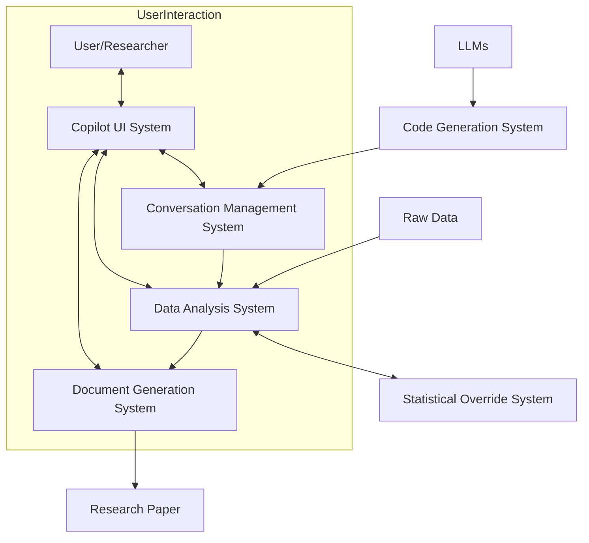

Sources: [README.md:38-44](), [README.md:45-57]()

### Key Components

1. **Data Analysis System**: Processes and analyzes raw data using statistical methods and machine learning techniques.

2. **Document Generation System**: Transforms analyzed data into LaTeX tables, figures, and a complete research paper.

3. **Code Generation System**: Generates data analysis code using LLMs with debugging capabilities.

4. **Conversation Management System**: Orchestrates interactions with LLMs.

5. **Statistical Override System**: Provides guardrails for statistical packages to prevent common LLM coding errors.

6. **Copilot UI System**: Provides a graphical interface for researcher guidance and oversight.

For more details on the system architecture, see [Architecture Overview](#1.2).

Sources: [README.md:58-59](), [pyproject.toml:6-9]()

## Research Workflow

The framework guides AI agents through the conventional scientific research path:

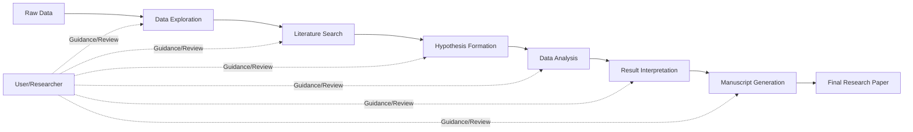

Sources: [README.md:80-83]()

## Code Execution Environment

The Code Execution Environment provides a secure sandbox for running AI-generated code:


This system ensures that AI-generated code runs safely and correctly, with guardrails to prevent common errors and a debugging system to identify and fix issues.

For more details about the Code Execution System, see [Code Execution System](#2).

Sources: [README.md:58-59]()

## Statistical Override System

The Statistical Override System intercepts calls to statistical packages and enforces proper behavior:

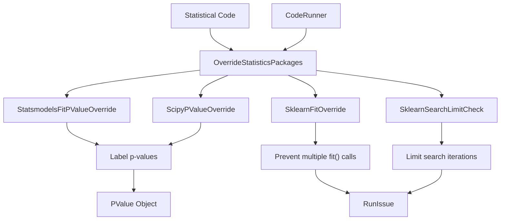

This system is a key guardrail that intercepts calls to statistical packages (`statsmodels`, `scipy`, `sklearn`) to enforce proper behavior, such as labeling p-values and preventing p-hacking.

For more details about the Statistical Override System, see [Statistical Package Overrides](#2.3).

Sources: [README.md:58-59](), [pyproject.toml:53-60]()

## Document Generation System

The Document Generation System transforms analyzed data into research papers:

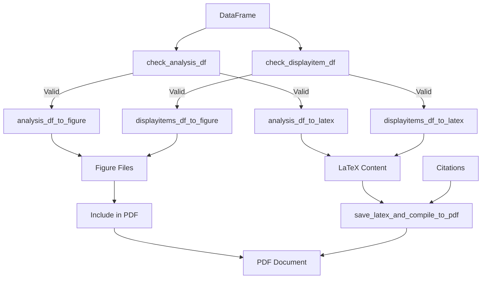

This system creates backward-traceable manuscripts where any numeric values can be traced back to the specific code lines that created them.

For more details about the Document Generation System, see [Document Generation System](#4).

Sources: [README.md:41-43]()

## Installation and Usage

### Installation

To install and set up the `data-to-paper` framework:

1. Install the package using pip:
   ```
   pip install data-to-paper
   ```

2. Install dependencies:
   - Pandoc for document conversion
   - LaTeX for PDF compilation

3. Set up API keys as environment variables:
   - OPENAI_API_KEY
   - SEMANTIC_SCHOLAR_API_KEY
   - DEEPINFRA_API_KEY (optional)

4. Check the installation:
   ```
   data-to-paper-chkres
   ```

5. Run the application:
   ```
   data-to-paper
   ```

For more detailed installation instructions, see [Installation and Setup](#1.1).

Sources: [INSTALL.md:1-9](), [INSTALL.md:22-44](), [INSTALL.md:48-56]()

### Example Usage

The framework includes several example datasets for testing:

| Dataset | Description | Command |
|---------|-------------|---------|
| Health Indicators | CDC's BRFSS 2015 dataset | `data-to-paper diabetes` |
| Social Network | Twitter interactions among 117th Congress members | `data-to-paper social_network` |
| Treatment Policy | NICU treatment outcomes | `data-to-paper npr_nicu` |
| Treatment Optimization (Easy) | Compare two ML methods | `data-to-paper ML_easy` |
| Treatment Optimization (Medium) | Compare ML and formula-based methods | `data-to-paper ML_medium` |
| Treatment Optimization (Hard) | Compare multiple methods | `data-to-paper ML_hard` |

Sources: [README.md:102-148]()

## Key Features

1. **End-to-end field-agnostic research**: The process navigates through the entire scientific path, from data exploration to creating complete research papers.

2. **Traceable "data-chained" manuscripts**: Creates backward-traceable papers where numeric values can be traced to specific code lines.

3. **Autopilot or Copilot operation**: Can run fully autonomously or with human guidance.

4. **Coding guardrails**: Statistical packages are overridden with guardrails to minimize common LLM coding errors.

Sources: [README.md:38-59]()

## Package Components

The `data-to-paper` package includes the following major components:

| Component | Description | Dependencies |
|-----------|-------------|--------------|
| Core Framework | Main research automation logic | OpenAI, regex, tiktoken |
| Statistical Overrides | Statistical package guardrails | numpy, pandas, statsmodels, scipy, scikit-learn |
| Document Generation | LaTeX and PDF generation | PyMuPDF, Jinja2 |
| User Interface | Copilot GUI application | PySide6, colorama, pygments |
| External Integrations | Literature search | requests |

Sources: [pyproject.toml:40-61]()

## Next Steps

For more information about specific components of the `data-to-paper` framework, see:

- [Code Execution System](#2) for details about the code execution environment
- [Data Analysis System](#3) for information about data processing and analysis
- [Document Generation System](#4) for documentation on creating research papers
- [LLM Interaction System](#5) for details about interacting with Large Language Models
- [User Interface](#6) for information about the GUI application

Sources: [README.md:86-90]()

---

# Page: Installation and Setup

# Installation and Setup

<details>
<summary>Relevant source files</summary>

The following files were used as context for generating this wiki page:

- [.gitignore](.gitignore)
- [INSTALL.md](INSTALL.md)
- [MANIFEST.in](MANIFEST.in)
- [README.md](README.md)
- [pyproject.toml](pyproject.toml)
- [release.py](release.py)

</details>


This document provides detailed instructions for installing and configuring the data-to-paper framework, a system for conducting reproducible AI-driven scientific research. The guide covers both standard user installation and developer setup options, required dependencies, API key configuration, and verification steps.

## Overview of Installation Process

The installation process consists of four main steps: package installation, dependency setup, API key configuration, and verification. The framework can be installed either as a regular user (via pip) or as a developer (from source).

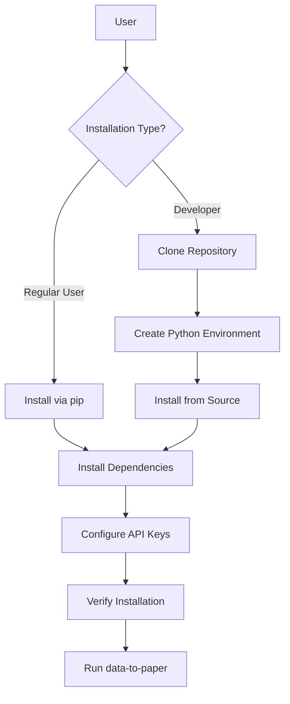

Sources: [README.md:24-29](), [INSTALL.md:1-9](), [INSTALL.md:11-20]()

## System Requirements

### Supported Platforms
The data-to-paper framework can run on multiple platforms:
- Linux
- macOS
- Windows

### Python Requirements
- Python 3.9 or later

### Third-Party Software Dependencies
- LaTeX distribution (for document compilation)
- Pandoc (for document conversion)

Sources: [pyproject.toml:62](), [INSTALL.md:22-44]()

## Installation for Regular Users

If you want to use the data-to-paper framework without modifying its source code, follow these steps:

1. Install the package using pip:
   ```bash
   pip install data-to-paper
   ```

2. Install dependencies as described in the [Dependencies](#dependencies) section below.

3. Configure API keys as described in the [API Key Configuration](#api-key-configuration) section.

4. Verify the installation:
   ```bash
   data-to-paper-chkres
   ```

5. Run the application:
   ```bash
   data-to-paper
   ```

Sources: [README.md:24-29](), [INSTALL.md:3-8]()

## Installation for Developers

If you plan to modify the source code or contribute to the project, follow these steps:

1. Clone the repository:
   ```bash
   git clone https://github.com/Technion-Kishony-lab/data-to-paper
   ```

2. Create and activate a Python environment (optional but recommended):
   ```bash
   conda create -n data-to-paper python=3.11
   conda activate data-to-paper
   ```

3. Navigate to the repository folder:
   ```bash
   cd data-to-paper
   ```

4. Install the package in development mode:
   ```bash
   pip install -e .
   ```

5. Install dependencies as described in the [Dependencies](#dependencies) section below.

6. Configure API keys as described in the [API Key Configuration](#api-key-configuration) section.

7. Verify the installation:
   ```bash
   data-to-paper-chkres
   ```

Sources: [INSTALL.md:11-20]()

## Dependencies

The framework has several dependencies that need to be installed separately:

### Package Dependencies

The following Python packages are automatically installed when you install data-to-paper:

| Category | Packages |
|----------|----------|
| Core | openai, regex, tiktoken, requests |
| UI | PySide6, colorama, pygments, ansi2html |
| Document Processing | PyMuPDF, Jinja2 |
| Data Analysis | numpy, pandas, scipy, statsmodels, scikit-learn, networkx, matplotlib |
| Testing | pytest |

### Pandoc Installation

Pandoc is used for document conversion:

1. Follow instructions at [Pandoc Installation](https://pandoc.org/installing.html)

### LaTeX Installation

LaTeX is required for PDF generation:

#### Debian-based Systems (Ubuntu, etc.)
```bash
sudo apt-get update && \
sudo apt-get install -y --no-install-recommends \
texlive-latex-base \
texlive-latex-extra \
texlive-fonts-recommended
```

#### macOS
```bash
# Install Homebrew if not already installed
# /bin/bash -c "$(curl -fsSL https://raw.githubusercontent.com/Homebrew/install/HEAD/install.sh)"

# Install MacTeX (without GUI)
brew install --cask mactex-no-gui
```

#### Windows
1. Download and install MiKTeX from [MiKTeX Download Page](https://miktex.org/download)
2. During installation, select 'Yes' when asked to install missing packages on-the-fly

Sources: [pyproject.toml:40-61](), [INSTALL.md:22-44]()

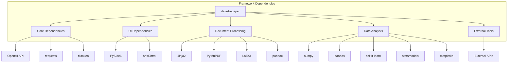

Sources: [pyproject.toml:40-61](), [INSTALL.md:22-44]()

## API Key Configuration

The framework requires several API keys to function properly:

### Required API Keys

1. **OPENAI_API_KEY** - For accessing OpenAI's language models
2. **SEMANTIC_SCHOLAR_API_KEY** - For literature search functionality
3. **DEEPINFRA_API_KEY** (optional) - For optional deep infrastructure features

### Setting Up API Keys

To configure these keys, set them as environment variables:

#### Linux/macOS
```bash
export OPENAI_API_KEY="your-openai-api-key"
export SEMANTIC_SCHOLAR_API_KEY="your-semantic-scholar-api-key"
export DEEPINFRA_API_KEY="your-deepinfra-api-key"  # Optional
```

To make these settings permanent, add these lines to your `~/.bashrc` or `~/.zshrc` file.

#### Windows
```cmd
setx OPENAI_API_KEY "your-openai-api-key"
setx SEMANTIC_SCHOLAR_API_KEY "your-semantic-scholar-api-key"
setx DEEPINFRA_API_KEY "your-deepinfra-api-key"  # Optional
```

### Obtaining API Keys

- **OpenAI API Key**: Sign up at [OpenAI API](https://platform.openai.com/signup) and create an API key in your account dashboard.
- **Semantic Scholar API Key**: Register for an API key at [Semantic Scholar API](https://www.semanticscholar.org/product/api).
- **DeepInfra API Key** (optional): Register at [DeepInfra](https://deepinfra.com) to obtain an API key.

Sources: [INSTALL.md:47-56]()

## Verification and Testing

After installation, verify that all dependencies and API keys are correctly configured:

```bash
data-to-paper-chkres
```

This command checks:
1. Python dependencies
2. External tools (LaTeX, pandoc)
3. API key configurations

If everything is set up correctly, you should see success messages for each check.

### Running the Application

Once verification is successful, you can run the application:

```bash
data-to-paper
```

The framework can also be run with console output using:

```bash
data-to-paper-run-with-console
```

Sources: [INSTALL.md:58-62](), [pyproject.toml:70-75]()

## Sample Projects

The data-to-paper framework includes several example projects you can try:

```bash
# Health Indicators dataset
data-to-paper diabetes

# Social Network analysis
data-to-paper social_network

# Treatment Policy analysis
data-to-paper npr_nicu

# Treatment Optimization (ML comparison)
data-to-paper ML_easy
data-to-paper ML_medium
data-to-paper ML_hard
```

Sources: [README.md:102-148]()

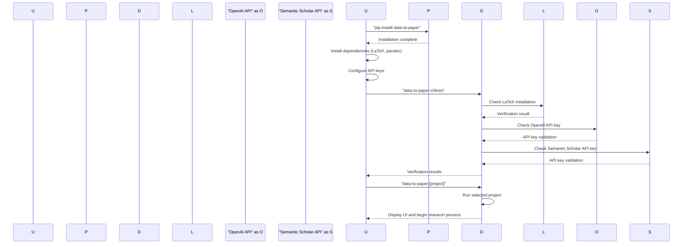

Sources: [INSTALL.md:1-62](), [README.md:24-29]()

## Troubleshooting

### Common Issues

1. **LaTeX compilation errors**
   - Ensure you have the complete LaTeX distribution installed
   - Check if your system PATH includes LaTeX binaries

2. **API key issues**
   - Verify that the environment variables are correctly set
   - Ensure you haven't reached API usage limits
   - Check for any special characters in your API keys

3. **Package dependency errors**
   - Try reinstalling with `pip install --force-reinstall data-to-paper`
   - Ensure your Python version is 3.9 or higher

### Getting Help

If you encounter issues not covered in this guide, you can:
- Check the project's GitHub repository for known issues
- Submit a new issue on the GitHub repository

Sources: [INSTALL.md:22-56](), [pyproject.toml:62]()

---

# Page: Architecture Overview

# Architecture Overview

<details>
<summary>Relevant source files</summary>

The following files were used as context for generating this wiki page:

- [INSTALL.md](INSTALL.md)
- [README.md](README.md)
- [tests/functional/latex/test_process_latex.py](tests/functional/latex/test_process_latex.py)

</details>


## Purpose and Scope

This document provides a technical overview of the data-to-paper framework's architecture, explaining how its major components interact to enable end-to-end AI-driven scientific research. It covers the system's high-level organization, core components, and their relationships. For installation instructions, see [Installation and Setup](#1.1).

Sources: [README.md:10-14]()

## High-Level System Architecture

The data-to-paper framework is structured as a multi-system pipeline that transforms raw data into research papers through several processing stages.

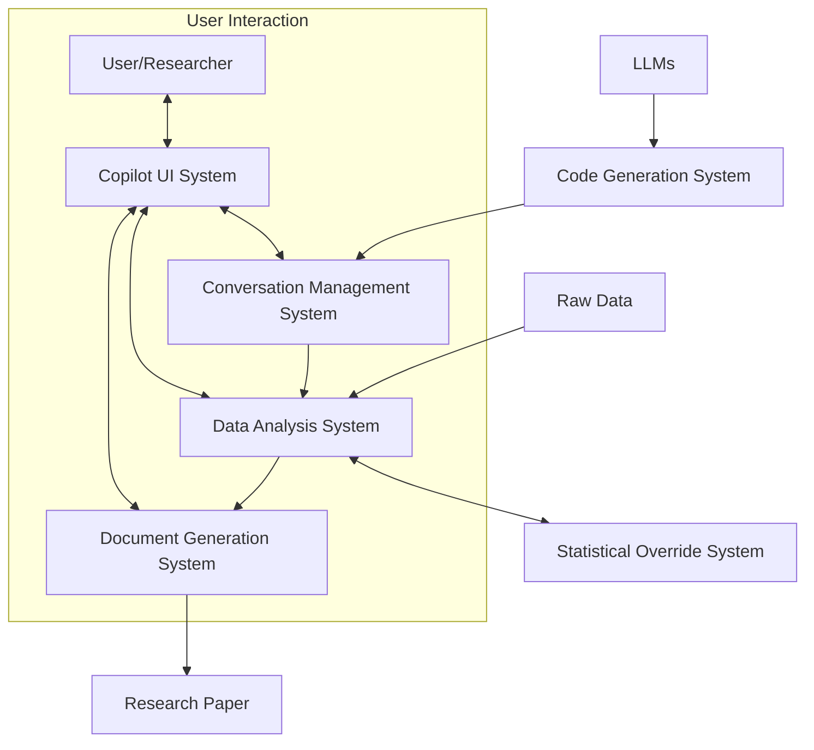

The framework consists of six primary interconnected systems:

| System | Primary Responsibility |
|--------|------------------------|
| Data Analysis System | Processes raw data using AI-generated code with statistical validation |
| Code Generation System | Uses LLMs to write and debug Python analytical code |
| Conversation Management System | Orchestrates interactions with Large Language Models |
| Statistical Override System | Provides safety guardrails for statistical operations |
| Document Generation System | Transforms analysis results into LaTeX and compiled PDFs |
| Copilot UI System | Enables human oversight and guidance of the research process |

Sources: [README.md:38-45](), [README.md:58-59]()

## Core Components

### 1. Code Execution System

The Code Execution System provides a secure sandbox for running AI-generated analytical code with appropriate safeguards.

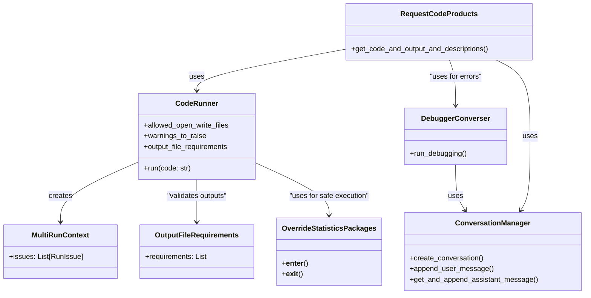

This diagram illustrates how `CodeRunner` serves as the central execution environment, with `DebuggerConverser` providing error handling and `RequestCodeProducts` managing the process of generating and executing code through conversations with LLMs.

For details on the specific safeguards and restrictions implemented in the Code Execution System, see [CodeRunner](#2.1) and [Debugging System](#2.2).

Sources: [README.md:58-59]()

### 2. Statistical Override System

The Statistical Override System intercepts calls to common statistical packages to enforce proper behavior and prevent typical errors in AI-generated statistical code.

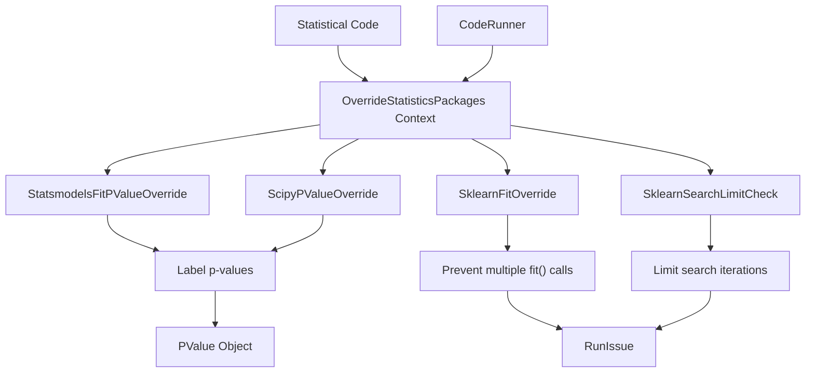

This system implements overrides for:
- `statsmodels` and `scipy` to properly label p-values
- `sklearn` to prevent redundant model fitting operations
- `sklearn` to limit hyperparameter search iterations

For more detailed information on statistical package overrides, see [Statistical Package Overrides](#2.3).

Sources: [README.md:58-59]()

### 3. Data Analysis System

The Data Analysis System processes raw data through validation, analysis, and visualization stages.

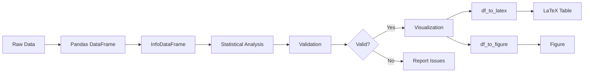

The system extends standard Pandas DataFrames with added metadata for traceability and implements validation checks to ensure data quality before visualization. For more information on data validation and visualization, see [DataFrame Validation](#3.1) and [Data Visualization](#3.2).

Sources: [README.md:41-42]()

### 4. Document Generation System

The Document Generation System transforms analyzed data into research paper components and compiles them into a final PDF.

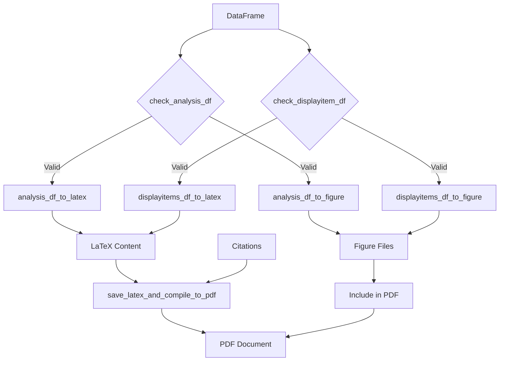

This system handles:
- Validation of data before conversion to LaTeX/figures
- Transformation of DataFrames to LaTeX tables and figures
- Compilation of all content into a PDF document

For more details on LaTeX generation and PDF compilation, see [LaTeX Generation](#4.1) and [PDF Compilation](#4.3).

Sources: [README.md:41-42](), [tests/functional/latex/test_process_latex.py:1-49]()

### 5. Conversation Management System

The Conversation Management System orchestrates interactions with LLMs throughout the research process.

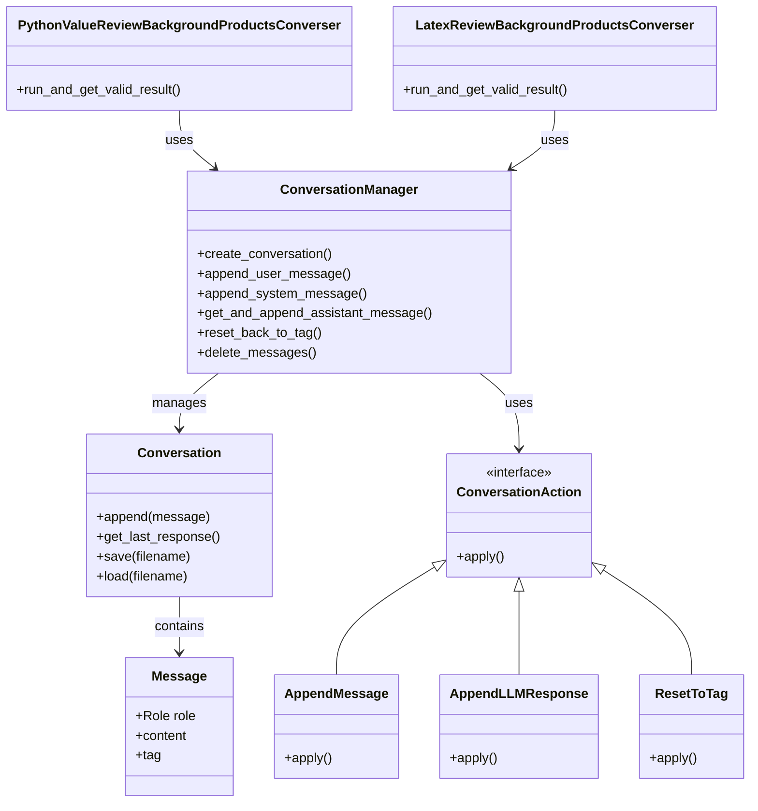

The system manages structured conversations with LLMs, extracting specific data types (Python values, LaTeX code, etc.) from responses. For additional details, see [Conversation Management](#5.1) and [Data Type Extraction](#5.2).

Sources: [INSTALL.md:48-56]() (API key references)

### 6. User Interface System

The User Interface System provides a graphical interface for researchers to interact with and guide the AI-driven research process.

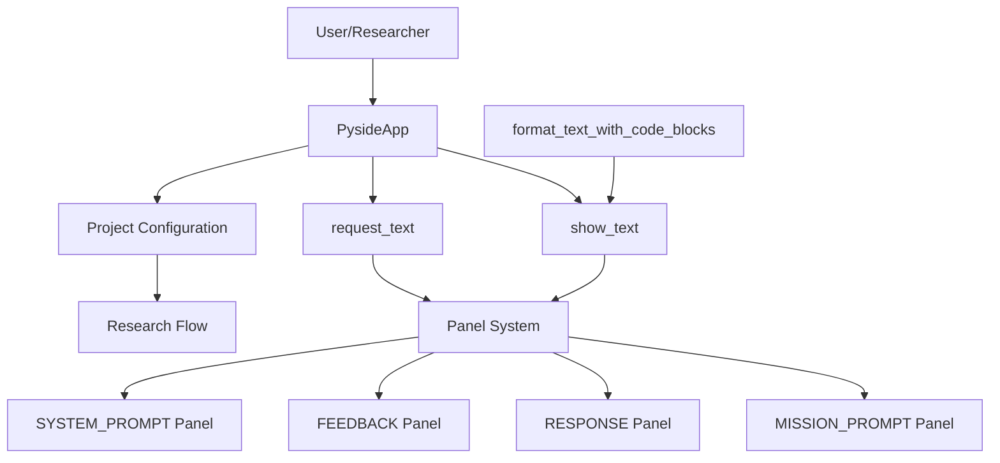

The UI system based on PySide/Qt provides:
- Text display with code highlighting
- User input collection
- Multiple panels for different content types
- Project configuration options

For more information on the user interface, see [PySide App](#6.1).

Sources: [README.md:45-57]()

## Data and Control Flow

The following sequence diagram illustrates the typical flow of data and control through the system components during a research project.

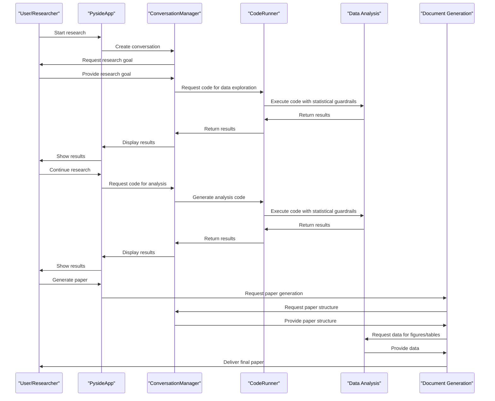

This diagram shows a typical research workflow, starting with setting research goals, proceeding through data exploration and analysis, and concluding with paper generation.

Sources: [README.md:63-67]()

## Security and Validation Features

The data-to-paper framework implements several security and validation mechanisms:

| Feature | Implementation | Purpose |
|---------|---------------|---------|
| Sandboxed Code Execution | `CodeRunner` class | Restricts file access and potentially dangerous operations |
| Statistical Guardrails | `OverrideStatisticsPackages` system | Prevents common statistical errors in AI-generated code |
| Data Validation | Validation functions before visualization | Ensures data quality and consistency |
| Output Validation | `check_analysis_df` and `check_displayitem_df` | Validates DataFrames before document generation |
| Traceability | Value tracking and linking | Allows any numeric value to be traced to its origin |

These features ensure that the research process remains safe, reliable, and transparent throughout all stages.

Sources: [README.md:58-59](), [README.md:41-42]()

---

# Page: Code Execution System

# Code Execution System

<details>
<summary>Relevant source files</summary>

The following files were used as context for generating this wiki page:

- [tests/functional/base_steps/test_debugger.py](tests/functional/base_steps/test_debugger.py)
- [tests/functional/base_steps/test_request_code.py](tests/functional/base_steps/test_request_code.py)
- [tests/functional/run_gpt_code/test_run_code.py](tests/functional/run_gpt_code/test_run_code.py)

</details>


The Code Execution System provides a secure, controlled environment for running AI-generated Python code within the data-to-paper framework. This system ensures that code execution is safe, reproducible, and properly integrated with the rest of the framework. It includes sandboxed execution, robust error handling, statistical package overrides, and automated debugging capabilities.

For details about how code is generated by LLMs, see [LLM Interaction System](#5). For information about data analysis performed using this execution system, see [Data Analysis System](#3).

## System Architecture

The Code Execution System consists of several interconnected components that work together to enable safe and controlled execution of Python code.

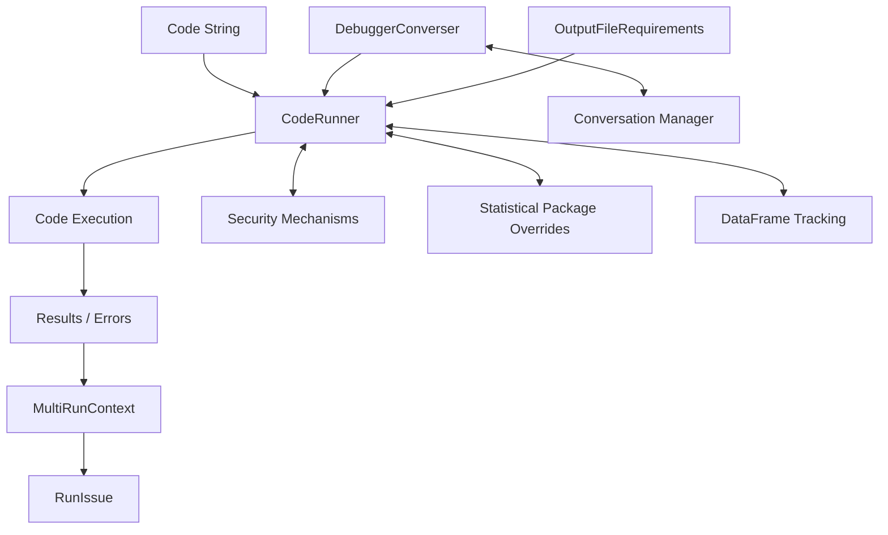

Sources: [tests/functional/run_gpt_code/test_run_code.py:9-18](), [tests/functional/base_steps/test_debugger.py:6-12]()

## Core Components

### CodeRunner

The `CodeRunner` class is the central component responsible for executing Python code in a controlled environment. It implements various security measures to prevent malicious or erroneous code execution.

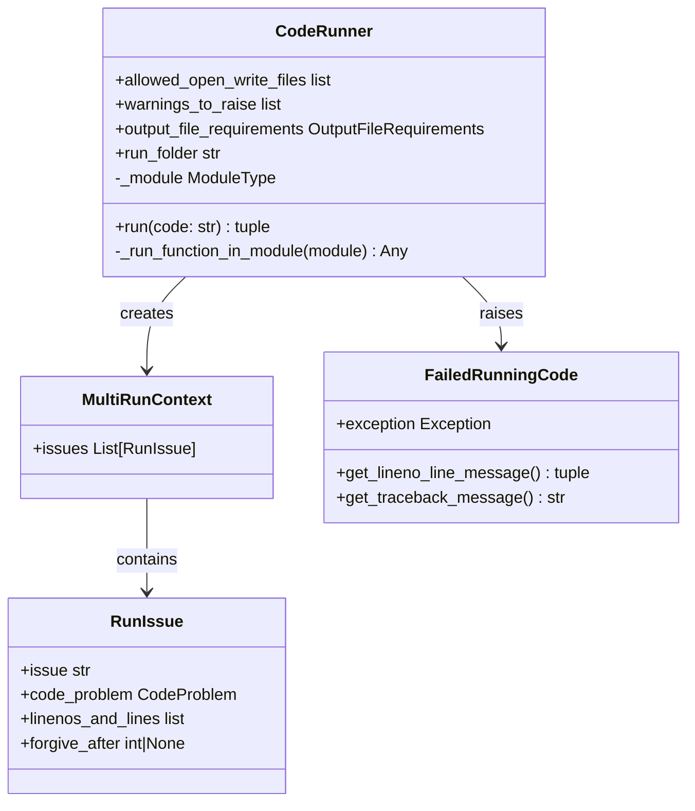

The `run()` method executes the provided code string and returns a tuple containing:
1. The result of the execution
2. A list of created files
3. A `MultiRunContext` object containing issues
4. An error object (if execution failed)

Sources: [tests/functional/run_gpt_code/test_run_code.py:9-10](), [tests/functional/run_gpt_code/test_run_code.py:21-23](), [tests/functional/run_gpt_code/test_run_code.py:31-32]()

### Security Mechanisms

The `CodeRunner` implements several security mechanisms to prevent harmful code execution:

1. **Forbidden Function Checks**: Prevents use of potentially dangerous functions like `input()`, `exit()`, `quit()`, and `eval()`.
2. **Module Import Restrictions**: Blocks imports of certain modules like `os`, `sys`, and `matplotlib` by default.
3. **File Access Control**: Restricts which files can be opened for writing.
4. **File Creation Validation**: Ensures only allowed files are created.

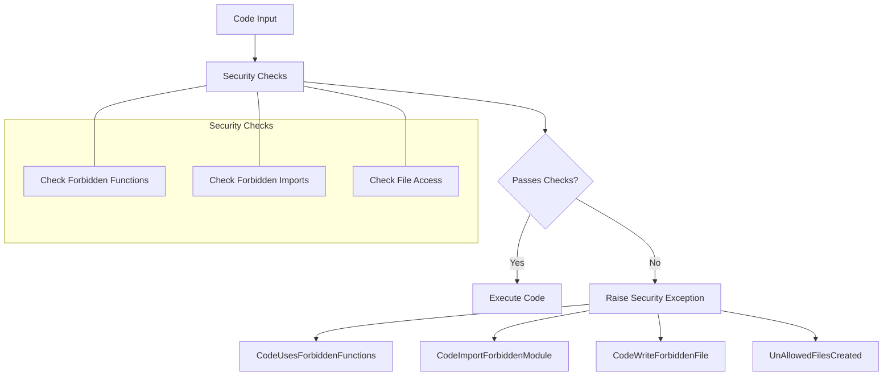

Sources: [tests/functional/run_gpt_code/test_run_code.py:10-11](), [tests/functional/run_gpt_code/test_run_code.py:100-113](), [tests/functional/run_gpt_code/test_run_code.py:126-150](), [tests/functional/run_gpt_code/test_run_code.py:177-195]()

### Error Handling and Debugging

The system provides robust error handling and debugging capabilities, using the `DebuggerConverser` to facilitate iterative debugging with LLM assistance.

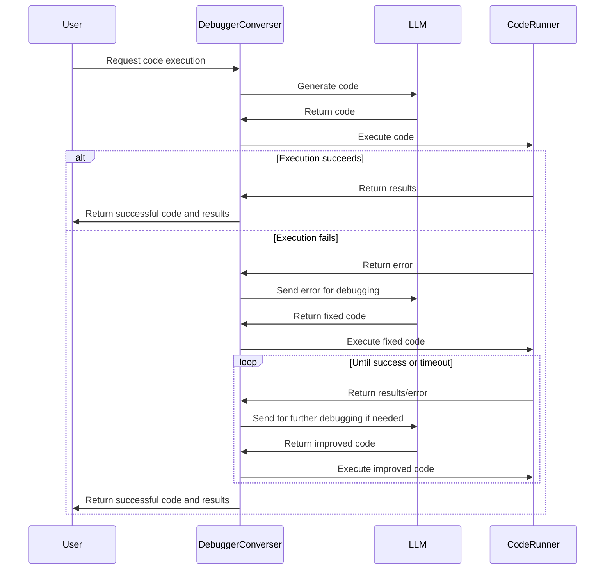

The `DebuggerConverser` manages the debugging process by:
1. Executing code using `CodeRunner`
2. Analyzing errors when execution fails
3. Communicating with LLMs to get improved code
4. Iterating until code executes successfully or a timeout is reached

Sources: [tests/functional/base_steps/test_debugger.py:6-12](), [tests/functional/base_steps/test_debugger.py:18-35](), [tests/functional/base_steps/test_debugger.py:95-117]()

## Statistical Package Overrides

The system includes mechanisms to override statistical packages to enforce correct behavior and prevent common errors. These overrides are implemented through context managers that temporarily modify the behavior of statistical functions.

```mermaid
classDiagram
    class OverrideStatisticsPackages {
        +__enter__()
        +__exit__()
    }
    
    class StatsmodelsFitPValueOverride {
        +override_methods()
    }
    
    class ScipyPValueOverride {
        +override_methods()
    }
    
    class SklearnFitOverride {
        +override_methods()
    }
    
    class SklearnRandomStateOverride {
        +override_methods()
    }
    
    class SklearnNNSizeOverride {
        +override_methods()
    }
    
    class SetRandomSeeds {
        +random_seed int
        +__enter__()
        +__exit__()
    }
    
    OverrideStatisticsPackages --> StatsmodelsFitPValueOverride : uses
    OverrideStatisticsPackages --> ScipyPValueOverride : uses
    OverrideStatisticsPackages --> SklearnFitOverride : uses
    OverrideStatisticsPackages --> SklearnRandomStateOverride : uses
    
    CodeRunner --> OverrideStatisticsPackages : uses
    CodeRunner --> SetRandomSeeds : uses
    CodeRunner --> SklearnNNSizeOverride : can use
```

The main types of statistical overrides include:

1. **P-value labeling**: Tracks p-values from statistical tests to ensure proper reporting
2. **Random state control**: Ensures reproducibility by setting random seeds
3. **Model fit monitoring**: Prevents multiple calls to fit() on the same model
4. **Neural network size limits**: Restricts neural network complexity to prevent excessive computation

Sources: [tests/functional/run_gpt_code/test_run_code.py:12-16](), [tests/functional/run_gpt_code/test_run_code.py:210-220](), [tests/functional/run_gpt_code/test_run_code.py:223-238](), [tests/functional/run_gpt_code/test_run_code.py:241-263](), [tests/functional/run_gpt_code/test_run_code.py:266-283]()

## DataFrame Tracking

The system includes a mechanism for tracking DataFrame changes during code execution to ensure that data integrity is maintained and that modifications are properly saved.

```mermaid
flowchart TD
    A["Original DataFrame"] --> B["TrackDataFrames Context"]
    
    B --> C["DataFrame Operations"]
    C --> D{"DataFrame Modified?"}
    
    D -->|"Yes"| E{"Saving Enforced?"}
    D -->|"No"| F["Continue"]
    
    E -->|"Yes"| G{"DataFrame Saved?"}
    E -->|"No"| F
    
    G -->|"Yes"| F
    G -->|"No"| H["Raise Issue"]
```

Key features of DataFrame tracking:

1. **Change detection**: Detects when DataFrames are modified during code execution
2. **Save enforcement**: Can require that modified DataFrames are saved
3. **Copy protection**: Can prevent modifications to existing DataFrames without making a copy first

Sources: [tests/functional/base_steps/test_request_code.py:14](), [tests/functional/base_steps/test_request_code.py:27](), [tests/functional/base_steps/test_request_code.py:44](), [tests/functional/base_steps/test_request_code.py:130-136]()

## Output File Requirements

The system allows specifying requirements for output files to ensure that code execution produces the expected outputs in the correct format.

```mermaid
classDiagram
    class OutputFileRequirements {
        +requirements List[OutputFileRequirement]
        +validate(files, context)
    }
    
    class OutputFileRequirement {
        <<abstract>>
        +validate(files, context)
    }
    
    class TextContentOutputFileRequirement {
        +filename_pattern str
        +validate(files, context)
    }
    
    class DataOutputFileRequirement {
        +filename_pattern str
        +validate(files, context)
    }
    
    class DictPickleContentOutputFileRequirement {
        +filename str
        +req_version int
        +validate(files, context)
    }
    
    OutputFileRequirements --> OutputFileRequirement : contains
    OutputFileRequirement <|-- TextContentOutputFileRequirement
    OutputFileRequirement <|-- DataOutputFileRequirement
    OutputFileRequirement <|-- DictPickleContentOutputFileRequirement
    
    CodeRunner --> OutputFileRequirements : uses
```

The `OutputFileRequirements` class validates that the files created during code execution meet the specified requirements. Different types of requirements are available for different file types, such as text files, data files, and pickled dictionaries.

Sources: [tests/functional/run_gpt_code/test_run_code.py:8](), [tests/functional/run_gpt_code/test_run_code.py:17](), [tests/functional/run_gpt_code/test_run_code.py:195](), [tests/functional/run_gpt_code/test_run_code.py:213-214](), [tests/functional/base_steps/test_request_code.py:15-16](), [tests/functional/base_steps/test_request_code.py:26](), [tests/functional/base_steps/test_debugger.py:8-9](), [tests/functional/base_steps/test_debugger.py:48-50]()

## Integration with Other Systems

The Code Execution System is tightly integrated with other components of the data-to-paper framework:

```mermaid
flowchart TD
    A["Code Execution System"] --> B["Data Analysis System"]
    A --> C["Document Generation System"]
    D["LLM Interaction System"] --> A
    
    subgraph "Code Execution System"
        E["CodeRunner"]
        F["DebuggerConverser"]
        G["Statistical Overrides"]
        H["DataFrame Tracking"]
    end
    
    subgraph "LLM Interaction System"
        I["ConversationManager"]
        J["RequestCodeProducts"]
    end
    
    F <--> I
    J --> E
    J --> F
```

Key integration points:

1. **LLM Interaction System**: Provides code generation capabilities through the `RequestCodeProducts` class, which uses the Code Execution System to run and debug the generated code.

2. **Data Analysis System**: Receives the output of code execution, particularly DataFrames and their associated metadata, for further analysis and visualization.

3. **Document Generation System**: Uses the results of code execution to generate research paper content, including tables, figures, and explanatory text.

Sources: [tests/functional/base_steps/test_request_code.py:9-11](), [tests/functional/base_steps/test_request_code.py:62-73]()

## Usage Examples

The following table shows common usage patterns for the Code Execution System:

| Use Case | Key Components | Example |
|----------|----------------|---------|
| Basic Code Execution | CodeRunner | `runner = CodeRunner()` <br> `result, files, context, error = runner.run(code)` |
| Execution with File Requirements | CodeRunner, OutputFileRequirements | `requirements = OutputFileRequirements([TextContentOutputFileRequirement('output.txt')])` <br> `runner = CodeRunner(output_file_requirements=requirements)` |
| Statistical Analysis | CodeRunner, OverrideStatisticsPackages | `with OverrideStatisticsPackages():` <br> `    runner.run(statistical_code)` |
| Reproducible Execution | CodeRunner, SetRandomSeeds | `with SetRandomSeeds(random_seed=42):` <br> `    runner.run(code_with_randomness)` |
| Debugging Code | DebuggerConverser | `debugger = DebuggerConverser(...)` <br> `code_and_output = debugger.run_debugging()` |
| DataFrame Tracking | CodeRunner, TrackDataFrames | `contexts = {'TrackDataFrames': TrackDataFrames()}` <br> `runner = CodeRunner(additional_contexts=contexts)` |

Sources: [tests/functional/run_gpt_code/test_run_code.py:31-32](), [tests/functional/run_gpt_code/test_run_code.py:194-195](), [tests/functional/run_gpt_code/test_run_code.py:210-216](), [tests/functional/run_gpt_code/test_run_code.py:241-263](), [tests/functional/base_steps/test_debugger.py:95-99](), [tests/functional/base_steps/test_request_code.py:43-44]()

---

# Page: CodeRunner

# CodeRunner

<details>
<summary>Relevant source files</summary>

The following files were used as context for generating this wiki page:

- [tests/functional/base_steps/test_debugger.py](tests/functional/base_steps/test_debugger.py)
- [tests/functional/base_steps/test_request_code.py](tests/functional/base_steps/test_request_code.py)
- [tests/functional/run_gpt_code/test_run_code.py](tests/functional/run_gpt_code/test_run_code.py)

</details>


## Overview

CodeRunner is a core component of the Code Execution System in the data-to-paper framework. It provides a secure sandboxed environment for executing Python code, particularly code generated by Large Language Models (LLMs). This document explains how CodeRunner works, its security features, and how it integrates with other components of the system.

For information about debugging code with LLM assistance, see [Debugging System](#2.2). For details about statistical package overrides used with CodeRunner, see [Statistical Package Overrides](#2.3).

Sources: [tests/functional/run_gpt_code/test_run_code.py:9-11]()

## Architecture and Components

CodeRunner serves as a secure execution environment that handles code execution with built-in safeguards. It can restrict forbidden operations, track created files, manage output requirements, and report execution issues.

### CodeRunner Core Architecture

```mermaid
classDiagram
    class CodeRunner {
        +run(code: str) → tuple
        +allowed_open_write_files: list|str
        +warnings_to_raise: list
        +warnings_to_issue: list
        +output_file_requirements: OutputFileRequirements
        +run_folder: str
        +modified_imports: tuple
        -_run_function_in_module(module) → Any
        -_module: ModuleType
    }
    
    class MultiRunContext {
        +issues: List[RunIssue]
    }
    
    class RunIssue {
        +issue: str
        +code_problem: CodeProblem
        +linenos_and_lines: list
        +forgive_after: int|None
    }
    
    class OutputFileRequirements {
        +requirements: List
        +validate(created_files)
    }
    
    class FailedRunningCode {
        +exception: Exception
        +get_lineno_line_message() → tuple
        +get_traceback_message() → str
    }
    
    CodeRunner --> MultiRunContext: "creates"
    MultiRunContext --> RunIssue: "contains"
    CodeRunner --> OutputFileRequirements: "validates outputs with"
    CodeRunner --> FailedRunningCode: "raises on error"
```

Sources: [tests/functional/run_gpt_code/test_run_code.py:9-11](), [tests/functional/run_gpt_code/test_run_code.py:31-33](), [tests/functional/run_gpt_code/test_run_code.py:43]()

### Integration with Data-to-Paper Framework

```mermaid
graph TD
    A["LLM"] --> B["Generated Code String"]
    B --> C["CodeRunner"]
    
    C --> D["Run Code"]
    D --> E["Success"]
    D --> F["Error"]
    
    E --> G["Result"]
    E --> H["Created Files"]
    E --> I["MultiRunContext"]
    
    F --> J["FailedRunningCode"]
    J --> K["DebuggerConverser"]
    K --> L["Fixed Code"]
    L --> C
    
    H --> M["DataFrame Validation"]
    H --> N["Document Generation"]
    
    I --> O["Warning Issues"]
    I --> P["Statistical Annotations"]
```

Sources: [tests/functional/run_gpt_code/test_run_code.py:21-23](), [tests/functional/base_steps/test_debugger.py:28-38]()

## Key Features

### Code Execution

CodeRunner's primary function is to execute Python code strings safely. The `run()` method takes a code string as input and returns a tuple containing:

1. The execution result (if applicable)
2. Created files
3. A `MultiRunContext` object with execution issues
4. Error information (if the execution failed)

```python
result, created_files, multi_context, error = CodeRunner().run(code)
```

The executed code is run in a module context, which is stored in the `_module` attribute of the CodeRunner instance.

Sources: [tests/functional/run_gpt_code/test_run_code.py:31-33](), [tests/functional/run_gpt_code/test_run_code.py:43]()

### Security Restrictions

CodeRunner implements multiple layers of security to ensure safe execution of potentially untrusted code:

#### Forbidden Function Calls

CodeRunner prevents the use of potentially dangerous functions:

| Forbidden Function | Reason |
|-------------------|--------|
| `input()` | Blocks execution waiting for user input |
| `exit()` | Terminates the program |
| `quit()` | Terminates the program |
| `eval()` | Executes arbitrary code |
| `print()` (warns but doesn't block) | Encourages proper output file usage |

Sources: [tests/functional/run_gpt_code/test_run_code.py:100-113](), [tests/functional/run_gpt_code/test_run_code.py:116-123]()

#### Import Restrictions

By default, CodeRunner restricts imports of modules that could be used to access system resources:

| Restricted Modules | Example |
|-------------------|---------|
| `os` | System operations |
| `sys` | Python runtime environment |
| `matplotlib` (configurable) | Visualization (can be configured) |

The `modified_imports` parameter allows specifying which imports to restrict or modify.

Sources: [tests/functional/run_gpt_code/test_run_code.py:126-150](), [tests/functional/run_gpt_code/test_run_code.py:153-159]()

#### File Operation Restrictions

CodeRunner can restrict which files the code is allowed to write to:

- With `allowed_open_write_files=[]`, no file writing is allowed
- With `allowed_open_write_files=['file1.txt', 'file2.csv']`, only specified files can be written
- With `allowed_open_write_files='all'`, all file operations are allowed but still tracked

Sources: [tests/functional/run_gpt_code/test_run_code.py:177-190](), [tests/functional/run_gpt_code/test_run_code.py:193-195]()

### Error Handling

When code execution fails, CodeRunner catches exceptions and provides detailed error information:

- Line numbers and code snippets where the error occurred
- Formatted traceback messages for debugging
- Categorized error types via specific exception classes

```python
error = CodeRunner().run(code)[3]
if isinstance(error, FailedRunningCode):
    linenos_lines, msg = error.get_lineno_line_message()
    # linenos_lines contains tuples of (line_number, line_content)
```

Sources: [tests/functional/run_gpt_code/test_run_code.py:36-47](), [tests/functional/run_gpt_code/test_run_code.py:83-97]()

### Warning Management

CodeRunner can handle warnings in two ways:

1. **Raise warnings as exceptions**:
   ```python
   error = CodeRunner(warnings_to_raise=[UserWarning]).run(code)[3]
   ```

2. **Issue warnings as non-fatal issues**:
   ```python
   result, created_files, multi_context, error = CodeRunner(warnings_to_issue=[UserWarning]).run(code)
   issues = multi_context.issues  # Contains the warnings
   ```

Sources: [tests/functional/run_gpt_code/test_run_code.py:58-80]()

### Output File Requirements

CodeRunner can enforce requirements on output files through the `OutputFileRequirements` class:

```python
CodeRunner(
    allowed_open_write_files=['results.pkl'],
    output_file_requirements=OutputFileRequirements([
        DictPickleContentOutputFileRequirement('results.pkl', 1)
    ])
).run(code)
```

This ensures that code produces files in specific formats and with required content types.

Sources: [tests/functional/run_gpt_code/test_run_code.py:198-221]()

## Extension and Customization

### Custom Run Contexts

CodeRunner can be extended with additional contexts to modify execution behavior:

```mermaid
graph TD
    A["CodeRunner"] --> B["Run Code"]
    B --> C{"Run Contexts"}
    
    C --> D["OverrideStatisticsPackages"]
    C --> E["SetRandomSeeds"]
    C --> F["SklearnRandomStateOverride"]
    C --> G["SklearnNNSizeOverride"]
    C --> H["TrackDataFrames"]
    
    D --> I["Scipy, Statsmodels, Sklearn Behavior Modifications"]
    E --> J["Deterministic Random Number Generation"]
    F --> K["Fixed Random State for Models"]
    G --> L["Neural Network Size Limits"]
    H --> M["DataFrame Tracking and Validation"]
```

Sources: [tests/functional/run_gpt_code/test_run_code.py:210-221](), [tests/functional/run_gpt_code/test_run_code.py:235-263](), [tests/functional/base_steps/test_request_code.py:44]()

### Custom CodeRunner Subclasses

CodeRunner can be subclassed to customize behavior:

```python
class CallFuncCodeRunner(CodeRunner):
    def _run_function_in_module(self, module: ModuleType):
        return module.func()
```

The `TestCodeRunnerWithForgive` example shows how to create a specialized CodeRunner that handles specific types of issues, with the ability to "forgive" certain issues after a specific number of attempts.

Sources: [tests/functional/run_gpt_code/test_run_code.py:21-23](), [tests/functional/base_steps/test_debugger.py:28-38]()

## Usage Examples

### Basic Code Execution

```python
code = """
def f():
    return 'hello'
"""
run_code = CodeRunner()
result, created_files, multi_context, error = run_code.run(code)
# Access defined functions via the module
hello_result = run_code._module.f()  # 'hello'
```

Sources: [tests/functional/run_gpt_code/test_run_code.py:26-33]()

### Executing Code with Statistical Overrides

```python
with OverrideStatisticsPackages():
    error = CodeRunner(
        run_folder=tmpdir,
        allowed_open_write_files=['results.pkl'],
        output_file_requirements=OutputFileRequirements([
            DictPickleContentOutputFileRequirement('results.pkl', 1)
        ])
    ).run(statistical_code)
```

Sources: [tests/functional/run_gpt_code/test_run_code.py:198-221]()

### Reproducible Machine Learning

```python
with SetRandomSeeds(random_seed=42):
    result = CodeRunner().run(ml_code)
```

Sources: [tests/functional/run_gpt_code/test_run_code.py:254-263]()

## Integration with Debugging System

When CodeRunner encounters errors, these can be automatically addressed using the `DebuggerConverser`, which works with an LLM to fix the code:

```python
debugger = DebuggerConverser(
    output_file_requirements=OutputFileRequirements([
        TextContentOutputFileRequirement('output.txt')
    ])
)
fixed_code_and_output = debugger.run_debugging()
```

Sources: [tests/functional/base_steps/test_debugger.py:45-50](), [tests/functional/base_steps/test_debugger.py:95-99]()

## Summary

CodeRunner is a fundamental component of the data-to-paper framework that enables secure execution of code, typically generated by Large Language Models. It provides comprehensive security features, extensive error handling, and integration with other system components like the DebuggerConverser. Through its customization options, it can be tailored to specific execution requirements, making it a versatile tool for reproducible scientific research.

---

# Page: Debugging System

# Debugging System

<details>
<summary>Relevant source files</summary>

The following files were used as context for generating this wiki page:

- [tests/functional/base_steps/test_debugger.py](tests/functional/base_steps/test_debugger.py)
- [tests/functional/base_steps/test_request_code.py](tests/functional/base_steps/test_request_code.py)
- [tests/functional/run_gpt_code/test_run_code.py](tests/functional/run_gpt_code/test_run_code.py)

</details>


The Debugging System is a critical component of the `data-to-paper` framework that facilitates automatic error detection and correction in AI-generated code. It serves as a bridge between the Code Execution System and the LLM Interaction System, providing an intelligent feedback loop that enables iterative debugging with assistance from large language models.

This page describes the debugging components, workflow, and error handling mechanisms. For information about the underlying code execution environment, see [CodeRunner](#2.1). For details on statistical safety measures, see [Statistical Package Overrides](#2.3).

## Components and Architecture

The Debugging System is centered around the `DebuggerConverser` class, which orchestrates the debugging process by detecting code issues, generating appropriate error messages, and working with LLMs to fix problems.

```mermaid
classDiagram
    class DebuggerConverser {
      +run_debugging()
      -code_runner_cls
      -output_file_requirements
      -data_folder
      -data_filenames
      -timeout_sec
    }
    
    class CodeRunner {
      +run(code: str)
      +allowed_open_write_files
      +warnings_to_raise
      +output_file_requirements
    }
    
    class MultiRunContext {
      +issues: List[RunIssue]
    }
    
    class RunIssue {
      +issue: str
      +code_problem: CodeProblem
      +forgive_after: int
      +linenos_and_lines: List[Tuple]
    }
    
    class ConversationManager {
      +create_conversation()
      +append_user_message()
      +get_and_append_assistant_message()
    }
    
    DebuggerConverser --> CodeRunner: "uses to execute code"
    DebuggerConverser --> ConversationManager: "uses for LLM interactions"
    CodeRunner --> MultiRunContext: "creates"
    MultiRunContext *-- RunIssue: "contains"
```

Sources: [tests/functional/base_steps/test_debugger.py:6-24](), [tests/functional/run_gpt_code/test_run_code.py:9-24]()

## Debugging Workflow

The debugging system follows an iterative process to detect and fix issues in code:

```mermaid
flowchart TD
    A["Initial Code"] --> B["CodeRunner.run()"]
    B --> C{"Errors or Issues?"}
    C -->|"Yes"| D["Format Error Message"]
    D --> E["Send to LLM via ConversationManager"]
    E --> F["Get Corrected Code"]
    F --> B
    C -->|"No"| G["Return Successful Result"]
    
    subgraph "Error Types"
        H["Syntax Errors"]
        I["Execution Errors"]
        J["Runtime Issues"]
        K["Security Violations"]
        L["Output Requirements"]
    end
    
    H --> D
    I --> D
    J --> D
    K --> D
    L --> D
```

Sources: [tests/functional/base_steps/test_debugger.py:95-117](), [tests/functional/run_gpt_code/test_run_code.py:35-97]()

### Key Methods

The main entry point to the debugging system is the `run_debugging()` method of `DebuggerConverser`, which:

1. Takes code (often AI-generated)
2. Attempts to run it using `CodeRunner`
3. If issues are found, formats detailed error messages
4. Passes these messages to an LLM via the Conversation Management System
5. Gets corrected code from the LLM
6. Repeats until the code runs without issues or timeout occurs

Sources: [tests/functional/base_steps/test_debugger.py:95-117]()

## Error Types and Handling

The Debugging System handles a variety of error types, providing detailed context for the LLM to understand and fix issues:

### 1. Syntax Errors

Detected when code fails to parse. Error messages include line numbers and offending code segments.

```
SyntaxError: unexpected EOF while parsing
Line 3: f.write(
```

### 2. Execution Errors

Includes forbidden function calls, restricted imports, and general Python exceptions.

```mermaid
classDiagram
    class CodeUsesForbiddenFunctions {
      +function_name: str
    }
    
    class CodeImportForbiddenModule {
      +module: str
    }
    
    class CodeWriteForbiddenFile {
      +file_path: str
    }
    
    class UnAllowedFilesCreated {
      +created_files: List[str] 
    }
    
    class FailedRunningCode {
      +exception
      +get_lineno_line_message()
      +get_traceback_message()
    }
    
    FailedRunningCode <|-- CodeUsesForbiddenFunctions
    FailedRunningCode <|-- CodeImportForbiddenModule
    FailedRunningCode <|-- CodeWriteForbiddenFile
    FailedRunningCode <|-- UnAllowedFilesCreated
```

Sources: [tests/functional/run_gpt_code/test_run_code.py:10-11](), [tests/functional/run_gpt_code/test_run_code.py:99-190]()

### 3. Runtime Issues

Includes timeouts for long-running code and statistical inference issues.

Sources: [tests/functional/base_steps/test_debugger.py:119-124]()

### 4. Forgiveness Mechanism

The system can "forgive" certain minor issues after seeing them a specific number of times. This prevents endless debugging loops for non-critical warnings.

```python
RunIssue(issue='Small problem that can be forgiven',
         code_problem=CodeProblem.OutputFileAnnotation,
         forgive_after=1)
```

Sources: [tests/functional/base_steps/test_debugger.py:27-42](), [tests/functional/base_steps/test_debugger.py:126-134]()

## Integration with Other Systems

### Integration with Code Generation

The Debugging System complements the Code Generation System by providing a mechanism to fix issues in AI-generated code. This integration is handled through the `RequestCodeProducts` class, which:

1. Requests code from an LLM
2. Runs the code using `CodeRunner`
3. If errors occur, invokes the Debugging System
4. Collects explanations of the code and its outputs

```mermaid
flowchart TD
    A["RequestCodeProducts.get_code_and_output_and_descriptions()"] --> B["Get code from LLM"]
    B --> C["CodeRunner.run()"]
    C --> D{"Errors or Issues?"}
    D -->|"Yes"| E["DebuggerConverser.run_debugging()"]
    E --> B
    D -->|"No"| F["Request explanations"]
    F --> G["Return code, output, and descriptions"]
```

Sources: [tests/functional/base_steps/test_request_code.py:62-73](), [tests/functional/base_steps/test_request_code.py:221-251]()

### Integration with Statistical Overrides

The Debugging System works with the Statistical Override System to enforce correct statistical practices. When code is run through `CodeRunner`, it can use contexts like `OverrideStatisticsPackages` to intercept and modify statistical function calls, reporting issues when problematic patterns are detected.

```python
with OverrideStatisticsPackages():
    error = CodeRunner(...).run(code)[3]
```

Sources: [tests/functional/run_gpt_code/test_run_code.py:210-220](), [tests/functional/run_gpt_code/test_run_code.py:12-15]()

## Example Debugging Flow

Here's an example of the debugging process in action:

1. LLM generates code with a syntax error:
   ```python
   with open('test_output.txt', 'w') as f:
       f.write(
   ```

2. `CodeRunner` executes the code and detects the error

3. `DebuggerConverser` formats the error message with context:
   ```
   SyntaxError: unexpected EOF while parsing
   Line 2: f.write(
   ```

4. The error message is sent to the LLM via the Conversation Manager

5. LLM responds with corrected code:
   ```python
   with open('test_output.txt', 'w') as f:
       f.write('The answer is 42')
   ```

6. The corrected code is executed successfully

Sources: [tests/functional/base_steps/test_debugger.py:102-117]()

## Configuration Options

The Debugging System can be configured with several options:

| Option | Description | Example |
|--------|-------------|---------|
| `timeout_sec` | Maximum execution time allowed for code | `timeout_sec=3` |
| `output_file_requirements` | Required output files with validation rules | `OutputFileRequirements([TextContentOutputFileRequirement('output.txt')])` |
| `data_folder` | Folder containing input data files | `/path/to/data` |
| `data_filenames` | Names of input data files | `('data.csv',)` |
| `code_runner_cls` | Class to use for code execution | `CodeRunner` |

Sources: [tests/functional/base_steps/test_debugger.py:46-55]()

## Timeout Handling

The Debugging System includes functionality to handle code that runs for too long, which is particularly important when dealing with potentially infinite loops or inefficient algorithms in AI-generated code.

Sources: [tests/functional/base_steps/test_debugger.py:54-55](), [tests/functional/base_steps/test_debugger.py:119-124]()

---

# Page: Statistical Package Overrides

# Statistical Package Overrides

<details>
<summary>Relevant source files</summary>

The following files were used as context for generating this wiki page:

- [tests/functional/run_gpt_code/test_sklearn.py](tests/functional/run_gpt_code/test_sklearn.py)
- [tests/functional/run_gpt_code/test_statsmodels.py](tests/functional/run_gpt_code/test_statsmodels.py)

</details>


## Purpose and Overview

The Statistical Package Overrides system is a critical component of the `data-to-paper` framework that ensures statistical analysis is performed correctly and consistently. It intercepts calls to popular statistical packages and modifies their behavior to:

1. Track and properly label p-values to prevent misinterpretation
2. Prevent common statistical errors and pitfalls
3. Enforce best practices in statistical reporting
4. Limit computationally expensive operations to reasonable bounds

This system works transparently during code execution to help researchers avoid common statistical pitfalls without having to modify their analysis code.

Sources: [tests/functional/run_gpt_code/test_statsmodels.py:11-17]()

## Architecture Overview

```mermaid
classDiagram
    class OverrideStatisticsPackages {
        +__enter__()
        +__exit__()
        +issues: List[RunIssue]
    }
    
    class StatsmodelsFitPValueOverride {
        +__enter__()
        +__exit__()
        +pvalue_creating_funcs: List
    }
    
    class ScipyPValueOverride {
        +__enter__()
        +__exit__()
        +prevent_unpacking: bool
    }
    
    class SklearnFitOverride {
        +__enter__()
        +__exit__()
    }
    
    class SklearnSearchLimitCheck {
        +__enter__()
        +__exit__()
        +max_iterations: int
    }
    
    class PValue {
        +value: float
        +created_by: str
        +__str__()
        +__float__()
    }
    
    OverrideStatisticsPackages --> StatsmodelsFitPValueOverride: uses
    OverrideStatisticsPackages --> ScipyPValueOverride: uses
    OverrideStatisticsPackages --> SklearnFitOverride: uses
    OverrideStatisticsPackages --> SklearnSearchLimitCheck: uses
    
    StatsmodelsFitPValueOverride --> PValue: creates
    ScipyPValueOverride --> PValue: creates
```

**Class Hierarchy of Statistical Package Overrides**

The system uses a set of context managers to override the behavior of statistical packages. The main context manager, `OverrideStatisticsPackages`, applies all specific overrides and collects any issues that arise during execution.

Sources: [tests/functional/run_gpt_code/test_statsmodels.py:12-17](), [tests/functional/run_gpt_code/test_statsmodels.py:49-55]()

## P-Value Tracking System

```mermaid
flowchart TD
    A["Statistical Function Called"] --> B{"Override Active?"}
    B -->|"No"| C["Normal Execution"]
    B -->|"Yes"| D["Intercept Function Call"]
    D --> E["Extract P-value"]
    E --> F["Create PValue Object"]
    F --> G["Return Result with PValue Object"]
    
    H["User Accesses p-value"] --> I{"is_p_value Check"}
    I -->|"Yes"| J["Special Handling"]
    I -->|"No"| K["Normal Behavior"]
    
    J --> L["Prevent Conversion to Float"]
    J --> M["Custom String Representation"]
```

**P-Value Tracking Workflow**

The core of the statistical override system is the `PValue` class, which wraps standard floating-point p-values with metadata:

- Tracks the statistical method that generated the p-value
- Prevents improper conversion to float (which would strip this metadata)
- Provides custom string representation for proper reporting

The `is_p_value()` function checks if a value is a `PValue` object, enabling special handling throughout the system.

Sources: [tests/functional/run_gpt_code/test_statsmodels.py:17](), [tests/functional/run_gpt_code/test_statsmodels.py:85-92]()

## Package-Specific Overrides

### Statsmodels Overrides

The `StatsmodelsFitPValueOverride` manages several behaviors for the statsmodels package:

1. **P-value Labeling**: 
   - Replaces float p-values with `PValue` objects that track their origin
   - Works with multiple model types (OLS, WLS, GLS, GLM, Logit)
   - Tracks which methods created p-values

2. **Usage Enforcement**:
   - Prevents the use of `summary()` method, encouraging more standardized reporting
   - Allows `summary2()` for better tabular output
   - Prevents conversion of p-values to raw floats

3. **Error Detection**:
   - Detects NaN p-values and issues warnings
   - Identifies singular matrix problems
   - Creates issues when fit() is not called on models

Sources: [tests/functional/run_gpt_code/test_statsmodels.py:72-99](), [tests/functional/run_gpt_code/test_statsmodels.py:102-115](), [tests/functional/run_gpt_code/test_statsmodels.py:129-141]()

### Scipy Overrides

The `ScipyPValueOverride` class modifies scipy statistical functions:

1. **P-value Labeling**:
   - Labels p-values from functions like `ttest_1samp`, `ttest_ind`, and `chi2_contingency`
   - Tracks the function that created each p-value

2. **Error Prevention**:
   - Raises errors on NaN p-values
   - Optionally prevents result unpacking (e.g., `statistic, pvalue = result`) to encourage accessing named attributes
   - Blocks index-based access to result tuples (`result[1]`) in favor of named attributes (`result.pvalue`)

Sources: [tests/functional/run_gpt_code/test_statsmodels.py:291-307](), [tests/functional/run_gpt_code/test_statsmodels.py:357-379]()

### Scikit-learn Overrides

The scikit-learn overrides address two major issues:

1. **`SklearnFitOverride`**:
   - Prevents multiple calls to `fit()` on the same model instance
   - Solves a subtle bug where scikit-learn reuses the same model object, causing unexpected behavior when data changes

2. **`SklearnSearchLimitCheck`**:
   - Limits the number of iterations in hyperparameter searches (GridSearchCV, RandomizedSearchCV)
   - Prevents computationally expensive searches from running too long
   - Raises a `RunIssue` when the search would exceed the maximum iterations

3. **`SklearnPValue`**:
   - Labels p-values from scikit-learn feature selection methods

Sources: [tests/functional/run_gpt_code/test_statsmodels.py:217-241](), [tests/functional/run_gpt_code/test_sklearn.py:12-57](), [tests/functional/run_gpt_code/test_sklearn.py:60-65]()

## Integration with Code Execution System

```mermaid
sequenceDiagram
    participant "User" as User
    participant "CodeRunner" as CodeRunner
    participant "OverrideStatisticsPackages" as OverrideStats
    participant "Statistical Function" as StatFn
    
    User->>CodeRunner: run(code_with_statistics)
    CodeRunner->>OverrideStats: __enter__()
    activate OverrideStats
    CodeRunner->>StatFn: execute statistical test
    StatFn->>OverrideStats: intercept call
    OverrideStats-->>StatFn: return modified result
    StatFn-->>CodeRunner: return result with PValue objects
    CodeRunner->>OverrideStats: __exit__()
    OverrideStats-->>CodeRunner: return issues detected
    deactivate OverrideStats
    CodeRunner-->>User: return results and issues
```

**Integration Flow with CodeRunner**

The `CodeRunner` class automatically applies statistical package overrides when executing code. It:

1. Enters the `OverrideStatisticsPackages` context
2. Executes the user's statistical code
3. Collects any issues that arise during execution
4. Reports these issues along with the execution results

This integration ensures that all statistical code runs with the necessary safeguards automatically applied.

Sources: [tests/functional/run_gpt_code/test_statsmodels.py:254-262](), [tests/functional/run_gpt_code/test_statsmodels.py:275-282]()

## Common Issues Detected

The statistical package overrides detect several common issues:

| Issue | Description | Package | Action |
|-------|-------------|---------|--------|
| NaN p-values | P-values that are NaN due to missing data or other issues | statsmodels, scipy | Raises `RunIssue` with explanation |
| Multiple `fit()` calls | Calling `fit()` multiple times on the same sklearn model | sklearn | Raises `RunIssue` to prevent the second call |
| Excessive search iterations | Hyperparameter searches with too many iterations | sklearn | Limits iterations and raises `RunIssue` if exceeded |
| Singular matrix warnings | Models with redundant features leading to singular matrices | statsmodels | Issues warning about potential multicollinearity |
| Unpacking statistical results | Using tuple unpacking instead of named attributes | scipy | Either prevents unpacking or issues guidance |
| Missing `fit()` call | Creating a model without calling `fit()` | statsmodels | Issues reminder to call `fit()` |

Sources: [tests/functional/run_gpt_code/test_statsmodels.py:102-115](), [tests/functional/run_gpt_code/test_statsmodels.py:129-141](), [tests/functional/run_gpt_code/test_statsmodels.py:302-307](), [tests/functional/run_gpt_code/test_sklearn.py:12-33]()

## Usage Examples

### Basic Usage with CodeRunner

To apply statistical overrides when running code:

```python
from data_to_paper.run_gpt_code.code_runner import CodeRunner
from data_to_paper.run_gpt_code.overrides.contexts import OverrideStatisticsPackages

# Code will run with all statistical overrides applied
result, _, _, exception = CodeRunner(
    additional_contexts={'OverrideStatisticsPackages': OverrideStatisticsPackages()}
).run(statistical_code)

# Check for any statistical issues
if exception:
    print(f"Statistical issue detected: {exception}")
```

### Manual Context Usage

For more control, you can manually use the context managers:

```python
from data_to_paper.run_gpt_code.overrides.contexts import OverrideStatisticsPackages

with OverrideStatisticsPackages() as context:
    # Your statistical code here
    model = ols('y ~ x', data=data).fit()
    p_value = model.pvalues[0]  # This will be a PValue object
    
# Check if any issues were detected
if context.issues:
    print(f"Issues detected: {context.issues}")
```

Sources: [tests/functional/run_gpt_code/test_statsmodels.py:49-55](), [tests/functional/run_gpt_code/test_statsmodels.py:254-262]()

## Best Practices

When working with the statistical package overrides, follow these best practices:

1. **Use Named Attributes**: Access result attributes by name (e.g., `result.pvalue`) rather than by index or unpacking
2. **Check Issue Reports**: Always check for issues returned by the context manager
3. **Use `summary2()` Instead of `summary()`**: For statsmodels, prefer `summary2()` for better tabular output
4. **Keep Hyperparameter Searches Reasonable**: Limit the search space in GridSearchCV and RandomizedSearchCV
5. **Always Call `fit()`**: Make sure to call `fit()` on models before accessing results
6. **Create New Model Instances**: Create new model instances rather than reusing existing ones with new data

Sources: [tests/functional/run_gpt_code/test_statsmodels.py:357-379](), [tests/functional/run_gpt_code/test_statsmodels.py:49-61](), [tests/functional/run_gpt_code/test_sklearn.py:36-57]()

## Limitations and Considerations

- Statistical overrides may slightly impact performance due to the interception of function calls
- Some very specialized statistical functions might not be covered by the overrides
- The system cannot catch all possible statistical errors, just the most common ones
- Custom statistical code might not benefit from these overrides if it doesn't use the standard packages

Sources: [tests/functional/run_gpt_code/test_statsmodels.py:338-346]()

---

# Page: DataFrame Tracking

# DataFrame Tracking

<details>
<summary>Relevant source files</summary>

The following files were used as context for generating this wiki page:

- [tests/functional/run_gpt_code/test_reporting_dataframe.py](tests/functional/run_gpt_code/test_reporting_dataframe.py)

</details>


## Purpose and Scope

The DataFrame Tracking system is a core component of the Code Execution System that monitors and controls pandas DataFrame operations during the execution of AI-generated code. Its primary purposes are to:

1. Track the creation, modification, and saving of DataFrames
2. Enforce data integrity rules
3. Prevent common DataFrame mistakes
4. Ensure modified DataFrames are properly saved
5. Provide enhanced error messages with context-aware suggestions

For information about DataFrame validation and data quality checks, see [DataFrame Validation](#3.1). For information about statistical package overrides that may interact with DataFrames, see [Statistical Package Overrides](#2.3).

## Overview

The DataFrame Tracking system acts as a safety net that enables code to execute with guardrails in place. It intercepts pandas DataFrame operations through a context manager that wraps standard pandas functionality with enhanced tracking and validation.

```mermaid
flowchart TD
    A["User/AI Code"] --> B["TrackDataFrames Context"]
    B --> C["DataFrame Creation"]
    B --> D["DataFrame Modification"]
    B --> E["DataFrame Saving"]
    
    C --> F["Track Creation Source"]
    D --> G["Record Changes"]
    D --> H["Enforce Modification Rules"]
    E --> I["Register Save Location"]
    E --> J["Clear 'Needs Saving' Flag"]
    
    G --> K["Dataframe Operations Log"]
    F --> K
    I --> K
    
    H --> L["Raise Issues If Rules Violated"]
    
    subgraph "End of Context"
        M["Check For Unsaved Changes"]
        M --> N{"Issues Found?"}
        N -->|Yes| O["Return Issues List"]
        N -->|No| P["Clean Exit"]
    end
</flowchart>

Sources: [tests/functional/run_gpt_code/test_reporting_dataframe.py:17-29](), [tests/functional/run_gpt_code/test_reporting_dataframe.py:113-119]()

## Core Components

The DataFrame Tracking system consists of these primary components:

```mermaid
classDiagram
    class TrackDataFrames {
        +__enter__()
        +__exit__()
        +issues: List[RunIssue]
        +dataframe_operations: List
        +allow_dataframes_to_change_existing_series
        +enforce_saving_altered_dataframes
    }
    
    class DataframeOperation {
        +id
        +columns
        +created_by
        +filename
    }
    
    class AddSeriesDataframeOperation {
        +series_name
        +dataframe_id
    }
    
    class SaveDataframeOperation {
        +dataframe_id
        +filename
        +columns
    }
    
    class UnAllowedDataframeMethodCall {
        +method_name
        +message
    }
    
    TrackDataFrames --> DataframeOperation : tracks
    DataframeOperation <|-- AddSeriesDataframeOperation
    DataframeOperation <|-- SaveDataframeOperation
    TrackDataFrames --> UnAllowedDataframeMethodCall : raises
</flowchart>

Sources: [tests/functional/run_gpt_code/test_reporting_dataframe.py:5-7](), [tests/functional/run_gpt_code/test_reporting_dataframe.py:12-14](), [tests/functional/run_gpt_code/test_reporting_dataframe.py:184-189]()

## Using the DataFrame Tracker

The `TrackDataFrames` class is used as a context manager that overrides standard pandas functionality during the execution of code:

```mermaid
sequenceDiagram
    participant U as "User/AI Code"
    participant T as "TrackDataFrames"
    participant P as "pandas.DataFrame"
    
    U->>T: Create context with configuration
    activate T
    Note over T: Override pandas methods
    
    U->>P: pd.read_csv('file.csv')
    P->>T: Record DataFrame creation
    T-->>P: Return tracked DataFrame
    
    U->>P: df['new_column'] = values
    P->>T: Check if modification allowed
    alt Modification allowed
        T-->>P: Allow operation
    else Modification not allowed
        T-->>U: Raise issue
    end
    
    U->>P: df.to_csv('output.csv')
    P->>T: Record DataFrame saving
    
    U->>T: Exit context
    T->>T: Check for unsaved modified DataFrames
    alt Unsaved DataFrames + enforce_saving enabled
        T-->>U: Return issues list
    else All DataFrames saved or enforcement disabled
        T-->>U: Clean exit
    end
    deactivate T
</flowchart>

Sources: [tests/functional/run_gpt_code/test_reporting_dataframe.py:57-63](), [tests/functional/run_gpt_code/test_reporting_dataframe.py:92-99]()

## Key Features and Functionality

### 1. DataFrame Creation Tracking

The system monitors the creation of DataFrames, particularly those loaded from files:

```python
with TrackDataFrames() as tdf:
    df = pd.read_csv('data.csv')  # Creation is tracked
```

The tracker records:
- The creation method (e.g., `read_csv`)
- The source filename
- Initial column names

Sources: [tests/functional/run_gpt_code/test_reporting_dataframe.py:66-70](), [tests/functional/run_gpt_code/test_reporting_dataframe.py:73-79]()

### 2. DataFrame Modification Tracking

When columns are added or modified, the system records these changes:

```python
with TrackDataFrames() as tdf:
    df = pd.DataFrame({'a': [1, 2]})
    df['b'] = [3, 4]  # This modification is tracked
```

The tracker can enforce rules about column modifications with the `allow_dataframes_to_change_existing_series` parameter:
- `True`: Allow all modifications
- `False`: Prevent all modifications
- `None`: Allow modifications to newly created DataFrames but prevent modifications to DataFrames loaded from files

Sources: [tests/functional/run_gpt_code/test_reporting_dataframe.py:17-29](), [tests/functional/run_gpt_code/test_reporting_dataframe.py:32-47](), [tests/functional/run_gpt_code/test_reporting_dataframe.py:50-54]()

### 3. DataFrame Saving Tracking

The system tracks when DataFrames are saved:

```python
with TrackDataFrames() as tdf:
    df = pd.read_csv('data.csv')
    df['new'] = [4, 5]
    df.to_csv('output.csv')  # Saving is tracked
```

The tracker records:
- The save method (e.g., `to_csv`)
- The destination filename
- Column names at the time of saving

Sources: [tests/functional/run_gpt_code/test_reporting_dataframe.py:92-99](), [tests/functional/run_gpt_code/test_reporting_dataframe.py:135-146]()

### 4. Enforcing Save Requirements

The system can enforce that modified DataFrames must be saved before the context is exited:

```python
with TrackDataFrames(enforce_saving_altered_dataframes=True) as tdf:
    df = pd.read_csv('data.csv')
    df['new'] = [4, 5]
    # Not saving df will result in an issue
```

This feature helps ensure that important data modifications are not lost.

Sources: [tests/functional/run_gpt_code/test_reporting_dataframe.py:102-110](), [tests/functional/run_gpt_code/test_reporting_dataframe.py:113-119]()

### 5. Enhanced Error Messages

The system provides more informative error messages for common DataFrame operations:

1. When accessing a nonexistent column, it suggests available column names:
   ```python
   df = pd.DataFrame({'available_key': [7.0, 1.2385]})
   df['b']  # Raises KeyError with suggestion about 'available_key'
   ```

2. When trying to use a non-matching index in column assignment:
   ```python
   df = pd.DataFrame({'a': [1, 2]}, index=['x', 'y'])
   df['d'] = pd.Series([7, 8], index=['x', 'z'])  # Raises ValueError with index comparison
   ```

3. When accessing invalid rows/columns with `.loc`:
   ```python
   df = pd.DataFrame({'col_A': [1, 2, 3]}, index=['row_x', 'row_y', 'row_z'])
   df.loc['row', 'col']  # Raises KeyError with available row and column options
   ```

Sources: [tests/functional/run_gpt_code/test_reporting_dataframe.py:200-205](), [tests/functional/run_gpt_code/test_reporting_dataframe.py:208-216](), [tests/functional/run_gpt_code/test_reporting_dataframe.py:219-232]()

### 6. Method Restrictions

The system can prevent the use of certain DataFrame methods:

```python
with TrackDataFrames():
    df = pd.DataFrame()
    df.to_json()  # Raises UnAllowedDataframeMethodCall
```

This helps enforce consistent practices in the codebase.

Sources: [tests/functional/run_gpt_code/test_reporting_dataframe.py:184-189]()

### 7. Output Formatting Control

The system controls how DataFrame values are formatted when displayed or exported:

```python
with TrackDataFrames():
    df = pd.DataFrame({'a': [1.23456789]})
    str(df)  # Rounds to 1.235
    df.to_string()  # Rounds to 1.235
    df.to_csv()  # Full precision: 1.23456789
```

This ensures consistent and readable output.

Sources: [tests/functional/run_gpt_code/test_reporting_dataframe.py:149-164](), [tests/functional/run_gpt_code/test_reporting_dataframe.py:192-197]()

## Configuration Options

The `TrackDataFrames` context manager accepts several configuration parameters:

| Parameter | Type | Default | Description |
|-----------|------|---------|-------------|
| `allow_dataframes_to_change_existing_series` | bool\|None | None | Controls whether existing DataFrame series/columns can be modified. `None` means only allow modification of newly created DataFrames but not those loaded from files. |
| `enforce_saving_altered_dataframes` | bool | False | If True, requires DataFrames that have been loaded from files and modified to be saved before context exit. |

Sources: [tests/functional/run_gpt_code/test_reporting_dataframe.py:17-29](), [tests/functional/run_gpt_code/test_reporting_dataframe.py:32-47](), [tests/functional/run_gpt_code/test_reporting_dataframe.py:113-119]()

## Integration with Data Analysis Workflow

The DataFrame tracking system integrates with the broader data analysis workflow in the data-to-paper framework:

```mermaid
flowchart LR
    A["Raw Data Files"] --> B["pd.read_csv()"]
    B --> C["TrackDataFrames"]
    
    C --> D["Data Cleaning"]
    D --> E["Statistical Analysis"]
    E --> F["Visualization"]
    
    subgraph "DataFrame Validation"
        G["Column Types"]
        H["Missing Values"]
        I["Value Ranges"]
    end
    
    subgraph "Statistical Overrides"
        J["P-Value Tracking"]
        K["Model Fit Monitoring"]
    end
    
    F --> L["Save Results"]
    L --> M["Generate LaTeX/PDF"]
    
    D --> G
    D --> H
    D --> I
    
    E --> J
    E --> K
    
    C -.-> G
    C -.-> H
    C -.-> I
    C -.-> J
    C -.-> K
</flowchart>

Sources: [tests/functional/run_gpt_code/test_reporting_dataframe.py:32-47](), [tests/functional/run_gpt_code/test_reporting_dataframe.py:102-110]()

## Common Usage Patterns

Here are typical patterns for using the DataFrame tracking system:

1. **Basic tracking**:
   ```python
   with TrackDataFrames() as tdf:
       # DataFrame operations
       ...
   issues = tdf.issues  # Check for any issues
   ```

2. **Enforcing data integrity**:
   ```python
   with TrackDataFrames(allow_dataframes_to_change_existing_series=False) as tdf:
       # DataFrame operations
       ...
   ```

3. **Enforcing saving of changes**:
   ```python
   with TrackDataFrames(enforce_saving_altered_dataframes=True) as tdf:
       # DataFrame operations
       ...
   ```

4. **Capturing operation history**:
   ```python
   with TrackDataFrames() as tdf:
       # DataFrame operations
       ...
   dataframe_operations = tdf.dataframe_operations  # Access detailed operation log
   ```

Sources: [tests/functional/run_gpt_code/test_reporting_dataframe.py:57-63](), [tests/functional/run_gpt_code/test_reporting_dataframe.py:113-119]()

## Conclusion

The DataFrame Tracking system provides a robust mechanism for monitoring and controlling DataFrame operations in AI-generated code. By tracking creation, modification, and saving operations, it helps ensure data integrity and prevents common mistakes. The enhanced error messages and formatting controls further improve the development experience and output quality.

---

# Page: Data Analysis System

# Data Analysis System

<details>
<summary>Relevant source files</summary>

The following files were used as context for generating this wiki page:

- [tests/functional/research_types/scientific_research/test_df_file_formatting.py](tests/functional/research_types/scientific_research/test_df_file_formatting.py)
- [tests/functional/run_gpt_code/test_mydata_df.py](tests/functional/run_gpt_code/test_mydata_df.py)
- [tests/functional/utils/test_check_types.py](tests/functional/utils/test_check_types.py)

</details>


The Data Analysis System is a core component of the data-to-paper framework that handles the processing, validation, transformation, and visualization of research data. It provides specialized data structures and utilities for ensuring data integrity, tracking data transformations, and converting data into formats suitable for publication in scientific papers.

For information about the Document Generation System that uses the analyzed data to create research papers, see [Document Generation System](#4). For details on how code execution is handled in a sandboxed environment, see [Code Execution System](#2).

## System Architecture

The Data Analysis System consists of several interrelated components that work together to process and validate research data:

```mermaid
flowchart TD
    subgraph "Data Analysis System"
        A["InfoDataFrame"] --> B["Data Validation"]
        A --> C["Data Transformation"]
        C --> D["LaTeX Conversion"]
        C --> E["Figure Generation"]
        F["Statistical Processing"] --> A
        G["DataFrame Tracking"] --> A
    end

    H["Raw Data"] --> A
    D --> I["LaTeX Content"]
    E --> J["Figure Files"]
    
    I --> K["Document Generation System"]
    J --> K
```

Sources: [tests/functional/research_types/scientific_research/test_df_file_formatting.py:1-202](), [tests/functional/run_gpt_code/test_mydata_df.py:1-54]()

## Key Components

### InfoDataFrame

The InfoDataFrame is an extended Pandas DataFrame that preserves additional metadata and tracks transformations. It inherits from Pandas DataFrame and adds the ability to store extra information that persists through operations like saving, loading, and transformations.

```mermaid
classDiagram
    class DataFrame {
        +columns
        +index
        +values
        +to_pickle()
        +read_pickle()
        +T
    }
    
    class InfoDataFrame {
        +extra_info
        +to_pickle()
        +read_pickle()
        +T
    }
    
    class InfoDataFrameWithSaveObjFuncCall {
        +get_func_call()
    }
    
    DataFrame <|-- InfoDataFrame
    InfoDataFrame <|-- InfoDataFrameWithSaveObjFuncCall
```

Key features of InfoDataFrame:
- Maintains metadata through serialization/deserialization
- Preserves attributes during operations like transpose
- Integrates with the DataFrame tracking system

Sources: [tests/functional/run_gpt_code/test_mydata_df.py:10-54]()

### Data Validation System

The Data Analysis System includes robust validation mechanisms to ensure data integrity and correct typing:

```mermaid
flowchart LR
    A["Input Data"] --> B["Type Validation"]
    B --> C{Valid?}
    C -->|Yes| D["Process Data"]
    C -->|No| E["Raise WrongTypeException"]
    
    subgraph "Validation Types"
        F["Basic Types"]
        G["Collections (List, Dict)"]
        H["Union Types"]
        I["Optional Types"]
        J["Tuple Types"]
    end
```

The validation system supports:
- Validation of primitive types (int, str, etc.)
- Complex type checking for collections like List[str], Dict[str, int]
- Union type validation (Union[int, str])
- Optional type validation
- Tuple type validation with specific length and element types

Sources: [tests/functional/utils/test_check_types.py:1-57]()

### Data Transformation

The Data Analysis System provides utilities to transform DataFrames into formats suitable for inclusion in research papers:

```mermaid
flowchart TD
    A["InfoDataFrame"] --> B["analysis_df_to_latex"]
    A --> C["analysis_df_to_figure"]
    A --> D["displayitems_df_to_latex"]
    A --> E["displayitems_df_to_figure"]
    
    B --> F["LaTeX Table"]
    C --> G["Figure File"]
    D --> H["Formatted LaTeX Table"]
    E --> I["Formatted Figure File"]
    
    F --> J["Raw Analysis"]
    H --> K["Display Items"]
    G --> J
    I --> K
```

These transformation functions handle:
- Converting DataFrames to LaTeX tables with proper formatting
- Creating figures from DataFrames with appropriate styling
- Handling special formatting for statistical values (e.g., p-values)
- Adding captions, labels, and glossaries for scientific documentation

Sources: [tests/functional/research_types/scientific_research/test_df_file_formatting.py:43-69]()

### Statistical Processing

The Data Analysis System includes specialized handling for statistical entities, particularly p-values:

```mermaid
classDiagram
    class PValue {
        +value: float
        +__str__()
        +__repr__()
        +__lt__()
        +__gt__()
    }
    
    class DataFrame {
        +columns
    }
    
    class DataFrameWithPValues {
        +p_value_column
    }
    
    DataFrame <|-- DataFrameWithPValues
    DataFrameWithPValues --> PValue : contains
```

The `PValue` class provides specialized formatting and comparison operations for statistical p-values. This allows for proper display in scientific papers with appropriate significance indicators.

Sources: [tests/functional/research_types/scientific_research/test_df_file_formatting.py:25-31]()

## DataFrame Tracking

The Data Analysis System includes a tracking mechanism to monitor DataFrame changes during code execution:

```mermaid
sequenceDiagram
    participant User
    participant TrackDataFrames
    participant DataFrame
    participant Storage
    
    User->>TrackDataFrames: Enter context
    DataFrame->>TrackDataFrames: Register DataFrame
    User->>DataFrame: Modify DataFrame
    TrackDataFrames->>DataFrame: Track modifications
    DataFrame->>Storage: Save with to_pickle()
    Storage->>DataFrame: Load with read_pickle()
    DataFrame->>TrackDataFrames: Update tracking state
    User->>TrackDataFrames: Exit context
```

The `TrackDataFrames` context manager:
- Monitors DataFrame creation and modifications
- Ensures persistence of metadata during save/load operations
- Maintains the specialized DataFrame types and their attributes

Sources: [tests/functional/run_gpt_code/test_mydata_df.py:34-42]()

## Integration with Other Systems

The Data Analysis System integrates with other components of the data-to-paper framework:

```mermaid
flowchart LR
    subgraph "Code Execution System"
        A["CodeRunner"]
        B["Statistical Package Overrides"]
    end
    
    subgraph "Data Analysis System"
        C["InfoDataFrame"]
        D["DataFrame Validation"]
        E["Data Transformation"]
    end
    
    subgraph "Document Generation System"
        F["LaTeX Generation"]
        G["Figure Generation"]
        H["PDF Compilation"]
    end
    
    A --> C
    B --> C
    C --> D
    D --> E
    E --> F
    E --> G
    F --> H
    G --> H
```

Key integrations:
1. **Code Execution System**: Provides the sandboxed environment where data analysis code runs
2. **Statistical Package Overrides**: Ensures statistical functions behave properly during analysis
3. **Document Generation System**: Uses the transformed data to generate publication-ready documents

Sources: [tests/functional/research_types/scientific_research/test_df_file_formatting.py:8-22]()

## Data View Purposes

The Data Analysis System supports multiple presentation formats for different contexts through the `ViewPurpose` enumeration:

| View Purpose | Description | Use Case |
|-------------|-------------|----------|
| CODE_REVIEW | Raw format for code inspection | Code review and debugging |
| PRODUCT | Formatted output for general viewing | General product display |
| HYPERTARGET_PRODUCT | Output with hyperlinks | Interactive document viewing |
| APP_HTML | HTML format for application display | GUI application display |
| FINAL_APPENDIX | Format for document appendices | Research paper appendices |
| FINAL_INLINE | Format for inline document content | Main research paper content |

The system adapts its output formatting based on the view purpose, ensuring appropriate presentation in each context.

Sources: [tests/functional/research_types/scientific_research/test_df_file_formatting.py:106-141]()

## Data Flow

The typical workflow through the Data Analysis System follows these steps:

```mermaid
flowchart TD
    A["Raw Data Input"] --> B["Create InfoDataFrame"]
    B --> C["Apply Statistical Analysis"]
    C --> D["Validate Data"]
    D --> E["Transform to Output Format"]
    E -->|Tables| F["analysis_df_to_latex / displayitems_df_to_latex"]
    E -->|Figures| G["analysis_df_to_figure / displayitems_df_to_figure"]
    F --> H["LaTeX Document"]
    G --> I["Figure Files"]
    H --> J["Document Generation System"]
    I --> J
```

This workflow ensures that raw data is properly processed, validated, and transformed into formats suitable for inclusion in scientific publications.

Sources: [tests/functional/research_types/scientific_research/test_df_file_formatting.py:65-69]()

---

# Page: DataFrame Validation

# DataFrame Validation

<details>
<summary>Relevant source files</summary>

The following files were used as context for generating this wiki page:

- [tests/functional/research_types/scientific_research/test_df_file_formatting.py](tests/functional/research_types/scientific_research/test_df_file_formatting.py)
- [tests/functional/run_gpt_code/test_mydata_df.py](tests/functional/run_gpt_code/test_mydata_df.py)
- [tests/functional/utils/test_check_types.py](tests/functional/utils/test_check_types.py)

</details>


## Purpose and Scope

The DataFrame Validation system is a core component of the data-to-paper framework that ensures data quality, consistency, and proper formatting of pandas DataFrames throughout the research workflow. This system verifies that DataFrames meet specific requirements before they can be used for analysis, visualization, or inclusion in research documents.

This page documents the DataFrame validation mechanisms, including validation requirements, type checking, and format verification. For information about how DataFrames are tracked during code execution, see [DataFrame Tracking](#2.4). For details about storage and formatting of DataFrames, see [DataFrame Storage and Formatting](#3.3).

Sources: [tests/functional/research_types/scientific_research/test_df_file_formatting.py]()

## DataFrame Validation Architecture

The DataFrame validation system consists of several components that work together to ensure data integrity and proper formatting.

```mermaid
flowchart TD
    A["Raw DataFrame"] --> B["InfoDataFrame"]
    B --> C{"Validation System"}
    C --> D["Type Validation"]
    C --> E["Format Validation"]
    C --> F["Content Validation"]
    
    D --> G["validate_value_type()"]
    E --> H["DataFramePickleContentOutputFileRequirement"]
    E --> I["TexDisplayitemContentOutputFileRequirement"]
    F --> J["check_analysis_df()"]
    F --> K["check_displayitem_df()"]
    
    L["ViewPurpose"] --> E
    
    G --> M["Valid DataFrame"]
    H --> M
    I --> M
    J --> M
    K --> M
    
    M --> N["Analysis/Visualization"]
    M --> O["Document Generation"]
```

**DataFrame Validation System Architecture**

Sources: [tests/functional/research_types/scientific_research/test_df_file_formatting.py:107-118](), [tests/functional/utils/test_check_types.py:4-37]()

## InfoDataFrame: The Foundation for Validation

The `InfoDataFrame` class extends pandas' DataFrame with additional capabilities to support validation, tracking, and metadata storage.

```mermaid
classDiagram
    class DataFrame {
        +pandas.DataFrame
    }
    
    class InfoDataFrame {
        +extra_info
        +to_pickle()
        +T
    }
    
    class InfoDataFrameWithSaveObjFuncCall {
        +func_call
        +get_func_call()
    }
    
    DataFrame <|-- InfoDataFrame
    InfoDataFrame <|-- InfoDataFrameWithSaveObjFuncCall
```

**InfoDataFrame Class Hierarchy**

`InfoDataFrame` allows attaching metadata to DataFrames through its `extra_info` property. This metadata persists through operations like pickling/unpickling and transposition.

`InfoDataFrameWithSaveObjFuncCall` extends this further by tracking function calls made on the DataFrame, which is essential for validation and reproduction.

Sources: [tests/functional/run_gpt_code/test_mydata_df.py:11-53]()

## Type Validation

The DataFrame validation system uses type checking to ensure that DataFrame values match expected types.

### Core Type Validation Functions

The system primarily relies on the following functions:

- `validate_value_type`: Validates if a value matches an expected type signature
- `raise_on_wrong_func_argument_types`: Ensures function arguments match expected types

Type validation supports complex type structures including:

| Type Structure | Example | Description |
|----------------|---------|-------------|
| Basic types | `int`, `str` | Validates simple types |
| Container types | `List[str]`, `Dict[str, int]` | Validates both container and content types |
| Union types | `Union[int, str]` | Validates that value matches one of multiple types |
| Optional types | `Optional[str]` | Validates value is either of specified type or None |
| Tuple types | `Tuple[int, str]` | Validates fixed-length tuples with specific types |

Sources: [tests/functional/utils/test_check_types.py:7-37]()

## DataFrame Content Requirements

DataFrames in the data-to-paper framework must meet specific content requirements based on their intended use. These requirements ensure that the data is properly structured for analysis, visualization, and document generation.

### Analysis DataFrame Requirements

Analysis DataFrames require specific validations to ensure they're suitable for statistical analysis and proper result presentation:

```mermaid
flowchart TD
    A["analysis_df_to_latex()"] --> B["DataFrame"]
    A --> C["Caption"]
    B --> D{"DataFramePickleContentOutputFileRequirement"}
    C --> D
    D --> E["Validation"]
    E --> F["Valid Analysis DataFrame"]
    
    G["analysis_df_to_figure()"] --> B
    G --> C
    G --> H["Visualization Parameters"]
    H --> D
```

**Analysis DataFrame Validation Flow**

Sources: [tests/functional/research_types/scientific_research/test_df_file_formatting.py:43-50](), [tests/functional/research_types/scientific_research/test_df_file_formatting.py:76-85]()

### Display Item DataFrame Requirements

Display Item DataFrames have additional requirements for proper presentation in research documents:

```mermaid
flowchart TD
    A["displayitems_df_to_latex()"] --> B["DataFrame"]
    A --> C["Caption"]
    A --> D["Glossary"]
    B --> E{"TexDisplayitemContentOutputFileRequirement"}
    C --> E
    D --> E
    E --> F["Validation"]
    F --> G["Valid Display Item DataFrame"]
    
    H["displayitems_df_to_figure()"] --> B
    H --> C
    H --> D
    H --> I["Visualization Parameters"]
    I --> E
```

**Display Item DataFrame Validation Flow**

Sources: [tests/functional/research_types/scientific_research/test_df_file_formatting.py:53-62](), [tests/functional/research_types/scientific_research/test_df_file_formatting.py:93-103]()

## View Purpose and Presentation Context

The DataFrame validation system adapts its validation requirements based on the context in which the DataFrame will be viewed or used, as defined by the `ViewPurpose` enum.

### ViewPurpose Options

The system supports multiple view contexts that determine how DataFrames are validated and presented:

| ViewPurpose | Description | Validation Requirements |
|-------------|-------------|-------------------------|
| CODE_REVIEW | For code review contexts | Raw format, includes all details |
| PRODUCT | For product-facing displays | Formatted for readability |
| HYPERTARGET_PRODUCT | For interactive documents | Includes hyperlinks to values |
| APP_HTML | For HTML application display | HTML formatting |
| FINAL_APPENDIX | For document appendices | Concise formatting |
| FINAL_INLINE | For inline document inclusion | Properly escaped for LaTeX |

Each ViewPurpose triggers specific validation logic to ensure the DataFrame meets the requirements for the intended presentation context.

```mermaid
flowchart TD
    A["DataFrame"] --> B{"get_pretty_content_with_header()"}
    B --> C["ViewPurpose"]
    
    C --> D["CODE_REVIEW"]
    C --> E["PRODUCT"]
    C --> F["HYPERTARGET_PRODUCT"]
    C --> G["APP_HTML"]
    C --> H["FINAL_APPENDIX"]
    C --> I["FINAL_INLINE"]
    
    D --> J["Raw Format"]
    E --> K["Readable Format"]
    F --> L["With Hyperlinks"]
    G --> M["HTML Format"]
    H --> N["Appendix Format"]
    I --> O["LaTeX Format"]
    
    J --> P["Validated Output"]
    K --> P
    L --> P
    M --> P
    N --> P
    O --> P
```

**ViewPurpose and Presentation Context Flow**

Sources: [tests/functional/research_types/scientific_research/test_df_file_formatting.py:106-118](), [tests/functional/research_types/scientific_research/test_df_file_formatting.py:121-141](), [tests/functional/research_types/scientific_research/test_df_file_formatting.py:143-185]()

## Special Value Handling

The DataFrame validation system includes special handling for certain types of values:

### P-Value Handling

P-values receive special treatment in the validation system:

- Represented as `PValue` objects (not raw floating-point numbers)
- Formatted differently based on ViewPurpose
- Small p-values (<1e-6) are displayed as "<1e-6" in certain contexts
- Included in visualization metadata for proper annotation

```mermaid
flowchart TD
    A["DataFrame with P-values"] --> B["Convert to PValue objects"]
    B --> C{"ViewPurpose Check"}
    
    C -->|"CODE_REVIEW"| D["Show raw p-value"]
    C -->|"PRODUCT/APPENDIX"| E["Format p-values"]
    C -->|"FINAL_INLINE"| F["LaTeX escaped p-values"]
    
    D --> G["2e-08"]
    E --> H["<1e-06"]
    F --> I["$<$\\raisebox{2ex}{\\hypertarget{C1d}{}}1e-06"]
    
    G --> J["Validated DataFrame"]
    H --> J
    I --> J
```

**P-Value Validation and Formatting Flow**

Sources: [tests/functional/research_types/scientific_research/test_df_file_formatting.py:25-31](), [tests/functional/research_types/scientific_research/test_df_file_formatting.py:121-141](), [tests/functional/research_types/scientific_research/test_df_file_formatting.py:143-185]()

## DataFrame Validation Integration

The DataFrame validation system integrates with other components of the data-to-paper framework:

```mermaid
flowchart TD
    A["Raw Data"] --> B["InfoDataFrame Creation"]
    B --> C["Validation"]
    C --> D["Analysis/Processing"]
    D --> E["Visualization"]
    E --> F["LaTeX Generation"]
    F --> G["PDF Compilation"]
    
    H["CodeRunner System"] --> B
    I["TrackDataFrames Context"] --> B
    
    C --> J{"Valid?"}
    J -->|"No"| K["Error Reporting"]
    J -->|"Yes"| D
    
    L["ViewPurpose"] --> F
```

**DataFrame Validation in the Research Workflow**

Sources: [tests/functional/research_types/scientific_research/test_df_file_formatting.py:65-69](), [tests/functional/run_gpt_code/test_mydata_df.py:34-42]()

## Handling Special Cases

The validation system includes special handling for edge cases:

### Special Character Handling

DataFrames with special characters (like underscores) in indexes or column names receive special handling to ensure proper escaping in LaTeX output:

```mermaid
flowchart TD
    A["DataFrame with Special Characters"] --> B{"displayitems_df_to_latex()"}
    B --> C["Escape special characters"]
    C --> D["Validate LaTeX compatibility"]
    D --> E["LatexDocument.compile_table()"]
    E --> F["Test compilation"]
    F --> G["Valid LaTeX output"]
```

**Special Character Handling in DataFrame Validation**

Sources: [tests/functional/research_types/scientific_research/test_df_file_formatting.py:34-40](), [tests/functional/research_types/scientific_research/test_df_file_formatting.py:191-201]()

## Summary

The DataFrame Validation system is a critical component of the data-to-paper framework that ensures data quality, proper formatting, and consistency. It provides:

1. Enhanced DataFrame classes with metadata support
2. Type validation for DataFrame contents
3. Context-aware formatting based on view purpose
4. Special handling for statistical values like p-values
5. Integration with visualization and document generation systems

This validation ensures that data used in research is properly formatted, accurately represented, and meets the requirements for inclusion in research documents.

---

# Page: Data Visualization

# Data Visualization

<details>
<summary>Relevant source files</summary>

The following files were used as context for generating this wiki page:

- [tests/functional/graphics/test_create_figure.py](tests/functional/graphics/test_create_figure.py)
- [tests/functional/graphics/test_df_to_figure.py](tests/functional/graphics/test_df_to_figure.py)

</details>


## Purpose and Scope

The Data Visualization component provides utilities to transform DataFrames containing analysis results into visual representations (figures) and generate corresponding LaTeX code for inclusion in research documents. This module bridges the data analysis and document generation systems, enabling seamless integration of visualizations into the final research paper.

For information about DataFrame validation before visualization, see [DataFrame Validation](#3.1). For details on how generated figures are incorporated into final documents, see [Document Generation System](#4) and [Figure Generation](#4.2).

## System Overview

The Data Visualization component takes validated DataFrames from the Data Analysis System and converts them into publication-ready figures with appropriate statistical annotations. It generates both the figure files and the LaTeX code needed to include them in the final document.

```mermaid
flowchart LR
    A["DataFrame"] --> B["Data Visualization System"]
    B --> C["create_fig_for_df_to_figure_and_get_axis_parameters()"]
    C --> D["Matplotlib Figure"]
    D --> E["Figure File (.png)"]
    B --> F["df_to_figure()"]
    F --> G["LaTeX Code"]
    E --> H["Document Generation System"]
    G --> H
    H --> I["Final PDF"]
```

Sources: [tests/functional/graphics/test_create_figure.py:10-11](). [tests/functional/graphics/test_df_to_figure.py:1-2]()

## Core Functions

The data visualization system is built around two main functions:

1. `df_to_figure()` - Higher-level function that generates LaTeX code to include figures in documents
2. `create_fig_for_df_to_figure_and_get_axis_parameters()` - Lower-level function that handles the actual figure creation

```mermaid
classDiagram
    class df_to_figure {
        +df_to_figure(df, filename, caption, y, yerr, y_ci, y_p_value, ...)
        +Returns LaTeX code with figure reference
    }
    
    class create_fig_for_df_to_figure_and_get_axis_parameters {
        +create_fig_for_df_to_figure_and_get_axis_parameters(df, filepath, y, yerr, y_ci, y_p_value, ...)
        +Creates and saves matplotlib figure
        +Returns axis parameters
    }
    
    df_to_figure --> create_fig_for_df_to_figure_and_get_axis_parameters : uses
```

Sources: [tests/functional/graphics/test_create_figure.py:10](). [tests/functional/graphics/test_df_to_figure.py:1-2]()

## Visualization Features

The Data Visualization system supports a variety of visualization features and customization options:

### Core Plotting Capabilities

| Feature | Parameter | Description |
|---------|-----------|-------------|
| Basic plotting | `y` | Column(s) to plot on the y-axis |
| Error bars | `yerr` | Column name(s) containing error values |
| Confidence intervals | `y_ci` | Column name(s) or tuple of column names with CI bounds |
| P-value annotations | `y_p_value` | Column name(s) containing p-values |
| Axis labels | `xlabel`, `ylabel` | Custom labels for x and y axes |
| Multiple series | `y` as list | Plot multiple data series in one figure |

Sources: [tests/functional/graphics/test_create_figure.py:44-101]()

### Visualization Types and Options

The system can generate various types of visualizations based on your data:

```mermaid
graph TD
    A["DataFrame Visualization Types"] --> B["Single Series Plot"]
    A --> C["Multi-Series Plot"]
    A --> D["Error Bar Plot"]
    A --> E["Confidence Interval Plot"]
    A --> F["Statistical Significance Plot"]

    subgraph "Statistical Annotations"
        F --> G["* p < 0.05"]
        F --> H["** p < 0.01"]
        F --> I["*** p < 0.001"]
    end

    subgraph "Dependency"
        J["P-value annotations require\neither yerr or y_ci"]
    end
```

Sources: [tests/functional/graphics/test_create_figure.py:65-106]()

## Document Integration Features

The visualization system includes features to integrate figures seamlessly into the final research document:

### LaTeX Output Customization

| Feature | Parameter | Description |
|---------|-----------|-------------|
| Caption | `caption` | Figure caption text |
| Label | `label` | Figure label for cross-referencing |
| Note | `note` | Additional information to appear below the figure |
| Glossary | `glossary` | Dictionary of terms and their definitions |

Sources: [tests/functional/graphics/test_df_to_figure.py:4-26]()

## Usage Examples

### Basic Plot

```python
# Create a simple plot with a caption
latex_code = df_to_figure(
    dataframe, 
    filename='basic_plot',
    caption='Trend of measurements over time',
    y='measurement_value'
)
```

### Plot with Error Bars and P-values

```python
# Create a plot with error bars and p-value annotations
latex_code = df_to_figure(
    dataframe,
    filename='statistical_plot',
    caption='Statistical comparison between groups',
    y='mean_value',
    yerr='standard_error',
    y_p_value='p_value',
    xlabel='Treatment Groups',
    ylabel='Response (units)'
)
```

### Multiple Series with Confidence Intervals

```python
# Create a plot with multiple data series and confidence intervals
latex_code = df_to_figure(
    dataframe,
    filename='multi_series_plot',
    caption='Comparison of multiple variables',
    y=['variable1', 'variable2', 'variable3'],
    y_ci=['variable1_ci', 'variable2_ci', 'variable3_ci'],
    xlabel='Time Points',
    ylabel='Response',
    note='Error bands represent 95% confidence intervals.',
    glossary={'variable1': 'Description of variable 1', 
              'variable2': 'Description of variable 2',
              'variable3': 'Description of variable 3'}
)
```

Sources: [tests/functional/graphics/test_df_to_figure.py:4-26](), [tests/functional/graphics/test_create_figure.py:44-101]()

## Key Implementation Details

### Figure Generation

The figure generation process handles several technical challenges:

1. **Long Axis Labels**: Automatically adjusts figure layout when x-tick labels are long
2. **P-value Representation**: Converts numerical p-values to standard significance notation (* for p < 0.05, ** for p < 0.01, etc.)
3. **Confidence Intervals**: Supports both single column CI values and separate lower/upper bound columns

### Validation Rules

The system enforces several validation rules to ensure meaningful visualizations:

1. P-value annotations require either error bars or confidence intervals to be specified
2. Figure files are automatically saved to the specified directory
3. Generated LaTeX code includes all necessary commands to properly include the figure in the document

Sources: [tests/functional/graphics/test_create_figure.py:104-106]()

## Integration with the Document Generation System

The output of the Data Visualization system serves as input to the Document Generation System. The generated LaTeX code includes:

1. The necessary LaTeX commands to include the figure
2. Figure captions and labels
3. Optional notes and glossary entries
4. References to the saved figure files

```mermaid
flowchart TD
    A["df_to_figure()"] --> B["LaTeX Code"]
    A --> C["Figure File (.png)"]
    
    B --> D["Document Generation System"]
    C --> D
    
    D --> E["LaTeX Compilation"]
    E --> F["Final PDF with Figures"]
```

Sources: [tests/functional/graphics/test_df_to_figure.py:18-26]()

---

# Page: DataFrame Storage and Formatting

# DataFrame Storage and Formatting

<details>
<summary>Relevant source files</summary>

The following files were used as context for generating this wiki page:

- [tests/functional/latex/test_tables.py](tests/functional/latex/test_tables.py)
- [tests/functional/research_types/scientific_research/test_df_file_formatting.py](tests/functional/research_types/scientific_research/test_df_file_formatting.py)
- [tests/functional/research_types/scientific_research/test_utils_modified_for_gpt_use.py](tests/functional/research_types/scientific_research/test_utils_modified_for_gpt_use.py)
- [tests/functional/run_gpt_code/test_mydata_df.py](tests/functional/run_gpt_code/test_mydata_df.py)
- [tests/functional/utils/test_check_types.py](tests/functional/utils/test_check_types.py)
- [tests/functional/utils/test_dataframe.py](tests/functional/utils/test_dataframe.py)

</details>


## Purpose and Overview

The DataFrame Storage and Formatting system in the `data-to-paper` framework provides specialized DataFrame classes and utilities that extend pandas DataFrames with additional metadata and formatting capabilities. This system serves as a bridge between raw data analysis and document generation, enabling DataFrames to maintain context and formatting information throughout the research pipeline.

This document explains how DataFrames are enhanced with metadata, how they're serialized while preserving this metadata, and how they're formatted for different output contexts such as code review, final documents, or HTML display. For information about DataFrame validation, see [DataFrame Validation](#3.1), and for details on visualization, see [Data Visualization](#3.2).

## InfoDataFrame Class

The core of the DataFrame storage system is the `InfoDataFrame` class, which extends pandas DataFrame to store additional metadata. This class can preserve extra information through serialization and common DataFrame operations.

### InfoDataFrame Class Hierarchy

```mermaid
classDiagram
    class "pd.DataFrame" {
        +Standard pandas DataFrame
    }
    
    class "InfoDataFrame" {
        +extra_info: Any
        +__init__(data, extra_info)
        +to_pickle(path)
    }
    
    class "InfoDataFrameWithSaveObjFuncCall" {
        +func_call: object
        +get_func_call()
    }
    
    class "TrackDataFrames" {
        +Context manager
        +__enter__()
        +__exit__()
    }
    
    "pd.DataFrame" <|-- "InfoDataFrame"
    "InfoDataFrame" <|-- "InfoDataFrameWithSaveObjFuncCall"
    "TrackDataFrames" --> "InfoDataFrame": tracks
```

Sources: 
- [tests/functional/run_gpt_code/test_mydata_df.py:12-20]()
- [tests/functional/run_gpt_code/test_mydata_df.py:38-42]()

The `InfoDataFrame` class maintains its metadata even through operations like transposition:

```python
df = InfoDataFrame({'a': [1, 2]}, extra_info=(7, 'ok'))
df = df.T  # extra_info is preserved
```

Sources:
- [tests/functional/run_gpt_code/test_mydata_df.py:45-53]()

The `InfoDataFrameWithSaveObjFuncCall` extends `InfoDataFrame` to also store function call information, which is used for tracking how the DataFrame was generated or processed.

## DataFrame Serialization

One of the key features of the `InfoDataFrame` class is its ability to be serialized and deserialized while preserving its metadata. This is essential for maintaining context across different stages of analysis.

### DataFrame Serialization Flow

```mermaid
sequenceDiagram
    participant "Code" as User Code
    participant "InfoDF" as InfoDataFrame
    participant "Pickle" as pickle/pd.to_pickle
    participant "Storage" as File System
    
    "Code"->"InfoDF": Create with extra_info
    "InfoDF"->>"InfoDF": Store metadata
    "InfoDF"->"Pickle": Serialize via to_pickle()
    "Pickle"->"Storage": Write to file
    "Storage"->"Pickle": Read from file
    "Pickle"->"InfoDF": Deserialize with metadata
    "InfoDF"->"Code": Return complete DataFrame
```

The serialization works with both standard Python `pickle` and pandas' `to_pickle` method:

```python
# Using pickle directly
with open('custom_df.pickle', 'wb') as file:
    pickle.dump(df, file)

# Using pandas to_pickle
df.to_pickle('custom_df_pd.pickle')

# Both methods preserve the extra_info
loaded_df = pd.read_pickle('custom_df_pd.pickle')
assert loaded_df.extra_info == (7, 'ok')
```

Sources:
- [tests/functional/run_gpt_code/test_mydata_df.py:10-42]()

## DataFrame Formatting for Different Views

The system supports formatting DataFrames differently depending on the intended viewing context. This is managed through the `ViewPurpose` enum and specialized content output requirements.

### DataFrame View Formatting System

```mermaid
flowchart TD
    A["InfoDataFrame"] --> B{"ViewPurpose"}
    
    B -->|"CODE_REVIEW"| C["Raw representation with actual p-values"]
    B -->|"PRODUCT"| D["Masked sensitive p-values (e.g., <1e-06)"]
    B -->|"APP_HTML"| E["HTML table for app display"]
    B -->|"FINAL_APPENDIX"| F["LaTeX for document appendix"]
    B -->|"FINAL_INLINE"| G["LaTeX for inline document use"]
    
    H["DataFramePickleContentOutputFileRequirement"] --> C
    H --> D
    H --> E
    I["TexDisplayitemContentOutputFileRequirement"] --> F
    I --> G
```

The system handles special cases like p-values differently depending on the view context:

- In `CODE_REVIEW` view, precise p-values like `2e-08` are shown
- In `PRODUCT` view, very small p-values are masked as `<1e-06`
- In `FINAL_INLINE` view, p-values get special LaTeX formatting with hypertarget tags

Sources:
- [tests/functional/research_types/scientific_research/test_df_file_formatting.py:121-141]()
- [tests/functional/research_types/scientific_research/test_df_file_formatting.py:143-185]()

## Conversion to Presentation Formats

The framework provides specialized functions for converting DataFrames to different presentation formats:

### DataFrame Presentation Conversion System

```mermaid
flowchart LR
    A["InfoDataFrameWithSaveObjFuncCall"] --> B{"Conversion Type"}
    
    B -->|"analysis_df_to_latex"| C["LaTeX Table"]
    B -->|"analysis_df_to_figure"| D["Figure"]
    B -->|"displayitems_df_to_latex"| E["Formatted LaTeX Table"]
    B -->|"displayitems_df_to_figure"| F["Formatted Figure"]
    
    subgraph "Formatting Options"
        G["caption"]
        H["glossary"]
        I["note"]
    end
    
    G --> C
    G --> D
    G --> E
    G --> F
    H --> E
    H --> F
    I --> C
    I --> E
    
    C --> K["PDF Document via LatexDocument"]
    D --> K
    E --> K
    F --> K
```

The system differentiates between:

1. **Analysis functions** (`analysis_df_to_latex`, `analysis_df_to_figure`): Used during data analysis
2. **Display item functions** (`displayitems_df_to_latex`, `displayitems_df_to_figure`): Used for final presentation 

Display item functions support additional formatting options like glossaries to explain abbreviations:

```python
displayitems_df_to_latex(df, 'table_label', 
                         caption='Table caption',
                         glossary={'coef': 'coefficient'})
```

Sources:
- [tests/functional/research_types/scientific_research/test_df_file_formatting.py:43-69]()
- [tests/functional/research_types/scientific_research/test_df_file_formatting.py:72-85]()
- [tests/functional/research_types/scientific_research/test_df_file_formatting.py:87-103]()
- [tests/functional/latex/test_tables.py:21-33]()

## LaTeX Integration

The framework provides robust support for converting DataFrames to LaTeX format with various styling options. The system handles special characters, underscores in captions, and other LaTeX-specific formatting needs.

```python
# Basic LaTeX conversion
latex = df_to_latex(df_table, 'test', 
                   caption='test caption', 
                   note='this is a note',
                   glossary={'CV': 'coefficient of variation'})

# Compilation to PDF
width = LatexDocument().compile_table(latex, file_stem='test')
```

The system also detects and handles potential issues like unknown abbreviations in column headers, ensuring that tables are properly documented.

Sources:
- [tests/functional/latex/test_tables.py:21-51]()
- [tests/functional/research_types/scientific_research/test_df_file_formatting.py:186-202]()

## Special Data Type Handling

The framework includes specialized handling for various data types within DataFrames:

1. **P-Values**: Special `PValue` objects that format differently in different contexts
2. **Lists**: Automatically formats lists in cells with appropriate delimiters
3. **Tuples**: Commonly used for confidence intervals, with special formatting

```python
# P-value handling
df.loc['row', 'P-value'] = PValue(0.00000002)  # Shows as 2e-08 or <1e-06 depending on context

# List handling
df = pd.DataFrame({'a': [[1, 2.3578523523523, 3], [4, 5, 6]]})
# When converted to LaTeX, displays as "2.358, ..." with appropriate formatting
```

Sources:
- [tests/functional/research_types/scientific_research/test_utils_modified_for_gpt_use.py:36-40]()
- [tests/functional/latex/test_tables.py:29-33]()

## Integration with Document Generation

The formatted DataFrames ultimately feed into the document generation system to create research papers. The system handles:

1. Converting DataFrames to LaTeX tables
2. Generating figures from DataFrames
3. Compiling these elements into a final PDF document

This integration ensures that data analyzed during research is accurately and consistently represented in the final document, with appropriate formatting for publication quality.

Sources:
- [tests/functional/research_types/scientific_research/test_df_file_formatting.py:187-202]()
- [tests/functional/latex/test_tables.py:21-26]()

## Type Validation

The system includes type validation to ensure DataFrames and their contents match expected types. This helps prevent errors in data processing and presentation.

```python
# Validates that values match expected types
validate_value_type(value, expected_type)

# Can validate complex nested types like Dict[str, List[str]]
```

Sources:
- [tests/functional/utils/test_check_types.py:7-37]()

The DataFrame Storage and Formatting system plays a crucial role in the data-to-paper framework by extending standard pandas DataFrames with metadata preservation, specialized formatting, and integration with document generation, enabling a seamless pipeline from data analysis to final research paper.

---

# Page: Document Generation System

# Document Generation System

<details>
<summary>Relevant source files</summary>

The following files were used as context for generating this wiki page:

- [tests/functional/latex/test_latex_to_pdf.py](tests/functional/latex/test_latex_to_pdf.py)
- [tests/functional/research_types/scientific_research/test_df_check.py](tests/functional/research_types/scientific_research/test_df_check.py)

</details>


This document details the Document Generation System within the data-to-paper framework, which transforms research data into publication-ready documents. The system converts DataFrame objects into LaTeX tables, figures, and ultimately compiles these elements into a complete PDF research paper.

For information about DataFrame validation, see [Data Analysis System](#3). For LaTeX generation details, see [LaTeX Generation](#4.1).

## System Overview

The Document Generation System serves as the final transformation stage in the data-to-paper pipeline, converting analyzed data into a research paper format. It provides automated conversion of validated DataFrames into both LaTeX elements and figures, combining them into a structured document with proper formatting, citations, and layout.

```mermaid
flowchart TD
    subgraph "Document Generation System"
        direction TB
        validation["DataFrame Validation"]
        latex["LaTeX Generation"]
        figure["Figure Generation"]
        pdf["PDF Compilation"]
        
        validation --> latex
        validation --> figure
        latex --> pdf
        figure --> pdf
        citations --> pdf
    end
    
    analysis["Data Analysis System"] --> validation
    pdf --> paper["Research Paper (PDF)"]
    
    citations["Citations"]
```

Sources: [tests/functional/research_types/scientific_research/test_df_check.py:5-15](), [tests/functional/latex/test_latex_to_pdf.py:7-10]()

## Key Components and Workflow

The Document Generation System follows a structured workflow with distinct components handling specific aspects of the document creation process:

1. **DataFrame Validation**: Ensures data meets requirements before conversion
2. **LaTeX Generation**: Transforms DataFrames into LaTeX tables and text
3. **Figure Generation**: Creates visual representations from DataFrames
4. **PDF Compilation**: Combines all elements into a formatted PDF document

```mermaid
sequenceDiagram
    participant "Data Analysis" as DA
    participant "DataFrame Validation" as DV
    participant "LaTeX Generation" as LG
    participant "Figure Generation" as FG
    participant "PDF Compilation" as PC
    
    DA->>DV: Provide DataFrame
    DV->>DV: check_analysis_df/check_displayitem_df
    
    alt Valid DataFrame
        DV->>LG: Convert to LaTeX (analysis_df_to_latex)
        DV->>FG: Create figures (analysis_df_to_figure)
        
        LG->>PC: LaTeX content
        FG->>PC: Figure files
        
        Note over PC: save_latex_and_compile_to_pdf
        PC->>PC: process_latex_text_and_math
        PC->>PC: Compile LaTeX to PDF
    else Invalid DataFrame
        DV-->>DA: Return validation issues
    end
```

Sources: [tests/functional/research_types/scientific_research/test_df_check.py:63-80](), [tests/functional/latex/test_latex_to_pdf.py:120-127]()

## DataFrame Validation

Before a DataFrame can be converted to LaTeX or figures, it undergoes validation to ensure it meets specific requirements. The system provides two main validator functions:

- `check_analysis_df`: Validates DataFrames for analysis tables and figures
- `check_displayitem_df`: Validates DataFrames for display items in the final document

These validators check for issues such as:
- Invalid column or index names
- Unsupported data types
- Missing required metadata (e.g., captions)
- NaN values or other problematic data points
- Improper structure or formatting

```mermaid
classDiagram
    class BaseChecker {
        +issues: List[RunIssue]
        +intermediate_results: Dict
        +run_checks()
        +_append_issue(issue)
    }
    
    class SyntaxDfChecker {
        +check_filename()
        +check_no_label()
    }
    
    BaseChecker <|-- SyntaxDfChecker
    
    class check_analysis_df {
        <<function>>
    }
    
    class check_displayitem_df {
        <<function>>
    }
    
    check_analysis_df --> BaseChecker: uses
    check_displayitem_df --> BaseChecker: uses
```

Sources: [tests/functional/research_types/scientific_research/test_df_check.py:6-7](), [tests/functional/research_types/scientific_research/test_df_check.py:157-159](), [tests/functional/research_types/scientific_research/test_df_check.py:209-211]()

## LaTeX Generation

After validation, DataFrames are converted to LaTeX content using specialized conversion functions:

- `analysis_df_to_latex`: Converts analysis DataFrames to LaTeX tables
- `displayitems_df_to_latex`: Converts display item DataFrames to formatted LaTeX for inclusion in the document

These functions handle formatting, styling, and proper representation of data in LaTeX format. They can handle various data types, including p-values that require special formatting.

### DataFrame to LaTeX Workflow

```mermaid
flowchart LR
    df["DataFrame"] --> check["check_analysis_df"]
    check --> convert["analysis_df_to_latex"]
    convert --> formatted["Formatted DataFrame"]
    formatted --> display["displayitems_df_to_latex"]
    display --> latex["LaTeX Content"]
```

Sources: [tests/functional/research_types/scientific_research/test_df_check.py:9-10](), [tests/functional/research_types/scientific_research/test_df_check.py:12-13](), [tests/functional/research_types/scientific_research/test_df_check.py:158-159](), [tests/functional/research_types/scientific_research/test_df_check.py:208-209]()

## Figure Generation

Similar to LaTeX generation, the system provides functions to convert DataFrames into figures:

- `analysis_df_to_figure`: Creates figures from analysis DataFrames
- `displayitems_df_to_figure`: Creates formatted figures for inclusion in the document

The system supports various plot types including bar charts, line plots, and scatter plots. It automatically handles formatting details like axis labels, titles, and legends.

### Figure Generation Configuration

When generating figures, users need to specify parameters such as:

| Parameter | Description | Required |
|-----------|-------------|----------|
| `y` | Column to plot on y-axis | Yes |
| `kind` | Plot type (bar, line, etc.) | Yes |
| `caption` | Figure caption | Yes (for display items) |
| `y_p_value` | Column with p-values for significance | Optional |

Sources: [tests/functional/research_types/scientific_research/test_df_check.py:8-9](), [tests/functional/research_types/scientific_research/test_df_check.py:10-11](), [tests/functional/research_types/scientific_research/test_df_check.py:162-192](), [tests/functional/research_types/scientific_research/test_df_check.py:214-225]()

## PDF Compilation

The final stage in the document generation process is compiling all LaTeX content and figures into a PDF document. This is primarily handled by the `save_latex_and_compile_to_pdf` function.

### LaTeX Compilation Process

```mermaid
flowchart TD
    content["LaTeX Content"] --> clean["process_latex_text_and_math"]
    clean --> save["Save .tex file"]
    citations["Citations"] --> bib["Generate .bib file"]
    save --> compile["Compile LaTeX"]
    bib --> compile
    compile --> pdf["PDF Document"]
    compile -->|Error| error["LatexCompilationError"]
```

The compilation process includes:

1. Cleaning LaTeX content to escape special characters
2. Saving content to a .tex file
3. Generating a BibTeX file for citations (if needed)
4. Running the LaTeX compiler to generate a PDF
5. Handling compilation errors
6. Cleaning up temporary files

### LaTeX Expression Evaluation

The system also provides functionality to evaluate expressions within LaTeX using the `evaluate_latex_num_command` function. This allows for dynamic calculation of values within the document.

For example, a LaTeX string like:
```latex
I have \num{1+2, "trivial"} apples.
```

Would be transformed to:
```latex
I have 3 apples.
```

With the calculation details preserved for reference.

Sources: [tests/functional/latex/test_latex_to_pdf.py:6-9](), [tests/functional/latex/test_latex_to_pdf.py:120-127](), [tests/functional/latex/test_latex_to_pdf.py:129-136](), [tests/functional/latex/test_latex_to_pdf.py:139-145](), [tests/functional/latex/test_latex_to_pdf.py:173-180]()

## Citation Management

The Document Generation System includes robust support for managing citations in research papers through the `CrossrefCitation` class. Citations can be provided to the PDF compilation process, which will generate the appropriate BibTeX entries.

```mermaid
classDiagram
    class CrossrefCitation {
        +type: String
        +title: String
        +author: String
        +first_author_family: String
        +journal: String
        +year: String
        +volume: String
        +number: String
        +pages: String
        +doi: String
        +url: String
    }
    
    class save_latex_and_compile_to_pdf {
        <<function>>
    }
    
    save_latex_and_compile_to_pdf --> CrossrefCitation: uses
```

Sources: [tests/functional/latex/test_latex_to_pdf.py:10](), [tests/functional/latex/test_latex_to_pdf.py:83-110](), [tests/functional/latex/test_latex_to_pdf.py:129-136]()

## Error Handling

The Document Generation System includes robust error handling, particularly for LaTeX compilation errors. When a compilation error occurs, a `LatexCompilationError` is raised with details about the error, including the problematic content and line number.

This helps users quickly identify and fix issues in their LaTeX content, improving the document generation workflow.

Sources: [tests/functional/latex/test_latex_to_pdf.py:7](), [tests/functional/latex/test_latex_to_pdf.py:164-169]()

## Integration with Other Systems

The Document Generation System integrates with several other components of the data-to-paper framework:

- **Data Analysis System**: Provides validated DataFrames for conversion to document elements
- **LaTeX Document Class**: Encapsulates LaTeX document structure and compilation logic
- **P-Value Handling**: Special handling for statistical p-values ensures proper formatting and representation

This integration ensures a seamless flow from data analysis to publication-ready documents.

Sources: [tests/functional/research_types/scientific_research/test_df_check.py:5](), [tests/functional/research_types/scientific_research/test_df_check.py:14]()

---

# Page: LaTeX Generation

# LaTeX Generation

<details>
<summary>Relevant source files</summary>

The following files were used as context for generating this wiki page:

- [tests/functional/base_steps/test_request_latex.py](tests/functional/base_steps/test_request_latex.py)
- [tests/functional/base_steps/test_request_multi_choice.py](tests/functional/base_steps/test_request_multi_choice.py)
- [tests/functional/base_steps/test_request_python_value.py](tests/functional/base_steps/test_request_python_value.py)
- [tests/functional/base_steps/test_request_quoted_text.py](tests/functional/base_steps/test_request_quoted_text.py)
- [tests/functional/base_steps/test_review_dialog.py](tests/functional/base_steps/test_review_dialog.py)
- [tests/functional/base_steps/utils.py](tests/functional/base_steps/utils.py)
- [tests/functional/latex/test_latex_to_pdf.py](tests/functional/latex/test_latex_to_pdf.py)
- [tests/functional/research_types/scientific_research/test_df_check.py](tests/functional/research_types/scientific_research/test_df_check.py)

</details>


## Purpose and Overview

The LaTeX Generation system is responsible for transforming research data and analysis into properly formatted LaTeX content for scientific papers. This component handles conversion of DataFrames into LaTeX tables, processes raw LaTeX text for proper formatting, manages citations, and compiles LaTeX content into PDF documents.

This page focuses solely on the generation and processing of LaTeX content. For information about figure generation from data, see [Figure Generation](#4.2). For details on compiling LaTeX into final PDF documents, see [PDF Compilation](#4.3).

Sources: [tests/functional/latex/test_latex_to_pdf.py:5-10]()

## System Architecture

### LaTeX Generation Flow

```mermaid
flowchart TD
    A["DataFrame"] --> B["DataFrame Validation"]
    B -->|"Valid"| C["df_to_latex Conversion"]
    C --> D["LaTeX Content"]
    
    E["Raw LaTeX Text"] --> F["process_latex_text_and_math"]
    F --> D
    
    G["LLM"] --> H["LatexReviewBackgroundProductsConverser"]
    H --> E
    
    D --> I["LatexDocument"]
    J["Citations"] --> I
    I --> K["save_latex_and_compile_to_pdf"]
    K --> L["PDF Document"]
    
    M["evaluate_latex_num_command"] --> D
```

Sources: [tests/functional/latex/test_latex_to_pdf.py:6-9](), [tests/functional/base_steps/test_request_latex.py:5-11]()

### Key Components and Interactions

```mermaid
classDiagram
    class LatexDocument {
        +compile_document()
    }
    
    class process_latex_text_and_math {
        +Function that escapes special characters
    }
    
    class save_latex_and_compile_to_pdf {
        +Function that saves and compiles LaTeX
    }
    
    class evaluate_latex_num_command {
        +Function that evaluates math expressions
    }
    
    class CrossrefCitation {
        +type
        +title
        +author
        +first_author_family
        +journal
        +year
        +etc.
    }
    
    class LatexReviewBackgroundProductsConverser {
        +section_names
        +un_allowed_commands
        +allowed_bibtex_citation_ids
        +run_and_get_valid_result()
    }
    
    class analysis_df_to_latex {
        +Function to convert analysis DataFrames to LaTeX
    }
    
    class displayitems_df_to_latex {
        +Function to convert display items to LaTeX
    }
    
    LatexDocument --> save_latex_and_compile_to_pdf
    process_latex_text_and_math --> save_latex_and_compile_to_pdf
    CrossrefCitation --> save_latex_and_compile_to_pdf
    LatexReviewBackgroundProductsConverser --> process_latex_text_and_math
    analysis_df_to_latex --> LatexDocument
    displayitems_df_to_latex --> LatexDocument
    evaluate_latex_num_command --> LatexDocument
```

Sources: [tests/functional/latex/test_latex_to_pdf.py:6-10](), [tests/functional/base_steps/test_request_latex.py:7]()

## Core Components

### LatexDocument Class

The `LatexDocument` class is responsible for managing LaTeX content and compiling it into a document. It serves as a container for LaTeX code and provides methods for compilation.

Key features:
- Hashable class that can be used in collections
- Provides `compile_document` method to compile LaTeX code into a document

```python
# Example of using LatexDocument
latex_doc = LatexDocument()
latex_doc.compile_document(latex_content, file_stem='output_name')
```

Sources: [tests/functional/latex/test_latex_to_pdf.py:8](), [tests/functional/latex/test_latex_to_pdf.py:116-117]()

### LaTeX to PDF Conversion

The `save_latex_and_compile_to_pdf` function handles saving LaTeX content to a file and compiling it into a PDF document. This function manages the entire process of creating a PDF from LaTeX code.

Key features:
- Saves LaTeX content to a .tex file
- Compiles the LaTeX content into a PDF
- Handles citations through BibTeX if provided
- Cleans up auxiliary files after compilation
- Raises `LatexCompilationError` if compilation fails

```python
# Example of using save_latex_and_compile_to_pdf
save_latex_and_compile_to_pdf(latex_content, 'document_name', '/output/path')
```

Sources: [tests/functional/latex/test_latex_to_pdf.py:9](), [tests/functional/latex/test_latex_to_pdf.py:120-147]()

### LaTeX Text Processing

The `process_latex_text_and_math` function is responsible for cleaning and formatting raw LaTeX text. It ensures that special characters are properly escaped to prevent LaTeX compilation errors.

Key features:
- Escapes special characters like `&`, `%`, `#`, and `_`
- Preserves already-escaped characters and mathematical expressions
- Handles both inline math (`$x^2$`) and display math (`$$x^2$$`)

Sources: [tests/functional/latex/test_latex_to_pdf.py:6](), [tests/functional/latex/test_latex_to_pdf.py:139-145](), [tests/functional/latex/test_latex_to_pdf.py:154-161]()

### LaTeX Mathematical Expression Evaluation

The `evaluate_latex_num_command` function processes LaTeX code containing the `\num{}` command, which allows embedding evaluated mathematical expressions in LaTeX documents.

Key features:
- Evaluates mathematical expressions within `\num{}` commands
- Supports addition, subtraction, multiplication, division, and exponentiation
- Can include a description of the calculation in quotes
- Creates a dictionary mapping indices to evaluation explanations

```python
# Example of evaluate_latex_num_command
latex = r'I have \num{1+2, "trivial"} apples.'
result, explanations = evaluate_latex_num_command(latex)
# result: 'I have 3 apples.'
# explanations: {'0': '1+2 = 3\n\ntrivial'}
```

Sources: [tests/functional/latex/test_latex_to_pdf.py:9](), [tests/functional/latex/test_latex_to_pdf.py:172-181]()

## Citation Handling

The system supports citation management through the `CrossrefCitation` class and BibTeX integration.

### CrossrefCitation Class

`CrossrefCitation` represents a scholarly citation with standard bibliographic fields:

```python
CrossrefCitation(
    type='article',
    title='Example Paper',
    author='Author Name',
    first_author_family='AuthorFamily',
    journal='Journal Name',
    year='2023',
    volume='1',
    number='1',
    pages='1-10',
    doi='10.1234/5678',
    url='https://example.com'
)
```

The citation system supports:
- Converting citations to BibTeX format
- Generating a .bib file with all citations
- Integrating citations into the LaTeX compilation process
- Citation detection and normalization in LaTeX content

Sources: [tests/functional/latex/test_latex_to_pdf.py:10](), [tests/functional/latex/test_latex_to_pdf.py:81-110](), [tests/functional/latex/test_latex_to_pdf.py:129-136]()

## DataFrame to LaTeX Conversion

The system provides functionality to convert pandas DataFrames into LaTeX tables through specialized functions.

### Analysis DataFrame to LaTeX

The `analysis_df_to_latex` function converts DataFrames containing analysis results into LaTeX tables. It includes validation steps to ensure the DataFrame meets requirements for proper LaTeX table generation.

Validation checks include:
- No NaN values
- No nested DataFrames or complex data types
- Appropriate column headers
- Reasonable DataFrame size
- No duplicated values

Sources: [tests/functional/research_types/scientific_research/test_df_check.py:9](), [tests/functional/research_types/scientific_research/test_df_check.py:157-159]()

### Display Items DataFrame to LaTeX

The `displayitems_df_to_latex` function converts DataFrames intended for display in the final paper into LaTeX tables. It includes additional validation specific to display purposes:

- Requires a caption
- Checks table width to ensure it fits in the document
- Validates LaTeX compilation of the resulting table

Sources: [tests/functional/research_types/scientific_research/test_df_check.py:13](), [tests/functional/research_types/scientific_research/test_df_check.py:206-209]()

## LLM Interaction for LaTeX Generation

The system leverages Large Language Models (LLMs) to generate and refine LaTeX content through specialized converser classes.

### LaTeX Review Background Products Converser

The `LatexReviewBackgroundProductsConverser` class facilitates requesting LaTeX content from LLMs and validating the responses.

Key features:
- Requests specific LaTeX sections (abstract, title, introduction, etc.)
- Validates LaTeX content for compilation errors
- Automatically corrects common LaTeX issues
- Manages citations in LaTeX content
- Enforces allowed commands and removes unapproved commands
- Supports iterative refinement through reviewer feedback

```mermaid
sequenceDiagram
    participant U as "User"
    participant C as "LatexReviewBackgroundProductsConverser"
    participant L as "LLM"
    participant P as "LaTeX Processor"
    
    U->>C: Request LaTeX content
    C->>L: Send prompt for LaTeX section
    L->>C: Return draft LaTeX
    C->>P: Validate and process LaTeX
    
    alt Valid LaTeX
        P->>C: Return validated LaTeX
        C->>U: Return final LaTeX
    else Invalid LaTeX
        P->>C: Return error details
        C->>L: Request correction with details
        L->>C: Return corrected LaTeX
        C->>P: Validate again
        P->>C: Return validated LaTeX
        C->>U: Return final LaTeX
    end
```

Sources: [tests/functional/base_steps/test_request_latex.py:7](), [tests/functional/base_steps/test_request_latex.py:18-23](), [tests/functional/base_steps/test_request_latex.py:95-112]()

## Error Handling and Validation

The LaTeX generation system includes robust error handling and validation mechanisms to ensure high-quality LaTeX output.

### LaTeX Compilation Error Handling

The system uses the `LatexCompilationError` exception class to handle compilation failures:
- Captures the failing LaTeX content
- Identifies the line number where the error occurred
- Provides detailed error messages for debugging

Sources: [tests/functional/latex/test_latex_to_pdf.py:7](), [tests/functional/latex/test_latex_to_pdf.py:164-169]()

### LaTeX Content Validation

LaTeX content validation includes:
- Checking for unescaped special characters (`&`, `%`, `#`, `_`, `~`, `^`)
- Validating LaTeX section structure
- Detecting and correcting citation formatting
- Removing unapproved LaTeX commands
- Ensuring proper nesting of LaTeX environments

Sources: [tests/functional/base_steps/test_request_latex.py:60-93]()

## Usage Examples

### Basic LaTeX Compilation

```python
from data_to_paper.latex.latex_doc import LatexDocument
from data_to_paper.latex.latex_to_pdf import save_latex_and_compile_to_pdf

# Create LaTeX content
latex_content = r"""
\documentclass{article}
\begin{document}
Hello World!
\end{document}
"""

# Save and compile to PDF
save_latex_and_compile_to_pdf(latex_content, "output", "/path/to/output/dir")
```

### Converting DataFrame to LaTeX

```python
import pandas as pd
from data_to_paper.research_types.hypothesis_testing.coding.analysis.my_utils.df_to_latex import analysis_df_to_latex

# Create a DataFrame
df = pd.DataFrame({'Column1': [1, 2, 3], 'Column2': [4, 5, 6]})

# Convert to LaTeX
latex_df = analysis_df_to_latex(df, 'example_table')
```

### Requesting LaTeX from LLM

```python
from data_to_paper.base_steps import LatexReviewBackgroundProductsConverser

# Create converser instance
converser = LatexReviewBackgroundProductsConverser(section_names=['abstract'])

# Request abstract from LLM
abstract_latex = converser.run_and_get_valid_result()
```

Sources: [tests/functional/base_steps/test_request_latex.py:54-57](), [tests/functional/base_steps/test_request_latex.py:96-106]()

---

# Page: Figure Generation

# Figure Generation

<details>
<summary>Relevant source files</summary>

The following files were used as context for generating this wiki page:

- [tests/functional/graphics/test_create_figure.py](tests/functional/graphics/test_create_figure.py)
- [tests/functional/graphics/test_df_to_figure.py](tests/functional/graphics/test_df_to_figure.py)

</details>


## Purpose and Scope

This document describes the Figure Generation system within the data-to-paper framework, which converts DataFrame data into publication-ready figures and handles their integration into research documents. It covers the process of creating customizable plots from DataFrames with support for statistical annotations, error bars, and confidence intervals. For information about generating LaTeX tables from DataFrames, see [LaTeX Generation](#4.1). For general data visualization utilities, see [Data Visualization](#3.2).

## Figure Generation Architecture

The Figure Generation system consists of two primary components that work together to create and integrate figures into research documents:

```mermaid
flowchart TD
    A["DataFrame"] --> B["create_fig_for_df_to_figure_and_get_axis_parameters()"]
    B --> C["Figure File (PNG)"]
    A --> D["df_to_figure()"]
    D --> E["LaTeX Figure Code"]
    D --> B
    C --> E
    E --> F["Research Document"]
    
    subgraph "Figure Generation Process"
        B
        C
        D
        E
    end
```

Sources: [data_to_paper/llm_coding_utils/df_to_figure.py]()

## Core Components

### DataFrame to Figure Conversion

The system converts DataFrames to figures through a two-step process:

1. **Figure Creation**: The `create_fig_for_df_to_figure_and_get_axis_parameters` function handles the actual creation of the figure using Matplotlib
2. **LaTeX Integration**: The `df_to_figure` function generates LaTeX code that references the created figure file

This separation allows for both the creation of standalone figures and their seamless integration into LaTeX documents.

```mermaid
classDiagram
    class create_fig_for_df_to_figure_and_get_axis_parameters {
        +DataFrame df
        +str filepath
        +str/list y
        +str/list yerr
        +str/tuple y_ci
        +str/list y_p_value
        +str xlabel
        +str ylabel
        +str kind
        +dict **kwargs
    }
    
    class df_to_figure {
        +DataFrame df
        +str filename
        +str caption
        +str note
        +dict glossary
        +bool create_fig
        +Path figure_folder
        +str/list y
        +str/list yerr
        +str/tuple y_ci
        +str/list y_p_value
        +str xlabel
        +str ylabel
        +str kind
        +dict **kwargs
    }
    
    df_to_figure --> create_fig_for_df_to_figure_and_get_axis_parameters : calls
```

Sources: [tests/functional/graphics/test_create_figure.py:10](), [tests/functional/graphics/test_df_to_figure.py:1]()

## Figure Creation Process

The `create_fig_for_df_to_figure_and_get_axis_parameters` function serves as the core figure generation component. It takes a DataFrame and various plotting parameters to create a publication-quality figure.

### Key Parameters

| Parameter | Type | Description |
|-----------|------|-------------|
| `df` | DataFrame | Data to plot |
| `filepath` | str | Output file path for the figure (without extension) |
| `y` | str/list | Column name(s) for y-axis data |
| `yerr` | str/list | Column name(s) for error bars |
| `y_ci` | str/tuple | Column name for confidence intervals or tuple of (lower, upper) bounds |
| `y_p_value` | str/list | Column name(s) for p-values to annotate |
| `xlabel` | str | X-axis label |
| `ylabel` | str | Y-axis label |
| `kind` | str | Plot type (line, bar, etc.) |

Sources: [tests/functional/graphics/test_create_figure.py:44-106]()

### Statistical Annotations Support

The system offers built-in support for statistical annotation, including:

1. **Error Bars**: Using the `yerr` parameter to specify error margins
2. **Confidence Intervals**: Using the `y_ci` parameter (as a single column or as tuple of lower/upper bounds)
3. **P-Value Annotations**: Using the `y_p_value` parameter to add statistical significance markers

```mermaid
flowchart TD
    A["DataFrame"] --> B["create_fig_for_df_to_figure_and_get_axis_parameters()"]
    B --> C{"Add Statistical\nAnnotations?"}
    C -->|"Error Bars (yerr)"| D["Add Error Bars"]
    C -->|"Confidence Intervals (y_ci)"| E["Add CI Bands"]
    C -->|"P-Values (y_p_value)"| F["Add Significance\nMarkers"]
    D --> G["Save Figure"]
    E --> G
    F --> G
```

Sources: [tests/functional/graphics/test_create_figure.py:65-80]()

### Multiple Series Support

The system can plot multiple data series by passing lists of column names to the `y`, `yerr`, and `y_p_value` parameters.

Sources: [tests/functional/graphics/test_create_figure.py:83-101]()

## LaTeX Integration

The `df_to_figure` function generates LaTeX code that includes the created figure in a document. It adds:

1. Figure environment with appropriate references
2. Caption text
3. Optional notes
4. Optional glossary for explaining variables

```mermaid
flowchart TD
    A["df_to_figure()"] --> B{"Create Figure?"}
    B -->|"Yes (create_fig=True)"| C["Call create_fig_for_df_to_figure_and_get_axis_parameters()"]
    B -->|"No"| D["Generate LaTeX Code Only"]
    C --> E["Generate LaTeX Code"]
    E --> F["LaTeX Figure Environment"]
    F --> G["Add Caption"]
    G --> H{"Add Note?"}
    H -->|"Yes"| I["Add Note Text"]
    H -->|"No"| J{"Add Glossary?"}
    I --> J
    J -->|"Yes"| K["Add Glossary Entries"]
    J -->|"No"| L["Return LaTeX Code"]
    K --> L
```

Sources: [tests/functional/graphics/test_df_to_figure.py:4-26]()

### LaTeX Output Example

The function generates LaTeX code that includes:

- Figure environment with `\includegraphics`
- Caption text from the `caption` parameter
- Notes section if provided
- Glossary entries if provided

The generated LaTeX can be integrated directly into research documents.

Sources: [tests/functional/graphics/test_df_to_figure.py:10-26]()

## Special Handling for Long Labels

The figure generation system includes special handling for long axis labels, automatically adjusting the figure layout to accommodate:

1. Long text labels
2. Wide character labels

This ensures figures remain readable regardless of label content.

Sources: [tests/functional/graphics/test_create_figure.py:53-62]()

## Validation and Requirements

The system enforces data validation requirements:

1. When specifying p-values (`y_p_value`), either error bars (`yerr`) or confidence intervals (`y_ci`) must be provided
2. Figure files are saved with appropriate extensions
3. All referenced columns must exist in the DataFrame

```mermaid
flowchart TD
    A["Input Validation"] --> B{"y_p_value provided?"}
    B -->|"Yes"| C{"yerr or y_ci\nprovided?"}
    C -->|"No"| D["Raise ValueError"]
    C -->|"Yes"| E["Continue Processing"]
    B -->|"No"| E
    E --> F["Create Figure"]
```

Sources: [tests/functional/graphics/test_create_figure.py:104-106]()

## Integration with Document Generation

The Figure Generation system integrates with the larger Document Generation System:

```mermaid
flowchart LR
    A["DataFrame"] --> B["df_to_figure()"]
    B --> C["LaTeX Code"]
    C --> D["save_latex_and_compile_to_pdf()"]
    E["Figure Files"] --> D
    D --> F["Final PDF Document"]
```

The figures created by this system are included in the final PDF document through LaTeX references. The Document Generation System handles the compilation process that integrates all figures and tables.

Sources: [tests/functional/graphics/test_df_to_figure.py:28-38]() (commented code indicates the integration)

## Usage Example

A typical usage of the figure generation system involves:

1. Creating a DataFrame with data to plot
2. Calling `df_to_figure` with appropriate parameters
3. Integrating the returned LaTeX code into the document

Key options that can be specified include:

- Y-axis data columns and corresponding error/CI/p-value columns
- Axis labels
- Figure captions and notes
- Glossary entries to explain variables

The system handles the technical details of creating publication-quality figures with appropriate statistical annotations.

Sources: [tests/functional/graphics/test_df_to_figure.py:18-26]()

---

# Page: PDF Compilation

# PDF Compilation

<details>
<summary>Relevant source files</summary>

The following files were used as context for generating this wiki page:

- [tests/functional/latex/test_latex_to_pdf.py](tests/functional/latex/test_latex_to_pdf.py)
- [tests/functional/research_types/scientific_research/test_df_check.py](tests/functional/research_types/scientific_research/test_df_check.py)

</details>


This document details the PDF compilation process in the data-to-paper framework, explaining how LaTeX content and figures are compiled into a final PDF document. It covers the process of converting LaTeX content to PDF, handling citations, error handling during compilation, and LaTeX expression evaluation. For information about LaTeX content generation, see [LaTeX Generation](#4.1), and for figure creation, see [Figure Generation](#4.2).

## PDF Compilation Process Overview

The PDF compilation system takes LaTeX content (potentially with citations and figures) and generates a PDF document through a multi-step process. It handles various LaTeX features including citations, hyperlinks, and mathematical expressions.

**PDF Compilation Workflow**
```mermaid
flowchart TD
    A["LaTeX Content"] --> B["save_latex_and_compile_to_pdf()"]
    C["Citations"] -->|Optional| B
    
    B --> D["Write .tex file"]
    B -->|If citations present| E["Write .bib file"]
    
    D --> F["LaTeX Compilation"]
    E -->|If needed| G["BibTeX Processing"]
    G --> F
    
    F --> H["PDF Output"]
    
    B --> I["Cleanup temporary files"]
    
    J["Error Handling"]
    F -->|Errors| J
    J --> K["LatexCompilationError"]
```

Sources: [tests/functional/latex/test_latex_to_pdf.py:9-11](), [tests/functional/latex/test_latex_to_pdf.py:120-126]()

## Key Components

### `save_latex_and_compile_to_pdf` Function

The central function for PDF compilation is `save_latex_and_compile_to_pdf`, which:

1. Takes LaTeX content as input
2. Saves it to a .tex file
3. Compiles it into a PDF
4. Handles citations if provided
5. Cleans up temporary files

Basic usage involves providing LaTeX content, a file name, and an output directory:

```
save_latex_and_compile_to_pdf(latex_content, file_name, output_directory)
```

When citations are included, an additional citations parameter is required:

```
save_latex_and_compile_to_pdf(latex_content, file_name, output_directory, citations)
```

Sources: [tests/functional/latex/test_latex_to_pdf.py:120-126](), [tests/functional/latex/test_latex_to_pdf.py:129-136]()

### Citation Handling

The system supports BibTeX citations through the `CrossrefCitation` class. Citations are stored in a collection and passed to the `save_latex_and_compile_to_pdf` function, which:

1. Writes citations to a .bib file
2. Ensures proper BibTeX processing during compilation
3. Includes the bibliography in the final PDF

**Citation Structure and Processing**
```mermaid
classDiagram
    class "CrossrefCitation" {
        +type: str
        +title: str
        +author: str
        +first_author_family: str
        +journal: str
        +year: str
        +volume: str
        +number: str
        +pages: str
        +doi: str
        +url: str
    }
    
    class "save_latex_and_compile_to_pdf" {
        +compile(latex_content, file_name, output_dir, citations)
    }
    
    "save_latex_and_compile_to_pdf" --> "CrossrefCitation" : processes
    "CrossrefCitation" --> "BibTeX file" : saved to
    "BibTeX file" --> "LaTeX Compiler" : used by
    "LaTeX Compiler" --> "PDF Document" : generates
```

Sources: [tests/functional/latex/test_latex_to_pdf.py:82-110](), [tests/functional/latex/test_latex_to_pdf.py:129-136]()

## Error Handling

The PDF compilation system includes robust error handling through the `LatexCompilationError` exception. When LaTeX compilation fails, the system:

1. Raises a `LatexCompilationError` with the original LaTeX content
2. Provides information about the line number where the error occurred
3. Preserves the LaTeX content for debugging purposes

**Example of error handling:**
```mermaid
flowchart TD
    A["LaTeX Content with Errors"] --> B["save_latex_and_compile_to_pdf()"]
    B --> C["LaTeX Compiler"]
    C -->|Compilation Error| D["Capture Error Output"]
    D --> E["Analyze Error Location"]
    E --> F["LatexCompilationError"]
    F --> G["Error with Line Number"]
```

Sources: [tests/functional/latex/test_latex_to_pdf.py:164-169]()

## LaTeX Text Processing and Expression Evaluation

### Processing LaTeX Text

The system includes `process_latex_text_and_math` which prepares raw text for LaTeX by:

1. Escaping special characters (e.g., &, %, #, _)
2. Preserving already escaped characters
3. Maintaining proper math mode environments ($...$, $$...$$)

This function is crucial for handling user-provided content that may contain unescaped special characters.

Sources: [tests/functional/latex/test_latex_to_pdf.py:6](), [tests/functional/latex/test_latex_to_pdf.py:139-145](), [tests/functional/latex/test_latex_to_pdf.py:154-161]()

### LaTeX Expression Evaluation

The system can evaluate mathematical expressions within LaTeX using the `evaluate_latex_num_command` function. This allows:

1. Embedding calculations directly in LaTeX using `\num{expression, "description"}`
2. Automatic evaluation of the expression (e.g., `\num{1+2, "trivial"}` becomes "3")
3. Documentation of the calculation in a separate dictionary

**LaTeX Expression Evaluation Process**
```mermaid
flowchart LR
    A["LaTeX with \\num{} commands"] --> B["evaluate_latex_num_command()"]
    B --> C["Evaluate expressions"]
    C --> D["Replace with calculated values"]
    C --> E["Generate documentation"]
    D --> F["Processed LaTeX"]
    E --> G["Expression documentation"]
```

Sources: [tests/functional/latex/test_latex_to_pdf.py:172-181]()

## Integration with DataFrame Visualization

The PDF compilation system integrates with the DataFrame visualization system:

1. DataFrames are validated using `check_analysis_df` or `check_displayitem_df`
2. Validated DataFrames are converted to LaTeX tables or figures
3. The resulting LaTeX content is compiled to PDF

**DataFrame to PDF Integration**
```mermaid
flowchart TD
    A["DataFrame"] -->|For analysis| B["check_analysis_df()"]
    A -->|For display items| C["check_displayitem_df()"]
    
    B -->|Valid| D["analysis_df_to_latex()"]
    B -->|Valid| E["analysis_df_to_figure()"]
    
    C -->|Valid| F["displayitems_df_to_latex()"]
    C -->|Valid| G["displayitems_df_to_figure()"]
    
    D --> H["LaTeX Tables"]
    F --> H
    
    E --> I["Figure Files"]
    G --> I
    
    H --> J["save_latex_and_compile_to_pdf()"]
    I --> J
    
    J --> K["Final PDF"]
```

Sources: [tests/functional/research_types/scientific_research/test_df_check.py:205-209](), [tests/functional/research_types/scientific_research/test_df_check.py:221-224]()

## LatexDocument Class

The `LatexDocument` class provides an object-oriented interface for LaTeX document operations:

1. Represents a LaTeX document with associated state and methods
2. Provides compilation functionality through the `compile_document` method
3. Designed to be hashable for storage in collections

Sources: [tests/functional/latex/test_latex_to_pdf.py:8](), [tests/functional/latex/test_latex_to_pdf.py:116-117](), [tests/functional/latex/test_latex_to_pdf.py:181-182]()

---

# Page: LLM Interaction System

# LLM Interaction System

<details>
<summary>Relevant source files</summary>

The following files were used as context for generating this wiki page:

- [tests/functional/conversation/conftest.py](tests/functional/conversation/conftest.py)
- [tests/functional/conversation/test_actions.py](tests/functional/conversation/test_actions.py)
- [tests/functional/conversation/test_conversation.py](tests/functional/conversation/test_conversation.py)
- [tests/functional/conversation/test_conversation_manager.py](tests/functional/conversation/test_conversation_manager.py)
- [tests/functional/conversation/test_message_designation.py](tests/functional/conversation/test_message_designation.py)
- [tests/functional/utils/test_ref_numeric_values.py](tests/functional/utils/test_ref_numeric_values.py)

</details>


The LLM Interaction System provides a structured framework for managing interactions with Large Language Models (LLMs) in the data-to-paper ecosystem. This system handles the creation, management, and processing of conversations with LLMs, enabling other components to utilize AI capabilities in a controlled and reliable manner.

The system handles three main areas:
- Conversation management and tracking
- Extraction of structured data from LLM responses
- Integration with external LLM providers

For information about executing AI-generated code, see [Code Execution System](#2), and for information about generating document content, see [Document Generation System](#4).

## System Architecture

### Overview Diagram

```mermaid
classDiagram
    class ConversationManager {
        +create_conversation()
        +append_user_message()
        +append_system_message()
        +append_surrogate_message()
        +append_commenter_message()
        +get_and_append_assistant_message()
        +reset_back_to_tag()
        +delete_messages()
        +replace_last_message()
    }
    
    class Conversation {
        +append(message)
        +get_last_response()
        +save(filename)
        +load(filename)
        +get_chosen_indices_and_messages()
    }
    
    class Message {
        +Role role
        +content
        +tag
        +ignore
    }
    
    class ConversationAction {
        <<interface>>
        +apply()
    }
    
    class AppendMessage {
        +apply()
    }
    
    class AppendLLMResponse {
        +apply()
    }
    
    class ResetToTag {
        +apply()
    }
    
    class DeleteMessages {
        +apply()
    }
    
    class ReplaceLastMessage {
        +apply()
    }
    
    class MessageDesignation {
        <<interface>>
        +get_message_nums(conversation)
    }
    
    class SingleMessageDesignation {
        +tag: str
        +offset: int
        +get_message_nums(conversation)
    }
    
    class RangeMessageDesignation {
        +start
        +end
        +get_message_nums(conversation)
    }

    ConversationManager --> Conversation : manages
    Conversation --> Message : contains
    ConversationAction <|-- AppendMessage
    ConversationAction <|-- AppendLLMResponse
    ConversationAction <|-- ResetToTag
    ConversationAction <|-- DeleteMessages
    ConversationAction <|-- ReplaceLastMessage
    ConversationManager --> ConversationAction : uses
    MessageDesignation <|-- SingleMessageDesignation
    MessageDesignation <|-- RangeMessageDesignation
    DeleteMessages --> MessageDesignation : uses
    ResetToTag --> SingleMessageDesignation : uses
```

Sources: [tests/functional/conversation/test_conversation_manager.py:1-127](), [tests/functional/conversation/test_actions.py:1-97](), [tests/functional/conversation/test_message_designation.py:1-44]()

### Interaction Flow

```mermaid
sequenceDiagram
    participant Client as "Client System"
    participant CM as "ConversationManager"
    participant Action as "ConversationAction"
    participant Conv as "Conversation"
    participant LLM as "LLM Provider"
    
    Client->>CM: create_conversation()
    CM->>Action: CreateConversation
    Action->>Conv: new Conversation
    
    Client->>CM: append_user_message(content, tag)
    CM->>Action: AppendMessage
    Action->>Conv: append(message)
    
    Client->>CM: get_and_append_assistant_message(tag)
    CM->>LLM: Request response
    LLM-->>CM: Response
    CM->>Action: AppendLLMResponse
    Action->>Conv: append(message)
    
    Client->>CM: reset_back_to_tag(tag)
    CM->>Action: ResetToTag
    Action->>Conv: Remove messages after tag
    
    Client->>CM: delete_messages(designation)
    CM->>Action: DeleteMessages
    Action->>Conv: Remove specified messages
```

Sources: [tests/functional/conversation/test_conversation_manager.py:1-127](), [tests/functional/conversation/test_actions.py:1-97]()

## Conversation Management

The Conversation Management subsystem provides a structured way to interact with LLMs through a conversation-based paradigm. It maintains conversations as sequences of messages with different roles and provides methods to manipulate these conversations.

### ConversationManager

The `ConversationManager` class is the central component of the Conversation Management subsystem. It orchestrates conversations with LLMs and provides methods to manipulate them.

Key features:
- Creating and managing conversations
- Adding different types of messages (user, system, assistant)
- Getting responses from LLMs
- Manipulating conversation history (reset, delete, replace)

```mermaid
flowchart TD
    A["ConversationManager"] --> B["create_conversation()"]
    A --> C["append_user_message(content, tag)"]
    A --> D["append_system_message(content)"]
    A --> E["append_surrogate_message(content)"]
    A --> F["get_and_append_assistant_message(tag)"]
    A --> G["reset_back_to_tag(tag)"]
    A --> H["delete_messages(message_designation)"]
    A --> I["replace_last_message(content)"]
```

Sources: [tests/functional/conversation/test_conversation_manager.py:4-127]()

### Message Types and Roles

The system supports different types of messages within a conversation, each with a specific role:

| Role | Description | Used For |
|------|-------------|----------|
| `SYSTEM` | System instructions | Setting behavior instructions for the LLM |
| `USER` | User input | Providing queries or input to the LLM |
| `ASSISTANT` | LLM response | Responses generated by the LLM |
| `SURROGATE` | Predefined assistant response | Manually injected assistant messages |
| `COMMENTER` | Comment | Metadata or annotations (not sent to LLM) |

Messages can also have additional attributes:
- `tag`: Optional identifier for referencing specific messages
- `ignore`: Flag to exclude message from being sent to LLM
- `comment`: Additional metadata about the message

Sources: [tests/functional/conversation/conftest.py:1-23](), [tests/functional/conversation/test_conversation.py:1-80]()

### Conversation Actions

The system implements a command pattern for conversation manipulation through `ConversationAction` objects:

| Action | Description |
|--------|-------------|
| `CreateConversation` | Creates a new conversation |
| `AppendMessage` | Adds a message to a conversation |
| `AppendLLMResponse` | Adds an LLM-generated response |
| `FailedLLMResponse` | Handles a failed LLM response |
| `ResetToTag` | Resets conversation back to a specified tag |
| `DeleteMessages` | Removes specified messages |
| `ReplaceLastMessage` | Replaces the last message |

These actions provide an auditable and reproducible way to manipulate conversations.

Sources: [tests/functional/conversation/test_actions.py:3-97]()

### Message Designation

The system provides flexible ways to designate messages for operations like deletion or resetting:

```mermaid
classDiagram
    class MessageDesignation {
        <<interface>>
        +get_message_nums(conversation)
    }
    
    class SingleMessageDesignation {
        +tag: str
        +offset: int
        +get_message_nums(conversation)
    }
    
    class RangeMessageDesignation {
        +start
        +end
        +get_message_nums(conversation)
    }

    MessageDesignation <|-- SingleMessageDesignation
    MessageDesignation <|-- RangeMessageDesignation
```

#### Designation Methods:
- **By index**: Direct numerical index in the conversation
- **By tag**: Reference to a tagged message
- **By offset**: Relative position from a tagged message
- **By range**: A range of messages between two points

Sources: [tests/functional/conversation/test_message_designation.py:1-44]()

## Data Type Extraction

The system provides mechanisms for extracting structured data from LLM responses, particularly numeric values and references.

### Numeric Value Extraction

The framework can extract numeric values from text and create references to them:

```mermaid
flowchart TD
    A["Text with numbers"] --> B["find_numeric_values()"]
    B --> C["List of numeric values"]
    
    D["Text with references"] --> E["find_hyperlinks()"]
    E --> F["List of ReferencedValue objects"]
    
    G["NumericReferenceableText"] --> H["get_formatted_text_and_references()"]
    H --> I["Formatted text with hyperlinks"]
    H --> J["List of references"]
```

Key classes:
- `NumericReferenceableText`: Creates references to all numeric values in text
- `LabeledNumericReferenceableText`: Creates references only to labeled numeric values
- `ReferencedValue`: Represents a referenced numeric value

Sources: [tests/functional/utils/test_ref_numeric_values.py:1-88]()

## LLM API Integration

The LLM Interaction System integrates with external LLM providers, particularly OpenAI's API.

### LLM Response Handling

The system provides utilities for requesting responses from LLMs and handling various scenarios:

```mermaid
flowchart TD
    A["Conversation"] --> B["try_get_llm_response()"]
    B --> C{"Success?"}
    C -->|Yes| D["Return response string"]
    C -->|No| E["Return exception object"]
    
    F["ConversationManager"] --> G["get_and_append_assistant_message()"]
    G --> H["OPENAI_SERVER_CALLER"]
    H --> I["Process response"]
    I --> J["Format code blocks if needed"]
    I --> K["Append to conversation"]
```

Key features:
- Error handling for API issues
- Token counting and management
- Model selection flexibility
- Response formatting for code blocks

Sources: [tests/functional/conversation/test_conversation.py:28-44](), [tests/functional/conversation/test_conversation_manager.py:115-127]()

### Advanced Integration Features

The system includes several advanced features for LLM integration:

1. **Token Counting**: Calculates token usage for API requests
2. **Model Selection**: Supports different models like GPT-4 and GPT-4 Turbo
3. **Response Formatting**: Automatically formats code blocks with the appropriate language
4. **Error Handling**: Gracefully handles API errors and retries

Sources: [tests/functional/conversation/test_conversation.py:12-26]()

## Usage Examples

### Basic Conversation

```python
# Create a conversation manager
manager = ConversationManager()
manager.create_conversation()

# Add system and user messages
manager.append_system_message('You are a helpful assistant.')
manager.append_user_message('How much is 2 + 2?', tag='math_question')

# Get a response from the LLM
response = manager.get_and_append_assistant_message(tag='math_answer')

# Get the last response content
answer = manager.conversation.get_last_response()
```

### Conversation Management

```python
# Reset the conversation back to a specific point
manager.reset_back_to_tag('math_question')

# Delete specific messages
manager.delete_messages(RangeMessageDesignation.from_('math_question', -1))

# Replace the last response
manager.replace_last_message('New response content')
```

Sources: [tests/functional/conversation/test_conversation_manager.py:20-112]()

---

# Page: Conversation Management

# Conversation Management

<details>
<summary>Relevant source files</summary>

The following files were used as context for generating this wiki page:

- [tests/functional/conversation/conftest.py](tests/functional/conversation/conftest.py)
- [tests/functional/conversation/test_actions.py](tests/functional/conversation/test_actions.py)
- [tests/functional/conversation/test_conversation.py](tests/functional/conversation/test_conversation.py)
- [tests/functional/conversation/test_conversation_manager.py](tests/functional/conversation/test_conversation_manager.py)
- [tests/functional/conversation/test_message_designation.py](tests/functional/conversation/test_message_designation.py)
- [tests/functional/utils/test_ref_numeric_values.py](tests/functional/utils/test_ref_numeric_values.py)

</details>


## Purpose and Scope

The Conversation Management system is responsible for orchestrating interactions with Large Language Models (LLMs) in the data-to-paper framework. It provides a structured way to create, maintain, and manipulate conversations with LLMs, including sending prompts, receiving responses, and tracking conversation state. This component serves as the communication layer between the framework and external LLM services.

For information about extracting specific data types from LLM responses, see [Data Type Extraction](#5.2).

## System Overview

The Conversation Management system consists of several core components that work together to facilitate structured conversations with LLMs:

**Conversation Management System Architecture**

```mermaid
classDiagram
    class ConversationManager["ConversationManager"] {
        +create_conversation()
        +append_user_message()
        +append_system_message()
        +append_surrogate_message()
        +append_commenter_message()
        +get_and_append_assistant_message()
        +reset_back_to_tag()
        +delete_messages()
        +replace_last_message()
    }
    
    class Conversation["Conversation"] {
        +append(message)
        +get_last_response()
        +save(filename)
        +load(filename)
        +from_file(filename)
        +print_all_messages()
    }
    
    class Message["Message"] {
        +Role role
        +content
        +tag
        +ignore
    }
    
    class Role["Role"] {
        SYSTEM
        USER
        ASSISTANT
        SURROGATE
        COMMENTER
    }
    
    class ConversationAction["ConversationAction"] {
        +apply()
    }
    
    ConversationManager --> Conversation : "manages"
    Conversation --> Message : "contains"
    Message --> Role : "has"
    ConversationManager --> ConversationAction : "uses"
```

Sources: [tests/functional/conversation/test_conversation_manager.py:1-127](), [tests/functional/conversation/test_conversation.py:1-81]()

## Core Components

### Conversation Manager

The `ConversationManager` class is the central component of the system. It orchestrates conversations with LLMs, providing methods to create conversations, add messages, retrieve LLM responses, and manipulate the conversation history.

#### Key Methods

| Method | Description |
|--------|-------------|
| `create_conversation()` | Creates a new conversation |
| `append_user_message(content, tag=None, comment=None)` | Adds a user message to the conversation |
| `append_system_message(content)` | Adds a system message to the conversation |
| `append_surrogate_message(content)` | Adds a predefined assistant message to the conversation |
| `append_commenter_message(content)` | Adds a comment message to the conversation |
| `get_and_append_assistant_message(tag=None, is_code=False, **kwargs)` | Sends the conversation to the LLM, gets a response, and adds it to the conversation |
| `reset_back_to_tag(tag)` | Resets the conversation back to a specific tagged message |
| `delete_messages(message_designation)` | Deletes specific messages from the conversation |
| `replace_last_message(content)` | Replaces the last message in the conversation |

Sources: [tests/functional/conversation/test_conversation_manager.py:4-127]()

### Conversation and Messages

Conversations are collections of messages with different roles. The `Conversation` class provides methods to manage these messages and save/load conversations.

#### Conversation Methods

| Method | Description |
|--------|-------------|
| `append(message)` | Adds a message to the conversation |
| `get_last_response()` | Returns the content of the last assistant message |
| `save(filename)` | Saves the conversation to a file |
| `load(filename)` | Loads a conversation from a file |
| `from_file(filename)` | Static method to create a conversation from a file |
| `print_all_messages()` | Prints all messages in the conversation |

#### Message Structure

Messages have the following properties:
- `role`: The role of the message sender (SYSTEM, USER, ASSISTANT, SURROGATE, COMMENTER)
- `content`: The text content of the message
- `tag`: Optional tag to identify the message (used for navigation within the conversation)
- `ignore`: Boolean flag to indicate if the message should be ignored when sending to LLM

Sources: [tests/functional/conversation/test_conversation.py:6-80](), [tests/functional/conversation/conftest.py:4-18]()

**Message Flow in a Conversation**

```mermaid
sequenceDiagram
    participant User as "User"
    participant CM as "ConversationManager"
    participant Conv as "Conversation"
    participant LLM as "LLM API"
    
    User->>CM: "append_user_message(message, tag)"
    CM->>Conv: "append(Message(Role.USER, message, tag))"
    User->>CM: "get_and_append_assistant_message()"
    CM->>LLM: "try_get_llm_response(conversation)"
    LLM-->>CM: "response text"
    CM->>Conv: "append(Message(Role.ASSISTANT, response))"
    CM-->>User: "response text"
```

Sources: [tests/functional/conversation/test_conversation_manager.py:20-32](), [tests/functional/conversation/test_conversation.py:34-45]()

### Conversation Actions

The Conversation Management system uses an action-based approach to maintain a record of all operations performed on conversations. Each operation is represented by a `ConversationAction` that can be applied to a conversation.

**Conversation Actions Hierarchy**

```mermaid
classDiagram
    class ConversationAction["ConversationAction"] {
        +apply()
    }
    
    class CreateConversation["CreateConversation"] {
        +apply()
    }
    
    class AppendMessage["AppendMessage"] {
        +apply()
    }
    
    class AppendLLMResponse["AppendLLMResponse"] {
        +apply()
    }
    
    class FailedLLMResponse["FailedLLMResponse"] {
        +apply()
    }
    
    class NullConversationAction["NullConversationAction"] {
        +apply()
    }
    
    class ResetToTag["ResetToTag"] {
        +apply()
    }
    
    class DeleteMessages["DeleteMessages"] {
        +apply()
    }
    
    class ReplaceLastMessage["ReplaceLastMessage"] {
        +apply()
    }
    
    ConversationAction <|-- CreateConversation : "implements"
    ConversationAction <|-- AppendMessage : "implements"
    ConversationAction <|-- AppendLLMResponse : "implements"
    ConversationAction <|-- FailedLLMResponse : "implements"
    ConversationAction <|-- NullConversationAction : "implements"
    ConversationAction <|-- ResetToTag : "implements"
    ConversationAction <|-- DeleteMessages : "implements"
    ConversationAction <|-- ReplaceLastMessage : "implements"
```

Sources: [tests/functional/conversation/test_actions.py:3-97]()

#### Action Types

| Action | Description |
|--------|-------------|
| `CreateConversation` | Creates a new conversation |
| `AppendMessage` | Adds a message to a conversation |
| `AppendLLMResponse` | Adds an LLM response to a conversation |
| `FailedLLMResponse` | Records a failed attempt to get an LLM response |
| `NullConversationAction` | Represents no action (for logging purposes) |
| `ResetToTag` | Resets a conversation back to a specific tag |
| `DeleteMessages` | Deletes specific messages from a conversation |
| `ReplaceLastMessage` | Replaces the last message in a conversation |

Sources: [tests/functional/conversation/test_actions.py:19-97]()

### Message Designation

The system provides flexible ways to refer to messages within a conversation through the Message Designation system. This allows operations like deletion or resetting to target specific messages.

**Message Designation System**

```mermaid
classDiagram
    class MessageDesignation["MessageDesignation"] {
        +get_message_nums(conversation)
    }
    
    class SingleMessageDesignation["SingleMessageDesignation"] {
        +tag
        +offset
        +get_message_nums(conversation)
    }
    
    class RangeMessageDesignation["RangeMessageDesignation"] {
        +start
        +end
        +get_message_nums(conversation)
        +from_(start, end)
    }
    
    MessageDesignation <|-- SingleMessageDesignation : "implements"
    MessageDesignation <|-- RangeMessageDesignation : "implements"
```

Sources: [tests/functional/conversation/test_message_designation.py:3-44]()

#### Message Designation Types

| Designation | Description | Example |
|-------------|-------------|---------|
| `SingleMessageDesignation` | Refers to a single message by tag and optional offset | `'code'` or `('code', 1)` |
| `RangeMessageDesignation` | Refers to a range of messages | `(1, 3)` or `(None, 'code')` |
| Integer index | Refers to a specific message by index | `1` or `-1` (last message) |

Sources: [tests/functional/conversation/test_message_designation.py:7-44]()

## Integration with Other Systems

The Conversation Management system serves as a core component that interacts with several other systems in the data-to-paper framework:

**Conversation Management System Integration**

```mermaid
flowchart TD
    User["User"] --> ConversationManager["ConversationManager"]
    ConversationManager --> Conversation["Conversation"]
    Conversation --> Message["Message"]
    ConversationManager --> LLM["LLM API"]
    LLM --> ConversationManager
    
    CodeRunner["CodeRunner"] --> ConversationManager
    DebuggerConverser["DebuggerConverser"] --> ConversationManager
    PythonValueReviewer["PythonValueReviewBackgroundProductsConverser"] --> ConversationManager
    LatexReviewer["LatexReviewBackgroundProductsConverser"] --> ConversationManager
```

Sources: [tests/functional/conversation/test_conversation_manager.py:1-127]()

## Usage Examples

### Creating and Managing a Conversation

```python
# Initialize a conversation manager
manager = ConversationManager(actions_and_conversations=actions_and_conversations, conversation_name='example')

# Create a new conversation
manager.create_conversation()

# Add system instructions
manager.append_system_message('You are a helpful assistant.')

# Add a user message with a tag for reference
manager.append_user_message('How much is 2 + 2?', tag='math_question')

# Get LLM response and add it to the conversation
response = manager.get_and_append_assistant_message(tag='math_answer')

# Reset the conversation back to a specific point
manager.reset_back_to_tag(tag='math_question')

# Replace the last message
manager.replace_last_message('New response: The answer is 4.')
```

Sources: [tests/functional/conversation/test_conversation_manager.py:10-112]()

### Working with Code Responses

The Conversation Management system includes special handling for code responses, automatically adding Python syntax highlighting to code blocks:

```python
# Get an LLM response that contains code and add it to the conversation
response = manager.get_and_append_assistant_message(is_code=True)
```

When `is_code=True` is specified, the system automatically adds language identifiers to code blocks to ensure proper syntax highlighting (e.g., changing ``` to ```python).

Sources: [tests/functional/conversation/test_conversation_manager.py:115-127]()

### Saving and Loading Conversations

Conversations can be saved to files and loaded later:

```python
# Save a conversation to a file
conversation.save('my_conversation.txt')

# Load a conversation from a file
new_conversation = Conversation()
new_conversation.load('my_conversation.txt')

# Or create a conversation directly from a file
new_conversation = Conversation.from_file('my_conversation.txt')
```

Sources: [tests/functional/conversation/test_conversation.py:47-61]()

## Best Practices

1. **Use tags for important messages**: Tags make it easier to navigate and manipulate conversations, especially for resetting or referencing specific points.

2. **Handle LLM failures gracefully**: LLM calls can fail due to various reasons (token limits, connectivity issues, etc.). Always check for errors when calling `get_and_append_assistant_message()`.

3. **Use appropriate message roles**: Different roles (SYSTEM, USER, ASSISTANT, etc.) have different purposes and should be used accordingly.

4. **Save conversations for reproducibility**: Saving conversations to files provides a record of the interaction and allows for later analysis or resumption.

5. **Use message designations for precise operations**: When deleting messages or resetting conversations, use message designations to precisely target the desired messages.

---

# Page: Data Type Extraction

# Data Type Extraction

<details>
<summary>Relevant source files</summary>

The following files were used as context for generating this wiki page:

- [tests/functional/base_steps/test_request_latex.py](tests/functional/base_steps/test_request_latex.py)
- [tests/functional/base_steps/test_request_multi_choice.py](tests/functional/base_steps/test_request_multi_choice.py)
- [tests/functional/base_steps/test_request_python_value.py](tests/functional/base_steps/test_request_python_value.py)
- [tests/functional/base_steps/test_request_quoted_text.py](tests/functional/base_steps/test_request_quoted_text.py)
- [tests/functional/base_steps/test_review_dialog.py](tests/functional/base_steps/test_review_dialog.py)
- [tests/functional/base_steps/utils.py](tests/functional/base_steps/utils.py)
- [tests/functional/utils/test_replacer.py](tests/functional/utils/test_replacer.py)

</details>


## Purpose and Scope

This document details the Data Type Extraction system within the data-to-paper framework. This system is responsible for extracting and validating specific data types from Large Language Model (LLM) responses. It provides specialized classes for handling different data formats including Python values, LaTeX code, quoted text, and multiple choice selections.

The Data Type Extraction system is a critical component of the LLM Interaction System, enabling reliable extraction of structured data from free-form LLM responses. For information about the overall conversation management with LLMs, see [Conversation Management](#5.1).

## System Architecture

The Data Type Extraction system consists of specialized "converser" classes that extract and validate specific data types from LLM responses. These conversers inherit from a common base class structure and implement type-specific extraction and validation logic.

```mermaid
classDiagram
    class ResultConverser {
        +run_and_get_valid_result()
        +apply_get_and_append_assistant_message()
        +check_response_for_result(response)
        +extract_result_from_response(response)
        +validate_result(result)
    }

    class PythonValueReviewBackgroundProductsConverser {
        +value_type: Type
        +extract_result_from_response(response)
        +validate_result(result)
    }

    class LatexReviewBackgroundProductsConverser {
        +section_names: List[str]
        +un_allowed_commands: Tuple[str]
        +extract_result_from_response(response)
        +validate_result(result)
    }

    class BaseProductsQuotedReviewGPT {
        +extract_result_from_response(response)
        +validate_result(result)
    }

    class MultiChoiceBackgroundProductsConverser {
        +extract_result_from_response(response)
        +validate_result(result)
    }

    ResultConverser <|-- PythonValueReviewBackgroundProductsConverser
    ResultConverser <|-- LatexReviewBackgroundProductsConverser
    ResultConverser <|-- BaseProductsQuotedReviewGPT
    ResultConverser <|-- MultiChoiceBackgroundProductsConverser
```

Sources: [tests/functional/base_steps/test_request_python_value.py:7-8](), [tests/functional/base_steps/test_request_latex.py:7](), [tests/functional/base_steps/test_request_quoted_text.py:1](), [tests/functional/base_steps/test_request_multi_choice.py:6](), [tests/functional/base_steps/utils.py:54-55]()

## Data Flow

The following diagram illustrates the data flow in the extraction process, from the LLM response to the validated result:

```mermaid
flowchart TD
    A["LLM Response"] --> B["Conversation Manager"]
    B --> C["Specialized Converser"]
    C --> D{"Extract Specific\nData Type"}
    D --> E{"Validate\nExtracted Data"}
    
    E -->|"Valid"| F["Return Valid Result"]
    E -->|"Invalid"| G["Generate Error Message"]
    G --> H["Rewind Conversation"]
    H --> B
    
    subgraph "Data Types"
        I["Python Values"]
        J["LaTeX Code"]
        K["Quoted Text"]
        L["Multiple Choice"]
    end
    
    D --- I
    D --- J
    D --- K
    D --- L
```

Sources: [tests/functional/base_steps/utils.py:36-52](), [tests/functional/base_steps/test_request_python_value.py:40-53](), [tests/functional/base_steps/test_request_latex.py:53-58]()

## Python Value Extraction

The Python Value Extraction component extracts and validates Python values of specific types from LLM responses. It supports various Python data types including dictionaries, lists, and sets.

### Key Features

1. **Type Validation**: Ensures extracted values match the expected Python type
2. **Structure Validation**: For complex types (like dictionaries), validates the structure matches requirements
3. **Key Validation**: For dictionaries, can validate specific keys are present
4. **Error Handling**: Provides detailed error messages for invalid responses

### Example Flow

```mermaid
sequenceDiagram
    participant User
    participant Converser as "PythonValueReviewBackgroundProductsConverser"
    participant LLM
    
    User->>Converser: Request Python value (Dict[str, Any])
    Converser->>LLM: Send prompt
    LLM->>Converser: Return response
    Converser->>Converser: Extract Python value
    Converser->>Converser: Validate type and structure
    
    alt Invalid Response
        Converser->>LLM: Send error message
        LLM->>Converser: Return corrected response
        Converser->>Converser: Re-validate
    end
    
    Converser->>User: Return valid Python value
```

Sources: [tests/functional/base_steps/test_request_python_value.py:20-29](), [tests/functional/base_steps/test_request_python_value.py:56-65]()

### Specialized Dictionary Extraction

The framework includes specialized support for dictionaries with defined keys through the `PythonDictWithDefinedKeysReviewBackgroundProductsConverser` class, which validates that dictionaries contain specific required keys.

Sources: [tests/functional/base_steps/test_request_python_value.py:7-8](), [tests/functional/base_steps/test_request_python_value.py:125-139]()

## LaTeX Extraction

The LaTeX Extraction component extracts and validates LaTeX code from LLM responses, with support for validating different LaTeX sections and ensuring proper LaTeX syntax.

### Key Features

1. **Section Extraction**: Extracts specific LaTeX sections (title, abstract, etc.)
2. **Syntax Validation**: Ensures valid LaTeX syntax
3. **Citation Handling**: Validates and corrects citations
4. **Command Filtering**: Can filter out disallowed LaTeX commands

### Example Flow

```mermaid
sequenceDiagram
    participant User
    participant Converser as "LatexReviewBackgroundProductsConverser"
    participant LLM
    
    User->>Converser: Request LaTeX (section="abstract")
    Converser->>LLM: Send prompt
    LLM->>Converser: Return LaTeX code
    Converser->>Converser: Extract LaTeX section
    Converser->>Converser: Validate LaTeX syntax
    Converser->>Converser: Check for disallowed commands
    
    alt Invalid LaTeX
        Converser->>LLM: Send error message
        LLM->>Converser: Return corrected LaTeX
        Converser->>Converser: Re-validate
    end
    
    Converser->>User: Return valid LaTeX
```

Sources: [tests/functional/base_steps/test_request_latex.py:16-24](), [tests/functional/base_steps/test_request_latex.py:48-58]()

### Citation Handling

The LaTeX extraction system includes special handling for citations:

1. **Citation Removal**: Option to remove citations from sections
2. **Citation Normalization**: Automatically corrects citation formats
3. **Floating Citation Detection**: Detects and corrects floating citations (citations not properly wrapped in `\cite{}`)

Sources: [tests/functional/base_steps/test_request_latex.py:122-146](), [tests/functional/base_steps/test_request_latex.py:161-174]()

## Quoted Text Extraction

The Quoted Text Extraction component extracts text enclosed in triple backticks from LLM responses.

### Key Features

1. **Backtick Detection**: Extracts text between triple backticks
2. **Header Handling**: Supports extraction with headers inside the quoted blocks
3. **Error Recovery**: Automatically handles missing closing backticks

### Example Flow

```mermaid
sequenceDiagram
    participant User
    participant Converser as "BaseProductsQuotedReviewGPT"
    participant LLM
    
    User->>Converser: Request quoted text
    Converser->>LLM: Send prompt
    LLM->>Converser: Return response with quoted text
    Converser->>Converser: Extract text between ```
    
    alt Missing Backticks
        Converser->>LLM: Request properly formatted response
        LLM->>Converser: Return corrected response
        Converser->>Converser: Re-extract
    end
    
    Converser->>User: Return extracted text
```

Sources: [tests/functional/base_steps/test_request_quoted_text.py:13-14](), [tests/functional/base_steps/test_request_quoted_text.py:20-24](), [tests/functional/base_steps/test_request_quoted_text.py:27-42]()

## Multiple Choice Extraction

The Multiple Choice Extraction component extracts and validates multiple choice answers from LLM responses.

### Key Features

1. **Single Choice Validation**: Ensures response is a single option
2. **Option Validation**: Validates that the selected option is among the available options
3. **Error Handling**: Provides clear error messages for invalid selections

Sources: [tests/functional/base_steps/test_request_multi_choice.py:13-14](), [tests/functional/base_steps/test_request_multi_choice.py:20-32]()

## Common Functionality

All data type extractors share common functionality provided by their base classes.

### Error Handling and Conversation Rewinding

The system includes sophisticated error handling and conversation management through the "rewind" mechanism:

1. **Error Detection**: Detects invalid responses based on type-specific validation rules
2. **Error Messages**: Generates clear error messages explaining the issue
3. **Conversation Rewinding**: Can rewind the conversation to a previous state to try again
4. **Fresh Response Formatting**: Reformats valid responses to be clean and properly structured

```mermaid
flowchart TD
    A["LLM Response"] --> B["Extract Data"]
    B --> C{"Validate Data"}
    C -->|"Valid"| D["Repost as Fresh Response"]
    C -->|"Invalid"| E["Generate Error Message"]
    
    E --> F{"Rewind Strategy"}
    F -->|"As Fresh"| G["Rewind to Start"]
    F -->|"As Correction"| H["Maintain Context"]
    
    G --> I["Request New Response"]
    H --> I
    I --> A
    
    D --> J["Return Valid Result"]
```

Sources: [tests/functional/base_steps/utils.py:54-67](), [tests/functional/base_steps/test_request_python_value.py:94-122](), [tests/functional/base_steps/test_request_latex.py:96-112]()

### Model Strength Adjustment

When extracting complex data, the system can automatically adjust the model to one with more context if needed:

```mermaid
sequenceDiagram
    participant Converser
    participant LLM as "Default Model"
    participant StrongerLLM as "Model with More Context"
    
    Converser->>LLM: Request data extraction
    LLM->>Converser: Return incomplete response
    
    Converser->>Converser: Detect incomplete data
    Converser->>StrongerLLM: Retry with stronger model
    StrongerLLM->>Converser: Return complete response
    Converser->>Converser: Extract and validate data
    Converser->>Converser: Return valid result
```

Sources: [tests/functional/base_steps/test_request_quoted_text.py:45-56]()

## Integration with Conversation Management

The Data Type Extraction system integrates closely with the Conversation Management system. Each converser maintains its own conversation state and can interact with the LLM multiple times to obtain a valid result.

```mermaid
classDiagram
    class ConversationManager {
        +create_conversation()
        +append_user_message()
        +get_and_append_assistant_message()
    }
    
    class ResultConverser {
        +conversation
        +run_and_get_valid_result()
    }
    
    class PythonValueReviewBackgroundProductsConverser {
        +value_type: Type
    }
    
    class LatexReviewBackgroundProductsConverser {
        +section_names: List[str]
    }
    
    ResultConverser --> ConversationManager : uses
    ResultConverser <|-- PythonValueReviewBackgroundProductsConverser
    ResultConverser <|-- LatexReviewBackgroundProductsConverser
```

Sources: [tests/functional/base_steps/utils.py:26-32](), [tests/functional/base_steps/test_request_python_value.py:32-65]()

## Value Formatting and Replacement

The system uses the `Replacer` utility to format values within strings, supporting both direct attribute references and inline formatting:

```mermaid
flowchart LR
    A["Source Object"] --> B["Replacer"]
    B --> C["format_value()"]
    C --> D["Formatted String"]
    
    E["Template String"] --> C
    F["Format Args"] --> B
```

Sources: [tests/functional/utils/test_replacer.py:16-30]()

---

# Page: External API Integration

# External API Integration

<details>
<summary>Relevant source files</summary>

The following files were used as context for generating this wiki page:

- [tests/functional/servers/__init__.py](tests/functional/servers/__init__.py)
- [tests/functional/servers/test_api_keys.py](tests/functional/servers/test_api_keys.py)
- [tests/functional/servers/test_servers.py](tests/functional/servers/test_servers.py)

</details>


## Overview

The External API Integration system in the data-to-paper framework facilitates communication with third-party services such as Semantic Scholar for literature searches and access to various LLM providers. This documentation covers the architecture, components, and usage of the external API integration system, focusing on how it manages connections, handles authentication, and provides a consistent interface for the rest of the application.

For information about the conversation management with LLMs, see [Conversation Management](#5.1).
For details on extracting specific data types from API responses, see [Data Type Extraction](#5.2).

Sources: [tests/functional/servers/test_api_keys.py:1-9]()

## Architecture

The External API Integration system provides a consistent interface for interacting with external APIs while handling concerns such as authentication, error handling, response caching, and testing capabilities.

```mermaid
flowchart TB
    subgraph "data_to_paper Framework"
        A["ConversationManager"] --> B["External API Integration"]
        C["Document Generation System"] --> B
        
        subgraph "External API Integration"
            D["base_server.py Classes"] --> E["API Key Management"]
            D --> F["Connection Checking"]
            D --> G["Request/Response Handling"]
        end
    end
    
    B --> H["Semantic Scholar API"]
    B --> I["LLM Provider APIs"]
    
    class A,B,C,D,E,F,G,H,I interface
```

The External API Integration system acts as a bridge between the data-to-paper framework and external services. It provides specialized callers for different API patterns and ensures proper authentication and error handling.

Sources: [tests/functional/servers/test_api_keys.py:1-9](), [tests/functional/servers/test_servers.py:7-8]()

## Server Caller Classes

The framework implements several server caller classes to support different API interaction patterns:

```mermaid
classDiagram
    class BaseServerCaller {
        <<abstract>>
        +get_server_response()
        +mock()
        +mock_with_file()
    }
    
    class ListServerCaller {
        +get_server_response()
        #_get_server_response()
    }
    
    class ParameterizedQueryServerCaller {
        +get_server_response(args, kwargs)
        #_get_server_response(args, kwargs)
    }
    
    class OrderedKeyToListServerCaller {
        +get_server_response(key)
        #_get_server_response(key)
        #_generate_key(args, kwargs)
    }
    
    BaseServerCaller <|-- ListServerCaller
    BaseServerCaller <|-- ParameterizedQueryServerCaller
    BaseServerCaller <|-- OrderedKeyToListServerCaller
```

### ListServerCaller

The `ListServerCaller` class is designed for APIs that return sequential responses or where the order of responses matters. It doesn't accept parameters for the specific request.

### ParameterizedQueryServerCaller

The `ParameterizedQueryServerCaller` is used for APIs that require specific parameters for each request and can return different responses based on these parameters.

### OrderedKeyToListServerCaller

The `OrderedKeyToListServerCaller` combines features of both previous callers. It organizes responses by keys but maintains order within each key's response list.

Sources: [tests/functional/servers/test_servers.py:7-35]()

## API Key Management

The framework uses environment variables to manage API keys for external services. A specialized mechanism handles key validation and provides clear error messages for missing or invalid keys.

```mermaid
flowchart TD
    A["Environment Variables"] --> B["API Key Objects"]
    B --> C["SEMANTIC_SCHOLAR_API_KEY"]
    B --> D["LLM Provider API Keys"]
    
    C --> E["check_semantic_scholar_connection()"]
    D --> F["check_llm_servers_connection()"]
    
    E --> G{"Valid?"}
    F --> H{"Valid?"}
    
    G -->|"No"| I["InvalidAPIKeyError or MissingSemanticScholarAPIKeyError"]
    H -->|"No"| J["InvalidAPIKeyError"]
    
    G -->|"Yes"| K["Connection Established"]
    H -->|"Yes"| L["Connection Established"]
```

The system provides specialized error types for API key issues:
- `InvalidAPIKeyError`: Raised when an API key is present but invalid
- `MissingSemanticScholarAPIKeyError`: Raised when the Semantic Scholar API key is missing

Sources: [tests/functional/servers/test_api_keys.py:1-9](), [tests/functional/servers/test_api_keys.py:16-57]()

## Connection Verification

The framework includes utilities to verify connections to external services:

1. `check_semantic_scholar_connection()`: Verifies the connection to Semantic Scholar API
2. `check_llm_servers_connection()`: Verifies connections to LLM provider services
3. `check_all_servers()`: Comprehensive check of all external service connections

These functions verify that:
- API keys are present and valid
- The external services are reachable
- Authentication is working correctly

Sources: [tests/functional/servers/test_api_keys.py:1-5](), [tests/functional/servers/test_api_keys.py:12-57]()

## Mocking System for Testing

The server caller classes include a sophisticated mocking system to facilitate testing without making actual API calls.

```mermaid
sequenceDiagram
    participant Test as "Test Code"
    participant ServerCaller as "ServerCaller"
    participant MockContext as "Mock Context"
    participant API as "External API"
    
    Test->>ServerCaller: Create server caller
    Test->>ServerCaller: server.mock(old_records, file_path, ...)
    ServerCaller->>MockContext: Create mock context
    MockContext->>ServerCaller: Return context manager
    
    Test->>ServerCaller: get_server_response()
    alt Has cached response
        ServerCaller->>MockContext: Get from old_records
        MockContext->>ServerCaller: Return mocked response
    else No cached response and record_more_if_needed=True
        ServerCaller->>API: Make actual API call
        API->>ServerCaller: Return real response
        ServerCaller->>MockContext: Add to new_records
    else No cached response and record_more_if_needed=False
        ServerCaller->>MockContext: Raise NoMoreResponsesToMockError
    end
    
    Test->>MockContext: Exit context
    MockContext->>ServerCaller: Save new_records to file if should_save=True
```

### Key Mocking Features

1. **Record and Replay**: Responses can be recorded and replayed for consistent testing.
2. **File-based Storage**: Recorded responses can be saved to files and loaded later.
3. **Automatic Recording**: The system can automatically record new responses when needed.
4. **Error Simulation**: The mocking system can simulate API errors for testing error handling.

### Mocking Methods

- `mock()`: Creates a mock context with specified parameters
- `mock_with_file()`: Creates a mock context using responses from a file

Sources: [tests/functional/servers/test_servers.py:38-152]()

## Semantic Scholar Integration

The framework integrates with the Semantic Scholar API to enable literature searches and citation data retrieval.

```mermaid
sequenceDiagram
    participant Framework as "data_to_paper Framework"
    participant APIKey as "SEMANTIC_SCHOLAR_API_KEY"
    participant Checker as "check_semantic_scholar_connection()"
    participant ServerCaller as "Semantic Scholar ServerCaller"
    participant API as "Semantic Scholar API"
    
    Framework->>Checker: Verify connection
    Checker->>APIKey: Get API key
    
    alt API key is missing
        APIKey->>Checker: Return None
        Checker->>Framework: Raise MissingSemanticScholarAPIKeyError
    else API key is present
        APIKey->>Checker: Return key value
        Checker->>ServerCaller: Test API call with key
        ServerCaller->>API: Send request with API key
        
        alt API key is invalid
            API->>ServerCaller: Return error
            ServerCaller->>Checker: Propagate error
            Checker->>Framework: Raise InvalidAPIKeyError
        else API key is valid
            API->>ServerCaller: Return success
            ServerCaller->>Checker: Return success
            Checker->>Framework: Connection verified
        end
    end
    
    Framework->>ServerCaller: Make literature search request
    ServerCaller->>API: Send search query
    API->>ServerCaller: Return search results
    ServerCaller->>Framework: Process and return results
```

Sources: [tests/functional/servers/test_api_keys.py:16-42]()

## Error Handling

The API integration system includes specialized error types to handle different failure scenarios:

| Error Type | Description | Handling Strategy |
|------------|-------------|-------------------|
| `InvalidAPIKeyError` | Raised when an API key is present but invalid | Suggests checking the key value and refreshing if needed |
| `MissingSemanticScholarAPIKeyError` | Raised when the Semantic Scholar API key is not provided | Directs users to obtain and configure the required API key |
| `NoMoreResponsesToMockError` | Raised during testing when no more mock responses are available | Indicates a test needs additional mock data |

Proper error handling ensures that API issues are reported clearly to users and don't cause unexpected application crashes.

Sources: [tests/functional/servers/test_api_keys.py:6-9](), [tests/functional/servers/test_servers.py:8]()

## Testing Support

The External API Integration system includes robust testing capabilities:

1. **Mock Server Responses**: Tests can provide pre-defined responses to avoid dependency on external services.
2. **Response Recording**: New responses can be recorded during testing for future test runs.
3. **Exception Simulation**: Tests can simulate API errors to validate error handling.
4. **File-based Testing**: Recorded responses can be stored in files and used across test runs.

This comprehensive testing approach ensures that the integration with external APIs remains reliable even as the APIs evolve.

Sources: [tests/functional/servers/test_servers.py:38-152]()

---

# Page: User Interface

# User Interface

<details>
<summary>Relevant source files</summary>

The following files were used as context for generating this wiki page:

- [tests/functional/interactive/test_pyside_app.py](tests/functional/interactive/test_pyside_app.py)

</details>


This document describes the User Interface system of the data-to-paper framework, which provides the interactive front-end for researchers to interact with the underlying data analysis and document generation components. The UI allows users to view research prompts, see system responses, provide feedback, and engage with the AI-powered research workflow.

For information about the code execution system that runs behind the UI, see [Code Execution System](#2). For details on LLM interactions, see [LLM Interaction System](#5).

## Overview of the UI System

The User Interface is built on PySide (Qt for Python), implementing a desktop application that organizes information into panels and provides text display and input capabilities.

```mermaid
graph TD
    A["User/Researcher"] --> B["PysideApp"]
    
    B --> C["show_text() method"]
    B --> D["request_text() method"]
    
    C --> E["Panel System"]
    D --> E
    
    E --> F["MISSION_PROMPT Panel"]
    E --> G["RESPONSE Panel"]
    E --> H["FEEDBACK Panel"]
    E --> I["SYSTEM_PROMPT Panel"]
    
    J["format_text_with_code_blocks()"] --> C
    
    B --> K["Project Configuration"]
    K --> L["Research Flow"]
```

Sources: [tests/functional/interactive/test_pyside_app.py:138-155]()

## PysideApp Class

The central component of the UI system is the `PysideApp` class, which follows the Singleton pattern to ensure only one instance of the application exists at a time.

```mermaid
classDiagram
    class PysideApp {
        -static _instance: PysideApp
        +get_instance() PysideApp
        +initialize(func_to_run)
        +show_text(panel_name, text, is_html)
        +request_text(panel_name, initial_text, prompt)
    }
    
    class PanelNames {
        <<enumeration>>
        MISSION_PROMPT
        RESPONSE
        FEEDBACK
        SYSTEM_PROMPT
    }
    
    PysideApp --> PanelNames : "uses"
```

### Key Methods:

1. **get_instance()**: Static method that returns the singleton instance of `PysideApp`
2. **initialize(func_to_run)**: Sets up the application with a callback function to run
3. **show_text(panel_name, text, is_html=False)**: Displays text in the specified panel
4. **request_text(panel_name, initial_text, prompt)**: Requests text input from the user in the specified panel

Sources: [tests/functional/interactive/test_pyside_app.py:8-9](), [tests/functional/interactive/test_pyside_app.py:142-148]()

## Panel System

The UI is organized into distinct panels, each with a specific purpose in the research workflow. These panels are identified using the `PanelNames` enumeration.

| Panel Name | Purpose |
|------------|---------|
| MISSION_PROMPT | Displays the current research mission or task |
| RESPONSE | Shows responses from the system, including generated content and results |
| FEEDBACK | Collects feedback and additional instructions from the user |
| SYSTEM_PROMPT | Displays system prompts and messages to the user |

Sources: [tests/functional/interactive/test_pyside_app.py:9](), [tests/functional/interactive/test_pyside_app.py:142-148]()

## Text Formatting

The UI system includes utilities for formatting text with code blocks, headers, and other styling. The primary utility is `format_text_with_code_blocks()`, which converts markdown-style text to formatted text or HTML.

```mermaid
flowchart LR
    A["Raw Text/Markdown"] --> B["format_text_with_code_blocks()"]
    B --> C{"Parameters"}
    C --> D["is_html"]
    C --> E["from_md"]
    C --> F["do_not_format"]
    
    B --> G["Formatted Output"]
    
    subgraph "Supported Formats"
        H["Code Blocks"] 
        I["Headers"]
        J["Bold/Italic"]
        K["LaTeX"]
        L["Error Messages"]
    end
```

### Features of Text Formatting:

- Support for multiple code block types (Python, LaTeX, error, output)
- Header formatting with different levels (H1-H4)
- Bold and italic text formatting
- Special handling for LaTeX content
- Option to exclude certain formats from processing

Sources: [tests/functional/interactive/test_pyside_app.py:10](), [tests/functional/interactive/test_pyside_app.py:133-134](), [tests/functional/interactive/test_pyside_app.py:22-121]()

## User Interaction Flow

The UI facilitates interaction between the researcher and the system through a structured workflow:

```mermaid
sequenceDiagram
    participant User as "User/Researcher"
    participant UI as "PysideApp"
    participant Backend as "Backend Systems"
    
    User->>UI: View research prompt (MISSION_PROMPT panel)
    Backend->>UI: Send system response
    UI->>User: Display response (RESPONSE panel)
    User->>UI: Provide feedback (FEEDBACK panel)
    UI->>Backend: Process feedback
    Backend->>UI: Generate updated response
    UI->>User: Show system messages (SYSTEM_PROMPT panel)
```

### Typical Interaction Pattern:

1. The application initializes with a function to run
2. System displays research prompt in MISSION_PROMPT panel
3. System shows responses in RESPONSE panel (can include formatted text, code, or images)
4. User provides feedback through FEEDBACK panel
5. System messages are shown in SYSTEM_PROMPT panel

Sources: [tests/functional/interactive/test_pyside_app.py:140-148]()

## Application Initialization

The UI application is initialized through a specific process that ensures proper setup:

```mermaid
flowchart TB
    A["CHOSEN_APP.temporary_set('pyside')"] --> B["get_or_create_q_application_if_app_is_pyside()"]
    B --> C["QApplication Instance"]
    C --> D["PysideApp.get_instance()"]
    D --> E["app.initialize(func_to_run)"]
    E --> F["q_application.exec()"]
```

This initialization process:
1. Temporarily sets the application type to 'pyside'
2. Creates or retrieves a QApplication instance
3. Gets the singleton instance of PysideApp
4. Initializes the app with a function to run
5. Starts the application's event loop

Sources: [tests/functional/interactive/test_pyside_app.py:151-155]()

## Content Display Capabilities

The UI can display various types of content:

| Content Type | Description | Example |
|--------------|-------------|---------|
| Plain Text | Regular text content | "This is a regular text." |
| Formatted Text | Bold, italic, and other formatting | "We can **bold** and *italicize* text." |
| Code Blocks | Syntax-highlighted code | ```python print('Hello World!')``` |
| LaTeX | Mathematical equations and paper formatting | ```latex \begin{equation} E = mc^2 \end{equation}``` |
| Images | Visual content | `` |

The system handles proper HTML escaping to ensure that HTML tags in content are displayed as text rather than being rendered.

Sources: [tests/functional/interactive/test_pyside_app.py:22-129]()

## Integration with Other Systems

The UI connects with several other components in the data-to-paper framework:

```mermaid
graph TD
    A["PysideApp"] --> B["Data Analysis System"]
    A --> C["Document Generation System"]
    A --> D["Conversation Management System"]
    A --> E["Code Execution System"]
    
    subgraph "Interactive Flow"
        A --> F["show_text()"]
        A --> G["request_text()"]
        F --> H["Display Results"]
        G --> I["Process Input"]
    end
```

The User Interface serves as the central point for user interaction, connecting researchers with the underlying systems for data analysis, document generation, code execution, and LLM interactions.

Sources: [tests/functional/interactive/test_pyside_app.py:6-8]()

---

# Page: PySide App

# PySide App

<details>
<summary>Relevant source files</summary>

The following files were used as context for generating this wiki page:

- [tests/functional/interactive/test_pyside_app.py](tests/functional/interactive/test_pyside_app.py)

</details>


## Purpose and Scope

The PySide App is a graphical user interface (GUI) component of the data-to-paper framework that facilitates researcher interaction with the system. It provides a structured interface for displaying formatted text, code blocks, images, and LaTeX content, as well as gathering user input. This page documents the architecture, components, and usage patterns of the PySide App.

For information about text formatting utilities used within the PySide App, see [Text Formatting Utilities](#6.2).

## Architecture and Components

The PySide App is built using PySide, which is a Python binding for the Qt framework. It follows a singleton pattern, ensuring only one instance of the application exists at any time.

```mermaid
classDiagram
    class PysideApp {
        -static instance: PysideApp
        +initialize(func_to_run)
        +show_text(panel_name, text, is_html=False)
        +request_text(panel_name, initial_text, prompt_text)
        +get_instance() static
    }
    
    class PanelNames {
        <<enumeration>>
        MISSION_PROMPT
        RESPONSE
        FEEDBACK
        SYSTEM_PROMPT
    }
    
    class QApplication {
        +exec()
    }
    
    PysideApp --> PanelNames : uses
    PysideApp --> QApplication : uses
```

The PySide App integrates with the Qt framework through the QApplication class and organizes its interface using a panel system defined by the PanelNames enumeration.

Sources: [tests/functional/interactive/test_pyside_app.py:8-9](). [tests/functional/interactive/test_pyside_app.py:152-154]()

## Initialization and Usage Flow

The application follows a specific initialization and usage flow:

```mermaid
sequenceDiagram
    participant User as "Researcher"
    participant App as "PysideApp"
    participant QApp as "QApplication"
    participant TextFormat as "Text Formatter"
    
    User->>App: initialize(callback_function)
    App->>QApp: Create QApplication instance
    App->>App: Set up UI components
    App->>App: Schedule callback function
    QApp->>App: Start event loop
    App->>User: Display UI
    
    User->>App: Interact with UI
    App->>TextFormat: format_text_with_code_blocks()
    TextFormat->>App: Formatted HTML
    App->>User: Display formatted text
    
    User->>App: Input text
    App->>User: Process and display response
```

The application is initialized with a callback function that defines the interaction flow. It uses a Qt application instance to manage the event loop and UI rendering.

Sources: [tests/functional/interactive/test_pyside_app.py:140-155]()

## Key Functionalities

The PysideApp class provides several key methods for interacting with the user interface:

| Method | Purpose | Parameters |
|--------|---------|------------|
| `initialize(func_to_run)` | Initializes the application with a callback function | `func_to_run`: Function to execute after initialization |
| `show_text(panel_name, text, is_html=False)` | Displays text in the specified panel | `panel_name`: Panel to show text in<br>`text`: Content to display<br>`is_html`: Whether content is HTML |
| `request_text(panel_name, initial_text, prompt_text)` | Requests text input from the user | `panel_name`: Panel to show prompt in<br>`initial_text`: Default text in input field<br>`prompt_text`: Prompt message |
| `get_instance()` | Returns the singleton instance of PysideApp | None |

Sources: [tests/functional/interactive/test_pyside_app.py:142-148](), [tests/functional/interactive/test_pyside_app.py:153]()

## Panel System

The PysideApp organizes its interface into distinct panels, each serving a specific purpose:

```mermaid
graph TD
    App["PysideApp"] --> Panel1["MISSION_PROMPT Panel"]
    App --> Panel2["RESPONSE Panel"]
    App --> Panel3["FEEDBACK Panel"]
    App --> Panel4["SYSTEM_PROMPT Panel"]
    
    Panel1 --> Content1["Project mission and instructions"]
    Panel2 --> Content2["AI/system responses"]
    Panel3 --> Content3["User feedback and input"]
    Panel4 --> Content4["System prompts and status"]
```

| Panel Name | Purpose | 
|------------|---------|
| MISSION_PROMPT | Displays project mission and instructions |
| RESPONSE | Shows AI-generated responses and analysis results |
| FEEDBACK | Collects user feedback and input |
| SYSTEM_PROMPT | Displays system prompts and status messages |

Sources: [tests/functional/interactive/test_pyside_app.py:9](), [tests/functional/interactive/test_pyside_app.py:142-148]()

## Text Formatting Integration

The PysideApp integrates with the text formatting utilities to render rich content including:

- Markdown text with bold and italic formatting
- Code blocks with syntax highlighting
- LaTeX mathematical expressions and document structures
- HTML content including images
- Output and error blocks

The formatting is handled through the `format_text_with_code_blocks` function, which converts raw text into properly formatted HTML for display in the UI.

```mermaid
flowchart LR
    A["Raw Text Input"] --> B["format_text_with_code_blocks()"]
    B --> C["HTML-formatted Content"]
    C --> D["show_text() Method"]
    D --> E["UI Panel Display"]
    
    subgraph "Supported Content Types"
        F["Markdown Text"]
        G["Code Blocks"]
        H["LaTeX Expressions"]
        I["HTML & Images"]
        J["Error Messages"]
    end
    
    F & G & H & I & J --> A
```

Sources: [tests/functional/interactive/test_pyside_app.py:10](), [tests/functional/interactive/test_pyside_app.py:133-134](), [tests/functional/interactive/test_pyside_app.py:150]()

## Application Setup and Integration

The PySide App is initialized and run as follows:

```mermaid
flowchart TD
    A["Import PysideApp"] --> B["Set CHOSEN_APP to 'pyside'"]
    B --> C["Get/create QApplication instance"]
    C --> D["Get PysideApp instance"]
    D --> E["Initialize with callback function"]
    E --> F["Start Qt event loop"]
```

The application integrates with the rest of the data-to-paper framework through the `CHOSEN_APP` environment variable, which can be temporarily set to 'pyside' to use the graphical interface.

Sources: [tests/functional/interactive/test_pyside_app.py:6-7](), [tests/functional/interactive/test_pyside_app.py:151-155]()

## Example Usage

The PysideApp is typically used to create an interactive session where users can view formatted output and provide input. Here's a typical usage pattern:

1. Import necessary modules
2. Define a callback function for interactive flow
3. Format content using text formatting utilities
4. Initialize the PysideApp with the callback function
5. Start the Qt application event loop

The callback function typically follows a pattern of showing text in different panels, requesting user input, and then processing and displaying results based on that input.

Sources: [tests/functional/interactive/test_pyside_app.py:140-155]()

## Conclusion

The PySide App provides a flexible and user-friendly graphical interface for the data-to-paper framework. Its panel-based organization, integration with text formatting utilities, and support for various content types make it a powerful tool for researchers interacting with the system. The singleton pattern ensures consistent state management, while the Qt-based implementation provides cross-platform compatibility.

---

# Page: Text Formatting Utilities

# Text Formatting Utilities

<details>
<summary>Relevant source files</summary>

The following files were used as context for generating this wiki page:

- [tests/functional/interactive/test_pyside_app.py](tests/functional/interactive/test_pyside_app.py)
- [tests/functional/utils/test_check_numeric_values.py](tests/functional/utils/test_check_numeric_values.py)

</details>


## Purpose and Scope

The Text Formatting Utilities in the data-to-paper framework provide functionality for formatting and validating text content displayed in the user interface. These utilities focus on two main areas:

1. Converting markdown text with code blocks into formatted HTML for display in the UI
2. Extracting and validating numeric values within text to ensure accuracy in scientific reporting

These utilities are primarily used by the user interface components. For information about the overall UI system, see [User Interface](#6) and [PySide App](#6.1).

## Text Formatting with Code Blocks

The primary text formatting utility is the `format_text_with_code_blocks` function, which transforms markdown text into HTML with proper formatting for different types of content, including syntax highlighting for code blocks.

### Key Features

- Converts markdown formatting to HTML
- Provides syntax highlighting for code blocks
- Supports custom block types (output, error)
- Formats LaTeX code blocks
- Preserves monospace formatting for inline code
- Handles HTML escaping to prevent rendering issues
- Supports header formatting (H1-H4)

### Usage Example

The function is typically used to format text before displaying it in UI panels:

```python
formatted_text = format_text_with_code_blocks(
    text,               # Input text (markdown)
    is_html=True,       # Output as HTML
    from_md=True,       # Input is markdown
    do_not_format=[]    # Optional list of block types to leave unformatted
)
app.show_text(PanelNames.RESPONSE, formatted_text, is_html=True)
```

Sources: [tests/functional/interactive/test_pyside_app.py:10](). [tests/functional/interactive/test_pyside_app.py:150]().

### Text Formatting Process

```mermaid
flowchart LR
    A["Markdown Text"] --> B["format_text_with_code_blocks()"]
    B --> C["Escape HTML"]
    C --> D["Format Headers"]
    D --> E["Process Code Blocks"]
    E --> F1["Regular Code"]
    E --> F2["Error Code"]
    E --> F3["Output Code"]
    E --> F4["LaTeX Code"]
    F1 --> G["Format Inline Code"]
    F2 --> G
    F3 --> G
    F4 --> G
    G --> H["HTML Output"]
```

Sources: [tests/functional/interactive/test_pyside_app.py:133-134]().

## Numeric Value Utilities

The framework includes several utilities for extracting and validating numeric values in text, which is particularly important for ensuring accuracy in scientific reporting.

### Key Components

- **extract_numeric_values**: Extracts all numeric values from a text string
- **find_non_matching_numeric_values**: Identifies numeric values in a source text that don't match those in a target text
- **add_one_to_last_digit**: Increments the last digit of a numeric string
- **truncate_to_n_digits**: Truncates a number to a specified number of significant digits
- **is_after_smaller_than_sign**: Checks if a number appears after a "smaller than" sign in text

### Numeric Value Validation Process

```mermaid
flowchart TD
    A["Source Text"] --> B["extract_numeric_values()"]
    C["Target Text"] --> D["extract_numeric_values()"]
    B --> E["Source Numbers"]
    D --> F["Target Numbers"]
    E --> G["find_non_matching_numeric_values()"]
    F --> G
    G --> H["Non-matching Numbers"]
    H -- "None" --> I["Validation Passed"]
    H -- "Some" --> J["Validation Failed"]
```

Sources: [tests/functional/utils/test_check_numeric_values.py:3-4](), [tests/functional/utils/test_check_numeric_values.py:44-68]().

### Supported Number Formats

The numeric utilities can handle various number formats:

| Format | Example | Notes |
|--------|---------|-------|
| Integers | `123`, `1234` | Can include commas in display format |
| Decimals | `1.02`, `10.00` | Supports variable precision |
| Scientific | `12e+03`, `4.72e-05` | Supports various display formats including LaTeX |
| Negative | `-100.2`, `-0.0007732` | Full support for negative values |
| Percentages | `90.02%` | Converted from decimal form |

Sources: [tests/functional/utils/test_check_numeric_values.py:7-14](), [tests/functional/utils/test_check_numeric_values.py:44-66]().

## Integration with User Interface

The text formatting utilities integrate with the PySide-based user interface to ensure proper display of formatted content.

### UI Integration Flow

```mermaid
flowchart TD
    A["Raw Text/Data"] --> B["format_text_with_code_blocks()"]
    A --> C["Numeric Validation"]
    B --> D["PysideApp.show_text()"]
    C -- "Validation Issues" --> E["Error Handling"]
    C -- "Validation Passed" --> D
    D --> F["UI Panels"]
    F --> G1["MISSION_PROMPT Panel"]
    F --> G2["RESPONSE Panel"]
    F --> G3["FEEDBACK Panel"]
    F --> G4["SYSTEM_PROMPT Panel"]
```

Sources: [tests/functional/interactive/test_pyside_app.py:142-148](), [tests/functional/interactive/test_pyside_app.py:9-10]().

## Code Block Type Support

The `format_text_with_code_blocks` function supports different types of code blocks with special formatting:

| Block Type | Purpose | Formatting |
|------------|---------|------------|
| `python` | Python code | Syntax highlighting for Python |
| `output` | Command output | Plain monospace formatting |
| `error` | Error messages | Special formatting for errors |
| `latex` | LaTeX code | Preserves LaTeX formatting |
| Default | Generic code | Basic monospace formatting |

Sources: [tests/functional/interactive/test_pyside_app.py:75-120]().

## Numeric Validation Behavior

The numeric validation utilities employ several strategies to compare numbers:

1. **Rounding Tolerance**: Small differences due to rounding are accepted
2. **Scientific Notation Equivalence**: Different representations of the same number are treated as equal
3. **Digit Truncation**: Truncation of trailing digits is permitted
4. **Format Flexibility**: Numbers can be formatted differently (commas, scientific notation) while being logically equivalent
5. **Context Awareness**: Special handling for numbers after comparison operators like "<"

### Validation Rules

```mermaid
flowchart TD
    A["Source Number"] --> B["Target Number"]
    B --> C{"Match exactly?"}
    C -- "Yes" --> D["PASS"]
    C -- "No" --> E{"Rounded version?"}
    E -- "Yes" --> D
    E -- "No" --> F{"Scientific notation equivalent?"}
    F -- "Yes" --> D
    F -- "No" --> G{"Truncated version?"}
    G -- "Yes" --> D
    G -- "No" --> H{"After < sign?"}
    H -- "Yes" --> I{"Source < Target?"}
    H -- "No" --> J["FAIL"]
    I -- "Yes" --> D
    I -- "No" --> J
```

Sources: [tests/functional/utils/test_check_numeric_values.py:44-68](), [tests/functional/utils/test_check_numeric_values.py:71-76]().