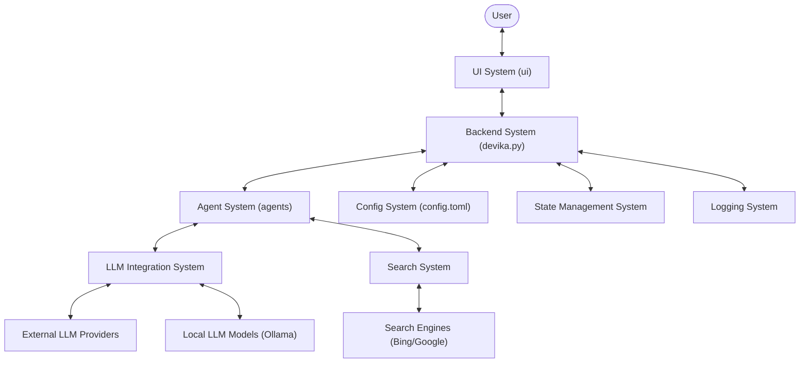
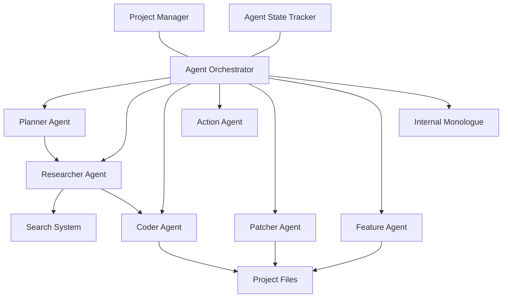
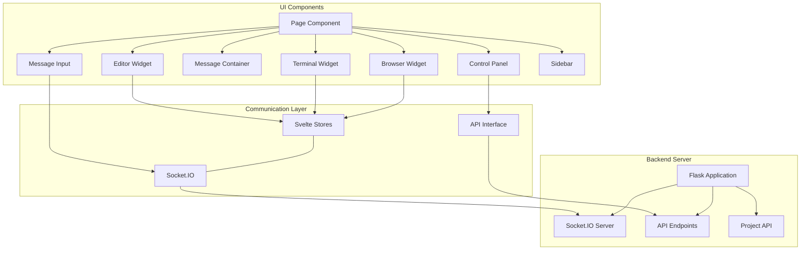
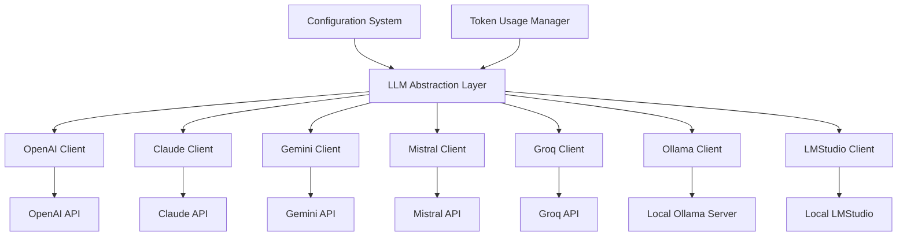

<!-- source: DeepWiki mcp.deepwiki.com · repo stitionai/devika · page 1 Overview · fetched 2026-10-26 -->

# Overview

Relevant source files

The following files were used as context for generating this wiki page:

- [.gitignore](.gitignore)
- [README.md](README.md)

This document provides an introduction to Devika, an agentic AI software engineer designed to understand human instructions, break them down into steps, and write code to achieve objectives. For detailed information about the system architecture, see [System Architecture](#2).

## What is Devika?

Devika is an advanced AI software engineer that can understand high-level human instructions, break them down into steps, research relevant information, and write code to achieve given objectives. It utilizes large language models, planning and reasoning algorithms, and web browsing capabilities to intelligently develop software.

Designed as an AI pair programmer, Devika can handle complex coding tasks with minimal human guidance. Whether creating new features, fixing bugs, or developing entire projects, Devika streamlines the software development process.

Devika is modeled after Devin by Cognition AI and aims to be an open-source alternative with the goal of matching or exceeding Devin's performance on software engineering benchmarks.

Sources: [README.md:26-33]()

## System Architecture Overview

The following diagram illustrates the high-level architecture of Devika, showing the primary components and their interactions:

Sources: [README.md:51-53]()

## Key Features

Devika provides a comprehensive set of capabilities for AI-assisted software development:

| Feature | Description |
|---------|-------------|
| **Multi-Model LLM Support** | Integrates with Claude 3, GPT-4, Gemini, Mistral, Groq, and Local LLMs via Ollama |
| **AI Planning & Reasoning** | Advanced planning capabilities to break down complex tasks |
| **Research Capabilities** | Contextual keyword extraction and web browsing for information gathering |
| **Code Generation** | Writing code in multiple programming languages |
| **State Tracking** | Dynamic agent state tracking and visualization |
| **Natural Language Interface** | Chat-based interaction for human-AI collaboration |
| **Project Management** | Project-based organization and file management |
| **Extensible Architecture** | Modular design for adding new features and integrations |

Sources: [README.md:39-50]()

## Agent System Architecture

Devika's intelligence comes from its agent system - a collection of specialized AI agents that collaborate to accomplish software engineering tasks:

When a user submits a request, the workflow typically follows these steps:

1. The `PlannerAgent` breaks down the task into manageable steps
2. The `ResearcherAgent` gathers required information using the Search System
3. The `CoderAgent` writes the necessary code
4. The `PatcherAgent` fixes any issues in the code
5. The `FeatureAgent` implements specific features
6. The `ActionAgent` performs necessary actions in the system
7. The `InternalMonologue` maintains context and reasoning throughout the process

All these agents are coordinated by the `AgentOrchestrator`, which ensures they work together effectively to complete the user's request.

Sources: [README.md:40-42]()

## User Interface and Communication

Devika provides a web-based user interface with the following components:

Users interact with Devika by:
1. Sending natural language instructions through the chat interface
2. Viewing generated code in the editor widget
3. Running and testing code in the terminal
4. Monitoring Devika's web research in the browser widget
5. Managing projects and configurations through the control panel

Sources: [README.md:116-127]()

## LLM Integration System

Devika integrates with multiple language models through an abstraction layer:

The LLM integration system allows Devika to leverage various language models, with Claude 3 recommended for optimal performance.

Sources: [README.md:41](), [README.md:130-143]()

## Configuration System

Devika requires certain configuration settings and API keys to function properly. When you first run Devika, it creates a `config.toml` file in the root directory. Configuration options include:

- API keys for various services (OpenAI, Claude, Gemini, Mistral, Groq, search engines)
- API endpoints for LLMs and search services
- Storage paths and system settings
- Logging configuration

These settings can be managed through the UI's settings page or by directly editing the configuration file.

Sources: [README.md:130-151]()

## Getting Started

To get started with Devika:

1. Install the required dependencies (Python 3.10-3.11, Node.js, bun)
2. Clone the repository and set up the environment
3. Configure API keys for LLMs and search engines
4. Run the backend server and frontend UI

For detailed installation instructions, see [Installation and Deployment](#3).

Sources: [README.md:56-114]()

## Further Reading

For more detailed information about specific components of Devika, refer to the following sections:
- [System Architecture](#2) - Detailed overview of the system architecture
- [LLM Integration Architecture](#2.1) - Details about the LLM integration system
- [Agent System Architecture](#2.2) - In-depth explanation of the agent system
- [Frontend Architecture](#2.3) - Overview of the frontend system
- [Configuration](#4) - Comprehensive guide to configuring Devika

---

