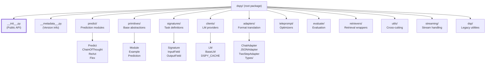
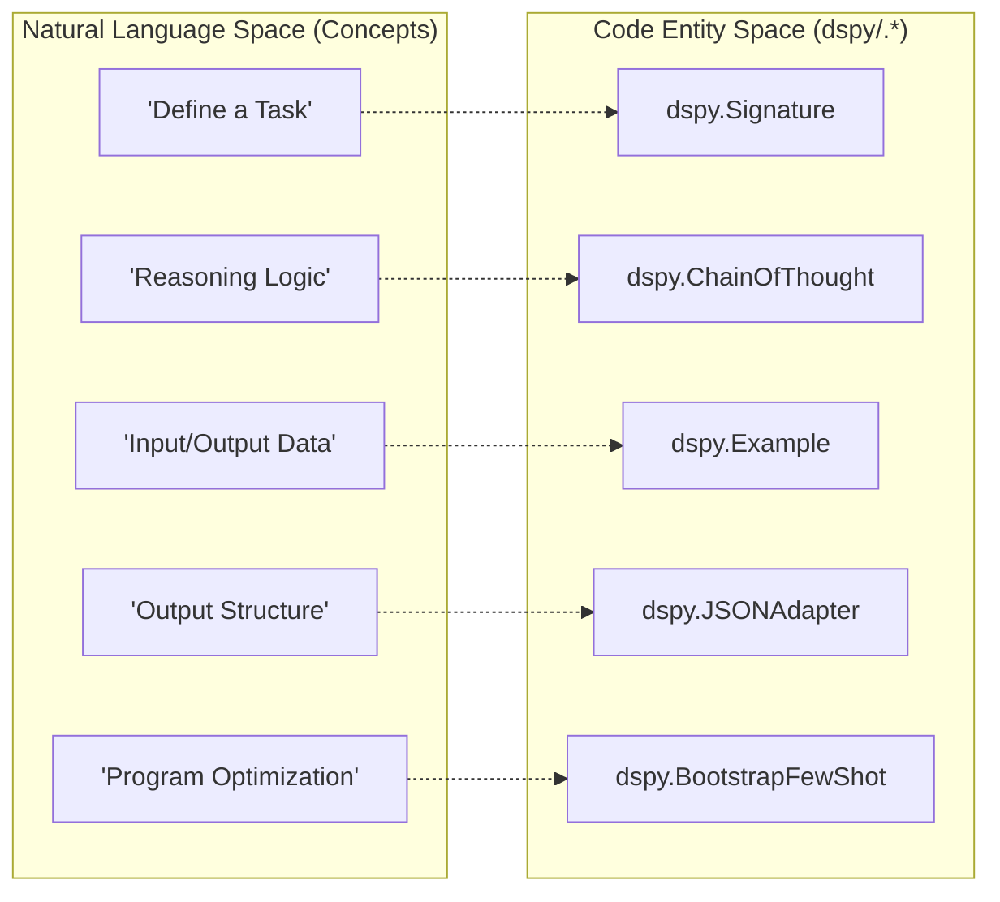
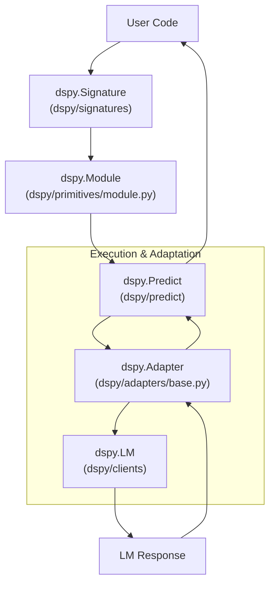

<!-- source: DeepWiki mcp.deepwiki.com · repo stanfordnlp/dspy · page 2.1 Package Structure & Public API · fetched 2026-10-26 -->

# Package Structure & Public API

<details>
<summary>Relevant source files</summary>

The following files were used as context for generating this wiki page:

- [dspy/__init__.py](dspy/__init__.py)
- [dspy/adapters/__init__.py](dspy/adapters/__init__.py)
- [dspy/adapters/types/__init__.py](dspy/adapters/types/__init__.py)
- [dspy/utils/__init__.py](dspy/utils/__init__.py)
- [dspy/utils/annotation.py](dspy/utils/annotation.py)
- [tests/utils/test_annotation.py](tests/utils/test_annotation.py)

</details>


## Purpose and Scope

This document describes the structural organization of the `dspy` package, including its directory layout, module hierarchy, and the public API surface exposed through `dspy/__init__.py`. It explains how the package aggregates functionality from multiple submodules into a unified interface, the data types supported, and the singleton-based configuration system.

For information about specific subsystems (Signatures, Modules, LM Clients, Adapters), see their dedicated pages under [Core Architecture]().

---

## Package Directory Structure

The `dspy` package follows a modular architecture with clear separation of concerns across functional domains:



**Sources:** [dspy/__init__.py:1-21](), [dspy/adapters/__init__.py:1-23]()

---

## Public API Aggregation

The `dspy/__init__.py` file serves as the primary entry point for the public API, importing and re-exporting symbols from submodules to provide a flat, user-friendly namespace.

### Natural Language Space to Code Entity Space Mapping

This diagram associates high-level system concepts with the specific code entities exposed in the public API.



**Sources:** [dspy/__init__.py:1-9](), [dspy/adapters/__init__.py:1-6]()

### Wildcard and Explicit Imports

The `__init__.py` uses wildcard imports for major subsystems, allowing them to control their public surface via `__all__`.

[dspy/__init__.py:1-5]()
```python
from dspy.predict import *
from dspy.primitives import *
from dspy.retrievers import *
from dspy.signatures import *
from dspy.teleprompt import *
```

Core infrastructure, utilities, and the adapter system are imported explicitly to ensure type safety and visibility:

[dspy/__init__.py:7-22]()
```python
from dspy.evaluate import Evaluate
from dspy.clients import *
from dspy.adapters import Adapter, ChatAdapter, JSONAdapter, XMLAdapter, TwoStepAdapter, Image, Audio, File, History, Type, Tool, ToolCalls, ToolCallResults, Code, Reasoning
from dspy.core import (
    Assistant, Developer, LMConfig, LMMessage, LMRequest, LMResponse, System, ToolCall, ToolResult, User,
)
```

The package also exposes specialized serialization and error handling primitives:

[dspy/__init__.py:23-43]()
```python
from dspy.primitives.sandbox_serializable import SandboxSerializable
from dspy.utils.exceptions import (
    AdapterParseError, ContextWindowExceededError, DSPyError, LMAuthError, LMBillingError,
    LMConfigurationError, LMError, LMInvalidRequestError, LMNotConfiguredError, LMProviderError,
    LMRateLimitError, LMServerError, LMTimeoutError, LMTransportError, LMUnexpectedError,
    LMUnsupportedFeatureError, LMUnsupportedModelError, is_retryable_lm_error,
)
```

**Sources:** [dspy/__init__.py:1-43]()

### Utility Functions and Singletons

The module exposes global settings and creates convenient aliases for optimization and usage tracking:

[dspy/__init__.py:44-66]()

| Category | Symbols | Purpose |
|----------|---------|---------|
| **Settings** | `configure`, `context`, `load_settings` | Manage global state via `dspy.dsp.utils.settings` |
| **Async/Sync** | `asyncify`, `syncify` | Utilities for execution mode conversion |
| **Optimization** | `BootstrapRS` | Alias for `BootstrapFewShotWithRandomSearch` |
| **Caching** | `cache` | Alias for `DSPY_CACHE` from `dspy.clients` |
| **Observability**| `track_usage`, `enable_logging`, `disable_logging` | Monitor token usage and framework logs |
| **Persistence** | `load` | Utility to load saved modules/states |
| **Streaming** | `streamify` | Utility for handling LM response streams |

**Sources:** [dspy/__init__.py:44-66](), [dspy/dsp/utils/settings.py:1-20]()

---

## Module Categorization

The package organizes functionality into distinct layers that facilitate the flow from task definition to LM execution.

### Data and Logic Flow Diagram



**Sources:** [dspy/__init__.py:1-12](), [dspy/primitives/module.py:40-49]()

### Core Subsystems

- **`dspy.predict`**: Contains functional modules like `Predict`, `ChainOfThought`, `ReAct`, and the `Flex` module [dspy/__init__.py:1,6]().
- **`dspy.primitives`**: Defines foundational classes like `Module`, `Example`, and `Prediction` [dspy/__init__.py:2]().
- **`dspy.adapters`**: Manages the translation between DSPy's structured signatures and the raw strings/JSON expected by LMs.
    - `dspy.Type`: The base class for custom types like `Image`, `Audio`, and `Tool` [dspy/adapters/types/__init__.py:2,10]().
    - `dspy.Tool`: Wraps Python functions for tool calling, allowing `ToolCalls` and `ToolCallResults` handling [dspy/adapters/types/__init__.py:8,10]().
    - `dspy.Reasoning`: A specialized type for handling chain-of-thought or model-internal reasoning [dspy/adapters/types/__init__.py:7,10]().
    - `dspy.History`: Manages conversational context across turns [dspy/adapters/types/__init__.py:5,10]().
- **`dspy.utils`**: Provides cross-cutting concerns like the `@experimental` decorator for marking APIs that may change in future releases [dspy/utils/annotation.py:16-30](), and debugging tools like `pretty_print_history` [dspy/utils/__init__.py:10,37]().

**Sources:** [dspy/__init__.py:1-12](), [dspy/adapters/__init__.py:1-23](), [dspy/utils/annotation.py:16-30](), [dspy/utils/__init__.py:1-38]()

---

## Package Metadata and Initialization

The package performs automatic initialization upon import:
1. Configures default loggers using `configure_dspy_loggers(__name__)` [dspy/__init__.py:56]().
2. Exposes metadata like `__version__`, `__author__`, and `__url__` from `dspy.__metadata__` [dspy/__init__.py:54]().
3. Maps singleton settings from `dspy.dsp.utils.settings` to the top-level `dspy` namespace for easy access (e.g., `dspy.configure`, `dspy.context`, `dspy.load_settings`) [dspy/__init__.py:59-61]().
4. Initializes the usage tracking system via `track_usage` [dspy/__init__.py:49]().

**Sources:** [dspy/__init__.py:49-61](), [dspy/dsp/utils/settings.py:1-20]()

---

