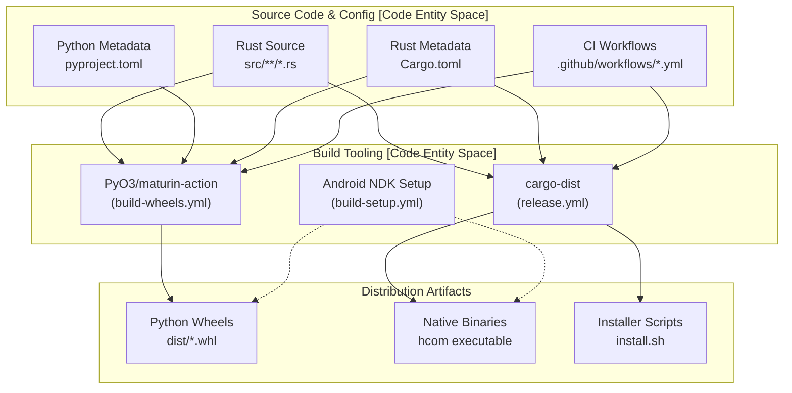
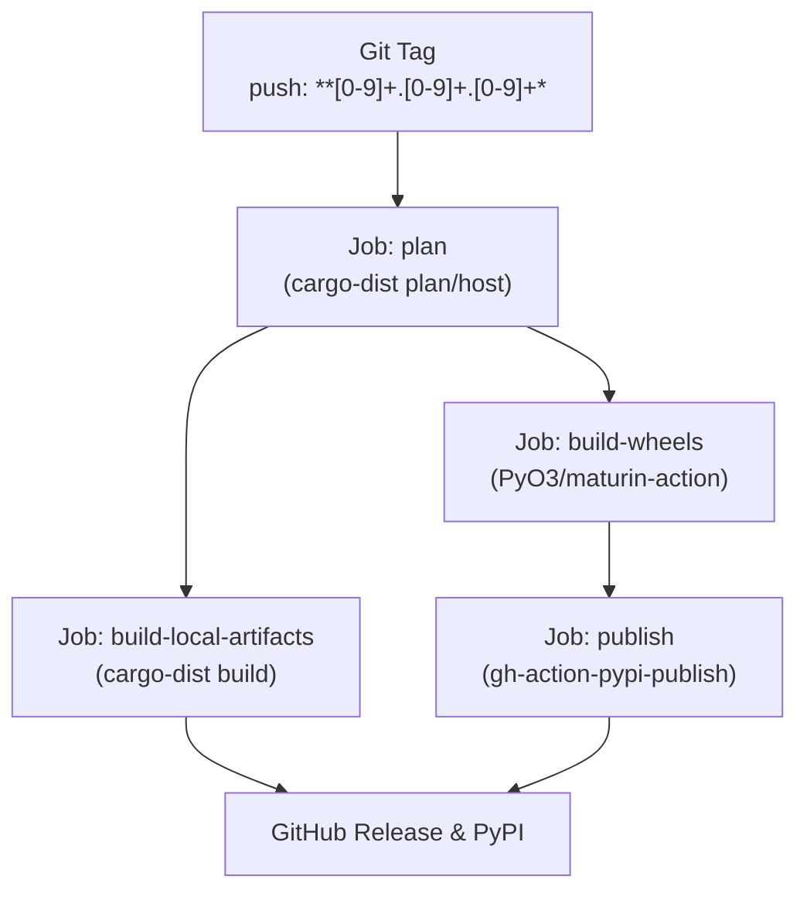

<!-- source: DeepWiki mcp.deepwiki.com · repo aannoo/hcom · page 10 Build and Distribution · fetched 2026-10-26 -->

# Build and Distribution

Relevant source files

The following files were used as context for generating this wiki page:

- [.github/build-setup.yml](.github/build-setup.yml)
- [.github/workflows/build-wheels.yml](.github/workflows/build-wheels.yml)
- [.github/workflows/publish-pypi.yml](.github/workflows/publish-pypi.yml)
- [.github/workflows/release.yml](.github/workflows/release.yml)
- [install.sh](install.sh)

This document provides a high-level overview of `hcom`'s build system, CI/CD pipelines, and distribution mechanisms. `hcom` utilizes a hybrid Rust/Python architecture, leveraging `maturin` for wheel packaging and `cargo-dist` for native binary releases.

For comprehensive technical details, see the child pages:
- [Build System and CI/CD](#10.1) — Detailed coverage of `maturin`-based wheel building, GitHub Actions workflows, multi-platform matrix, Justfile tasks, and workflow linting.
- [Installation and Update Mechanisms](#10.2) — Detailed documentation for `pip install`, `curl` installer script platform detection (including Termux), PyPI vs GitHub Releases, and the self-update path.

---

## Build System Overview

`hcom` combines Rust performance with Python integration using [maturin](https://www.maturin.rs) to compile native extensions into Python-importable wheels. The build and distribution system relies on GitHub Actions workflows and Cargo configuration [.github/workflows/release.yml:1-150](), [.github/workflows/build-wheels.yml:1-92](), [pyproject.toml](), [Cargo.toml]().

**Diagram: Build System Architecture and Tooling**

Sources: [.github/workflows/release.yml:63-83](), [.github/workflows/build-wheels.yml:44-52](), [.github/build-setup.yml:1-21]()

For details on workflow configuration, cross-compilation matrix setups, and Justfile task automation, see [Build System and CI/CD](#10.1).

---

## Platform Target Matrix

The build matrix supports multiple operating systems and architectures, including specialized cross-compilation configurations for Linux (`glibc` and `musl`), macOS (Intel and Apple Silicon), Windows, and Android (`aarch64-linux-android` via Termux) [.github/workflows/build-wheels.yml:12-38](), [.github/workflows/build-wheels.yml:59-86]().

Android builds require specialized setup of Java 17, Android SDK tools, NDK version `30.0.16248370`, and explicit linker/compiler environment variables (`CARGO_TARGET_AARCH64_LINUX_ANDROID_LINKER`, `CC_aarch64_linux_android`, `AR_aarch64_linux_android`) [.github/workflows/release.yml:130-150](), [.github/build-setup.yml:1-21]().

For complete matrix definitions and toolchain specifics, see [Build System and CI/CD](#10.1).

Sources: [.github/workflows/release.yml:130-150](), [.github/workflows/build-wheels.yml:12-92](), [.github/build-setup.yml:1-21]()

---

## CI/CD Workflows

The CI/CD pipeline automates release planning, artifact building, and publishing. Triggered by SemVer Git tags, the release workflow coordinates artifact generation across jobs such as `plan`, `build-local-artifacts`, `build-wheels`, and `publish` [.github/workflows/release.yml:43-55](), [.github/workflows/build-wheels.yml:1-92](), [.github/workflows/publish-pypi.yml:1-33]().

**Diagram: Release Pipeline Flow**

Sources: [.github/workflows/release.yml:43-110](), [.github/workflows/build-wheels.yml:11-58](), [.github/workflows/publish-pypi.yml:15-33]()

For details on workflow steps, error handling, and linting rules, see [Build System and CI/CD](#10.1).

---

## Installation and Update Mechanisms

`hcom` supports multiple installation channels tailored to user environments:
1. **PyPI**: Installed via Python package managers like `pip install hcom` or `uv tool install hcom`.
2. **GitHub Releases & Installer Scripts**: Standalone shell installers (`install.sh`) that fetch precompiled binaries for macOS, Linux, and Termux [install.sh:4-18]().
3. **Self-Update**: Built-in update routines allowing in-place binary replacement via CLI commands.

For instructions, script logic, platform detection details, and update path implementations, see [Installation and Update Mechanisms](#10.2).

Sources: [install.sh:1-18]()

---

## Child Pages

- [Build System and CI/CD](#10.1) — Detail maturin-based wheel building, GitHub Actions workflows, multi-platform matrix, Justfile tasks, and workflow linting.
- [Installation and Update Mechanisms](#10.2) — Document pip install, curl installer script (platform detection, Termux), PyPI vs GitHub Releases, and the self-update path in `src/update.rs`.

---

