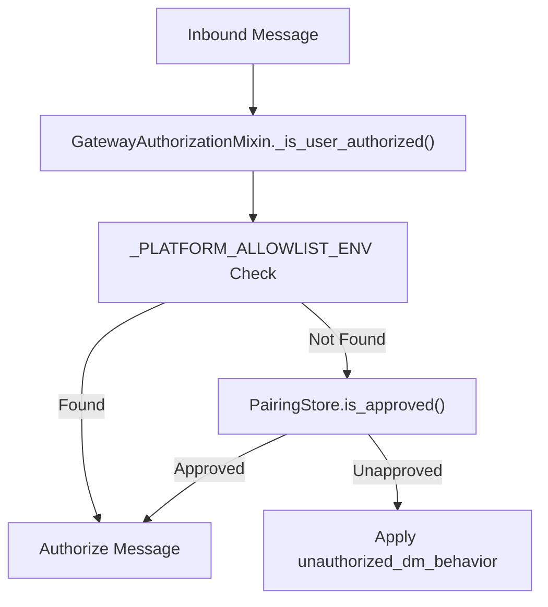
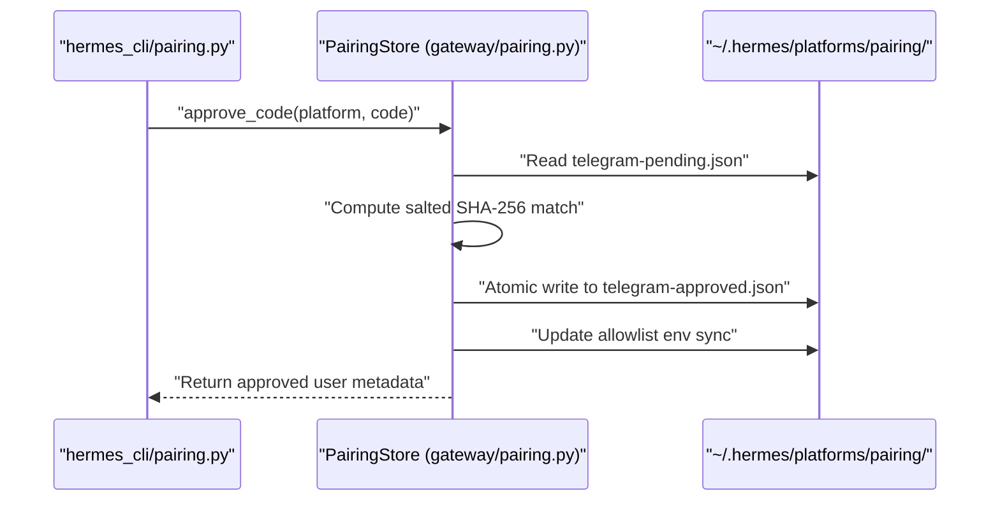
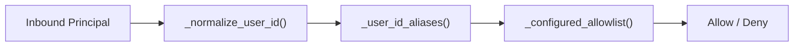
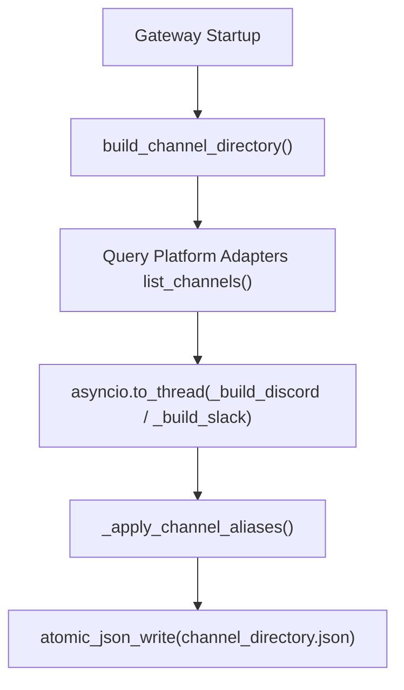
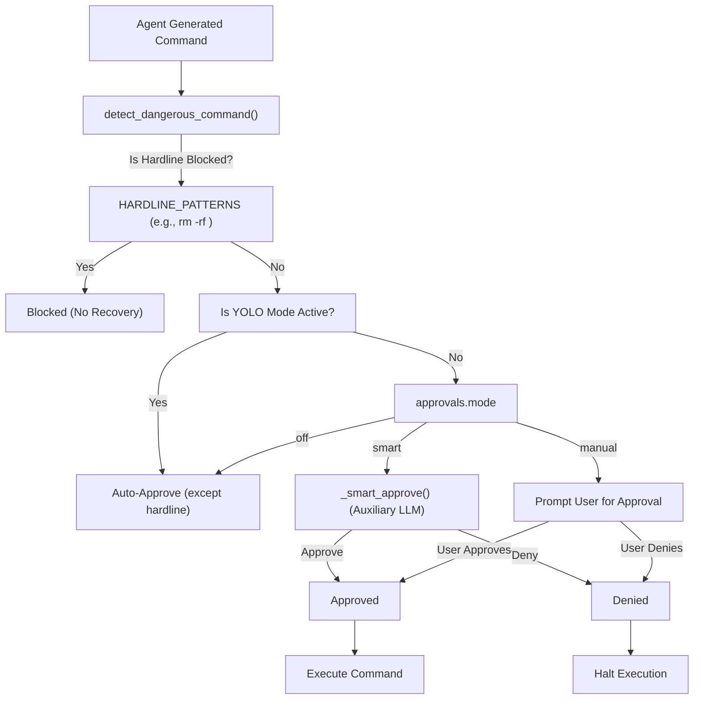

<!-- source: DeepWiki mcp.deepwiki.com · repo nousresearch/hermes-agent · page 7.4 Security and Pairing · fetched 2026-10-26 -->

# Security and Pairing

Relevant source files

The following files were used as context for generating this wiki page:

- [contributors/emails/Cryptodombili@gmail.com](contributors/emails/Cryptodombili@gmail.com)
- [contributors/emails/fangliquan@qq.com](contributors/emails/fangliquan@qq.com)
- [gateway/authz_mixin.py](gateway/authz_mixin.py)
- [gateway/channel_directory.py](gateway/channel_directory.py)
- [gateway/config.py](gateway/config.py)
- [gateway/config_env.py](gateway/config_env.py)
- [gateway/config_loader.py](gateway/config_loader.py)
- [gateway/pairing.py](gateway/pairing.py)
- [gateway/relay/__init__.py](gateway/relay/__init__.py)
- [gateway/relay/adapter.py](gateway/relay/adapter.py)
- [gateway/relay/command_manifest.py](gateway/relay/command_manifest.py)
- [gateway/relay/media.py](gateway/relay/media.py)
- [gateway/relay/transport.py](gateway/relay/transport.py)
- [gateway/relay/ws_transport.py](gateway/relay/ws_transport.py)
- [hermes_cli/gateway_enroll.py](hermes_cli/gateway_enroll.py)
- [hermes_cli/nous_auth_keepalive.py](hermes_cli/nous_auth_keepalive.py)
- [hermes_cli/nous_subscription.py](hermes_cli/nous_subscription.py)
- [hermes_cli/pairing.py](hermes_cli/pairing.py)
- [hermes_cli/portal_cli.py](hermes_cli/portal_cli.py)
- [hermes_cli/tools_config.py](hermes_cli/tools_config.py)
- [model_tools.py](model_tools.py)
- [tests/agent/test_codex_token_expired_replay_recovery.py](tests/agent/test_codex_token_expired_replay_recovery.py)
- [tests/gateway/relay/stub_connector.py](tests/gateway/relay/stub_connector.py)
- [tests/gateway/relay/test_cold_opt_out.py](tests/gateway/relay/test_cold_opt_out.py)
- [tests/gateway/relay/test_explicit_disable.py](tests/gateway/relay/test_explicit_disable.py)
- [tests/gateway/relay/test_identity_token_resolver.py](tests/gateway/relay/test_identity_token_resolver.py)
- [tests/gateway/relay/test_relay_adapter.py](tests/gateway/relay/test_relay_adapter.py)
- [tests/gateway/relay/test_relay_follow_up.py](tests/gateway/relay/test_relay_follow_up.py)
- [tests/gateway/relay/test_relay_going_idle.py](tests/gateway/relay/test_relay_going_idle.py)
- [tests/gateway/relay/test_relay_media.py](tests/gateway/relay/test_relay_media.py)
- [tests/gateway/relay/test_relay_multiplatform.py](tests/gateway/relay/test_relay_multiplatform.py)
- [tests/gateway/relay/test_relay_passthrough.py](tests/gateway/relay/test_relay_passthrough.py)
- [tests/gateway/relay/test_relay_policy_send.py](tests/gateway/relay/test_relay_policy_send.py)
- [tests/gateway/relay/test_relay_registration.py](tests/gateway/relay/test_relay_registration.py)
- [tests/gateway/relay/test_relay_roundtrip.py](tests/gateway/relay/test_relay_roundtrip.py)
- [tests/gateway/relay/test_relay_roundtrip_telegram.py](tests/gateway/relay/test_relay_roundtrip_telegram.py)
- [tests/gateway/relay/test_relay_slack_dm_streaming.py](tests/gateway/relay/test_relay_slack_dm_streaming.py)
- [tests/gateway/relay/test_relay_slack_prompt_dm_root.py](tests/gateway/relay/test_relay_slack_prompt_dm_root.py)
- [tests/gateway/relay/test_relay_slack_unfurl.py](tests/gateway/relay/test_relay_slack_unfurl.py)
- [tests/gateway/relay/test_self_provision.py](tests/gateway/relay/test_self_provision.py)
- [tests/gateway/relay/test_wire_voice_media.py](tests/gateway/relay/test_wire_voice_media.py)
- [tests/gateway/relay/test_ws_transport.py](tests/gateway/relay/test_ws_transport.py)
- [tests/gateway/relay/test_ws_transport_hardening.py](tests/gateway/relay/test_ws_transport_hardening.py)
- [tests/gateway/test_channel_directory.py](tests/gateway/test_channel_directory.py)
- [tests/gateway/test_config.py](tests/gateway/test_config.py)
- [tests/gateway/test_env_override_explicit_disable.py](tests/gateway/test_env_override_explicit_disable.py)
- [tests/gateway/test_multiplex_pairing_stores.py](tests/gateway/test_multiplex_pairing_stores.py)
- [tests/gateway/test_pairing.py](tests/gateway/test_pairing.py)
- [tests/gateway/test_pairing_allowlist_bypass.py](tests/gateway/test_pairing_allowlist_bypass.py)
- [tests/gateway/test_whatsapp_cloud_allowed_users.py](tests/gateway/test_whatsapp_cloud_allowed_users.py)
- [tests/hermes_cli/test_gateway_enroll_multiplex_warning.py](tests/hermes_cli/test_gateway_enroll_multiplex_warning.py)
- [tests/hermes_cli/test_install_cua_driver.py](tests/hermes_cli/test_install_cua_driver.py)
- [tests/hermes_cli/test_nous_auth_keepalive.py](tests/hermes_cli/test_nous_auth_keepalive.py)
- [tests/hermes_cli/test_nous_subscription.py](tests/hermes_cli/test_nous_subscription.py)
- [tests/hermes_cli/test_tools_config.py](tests/hermes_cli/test_tools_config.py)
- [tests/tools/test_image_generation_managed.py](tests/tools/test_image_generation_managed.py)
- [tools/__init__.py](tools/__init__.py)
- [tools/image_generation_managed.py](tools/image_generation_managed.py)
- [toolsets.py](toolsets.py)
- [website/docs/developer-guide/agent-loop.md](website/docs/developer-guide/agent-loop.md)
- [website/docs/developer-guide/architecture.md](website/docs/developer-guide/architecture.md)
- [website/docs/developer-guide/cron-internals.md](website/docs/developer-guide/cron-internals.md)
- [website/docs/developer-guide/gateway-internals.md](website/docs/developer-guide/gateway-internals.md)
- [website/docs/developer-guide/provider-runtime.md](website/docs/developer-guide/provider-runtime.md)
- [website/docs/developer-guide/relay-connector-contract.md](website/docs/developer-guide/relay-connector-contract.md)
- [website/docs/reference/tools-reference.md](website/docs/reference/tools-reference.md)
- [website/docs/reference/toolsets-reference.md](website/docs/reference/toolsets-reference.md)
- [website/docs/user-guide/features/tool-gateway.md](website/docs/user-guide/features/tool-gateway.md)
- [website/docs/user-guide/messaging/relay.md](website/docs/user-guide/messaging/relay.md)

This page explains the gateway security architecture, user authorization mechanisms, allowlist filtering, the channel directory cache, and the Direct Message (DM) pairing system in Hermes Agent. It covers the technical implementation of access controls across messaging platform adapters, cryptographic pairing code generation, secure permission handling, and runtime secret-scope isolation.

---

## 1. Security Model and Authorization Hierarchy

Hermes enforces multi-tiered authorization through `GatewayAuthorizationMixin`, which integrates into `GatewayRunner` to gate incoming messages before routing them to the core agent [gateway/authz_mixin.py:1-7]().

The evaluation hierarchy resolves inbound requests via the following order:
1.  **Platform Adapters & Upstream Trust**: Certain adapters manage their own policy or allowlists at intake, which the gateway can trust if configured [gateway/authz_mixin.py:160-166]().
2.  **Environment Allowlist**: Platform-specific allowlists loaded from environment variables or profile settings (e.g., `TELEGRAM_ALLOWED_USERS`) [gateway/authz_mixin.py:26-41]().
3.  **DM Pairing Store**: If a user is not present in the static allowlist, the dynamic pairing subsystem (`PairingStore`) is queried for an explicit approval record [gateway/pairing.py:284-319]().
4.  **Default Deny / Unauthorized Behavior**: If no matching authorization rule is met, the gateway applies the configured `unauthorized_dm_behavior` to drop or reject the message [gateway/authz_mixin.py:160-185]().

Profile multiplexing is supported via `_platform_gate_env()`, which queries `agent.secret_scope` to prevent allowlist variable leakage across isolated configuration profiles [gateway/authz_mixin.py:53-53](). For decentralized platforms like Nostr (Buzz), bech32 `npub1…` keys are automatically normalized to 64-character hex pubkeys to unify identity matching [gateway/authz_mixin.py:89-157]().

Title: Authorization Evaluation Flow

Sources: [gateway/authz_mixin.py:1-166](), [gateway/pairing.py:99-118]()

---

## 2. DM Pairing System

The Direct Message (DM) pairing system (`gateway/pairing.py`) provides an interactive workflow for onboarding unknown users via cryptographically secure, time-limited verification codes.

### Cryptographic Properties and Storage Limits
-   **Code Generation**: Codes are 8 characters long, selected from a 32-character unambiguous alphabet (`ALPHABET = "ABCDEFGHJKLMNPQRSTUVWXYZ23456789"`, excluding `0/O`, `1/I`) using `secrets.choice()` [gateway/pairing.py:29-32]().
-   **TTL and Rate Limiting**: Codes expire after 1 hour (`CODE_TTL_SECONDS = 3600`) [gateway/pairing.py:33](). Rate limits restrict requests to 1 per user per 10 minutes (`RATE_LIMIT_SECONDS = 600`) [gateway/pairing.py:34]().
-   **Lockout Protection**: Exceeding 5 failed approval attempts (`MAX_FAILED_ATTEMPTS = 5`) triggers a 1-hour platform lockout (`LOCKOUT_SECONDS = 3600`) [gateway/pairing.py:35-37]().
-   **Hashed Storage**: Plaintext codes are never stored. Entries are persisted as salted SHA-256 hashes inside JSON files under `~/.hermes/platforms/pairing/` [gateway/pairing.py:1-8]().
-   **File Permissions**: Files are written using `_save_json_file()`, enforcing POSIX `0600` permissions where supported [tests/gateway/test_pairing.py:89-96]().

### Pairing Workflow Implementation

The `PairingStore` class manages state transitions for pending and approved principals [gateway/pairing.py:1-637]():
-   `generate_code(platform, user_id, user_name)`: Creates a hashed pending entry [gateway/pairing.py:245-282]().
-   `approve_code(platform, code)` / `approve_request(platform, request_id)`: Validates input and transitions the principal to the approved registry [gateway/pairing.py:321-345]().
-   `_normalize_user_id()`: Normalizes variant identities (such as WhatsApp phone numbers or JIDs via `gateway/whatsapp_identity.py`) before comparison [gateway/pairing.py:95-104]().

Title: Pairing Approval Sequence

Sources: [gateway/pairing.py:245-345](), [hermes_cli/pairing.py:56-82]()

---

## 3. Allowlist Filtering and Platform Integration

Allowlist filtering serves as the primary declarative barrier for platform access.

-   **Environment Mapping**: `_PLATFORM_ALLOWLIST_ENV` maps platform names to corresponding environment keys (e.g., `TELEGRAM_ALLOWED_USERS`, `DISCORD_ALLOWED_USERS`) [gateway/pairing.py:67-78]().
-   **Allowlist Synchronization**: Approving a pairing code automatically appends the user ID to the platform's allowlist environment variable when configured, keeping the operator's static config aligned with dynamic grants [gateway/pairing.py:62-66]().
-   **WhatsApp Identity Expansion**: WhatsApp adapters rely on `_user_id_aliases()` to ensure phone numbers, LID records, and full JIDs resolve equivalently during allowlist evaluation [gateway/pairing.py:106-116]().

Title: User Identity Normalization Pipeline

Sources: [gateway/pairing.py:80-122](), [gateway/authz_mixin.py:85-96]()

---

## 4. Channel Directory and Discovery

The channel directory module (`gateway/channel_directory.py`) maintains a cached map of reachable communication channels and contacts per platform to support target resolution for commands like `send_message` [gateway/channel_directory.py:1-15]().

-   **Persistence**: Cached at `~/.hermes/channel_directory.json` and overlaid with friendly names from `channel_aliases.json` [gateway/channel_directory.py:21-46]().
-   **Background Refresh**: Built on gateway startup and updated on a recurring schedule [gateway/channel_directory.py:3-4]().
-   **Async Thread Offloading**: Network-heavy directory builders (such as Discord and Slack integrations) execute off the main event loop thread via `asyncio.to_thread()` to prevent blocking message routing [tests/gateway/test_channel_directory.py:97-114]().

Title: Channel Directory Build Process

Sources: [gateway/channel_directory.py:131-156](), [tests/gateway/test_channel_directory.py:97-114]()

---

## 5. Gateway Security Model

The gateway security model is designed with defense-in-depth, encompassing several layers to protect against various threats, from dangerous command execution to unauthorized access. This section details the key components of this model.

### 5.1. Dangerous Command Approval

Hermes Agent employs a robust dangerous command approval system to prevent unintended or malicious actions. Before executing any command, it is checked against a curated list of dangerous patterns. If a match is found, human intervention is required.

#### Approval Modes
The approval system operates in three configurable modes, defined by `approvals.mode` in `~/.hermes/config.yaml` [website/docs/user-guide/security.md:31-32]():

| Mode | Behavior |
|---|---|
| **smart** (default) | Uses an auxiliary LLM to assess risk. Low-risk commands are auto-approved for that command only. Genuinely dangerous commands are auto-denied. Uncertain cases escalate to a manual prompt. [website/docs/user-guide/security.md:57-58]() |
| **manual** | Always prompts the user for approval on dangerous commands. [website/docs/user-guide/security.md:59]() |
| **off** | Disables all approval checks, equivalent to running with `--yolo`. All commands execute without prompts. [website/docs/user-guide/security.md:60]()

The configuration also includes settings for `timeout`, `cron_mode`, `single_query_mode`, `unattended_mode`, `mcp_reload_confirm`, and `destructive_slash_confirm` [website/docs/user-guide/security.md:33-53]().

#### YOLO Mode
YOLO mode bypasses most dangerous command approval prompts for the current session. It can be activated via a CLI flag (`hermes --yolo`), a slash command (`/yolo`), or an environment variable (`HERMES_YOLO_MODE=1`) [website/docs/user-guide/security.md:67-71]().

When active, visual reminders are displayed, such as a red banner and a `⚠ YOLO` fragment in the status bar [website/docs/user-guide/security.md:86-89](). It's crucial to note that YOLO mode disables most safety checks, **except** for the hardline blocklist [website/docs/user-guide/security.md:90-92]().

#### Hardline Blocklist
A small, critical set of commands are unconditionally blocked, regardless of YOLO mode or approval settings. These are operations with no recovery path, such as recursive deletion of system roots (`rm -rf /`) or system shutdown commands. This blocklist is deliberately minimal to avoid interfering with legitimate operations [tools/approval_detection.py:70-76]().

Examples of hardline blocked patterns include:
-   Recursive deletion of root filesystem [tools/approval_detection.py:107-112]()
-   System shutdown/reboot commands [tools/approval_detection.py:78-86]()
-   Direct process killing of the gateway's interpreter image (e.g., `pkill python`) [cron/lifecycle_guard.py:70-77]()

The `cron.lifecycle_guard` module specifically prevents cron jobs from scheduling commands that would restart or stop the gateway itself, avoiding SIGTERM-respawn loops [cron/lifecycle_guard.py:1-6]().

Title: Dangerous Command Approval Flow

Sources: [tools/approval.py:1-144](), [tools/approval_detection.py:1-157](), [cron/lifecycle_guard.py:1-110](), [website/docs/user-guide/security.md:24-97]()

### 5.2. Gateway Configuration Security

The `gateway.config` module handles the loading and parsing of gateway-specific configurations, including security-related settings.

#### Configuration Precedence
Gateway configuration is loaded from multiple sources with a defined precedence:
1.  Environment variables (e.g., `GATEWAY_MULTIPLEX_PROFILES`) [gateway/config.py:46-65]()
2.  `config.yaml` (top-level keys take precedence over nested `gateway:` section) [gateway/config_loader.py:1-7]()
3.  `gateway.json` (legacy, lowest precedence) [gateway/config_loader.py:22-34]()

This layered approach ensures that operator-defined environment variables can override configuration files, and `config.yaml` takes precedence over legacy settings.

#### Unauthorized DM Behavior
The `unauthorized_dm_behavior` setting defines how the gateway responds to direct messages from unauthorized users. Options include:
-   `"pair"`: Sends a pairing code to the user.
-   `"ignore"`: Silently drops the message.
-   `"decline"`: Sends a polite refusal message once, then ignores subsequent messages for a period (`DECLINE_DEDUPE_SECONDS`) [gateway/config.py:164-165]().

The default decline message is: "Hi! I'm a personal assistant and can only chat with my owner, so I can't help you directly. Sorry!" [gateway/config.py:166-168]().

#### Relay Connector Security
When using the Relay connector, authentication is handled via `relay_connection_auth()`, which retrieves `gateway_id` and `upgrade_secret` from environment variables (`GATEWAY_RELAY_ID`, `GATEWAY_RELAY_SECRET`) or `config.yaml` (`gateway.relay_id`, `gateway.relay_secret`) [gateway/relay/__init__.py:155-160](). If these are absent, the transport dials unauthenticated.

The WebSocket transport (`gateway/relay/ws_transport.py`) handles specific close codes for security:
-   `_RELAY_UNAUTHORIZED_CLOSE_CODE` (4401): Indicates that the per-gateway secret was revoked, leading to a terminal disconnect without reconnect attempts [gateway/relay/ws_transport.py:51-53]().
-   `_RELAY_EXPIRED_CLOSE_REASON`: A close reason for 4401 indicating an expired token, which is not treated as a revocation [gateway/relay/ws_transport.py:77-78]().

Sources: [gateway/config.py:1-172](), [gateway/config_loader.py:1-146](), [gateway/relay/__init__.py:1-160](), [gateway/relay/ws_transport.py:1-159]()

---

