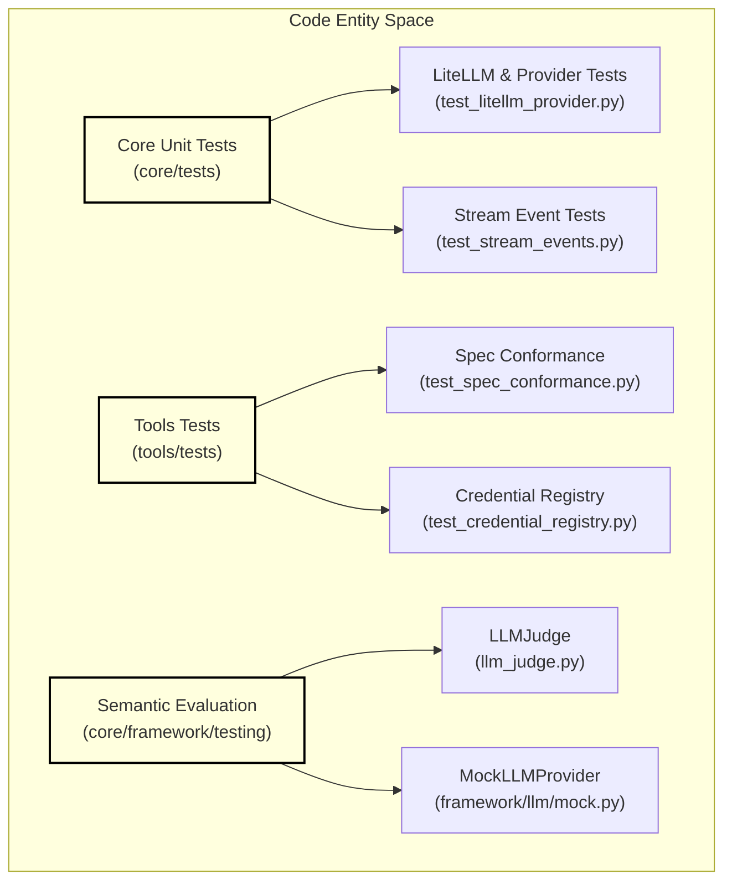
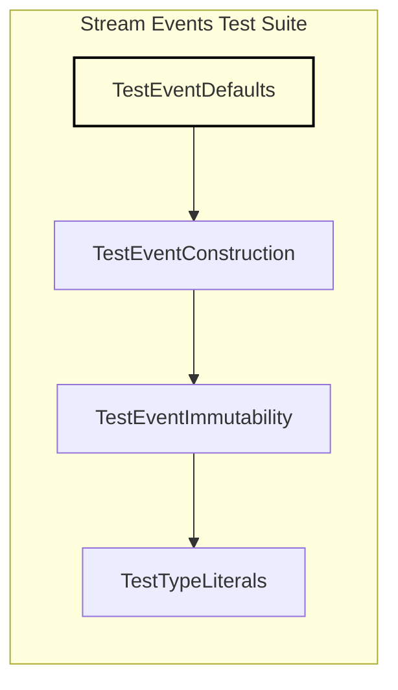
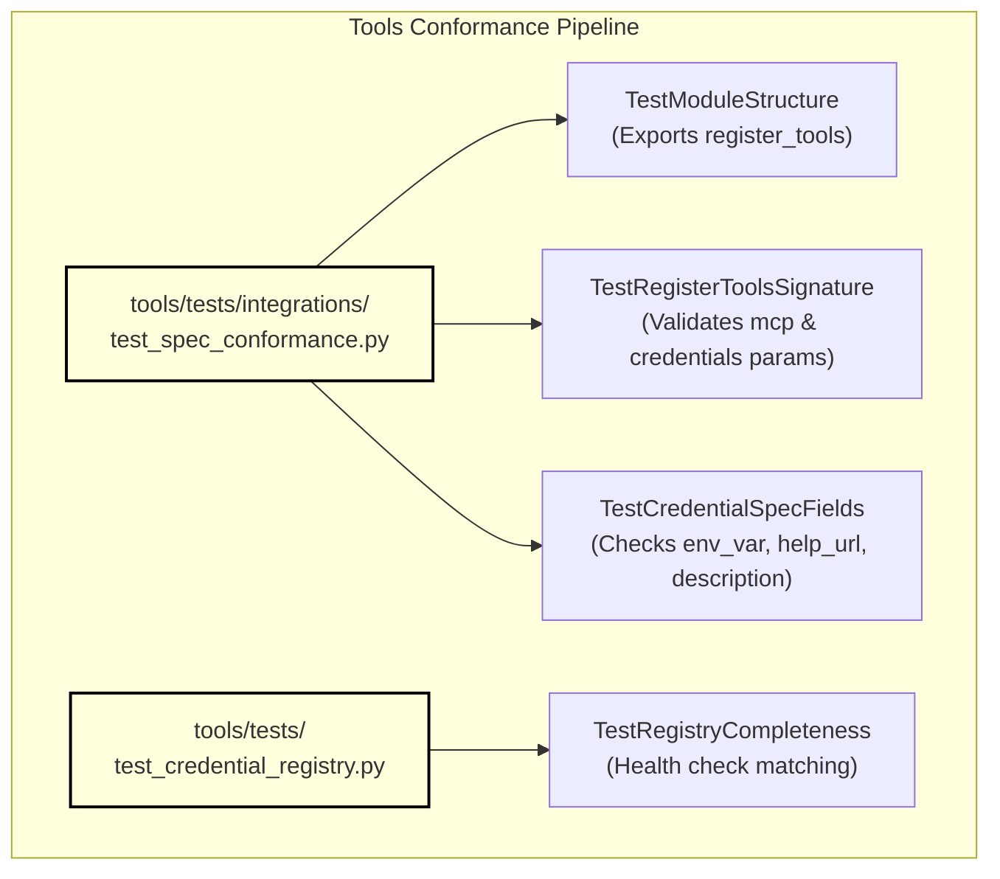
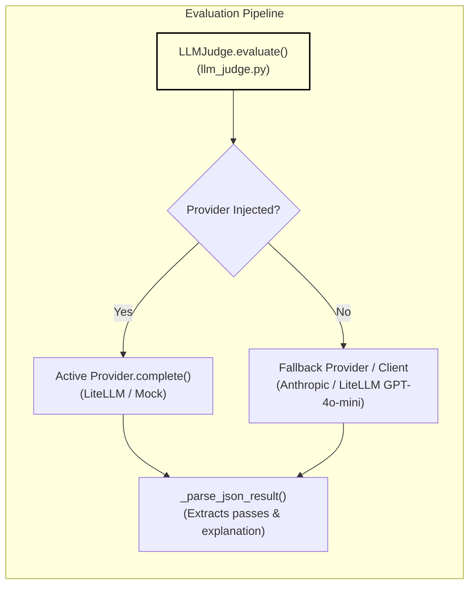

<!-- source: DeepWiki mcp.deepwiki.com · repo aden-hive/hive · page 9.1 Testing Strategy · fetched 2026-10-26 -->

# Testing Strategy

Relevant source files

The following files were used as context for generating this wiki page:

- [core/framework/agent_loop/internals/event_publishing.py](core/framework/agent_loop/internals/event_publishing.py)
- [core/framework/host/event_bus.py](core/framework/host/event_bus.py)
- [core/framework/llm/__init__.py](core/framework/llm/__init__.py)
- [core/framework/llm/anthropic.py](core/framework/llm/anthropic.py)
- [core/framework/llm/litellm.py](core/framework/llm/litellm.py)
- [core/framework/llm/mock.py](core/framework/llm/mock.py)
- [core/framework/llm/provider.py](core/framework/llm/provider.py)
- [core/framework/llm/stream_events.py](core/framework/llm/stream_events.py)
- [core/framework/schemas/decision.py](core/framework/schemas/decision.py)
- [core/framework/schemas/run.py](core/framework/schemas/run.py)
- [core/framework/testing/approval_types.py](core/framework/testing/approval_types.py)
- [core/framework/testing/llm_judge.py](core/framework/testing/llm_judge.py)
- [core/framework/testing/test_case.py](core/framework/testing/test_case.py)
- [core/framework/testing/test_result.py](core/framework/testing/test_result.py)
- [core/tests/e2e/conftest.py](core/tests/e2e/conftest.py)
- [core/tests/e2e/specs.py](core/tests/e2e/specs.py)
- [core/tests/e2e/synthetic.py](core/tests/e2e/synthetic.py)
- [core/tests/e2e/test_queen_e2e.py](core/tests/e2e/test_queen_e2e.py)
- [core/tests/test_event_bus.py](core/tests/test_event_bus.py)
- [core/tests/test_harness_tools.py](core/tests/test_harness_tools.py)
- [core/tests/test_janitor_worker_deepclean.py](core/tests/test_janitor_worker_deepclean.py)
- [core/tests/test_litellm_provider.py](core/tests/test_litellm_provider.py)
- [core/tests/test_llm_judge.py](core/tests/test_llm_judge.py)
- [core/tests/test_run_worker_tool.py](core/tests/test_run_worker_tool.py)
- [core/tests/test_stream_events.py](core/tests/test_stream_events.py)
- [core/tests/test_worker_definition.py](core/tests/test_worker_definition.py)
- [tools/src/memory_tools/paths.py](tools/src/memory_tools/paths.py)
- [tools/src/terminal_tools/common/limits.py](tools/src/terminal_tools/common/limits.py)
- [tools/tests/integrations/__init__.py](tools/tests/integrations/__init__.py)
- [tools/tests/integrations/conftest.py](tools/tests/integrations/conftest.py)
- [tools/tests/integrations/test_input_validation.py](tools/tests/integrations/test_input_validation.py)
- [tools/tests/integrations/test_registration.py](tools/tests/integrations/test_registration.py)
- [tools/tests/integrations/test_spec_conformance.py](tools/tests/integrations/test_spec_conformance.py)
- [tools/tests/test_command_guard.py](tools/tests/test_command_guard.py)
- [tools/tests/test_credential_registry.py](tools/tests/test_credential_registry.py)
- [tools/tests/test_memory_tools.py](tools/tests/test_memory_tools.py)

## Overview and Scope

This page documents the comprehensive testing strategy for the Hive repository (`https://github.com/aden-hive/hive`). The test suite spans multiple packages in the `uv` workspace (`core/` and `tools/`), providing unit validation, server integration testing, tool conformance checks, semantic LLM evaluation via `LLMJudge` [core/framework/testing/llm_judge.py:18-140](), and end-to-end (e2e) colony behaviors.

Sources: [core/tests/test_litellm_provider.py:1-40](), [tools/tests/integrations/test_spec_conformance.py:1-42]()

---

## Core Unit Tests (`core/tests/`)

The `core/tests/` directory houses unit and low-level integration tests verifying the runtime primitives, event buses, stream events, and LLM adapters.

- **LiteLLM Provider Tests (`core/tests/test_litellm_provider.py`)**: Validates `LiteLLMProvider` initialization across various models (OpenAI, Anthropic, DeepSeek, Ollama), custom API base overrides, retry calculations, and system-only payload summary logging [core/tests/test_litellm_provider.py:42-130]().
- **Stream Event Discriminated Union (`core/tests/test_stream_events.py`)**: Ensures that all event types (`TextDeltaEvent`, `ToolCallEvent`, `FinishEvent`, etc.) instantiate correctly with default and custom values, maintain immutability via frozen dataclasses, and respect type literal constraints [core/tests/test_stream_events.py:1-206]().

Sources: [core/tests/test_litellm_provider.py:1-169](), [core/tests/test_stream_events.py:1-206]()

---

## Server and HTTP Tests

HTTP server testing verifies `aiohttp` application routes, session management endpoints, EventSource (SSE) streaming paths, and payload validations. Tests mock underlying execution loops to measure middleware safety, CORS headers, and route dispatches without requiring live backend processes.

Sources: [core/framework/llm/litellm.py:1-50]()

---

## End-to-End (E2E) Test Suites

The framework includes specialized end-to-end evaluation harnesses for complex multi-agent reasoning:
- **Queen E2E (`core/tests/e2e/test_queen_e2e.py`)**: Tests multi-turn queen-worker orchestration, dynamic task creation, tool dispatch, and checkpoint recovery across independent and colony phases.
- **LongMemEval**: Measures long-term memory retrieval accuracy, reflection loops, and recall selectors over multi-session persistence histories.

Sources: [core/framework/llm/mock.py:1-35]()

---

## Tools Tests, Integrations, and `vision_eval`

The `tools/` package includes rigorous integration and conformance test suites verifying that every FastMCP module complies with architecture rules.

### Spec Conformance and Credential Registries
- **`test_spec_conformance.py`**: Verifies that tool modules export `register_tools`, accept appropriate `mcp` and `credentials` parameters, maintain valid `CredentialSpec` definitions, and align with registered `@mcp.tool()` functions [tools/tests/integrations/test_spec_conformance.py:48-167]().
- **`test_credential_registry.py`**: Enforces that credentials with `health_check_endpoint` have registered entries in `HEALTH_CHECKERS`, prevents accidental duplicate environment variable collisions, and validates required metadata [tools/tests/test_credential_registry.py:20-104]().

Sources: [tools/tests/integrations/test_spec_conformance.py:1-167](), [tools/tests/test_credential_registry.py:1-104]()

- **`vision_eval`**: Assesses visual fallback workflows, image captioning, and fractional coordinate mapping for text-only model integrations.

Sources: [tools/tests/integrations/conftest.py:1-50]()

---

## Mocking and Semantic Evaluation

### `MockLLMProvider`
Defined in `core/framework/llm/mock.py`, `MockLLMProvider` simulates LLM responses for structural validation without making external API calls [core/framework/llm/mock.py:1-35](). It extracts output keys from system prompts, generates structured JSON responses in `json_mode`, and streams text deltas word by word [core/framework/llm/mock.py:44-195]().

### `LLMJudge`
Defined in `core/framework/testing/llm_judge.py`, `LLMJudge` performs semantic evaluation of test summaries against source documents and specified constraints [core/framework/testing/llm_judge.py:18-140]().

Sources: [core/tests/test_llm_judge.py:1-115](), [core/framework/testing/llm_judge.py:18-140]()

---

## Test Fixtures and `conftest` Patterns

Test suites across `core/` and `tools/` rely on structured pytest fixtures and conftest patterns:
- **Fixture Discovery**: `tools/tests/integrations/conftest.py` dynamically discovers tool packages and builds mappings between module short names and registered MCP tools [tools/tests/integrations/conftest.py:48-138]().
- **Minimal Argument Builders**: `get_minimal_args()` inspects function signatures to automatically generate valid test arguments based on type annotations [tools/tests/integrations/conftest.py:156-181]().

Sources: [tools/tests/integrations/conftest.py:1-181]()

---

