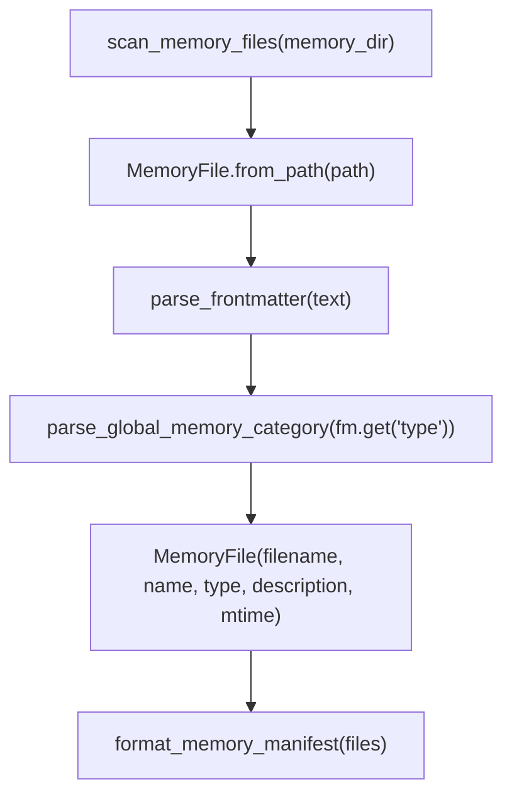
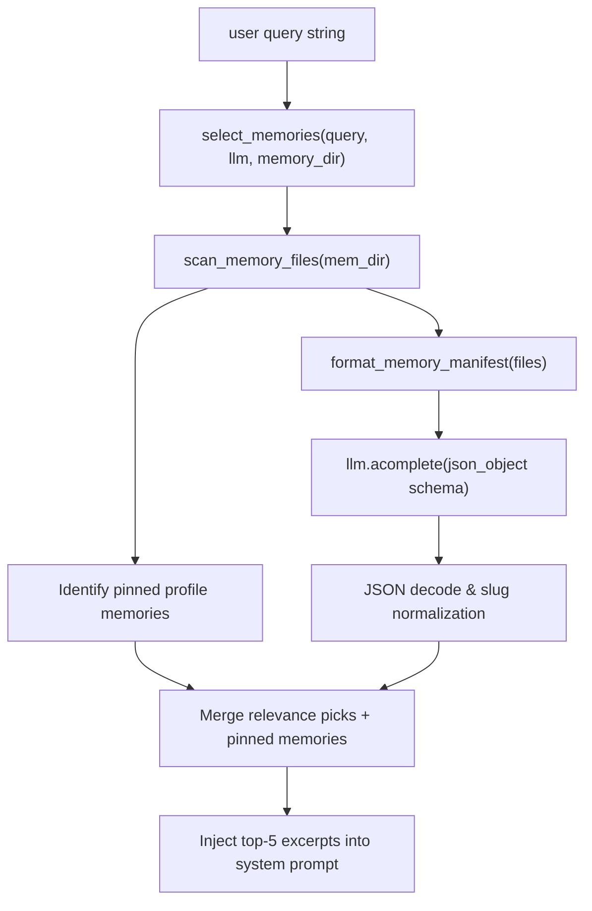
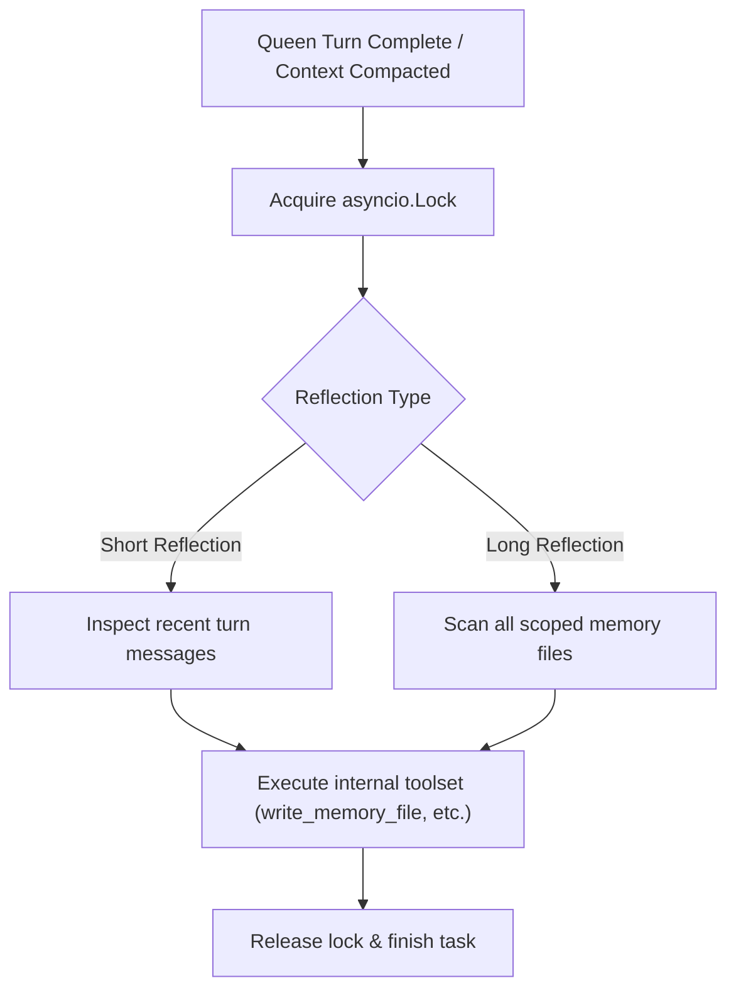
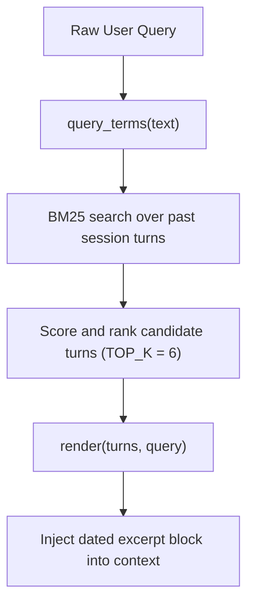

<!-- source: DeepWiki mcp.deepwiki.com · repo aden-hive/hive · extra page Queen Memory and Reflection · fetched 2026-10-26 -->

# Queen Memory and Reflection

<details>
<summary>Relevant source files</summary>

The following files were used as context for generating this wiki page:

- [core/framework/agent_loop/past_conversations_reminder.py](core/framework/agent_loop/past_conversations_reminder.py)
- [core/framework/agent_loop/reminders.py](core/framework/agent_loop/reminders.py)
- [core/framework/agents/queen/queen_memory_v2.py](core/framework/agents/queen/queen_memory_v2.py)
- [core/framework/agents/queen/recall_selector.py](core/framework/agents/queen/recall_selector.py)
- [core/framework/agents/queen/reflection_agent.py](core/framework/agents/queen/reflection_agent.py)
- [core/framework/agents/queen/timeline.py](core/framework/agents/queen/timeline.py)
- [core/framework/server/session_fork.py](core/framework/server/session_fork.py)
- [core/framework/server/session_titles.py](core/framework/server/session_titles.py)
- [core/framework/tools/harness_tools.py](core/framework/tools/harness_tools.py)
- [core/tests/test_config.py](core/tests/test_config.py)
- [core/tests/test_memory_timeline_recall.py](core/tests/test_memory_timeline_recall.py)
- [core/tests/test_queen_memory.py](core/tests/test_queen_memory.py)
- [core/tests/test_session_manager_worker_handoff.py](core/tests/test_session_manager_worker_handoff.py)
- [tools/src/memory_tools/recall.py](tools/src/memory_tools/recall.py)
- [tools/tests/test_memory_recall_timeline.py](tools/tests/test_memory_recall_timeline.py)

</details>


## Purpose and Scope
This page documents the memory and reflection subsystem of Hive's Queen agents, implemented primarily under `core/framework/agents/queen/`. The system enables persistent knowledge retention across independent and colony sessions via scoped Markdown memory files, pre-turn relevance selection, asynchronous background reflection, historical timeline extraction, and conversational recall.

---

## 1. Memory Hierarchy and Scopes

Hive organizes persistent agent memory into a hierarchical directory structure under `HIVE_HOME` (defaulting to `~/.hive/memories/`). The storage model supports three primary scopes:
* **Global Memory**: Shared across all queens and colonies (`global/`).
* **Colony-Scoped Memory**: Tied to a specific named colony (`colonies/{name}/`).
* **Queen-Specific Memory**: Tied to a named queen persona (`agents/queens/{name}/`).
* **Worker-Scoped Memory**: Tied to individual worker agents (`agents/{agent_name}/`).

Each memory entry is stored as an individual `.md` file containing optional YAML frontmatter (`name`, `type`, `description`) followed by the memory body. 

```
┌────────────────────────────────────────────────────────┐
│                      HIVE_HOME                         │
└──────────────────────────┬─────────────────────────────┘
                           │
                           ▼
                 [MEMORIES_DIR (~/.hive/memories)]
        ┌──────────────────┼──────────────────┐
        ▼                  ▼                  ▼
   [global/]        [colonies/{name}/]  [agents/queens/{name}/]
   - profile        - colony facts      - queen persona
   - preference                         - domain knowledge
   - environment
   - feedback
```
*Sources: [core/framework/agents/queen/queen_memory_v2.py:1-58](), [core/tests/test_queen_memory.py:188-199]()*

Key constraints enforced by `queen_memory_v2.py` include:
* **File Limits**: Capped at a maximum of `MAX_FILES = 200` per scope.
* **Size Limits**: Hard limit of `MAX_FILE_SIZE_BYTES = 4096` (4 KB) per memory file.
* **Categories**: Global memory categories are strictly validated against `GLOBAL_MEMORY_CATEGORIES` (`profile`, `preference`, `environment`, `feedback`).


*Diagram 1: Memory file ingestion and manifest formatting pipeline.*
*Sources: [core/framework/agents/queen/queen_memory_v2.py:30-142](), [core/tests/test_queen_memory.py:95-181]()*

---

## 2. Pre-Turn Memory Recall (`recall_selector`)

Before each conversation turn, the system dynamically selects relevant memories to inject into the Queen's system prompt without loading the entire corpus.

The selection pipeline executed by `select_memories` in `recall_selector.py`:
1. Scans the target memory directory for `.md` files via `scan_memory_files()`.
2. Identifies **pinned memories** (e.g., items where `type` is `profile`), which serve as baseline user identity context.
3. Sends a lightweight LLM request with `response_format={"type": "json_object"}` containing the user query and a manifest of available memory files and descriptions.
4. Parses the returned JSON containing `selected_memories`, validates filenames against existing files (supporting bare stems and `.md` extensions), and combines relevance picks with pinned profile memories up to `max_results = 5`.


*Diagram 2: Pre-turn memory selection data flow.*
*Sources: [core/framework/agents/queen/recall_selector.py:59-167](), [core/tests/test_queen_memory.py:15-19]*

---

## 3. Background Reflection (`reflection_agent`)

To prevent conversational context bloat and ensure durable facts are persisted, `reflection_agent.py` operates as a background side-agent running asynchronously via `asyncio.create_task`. It never blocks the queen's primary event loop, and an `asyncio.Lock` prevents overlapping runs.

### Reflection Types
* **Short Reflection**: Triggered after conversational queen turns. Distills recent dialogue into global or queen-scoped memory files.
* **Long Reflection**: Triggered every 5 short reflections and upon `CONTEXT_COMPACTED`. Organizes, deduplicates, and prunes redundant memories.

### Internal Reflection Tools
The reflection agent utilizes an internal toolset (`_REFLECTION_TOOLS`) that is separate from the Queen's main registry:
* `list_memory_files`: Inspects files grouped by scope (`global` or `queen`).
* `read_memory_file`: Reads full file content by filename and scope.
* `write_memory_file`: Creates or overwrites memory files containing YAML frontmatter and markdown bodies.
* `delete_memory_file`: Prunes stale or redundant memories during long reflections.


*Diagram 3: Reflection agent concurrency and lifecycle flow.*
*Sources: [core/framework/agents/queen/reflection_agent.py:1-130](), [core/tests/test_queen_memory.py:1-12]*

---

## 4. Memory Timeline and Historical Recall

Beyond static memory files, Hive maintains a structured chronological timeline of user statements and conversation histories.

### Timeline Extraction (`timeline.py`)
`timeline.py` extracts concrete events, facts, and plans stated by the user into `<session_dir>/timeline.jsonl`, accompanied by `<session_dir>/timeline_meta.json` as an extraction cursor. Relative dates (e.g., "yesterday", "last week") are resolved against session start timestamps.

```json
{
  "turn": 1,
  "kind": "event",
  "text": "The user attended cousin Rachel's vineyard wedding.",
  "start": "2023-08-01",
  "end": "2023-08-31",
  "aliases": ["went to a wedding"]
}
```
*Sources: [core/framework/agents/queen/timeline.py:1-76](), [core/tests/test_queen_memory_timeline.py:1-122]*

### BM25 Conversational Recall (`memory_tools/recall.py`)
The `memory_tools.recall` module processes raw user queries to extract content terms, strips scaffolding and stopwords (including CJK bigram slicing for Chinese/Japanese text), and performs BM25 scoring over past conversation mirror caches (`events.jsonl` / `.user.txt` / `.assistant.txt`). The highest-scoring turns are rendered into a dated excerpt block and injected ahead of each user turn.


*Diagram 4: Conversational recall pipeline.*
*Sources: [tools/src/memory_tools/recall.py:1-157](), [core/tests/test_queen_memory_timeline.py:43-114]*

---

## 5. Memory Benchmark Harness & Testing

Hive includes automated test suites validating memory persistence, recall accuracy, and timeline searching under `core/tests/test_queen_memory.py` and `tools/tests/test_memory_recall_timeline.py`. 

Key test coverage includes:
* **Frontmatter Parsing**: Robust handling of valid, missing, empty, or malformed YAML headers (`test_parse_frontmatter_*`).
* **Category Validation**: Ensuring strict enforcement of global memory categories (`test_parse_global_memory_category_*`).
* **File Allocation & Capping**: Verifying strict adherence to `MAX_FILES` and unique filename slug generation (`test_scan_memory_files_cap`).
* **Timeline Overlap & Alias Matching**: Confirming that range queries correctly filter by date overlap and match keyword aliases (`test_search_filters_by_date_overlap_and_sorts_oldest_first`).

```
Sources:
- [core/framework/agents/queen/reflection_agent.py:1-130]()
- [core/framework/agents/queen/recall_selector.py:59-167]()
- [core/framework/agents/queen/queen_memory_v2.py:1-58]()
- [core/framework/agents/queen/timeline.py:1-76]()
- [tools/src/memory_tools/recall.py:1-157]()
- [core/tests/test_queen_memory.py:1-199]()
- [tools/tests/test_memory_recall_timeline.py:1-169]()
```

---

