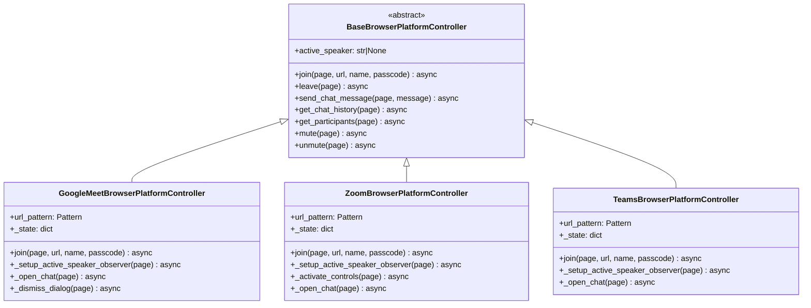
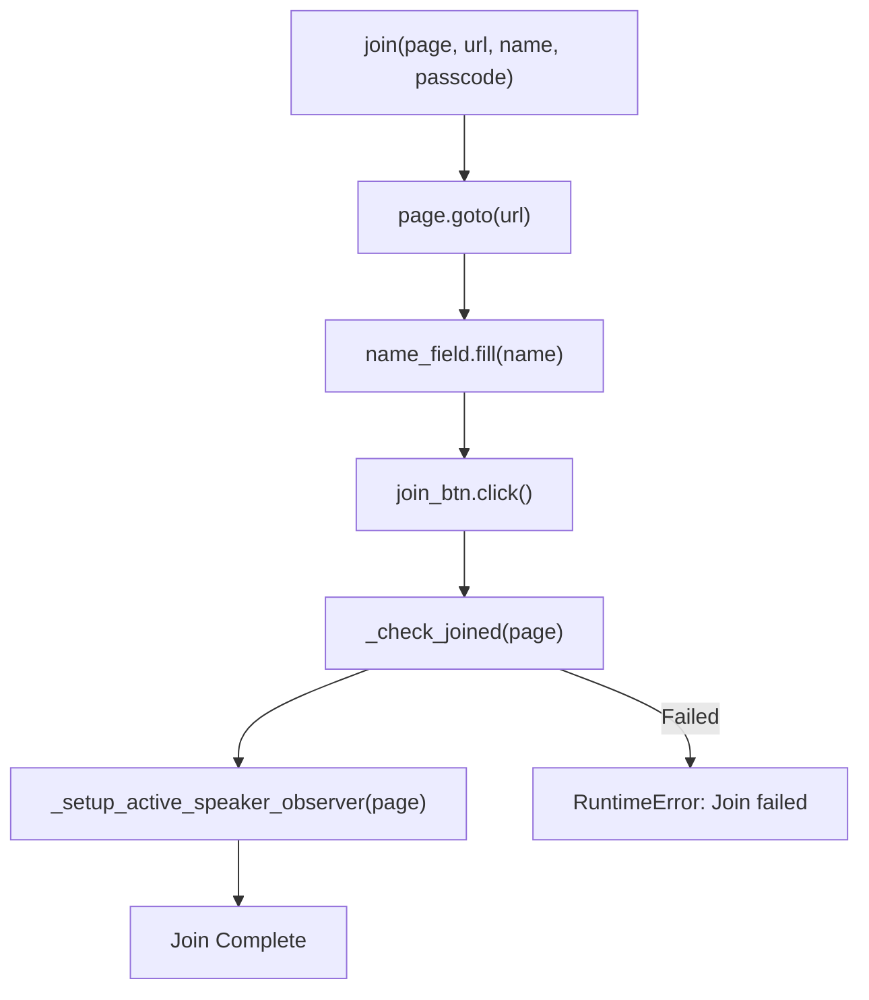
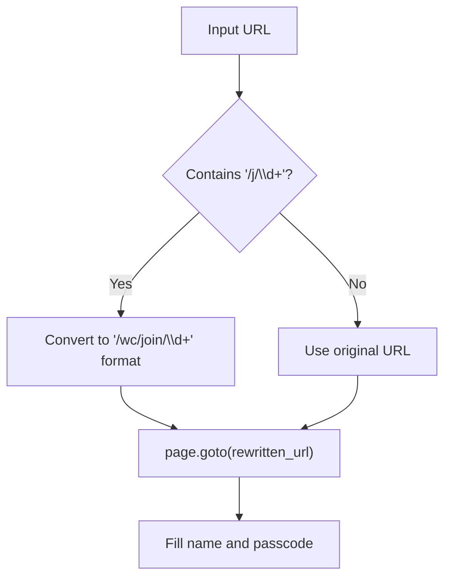
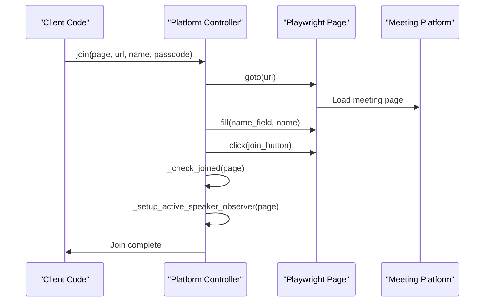
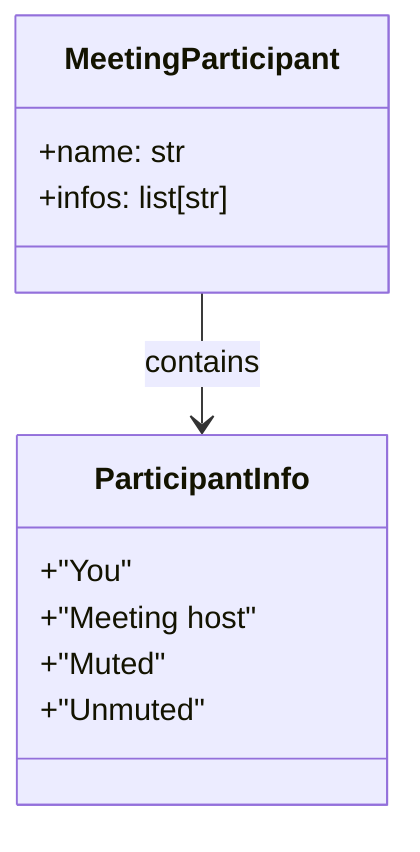
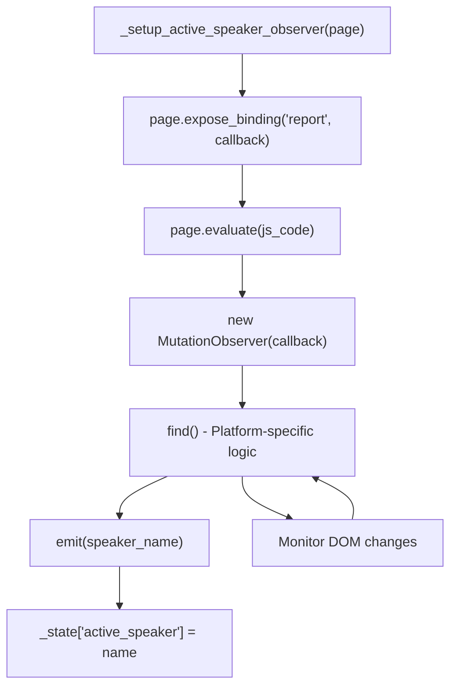

<!-- source: DeepWiki mcp.deepwiki.com · repo joinly-ai/joinly · page 4.4 Platform Controllers · fetched 2026-10-26 -->

# Platform Controllers

<details>
<summary>Relevant source files</summary>

The following files were used as context for generating this wiki page:

- [joinly/providers/browser/platforms/google_meet.py](joinly/providers/browser/platforms/google_meet.py)
- [joinly/providers/browser/platforms/teams.py](joinly/providers/browser/platforms/teams.py)
- [joinly/providers/browser/platforms/zoom.py](joinly/providers/browser/platforms/zoom.py)

</details>


Platform Controllers provide platform-specific implementations for interacting with different video conferencing platforms through browser automation. Each controller handles the unique DOM structure, UI patterns, and interaction flows required for Google Meet, Zoom, and Microsoft Teams.

For information about the overall browser automation system that manages these controllers, see [Browser Automation System](#5.1). For details about virtual audio device integration, see [Virtual Audio Devices](#5.3).

## Architecture Overview

Platform Controllers implement a common interface defined by `BaseBrowserPlatformController` while providing platform-specific logic for browser automation tasks. Each controller is responsible for URL pattern matching, meeting lifecycle management, and platform-specific DOM interactions.

**Platform Controller Class Hierarchy**


Sources: [joinly/providers/browser/platforms/google_meet.py:16-331](), [joinly/providers/browser/platforms/zoom.py:20-361](), [joinly/providers/browser/platforms/teams.py:15-296]()

## Common Interface

All platform controllers inherit from `BaseBrowserPlatformController` and implement a standardized set of methods for meeting management. The interface ensures consistent behavior across different platforms while allowing platform-specific implementations.

| Method | Purpose | Return Type |
|--------|---------|-------------|
| `join` | Join a meeting with credentials | `None` |
| `leave` | Leave the current meeting | `None` |
| `send_chat_message` | Send a chat message | `None` |
| `get_chat_history` | Retrieve chat message history | `MeetingChatHistory` |
| `get_participants` | Get list of meeting participants | `list[MeetingParticipant]` |
| `mute` | Mute the microphone | `None` |
| `unmute` | Unmute the microphone | `None` |
| `active_speaker` | Get current active speaker name | `str \| None` |

Each controller maintains internal state in the `_state` dictionary and provides platform-specific URL pattern matching through the `url_pattern` class variable.

Sources: [joinly/providers/browser/platforms/base.py](), [joinly/providers/browser/platforms/google_meet.py:16-31](), [joinly/providers/browser/platforms/zoom.py:20-35](), [joinly/providers/browser/platforms/teams.py:15-30]()

## Platform-Specific Implementations

### Google Meet Controller

The `GoogleMeetBrowserPlatformController` handles Google Meet's specific DOM structure and interaction patterns. It matches URLs using the pattern `/^(?:https?:)?(?:www\.)?meet\.google\.com/` and implements Google Meet-specific features.

**Key Implementation Details:**
- **Join Flow**: Fills name field via placeholder matching, clicks join button, and validates join success
- **Chat System**: Uses `textarea[placeholder*='Send a message']` for input and parses chat bubbles with `data-message-id` attributes
- **Participants**: Accesses participant list through `div[aria-label="Participants"][role="list"]`
- **Active Speaker Detection**: Uses `div[data-participant-id]` elements and CSS border detection for speaker identification

**Google Meet Join Flow**


Sources: [joinly/providers/browser/platforms/google_meet.py:16-61](), [joinly/providers/browser/platforms/google_meet.py:284-331]()

### Zoom Controller

The `ZoomBrowserPlatformController` manages Zoom's web client interface and handles URL rewriting from standard join URLs to web client format. It matches URLs using the pattern `/^(?:https?:)?(?:[a-z0-9-]+\.)?zoom\.us/`.

**Key Implementation Details:**
- **URL Rewriting**: Converts `/j/\d+` URLs to `/wc/join/\d+` format for web client access
- **Passcode Handling**: Supports both explicit passcode input and URL parameter extraction
- **Control Activation**: Uses mouse clicks at coordinates `(640, 360)` to activate control bars
- **Chat System**: Uses `div[contenteditable='true']` for message input and `role="application"` panels for history

**Zoom URL Processing**


Sources: [joinly/providers/browser/platforms/zoom.py:36-108](), [joinly/providers/browser/platforms/zoom.py:295-318]()

### Teams Controller

The `TeamsBrowserPlatformController` handles Microsoft Teams meetings across both `teams.microsoft.com` and `teams.live.com` domains. It matches URLs using the pattern `/^(?:https?:)?(?:[a-z0-9-]+\.)?(?:teams\.microsoft\.com|teams\.live\.com)/`.

**Key Implementation Details:**
- **Dialog Management**: Implements dialog dismissal for Teams popup handling
- **Chat Integration**: Uses `data-tid="chat-pane-item"` elements for message parsing
- **Participant Management**: Accesses participants through `div[aria-label="Attendees"][role="tree"]`
- **Active Speaker Detection**: Uses `data-tid="stage-layout"` and `data-tid="voice-level-stream-outline"` for speaker identification

Sources: [joinly/providers/browser/platforms/teams.py:15-71](), [joinly/providers/browser/platforms/teams.py:245-296]()

## Core Functionality

### Meeting Lifecycle Management

Each platform controller implements a consistent meeting lifecycle with platform-specific DOM interactions:

**Meeting Join Process**


### Chat Message Handling

Chat functionality varies significantly across platforms but follows a consistent pattern:

| Platform | Input Selector | Message Container | Max Length |
|----------|----------------|------------------|------------|
| Google Meet | `textarea[placeholder*='Send a message']` | `div[data-message-id]` | 500 chars |
| Zoom | `div[contenteditable='true']` | `[role="application"][aria-label="Chat Message List"]` | 1024 chars |
| Teams | `div[contenteditable='true']` | `[data-tid="chat-pane-item"]` | No limit |

Sources: [joinly/providers/browser/platforms/google_meet.py:78-101](), [joinly/providers/browser/platforms/zoom.py:130-150](), [joinly/providers/browser/platforms/teams.py:85-101]()

### Participant Management

Participant list access requires platform-specific button clicking and list parsing:

**Participant Data Structure**


Sources: [joinly/providers/browser/platforms/google_meet.py:139-187](), [joinly/providers/browser/platforms/zoom.py:195-234](), [joinly/providers/browser/platforms/teams.py:129-164]()

## Active Speaker Detection

Each platform implements real-time active speaker detection using JavaScript MutationObserver and platform-specific DOM selectors. The detection systems monitor CSS changes and DOM mutations to identify the currently speaking participant.

**Active Speaker Detection Architecture**


**Platform-Specific Speaker Detection:**

| Platform | Detection Method | DOM Selectors |
|----------|------------------|---------------|
| Google Meet | Border width detection | `div[data-participant-id]`, CSS `borderTopWidth > 3` |
| Zoom | CSS class matching | `.speaker-active-container__video-frame`, `.speaker-bar-container__video-frame--active` |
| Teams | Voice level indicators | `data-tid="voice-level-stream-outline"`, `.vdi-frame-occlusion` |

Sources: [joinly/providers/browser/platforms/google_meet.py:284-331](), [joinly/providers/browser/platforms/zoom.py:319-361](), [joinly/providers/browser/platforms/teams.py:245-296]()

## URL Pattern Matching

Platform controllers use compiled regular expressions for URL matching to determine which controller should handle a specific meeting URL:

```python
# URL Pattern Examples
GoogleMeetBrowserPlatformController.url_pattern = re.compile(
    r"^(?:https?:)?(?:www\.)?meet\.google\.com/"
)

ZoomBrowserPlatformController.url_pattern = re.compile(
    r"^(?:https?:)?(?:[a-z0-9-]+\.)?zoom\.us/"
)

TeamsBrowserPlatformController.url_pattern = re.compile(
    r"^(?:https?:)?(?:[a-z0-9-]+\.)?(?:teams\.microsoft\.com|teams\.live\.com)/"
)
```

The browser provider uses these patterns to route meeting URLs to the appropriate platform controller during the meeting join process.

Sources: [joinly/providers/browser/platforms/google_meet.py:19-22](), [joinly/providers/browser/platforms/zoom.py:23-26](), [joinly/providers/browser/platforms/teams.py:18-21]()

---

