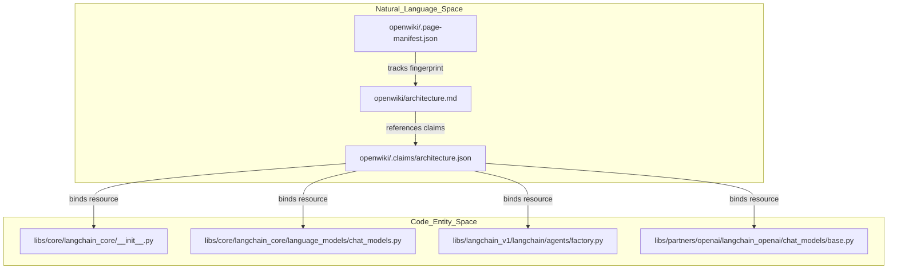

<!-- source: DeepWiki mcp.deepwiki.com · repo langchain-ai/langchain · page 1.3 Generated Wiki (openwiki) and Docs Automation · fetched 2026-10-26 -->

# Generated Wiki (openwiki) and Docs Automation

<details>
<summary>Relevant source files</summary>

The following files were used as context for generating this wiki page:

- [.github/workflows/openwiki-update.yml](.github/workflows/openwiki-update.yml)
- [openwiki/.claims/agent-execution.json](openwiki/.claims/agent-execution.json)
- [openwiki/.claims/agent-factory.json](openwiki/.claims/agent-factory.json)
- [openwiki/.claims/architecture.json](openwiki/.claims/architecture.json)
- [openwiki/.claims/ci-workflows.json](openwiki/.claims/ci-workflows.json)
- [openwiki/.claims/composability.json](openwiki/.claims/composability.json)
- [openwiki/.claims/dev-commands.json](openwiki/.claims/dev-commands.json)
- [openwiki/.claims/integration-tests.json](openwiki/.claims/integration-tests.json)
- [openwiki/.claims/mcp-integration.json](openwiki/.claims/mcp-integration.json)
- [openwiki/.claims/openai-provider.json](openwiki/.claims/openai-provider.json)
- [openwiki/.claims/partner-pattern.json](openwiki/.claims/partner-pattern.json)
- [openwiki/.claims/quickstart.json](openwiki/.claims/quickstart.json)
- [openwiki/.claims/source-map.json](openwiki/.claims/source-map.json)
- [openwiki/.last-update.json](openwiki/.last-update.json)
- [openwiki/.page-manifest.json](openwiki/.page-manifest.json)
- [openwiki/architecture.md](openwiki/architecture.md)
- [openwiki/dev-commands.md](openwiki/dev-commands.md)
- [openwiki/openai-provider.md](openwiki/openai-provider.md)
- [openwiki/partner-pattern.md](openwiki/partner-pattern.md)
- [openwiki/quickstart.md](openwiki/quickstart.md)
- [openwiki/source-map.md](openwiki/source-map.md)

</details>


The `openwiki/` directory and its associated automation provide a continuously synchronized and AI-assisted documentation framework embedded within the LangChain monorepo. This system links natural language wiki pages to verified code evidence using claim files, maintains a page manifest for tracking, and automates updates via a GitHub Actions workflow to keep docs current with code changes.

---

## 1. The `openwiki/` Directory and Page Architecture

Documentation pages live as Markdown files inside `openwiki/`. Each page begins with a structured YAML frontmatter section specifying metadata fields such as page type, title, description, tags, and references to source files that constitute the evidence for factual claims made in the documentation [openwiki/.page-manifest.json:1-125](), [openwiki/quickstart.md:1-47]().

### Frontmatter Schema Example

An example frontmatter from a wiki page:

```yaml
---
type: "Getting Started"
title: "LangChain Repository Quick Start"
description: "Entry point for engineers: orient to the monorepo structure, run first tests, understand what to edit for common tasks, and route to major development areas."
tags: [quickstart, getting-started, monorepo, setup]
sources:
  - id: openwiki-source-4d1645cb6317345817452838
    resource: repo://.pre-commit-config.yaml
  - id: openwiki-source-8e384445ccfbaf00747b3e18
    resource: repo://libs/core/langchain_core/__init__.py
generated: { by: "openwiki/0.5.0", at: "2026-09-21T08:30:16.745Z" }
verified:
  - by: openwiki/0.5.0
    at: 2026-09-22T08:27:06.345Z
---
```

This schema enables effective categorization, searching, and traceability of documentation content down to exact code versions.

```Sources: [openwiki/quickstart.md:1-47](), [openwiki/.page-manifest.json:1-125]()```

---

## 2. Claim Files and Evidence Binding (`openwiki/.claims/`)

To enforce accuracy and maintain provenance, all key factual statements in the text are extracted as individual *claims* stored as JSON files under `openwiki/.claims/`. Each claim includes a unique ID, the claim statement, and a list of *evidence* entries — source code files anchored by cryptographic hashes that uniquely identify the exact file version supporting the claim [openwiki/.claims/quickstart.json:1-22]().

### Example Claim JSON

```json
{
  "schemaVersion": 1,
  "pageVersion": "sha256:37b10d0b8065a18260ed5cc5af20f81cfbc6872d2057a39aef73c3cda08f81db",
  "claims": [
    {
      "id": "claim_7425c73f5e4c4667b8babba66c3663a0",
      "statement": "LangChain is organized as a three-layer architecture in /libs/: core (base abstractions including Runnable, BaseChatModel, tools, prompts, messages), langchain_v1 (agent orchestration, factory, middleware), and partners (provider-specific integrations)",
      "evidence": [
        {
          "resource": "repo://libs/core/langchain_core/__init__.py",
          "version": "repo-file-v1:sha256:fa4e54cbdf24eb2cfc4fd24776115853a9bc7977447b4d072a470f6765d2a781"
        }
      ]
    }
  ]
}
```

This binding mechanism guarantees all documentation assertions are verifiable and tied to code, facilitating automated validation and regeneration when code changes invalidate claims.

```Sources: [openwiki/.claims/quickstart.json:1-22](), [openwiki/.claims/architecture.json:1-26]()```

---

## 3. Page Manifest (`openwiki/.page-manifest.json`)

The wiki maintains a manifest file that tracks every page's synchronization state, generation metadata, fingerprints of source code references, and the git commit at the time of generation. This manifest enables efficient identification of stale pages that must be regenerated when underlying source code evolves [openwiki/.page-manifest.json:1-125]().

### Manifest Structure Overview

```json
{
  "schemaVersion": 1,
  "pages": {
    "/openwiki/architecture.md": {
      "pageVersion": "sha256:4bcc27e623ef816245eaea9630b852b1c8e3d01cfb4d739ba4ec040e531d087a",
      "completedBy": "openwiki/0.5.0",
      "completedRunId": "42beb1a0-aed2-4fc6-b6b4-a39607bfb92c",
      "gitHead": "9e4ea7a3495992c02a79de6fa5788e028b03df11",
      "sourceFingerprint": "sha256:fcf377c645402ec15df777e711a9634a4c0a1cac2ec0791da74fc9406df78122"
    }
  }
}
```

| Field                | Description                                                      |
|----------------------|------------------------------------------------------------------|
| `pageVersion`        | Hash of compiled Markdown content                                 |
| `completedBy`        | Generator tool/version string                                    |
| `completedRunId`     | Unique run identifier for the CI pipeline execution              |
| `gitHead`            | Commit SHA at time of generation                                 |
| `sourceFingerprint`  | Combined hash of all source files referenced by this page       |

This data structure supports incremental regeneration by detecting changes at the granularity of page dependency source sets.

```Sources: [openwiki/.page-manifest.json:1-125](), [openwiki/.last-update.json:1-8]()```

---

## 4. Automation and the `openwiki-update` Workflow

The `openwiki-update.yml` GitHub Actions workflow automates the regeneration of the wiki pages:

- It triggers on push or pull request events affecting source files referenced by the wiki claims.
- The automation engine compares the current source fingerprints in the manifest against the newly computed ones.
- On detecting any change, it regenerates claim files, updates Markdown wiki pages, refreshes the page manifest, and writes update timing metadata in `.last-update.json` [openwiki/.last-update.json:1-8]().

### Last Update Metadata Example

```json
{
  "updatedAt": "2026-09-29T08:33:44.890Z",
  "command": "update",
  "gitHead": "78a3cbcc6b5e7e39fafda5d7b8df384a4a2c821d",
  "model": "claude-haiku-4-5",
  "status": "complete",
  "language": "en"
}
```

This pipeline ensures documentation stays seamlessly aligned with the current codebase state without manual intervention.

```Sources: [openwiki/.last-update.json:1-8]()```

---

## 5. System Integration & Data Flow Architecture

The two diagrams below map the layered relationship between natural language documentation and code entities, and the automated update flow keeping them synchronized.

### Diagram 1: Mapping Natural Language Documentation to Code Entities



This diagram illustrates how wiki pages associate to claim files, each claim binds to concrete source code files, providing transparent traceability from natural language docs to code implementations.

```Sources: [openwiki/architecture.md:1-41](), [openwiki/.claims/architecture.json:1-26](), [openwiki/.page-manifest.json:1-125]()```

---

### Diagram 2: `openwiki-update` Automation Workflow

```mermaid
graph LR
    CodeChange["Code Commit / Pull Request"]
    WorkflowTrigger["GitHub Workflow: openwiki-update.yml"]
    AutomationEngine["OpenWiki Automation Engine"]
    FingerprintCheck["Compare sourceFingerprint from manifest"]

    RecomputeClaims["Generate /openwiki/.claims/*.json"]
    RenderMarkdown["Generate /openwiki/*.md Markdown files"]
    UpdateManifest["Update /openwiki/.page-manifest.json"]
    UpdateLastUpdate["Update /openwiki/.last-update.json"]

    CodeChange --> WorkflowTrigger
    WorkflowTrigger --> AutomationEngine
    AutomationEngine --> FingerprintCheck
    FingerprintCheck -- Modified --> RecomputeClaims
    RecomputeClaims --> RenderMarkdown
    RenderMarkdown --> UpdateManifest
    UpdateManifest --> UpdateLastUpdate
```



This flow depicts the continuous integration pipeline where source changes trigger claim and page regeneration, keeping documentation synchronized with the codebase.

```Sources: [openwiki/.page-manifest.json:1-125](), [openwiki/.last-update.json:1-8]()```

---

# Summary

- The `openwiki/` folder houses rich Markdown documentation pages with structured frontmatter connecting textual descriptions to precise source versions.
- Claim files in `openwiki/.claims/` explicitly encode factual assertions and code evidence relationships.
- A manifest tracks page build state and source fingerprints, enabling incremental regeneration detection.
- The `openwiki-update` GitHub Actions workflow automates regeneration upon code changes, ensuring docs always reflect the current implementation.
- Together, they form a tightly coupled, AI-assisted doc generation system that tightly integrates prose and code provenance in LangChain.

```Sources: [openwiki/quickstart.md:1-47](), [openwiki/.claims/quickstart.json:1-22](), [openwiki/.page-manifest.json:1-125](), [openwiki/.last-update.json:1-8]()```

---

