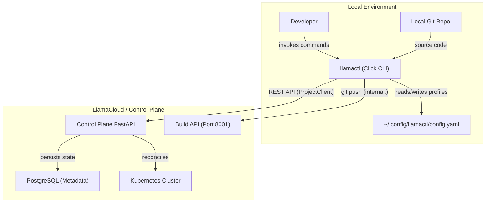
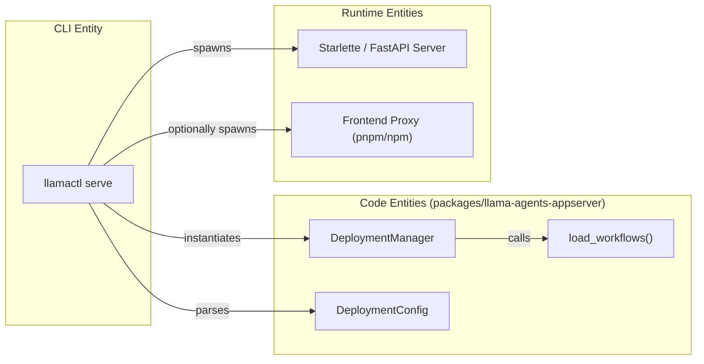

<!-- source: DeepWiki mcp.deepwiki.com · repo run-llama/llama-agents · page 7 llamactl CLI · fetched 2026-10-26 -->

# llamactl CLI

Relevant source files

The following files were used as context for generating this wiki page:

- [.agents/skills/llamactl-qa/SKILL.md](.agents/skills/llamactl-qa/SKILL.md)
- [architecture-docs/overall-architecture.md](architecture-docs/overall-architecture.md)
- [architecture-docs/quick-reference.md](architecture-docs/quick-reference.md)
- [docs/src/content/docs/llamaagents/llamactl-reference/commands-auth.md](docs/src/content/docs/llamaagents/llamactl-reference/commands-auth.md)
- [docs/src/content/docs/llamaagents/llamactl-reference/commands-config.md](docs/src/content/docs/llamaagents/llamactl-reference/commands-config.md)
- [docs/src/content/docs/llamaagents/llamactl-reference/commands-deployments.md](docs/src/content/docs/llamaagents/llamactl-reference/commands-deployments.md)
- [docs/src/content/docs/llamaagents/llamactl-reference/commands-environments.md](docs/src/content/docs/llamaagents/llamactl-reference/commands-environments.md)
- [docs/src/content/docs/llamaagents/llamactl-reference/commands-init.md](docs/src/content/docs/llamaagents/llamactl-reference/commands-init.md)
- [docs/src/content/docs/llamaagents/llamactl-reference/commands-organizations.md](docs/src/content/docs/llamaagents/llamactl-reference/commands-organizations.md)
- [docs/src/content/docs/llamaagents/llamactl-reference/commands-projects.md](docs/src/content/docs/llamaagents/llamactl-reference/commands-projects.md)
- [docs/src/content/docs/llamaagents/llamactl-reference/commands-serve.md](docs/src/content/docs/llamaagents/llamactl-reference/commands-serve.md)
- [docs/src/content/docs/llamaagents/llamactl/cd-with-github-actions.md](docs/src/content/docs/llamaagents/llamactl/cd-with-github-actions.md)
- [docs/src/content/docs/llamaagents/llamactl/configuration-reference.md](docs/src/content/docs/llamaagents/llamactl/configuration-reference.md)
- [docs/src/content/docs/llamaagents/llamactl/getting-started.md](docs/src/content/docs/llamaagents/llamactl/getting-started.md)
- [packages/llamactl/CHANGELOG.md](packages/llamactl/CHANGELOG.md)
- [packages/llamactl/README.md](packages/llamactl/README.md)
- [packages/llamactl/package.json](packages/llamactl/package.json)
- [packages/llamactl/pyproject.toml](packages/llamactl/pyproject.toml)

`llamactl` is the primary command-line interface for developing LlamaAgents applications locally and managing their lifecycle on LlamaCloud. It provides tools for scaffolding projects, running local development servers, and performing declarative deployment management via a centralized Control Plane [packages/llamactl/README.md:1-5]().

The CLI is built using the `click` library and is distributed as the `llamactl` package [packages/llamactl/pyproject.toml:18-45]().

### System Interaction Overview

The following diagram illustrates how `llamactl` bridges the local development environment with the remote LlamaCloud infrastructure.

**CLI to Control Plane Bridge**

Sources: [architecture-docs/overall-architecture.md:9-17](), [packages/llamactl/pyproject.toml:33-45](), [packages/llamactl/README.md:77-88]()

---

## Command Groups

`llamactl` organizes its functionality into several major command groups:

| Command Group | Purpose | Key Commands |
| --- | --- | --- |
| `deployments` | Manage cloud-hosted workflow instances | `apply`, `create`, `get`, `logs`, `update` |
| `auth` | Manage credentials and login sessions | `login`, `token`, `use`, `logout` |
| `environments` | Switch between LlamaCloud API targets | `use`, `get`, `add` |
| `projects` | Context switching between LlamaCloud projects | `use`, `get` |
| `init` | Scaffold new projects from templates | `llamactl init` |
| `serve` | Run the local app server and UI proxy | `llamactl serve` |

Sources: [packages/llamactl/README.md:64-76](), [docs/src/content/docs/llamaagents/llamactl-reference/commands-deployments.md:16-30]()

---

## Deployment Management

The `deployments` group is the core of `llamactl`'s cloud interaction. It supports both interactive workflows (using `$EDITOR` for YAML editing) and declarative CI/CD workflows using the `apply` command [docs/src/content/docs/llamaagents/llamactl-reference/commands-deployments.md:128-156]().

*   **Lifecycle**: Deployments move through phases like `Syncing`, `Pending`, and `Running` as the Kubernetes Operator reconciles the `LlamaDeployment` CRD [architecture-docs/overall-architecture.md:61]().
*   **Push-Mode**: `llamactl` can mirror local code to LlamaCloud's internal S3-backed Git repository using an `internal://` scheme [packages/llamactl/CHANGELOG.md:207-209]().

For details on the deployment lifecycle and YAML specs, see [Deployment Commands (apply, create, edit, template, logs)](#7.1).

---

## Authentication and Context

`llamactl` uses a hierarchical configuration system. Users select an **Environment** (e.g., production vs. local), then a **Profile** (credentials), and finally a **Project** context [docs/src/content/docs/llamaagents/llamactl-reference/commands-auth.md:6-7]().

*   **OIDC Flow**: `auth login` initiates a browser-based device flow [docs/src/content/docs/llamaagents/llamactl-reference/commands-auth.md:48-55]().
*   **Environment Variables**: For CI/CD, `LLAMA_CLOUD_API_KEY` and `LLAMA_AGENTS_PROJECT_ID` override local profiles [docs/src/content/docs/llamaagents/llamactl/cd-with-github-actions.md:12-20]().

For details on managing tokens and switching projects, see [Authentication, Projects, and Organizations](#7.2).

---

## Local Development: `init` and `serve`

`llamactl` provides a complete local loop for workflow development:

1.  **Scaffolding**: `llamactl init` uses a template picker to create a project with `pyproject.toml` configuration [docs/src/content/docs/llamaagents/llamactl/getting-started.md:62-71]().
2.  **Serving**: `llamactl serve` starts a local `WorkflowServer`, installs dependencies via `uv`, and can proxy a frontend development server [docs/src/content/docs/llamaagents/llamactl/getting-started.md:82-91]().

**Local Development Entity Map**

Sources: [docs/src/content/docs/llamaagents/llamactl/getting-started.md:82-112](), [architecture-docs/quick-reference.md:15-20]()

---

## CLI Internals and Configuration

`llamactl` features a robust internal framework for handling output and configuration:

*   **Output Dispatcher**: Supports `-o text`, `-o json`, `-o yaml`, and `-o wide` using a declarative column framework [packages/llamactl/CHANGELOG.md:46-49]().
*   **Config Management**: The `ConfigManager` handles the `~/.config/llamactl/config.yaml` file and merges it with environment variables [architecture-docs/quick-reference.md:26]().
*   **Shell Completion**: Built-in support for generating and installing completion scripts for `bash`, `zsh`, and `fish` [packages/llamactl/README.md:90-102]().

For details on the internal rendering engine and configuration schema, see [CLI Internals: Display, Output, and Configuration](#7.3).

Sources:
- [packages/llamactl/pyproject.toml:18-45]()
- [packages/llamactl/README.md:1-113]()
- [architecture-docs/overall-architecture.md:9-17]()
- [docs/src/content/docs/llamaagents/llamactl/getting-started.md:10-155]()
- [docs/src/content/docs/llamaagents/llamactl-reference/commands-deployments.md:6-30]()
- [docs/src/content/docs/llamaagents/llamactl-reference/commands-auth.md:6-102]()
- [architecture-docs/quick-reference.md:22-27]()

---

