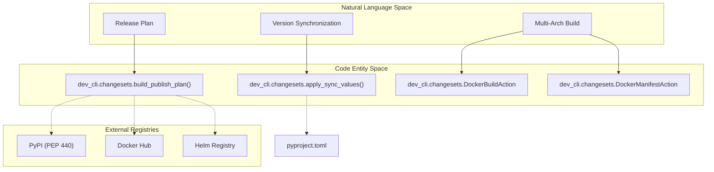
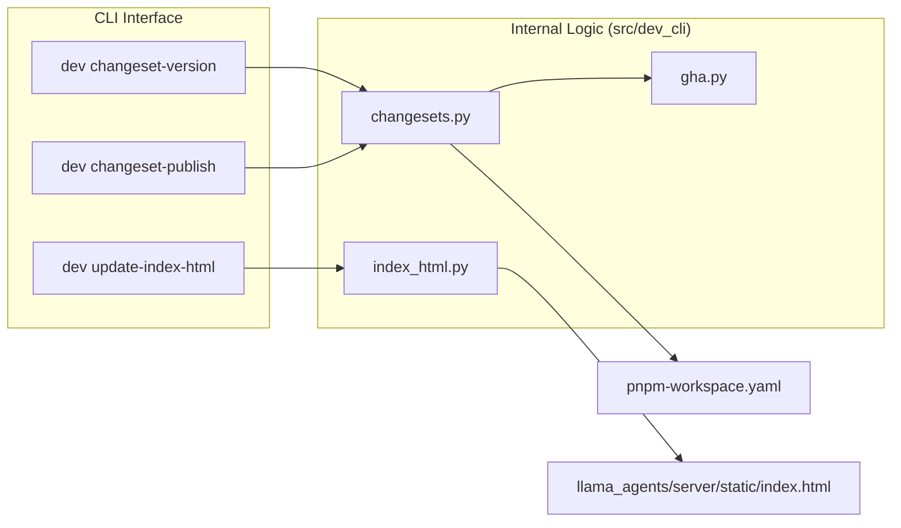

<!-- source: DeepWiki mcp.deepwiki.com · repo run-llama/llama-agents · page 8 CI/CD, Publishing, and Developer Tooling · fetched 2026-10-26 -->

# CI/CD, Publishing, and Developer Tooling

Relevant source files

The following files were used as context for generating this wiki page:

- [.github/actions/setup-publish/action.yml](.github/actions/setup-publish/action.yml)
- [.github/workflows/bump_llama_index_core.yml](.github/workflows/bump_llama_index_core.yml)
- [.github/workflows/publish_changesets.yml](.github/workflows/publish_changesets.yml)
- [.github/workflows/publish_openapi.yml](.github/workflows/publish_openapi.yml)
- [.github/workflows/sync-docs.yml](.github/workflows/sync-docs.yml)
- [.github/workflows/test.yml](.github/workflows/test.yml)
- [.github/workflows/update_debugger_assets.yml](.github/workflows/update_debugger_assets.yml)
- [operator/CHANGELOG.md](operator/CHANGELOG.md)
- [operator/package.json](operator/package.json)
- [src/dev_cli/changesets.py](src/dev_cli/changesets.py)
- [src/dev_cli/commands/changesets_cmd.py](src/dev_cli/commands/changesets_cmd.py)
- [src/dev_cli/commands/publish_cmd.py](src/dev_cli/commands/publish_cmd.py)
- [src/dev_cli/gha.py](src/dev_cli/gha.py)
- [src/dev_cli/index_html.py](src/dev_cli/index_html.py)
- [tests/dev_cli/test_changesets.py](tests/dev_cli/test_changesets.py)

This section provides an overview of the automated release pipeline, continuous integration (CI) workflows, and the internal developer CLI used to manage the `llama-agents` monorepo. The repository utilizes a hybrid approach to manage both Python and TypeScript-based components, ensuring synchronized versioning across PyPI, Docker Hub, and Helm registries.

## Automated Release Pipeline

The release process is driven by the `publish_changesets.yml` workflow, which implements a "plan and execute" pattern. It uses [Changesets](https://changesets.js.org) to manage version bumps and changelogs, combined with a custom reconciliation loop to publish artifacts.

- **Versioning**: Changesets are used to generate a "version packages" PR. When merged, the `changeset-version` command synchronizes `package.json` versions with `pyproject.toml` files and updates the `uv` lockfile [.github/workflows/publish_changesets.yml:75-84](), [src/dev_cli/commands/changesets_cmd.py:15-43]().
- **Reconcile Loop**: The pipeline runs `dev changeset-plan` to diff the current workspace against remote registries (PyPI, Docker Hub, Helm) [.github/workflows/publish_changesets.yml:103-105]().
- **Parallel Publishing**: Based on the plan, the workflow fans out into parallel jobs for PyPI uploads, multi-arch Docker builds (native amd64/arm64), and Helm chart publishing [.github/workflows/publish_changesets.yml:117-175]().

For details, see [Release Pipeline and Changeset Publishing](#8.1).

### Release Pipeline Mapping
The following diagram illustrates how the CI system bridges high-level release concepts to specific code entities and external registries.

**Sources:** [.github/workflows/publish_changesets.yml:103-175](), [src/dev_cli/changesets.py:122-210](), [src/dev_cli/commands/changesets_cmd.py:15-43]()

## CI and Documentation Workflows

Continuous Integration ensures code quality through rigorous testing and linting across multiple Python versions (3.10 through 3.14) [.github/workflows/test.yml:19-34]().

- **Testing**: The `test.yml` workflow runs `pytest` for every package in the monorepo. It includes specialized jobs for Docker-based integration tests [.github/workflows/test.yml:82-120]().
- **Documentation**: Documentation is automatically synced to the LlamaIndex Developer Hub upon pushes to the main branch [.github/workflows/sync-docs.yml:4-7]().
- **Maintenance**: Automated workflows handle routine tasks like bumping `llama-index-core` dependencies and updating debugger assets for the `WorkflowServer` [.github/workflows/bump_llama_index_core.yml:1-18](), [.github/workflows/update_debugger_assets.yml:1-50]().

For details, see [Test, Lint, and Documentation Workflows](#8.2).

## Dev CLI Tooling

The internal `dev` CLI (located in `src/dev_cli`) is the primary interface for developer operations. It abstracts complex monorepo tasks into simple commands.

- **Changeset Management**: Commands like `changeset-version` and `changeset-publish` allow developers to simulate or execute the release pipeline locally [src/dev_cli/commands/changesets_cmd.py:15-70]().
- **Asset Updates**: The `update-index-html` command manages the injection of remote JavaScript and CSS assets into the server's static debugger page [src/dev_cli/index_html.py:31-52]().
- **Version Conversion**: Utility functions handle the translation between SemVer (used by Changesets/NPM) and PEP 440 (required by PyPI) [src/dev_cli/changesets.py:63-102]().

For details, see [Dev CLI (src/dev_cli)](#8.3).

### Tooling Architecture
This diagram shows the relationship between the CLI commands and the underlying logic modules.

**Sources:** [src/dev_cli/commands/changesets_cmd.py:1-70](), [src/dev_cli/index_html.py:17-52](), [src/dev_cli/changesets.py:1-102]()

## Configuration Summary

The publishing behavior is controlled by metadata within `package.json` files found in each package directory.

| Field | Description | Example |
| :--- | :--- | :--- |
| `docker` | Configures image name, Dockerfile path, and target platforms | [operator/package.json:5-13]() |
| `publish` | Toggles for `pypi`, `docker`, and `helm` channels | [src/dev_cli/changesets.py:126-134]() |
| `syncValues` | Rules for syncing versions into arbitrary files (e.g., Helm `values.yaml`) | [src/dev_cli/changesets.py:143-143]() |
| `postVersion` | Shell commands to run after a version bump | [src/dev_cli/changesets.py:144-144]() |

**Sources:** [src/dev_cli/changesets.py:105-157](), [operator/package.json:1-14]()

---

