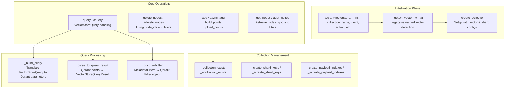
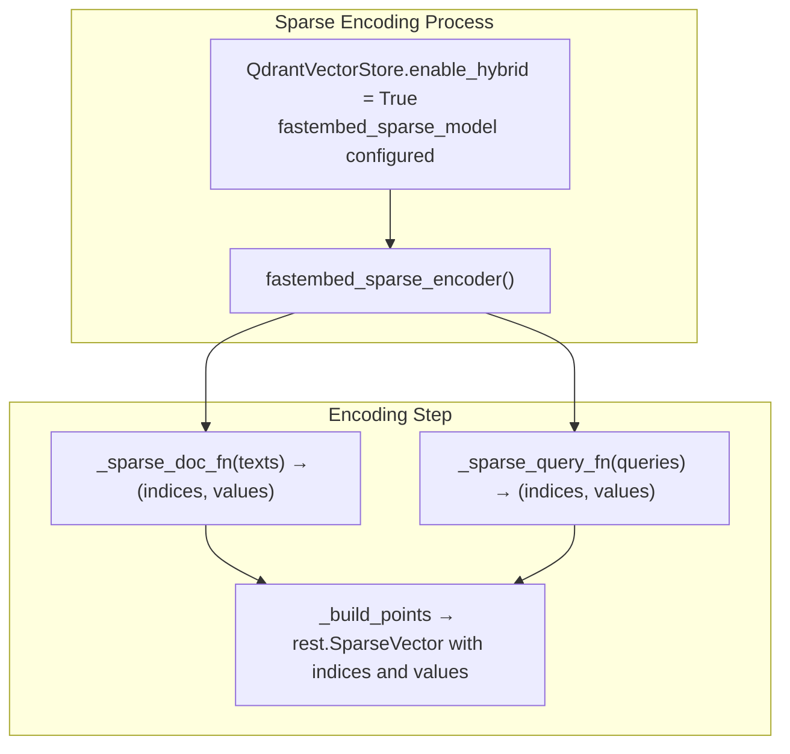
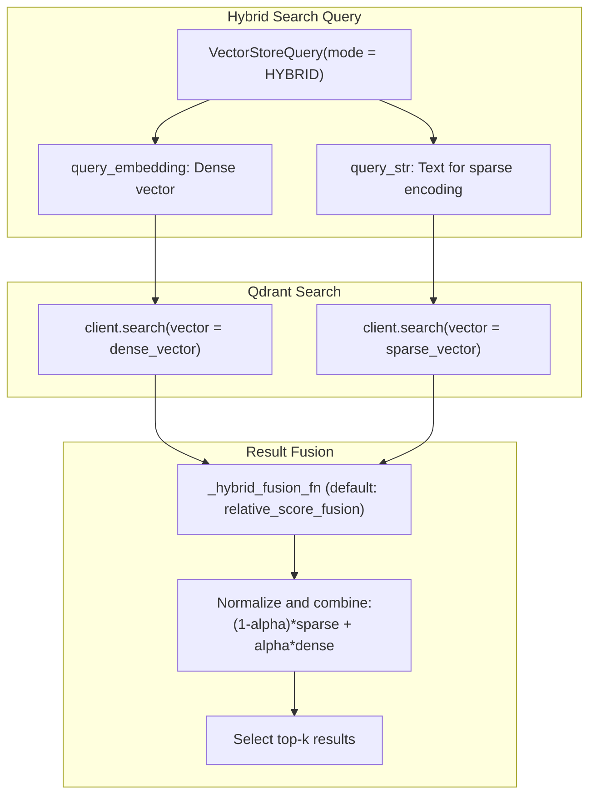

<!-- source: DeepWiki mcp.deepwiki.com · repo run-llama/llama_index · page 7.4 Qdrant Integration · fetched 2026-10-26 -->

# Qdrant Integration

Relevant source files

The following files were used as context for generating this wiki page:

- [llama-index-core/llama_index/core/graph_stores/simple.py](llama-index-core/llama_index/core/graph_stores/simple.py)
- [llama-index-core/llama_index/core/graph_stores/simple_labelled.py](llama-index-core/llama_index/core/graph_stores/simple_labelled.py)
- [llama-index-core/llama_index/core/storage/chat_store/simple_chat_store.py](llama-index-core/llama_index/core/storage/chat_store/simple_chat_store.py)
- [llama-index-core/llama_index/core/storage/index_store/simple_index_store.py](llama-index-core/llama_index/core/storage/index_store/simple_index_store.py)
- [llama-index-core/llama_index/core/storage/kvstore/simple_kvstore.py](llama-index-core/llama_index/core/storage/kvstore/simple_kvstore.py)
- [llama-index-core/llama_index/core/storage/kvstore/types.py](llama-index-core/llama_index/core/storage/kvstore/types.py)
- [llama-index-core/llama_index/core/storage/storage_context.py](llama-index-core/llama_index/core/storage/storage_context.py)
- [llama-index-core/llama_index/core/vector_stores/simple.py](llama-index-core/llama_index/core/vector_stores/simple.py)
- [llama-index-core/llama_index/core/vector_stores/types.py](llama-index-core/llama_index/core/vector_stores/types.py)
- [llama-index-core/tests/graph_stores/test_simple_lpg.py](llama-index-core/tests/graph_stores/test_simple_lpg.py)
- [llama-index-core/tests/storage/chat_store/test_simple_chat_store.py](llama-index-core/tests/storage/chat_store/test_simple_chat_store.py)
- [llama-index-core/tests/storage/kvstore/test_mutable_mapping_kvstore.py](llama-index-core/tests/storage/kvstore/test_mutable_mapping_kvstore.py)
- [llama-index-core/tests/vector_stores/test_simple.py](llama-index-core/tests/vector_stores/test_simple.py)
- [llama-index-integrations/vector_stores/llama-index-vector-stores-qdrant/llama_index/vector_stores/qdrant/base.py](llama-index-integrations/vector_stores/llama-index-vector-stores-qdrant/llama_index/vector_stores/qdrant/base.py)
- [llama-index-integrations/vector_stores/llama-index-vector-stores-qdrant/llama_index/vector_stores/qdrant/utils.py](llama-index-integrations/vector_stores/llama-index-vector-stores-qdrant/llama_index/vector_stores/qdrant/utils.py)
- [llama-index-integrations/vector_stores/llama-index-vector-stores-qdrant/pyproject.toml](llama-index-integrations/vector_stores/llama-index-vector-stores-qdrant/pyproject.toml)
- [llama-index-integrations/vector_stores/llama-index-vector-stores-qdrant/tests/conftest.py](llama-index-integrations/vector_stores/llama-index-vector-stores-qdrant/tests/conftest.py)
- [llama-index-integrations/vector_stores/llama-index-vector-stores-qdrant/tests/test_vector_stores_qdrant.py](llama-index-integrations/vector_stores/llama-index-vector-stores-qdrant/tests/test_vector_stores_qdrant.py)
- [llama-index-integrations/vector_stores/llama-index-vector-stores-qdrant/uv.lock](llama-index-integrations/vector_stores/llama-index-vector-stores-qdrant/uv.lock)

This document covers LlamaIndex's integration with **Qdrant**, a high-performance open-source vector database supporting semantic search over dense and sparse vectors. The integration centers around the `QdrantVectorStore` class, which encapsulates storage, retrieval, and advanced features such as named vectors, hybrid fusion between dense and sparse embeddings, sharding for distributed indexing, and a high-performance sparse embedding method via FastEmbed.

## Architecture Overview

The Qdrant integration provides a robust interface to Qdrant collections, supporting both synchronous and asynchronous clients. It features flexible vector naming conventions, hybrid search modes, and custom sharding and payload indexing support.

```mermaid
graph TB
    subgraph "LlamaIndex Qdrant Integration"
        QdrantVectorStore["QdrantVectorStore<br/>(BasePydanticVectorStore)"]
        Utils["Hybrid Fusion Utilities"]
    end
    
    subgraph "Client Layer"
        QdrantClient["QdrantClient<br/>Synchronous"]
        AsyncQdrantClient["AsyncQdrantClient<br/>Asynchronous"]
    end
    
    subgraph "Named Vectors"
        DenseVector["text-dense<br/>(DEFAULT_DENSE_VECTOR_NAME)"]
        SparseVector["text-sparse-new<br/>(DEFAULT_SPARSE_VECTOR_NAME)"]
        LegacySparse["text-sparse<br/>(DEFAULT_SPARSE_VECTOR_NAME_OLD)"]
    end
    
    subgraph "Search Modes"
        DefaultMode["VectorStoreQueryMode.DEFAULT<br/>Dense only search"]
        SparseMode["VectorStoreQueryMode.SPARSE<br/>Sparse only search"]
        HybridMode["VectorStoreQueryMode.HYBRID<br/>Fusion of dense and sparse"]
    end
    
    subgraph "Advanced Features"
        Sharding["Custom Sharding<br/>ShardingMethod.CUSTOM"]
        PayloadIndexes["Payload Indexes<br/>For metadata fields"]
        MetadataFilters["Metadata Filters<br/>FilterCondition support"]
    end
    
    QdrantVectorStore --> QdrantClient
    QdrantVectorStore --> AsyncQdrantClient
    
    QdrantVectorStore --> DenseVector
    QdrantVectorStore --> SparseVector
    QdrantVectorStore --> LegacySparse
    
    QdrantVectorStore --> DefaultMode
    QdrantVectorStore --> SparseMode
    QdrantVectorStore --> HybridMode
    
    Utils --> HybridMode
    
    QdrantVectorStore --> Sharding
    QdrantVectorStore --> PayloadIndexes
    QdrantVectorStore --> MetadataFilters
```

| Component               | Purpose                                       | Location                                                                                         |
|-------------------------|-----------------------------------------------|------------------------------------------------------------------------------------------------|
| `QdrantVectorStore`     | Main vector store class for Qdrant            | [vector_stores/qdrant/base.py:79-175]()                                                        |
| `HybridFusionCallable`  | Protocol defining hybrid fusion callable      | [vector_stores/qdrant/utils.py:10-20]()                                                        |
| `relative_score_fusion` | Default function to fuse sparse and dense results | [vector_stores/qdrant/utils.py:108-202]()                                                      |
| `fastembed_sparse_encoder` | Efficient sparse encoder using FastEmbed    | [vector_stores/qdrant/utils.py:67-105]()                                                       |

Sources: [vector_stores/qdrant/base.py:79-175](), [vector_stores/qdrant/utils.py:10-105]()

---

## QdrantVectorStore Class

The `QdrantVectorStore` class extends the base vector store abstraction with comprehensive support for Qdrant collections, enabling:

- Storage of vectors and documents in Qdrant collections.
- Querying top-k similar nodes via Qdrant's API.
- Support for synchronous and asynchronous client interfaces (`QdrantClient` and `AsyncQdrantClient`).
- Configurable batch upload sizes and retry logic.
- Hybrid search enabling both dense and sparse search using named vectors.
- Support for custom shard keys and payload indexes for optimized filtering.
- Text storage and metadata flattening control.

### Constructor Parameters Summary

| Parameter                     | Type                                  | Description                                        | Default / Notes             |
|-------------------------------|-------------------------------------|--------------------------------------------------|----------------------------|
| `collection_name`              | `str`                                | Name of the Qdrant collection                     | Required                   |
| `client`                      | `Optional[QdrantClient]`             | Synchronous Qdrant client instance                | None                       |
| `aclient`                     | `Optional[AsyncQdrantClient]`        | Asynchronous Qdrant client instance               | None                       |
| `url`                         | `Optional[str]`                      | Qdrant server URL                                 | None                       |
| `api_key`                     | `Optional[str]`                      | API key for authentication                         | None                       |
| `batch_size`                  | `int`                               | Number of points to upload in one batch           | 64                         |
| `parallel`                   | `int`                               | Number of parallel upload processes                | 1                          |
| `max_retries`                | `int`                               | Maximum number of retry attempts                    | 3                          |
| `enable_hybrid`               | `bool`                              | Enable hybrid search (dense + sparse vectors)     | Required                   |
| `fastembed_sparse_model`      | `Optional[str]`                      | Name of FastEmbed sparse embedding model          | None                       |
| `sparse_doc_fn`               | `Optional[SparseEncoderCallable]`  | Custom function to encode sparse document vectors | None                       |
| `sparse_query_fn`             | `Optional[SparseEncoderCallable]`  | Custom function to encode sparse query vectors    | None                       |
| `hybrid_fusion_fn`             | `Optional[HybridFusionCallable]`    | Function to fuse hybrid search results             | Default: `relative_score_fusion` |
| `index_doc_id`                | `bool`                              | Whether to index document IDs in payload          | True                       |
| `text_key`                   | `str`                               | Field name holding text information                | "text"                     |
| `dense_vector_name`           | `str`                               | Named dense vector field                            | "text-dense"               |
| `sparse_vector_name`          | `str`                               | Named sparse vector field                           | "text-sparse-new"          |
| `shard_number`               | `Optional[int]`                     | Number of shards in distributed mode               | None                       |
| `sharding_method`             | `Optional[rest.ShardingMethod]`    | Sharding method (e.g., CUSTOM)                      | None                       |
| `replication_factor`          | `Optional[int]`                     | Replication factor for shards                       | None                       |
| `write_consistency_factor`    | `Optional[int]`                     | Write consistency factor                            | None                       |
| `shard_key_selector_fn`       | `Optional[Callable[..., rest.ShardKeySelector]]` | Function to select shard keys dynamically           | None                       |
| `shard_keys`                  | `Optional[List[rest.ShardKey]]`    | List of explicit shard keys                         | None                       |
| `payload_indexes`             | `Optional[List[Dict[str, rest.PayloadSchemaType]]]` | Payload metadata indexes                            | None                       |

Sources: [vector_stores/qdrant/base.py:79-175]()

---

## Named Vectors in Qdrant

Qdrant uses **named vectors** to store multiple vector representations per point, enabling hybrid search combining dense and sparse vectors in one collection.

### Vector Name Constants

| Constant                  | Value             | Description                              |
|---------------------------|-------------------|----------------------------------------|
| `DEFAULT_DENSE_VECTOR_NAME` | `"text-dense"`       | Default field name for dense vectors    |
| `DEFAULT_SPARSE_VECTOR_NAME` | `"text-sparse-new"`  | Current default field name for sparse vectors |
| `DEFAULT_SPARSE_VECTOR_NAME_OLD` | `"text-sparse"`      | Legacy sparse vector name in older versions |
| `LEGACY_UNNAMED_VECTOR`    | `""` (empty string) | Former unnamed vector field in early collections |

Sources: [vector_stores/qdrant/base.py:62-67]()

### Vector Format Detection Logic

To maintain backward compatibility with existing Qdrant collections, the method `_detect_vector_format` inspects the collection's vector schema:

- If the collection uses unnamed vectors (vector name is empty string `""`), it flags `_legacy_vector_format` to use legacy access.
- If the old sparse vector name `"text-sparse"` is detected, the system adjusts to use this for sparse searches.
- Otherwise, it defaults to the current standard named vectors (`"text-dense"` for dense and `"text-sparse-new"` for sparse).

This detection ensures newly created collections use the current recommended naming scheme, while older collections continue functioning transparently.

Sources: [vector_stores/qdrant/base.py:117-123]()

---

## Sparse Embeddings and FastEmbed Integration

Sparse embeddings encode keyword- or term-level information that complements dense semantic embeddings, improving search accuracy for certain queries.

### Sparse Encoder Interfaces

The integration supports sparse embedding through callable functions of type `SparseEncoderCallable` that process lists of texts into sparse representations: indices and values arrays.

### FastEmbed Sparse Encoder

Qdrant integration features built-in support to use [FastEmbed](https://qdrant.github.io/fastembed) for efficient sparse embedding extraction:

- The function `fastembed_sparse_encoder` returns a sparse encoder callable.
- It prioritizes GPU usage if available but falls back to CPU.
- The sparse encoder produces indexed sparse embeddings for batches of texts.

### Embedding Workflow with Sparse Encoder

### IDF Support for Sparse Models

The method `_requires_idf` queries the Qdrant client for model metadata to determine if IDF weighting is needed for a sparse model, enabling correct sparse vector scaling.

Sources: [vector_stores/qdrant/base.py:71-76](), [vector_stores/qdrant/utils.py:67-105]()

---

## Hybrid Search and Fusion

Hybrid search enables more powerful retrieval by combining strengths of dense semantic and sparse keyword search. The integration implements this using parallel search calls and fusion of results.

### Hybrid Search Execution Flow

1. Input query is processed to produce:
   - Dense query vector (`query_embedding`).
   - Sparse query vector from text using sparse encoder.

2. Two parallel Qdrant searches:
   - Dense vector search using the dense vector field.
   - Sparse vector search using the sparse vector field.

3. Results from both searches are combined using a fusion function, typically `relative_score_fusion`.

### Fusion Logic

The `relative_score_fusion` function:

- Normalizes similarity scores of dense and sparse results to [0,1].
- Combines scores with a weighted sum controlled by parameter `alpha` (default 0.5).
- Produces fused `VectorStoreQueryResult` with merged node list ordered by combined similarity.

Sources: [vector_stores/qdrant/utils.py:108-202]()

---

## Custom Sharding and Payload Indexes

For scalable deployment, the integration supports sharding and advanced payload indexing:

### Sharding Parameters

| Parameter               | Purpose                                  |
|-------------------------|------------------------------------------|
| `shard_number`          | Number of shards to split collection into |
| `sharding_method`       | Sharding strategy, e.g., `CUSTOM`         |
| `replication_factor`    | Multiple replicas per shard                |
| `write_consistency_factor` | Consistency requirements on writes      |
| `shard_key_selector_fn` | Callable to determine shard key per point |
| `shard_keys`            | Explicit list of shard keys                |

These control how points are distributed in the Qdrant cluster and allow custom routing to shards for data locality or load balancing.

### Payload Indexes

Payload indexes optimize filtering on metadata fields, enabling faster queries on frequently filtered keys.

Defined as a list of dicts with:

- `field_name`: metadata key to index
- `field_schema`: type/schema of the indexed field (e.g., keyword, int)

Sources: [vector_stores/qdrant/base.py:108-114](), [vector_stores/qdrant/tests/conftest.py:184-193]()

---

## Metadata Filtering in Queries

LlamaIndex's rich `MetadataFilters` abstraction is converted to Qdrant's native `Filter` query language enabling logical combinations and various matching operators.

### Filter Operator Mapping

| LlamaIndex FilterOperator     | Qdrant Implementation                      |
|-------------------------------|--------------------------------------------|
| `EQ` (equal)                  | `MatchValue`                               |
| `NE` (not equal)              | `MatchExcept`                             |
| `GT`, `GTE`, `LT`, `LTE`     | `Range`                                   |
| `IN` (in array)               | `MatchAny`                                |
| `TEXT_MATCH`                  | `MatchText`                               |
| `IS_EMPTY`                    | `IsEmptyCondition`                        |

### Filter Condition Translation

| LlamaIndex FilterCondition | Qdrant Compound Filter Logic  |
|----------------------------|-------------------------------|
| `AND`                      | `must` clause                 |
| `OR`                       | `should` clause               |
| `NOT`                      | `must_not` clause             |

The method `_build_subfilter` recursively constructs the appropriate nested Qdrant `Filter` from LlamaIndex filter structures.

Sources: [vector_stores/qdrant/base.py:41-53](), [tests/test_vector_stores_qdrant.py:139-194]()

---

# Summary

The `QdrantVectorStore` integration in LlamaIndex provides a state-of-the-art vector storage backend supporting:

- **Named vectors** for multi-vector types per document (dense and sparse).
- **Hybrid fusion search** combining semantic (dense) and keyword (sparse) matching, with configurable fusion.
- **Sparse embedding support** including FastEmbed integration for highly efficient sparse vectors.
- **Flexible sharding and replication** for scalable distributed storage.
- **Payload indexes and rich metadata filtering** for powerful query targeting.
- **Asynchronous and synchronous client APIs** for flexible application integration.

This integration leverages the latest Qdrant features and exposes them in a familiar LlamaIndex abstraction for efficient and scalable semantic search applications.

---

Sources:  
[llama-index-integrations/vector_stores/llama-index-vector-stores-qdrant/llama_index/vector_stores/qdrant/base.py:1-170](),  
[llama-index-integrations/vector_stores/llama-index-vector-stores-qdrant/llama_index/vector_stores/qdrant/utils.py:1-105](),  
[llama-index-integrations/vector_stores/llama-index-vector-stores-qdrant/tests/test_vector_stores_qdrant.py:139-194](),  
[llama-index-integrations/vector_stores/llama-index-vector-stores-qdrant/tests/conftest.py:171-193]()

---

