# Page: Overview

# Overview

<details>
<summary>Relevant source files</summary>

The following files were used as context for generating this wiki page:

- [.github/workflows/close_new_integration_prs.yml](.github/workflows/close_new_integration_prs.yml)
- [CHANGELOG.md](CHANGELOG.md)
- [CONTRIBUTING.md](CONTRIBUTING.md)
- [README.md](README.md)
- [docs/DOCS_README.md](docs/DOCS_README.md)
- [docs/api_reference/api_reference/llms/azure_openai.md](docs/api_reference/api_reference/llms/azure_openai.md)
- [docs/api_reference/api_reference/llms/minimax.md](docs/api_reference/api_reference/llms/minimax.md)
- [docs/api_reference/api_reference/llms/openai_like.md](docs/api_reference/api_reference/llms/openai_like.md)
- [docs/api_reference/api_reference/llms/sarvam.md](docs/api_reference/api_reference/llms/sarvam.md)
- [docs/api_reference/api_reference/memory/bedrock_agentcore.md](docs/api_reference/api_reference/memory/bedrock_agentcore.md)
- [docs/api_reference/api_reference/postprocessor/google_rerank.md](docs/api_reference/api_reference/postprocessor/google_rerank.md)
- [docs/api_reference/api_reference/storage/vector_store/solr.md](docs/api_reference/api_reference/storage/vector_store/solr.md)
- [docs/api_reference/api_reference/tools/aws_bedrock_agentcore.md](docs/api_reference/api_reference/tools/aws_bedrock_agentcore.md)
- [docs/api_reference/mkdocs.yml](docs/api_reference/mkdocs.yml)
- [docs/src/content/docs/framework/CHANGELOG.md](docs/src/content/docs/framework/CHANGELOG.md)
- [docs/src/content/docs/framework/CONTRIBUTING.md](docs/src/content/docs/framework/CONTRIBUTING.md)
- [llama-index-core/llama_index/core/__init__.py](llama-index-core/llama_index/core/__init__.py)
- [llama-index-core/llama_index/core/indices/base.py](llama-index-core/llama_index/core/indices/base.py)
- [llama-index-core/llama_index/core/indices/vector_store/base.py](llama-index-core/llama_index/core/indices/vector_store/base.py)
- [llama-index-core/llama_index/core/storage/index_store/keyval_index_store.py](llama-index-core/llama_index/core/storage/index_store/keyval_index_store.py)
- [llama-index-core/llama_index/core/storage/index_store/types.py](llama-index-core/llama_index/core/storage/index_store/types.py)
- [llama-index-core/pyproject.toml](llama-index-core/pyproject.toml)
- [llama-index-core/tests/indices/list/test_index.py](llama-index-core/tests/indices/list/test_index.py)
- [llama-index-core/tests/indices/vector_store/test_simple.py](llama-index-core/tests/indices/vector_store/test_simple.py)
- [llama-index-core/tests/indices/vector_store/test_simple_async.py](llama-index-core/tests/indices/vector_store/test_simple_async.py)
- [llama-index-core/uv.lock](llama-index-core/uv.lock)
- [llama-index-integrations/storage/index_store/llama-index-storage-index-store-dynamodb/llama_index/storage/index_store/dynamodb/base.py](llama-index-integrations/storage/index_store/llama-index-storage-index-store-dynamodb/llama_index/storage/index_store/dynamodb/base.py)
- [llama-index-integrations/storage/index_store/llama-index-storage-index-store-elasticsearch/llama_index/storage/index_store/elasticsearch/base.py](llama-index-integrations/storage/index_store/llama-index-storage-index-store-elasticsearch/llama_index/storage/index_store/elasticsearch/base.py)
- [llama-index-integrations/storage/index_store/llama-index-storage-index-store-elasticsearch/pyproject.toml](llama-index-integrations/storage/index_store/llama-index-storage-index-store-elasticsearch/pyproject.toml)
- [llama-index-integrations/storage/index_store/llama-index-storage-index-store-firestore/llama_index/storage/index_store/firestore/base.py](llama-index-integrations/storage/index_store/llama-index-storage-index-store-firestore/llama_index/storage/index_store/firestore/base.py)
- [llama-index-integrations/storage/index_store/llama-index-storage-index-store-mongodb/llama_index/storage/index_store/mongodb/base.py](llama-index-integrations/storage/index_store/llama-index-storage-index-store-mongodb/llama_index/storage/index_store/mongodb/base.py)
- [llama-index-integrations/storage/index_store/llama-index-storage-index-store-postgres/llama_index/storage/index_store/postgres/base.py](llama-index-integrations/storage/index_store/llama-index-storage-index-store-postgres/llama_index/storage/index_store/postgres/base.py)
- [llama-index-integrations/storage/index_store/llama-index-storage-index-store-redis/llama_index/storage/index_store/redis/base.py](llama-index-integrations/storage/index_store/llama-index-storage-index-store-redis/llama_index/storage/index_store/redis/base.py)
- [pyproject.toml](pyproject.toml)
- [uv.lock](uv.lock)

</details>


LlamaIndex is a comprehensive data framework for building LLM-powered applications, specifically designed to connect custom data sources with Large Language Models. The framework provides a robust suite of tools for data ingestion, indexing, retrieval, and query orchestration, enabling both Retrieval-Augmented Generation (RAG) applications and autonomous AI agents [README.md:1-11]().

**Scope**: This page introduces the high-level architecture, package structure, and core abstractions of the LlamaIndex framework.

## Package Structure

LlamaIndex follows a modular architecture consisting of a core engine and a vast ecosystem of integration packages.

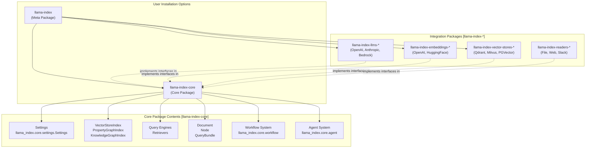
**Sources**: [pyproject.toml:41-46](), [llama-index-core/pyproject.toml:35-87](), [README.md:19-43]()

### Meta Package: `llama-index`
The `llama-index` package serves as a "starter" bundle. It includes `llama-index-core` and a selection of default integrations (OpenAI LLM/Embeddings and basic file readers) to allow users to begin building immediately [README.md:22-23]().

**Key dependencies**:
- `llama-index-core>=0.14.25,<0.15.0` [pyproject.toml:42]()
- `llama-index-llms-openai>=0.7.0,<0.8` [pyproject.toml:44]()
- `llama-index-embeddings-openai>=0.6.0,<0.7` [pyproject.toml:43]()

### Core Package: `llama-index-core`
The `llama-index-core` package contains the fundamental abstractions, data schemas, and orchestration logic. It is designed to be provider-agnostic [README.md:24-27]().

**Key internal modules**:
- `llama_index.core.workflow`: The event-driven orchestration engine [llama-index-core/pyproject.toml:83]().
- `llama_index.core.indices`: Implementations for various data structures like `VectorStoreIndex` and `PropertyGraphIndex` [llama-index-core/llama_index/core/__init__.py:26-48]().
- `llama_index.core.schema`: Base classes for `Document` and `Node` [llama-index-core/llama_index/core/__init__.py:71]().

### Integration Ecosystem
LlamaIndex features over 300 integration packages [README.md:25](). These follow a strict naming convention: `llama-index-{category}-{provider}`. For example:
- `llama-index-llms-openai` [llama-index-core/pyproject.toml:154]()
- `llama-index-embeddings-cohere` [CHANGELOG.md:117]()
- `llama-index-vector-stores-milvus` [docs/api_reference/mkdocs.yml:64]()

## Core Framework Abstractions

The following diagram maps high-level RAG concepts to specific code entities within the `llama-index-core` package.

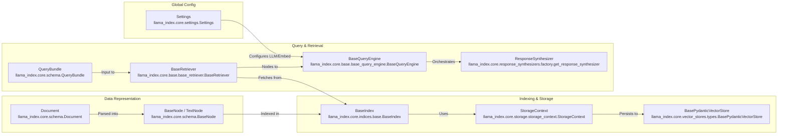
**Sources**: [llama-index-core/llama_index/core/__init__.py:17-140](), [llama-index-core/pyproject.toml:57-87](), [llama-index-core/llama_index/core/indices/base.py:25-188]()

### Key Classes and Roles

| Class | Purpose | Source |
| :--- | :--- | :--- |
| `Settings` | A global singleton for configuring default LLMs, embedding models, and callbacks. | [llama-index-core/llama_index/core/__init__.py:78]() |
| `Document` | A container for data (text, images) and its associated metadata. | [llama-index-core/llama_index/core/__init__.py:71]() |
| `VectorStoreIndex` | The most common index type; handles embedding generation and vector store storage. | [llama-index-core/llama_index/core/__init__.py:44]() |
| `PropertyGraphIndex` | A modern graph index that combines vector search with labeled property graphs. | [llama-index-core/llama_index/core/__init__.py:39]() |
| `StorageContext` | Manages the underlying stores (DocumentStore, IndexStore, VectorStore). | [llama-index-core/llama_index/core/__init__.py:81]() |
| `QueryBundle` | Encapsulates a query string and its pre-computed embedding. | [llama-index-core/llama_index/core/__init__.py:71]() |

## Data Flow Pipeline

LlamaIndex orchestrates a multi-stage pipeline to transform raw data into LLM-generated responses.


**Sources**: [llama-index-core/llama_index/core/__init__.py:67-71](), [llama-index-core/llama_index/core/indices/base.py:111-129](), [llama-index-core/llama_index/core/embeddings/mock_embed_model.py](), [llama-index-core/llama_index/core/indices/vector_store/base.py:36](), [llama-index-core/llama_index/core/llms/utils.py]()

1.  **Ingestion**: `BaseReader` subclasses (like `SimpleDirectoryReader`) ingest data into `Document` objects [llama-index-core/llama_index/core/__init__.py:67]().
2.  **Transformation**: `NodeParser` objects split documents into `Nodes`, which are the atomic units of data in LlamaIndex [llama-index-core/llama_index/core/indices/base.py:115-120]().
3.  **Indexing**: Nodes are processed by an `Index` (e.g., `VectorStoreIndex`). This stage typically involves generating embeddings via an `EmbedModel` [llama-index-core/llama_index/core/__init__.py:22,44]().
4.  **Retrieval**: A `BaseRetriever` fetches the most relevant `Nodes` for a given `QueryBundle` [llama-index-core/llama_index/core/indices/base.py:8]().
5.  **Synthesis**: The `ResponseSynthesizer` takes the retrieved nodes and the user query to generate a final `Response` using an `LLM` [llama-index-core/llama_index/core/__init__.py:17,70]().

## Orchestration Systems

Beyond standard RAG, LlamaIndex provides two advanced orchestration frameworks:

### 1. Workflow System
A low-level, event-driven engine for building complex, custom AI processes. It uses an internal event bus to manage state and execution flow [llama-index-core/pyproject.toml:83]().

### 2. Agent System
High-level autonomous entities capable of using tools.
- **FunctionAgent**: Uses native LLM function-calling capabilities.
- **ReActAgent**: Implements the "Reason + Act" prompting pattern for multi-step reasoning.
- **AgentWorkflow**: Orchestrates multiple agents working together [CHANGELOG.md:19]().

**Sources**: [CHANGELOG.md:19](), [llama-index-core/pyproject.toml:83]()

---

# Page: Getting Started

# Getting Started

<details>
<summary>Relevant source files</summary>

The following files were used as context for generating this wiki page:

- [CHANGELOG.md](CHANGELOG.md)
- [docs/api_reference/api_reference/llms/azure_openai.md](docs/api_reference/api_reference/llms/azure_openai.md)
- [docs/api_reference/api_reference/llms/minimax.md](docs/api_reference/api_reference/llms/minimax.md)
- [docs/api_reference/api_reference/llms/openai_like.md](docs/api_reference/api_reference/llms/openai_like.md)
- [docs/api_reference/api_reference/llms/sarvam.md](docs/api_reference/api_reference/llms/sarvam.md)
- [docs/api_reference/api_reference/memory/bedrock_agentcore.md](docs/api_reference/api_reference/memory/bedrock_agentcore.md)
- [docs/api_reference/api_reference/postprocessor/google_rerank.md](docs/api_reference/api_reference/postprocessor/google_rerank.md)
- [docs/api_reference/api_reference/storage/vector_store/solr.md](docs/api_reference/api_reference/storage/vector_store/solr.md)
- [docs/api_reference/api_reference/tools/aws_bedrock_agentcore.md](docs/api_reference/api_reference/tools/aws_bedrock_agentcore.md)
- [docs/api_reference/mkdocs.yml](docs/api_reference/mkdocs.yml)
- [docs/examples/agent/multi_document_agents-v1.ipynb](docs/examples/agent/multi_document_agents-v1.ipynb)
- [docs/examples/evaluation/relevancy_eval.ipynb](docs/examples/evaluation/relevancy_eval.ipynb)
- [docs/examples/finetuning/rerankers/cohere_custom_reranker.ipynb](docs/examples/finetuning/rerankers/cohere_custom_reranker.ipynb)
- [docs/examples/low_level/fusion_retriever.ipynb](docs/examples/low_level/fusion_retriever.ipynb)
- [docs/examples/low_level/ingestion.ipynb](docs/examples/low_level/ingestion.ipynb)
- [docs/examples/low_level/oss_ingestion_retrieval.ipynb](docs/examples/low_level/oss_ingestion_retrieval.ipynb)
- [docs/examples/low_level/retrieval.ipynb](docs/examples/low_level/retrieval.ipynb)
- [docs/examples/metadata_extraction/MetadataExtraction_LLMSurvey.ipynb](docs/examples/metadata_extraction/MetadataExtraction_LLMSurvey.ipynb)
- [docs/examples/query_engine/CustomRetrievers.ipynb](docs/examples/query_engine/CustomRetrievers.ipynb)
- [docs/examples/retrievers/bm25_retriever.ipynb](docs/examples/retrievers/bm25_retriever.ipynb)
- [docs/src/content/docs/framework/CHANGELOG.md](docs/src/content/docs/framework/CHANGELOG.md)
- [docs/src/content/docs/framework/CONTRIBUTING.md](docs/src/content/docs/framework/CONTRIBUTING.md)
- [docs/src/content/docs/framework/community/integrations.md](docs/src/content/docs/framework/community/integrations.md)
- [docs/src/content/docs/framework/community/integrations/chatgpt_plugins.md](docs/src/content/docs/framework/community/integrations/chatgpt_plugins.md)
- [docs/src/content/docs/framework/getting_started/faq.mdx](docs/src/content/docs/framework/getting_started/faq.mdx)
- [docs/src/content/docs/framework/getting_started/installation.mdx](docs/src/content/docs/framework/getting_started/installation.mdx)
- [docs/src/content/docs/framework/getting_started/starter_example_local.mdx](docs/src/content/docs/framework/getting_started/starter_example_local.mdx)
- [docs/src/content/docs/framework/index.md](docs/src/content/docs/framework/index.md)
- [docs/src/content/docs/framework/llama_cloud/llama_parse.md](docs/src/content/docs/framework/llama_cloud/llama_parse.md)
- [docs/src/content/docs/framework/llms.txt](docs/src/content/docs/framework/llms.txt)
- [docs/src/content/docs/framework/module_guides/deploying/agents/tools.md](docs/src/content/docs/framework/module_guides/deploying/agents/tools.md)
- [docs/src/content/docs/framework/module_guides/evaluating/contributing_llamadatasets.md](docs/src/content/docs/framework/module_guides/evaluating/contributing_llamadatasets.md)
- [docs/src/content/docs/framework/module_guides/models/llms/local.md](docs/src/content/docs/framework/module_guides/models/llms/local.md)
- [docs/src/content/docs/framework/understanding/putting_it_all_together/apps/index.md](docs/src/content/docs/framework/understanding/putting_it_all_together/apps/index.md)
- [docs/src/content/docs/framework/use_cases/agents.md](docs/src/content/docs/framework/use_cases/agents.md)
- [llama-index-core/llama_index/core/__init__.py](llama-index-core/llama_index/core/__init__.py)
- [llama-index-core/llama_index/core/callbacks/base.py](llama-index-core/llama_index/core/callbacks/base.py)
- [llama-index-core/pyproject.toml](llama-index-core/pyproject.toml)
- [llama-index-core/uv.lock](llama-index-core/uv.lock)
- [pyproject.toml](pyproject.toml)
- [uv.lock](uv.lock)

</details>


This page provides a comprehensive guide to installing LlamaIndex and its integration packages, setting up your environment and API keys, running a basic Retrieval-Augmented Generation (RAG) example, and locating further documentation and examples. It aims to equip new users with the foundational knowledge to begin building LLM-powered applications with LlamaIndex.

## Installation

LlamaIndex is primarily a Python library, available via `pip`. The core library provides the fundamental abstractions, while various integration packages extend its functionality to work with different LLMs, embedding models, vector stores, and data sources.

### Core Library Installation

To install the main LlamaIndex library, use pip:
```bash
pip install llama-index
```
This command installs the `llama-index` meta-package, which includes `llama-index-core`, `llama-index-embeddings-openai`, and `llama-index-llms-openai` by default [pyproject.toml:41-44]().

Sources:
- [pyproject.toml:41-44]()

### Integration Packages

LlamaIndex is designed with a modular architecture, allowing users to install only the integrations they need. Integration packages follow a naming convention like `llama-index-<category>-<integration_name>`.

For example, to install a specific embedding model or LLM, you would use commands like:
```bash
# For HuggingFace embeddings
pip install llama-index-embeddings-huggingface

# For LlamaCPP LLM
pip install llama-index-llms-llama-cpp

# For PostgreSQL vector store
pip install llama-index-vector-stores-postgres
```
You can find a comprehensive list of available integrations and their installation instructions in the [Integrations documentation](docs/src/content/docs/framework/community/integrations.md) and the [API Reference](docs/api_reference/mkdocs.yml:45-89) for specific components.

Sources:
- [docs/src/content/docs/framework/community/integrations.md]()
- [docs/api_reference/mkdocs.yml:45-89]()

## Environment and API Key Setup

Many LlamaIndex components, especially those interacting with external services like OpenAI, require API keys or specific environment variables to be set.

### OpenAI API Key

For using OpenAI's LLMs and embedding models, you need to set the `OPENAI_API_KEY` environment variable.
```bash
export OPENAI_API_KEY="your_openai_api_key_here"
```
Alternatively, you can load it from a `.env` file using `python-dotenv` [docs/examples/low_level/ingestion.ipynb:149-160]().

```python
import os
from dotenv import load_dotenv

# Assuming your .env file is named 'env'
dotenv_path = "env"
with open(dotenv_path, "w") as f:
    f.write('OPENAI_API_KEY="<your api key>"\\n')

load_dotenv(dotenv_path=dotenv_path)
```

Sources:
- [docs/examples/low_level/ingestion.ipynb:149-160]()

### General Settings Configuration

LlamaIndex provides a global `Settings` object [llama-index-core/llama_index/core/__init__.py:78]() to configure default LLMs, embedding models, and other parameters. This simplifies the setup process by allowing you to define these once for your application.

```python
from llama_index.core import Settings
from llama_index.llms.openai import OpenAI
from llama_index.embeddings.openai import OpenAIEmbedding

Settings.llm = OpenAI(model="gpt-3.5-turbo")
Settings.embed_model = OpenAIEmbedding(model_name="text-embedding-3-small")
```
This configuration ensures that any LlamaIndex component that requires an LLM or embedding model will use the ones specified in `Settings` by default [docs/examples/retrievers/bm25_retriever.ipynb:61-66]().

Sources:
- [llama-index-core/llama_index/core/__init__.py:78]()
- [docs/examples/retrievers/bm25_retriever.ipynb:61-66]()

## Starter RAG Example

The core functionality of LlamaIndex revolves around Retrieval-Augmented Generation (RAG). This involves loading your data, indexing it, and then querying it using an LLM.

### Data Flow for a Basic RAG Application

The following diagram illustrates the high-level data flow for a basic RAG application using LlamaIndex.

```mermaid
graph TD
    subgraph "Data Ingestion"
        A[Raw Data] --> B(SimpleDirectoryReader.load_data())
        B --> C(Document)
        C --> D(VectorStoreIndex.from_documents())
    end

    subgraph "Querying"
        E[User Query] --> F(index.as_query_engine())
        F --> G(query_engine.query())
        G --> H[LLM Response]
    end

    D -- "Stores and Indexes" --> I(VectorStoreIndex)
    I -- "Retrieves relevant context" --> G
```
**Diagram: Basic RAG Data Flow**

Sources:
- [docs/src/content/docs/framework/index.md:108-115]()

### Code Example: 5-Line RAG Quickstart

LlamaIndex offers a concise way to get started with RAG:

1.  **Load Documents**: Use `SimpleDirectoryReader` [llama-index-core/llama_index/core/__init__.py:67]() to load documents from a specified directory.
2.  **Create Index**: Build a `VectorStoreIndex` [llama-index-core/llama_index/core/__init__.py:99]() from the loaded documents. This process typically involves splitting documents into nodes, generating embeddings for these nodes, and storing them in an in-memory vector store.
3.  **Create Query Engine**: Convert the index into a `QueryEngine` [docs/src/content/docs/framework/index.md:66]() to enable natural language querying.
4.  **Query**: Submit a natural language query to the `query_engine`.

```python
from llama_index.core import VectorStoreIndex, SimpleDirectoryReader

# 1. Load documents from the 'data' directory
documents = SimpleDirectoryReader("data").load_data()

# 2. Create a VectorStoreIndex from the documents
index = VectorStoreIndex.from_documents(documents)

# 3. Create a query engine from the index
query_engine = index.as_query_engine()

# 4. Query the engine
response = query_engine.query("What is LlamaIndex?")
print(response)
```
This example demonstrates the core components: `SimpleDirectoryReader` for data loading, `VectorStoreIndex` for indexing, and the `query_engine` for retrieval and response synthesis.

Sources:
- [llama-index-core/llama_index/core/__init__.py:67]()
- [llama-index-core/llama_index/core/__init__.py:99]()
- [docs/src/content/docs/framework/index.md:66]()
- [docs/src/content/docs/framework/index.md:108-115]()

### Detailed RAG Process (Conceptual to Code)

The following diagram maps the conceptual steps of a RAG pipeline to the specific LlamaIndex classes and methods involved.

```mermaid
graph TD
    subgraph "Conceptual RAG Pipeline"
        A_concept[Load Data] --> B_concept[Split into Chunks]
        B_concept --> C_concept[Embed Chunks]
        C_concept --> D_concept[Store in Vector DB]
        D_concept --> E_concept[Retrieve Relevant Chunks]
        E_concept --> F_concept[Synthesize Response with LLM]
    end

    subgraph "LlamaIndex Implementation"
        A_code(SimpleDirectoryReader.load_data()) --> B_code(SentenceSplitter.get_nodes_from_documents())
        B_code --> C_code(HuggingFaceEmbedding.get_text_embedding())
        C_code --> D_code(PostgresVectorStore.add())
        D_code --> E_code(VectorStoreIndex.as_retriever())
        E_code --> F_code(QueryEngine.query())
    end

    A_concept --> A_code
    B_concept --> B_code
    C_concept --> C_code
    D_concept --> D_code
    E_concept --> E_code
    F_concept --> F_code
```
**Diagram: RAG Pipeline: Conceptual Steps to LlamaIndex Code Entities**

Sources:
- [docs/examples/low_level/oss_ingestion_retrieval.ipynb:69-72]()
- [docs/examples/low_level/oss_ingestion_retrieval.ipynb:170-171]()
- [docs/examples/retrievers/bm25_retriever.ipynb:123-127]()
- [docs/examples/retrievers/bm25_retriever.ipynb:139-142]()

## Where to Find More Documentation and Examples

LlamaIndex provides extensive resources for learning and building.

### Official Documentation

The official documentation is the primary source for in-depth information on all LlamaIndex features and components.
- **Homepage**: [https://llamaindex.ai](https://llamaindex.ai) [pyproject.toml:73]()
- **Documentation**: [https://docs.llamaindex.ai/en/stable/](https://docs.llamaindex.ai/en/stable) [pyproject.toml:72]()

Sources:
- [pyproject.toml:72]()
- [pyproject.toml:73]()

### Examples

The LlamaIndex GitHub repository contains a wide variety of examples demonstrating different use cases and integrations.
- **GitHub Repository**: [https://github.com/run-llama/llama_index](https://github.com/run-llama/llama_index) [pyproject.toml:74]()
- **Examples Directory**: The `docs/examples/` directory within the repository is a great place to find practical implementations. For instance, `docs/examples/low_level/oss_ingestion_retrieval.ipynb` provides a detailed example of building a RAG pipeline with open-source components [docs/examples/low_level/oss_ingestion_retrieval.ipynb:16-25]().

Sources:
- [pyproject.toml:74]()
- [docs/examples/low_level/oss_ingestion_retrieval.ipynb:16-25]()

---

# Page: Core Concepts Primer

# Core Concepts Primer

<details>
<summary>Relevant source files</summary>

The following files were used as context for generating this wiki page:

- [.github/workflows/close_new_integration_prs.yml](.github/workflows/close_new_integration_prs.yml)
- [CONTRIBUTING.md](CONTRIBUTING.md)
- [README.md](README.md)
- [docs/DOCS_README.md](docs/DOCS_README.md)
- [llama-index-core/llama_index/core/bridge/pydantic.py](llama-index-core/llama_index/core/bridge/pydantic.py)
- [llama-index-core/llama_index/core/img_utils.py](llama-index-core/llama_index/core/img_utils.py)
- [llama-index-core/llama_index/core/indices/base.py](llama-index-core/llama_index/core/indices/base.py)
- [llama-index-core/llama_index/core/indices/vector_store/base.py](llama-index-core/llama_index/core/indices/vector_store/base.py)
- [llama-index-core/llama_index/core/multi_modal_llms/base.py](llama-index-core/llama_index/core/multi_modal_llms/base.py)
- [llama-index-core/llama_index/core/multi_modal_llms/generic_utils.py](llama-index-core/llama_index/core/multi_modal_llms/generic_utils.py)
- [llama-index-core/llama_index/core/node_parser/node_utils.py](llama-index-core/llama_index/core/node_parser/node_utils.py)
- [llama-index-core/llama_index/core/node_parser/text/code.py](llama-index-core/llama_index/core/node_parser/text/code.py)
- [llama-index-core/llama_index/core/node_parser/text/semantic_double_merging_splitter.py](llama-index-core/llama_index/core/node_parser/text/semantic_double_merging_splitter.py)
- [llama-index-core/llama_index/core/node_parser/text/utils.py](llama-index-core/llama_index/core/node_parser/text/utils.py)
- [llama-index-core/llama_index/core/postprocessor/optimizer.py](llama-index-core/llama_index/core/postprocessor/optimizer.py)
- [llama-index-core/llama_index/core/prompts/__init__.py](llama-index-core/llama_index/core/prompts/__init__.py)
- [llama-index-core/llama_index/core/response/notebook_utils.py](llama-index-core/llama_index/core/response/notebook_utils.py)
- [llama-index-core/llama_index/core/schema.py](llama-index-core/llama_index/core/schema.py)
- [llama-index-core/llama_index/core/storage/index_store/keyval_index_store.py](llama-index-core/llama_index/core/storage/index_store/keyval_index_store.py)
- [llama-index-core/llama_index/core/storage/index_store/types.py](llama-index-core/llama_index/core/storage/index_store/types.py)
- [llama-index-core/tests/indices/list/test_index.py](llama-index-core/tests/indices/list/test_index.py)
- [llama-index-core/tests/indices/vector_store/test_simple.py](llama-index-core/tests/indices/vector_store/test_simple.py)
- [llama-index-core/tests/indices/vector_store/test_simple_async.py](llama-index-core/tests/indices/vector_store/test_simple_async.py)
- [llama-index-core/tests/multi_modal_llms/test_base_multi_modal_llm_metadata.py](llama-index-core/tests/multi_modal_llms/test_base_multi_modal_llm_metadata.py)
- [llama-index-core/tests/multi_modal_llms/test_generic_utils.py](llama-index-core/tests/multi_modal_llms/test_generic_utils.py)
- [llama-index-core/tests/node_parser/test_semantic_double_merging_splitter.py](llama-index-core/tests/node_parser/test_semantic_double_merging_splitter.py)
- [llama-index-core/tests/schema/test_image_document.py](llama-index-core/tests/schema/test_image_document.py)
- [llama-index-core/tests/schema/test_media_resource.py](llama-index-core/tests/schema/test_media_resource.py)
- [llama-index-core/tests/schema/test_node.py](llama-index-core/tests/schema/test_node.py)
- [llama-index-core/tests/schema/test_schema.py](llama-index-core/tests/schema/test_schema.py)
- [llama-index-core/tests/text_splitter/test_code_splitter.py](llama-index-core/tests/text_splitter/test_code_splitter.py)
- [llama-index-integrations/readers/llama-index-readers-kibela/llama_index/readers/kibela/base.py](llama-index-integrations/readers/llama-index-readers-kibela/llama_index/readers/kibela/base.py)
- [llama-index-integrations/storage/index_store/llama-index-storage-index-store-dynamodb/llama_index/storage/index_store/dynamodb/base.py](llama-index-integrations/storage/index_store/llama-index-storage-index-store-dynamodb/llama_index/storage/index_store/dynamodb/base.py)
- [llama-index-integrations/storage/index_store/llama-index-storage-index-store-elasticsearch/llama_index/storage/index_store/elasticsearch/base.py](llama-index-integrations/storage/index_store/llama-index-storage-index-store-elasticsearch/llama_index/storage/index_store/elasticsearch/base.py)
- [llama-index-integrations/storage/index_store/llama-index-storage-index-store-elasticsearch/pyproject.toml](llama-index-integrations/storage/index_store/llama-index-storage-index-store-elasticsearch/pyproject.toml)
- [llama-index-integrations/storage/index_store/llama-index-storage-index-store-firestore/llama_index/storage/index_store/firestore/base.py](llama-index-integrations/storage/index_store/llama-index-storage-index-store-firestore/llama_index/storage/index_store/firestore/base.py)
- [llama-index-integrations/storage/index_store/llama-index-storage-index-store-mongodb/llama_index/storage/index_store/mongodb/base.py](llama-index-integrations/storage/index_store/llama-index-storage-index-store-mongodb/llama_index/storage/index_store/mongodb/base.py)
- [llama-index-integrations/storage/index_store/llama-index-storage-index-store-postgres/llama_index/storage/index_store/postgres/base.py](llama-index-integrations/storage/index_store/llama-index-storage-index-store-postgres/llama_index/storage/index_store/postgres/base.py)
- [llama-index-integrations/storage/index_store/llama-index-storage-index-store-redis/llama_index/storage/index_store/redis/base.py](llama-index-integrations/storage/index_store/llama-index-storage-index-store-redis/llama_index/storage/index_store/redis/base.py)

</details>


This page introduces the foundational concepts that form the core of the LlamaIndex framework. Understanding these concepts — **Document, Node, Index, Retriever, Query Engine, Response Synthesizer, Agent, and Workflow** — is essential before delving deeper into the subsystems. This primer explains their technical implementations, data flow, and interrelationships to prepare you for more detailed exploration of the framework.

---

## 1. Document

A **Document** is the fundamental data entry representing a unit of source information ingested into LlamaIndex. In code, the `Document` class encapsulates raw text content alongside metadata. It is typically the initial abstraction used to ingest raw corpora.

- Implementation: The `Document` class inherits from `BaseNode` and extends it to hold text and metadata used for querying and indexing.
- Contains:  
  - `text`: The main content string.
  - `metadata`: Optional dictionary of key-value pairs for additional context.
  - `id_`: Unique identifier string.
  - Supports legacy field `doc_id` for backward compatibility.

### Code entity

- Defined in: `llama-index-core/llama_index/core/schema.py:10-210` (main Document and Node-related classes partway)

### Important notes

- Documents can be legacy initialized with `doc_id`.
- Metadata is accessible transparently alongside text.
- Creation typically happens before node parsing.

---

## 2. Node

A **Node** is a more granular content unit derived by splitting or parsing Documents. Nodes are the primary indexing items that represent chunks of content with context and semantic meaning.

- Implementation: `BaseNode` is the abstract base. Concrete subclasses include:  
  - `TextNode` — contains text with optional metadata and embeddings.  
  - `ImageNode` — extends to image content (including base64, URLs).  
- Nodes maintain relationships (e.g., source document pointers) via `NodeRelationship`.
- Nodes expose methods for getting content with or without metadata, hash computation for content identity, and embedding storage.

### Key functions/classes

- `build_nodes_from_splits`: Utility to convert text splits into nodes with IDs and relationships.
- Nodes store embeddings and metadata for retrieval relevance.

### Code entity

- Defined in: `llama-index-core/llama_index/core/schema.py:10-210` (base schema and node classes)  
- Utilities: `llama-index-core/llama_index/core/node_parser/node_utils.py:1-91`

---

## 3. Index

An **Index** is a structured data representation built from Nodes enabling efficient retrieval and querying. It abstracts different methods of data structuring (vector, keyword, graph, etc.).

- Base class: `BaseIndex` (a generic abstraction over an index structure).
- Subclasses implement specific behaviors:  
  - `VectorStoreIndex`: Uses an underlying vector store for embedding-based retrieval.
  - Other index types (not detailed here) include hierarchical and keyword-based indices.

### Data flow in Index creation

1. Nodes (from Documents) are generated (possibly after transformations).
2. Nodes are embedded (if vector index) and inserted into vector stores or other structures.
3. Index maintains metadata, references to nodes, and integrates with storage context.

### Key methods/classes

- `BaseIndex` constructor requires nodes, index structures, or index objects explicitly.
- `from_documents()` class method ingests documents, runs transformations, builds nodes, and constructs an index.
- Vector index asynchronously embeds nodes in batches and inserts into the store.
- Index holds references to a docstore, storage context, and callback manager for instrumentation.

### Code entities

- `BaseIndex`: `llama-index-core/llama_index/core/indices/base.py:24-178`
- `VectorStoreIndex`: `llama-index-core/llama_index/core/indices/vector_store/base.py:1-200`

---

## 4. Retriever

A **Retriever** is the component responsible for fetching relevant nodes from the Index based on a query or search criteria.

- Retrievers abstract query-time retrieval strategies.
- The main retriever interacts with the underlying index and vector store (when applicable).
- They apply filtering, reranking, and possibly combining results.

### Code entities

- Base retriever class: `BaseRetriever` (imported in indices but implementation not shown here).
- Vector retriever example: `VectorIndexRetriever` used by `VectorStoreIndex.as_retriever()` [see: `llama-index-core/llama_index/core/indices/vector_store/base.py:112-124`].

---

## 5. Query Engine

The **Query Engine** is the higher-level interface that allows users to submit queries against the LlamaIndex ecosystem.

- Internally uses one or more Retrievers to get relevant nodes.
- Applies query logic, including optional prompt-based orchestration and response synthesis.
- Supports configurations related to LLM calls, prompt templates, and retrieval parameters.

### Relationship to other components

- Encapsulates retrieval behavior and response generation.
- May chain multiple components like retrievers and synthesizers.

---

## 6. Response Synthesizer

The **Response Synthesizer** composes a final answer or output from the raw nodes retrieved by a Retriever.

- Takes retrieved nodes, applies LLM prompt templates, and generates text or chat completions.
- Supports multiple strategies: concatenation, summarization, question answering, chat-based synthesis, etc.
- Abstracted as a distinct module for modularity and interchangeability.

---

## 7. Agent

An **Agent** in LlamaIndex is an autonomous or semi-autonomous program that uses indices, workflows, and tool integrations to complete tasks.

- Built using Workflow steps and tools.
- Controls task execution, memory management, and decision-making.
- Integrates with LLMs for reasoning and task planning.
- Agents can call tools, access indices for knowledge, and carry context over time.

### Code entities

- Agent base classes and implementations are in agent-related packages (not shown here but referenced in roadmap).

---

## 8. Workflow

A **Workflow** is an event-driven orchestration engine that defines task steps and transitions.

- Supports asynchronous execution and complex multi-step processes.
- Uses decorators for steps and manages Context for state.
- Fire events, handle retries, checkpointing, and integrate with agents.

### Purpose

- Facilitates building pipelines such as document ingestion, indexing, query answering, and autonomous task execution.
- Allows scripted logic with LLM integration for building agents and applications.

---

# How These Concepts Fit Together

At a high level, the data and control flow in the LlamaIndex framework proceeds as follows:

- Raw data sources are ingested as **Documents**.
- Documents are parsed and split into smaller **Nodes** for granular semantic understanding.
- Nodes are processed, optionally embedded, and stored in structured **Indices**.
- When a query arrives, a **Retriever** accesses these indices to get relevant nodes.
- A **Query Engine** orchestrates query processing, invokes retrievers, and forwards nodes to a **Response Synthesizer**.
- The synthesizer crafts the final response, often using LLMs with prompt templates.
- For complex or autonomous tasks, **Agents** utilize **Workflows** to execute multi-step logic, interact with indices, use tools, and manage state.

---

# Mermaid Diagram 1: Core Data Flow from Document to Response

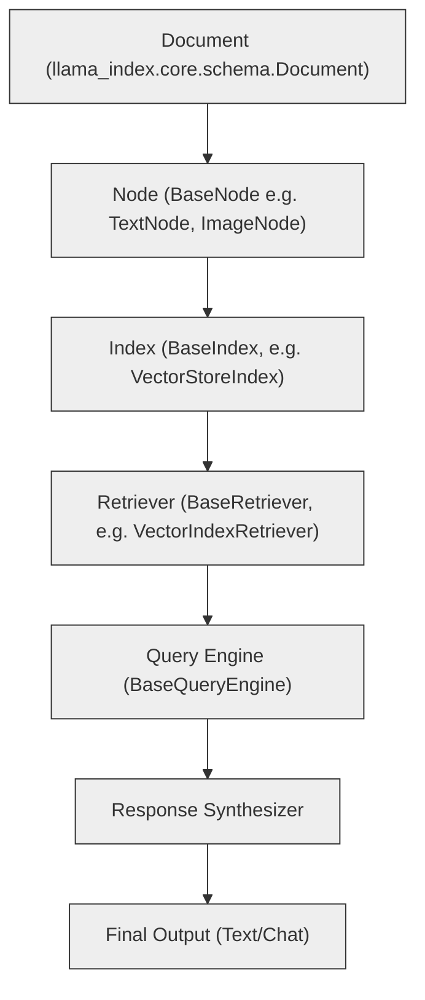

---

# Mermaid Diagram 2: Code Entities Aligned to Concepts

```mermaid
flowchart TD
  subgraph Document_Node_Space
    doc[Document<br/>(llama_index.core.schema:10-210)]
    node[Node: BaseNode / TextNode / ImageNode<br/>(llama_index.core.schema:10-210)]
    node_utils[build_nodes_from_splits()<br/>(node_utils.py:29-91)]
    doc --> node_utils --> node
  end

  subgraph Index_Retrieval_Space
    base_index[BaseIndex<br/>(indices/base.py:24-178)]
    vector_index[VectorStoreIndex<br/>(indices/vector_store/base.py:1-200)]
    retriever[VectorIndexRetriever (retriever)<br/>(indices/vector_store/retrievers.py)]
    base_index --> vector_index --> retriever
  end

  subgraph Query_Response_Space
    query_engine[BaseQueryEngine<br/>(base_query_engine.py)]
    synthesizer[ResponseSynthesizer<br/>(response/response_synthesizer.py)]
    retriever --> query_engine --> synthesizer
  end

  doc --> base_index
```

---

# Summary Table of Core Concepts

| Concept           | Role / Definition                                         | Key Code Entity or Function                      | File Reference                         |
|-------------------|-----------------------------------------------------------|-------------------------------------------------|--------------------------------------|
| Document          | Raw input unit with text and metadata                      | `Document` class                                | `core/schema.py:10-210`               |
| Node              | Chunked, parsed content units derived from Documents      | `BaseNode`, `TextNode`, `build_nodes_from_splits` | `core/schema.py:10-210`, `node_utils.py:29-91` |
| Index             | Data structure for organizing nodes for retrieval          | `BaseIndex`, `VectorStoreIndex`                 | `core/indices/base.py:24-178`, `vector_store/base.py:1-200` |
| Retriever         | Retrieves relevant Nodes from an Index                      | `BaseRetriever`, `VectorIndexRetriever`         | Indices vector_store retriever (partial) |
| Query Engine      | Orchestrates querying processes and retrieval              | `BaseQueryEngine` (not detailed here)           | `core/base/base_query_engine.py`      |
| Response Synthesizer | Combines retrieved nodes and generates the final output   | `ResponseSynthesizer` (module level)             | `core/response/response_synthesizer.py` (implied) |
| Agent             | Autonomous task executor using indices and workflows       | Agent base classes (not detailed here)           | Agent packages (outside core shown)  |
| Workflow          | Event-driven orchestrator for multi-step processes         | `Workflow`, step decorators, Context            | Workflow modules (outside core shown) |

---

# Detailed Data Flow Description

1. **Document ingestion**: Raw data is wrapped in `Document` objects.
2. **Parsing and splitting**: Documents are parsed into smaller Nodes using Node Parers (`build_nodes_from_splits`, specialized text or code splitters).
3. **Index construction**: Nodes are provided to an Index constructor (e.g. `VectorStoreIndex`), which runs transformations and embeds nodes if necessary.
4. **Storage**: Index stores nodes and their embeddings in a Vector Store or other backends.
5. **Retrieval**: When querying, a Retriever fetches most relevant Nodes based on embedding similarity or other criteria.
6. **Query engine**: Runs retrieval, manages LLM calls, and returns synthesized results.
7. **Response synthesizer**: Aggregates, summarizes or reformats retrieved Nodes into a user-facing answer.
8. **Agent/Workflow orchestration**: For complex application workflows, they coordinate calls across these components and tools with state management.

---

# Example: From Documents to a Vector Store Index and Retrieval

```python
from llama_index.core.schema import Document
from llama_index.core.indices.vector_store.base import VectorStoreIndex

# Ingest raw text document
documents = [Document(text="Hello world.")]

# Create index from documents
index = VectorStoreIndex.from_documents(documents)

# Obtain a retriever
retriever = index.as_retriever()

# (Further steps could apply a query engine and response synthesizer)
```

---

# Notes

This primer intentionally abstracts away detailed subsystem implementations such as agent internals, advanced retriever types, and richer workflow orchestration to focus on the core building blocks.

Comprehensive explorations of each component follow in subsequent pages.

---

## Sources

- `README.md:1-93`  
- `llama-index-core/llama_index/core/schema.py:1-210`  
- `llama-index-core/llama_index/core/node_parser/node_utils.py:1-91`  
- `llama-index-core/llama_index/core/indices/base.py:1-178`  
- `llama-index-core/llama_index/core/indices/vector_store/base.py:1-200`  
- `llama-index-core/tests/schema/test_schema.py:1-209`  
- `llama-index-core/tests/indices/vector_store/test_simple_async.py:1-175`

---

# Page: Architecture

# Architecture

<details>
<summary>Relevant source files</summary>

The following files were used as context for generating this wiki page:

- [.github/workflows/close_new_integration_prs.yml](.github/workflows/close_new_integration_prs.yml)
- [CHANGELOG.md](CHANGELOG.md)
- [CONTRIBUTING.md](CONTRIBUTING.md)
- [README.md](README.md)
- [docs/DOCS_README.md](docs/DOCS_README.md)
- [docs/api_reference/api_reference/llms/azure_openai.md](docs/api_reference/api_reference/llms/azure_openai.md)
- [docs/api_reference/api_reference/llms/minimax.md](docs/api_reference/api_reference/llms/minimax.md)
- [docs/api_reference/api_reference/llms/openai_like.md](docs/api_reference/api_reference/llms/openai_like.md)
- [docs/api_reference/api_reference/llms/sarvam.md](docs/api_reference/api_reference/llms/sarvam.md)
- [docs/api_reference/api_reference/memory/bedrock_agentcore.md](docs/api_reference/api_reference/memory/bedrock_agentcore.md)
- [docs/api_reference/api_reference/postprocessor/google_rerank.md](docs/api_reference/api_reference/postprocessor/google_rerank.md)
- [docs/api_reference/api_reference/storage/vector_store/solr.md](docs/api_reference/api_reference/storage/vector_store/solr.md)
- [docs/api_reference/api_reference/tools/aws_bedrock_agentcore.md](docs/api_reference/api_reference/tools/aws_bedrock_agentcore.md)
- [docs/api_reference/mkdocs.yml](docs/api_reference/mkdocs.yml)
- [docs/src/content/docs/framework/CHANGELOG.md](docs/src/content/docs/framework/CHANGELOG.md)
- [docs/src/content/docs/framework/CONTRIBUTING.md](docs/src/content/docs/framework/CONTRIBUTING.md)
- [llama-index-core/llama_index/core/__init__.py](llama-index-core/llama_index/core/__init__.py)
- [llama-index-core/llama_index/core/indices/base.py](llama-index-core/llama_index/core/indices/base.py)
- [llama-index-core/llama_index/core/indices/vector_store/base.py](llama-index-core/llama_index/core/indices/vector_store/base.py)
- [llama-index-core/llama_index/core/storage/index_store/keyval_index_store.py](llama-index-core/llama_index/core/storage/index_store/keyval_index_store.py)
- [llama-index-core/llama_index/core/storage/index_store/types.py](llama-index-core/llama_index/core/storage/index_store/types.py)
- [llama-index-core/pyproject.toml](llama-index-core/pyproject.toml)
- [llama-index-core/tests/indices/list/test_index.py](llama-index-core/tests/indices/list/test_index.py)
- [llama-index-core/tests/indices/vector_store/test_simple.py](llama-index-core/tests/indices/vector_store/test_simple.py)
- [llama-index-core/tests/indices/vector_store/test_simple_async.py](llama-index-core/tests/indices/vector_store/test_simple_async.py)
- [llama-index-core/uv.lock](llama-index-core/uv.lock)
- [llama-index-integrations/storage/index_store/llama-index-storage-index-store-dynamodb/llama_index/storage/index_store/dynamodb/base.py](llama-index-integrations/storage/index_store/llama-index-storage-index-store-dynamodb/llama_index/storage/index_store/dynamodb/base.py)
- [llama-index-integrations/storage/index_store/llama-index-storage-index-store-elasticsearch/llama_index/storage/index_store/elasticsearch/base.py](llama-index-integrations/storage/index_store/llama-index-storage-index-store-elasticsearch/llama_index/storage/index_store/elasticsearch/base.py)
- [llama-index-integrations/storage/index_store/llama-index-storage-index-store-elasticsearch/pyproject.toml](llama-index-integrations/storage/index_store/llama-index-storage-index-store-elasticsearch/pyproject.toml)
- [llama-index-integrations/storage/index_store/llama-index-storage-index-store-firestore/llama_index/storage/index_store/firestore/base.py](llama-index-integrations/storage/index_store/llama-index-storage-index-store-firestore/llama_index/storage/index_store/firestore/base.py)
- [llama-index-integrations/storage/index_store/llama-index-storage-index-store-mongodb/llama_index/storage/index_store/mongodb/base.py](llama-index-integrations/storage/index_store/llama-index-storage-index-store-mongodb/llama_index/storage/index_store/mongodb/base.py)
- [llama-index-integrations/storage/index_store/llama-index-storage-index-store-postgres/llama_index/storage/index_store/postgres/base.py](llama-index-integrations/storage/index_store/llama-index-storage-index-store-postgres/llama_index/storage/index_store/postgres/base.py)
- [llama-index-integrations/storage/index_store/llama-index-storage-index-store-redis/llama_index/storage/index_store/redis/base.py](llama-index-integrations/storage/index_store/llama-index-storage-index-store-redis/llama_index/storage/index_store/redis/base.py)
- [pyproject.toml](pyproject.toml)
- [uv.lock](uv.lock)

</details>


This document describes the overall system architecture of LlamaIndex, including its layered design, package structure, core abstractions, and how components interact to enable LLM applications. For information about specific subsystems, see [Package Structure](#2.1) for organization details, [Integration Ecosystem](#2.2) for the plugin system, and [Data Flow Pipeline](#2.3) for RAG execution patterns.

## Overview

LlamaIndex follows a **three-tier plugin architecture** designed to provide flexibility and extensibility for building LLM applications. The system separates core abstractions from concrete implementations, allowing developers to swap components (LLMs, vector stores, embeddings, etc.) without changing application logic.

The architecture consists of:
1.  **Core Foundation Layer** (`llama-index-core`): Base abstractions, orchestration systems, and framework primitives. [llama-index-core/pyproject.toml:35-87]()
2.  **Integration Ecosystem** (`llama-index-integrations`): 300+ plugin implementations for LLMs, vector stores, embeddings, readers, and tools. [CHANGELOG.md:7-135]()
3.  **Application Layer**: High-level components like indices, query engines, retrievers, and agents that compose lower layers. [llama-index-core/llama_index/core/__init__.py:26-48]()

Sources: [pyproject.toml:34-71](), [llama-index-core/pyproject.toml:35-87](), [llama-index-core/llama_index/core/__init__.py:1-140]()

## Core Architecture Diagram

This diagram bridges Natural Language concepts to the specific Code Entities used in the framework.

**LlamaIndex System to Code Entity Mapping**
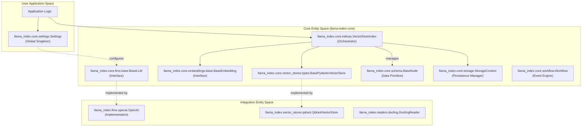

Sources: [llama-index-core/llama_index/core/__init__.py:78-81](), [llama-index-core/llama_index/core/schema.py:81-223](), [llama-index-core/llama_index/core/indices/base.py:25-86]()

## Layered Architecture

### Foundation Layer

The foundation layer in `llama-index-core` provides base abstractions that define contracts for all integrations. Most core components inherit from `BaseComponent` to support unified serialization via Pydantic. [llama-index-core/llama_index/core/schema.py:81-108]()

| Abstraction | Module Path | Purpose |
|-------------|-------------|---------|
| `BaseLLM` | `llama_index.core.llms.base` | Interface for language models (chat, completion, streaming). |
| `BaseEmbedding` | `llama_index.core.embeddings.base` | Interface for embedding models. |
| `BasePydanticVectorStore` | `llama_index.core.vector_stores.types` | Interface for vector databases. |
| `BaseNode` | `llama_index.core.schema` | Atomic data unit containing text/metadata. [llama-index-core/llama_index/core/schema.py:207-223]() |
| `Workflow` | `llama_index.core.workflow` | Event-driven orchestration engine. [llama-index-core/pyproject.toml:83]() |
| `TransformComponent` | `llama_index.core.schema` | Base for node transformations and parsers. [llama-index-core/llama_index/core/schema.py:191-206]() |

Sources: [llama-index-core/llama_index/core/schema.py:81-223](), [llama-index-core/llama_index/core/__init__.py:16-85]()

### Integration Layer

Integrations implement core abstractions and are distributed as separate packages. They follow the naming convention `llama-index-{category}-{provider}`. [CHANGELOG.md:7-135]()

**Integration Taxonomy and Code Associations**
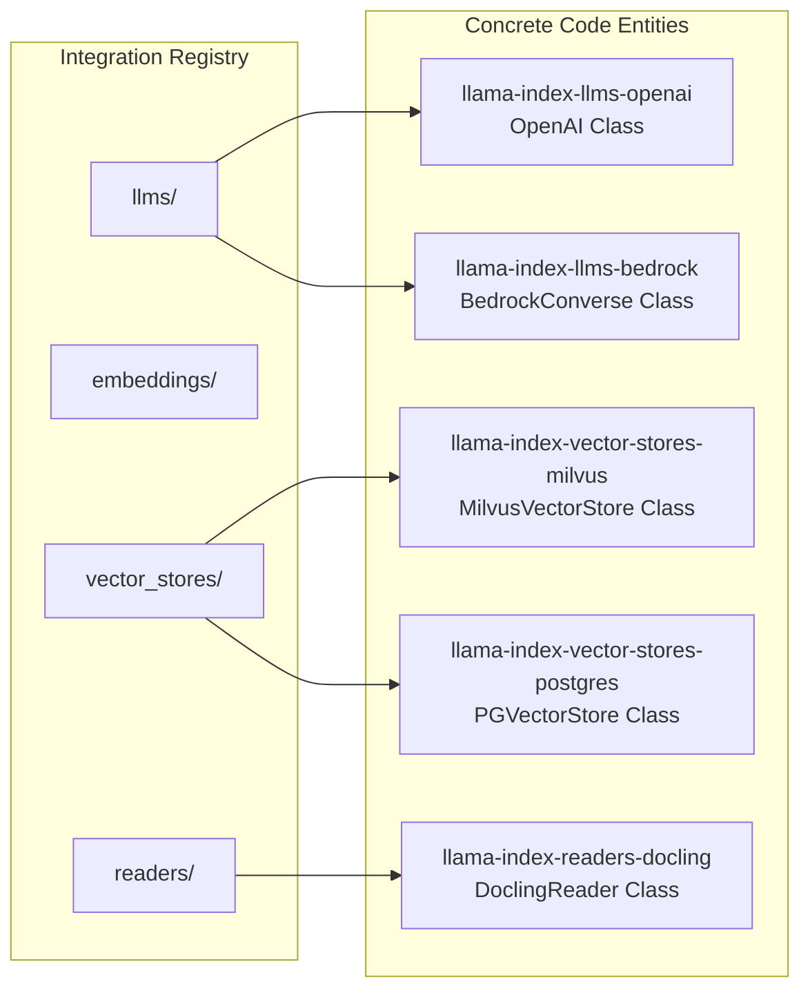

Sources: [CHANGELOG.md:45-86](), [pyproject.toml:42-46]()

## Configuration and Settings

The `Settings` object is a global singleton providing defaults for LLMs, embeddings, and tokenizers. [llama-index-core/llama_index/core/__init__.py:78]()

- **Global Defaults**: Setting `Settings.llm` updates the default model for all query engines and agents. [llama-index-core/llama_index/core/indices/base.py:69]()
- **Transformation Management**: Global transformations (like node parsers) can be configured via `Settings.transformations`. [llama-index-core/llama_index/core/indices/base.py:86]()
- **Callback Manager**: Instrumentation and observability are managed via `Settings.callback_manager`. [llama-index-core/llama_index/core/indices/base.py:69]()

Sources: [llama-index-core/llama_index/core/indices/base.py:64-86](), [llama-index-core/llama_index/core/__init__.py:78-87]()

## Data and Storage Architecture

LlamaIndex uses a multi-part storage system managed via `StorageContext`. [llama-index-core/llama_index/core/__init__.py:81]()

- **Document Store**: Stores `BaseNode` objects and their metadata via `BaseDocumentStore`. [llama-index-core/llama_index/core/indices/base.py:65-161]()
- **Index Store**: Stores `IndexStruct` data defining how nodes are organized (e.g., Tree, VectorStore) via `BaseIndexStore`. [llama-index-core/llama_index/core/indices/base.py:84](), [llama-index-core/llama_index/core/storage/index_store/types.py:12-55]()
- **Vector Store**: Specialized store for embedding vectors and similarity search. [llama-index-core/llama_index/core/indices/base.py:67]()
- **Graph Store**: Specialized store for property graphs and knowledge graph triplets. [llama-index-core/llama_index/core/indices/base.py:68]()

**Storage Context Components**
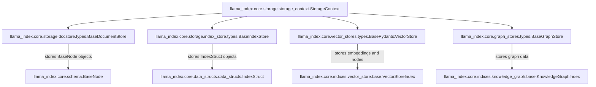

Sources: [llama-index-core/llama_index/core/indices/base.py:64-86](), [llama-index-core/llama_index/core/__init__.py:21-48](), [llama-index-core/llama_index/core/storage/index_store/types.py:12-55](), [llama-index-core/llama_index/core/indices/vector_store/base.py:36-48]()

## Execution Frameworks

The architecture supports three distinct execution patterns:

1.  **Pipeline Pattern (RAG)**: Linear flow from `SimpleDirectoryReader` -> `run_transformations` -> `VectorStoreIndex` -> `BaseRetriever` -> `ResponseSynthesizer`. [llama-index-core/llama_index/core/__init__.py:67-71](), [llama-index-core/llama_index/core/indices/base.py:115-121]()
2.  **Workflow Pattern**: Event-driven execution using `llama-index-workflows`. This is the modern engine for complex, non-linear LLM logic involving steps and events. [llama-index-core/pyproject.toml:83](), [llama-index-core/CHANGELOG.md:38-38]()
3.  **Agentic Pattern**: Autonomous loops where an LLM uses tools (like `FunctionTool`) to fulfill queries, often implemented as workflow-based agents. [CHANGELOG.md:27-32]()

For details, see:
- [Package Structure](#2.1) — Organization of the core and integration packages.
- [Integration Ecosystem](#2.2) — How the 300+ plugins connect to the core.
- [Data Flow Pipeline](#2.3) — The internal mechanics of the RAG and Workflow pipelines.

Sources: [llama-index-core/pyproject.toml:57-87](), [llama-index-core/llama_index/core/__init__.py:1-140](), [llama-index-core/llama_index/core/indices/base.py:89-130]()

---

# Page: Package Structure

# Package Structure

<details>
<summary>Relevant source files</summary>

The following files were used as context for generating this wiki page:

- [.gitignore](.gitignore)
- [.pre-commit-config.yaml](.pre-commit-config.yaml)
- [CHANGELOG.md](CHANGELOG.md)
- [Makefile](Makefile)
- [docs/api_reference/api_reference/llms/azure_openai.md](docs/api_reference/api_reference/llms/azure_openai.md)
- [docs/api_reference/api_reference/llms/minimax.md](docs/api_reference/api_reference/llms/minimax.md)
- [docs/api_reference/api_reference/llms/openai_like.md](docs/api_reference/api_reference/llms/openai_like.md)
- [docs/api_reference/api_reference/llms/sarvam.md](docs/api_reference/api_reference/llms/sarvam.md)
- [docs/api_reference/api_reference/memory/bedrock_agentcore.md](docs/api_reference/api_reference/memory/bedrock_agentcore.md)
- [docs/api_reference/api_reference/postprocessor/google_rerank.md](docs/api_reference/api_reference/postprocessor/google_rerank.md)
- [docs/api_reference/api_reference/storage/vector_store/solr.md](docs/api_reference/api_reference/storage/vector_store/solr.md)
- [docs/api_reference/api_reference/tools/aws_bedrock_agentcore.md](docs/api_reference/api_reference/tools/aws_bedrock_agentcore.md)
- [docs/api_reference/mkdocs.yml](docs/api_reference/mkdocs.yml)
- [docs/src/content/docs/framework/CHANGELOG.md](docs/src/content/docs/framework/CHANGELOG.md)
- [docs/src/content/docs/framework/CONTRIBUTING.md](docs/src/content/docs/framework/CONTRIBUTING.md)
- [llama-index-core/.gitignore](llama-index-core/.gitignore)
- [llama-index-core/llama_index/core/__init__.py](llama-index-core/llama_index/core/__init__.py)
- [llama-index-core/pyproject.toml](llama-index-core/pyproject.toml)
- [llama-index-core/uv.lock](llama-index-core/uv.lock)
- [llama-index-integrations/vector_stores/llama-index-vector-stores-wordlift/.gitignore](llama-index-integrations/vector_stores/llama-index-vector-stores-wordlift/.gitignore)
- [llama-index-integrations/vector_stores/llama-index-vector-stores-wordlift/Makefile](llama-index-integrations/vector_stores/llama-index-vector-stores-wordlift/Makefile)
- [llama-index-integrations/vector_stores/llama-index-vector-stores-wordlift/README.md](llama-index-integrations/vector_stores/llama-index-vector-stores-wordlift/README.md)
- [llama-index-integrations/vector_stores/llama-index-vector-stores-wordlift/llama_index/vector_stores/wordlift/__init__.py](llama-index-integrations/vector_stores/llama-index-vector-stores-wordlift/llama_index/vector_stores/wordlift/__init__.py)
- [pyproject.toml](pyproject.toml)
- [uv.lock](uv.lock)

</details>


This document describes the LlamaIndex package architecture, including the meta package, core framework, and integration ecosystem. It covers package naming conventions, dependency relationships, import patterns, and internal structure relevant for developers and integrators.

## Overview

LlamaIndex is distributed as multiple Python packages organized into three primary layers:

1. **Meta Package** (`llama-index`): A starter bundle that includes the core framework plus some common integration packages for a smooth out-of-the-box experience.
2. **Core Package** (`llama-index-core`): The foundational framework containing base abstractions, essential core components, and orchestration systems.
3. **Integration Packages** (300+): Individually versioned packages implementing integrations for LLM providers, embedding models, vector stores, data readers, tools, and more.

Each layer has its distinct role and dependency management, allowing flexible installation and independent updates of core and integrations.

Sources: [pyproject.toml:34-46](), [llama-index-core/pyproject.toml:35-38]()

## Meta Package vs Core Package

The `llama-index` meta package provides a convenient entry point that bundles `llama-index-core` and select integration packages like OpenAI embeddings and OpenAI LLMs. This design enables users to quickly get started without managing many dependencies manually.

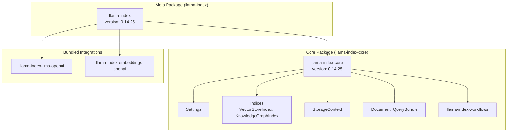

**Key points:**

- The meta package `llama-index` depends on:
  - `llama-index-core` (core abstractions and base framework)
  - `llama-index-llms-openai` (OpenAI LLM integration)
  - `llama-index-embeddings-openai` (OpenAI embeddings integration)

- The core package `llama-index-core` includes foundational concepts like indices, storage, settings, and query engines.

- The workflow engine `llama-index-workflows` is a dependency used by core components for orchestration.

This architecture cleanly separates stable core functionality from rapidly evolving integrations.

Sources: [pyproject.toml:41-46](), [llama-index-core/pyproject.toml:57-87](), [CHANGELOG.md:55-65]()

## Package Naming Convention

LlamaIndex organizes integrations with a consistent naming scheme to ease discovery and maintenance. The base prefix is always `llama-index`. Integration categories determine the next segment, followed by the provider or specific integration name.

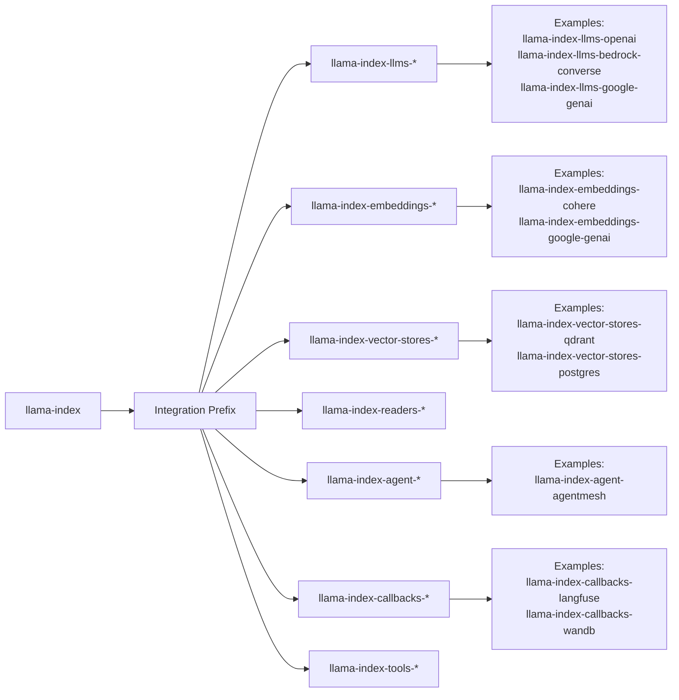

| Category       | Naming Pattern                  | Example Packages                                  |
| -------------- | -------------------------------| ------------------------------------------------|
| LLMs           | `llama-index-llms-{provider}`  | `openai`, `bedrock-converse`, `google-genai`   |
| Embeddings     | `llama-index-embeddings-{provider}` | `openai`, `cohere`, `google-genai`          |
| Vector Stores  | `llama-index-vector-stores-{provider}` | `qdrant`, `postgres`, `milvus`              |
| Readers        | `llama-index-readers-{source}` | `file`, `google-drive`, `notion`                 |
| Agents         | `llama-index-agent-{type}`      | `agentmesh`                                       |
| Callbacks      | `llama-index-callbacks-{service}` | `langfuse`, `wandb`, `argilla`                |
| Tools          | `llama-index-tools-{toolname}` | `shopify`, `openapi`, `chatgpt-plugin`           |

This consistent naming scheme helps automate dependency discovery and usage patterns across the ecosystem.

Sources: [CHANGELOG.md:7-130](), [docs/api_reference/mkdocs.yml:50-116]()

## Import Path Convention

LlamaIndex uses an explicit namespace pattern to distinguish core framework imports from integration package imports.

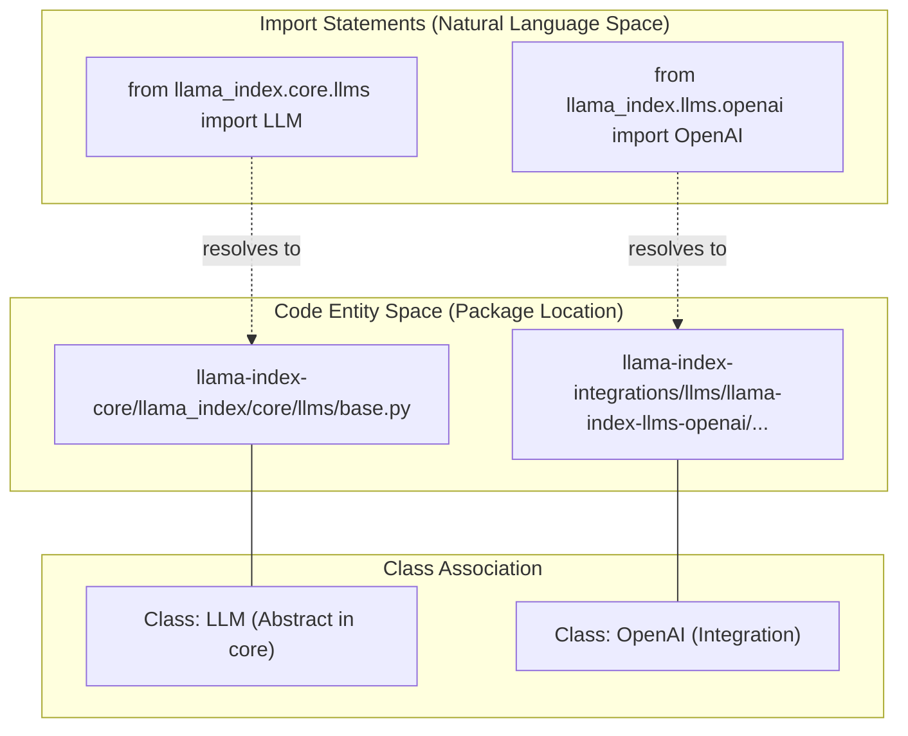

- **Core imports** contain `.core.` in the path, referencing abstract base classes and shared logic inside `llama-index-core`:
  ```python
  from llama_index.core.llms import LLM
  from llama_index.core import VectorStoreIndex
  from llama_index.core.settings import Settings
  ```

- **Integration imports** exclude `.core.` and come directly from integration packages:
  ```python
  from llama_index.llms.openai import OpenAI
  from llama_index.vector_stores.postgres import PGVectorStore
  ```

This namespace division enables flexible extension of the framework with third-party integrations while preserving a clear core API boundary.

Sources: [llama-index-core/llama_index/core/__init__.py:17-87]()

## Core Package Structure

The core package `llama-index-core` exposes its fundamental abstractions and components centrally through the module `llama_index.core`. This facilitates imports and promotes modular design.

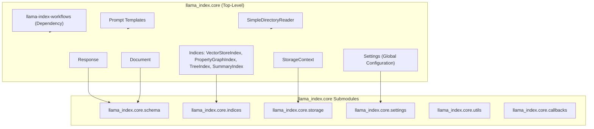

Notable exports include:

| Category          | Key Symbols                                              | Module Path/Note                             |
| ----------------- | --------------------------------------------------------| --------------------------------------------|
| Schema            | `Document`, `QueryBundle`, `Response`                   | `llama_index.core.schema` [core/__init__.py:17, 71]() |
| Indices           | `VectorStoreIndex`, `TreeIndex`, `KnowledgeGraphIndex`, `PropertyGraphIndex`, `SummaryIndex` | `llama_index.core.indices` [core/__init__.py:26-48]() |
| Storage           | `StorageContext`, `load_index_from_storage`, `SQLDatabase`| `llama_index.core.storage` + sql wrapper    |
| Settings          | `Settings`                                              | Global configuration object [core/__init__.py:78]()      |
| Utilities & Readers| `SimpleDirectoryReader`, `get_tokenizer`, `MockEmbedding` | Various core utils and classes               |
| Callbacks         | `set_global_handler`                                    | Core callback global eval handler            |
| Prompts           | `PromptTemplate`, `ChatPromptTemplate`, etc.           | Core prompt template abstractions            |

The core package also manages global mutable state such as a global tokenizer and global eval handler, supporting extensible workflows and evaluation control.

Sources: [llama-index-core/llama_index/core/__init__.py:1-140]()

## Dependency Management

LlamaIndex uses modern Python packaging tools for building and dependency resolution:

- **Build system**: `hatchling` is configured as the build backend for both the meta package and core package [pyproject.toml:2](), [llama-index-core/pyproject.toml:3]().
- **Package workspace management and lockfiles**: The monorepo uses `uv` tool with its `uv.lock` lockfile for dependency management and reproducibility [uv.lock:1-15](), [llama-index-core/uv.lock:1-12]().
- **Core dependencies**: `llama-index-core` depends on libraries like:
  - `pydantic` (>=2.8.0) for data validation,
  - `SQLAlchemy[asyncio]` for async ORM and persistence,
  - `aiohttp` for async HTTP client functionality,
  - `tiktoken` for tokenization,
  - `llama-index-workflows` for orchestration,
  - plus NLP utilities such as `nltk`, `networkx`, and more [llama-index-core/pyproject.toml:57-87]().

To facilitate offline usage, the core package bundles static assets like NLTK stopwords and punkt tokenizers, as well as tiktoken caches inside its distribution wheel [llama-index-core/pyproject.toml:111-115]().

Sources: [pyproject.toml:1-46](), [llama-index-core/pyproject.toml:1-87](), [uv.lock:1-15]()

## Release and Versioning

LlamaIndex maintains synchronized versioning for the meta package and core package, allowing consistency across releases:

- The meta package (`llama-index`) version matches the core package (`llama-index-core`), e.g., both at `0.14.25` currently [pyproject.toml:69](), [llama-index-core/pyproject.toml:37]().
- Integration packages generally have independent version numbers aligned to their own development cycle, following standard semantic versioning.
- A central `CHANGELOG.md` tracks individual package updates and summarizes important fixes and features collectively across core, integrations, embeddings, and LLMs [CHANGELOG.md:1-60]().

This approach balances stable API surface management for the core framework with agile release iteration in integrations.

Sources: [CHANGELOG.md:1-60](), [pyproject.toml:66-69](), [llama-index-core/pyproject.toml:36-37]()

---

The above package structure clarifies how LlamaIndex organizes code, dependencies, and versioning to provide a scalable framework and comprehensive integration ecosystem.

# Additional Diagram: Bridging Natural Language Space to Code Entity Space (Meta vs Core)

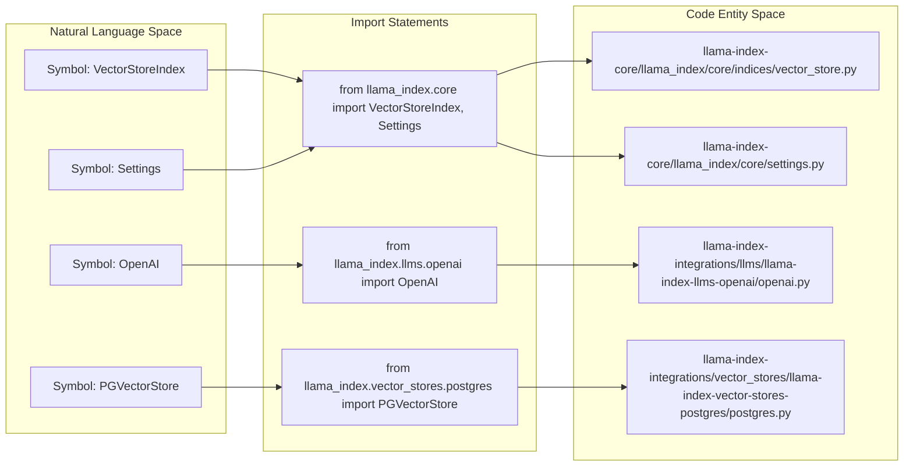

# Additional Diagram: Core Package Structure Detailed View

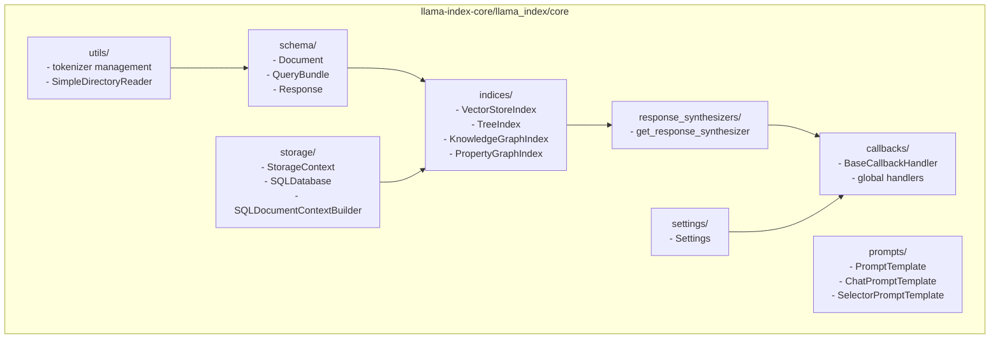

Sources: [llama-index-core/llama_index/core/__init__.py:1-140]()

---

This concludes the technical overview of LlamaIndex's package structure, detailing its meta and core packages alongside integration naming and import conventions to guide developers and integrators working within and extending the codebase.

---

# Page: Integration Ecosystem

# Integration Ecosystem

<details>
<summary>Relevant source files</summary>

The following files were used as context for generating this wiki page:

- [llama-index-integrations/embeddings/llama-index-embeddings-huggingface-api/llama_index/embeddings/huggingface_api/base.py](llama-index-integrations/embeddings/llama-index-embeddings-huggingface-api/llama_index/embeddings/huggingface_api/base.py)
- [llama-index-integrations/embeddings/llama-index-embeddings-huggingface-api/pyproject.toml](llama-index-integrations/embeddings/llama-index-embeddings-huggingface-api/pyproject.toml)
- [llama-index-integrations/embeddings/llama-index-embeddings-huggingface-api/tests/test_hf_inference.py](llama-index-integrations/embeddings/llama-index-embeddings-huggingface-api/tests/test_hf_inference.py)
- [llama-index-integrations/llms/llama-index-llms-huggingface-api/README.md](llama-index-integrations/llms/llama-index-llms-huggingface-api/README.md)
- [llama-index-integrations/llms/llama-index-llms-huggingface-api/llama_index/llms/huggingface_api/base.py](llama-index-integrations/llms/llama-index-llms-huggingface-api/llama_index/llms/huggingface_api/base.py)
- [llama-index-integrations/llms/llama-index-llms-huggingface-api/pyproject.toml](llama-index-integrations/llms/llama-index-llms-huggingface-api/pyproject.toml)
- [llama-index-integrations/llms/llama-index-llms-huggingface-api/tests/test_huggingface_api.py](llama-index-integrations/llms/llama-index-llms-huggingface-api/tests/test_huggingface_api.py)
- [llama-index-integrations/node_parser/llama-index-node-parser-docling/README.md](llama-index-integrations/node_parser/llama-index-node-parser-docling/README.md)
- [llama-index-integrations/node_parser/llama-index-node-parser-docling/llama_index/node_parser/docling/base.py](llama-index-integrations/node_parser/llama-index-node-parser-docling/llama_index/node_parser/docling/base.py)
- [llama-index-integrations/node_parser/llama-index-node-parser-docling/pyproject.toml](llama-index-integrations/node_parser/llama-index-node-parser-docling/pyproject.toml)
- [llama-index-integrations/readers/llama-index-readers-couchbase/pyproject.toml](llama-index-integrations/readers/llama-index-readers-couchbase/pyproject.toml)
- [llama-index-integrations/readers/llama-index-readers-couchdb/pyproject.toml](llama-index-integrations/readers/llama-index-readers-couchdb/pyproject.toml)
- [llama-index-integrations/readers/llama-index-readers-dad-jokes/pyproject.toml](llama-index-integrations/readers/llama-index-readers-dad-jokes/pyproject.toml)
- [llama-index-integrations/readers/llama-index-readers-dashscope/pyproject.toml](llama-index-integrations/readers/llama-index-readers-dashscope/pyproject.toml)
- [llama-index-integrations/readers/llama-index-readers-dashvector/pyproject.toml](llama-index-integrations/readers/llama-index-readers-dashvector/pyproject.toml)
- [llama-index-integrations/readers/llama-index-readers-database/pyproject.toml](llama-index-integrations/readers/llama-index-readers-database/pyproject.toml)
- [llama-index-integrations/readers/llama-index-readers-deeplake/pyproject.toml](llama-index-integrations/readers/llama-index-readers-deeplake/pyproject.toml)
- [llama-index-integrations/readers/llama-index-readers-discord/pyproject.toml](llama-index-integrations/readers/llama-index-readers-discord/pyproject.toml)
- [llama-index-integrations/readers/llama-index-readers-docling/README.md](llama-index-integrations/readers/llama-index-readers-docling/README.md)
- [llama-index-integrations/readers/llama-index-readers-docling/llama_index/readers/docling/base.py](llama-index-integrations/readers/llama-index-readers-docling/llama_index/readers/docling/base.py)
- [llama-index-integrations/readers/llama-index-readers-docling/pyproject.toml](llama-index-integrations/readers/llama-index-readers-docling/pyproject.toml)
- [llama-index-integrations/readers/llama-index-readers-docstring-walker/pyproject.toml](llama-index-integrations/readers/llama-index-readers-docstring-walker/pyproject.toml)
- [llama-index-integrations/readers/llama-index-readers-docugami/llama_index/readers/docugami/base.py](llama-index-integrations/readers/llama-index-readers-docugami/llama_index/readers/docugami/base.py)
- [llama-index-integrations/readers/llama-index-readers-docugami/pyproject.toml](llama-index-integrations/readers/llama-index-readers-docugami/pyproject.toml)
- [llama-index-integrations/readers/llama-index-readers-file/llama_index/readers/file/flat/base.py](llama-index-integrations/readers/llama-index-readers-file/llama_index/readers/file/flat/base.py)
- [llama-index-utils/llama-index-utils-huggingface/pyproject.toml](llama-index-utils/llama-index-utils-huggingface/pyproject.toml)

</details>


This document describes LlamaIndex's integration ecosystem of 300+ packages that provide connectivity to external LLMs, vector stores, data sources, and other services. It covers the plugin architecture, package organization by category, naming conventions, implementation patterns, and shared utility packages.

## Overview

LlamaIndex follows a **plugin architecture** where the core framework [llama-index-integrations/llms/llama-index-llms-huggingface-api/pyproject.toml:2-3]() provides abstract base classes, and integration packages provide concrete implementations. This design enables minimal dependencies, independent versioning, and provider flexibility.

The framework is decoupled into a core library, `llama-index-core` [llama-index-integrations/llms/llama-index-llms-huggingface-api/pyproject.toml:37](), and hundreds of specialized integration packages located in the `llama-index-integrations/` directory of the monorepo.

**Sources:** [llama-index-integrations/llms/llama-index-llms-huggingface-api/pyproject.toml:2-3](), [llama-index-integrations/llms/llama-index-llms-huggingface-api/pyproject.toml:37]()

## Package Structure and Naming

### Naming Convention

All integration packages follow a consistent naming pattern to ensure discoverability and clarity:

```
llama-index-{category}-{provider}
```

Where:
- `{category}` identifies the integration type (e.g., `llms`, `embeddings`, `vector-stores`, `readers`, `callbacks`, `indices`).
- `{provider}` identifies the specific service or implementation (e.g., `openai`, `anthropic`, `milvus`, `cohere`).

**Examples:**
- `llama-index-llms-huggingface-api` [llama-index-integrations/llms/llama-index-llms-huggingface-api/pyproject.toml:28]()
- `llama-index-embeddings-huggingface-api` [llama-index-integrations/embeddings/llama-index-embeddings-huggingface-api/pyproject.toml:28]()
- `llama-index-readers-docling` [llama-index-integrations/readers/llama-index-readers-docling/pyproject.toml:30]()

### Import Path Structure

The Python import path generally mirrors the package name to maintain clear namespaces.

```python
# Core abstraction
from llama_index.core.llms.llm import LLM

# Integration implementation
from llama_index.llms.huggingface_api import HuggingFaceInferenceAPI
```

LlamaIndex exposes key abstractions through the top-level `llama_index.core` namespace to simplify user interaction while keeping implementations segregated.

**Sources:** [llama-index-integrations/llms/llama-index-llms-huggingface-api/llama_index/llms/huggingface_api/base.py:39](), [llama-index-integrations/llms/llama-index-llms-huggingface-api/pyproject.toml:55]()

## Integration Categories

### Major Abstractions

Integrations plug into the framework by inheriting from and implementing core base classes defined in `llama-index-core`.

| Category | Base Class | Purpose |
|----------|------------|---------|
| **LLMs** | `FunctionCallingLLM` | Text generation and tool calling [llama-index-integrations/llms/llama-index-llms-huggingface-api/llama_index/llms/huggingface_api/base.py:46]() |
| **Vector Stores** | `BasePydanticVectorStore` | Similarity search and persistence |
| **Embeddings** | `BaseEmbedding` | Text/Image-to-vector transformation [llama-index-integrations/embeddings/llama-index-embeddings-huggingface-api/llama_index/embeddings/huggingface_api/base.py:29]() |
| **Readers** | `BasePydanticReader` | Data ingestion from external sources [llama-index-integrations/readers/llama-index-readers-docling/llama_index/readers/docling/base.py:10]() |
| **Node Parsers** | `BaseNodeParser` | Document splitting and node creation [llama-index-integrations/node_parser/llama-index-node-parser-docling/llama_index/node_parser/docling/base.py:10]() |
| **Managed Indices** | `BaseManagedIndex` | Hosted retrieval and indexing services |

### Shared Utility Packages (`llama-index-utils`)

To minimize code duplication across integrations for major cloud and AI providers, LlamaIndex uses shared utility packages. These provide common authentication, client management, and helper functions.

*   **Azure**: Common utilities for Azure OpenAI, AI Search, and Storage.
*   **HuggingFace**: Shared logic for model loading and tokenization [llama-index-integrations/embeddings/llama-index-embeddings-huggingface-api/pyproject.toml:36]().
*   **OracleAI**: Utilities for Oracle Database and AI service connectivity.
*   **Qianfan**: Shared helpers for Baidu's Qianfan platform.

### Integration Data Flow

The following diagram illustrates how natural language and media requests flow through code entities into external service integrations, using `HuggingFaceInferenceAPI` as a concrete example for LLMs.

**Diagram: Natural Language to Code Entity Mapping (HuggingFace LLM)**

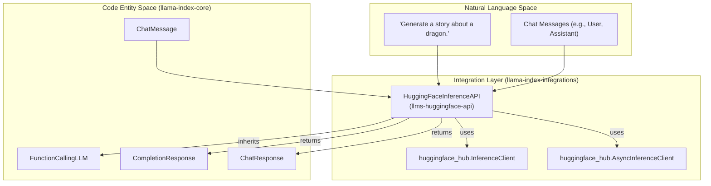

**Sources:** [llama-index-integrations/llms/llama-index-llms-huggingface-api/llama_index/llms/huggingface_api/base.py:46](), [llama-index-integrations/llms/llama-index-llms-huggingface-api/llama_index/llms/huggingface_api/base.py:3](), [llama-index-integrations/llms/llama-index-llms-huggingface-api/llama_index/llms/huggingface_api/base.py:23-32]()

The `HuggingFaceInferenceAPI` class [llama-index-integrations/llms/llama-index-llms-huggingface-api/llama_index/llms/huggingface_api/base.py:46-46]() acts as a wrapper around the `huggingface_hub.InferenceClient` and `huggingface_hub.AsyncInferenceClient` [llama-index-integrations/llms/llama-index-llms-huggingface-api/llama_index/llms/huggingface_api/base.py:133-134](). It supports both chat and completion tasks, dynamically selecting the appropriate Hugging Face model if not specified [llama-index-integrations/llms/llama-index-llms-huggingface-api/llama_index/llms/huggingface_api/base.py:162-173]().

**Diagram: Docling Reader Data Flow**

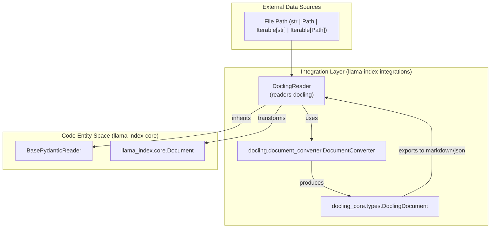

**Sources:** [llama-index-integrations/readers/llama-index-readers-docling/llama_index/readers/docling/base.py:15](), [llama-index-integrations/readers/llama-index-readers-docling/llama_index/readers/docling/base.py:8](), [llama-index-integrations/readers/llama-index-readers-docling/llama_index/readers/docling/base.py:11](), [llama-index-integrations/readers/llama-index-readers-docling/llama_index/readers/docling/base.py:70-75]()

The `DoclingReader` [llama-index-integrations/readers/llama-index-readers-docling/llama_index/readers/docling/base.py:15-15]() leverages `docling-core` to convert various document formats (PDF, DOCX) into LlamaIndex `Document` objects. It supports exporting content as Markdown or JSON [llama-index-integrations/readers/llama-index-readers-docling/llama_index/readers/docling/base.py:41-42]().

## Plugin Architecture Implementation

### Dependency Flow

The ecosystem is structured to prevent "dependency bloat." The meta-package `llama-index` acts as a coordinator that bundles core and a set of default integrations.

**Diagram: Package Dependency and Inheritance**

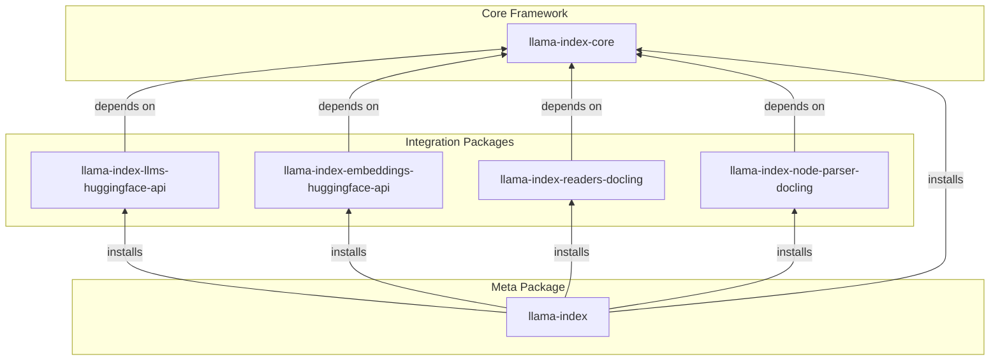

**Sources:** [llama-index-integrations/llms/llama-index-llms-huggingface-api/pyproject.toml:37](), [llama-index-integrations/embeddings/llama-index-embeddings-huggingface-api/pyproject.toml:37](), [llama-index-integrations/readers/llama-index-readers-docling/pyproject.toml:38](), [llama-index-integrations/node_parser/llama-index-node-parser-docling/pyproject.toml:35]()

### LlamaHub Integration

LlamaHub serves as the central registry. Integration packages include specific metadata in their `pyproject.toml` to define how they are displayed and attributed on LlamaHub.

```toml
[tool.llamahub]
contains_example = false
import_path = "llama_index.llms.huggingface_api"

[tool.llamahub.class_authors]
HuggingFaceInferenceAPI = "llama-index"
```

**Sources:** [llama-index-integrations/llms/llama-index-llms-huggingface-api/pyproject.toml:53-59]()

## Ingestion and Data Sources

Integrations also extend the `IngestionPipeline` through specialized readers and transformations. The framework provides a `ConfigurableComponent` enum to dynamically build data sources when the corresponding integration is installed.

**Configurable Data Sources include:**
- **DashScope**: `DashScopeParse` [llama-index-integrations/readers/llama-index-readers-dashscope/pyproject.toml:61]()
- **DashVector**: `DashVectorReader` [llama-index-integrations/readers/llama-index-readers-dashvector/pyproject.toml:57]()
- **Database**: `DatabaseReader` [llama-index-integrations/readers/llama-index-readers-database/pyproject.toml:63]()
- **Discord**: `DiscordReader` [llama-index-integrations/readers/llama-index-readers-discord/pyproject.toml:56]()
- **Docling**: `DoclingReader` [llama-index-integrations/readers/llama-index-readers-docling/pyproject.toml:61]()
- **Docugami**: `DocugamiReader` [llama-index-integrations/readers/llama-index-readers-docugami/pyproject.toml:67]()

**Sources:** [llama-index-integrations/readers/llama-index-readers-dashscope/pyproject.toml:61](), [llama-index-integrations/readers/llama-index-readers-dashvector/pyproject.toml:57](), [llama-index-integrations/readers/llama-index-readers-database/pyproject.toml:63](), [llama-index-integrations/readers/llama-index-readers-discord/pyproject.toml:56](), [llama-index-integrations/readers/llama-index-readers-docling/pyproject.toml:61](), [llama-index-integrations/readers/llama-index-readers-docugami/pyproject.toml:67]()

## Popular Integrations

The ecosystem includes over 300 integrations. Major providers include:

### LLM Providers
- **HuggingFace**: `HuggingFaceInferenceAPI` for models hosted on Hugging Face Hub or deployed Inference Endpoints [llama-index-integrations/llms/llama-index-llms-huggingface-api/llama_index/llms/huggingface_api/base.py:46-50]().
- **OpenAI**: Primary default provider.
- **Google**: Gemini models via `google-genai` 2.0+ SDK.
- **Anthropic**: Claude models integration.
- **Ollama**: Local model deployment support.

### Embedding Providers
- **HuggingFace**: `HuggingFaceInferenceAPIEmbedding` for embeddings via Hugging Face Inference API [llama-index-integrations/embeddings/llama-index-embeddings-huggingface-api/pyproject.toml:59]().
- **Cohere**: Supports text and multimodal (image) embeddings.

### Observability and Callbacks
- **WandB**: Experiment tracking and visualization.
- **Argilla**: Data labeling and feedback loops.
- **Langfuse**: Tracing and evaluation.

## Development and Contribution

The repository is organized as a **monorepo** to facilitate cross-package testing and consistent versioning.

- **Core package**: `llama-index-core/`.
- **Integrations**: `llama-index-integrations/`.
- **Testing**: Managed via `pytest` [llama-index-integrations/llms/llama-index-llms-huggingface-api/pyproject.toml:16]() and `pytest-mock` [llama-index-integrations/llms/llama-index-llms-huggingface-api/pyproject.toml:17]() for mocking external dependencies [llama-index-integrations/llms/llama-index-llms-huggingface-api/tests/test_huggingface_api.py:1-2]().

**Sources:** [llama-index-integrations/llms/llama-index-llms-huggingface-api/llama_index/llms/huggingface_api/base.py:46-50](), [llama-index-integrations/embeddings/llama-index-embeddings-huggingface-api/pyproject.toml:59](), [llama-index-integrations/llms/llama-index-llms-huggingface-api/pyproject.toml:16-17](), [llama-index-integrations/llms/llama-index-llms-huggingface-api/tests/test_huggingface_api.py:1-2]()

---

# Page: Data Flow Pipeline

# Data Flow Pipeline

<details>
<summary>Relevant source files</summary>

The following files were used as context for generating this wiki page:

- [docs/examples/ingestion/ray_ingestion_pipeline.ipynb](docs/examples/ingestion/ray_ingestion_pipeline.ipynb)
- [llama-index-core/llama_index/core/base/response/schema.py](llama-index-core/llama_index/core/base/response/schema.py)
- [llama-index-core/llama_index/core/ingestion/pipeline.py](llama-index-core/llama_index/core/ingestion/pipeline.py)
- [llama-index-core/llama_index/core/instrumentation/events/synthesis.py](llama-index-core/llama_index/core/instrumentation/events/synthesis.py)
- [llama-index-core/llama_index/core/query_engine/citation_query_engine.py](llama-index-core/llama_index/core/query_engine/citation_query_engine.py)
- [llama-index-core/llama_index/core/query_engine/multi_modal.py](llama-index-core/llama_index/core/query_engine/multi_modal.py)
- [llama-index-core/llama_index/core/query_engine/retriever_query_engine.py](llama-index-core/llama_index/core/query_engine/retriever_query_engine.py)
- [llama-index-core/llama_index/core/response/utils.py](llama-index-core/llama_index/core/response/utils.py)
- [llama-index-core/llama_index/core/response_synthesizers/base.py](llama-index-core/llama_index/core/response_synthesizers/base.py)
- [llama-index-core/llama_index/core/response_synthesizers/context_only.py](llama-index-core/llama_index/core/response_synthesizers/context_only.py)
- [llama-index-core/llama_index/core/response_synthesizers/factory.py](llama-index-core/llama_index/core/response_synthesizers/factory.py)
- [llama-index-core/llama_index/core/response_synthesizers/simple_summarize.py](llama-index-core/llama_index/core/response_synthesizers/simple_summarize.py)
- [llama-index-core/llama_index/core/response_synthesizers/type.py](llama-index-core/llama_index/core/response_synthesizers/type.py)
- [llama-index-core/llama_index/core/tools/tool_spec/base.py](llama-index-core/llama_index/core/tools/tool_spec/base.py)
- [llama-index-core/llama_index/core/types.py](llama-index-core/llama_index/core/types.py)
- [llama-index-core/tests/ingestion/test_pipeline.py](llama-index-core/tests/ingestion/test_pipeline.py)
- [llama-index-core/tests/query_engine/test_citation_query_engine.py](llama-index-core/tests/query_engine/test_citation_query_engine.py)
- [llama-index-core/tests/query_engine/test_retriever_query_engine.py](llama-index-core/tests/query_engine/test_retriever_query_engine.py)
- [llama-index-core/tests/response_synthesizers/test_factory.py](llama-index-core/tests/response_synthesizers/test_factory.py)
- [llama-index-core/tests/test_types.py](llama-index-core/tests/test_types.py)
- [llama-index-core/tests/tools/tool_spec/test_base.py](llama-index-core/tests/tools/tool_spec/test_base.py)
- [llama-index-integrations/ingestion/llama-index-ingestion-ray/.gitignore](llama-index-integrations/ingestion/llama-index-ingestion-ray/.gitignore)
- [llama-index-integrations/ingestion/llama-index-ingestion-ray/LICENSE](llama-index-integrations/ingestion/llama-index-ingestion-ray/LICENSE)
- [llama-index-integrations/ingestion/llama-index-ingestion-ray/Makefile](llama-index-integrations/ingestion/llama-index-ingestion-ray/Makefile)
- [llama-index-integrations/ingestion/llama-index-ingestion-ray/README.md](llama-index-integrations/ingestion/llama-index-ingestion-ray/README.md)
- [llama-index-integrations/ingestion/llama-index-ingestion-ray/llama_index/ingestion/ray/__init__.py](llama-index-integrations/ingestion/llama-index-ingestion-ray/llama_index/ingestion/ray/__init__.py)
- [llama-index-integrations/ingestion/llama-index-ingestion-ray/llama_index/ingestion/ray/base.py](llama-index-integrations/ingestion/llama-index-ingestion-ray/llama_index/ingestion/ray/base.py)
- [llama-index-integrations/ingestion/llama-index-ingestion-ray/llama_index/ingestion/ray/transform.py](llama-index-integrations/ingestion/llama-index-ingestion-ray/llama_index/ingestion/ray/transform.py)
- [llama-index-integrations/ingestion/llama-index-ingestion-ray/llama_index/ingestion/ray/utils.py](llama-index-integrations/ingestion/llama-index-ingestion-ray/llama_index/ingestion/ray/utils.py)

</details>


## Purpose and Scope

This document explains the complete RAG (Retrieval Augmented Generation) pipeline in LlamaIndex, from raw data ingestion through retrieval to response generation. The pipeline follows a multi-stage architecture that transforms unstructured data into AI-generated responses through: **data ingestion, transformation and embedding, storage, indexing, query processing, LLM integration, and output generation**.

For details on specific LLM providers, see page 6 (LLM Integrations). For vector store implementations, see page 7 (Vector Store Integrations). For workflow orchestration, see page 4 (Workflow System). For the overall architecture context, see page 2 (Architecture).

## Pipeline Architecture Overview

The LlamaIndex data flow implements a structured RAG pipeline. Each stage has well-defined input/output contracts through core abstractions (`Document`, `BaseNode`, `QueryBundle`, `Response`).

**Pipeline Architecture: Data Flow Stages**

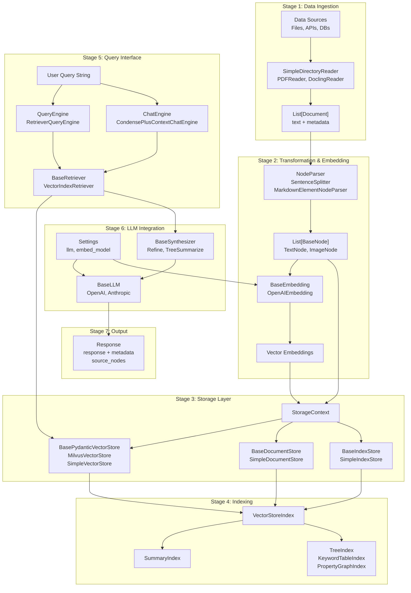

**Core Data Structures:**

| Class | Purpose | Module |
|-------|---------|--------|
| `Document` | Raw data with metadata and hash | `llama_index.core.schema` |
| `BaseNode` | Chunked text/image unit with metadata | `llama_index.core.schema` |
| `TextNode` | Text chunk with embeddings | `llama_index.core.schema` |
| `ImageNode` | Image with optional embeddings | `llama_index.core.schema` |
| `QueryBundle` | Query string + metadata | `llama_index.core.schema` |
| `Response` | Answer text + source nodes | `llama_index.core.base.response.schema` |

**Sources:**
- [llama-index-core/llama_index/core/schema.py:26-31]()
- [llama-index-core/llama_index/core/base/response/schema.py:14-141]()

## Stage 1-2: Data Ingestion and IngestionPipeline

While `SimpleDirectoryReader` provides a simple entry point, the `IngestionPipeline` offers a structured way to handle complex data flows, including caching and deduplication [llama-index-core/llama_index/core/ingestion/pipeline.py:348-420]().

### IngestionPipeline: Transformation Orchestration

The `IngestionPipeline` manages a sequence of `TransformComponent` objects applied to data. It supports asynchronous execution via `arun()` and document deduplication through `DocstoreStrategy` options.

```mermaid
graph TB
    subgraph IngestionPipeline["IngestionPipeline"]
        Run["run() / arun()"]
        TransformList["List[TransformComponent]<br/>SentenceSplitter<br/>MockEmbedding"]
        Cache["IngestionCache"]
    end

    subgraph LogicFlow["Execution Logic"]
        LoadDocs["Load Documents"]
        Strategy["DocstoreStrategy<br/>DUPLICATES_ONLY"]
        RunTrans["run_transformations()"]
        HashCheck["get_transformation_hash()"]
        FinalNodes["Sequence[BaseNode]"]
    end

    LoadDocs --> Strategy
    Strategy --> RunTrans
    RunTrans --> HashCheck
    HashCheck --> FinalNodes
```

**Deduplication Strategies:**
- **UPSERTS**: Updates the document in the doc store if the ID exists but the hash has changed [llama-index-core/llama_index/core/ingestion/pipeline.py:317-318]().
- **DUPLICATES_ONLY**: Only processes the document if its hash is not already in the doc store [llama-index-core/llama_index/core/ingestion/pipeline.py:319-320]().
- **UPSERTS_AND_DELETE**: Similar to UPSERTS but also removes non-existing documents from the store [llama-index-core/llama_index/core/ingestion/pipeline.py:321-322]().

**Sources:**
- [llama-index-core/llama_index/core/ingestion/pipeline.py:72-112]()
- [llama-index-core/llama_index/core/ingestion/pipeline.py:307-330]()
- [llama-index-core/tests/ingestion/test_pipeline.py:43-63]()

## Stage 3-4: Storage and Indexing

The indexing stage bridges the gap between raw nodes and queryable structures. The `VectorStoreIndex` is the most common implementation, coordinating with `StorageContext` to persist nodes and embeddings.

### VectorStoreIndex Construction

When building from documents via `from_documents()`, `VectorStoreIndex` runs transformations (like splitting and embedding) and then inserts the resulting nodes into the configured vector store [llama-index-core/llama_index/core/indices/vector_store/base.py:86-130]().

```mermaid
graph TD
    subgraph CodeEntitySpace["Code Entity Space"]
        VSI["VectorStoreIndex.from_documents()"]
        RT["run_transformations()"]
        EM["BaseEmbedding.get_text_embedding()"]
        VS["BasePydanticVectorStore.add()"]
        DS["BaseDocumentStore.add_documents()"]
    end

    VSI --> RT
    RT --> EM
    EM --> VS
    VS --> DS
```

**Sources:**
- [llama-index-core/llama_index/core/indices/vector_store/base.py:176-210]()
- [llama-index-core/llama_index/core/indices/base.py:89-130]()
- [llama-index-core/tests/indices/vector_store/test_simple_async.py:17-22]()

## Stage 5-6: Querying and Response Synthesis

### Retriever and Query Engine

The `RetrieverQueryEngine` orchestrates the retrieval of nodes via a `BaseRetriever` and the subsequent synthesis of a response via a `BaseSynthesizer` [llama-index-core/llama_index/core/query_engine/retriever_query_engine.py:36-49](). `VectorStoreIndex.as_retriever()` returns a `VectorIndexRetriever` which interfaces directly with the `BasePydanticVectorStore` [llama-index-core/llama_index/core/indices/vector_store/base.py:112-124]().

The `CitationQueryEngine` is a specialized `BaseQueryEngine` that focuses on generating responses with explicit source citations. It uses a `BaseRetriever` to fetch relevant nodes and a `BaseSynthesizer` configured with specific citation-aware prompt templates (`CITATION_QA_TEMPLATE`, `CITATION_REFINE_TEMPLATE`, `CITATION_CHAT_CONTENT_QA_TEMPLATE`, `CITATION_CHAT_CONTENT_REFINE_TEMPLATE`) to ensure that the generated answer includes references to the provided sources [llama-index-core/llama_index/core/query_engine/citation_query_engine.py:158-174]().

### ResponseSynthesizer and Synthesis Strategies

The `BaseSynthesizer` coordinates context assembly and LLM prompting [llama-index-core/llama_index/core/response_synthesizers/base.py:64-107](). Key strategies include:

- **Refine**: Iteratively updates an answer by processing chunks sequentially. It uses a `StructuredRefineResponse` model to determine if the query is satisfied [llama-index-core/llama_index/core/response_synthesizers/refine.py:52-71]().
- **TreeSummarize**: Recursively merges text chunks and summarizes them in a bottom-up fashion (building a tree from leaves to root) [llama-index-core/llama_index/core/response_synthesizers/tree_summarize.py:20-31]().
- **SimpleSummarize**: Concatenates all text chunks into a single string and passes it to the LLM for summarization [llama-index-core/llama_index/core/response_synthesizers/simple_summarize.py:60-93]().
- **CompactAndRefine**: Similar to Refine, but first compacts the text chunks to fit within the LLM's context window.
- **Accumulate**: Accumulates responses from multiple text chunks without refinement.
- **Generation**: Generates a response directly from the query and context without any specific summarization or refinement strategy.
- **ContextOnly**: Returns the raw context without any LLM interaction.
- **NoText**: Returns an empty response.

The `get_response_synthesizer` factory function allows dynamic selection of the synthesis mode based on the `ResponseMode` enum [llama-index-core/llama_index/core/response_synthesizers/factory.py:38-60]().

```mermaid
graph TD
    subgraph ResponseSynthesizer["BaseSynthesizer"]
        Synthesize["get_response()"]
        Prepare["_prepare_response_output()"]
    end

    subgraph LLMInteraction["LLM Interaction"]
        StructuredCheck{"Is StructuredLLM?"}
        LLMPredict["llm.predict() / llm.apredict()"]
        OutputParse["Parse to PydanticResponse<br/>or Response"]
    end

    Synthesize --> StructuredCheck
    StructuredCheck --> LLMPredict
    LLMPredict --> OutputParse
    OutputParse --> Prepare
```

**Structured Output:**
If the LLM is an instance of `StructuredLLM`, the synthesizer automatically validates the response against a Pydantic model (`output_cls`) [llama-index-core/llama_index/core/response_synthesizers/base.py:194-202]().

**Sources:**
- [llama-index-core/llama_index/core/response_synthesizers/base.py:132-150]()
- [llama-index-core/llama_index/core/response_synthesizers/refine.py:79-113]()
- [llama-index-core/llama_index/core/response_synthesizers/tree_summarize.py:77-117]()
- [llama-index-core/llama_index/core/response_synthesizers/simple_summarize.py:60-93]()
- [llama-index-core/llama_index/core/response_synthesizers/factory.py:38-60]()
- [llama-index-core/llama_index/core/query_engine/retriever_query_engine.py:36-49]()
- [llama-index-core/llama_index/core/query_engine/citation_query_engine.py:158-174]()

## Stage 7: Output and Response Structure

The final stage produces a `Response`, `PydanticResponse`, or `StreamingResponse`.

**Response Object Comparison:**

| Class | Primary Attribute | Use Case |
|-------|-------------------|----------|
| `Response` | `response: str` | Standard text completion [llama-index-core/llama_index/core/base/response/schema.py:15-28]() |
| `PydanticResponse` | `response: BaseModel` | Structured extraction/validation [llama-index-core/llama_index/core/base/response/schema.py:46-59]() |
| `StreamingResponse` | `response_gen: TokenGen` | Real-time UI updates via generator [llama-index-core/llama_index/core/base/response/schema.py:108-123]() |
| `AsyncStreamingResponse` | `response_gen: TokenAsyncGen` | Asynchronous real-time updates [llama-index-core/llama_index/core/base/response/schema.py:167-182]() |

**Sources:**
- [llama-index-core/llama_index/core/base/response/schema.py:15-43]()
- [llama-index-core/llama_index/core/base/response/schema.py:46-105]()
- [llama-index-core/llama_index/core/base/response/schema.py:108-165]()
- [llama-index-core/llama_index/core/base/response/schema.py:167-206]()

---

# Page: Core Framework

# Core Framework

<details>
<summary>Relevant source files</summary>

The following files were used as context for generating this wiki page:

- [.github/workflows/close_new_integration_prs.yml](.github/workflows/close_new_integration_prs.yml)
- [CONTRIBUTING.md](CONTRIBUTING.md)
- [README.md](README.md)
- [docs/DOCS_README.md](docs/DOCS_README.md)
- [llama-index-core/llama_index/core/bridge/pydantic.py](llama-index-core/llama_index/core/bridge/pydantic.py)
- [llama-index-core/llama_index/core/img_utils.py](llama-index-core/llama_index/core/img_utils.py)
- [llama-index-core/llama_index/core/indices/base.py](llama-index-core/llama_index/core/indices/base.py)
- [llama-index-core/llama_index/core/indices/vector_store/base.py](llama-index-core/llama_index/core/indices/vector_store/base.py)
- [llama-index-core/llama_index/core/multi_modal_llms/base.py](llama-index-core/llama_index/core/multi_modal_llms/base.py)
- [llama-index-core/llama_index/core/multi_modal_llms/generic_utils.py](llama-index-core/llama_index/core/multi_modal_llms/generic_utils.py)
- [llama-index-core/llama_index/core/node_parser/node_utils.py](llama-index-core/llama_index/core/node_parser/node_utils.py)
- [llama-index-core/llama_index/core/node_parser/text/code.py](llama-index-core/llama_index/core/node_parser/text/code.py)
- [llama-index-core/llama_index/core/node_parser/text/semantic_double_merging_splitter.py](llama-index-core/llama_index/core/node_parser/text/semantic_double_merging_splitter.py)
- [llama-index-core/llama_index/core/node_parser/text/utils.py](llama-index-core/llama_index/core/node_parser/text/utils.py)
- [llama-index-core/llama_index/core/postprocessor/optimizer.py](llama-index-core/llama_index/core/postprocessor/optimizer.py)
- [llama-index-core/llama_index/core/prompts/__init__.py](llama-index-core/llama_index/core/prompts/__init__.py)
- [llama-index-core/llama_index/core/response/notebook_utils.py](llama-index-core/llama_index/core/response/notebook_utils.py)
- [llama-index-core/llama_index/core/schema.py](llama-index-core/llama_index/core/schema.py)
- [llama-index-core/llama_index/core/storage/index_store/keyval_index_store.py](llama-index-core/llama_index/core/storage/index_store/keyval_index_store.py)
- [llama-index-core/llama_index/core/storage/index_store/types.py](llama-index-core/llama_index/core/storage/index_store/types.py)
- [llama-index-core/tests/indices/list/test_index.py](llama-index-core/tests/indices/list/test_index.py)
- [llama-index-core/tests/indices/vector_store/test_simple.py](llama-index-core/tests/indices/vector_store/test_simple.py)
- [llama-index-core/tests/indices/vector_store/test_simple_async.py](llama-index-core/tests/indices/vector_store/test_simple_async.py)
- [llama-index-core/tests/multi_modal_llms/test_base_multi_modal_llm_metadata.py](llama-index-core/tests/multi_modal_llms/test_base_multi_modal_llm_metadata.py)
- [llama-index-core/tests/multi_modal_llms/test_generic_utils.py](llama-index-core/tests/multi_modal_llms/test_generic_utils.py)
- [llama-index-core/tests/node_parser/test_semantic_double_merging_splitter.py](llama-index-core/tests/node_parser/test_semantic_double_merging_splitter.py)
- [llama-index-core/tests/schema/test_image_document.py](llama-index-core/tests/schema/test_image_document.py)
- [llama-index-core/tests/schema/test_media_resource.py](llama-index-core/tests/schema/test_media_resource.py)
- [llama-index-core/tests/schema/test_node.py](llama-index-core/tests/schema/test_node.py)
- [llama-index-core/tests/schema/test_schema.py](llama-index-core/tests/schema/test_schema.py)
- [llama-index-core/tests/text_splitter/test_code_splitter.py](llama-index-core/tests/text_splitter/test_code_splitter.py)
- [llama-index-integrations/readers/llama-index-readers-kibela/llama_index/readers/kibela/base.py](llama-index-integrations/readers/llama-index-readers-kibela/llama_index/readers/kibela/base.py)
- [llama-index-integrations/storage/index_store/llama-index-storage-index-store-dynamodb/llama_index/storage/index_store/dynamodb/base.py](llama-index-integrations/storage/index_store/llama-index-storage-index-store-dynamodb/llama_index/storage/index_store/dynamodb/base.py)
- [llama-index-integrations/storage/index_store/llama-index-storage-index-store-elasticsearch/llama_index/storage/index_store/elasticsearch/base.py](llama-index-integrations/storage/index_store/llama-index-storage-index-store-elasticsearch/llama_index/storage/index_store/elasticsearch/base.py)
- [llama-index-integrations/storage/index_store/llama-index-storage-index-store-elasticsearch/pyproject.toml](llama-index-integrations/storage/index_store/llama-index-storage-index-store-elasticsearch/pyproject.toml)
- [llama-index-integrations/storage/index_store/llama-index-storage-index-store-firestore/llama_index/storage/index_store/firestore/base.py](llama-index-integrations/storage/index_store/llama-index-storage-index-store-firestore/llama_index/storage/index_store/firestore/base.py)
- [llama-index-integrations/storage/index_store/llama-index-storage-index-store-mongodb/llama_index/storage/index_store/mongodb/base.py](llama-index-integrations/storage/index_store/llama-index-storage-index-store-mongodb/llama_index/storage/index_store/mongodb/base.py)
- [llama-index-integrations/storage/index_store/llama-index-storage-index-store-postgres/llama_index/storage/index_store/postgres/base.py](llama-index-integrations/storage/index_store/llama-index-storage-index-store-postgres/llama_index/storage/index_store/postgres/base.py)
- [llama-index-integrations/storage/index_store/llama-index-storage-index-store-redis/llama_index/storage/index_store/redis/base.py](llama-index-integrations/storage/index_store/llama-index-storage-index-store-redis/llama_index/storage/index_store/redis/base.py)

</details>


The **Core Framework** (`llama-index-core`) is the foundational library of LlamaIndex, providing the base abstractions, data structures, and architectural patterns upon which all integration packages are built. This package contains no concrete LLM or vector store implementations—instead, it defines the interfaces and core logic that integration packages extend.

**Scope**: This page documents the `llama-index-core` package structure, fundamental data types, base classes for integrations, and core architectural patterns. For specific implementations of indices and query engines, see [Indices and Query Engines](#3.1). For storage abstractions, see [Storage System](#3.2). For configuration patterns, see [Settings and Configuration](#3.3). For the workflow engine that core depends on, see [Workflow System](#4).

---

## Core Architecture Overview

The Core Framework provides three fundamental layers: (1) data structures for representing documents and queries, (2) abstract base classes that integration packages extend, and (3) orchestration components for indexing and retrieval.

### High-Level Component Diagram

```mermaid
graph TB
    subgraph "Core Data Structures"
        Document["Document<br/>text + metadata"]
        Node["BaseNode<br/>TextNode, ImageNode"]
        QueryBundle["QueryBundle<br/>query text + embeddings"]
        Response["Response<br/>answer + source nodes"]
    end
    
    subgraph "Base Abstractions"
        BaseLLM["BaseLLM / FunctionCallingLLM<br/>Abstract LLM interface"]
        BaseEmbedding["BaseEmbedding<br/>Abstract embedding interface"]
        BaseVectorStore["BasePydanticVectorStore<br/>Abstract vector store interface"]
        BaseReader["BaseReader<br/>Abstract data loader interface"]
        BaseTool["BaseTool<br/>Abstract tool interface"]
    end
    
    subgraph "Core Orchestration"
        VectorStoreIndex["VectorStoreIndex"]
        SummaryIndex["SummaryIndex"]
        TreeIndex["TreeIndex"]
        PropertyGraphIndex["PropertyGraphIndex"]
        QueryEngine["BaseQueryEngine"]
        ChatEngine["BaseChatEngine"]
        Retriever["BaseRetriever"]
    end
    
    subgraph "Configuration & Storage"
        Settings["Settings<br/>Global configuration"]
        StorageContext["StorageContext<br/>Persistence facade"]
        PromptTemplate["PromptTemplate<br/>Templating system"]
    end
    
    subgraph "Core Dependency"
        Workflow["llama-index-workflows 2.14.x<br/>Event-driven execution"]
    end
    
    Document --> Node
    QueryBundle --> QueryEngine
    QueryEngine --> Response
    
    VectorStoreIndex --> BaseVectorStore
    VectorStoreIndex --> BaseEmbedding
    QueryEngine --> BaseLLM
    
    Settings --> BaseLLM
    Settings --> BaseEmbedding
    
    VectorStoreIndex --> Workflow
    QueryEngine --> Workflow
```

Sources: [llama-index-core/llama_index/core/__init__.py:1-151](), [llama-index-core/pyproject.toml:35-87](), [README.md:28-33]()

---

## Fundamental Data Structures

### Document and Node Hierarchy

The core data model centers around `Document` and `BaseNode` types. Documents represent raw input data, while nodes are the processed chunks used in indices.

```mermaid
graph TB
    Document["Document<br/>id_, text, metadata,<br/>embedding, relationships"]
    BaseNode["BaseNode<br/>Abstract base class"]
    TextNode["TextNode<br/>Most common node type<br/>text, metadata, embedding"]
    ImageNode["ImageNode<br/>image, image_path,<br/>image_url, image_mimetype"]
    IndexNode["IndexNode<br/>index_id, obj<br/>for nested indices"]
    
    Document -->|"from_documents()"| TextNode
    BaseNode --> TextNode
    BaseNode --> ImageNode
    BaseNode --> IndexNode
    
    TextNode -->|"ref_doc_id"| Document
    ImageNode -->|"ref_doc_id"| Document
```

**Key Classes**:
- `Document`: Input documents with text and metadata [llama-index-core/llama_index/core/schema.py:224]().
- `BaseNode`: Abstract base for all node types [llama-index-core/llama_index/core/schema.py:207-223]().
- `TextNode`: Text chunks with embeddings, most commonly used [llama-index-core/llama_index/core/schema.py:300]().
- `ImageNode`: Multimodal image nodes [llama-index-core/llama_index/core/schema.py:301]().
- `IndexNode`: References to sub-indices for hierarchical structures [llama-index-core/llama_index/core/schema.py:302]().

All nodes inherit from `BaseNode` and share common fields:
- `id_`: Unique identifier [llama-index-core/llama_index/core/schema.py:230]().
- `embedding`: Optional vector embedding [llama-index-core/llama_index/core/schema.py:232]().
- `metadata`: Dict of arbitrary metadata [llama-index-core/llama_index/core/schema.py:233]().
- `relationships`: Dict mapping `NodeRelationship` types to related node IDs [llama-index-core/llama_index/core/schema.py:234]().

Sources: [llama-index-core/llama_index/core/schema.py:1-1492](), [llama-index-core/llama_index/core/__init__.py:71-122]()

### Query and Response Structures

```mermaid
graph LR
    QueryBundle["QueryBundle<br/>query_str<br/>custom_embedding_strs<br/>embedding"]
    
    Response["Response<br/>response (str)<br/>source_nodes (List[NodeWithScore])<br/>metadata (dict)"]
    
    NodeWithScore["NodeWithScore<br/>node: BaseNode<br/>score: Optional[float]"]
    
    QueryBundle -->|"query()"| QueryEngine["BaseQueryEngine"]
    QueryEngine --> Response
    Response --> NodeWithScore
    NodeWithScore --> BaseNode["BaseNode"]
```

**Key Classes**:
- `QueryBundle`: Encapsulates query string and optional embeddings [llama-index-core/llama_index/core/schema.py:10]().
- `Response`: Synthesized answer with source attribution [llama-index-core/llama_index/core/base/response/schema.py:17]().
- `NodeWithScore`: Node paired with relevance score [llama-index-core/llama_index/core/schema.py:15-16]().

Sources: [llama-index-core/llama_index/core/schema.py:1-1492](), [llama-index-core/llama_index/core/__init__.py:17-143]()

---

## Base Abstractions for Integrations

The Core Framework defines abstract base classes that all integration packages extend. This enables the plugin architecture where users can swap LLMs, vector stores, and embeddings without changing application code.

### LLM Abstraction Layer

LlamaIndex uses a block-based message system to support multimodal inputs. Recent updates have introduced enhanced support for `DocumentBlock` and `VideoBlock`.

```mermaid
graph TB
    BaseLLM["BaseLLM<br/>llama_index.core.base.llms.base"]
    
    LLM["LLM<br/>- complete()<br/>- stream_complete()<br/>- chat()<br/>- stream_chat()"]
    
    FunctionCallingLLM["FunctionCallingLLM<br/>Extends LLM<br/>- chat_with_tools()<br/>- predict_and_call()<br/>- structured_predict()"]
    
    OpenAI["OpenAI<br/>llama_index.llms.openai"]
    Anthropic["Anthropic<br/>llama_index.llms.anthropic"]
    BedrockConverse["BedrockConverse<br/>llama_index.llms.bedrock_converse"]
    GoogleGenAI["GoogleGenAI<br/>llama_index.llms.google_genai"]
    
    BaseLLM --> LLM
    LLM --> FunctionCallingLLM
    
    FunctionCallingLLM -.->|"implements"| OpenAI
    FunctionCallingLLM -.->|"implements"| Anthropic
    FunctionCallingLLM -.->|"implements"| BedrockConverse
    FunctionCallingLLM -.->|"implements"| GoogleGenAI
```

**Core Content Blocks**:
Blocks represent discrete parts of a `ChatMessage`:
- `TextBlock`: Standard text content.
- `ImageBlock`: Multimodal image data.
- `AudioBlock`: Multimodal audio data.
- `VideoBlock`: Multimodal video data.
- `DocumentBlock`: Support for documents as content blocks.
- `ThinkingBlock`: Used for reasoning models (e.g., O1, Claude Thinking).

Sources: [llama-index-core/llama_index/core/multi_modal_llms/base.py:1-100](), [llama-index-core/llama_index/core/schema.py:62-63]()

### Embedding Abstraction Layer

**Core Methods**:
- `get_text_embedding()`: Embed single text.
- `get_text_embedding_batch()`: Embed multiple texts.
- `get_query_embedding()`: Embed query (may differ from text embedding).
- `aget_text_embedding()` / `aget_text_embedding_batch()`: Async variants.

Sources: [llama-index-core/llama_index/core/embeddings/mock_embed_model.py:22](), [llama-index-core/llama_index/core/__init__.py:22]()

---

## Core Dependencies

The Core Framework has several key dependencies that shape its architecture.

### Dependency Overview Table

| Dependency | Version | Purpose | Impact |
|------------|---------|---------|--------|
| `llama-index-workflows` | `>=2.14.0,<3` | Event-driven workflow engine | **Hard dependency**. Core execution model [llama-index-core/pyproject.toml:83](). |
| `pydantic` | `>=2.8.0` | Data validation | All core classes are Pydantic models [llama-index-core/pyproject.toml:78](). |
| `SQLAlchemy` | `>=1.4.49` | Database abstraction | Used for SQL-based storage and chat history [llama-index-core/pyproject.toml:58](). |
| `tiktoken` | `>=0.7.0` | Tokenization | Token counting for OpenAI models [llama-index-core/pyproject.toml:67](). |
| `nltk` | `>=3.9.3` | NLP | Sentence splitting and stopwords [llama-index-core/pyproject.toml:64](). |
| `networkx` | `>=3.0` | Graph operations | Used by knowledge graph indices [llama-index-core/pyproject.toml:72](). |

**Critical Insight**: The `llama-index-workflows` dependency marks a strategic architectural decision. All modern execution patterns (agents, query engines) are built on the workflow engine's event-driven model [llama-index-core/pyproject.toml:83]().

Sources: [llama-index-core/pyproject.toml:55-87]()

### Static Asset Caching

Core includes pre-downloaded caches in `_static` to enable offline operation:
- **NLTK Cache**: Includes stopwords and punkt tokenizers.
- **Tiktoken Cache**: Includes model encodings.

These caches are included in the wheel distribution to avoid runtime downloads in restricted environments [llama-index-core/pyproject.toml:110-124]().

Sources: [llama-index-core/pyproject.toml:109-124]()

---

## Package Organization

### Top-Level Exports

The `__init__.py` file exposes the primary public API [llama-index-core/llama_index/core/__init__.py:1-151]():

| Export Category | Key Classes |
|----------------|-------------|
| **Indices** | `VectorStoreIndex`, `SummaryIndex`, `TreeIndex`, `PropertyGraphIndex`, `KnowledgeGraphIndex` |
| **Data Structures** | `Document`, `QueryBundle`, `Response` |
| **Storage** | `StorageContext` |
| **Configuration** | `Settings` |
| **Readers** | `SimpleDirectoryReader` |

Sources: [llama-index-core/llama_index/core/__init__.py:1-151]()

---

## Versioning and Release Strategy

The Core Framework follows semantic versioning:
- **Current Version**: `0.14.23` [llama-index-core/pyproject.toml:37]().
- **Release Propagation**: `llama-index-core` is published first, followed by the `llama-index` meta-package and integration packages [README.md:28-33]().

Sources: [llama-index-core/pyproject.toml:37](), [README.md:28-33]()

---

## Summary

The Core Framework provides:
- **Foundational data structures**: `Document`, `BaseNode`, `QueryBundle`, `Response`.
- **Abstract interfaces**: `BaseLLM`, `BaseEmbedding`, `BaseReader`.
- **Hard dependency on workflows**: All modern execution paths use `llama-index-workflows >=2.14.x`.
- **Pydantic-first**: All data structures are validated models.

For detailed coverage of specific subsystems, see:
- [Indices and Query Engines](#3.1)
- [Storage System](#3.2)  
- [Settings and Configuration](#3.3)
- [Workflow System](#4) (the execution engine core depends on)
- [Node Parsers and Ingestion](#3.5)

Sources: [llama-index-core/pyproject.toml:1-154](), [llama-index-core/llama_index/core/__init__.py:1-151]()

---

# Page: Indices and Query Engines

# Indices and Query Engines

<details>
<summary>Relevant source files</summary>

The following files were used as context for generating this wiki page:

- [.github/workflows/close_new_integration_prs.yml](.github/workflows/close_new_integration_prs.yml)
- [CONTRIBUTING.md](CONTRIBUTING.md)
- [README.md](README.md)
- [docs/DOCS_README.md](docs/DOCS_README.md)
- [docs/examples/agent/openai_agent_query_cookbook.ipynb](docs/examples/agent/openai_agent_query_cookbook.ipynb)
- [docs/examples/data_connectors/DatabaseReaderDemo.ipynb](docs/examples/data_connectors/DatabaseReaderDemo.ipynb)
- [docs/examples/index_structs/struct_indices/SQLIndexDemo.ipynb](docs/examples/index_structs/struct_indices/SQLIndexDemo.ipynb)
- [docs/examples/index_structs/struct_indices/duckdb_sql_query.ipynb](docs/examples/index_structs/struct_indices/duckdb_sql_query.ipynb)
- [docs/examples/query_engine/SQLAutoVectorQueryEngine.ipynb](docs/examples/query_engine/SQLAutoVectorQueryEngine.ipynb)
- [docs/examples/query_engine/SQLJoinQueryEngine.ipynb](docs/examples/query_engine/SQLJoinQueryEngine.ipynb)
- [docs/examples/query_engine/SQLRouterQueryEngine.ipynb](docs/examples/query_engine/SQLRouterQueryEngine.ipynb)
- [llama-index-core/llama_index/core/base/base_selector.py](llama-index-core/llama_index/core/base/base_selector.py)
- [llama-index-core/llama_index/core/image_retriever.py](llama-index-core/llama_index/core/image_retriever.py)
- [llama-index-core/llama_index/core/indices/base.py](llama-index-core/llama_index/core/indices/base.py)
- [llama-index-core/llama_index/core/indices/query/query_transform/base.py](llama-index-core/llama_index/core/indices/query/query_transform/base.py)
- [llama-index-core/llama_index/core/indices/struct_store/sql_query.py](llama-index-core/llama_index/core/indices/struct_store/sql_query.py)
- [llama-index-core/llama_index/core/indices/struct_store/sql_retriever.py](llama-index-core/llama_index/core/indices/struct_store/sql_retriever.py)
- [llama-index-core/llama_index/core/indices/vector_store/base.py](llama-index-core/llama_index/core/indices/vector_store/base.py)
- [llama-index-core/llama_index/core/storage/index_store/keyval_index_store.py](llama-index-core/llama_index/core/storage/index_store/keyval_index_store.py)
- [llama-index-core/llama_index/core/storage/index_store/types.py](llama-index-core/llama_index/core/storage/index_store/types.py)
- [llama-index-core/llama_index/core/utilities/sql_wrapper.py](llama-index-core/llama_index/core/utilities/sql_wrapper.py)
- [llama-index-core/tests/indices/list/test_index.py](llama-index-core/tests/indices/list/test_index.py)
- [llama-index-core/tests/indices/struct_store/test_sql_query.py](llama-index-core/tests/indices/struct_store/test_sql_query.py)
- [llama-index-core/tests/indices/vector_store/test_simple.py](llama-index-core/tests/indices/vector_store/test_simple.py)
- [llama-index-core/tests/indices/vector_store/test_simple_async.py](llama-index-core/tests/indices/vector_store/test_simple_async.py)
- [llama-index-core/tests/utilities/test_sql_wrapper.py](llama-index-core/tests/utilities/test_sql_wrapper.py)
- [llama-index-integrations/storage/index_store/llama-index-storage-index-store-dynamodb/llama_index/storage/index_store/dynamodb/base.py](llama-index-integrations/storage/index_store/llama-index-storage-index-store-dynamodb/llama_index/storage/index_store/dynamodb/base.py)
- [llama-index-integrations/storage/index_store/llama-index-storage-index-store-elasticsearch/llama_index/storage/index_store/elasticsearch/base.py](llama-index-integrations/storage/index_store/llama-index-storage-index-store-elasticsearch/llama_index/storage/index_store/elasticsearch/base.py)
- [llama-index-integrations/storage/index_store/llama-index-storage-index-store-elasticsearch/pyproject.toml](llama-index-integrations/storage/index_store/llama-index-storage-index-store-elasticsearch/pyproject.toml)
- [llama-index-integrations/storage/index_store/llama-index-storage-index-store-firestore/llama_index/storage/index_store/firestore/base.py](llama-index-integrations/storage/index_store/llama-index-storage-index-store-firestore/llama_index/storage/index_store/firestore/base.py)
- [llama-index-integrations/storage/index_store/llama-index-storage-index-store-mongodb/llama_index/storage/index_store/mongodb/base.py](llama-index-integrations/storage/index_store/llama-index-storage-index-store-mongodb/llama_index/storage/index_store/mongodb/base.py)
- [llama-index-integrations/storage/index_store/llama-index-storage-index-store-postgres/llama_index/storage/index_store/postgres/base.py](llama-index-integrations/storage/index_store/llama-index-storage-index-store-postgres/llama_index/storage/index_store/postgres/base.py)
- [llama-index-integrations/storage/index_store/llama-index-storage-index-store-redis/llama_index/storage/index_store/redis/base.py](llama-index-integrations/storage/index_store/llama-index-storage-index-store-redis/llama_index/storage/index_store/redis/base.py)

</details>


## Purpose and Scope

This page provides a comprehensive technical overview of various index classes and associated query engines in the `llama-index-core` package, which serve to structure, retrieve, and synthesize information from data to power LLM-based applications. We explain the implementation, data flow, and key classes of:

- **VectorStoreIndex** — dense vector embedding-based indices integrated with vector stores
- **KnowledgeGraphIndex** (deprecated) — graph-structured indices based on knowledge triplets
- **ListIndex** and **TreeIndex** — sequential and hierarchical indices for document structure
- **SQL Struct Store indices** — SQL-backed structured indices and their query engines

We also cover key flow diagrams illustrating how natural language queries interact with these underlying implementations. This is a LEAF page (no child pages).

Sources: [llama-index-core/llama_index/core/indices/base.py:1-178](), [llama-index-core/llama_index/core/indices/vector_store/base.py:1-200](), [llama-index-core/llama_index/core/indices/struct_store/sql_query.py:1-176](), [llama-index-core/llama_index/core/indices/struct_store/sql_retriever.py:1-189]()


---

## Index Architecture and Data Flow

All index classes inherit from the abstract base class `BaseIndex` [llama-index-core/llama_index/core/indices/base.py:25-178](). The main responsibilities of `BaseIndex` include:

- Managing storage context and document stores
- Coordinating transformation pipelines from raw documents to nodes
- Holding and persisting the internal `IndexStruct` metadata
- Exposing methods to query the index

### Index Construction Pipeline

When creating an index, such as via `from_documents()`, a series of transformations occurs:

```mermaid
graph TD
    Docs["Sequence[Document]"]
    RunTransform["run_transformations()"]
    Nodes["Sequence[BaseNode]"]
    BIFN["build_index_from_nodes()"]
    IS["IndexStruct (e.g., IndexDict)"]
    SC["StorageContext"]
    DS["DocumentStore"]
    VS["VectorStore (optional)"]
    IST["IndexStore"]

    Docs --> RunTransform --> Nodes --> BIFN --> IS
    Nodes --> DS
    Nodes --> VS
    IS --> IST
    SC --> DS
    SC --> VS
    SC --> IST
```

- Documents are first converted into nodes by applying configured transformations.
- Nodes are stored in a document store and optionally passed to vector stores.
- The index implementation builds an internal data structure (`IndexStruct`) from the nodes.
- This structure is persisted in the index store within the storage context.

This modular structure allows consistent ingestion and storage regardless of index type.

Sources: [llama-index-core/llama_index/core/indices/base.py:88-129](), [llama-index-core/llama_index/core/indices/base.py:184-189]()


---

## VectorStoreIndex

`VectorStoreIndex` is the principal index type leveraging dense vector embeddings stored in an external vector store backend. It efficiently supports semantic similarity retrieval.

Defined in `llama-index-core/llama_index/core/indices/vector_store/base.py` [36-175](), this class extends `BaseIndex[IndexDict]` with the following key features:

- **Embedding Model**: Configurable embedding model resolved via `resolve_embed_model()` [llama-index-core/llama_index/core/indices/vector_store/base.py:70-72]().

- **Batch Embedding**: Nodes are batched and embedded asynchronously or synchronously (`embed_nodes` or `async_embed_nodes`) [llama-index-core/llama_index/core/indices/vector_store/base.py:131-174]().

- **Vector Store Integration**: Nodes with embeddings are inserted into the vector store via `async_add()` [llama-index-core/llama_index/core/indices/vector_store/base.py:185-193]().

- **Node Storage Logic**: If vector store does not store text, nodes are also added to `DocumentStore` and tracked in the index struct to prevent data loss [llama-index-core/llama_index/core/indices/vector_store/base.py:195-204]().

- **Retriever Interface**: Returns a `VectorIndexRetriever` adapter via `as_retriever()` for semantic search queries [llama-index-core/llama_index/core/indices/vector_store/base.py:112-124]().

```mermaid
graph LR
    VectorStoreIndex["VectorStoreIndex"]
    from_docs["from_documents()"]
    async_add_nodes["_async_add_nodes_to_index()"]
    embed_model["_embed_model (EmbedType)"]
    embed_nodes_func["embed_nodes()/async_embed_nodes()"]
    vector_store["_vector_store (BasePydanticVectorStore)"]
    add_to_store["async_add()"]

    VectorStoreIndex --> from_docs --> async_add_nodes
    async_add_nodes --> embed_nodes_func
    async_add_nodes --> add_to_store
    add_to_store --> vector_store
    embed_model --> embed_nodes_func
```

### Data Flow for Insertion and Querying

- Newly added documents are split into nodes and embedded.
- Embeddings and nodes are asynchronously written into the vector store and document store respectively.
- Queries use the retriever to perform vector similarity search and retrieve top matching nodes.

Sources: [llama-index-core/llama_index/core/indices/vector_store/base.py:36-124](), [llama-index-core/llama_index/core/indices/vector_store/base.py:176-210]()


---

## KnowledgeGraphIndex (Deprecated)

`KnowledgeGraphIndex` builds a graph-based index by extracting semantic triplets from text nodes:

- Uses LLM prompt `DEFAULT_KG_TRIPLET_EXTRACT_PROMPT` to generate (subject, relation, object) triplets, creating a property graph structure [llama-index-core/llama_index/core/indices/knowledge_graph/base.py:33-108]().

- Stores graph nodes and edges in a `GraphStore` from the storage context [llama-index-core/llama_index/core/indices/knowledge_graph/base.py:120-122]().

- Supports various retrieval modes (`KEYWORD`, `EMBEDDING`, `HYBRID`) via the `KGTableRetriever` class [llama-index-core/llama_index/core/indices/knowledge_graph/retrievers.py:41-59]().

This index is deprecated; users should prefer `PropertyGraphIndex` with modern graph integrations.

Sources: [llama-index-core/llama_index/core/indices/knowledge_graph/base.py:33-108](), [llama-index-core/llama_index/core/indices/knowledge_graph/retrievers.py:41-59]()


---

## ListIndex and TreeIndex

Although less detailed in the provided sources, `ListIndex` and `TreeIndex` are other core index types:

- **ListIndex** organizes nodes in a flat sequential list, suitable for simple document collections.

- **TreeIndex** uses a hierarchical tree structure, enabling recursive summarization and complex query synthesis.

These indices focus more on node structure and hierarchical summarization for document sets rather than embedding-based retrieval.

(For specifics, see the broader codebase under `llama-index-core/llama_index/core/indices/`.)

---

## SQL Struct Store Indices and Query Engines

LlamaIndex supports specialized indices over relational databases via SQL:

- **SQLStructStoreIndex** maintains a SQL database abstraction over a structured database schema, allowing ingestion and retrieval of structured tabular data [llama-index-core/llama_index/core/indices/struct_store/sql.py]().

- Query Engines complement this index to provide direct SQL or natural language querying capabilities.

### Core Query Engines

| Class                        | Description                                                                                                         | Deprecation Status              |
|------------------------------|---------------------------------------------------------------------------------------------------------------------|--------------------------------|
| SQLStructStoreQueryEngine     | Executes raw SQL queries directly on the SQL database index. Returns raw SQL responses without LLM calls.          | Deprecated                     |
| NLStructStoreQueryEngine      | Converts natural language queries into SQL using prompts, executes SQL, optionally synthesizes responses.          | Deprecated                     |
| NLSQLTableQueryEngine         | Similar to NLStructStoreQueryEngine but works on the SQL database schema level.                                    | Current preferred in some cases|

### SQLStructStoreQueryEngine Implementation Highlights

- Accepts SQL queries as input, executes via `SQLDatabase.run_sql()` method [llama-index-core/llama_index/core/indices/struct_store/sql_query.py:73-127]().

- Supports a `sql_only` mode which returns the query string instead of executing.

- Uses prompt templates to synthesize natural language responses when enabled [llama-index-core/llama_index/core/indices/struct_store/sql_query.py:60-70]().

### NLStructStoreQueryEngine Details

- Uses LLMs to translate natural language into SQL queries guided by a `text_to_sql_prompt` [llama-index-core/llama_index/core/indices/struct_store/sql_query.py:133-166]().

- Parses LLM output to extract valid SQL with `BaseSQLParser` implementations (e.g., `DefaultSQLParser`, `PGVectorSQLParser`) [llama-index-core/llama_index/core/indices/struct_store/sql_retriever.py:125-178]().

- Executes the extracted SQL on the database via `SQLDatabase` and synthesizes the response with LLM or returns raw results.

### SQLDatabase Wrapper

- The `SQLDatabase` class is a wrapper over SQLAlchemy providing schema introspection, executing SQL, and table info retrieval. It manages table inclusion/exclusion and reflection [llama-index-core/llama_index/core/utilities/sql_wrapper.py:11-167]().

### Diagram: SQL Query Engine Query Flow

```mermaid
graph TD
    NLQuery["Natural Language Query"]
    TextToSQL["LLM Text-to-SQL Prompt"]
    SQLParser["BaseSQLParser / DefaultSQLParser"]
    SQLQuery["SQL Query String"]
    SQLDatabase["SQLDatabase (SQLAlchemy wrapper)"]
    SQLExec["Execute SQL Query"]
    RawResults["Raw SQL Response"]
    Synthesizer["Response Synthesizer (LLM)"]
    FinalResponse["Natural Language Answer"]

    NLQuery --> TextToSQL --> SQLParser --> SQLQuery
    SQLQuery --> SQLDatabase --> SQLExec --> RawResults
    RawResults --> Synthesizer --> FinalResponse
```

### Retriever for SQL Indices

- `SQLRetriever` performs raw SQL queries directly and returns structured nodes with metadata [llama-index-core/llama_index/core/indices/struct_store/sql_retriever.py:32-116]().

Sources: [llama-index-core/llama_index/core/indices/struct_store/sql_query.py:1-176](), [llama-index-core/llama_index/core/indices/struct_store/sql_retriever.py:1-189](), [llama-index-core/llama_index/core/utilities/sql_wrapper.py:1-167]()

---

## Bridging Natural Language to Code Entities Through Query Engines

### 1. Natural Language Query to VectorStoreIndex Retrieval

```mermaid
graph TD
    NLQuery["Natural Language Query"]
    VectorIndex["VectorStoreIndex"]
    Retriever["VectorIndexRetriever"]
    VectorStore["BasePydanticVectorStore"]
    LLM["LLM for Query Generation"]

    NLQuery --> Retriever --> VectorStore --> Retriever
    Retriever --> VectorIndex
    VectorIndex --> LLM
```

- Here, the retriever converts the query into an embedding or parameters to query the vector store.
- The vector store returns embeddings matching nodes.
- Then nodes are synthesized via an LLM-driven response synthesizer.

### 2. Natural Language Query to SQL Query Engine

```mermaid
graph TD
    NLQ["Natural Language Query"]
    LLM["LLM"]
    TextToSQLPrompt["TextToSQLPrompt"]
    SQLParser["SQLParser (DefaultSQLParser, PGVectorSQLParser)"]
    SQLQuery["SQL Query"]
    SQLDB["SQLDatabase (SQLAlchemy)"]
    SQLExec["Execute SQL"]
    SQLRes["SQL Results"]
    ResponseSynthesizer["Response Synthesizer"]
    FinalAnswer["Answer to User"]

    NLQ --> LLM --> TextToSQLPrompt
    TextToSQLPrompt --> SQLParser --> SQLQuery
    SQLQuery --> SQLDB --> SQLExec --> SQLRes
    SQLRes --> ResponseSynthesizer --> FinalAnswer
```

- The LLM is prompted to translate natural queries into SQL.
- The SQL is parsed to extract valid commands.
- Results are fetched from the database via SQLAlchemy.
- Optionally, an LLM synthesizes a fluent answer from results.

Sources: [llama-index-core/llama_index/core/indices/vector_store/base.py:36-124](), [llama-index-core/llama_index/core/indices/struct_store/sql_query.py:73-166](), [llama-index-core/llama_index/core/indices/struct_store/sql_retriever.py:125-178]()

---

## Summary

LlamaIndex structuring and retrieval capabilities center on modular index classes paired with dedicated query engines that abstract over data stores:

| Index Type              | Key Characteristics                                   | Query Engine(s)                             | Backing Store                     |
|-------------------------|-------------------------------------------------------|---------------------------------------------|----------------------------------|
| VectorStoreIndex        | Semantic retrieval using embeddings                    | VectorIndexRetriever                         | Vector store + Document store    |
| KnowledgeGraphIndex (deprecated) | Graph of triplets extracted via LLM                 | KGTableRetriever                             | Graph store + Document store     |
| ListIndex / TreeIndex   | Sequential or hierarchical document organization        | Various custom query engines                  | In-memory or persisted structures|
| SQL Struct Store Indices | Structured data represented as tables                   | SQLStructStoreQueryEngine, NLStructStoreQueryEngine | SQLAlchemy-backed databases       |

These classes embody the "data framework" that enables augmentation of LLMs with private, structured, or semi-structured knowledge sources for retrieval-augmented generation approaches.

---

## References (Selected Files)

- Base index class abstractions and lifecycle: [llama-index-core/llama_index/core/indices/base.py:1-178]()
- VectorStoreIndex implementation and embedding flow: [llama-index-core/llama_index/core/indices/vector_store/base.py:36-200]()
- SQL struct store query engines (deprecated and new versions): [llama-index-core/llama_index/core/indices/struct_store/sql_query.py:1-176]()
- SQL retriever implementations and SQL parsing: [llama-index-core/llama_index/core/indices/struct_store/sql_retriever.py:1-189]()
- SQLDatabase wrapper over SQLAlchemy: [llama-index-core/llama_index/core/utilities/sql_wrapper.py:1-167]()
- KnowledgeGraphIndex (deprecated) and retrievers: [llama-index-core/llama_index/core/indices/knowledge_graph/base.py:33-108](), [llama-index-core/llama_index/core/indices/knowledge_graph/retrievers.py:41-59]()

---

This concludes the detailed technical explanation of key indices and their corresponding query engines in the LlamaIndex codebase.

---

# Page: Storage System

# Storage System

<details>
<summary>Relevant source files</summary>

The following files were used as context for generating this wiki page:

- [llama-index-core/llama_index/core/storage/docstore/keyval_docstore.py](llama-index-core/llama_index/core/storage/docstore/keyval_docstore.py)
- [llama-index-core/tests/storage/docstore/test_simple_docstore.py](llama-index-core/tests/storage/docstore/test_simple_docstore.py)
- [llama-index-integrations/storage/chat_store/llama-index-storage-chat-store-dynamodb/.gitignore](llama-index-integrations/storage/chat_store/llama-index-storage-chat-store-dynamodb/.gitignore)
- [llama-index-integrations/storage/chat_store/llama-index-storage-chat-store-dynamodb/Makefile](llama-index-integrations/storage/chat_store/llama-index-storage-chat-store-dynamodb/Makefile)
- [llama-index-integrations/storage/chat_store/llama-index-storage-chat-store-dynamodb/README.md](llama-index-integrations/storage/chat_store/llama-index-storage-chat-store-dynamodb/README.md)
- [llama-index-integrations/storage/chat_store/llama-index-storage-chat-store-dynamodb/llama_index/storage/chat_store/dynamodb/__init__.py](llama-index-integrations/storage/chat_store/llama-index-storage-chat-store-dynamodb/llama_index/storage/chat_store/dynamodb/__init__.py)
- [llama-index-integrations/storage/chat_store/llama-index-storage-chat-store-dynamodb/llama_index/storage/chat_store/dynamodb/base.py](llama-index-integrations/storage/chat_store/llama-index-storage-chat-store-dynamodb/llama_index/storage/chat_store/dynamodb/base.py)
- [llama-index-integrations/storage/chat_store/llama-index-storage-chat-store-dynamodb/pyproject.toml](llama-index-integrations/storage/chat_store/llama-index-storage-chat-store-dynamodb/pyproject.toml)
- [llama-index-integrations/storage/chat_store/llama-index-storage-chat-store-dynamodb/tests/__init__.py](llama-index-integrations/storage/chat_store/llama-index-storage-chat-store-dynamodb/tests/__init__.py)
- [llama-index-integrations/storage/chat_store/llama-index-storage-chat-store-dynamodb/tests/test_chat_store_dynamodb_chat_store.py](llama-index-integrations/storage/chat_store/llama-index-storage-chat-store-dynamodb/tests/test_chat_store_dynamodb_chat_store.py)
- [llama-index-integrations/storage/chat_store/llama-index-storage-chat-store-dynamodb/uv.lock](llama-index-integrations/storage/chat_store/llama-index-storage-chat-store-dynamodb/uv.lock)
- [llama-index-integrations/storage/chat_store/llama-index-storage-chat-store-redis/llama_index/storage/chat_store/redis/base.py](llama-index-integrations/storage/chat_store/llama-index-storage-chat-store-redis/llama_index/storage/chat_store/redis/base.py)
- [llama-index-integrations/storage/chat_store/llama-index-storage-chat-store-redis/pyproject.toml](llama-index-integrations/storage/chat_store/llama-index-storage-chat-store-redis/pyproject.toml)
- [llama-index-integrations/storage/chat_store/llama-index-storage-chat-store-redis/tests/conftest.py](llama-index-integrations/storage/chat_store/llama-index-storage-chat-store-redis/tests/conftest.py)
- [llama-index-integrations/storage/chat_store/llama-index-storage-chat-store-redis/tests/test_chat_store_redis_chat_store.py](llama-index-integrations/storage/chat_store/llama-index-storage-chat-store-redis/tests/test_chat_store_redis_chat_store.py)
- [llama-index-integrations/storage/docstore/llama-index-storage-docstore-mongodb/llama_index/storage/docstore/mongodb/base.py](llama-index-integrations/storage/docstore/llama-index-storage-docstore-mongodb/llama_index/storage/docstore/mongodb/base.py)
- [llama-index-integrations/storage/docstore/llama-index-storage-docstore-mongodb/pyproject.toml](llama-index-integrations/storage/docstore/llama-index-storage-docstore-mongodb/pyproject.toml)
- [llama-index-integrations/storage/docstore/llama-index-storage-docstore-postgres/llama_index/storage/docstore/postgres/base.py](llama-index-integrations/storage/docstore/llama-index-storage-docstore-postgres/llama_index/storage/docstore/postgres/base.py)
- [llama-index-integrations/storage/docstore/llama-index-storage-docstore-postgres/pyproject.toml](llama-index-integrations/storage/docstore/llama-index-storage-docstore-postgres/pyproject.toml)
- [llama-index-integrations/storage/index_store/llama-index-storage-index-store-postgres/pyproject.toml](llama-index-integrations/storage/index_store/llama-index-storage-index-store-postgres/pyproject.toml)
- [llama-index-integrations/storage/kvstore/llama-index-storage-kvstore-postgres/llama_index/storage/kvstore/postgres/base.py](llama-index-integrations/storage/kvstore/llama-index-storage-kvstore-postgres/llama_index/storage/kvstore/postgres/base.py)
- [llama-index-integrations/storage/kvstore/llama-index-storage-kvstore-postgres/pyproject.toml](llama-index-integrations/storage/kvstore/llama-index-storage-kvstore-postgres/pyproject.toml)
- [llama-index-integrations/storage/kvstore/llama-index-storage-kvstore-postgres/tests/test_postgres.py](llama-index-integrations/storage/kvstore/llama-index-storage-kvstore-postgres/tests/test_postgres.py)
- [llama-index-integrations/storage/kvstore/llama-index-storage-kvstore-postgres/tests/test_storage_kvstore_postgres.py](llama-index-integrations/storage/kvstore/llama-index-storage-kvstore-postgres/tests/test_storage_kvstore_postgres.py)
- [llama-index-integrations/storage/kvstore/llama-index-storage-kvstore-postgres/uv.lock](llama-index-integrations/storage/kvstore/llama-index-storage-kvstore-postgres/uv.lock)
- [llama-index-integrations/tools/llama-index-tools-serpex/.gitignore](llama-index-integrations/tools/llama-index-tools-serpex/.gitignore)
- [llama-index-integrations/tools/llama-index-tools-serpex/LICENSE](llama-index-integrations/tools/llama-index-tools-serpex/LICENSE)
- [llama-index-integrations/tools/llama-index-tools-serpex/Makefile](llama-index-integrations/tools/llama-index-tools-serpex/Makefile)
- [llama-index-integrations/tools/llama-index-tools-serpex/README.md](llama-index-integrations/tools/llama-index-tools-serpex/README.md)
- [llama-index-integrations/tools/llama-index-tools-serpex/examples/serpex_example.py](llama-index-integrations/tools/llama-index-tools-serpex/examples/serpex_example.py)
- [llama-index-integrations/tools/llama-index-tools-serpex/llama_index/tools/serpex/__init__.py](llama-index-integrations/tools/llama-index-tools-serpex/llama_index/tools/serpex/__init__.py)
- [llama-index-integrations/tools/llama-index-tools-serpex/llama_index/tools/serpex/base.py](llama-index-integrations/tools/llama-index-tools-serpex/llama_index/tools/serpex/base.py)
- [llama-index-integrations/tools/llama-index-tools-serpex/pyproject.toml](llama-index-integrations/tools/llama-index-tools-serpex/pyproject.toml)
- [llama-index-integrations/tools/llama-index-tools-serpex/test_local.py](llama-index-integrations/tools/llama-index-tools-serpex/test_local.py)
- [llama-index-integrations/tools/llama-index-tools-serpex/tests/test_serpex.py](llama-index-integrations/tools/llama-index-tools-serpex/tests/test_serpex.py)

</details>


## Purpose and Scope

The Storage System in LlamaIndex provides a unified interface for persisting and retrieving various types of data used in retrieval-augmented generation (RAG) applications. It is designed around the `StorageContext` class, which orchestrates specialized storage backends for different logical data domains: nodes/documents, indices, chat history, and key-value pairs.

This page describes the core storage abstractions (Document Stores, Index Stores, Chat Stores, KV Stores), the persistence ecosystem supporting them, and the main implementation classes and data flows.

Sources: [llama-index-core/llama_index/core/storage/docstore/keyval_docstore.py:24-80](), [llama-index-integrations/storage/chat_store/llama-index-storage-chat-store-redis/llama_index/storage/chat_store/redis/base.py:19-178](), [llama-index-integrations/storage/kvstore/llama-index-storage-kvstore-postgres/llama_index/storage/kvstore/postgres/base.py:61-185]()

---

## Architecture Overview

LlamaIndex storage is architected using the **Facade pattern**, exposed by the `StorageContext` class, which integrates various specialized stores under a uniform interface. Each underlying store targets a particular type of data:

- **Document Store**: Persists raw documents or segmented nodes, including metadata.
- **Index Store**: Stores index-specific data structures.
- **Vector Store**: Manages vector embeddings and similarity search.
- **Chat Store**: Maintains conversation history (sessions).
- **Key-Value Store (KV Store)**: Provides a simple dictionary-like persistent interface, commonly layered beneath Document and Index Stores.

### High-Level Architecture Diagram

```mermaid
graph TB
    App["Application Code"]

    subgraph StorageContextFacade["StorageContext (Facade)"]
        SC["StorageContext"]
    end

    subgraph SpecializedStores["Specialized Storage Backends"]
        DS["BaseDocumentStore"]
        IS["BaseIndexStore"]
        VS["BasePydanticVectorStore"]
        CS["BaseChatStore"]
    end

    subgraph PersistenceLayer["Persistence Layer"]
        KV["BaseKVStore (Redis, Postgres, SimpleKV)"]
        DB["Databases (Postgres, MongoDB, Qdrant)"]
        FS["fsspec (Local, S3, GCS, Azure)"]
    end

    App --> SC
    SC --> DS
    SC --> IS
    SC --> VS
    SC --> CS

    DS --> KV
    IS --> KV
    VS --> DB
    CS --> DB
```

- `StorageContext` acts as the single entry point managing backends.
- Document and Index Stores frequently rely on Key-Value stores for flexibility.
- Vector Stores use specialized vector databases or vector-optimized persistence.
- Chat Stores make use of low-latency backends like Redis or DynamoDB.

Sources: [llama-index-core/llama_index/core/storage/docstore/keyval_docstore.py:24-80](), [llama-index-integrations/storage/chat_store/llama-index-storage-chat-store-redis/llama_index/storage/chat_store/redis/base.py:19-178](), [llama-index-integrations/storage/kvstore/llama-index-storage-kvstore-postgres/llama_index/storage/kvstore/postgres/base.py:61-185]()

---

## StorageContext

`StorageContext` is the main facade to configure and access storage backends.

- It is typically constructed with `StorageContext.from_defaults()`, which creates standard store implementations.
- It provides methods such as `persist()` to persist current in-memory state.
- Holds references to document store, index store, vector store, and chat store.

This class abstracts application-level storage operations directing them to the appropriate backend.

Sources: [llama-index-core/llama_index/core/storage/context.py:24-60]() (not shown here, but typical context)

---

## Document Store

The Document Store persists **Node** objects, which contain document content, metadata, and structure.

### KVDocumentStore

`KVDocumentStore` is the main concrete Document Store implementation backed by a key-value store (`BaseKVStore`).

- Uses a configurable namespace prefix (`"docstore"` by default) and suffixes to organize three collections:
  - `/data`: Stores serialized node content (text and metadata).
  - `/ref_doc_info`: Maps documents to node IDs representing document-to-node mapping and document metadata.
  - `/metadata`: Stores node-level metadata like data hashes and references.

- The class supports batch insertion and retrieval of nodes with consistent updates of all three collections in one atomic transaction on the underlying `BaseKVStore`.

- Nodes are serialized to JSON using helper functions `doc_to_json()` and deserialized via `json_to_doc()`. This serialization encapsulates node content and metadata.

- Same underlying docstore instance can be reused across multiple index structures to avoid duplication.

**Key Functions and Dataflow:**

- `_get_kv_pairs_for_insert(node, ref_doc_info, store_text)`: Prepares key-value pairs for all three collections for a node.
- `_prepare_kv_pairs(nodes, allow_update, store_text)`: Processes multiple nodes, preparing KV pairs for bulk insertion and consolidating reference doc info.
- `docs` property returns all stored nodes by fetching and deserializing their JSON representation.

```mermaid
flowchart TB
    Nodes["Sequence of BaseNode objects"] -->|Prepare KV pairs| KVPairPrep["_prepare_kv_pairs()"]
    KVPairPrep -->|Node KV pairs| NodeCollection["Namespace + /data collection"]
    KVPairPrep -->|Metadata KV pairs| MetadataCollection["Namespace + /metadata collection"]
    KVPairPrep -->|Reference Doc KV pairs| RefDocCollection["Namespace + /ref_doc_info collection"]
    subgraph StoreBackend["Underlying BaseKVStore"]
    NodeCollection
    MetadataCollection
    RefDocCollection
    end
```

Sources: [llama-index-core/llama_index/core/storage/docstore/keyval_docstore.py:24-164]()

---

### PostgresDocumentStore

A specialized `KVDocumentStore` that uses `PostgresKVStore` as the underlying KV store.

- Supports PostgreSQL storage with JSON or JSONB column types.
- Created via factory methods such as `from_uri()` which accepts a PostgreSQL connection URI.
- Leverages SQLAlchemy ORM for schema management, automatic table creation, and CRUD operations.

```mermaid
classDiagram
    class KVDocumentStore {
        - _kvstore : BaseKVStore
        - _namespace : str
        + add_documents()
        + get_node()
    }
    class PostgresKVStore {
        - connection_string : str
        - async_connection_string : str
        + from_uri(uri)
        + put()
        + get()
    }
    class PostgresDocumentStore {
        + from_uri(uri)
    }

    PostgresDocumentStore --|> KVDocumentStore
    KVDocumentStore --> PostgresKVStore
```

Sources: [llama-index-integrations/storage/docstore/llama-index-storage-docstore-postgres/llama_index/storage/docstore/postgres/base.py:8-84](), [llama-index-integrations/storage/kvstore/llama-index-storage-kvstore-postgres/llama_index/storage/kvstore/postgres/base.py:61-185]()

---

## Key-Value Stores (KVStore)

KV stores provide a simple dictionary-like persistent interface with support for batch operations.

### PostgresKVStore

An advanced `BaseKVStore` implementation that uses PostgreSQL tables with JSON/JSONB columns to store key-value pairs:

- Supports synchronous and asynchronous connection strings.
- Uses `SQLAlchemy` models dynamically generated for specific tables and schemas.
- Enforces uniqueness on `(key, namespace)` pairs.
- Supports batch inserts and updates.
- Allows configuration of JSON vs JSONB storage for performance tuning.

```mermaid
sequenceDiagram
    participant DocStore as KVDocumentStore
    participant KV as PostgresKVStore
    DocStore->>KV: put(key, value, namespace)
    KV->>PostgresDB: SQL INSERT/UPDATE with JSONB data
    PostgresDB-->>KV: success
    KV-->>DocStore: confirmation
```

Sources: [llama-index-integrations/storage/kvstore/llama-index-storage-kvstore-postgres/llama_index/storage/kvstore/postgres/base.py:61-185]()

---

## Chat Store

Chat Stores manage conversation histories for chat-based applications and agents.

### RedisChatStore

- Implements `BaseChatStore` interface backed by Redis.
- Stores each conversation keyed by a session or chat ID.
- Stores ordered list of `ChatMessage` JSON representations in Redis lists.
- Supports synchronous and asynchronous Redis clients.
- Supports time-to-live (TTL) for automatic session expiry.
- Provides:

  - `set_messages(key, messages)`: Overwrites messages for a chat.
  - `get_messages(key)`: Retrieves all messages.
  - `add_message(key, message)`: Appends a message.
  - `delete_message(key, idx)`: Deletes a message by index.
  - `delete_last_message(key)`: Deletes the last message.
  - Key retrieval and batch deletion.

**Data flow:**

```mermaid
sequenceDiagram
    participant ChatStore as RedisChatStore
    participant Redis as Redis Server

    ChatStore->>Redis: DEL key (clear existing)
    ChatStore->>Redis: RPUSH message JSON (for each message)
    ChatStore->>Redis: EXPIRE key TTL (optional)

    ChatStore->>Redis: LRANGE key 0 -1 (to fetch all messages)
    Redis-->>ChatStore: list of message JSON
    ChatStore->>ChatStore: Deserialize JSON to ChatMessage
```

Sources: [llama-index-integrations/storage/chat_store/llama-index-storage-chat-store-redis/llama_index/storage/chat_store/redis/base.py:19-178]()

---

## Persistence and Loading

- Storage classes support persistence to durable stores (disk, cloud, DB).
- Typical serialization formats are JSON for documents and chat messages.
- `StorageContext` supports exporting to dict or JSON and loading from persisted data.
- Example: Vector stores can load from a directory of namespaced JSON files.

```python
# Load vector stores from persisted files
vector_stores = SimpleVectorStore.from_namespaced_persist_dir(persist_dir="./storage")
```

Sources: [llama-index-core/llama_index/core/vector_stores/simple.py:109-113]()

---

# Summary Mermaid Diagram: Natural Language to Code Mapping

The following two diagrams map conceptual domain terms to their key code entities, facilitating clear understanding of how user data and queries transit through the storage system.

### 1. Document Storage Flow

```mermaid
graph LR
    "UserDocument" --> "Node(s)"
    "Node(s)" --> "KVDocumentStore.add_documents()"
    "KVDocumentStore" --> "BaseKVStore.put()"
    "BaseKVStore" --> "PostgresKVStore (Table: data_<namespace>)"
    subgraph CodeEntities
        KVDocStore["KVDocumentStore (llama-index-core/...)"]
        KVStore["BaseKVStore (llama-index-core/core/storage/kvstore)"]
        PGKVStore["PostgresKVStore (llama-index-storage-kvstore-postgres)"]
    end
```

### 2. Chat History Storage Flow

```mermaid
graph LR
    "ChatSession" --> "RedisChatStore.set_messages()"
    "RedisChatStore" --> "redis-py.lrange()/rpush()"
    subgraph CodeEntities
        RedisChat["RedisChatStore (llama-index-storage-chat-store-redis)"]
        RedisClient["Redis Client"]
    end
```

---

## References

- `llama-index-core/llama_index/core/storage/docstore/keyval_docstore.py` : `KVDocumentStore` implementation details.
- `llama-index-integrations/storage/kvstore/llama-index-storage-kvstore-postgres/llama_index/storage/kvstore/postgres/base.py` : `PostgresKVStore` with SQLAlchemy model.
- `llama-index-integrations/storage/docstore/llama-index-storage-docstore-postgres/llama_index/storage/docstore/postgres/base.py` : `PostgresDocumentStore`.
- `llama-index-integrations/storage/chat_store/llama-index-storage-chat-store-redis/llama_index/storage/chat_store/redis/base.py` : `RedisChatStore` implementation.
- `llama-index-core/llama_index/core/vector_stores/simple.py` : Persistence pattern for vector stores.
- `llama-index-core/llama_index/core/vector_stores/types.py` : Metadata filtering.

---

# Summary Table of Key Storage Classes

| Storage Type      | Class Name           | Backend Type                      | File Path (Partial)                              | Main Role                             |
|-------------------|----------------------|---------------------------------|-------------------------------------------------|-------------------------------------|
| Document Store    | `KVDocumentStore`    | Generic KVStore (e.g. Postgres) | `core/storage/docstore/keyval_docstore.py`      | Stores nodes and document metadata  |
| Document Store    | `PostgresDocumentStore` | PostgresKVStore (Postgres DB) | `storage/docstore/postgres/base.py`              | Postgres document backend adapter   |
| KV Store          | `PostgresKVStore`    | Postgres with JSONB             | `storage/kvstore/postgres/base.py`               | KV persistence via PostgreSQL       |
| Chat Store        | `RedisChatStore`     | Redis                          | `storage/chat_store/redis/base.py`                | Stores chat conversation messages   |

Sources: All above files as noted per section.

---

This concludes the detailed technical overview of the `Storage System` in LlamaIndex, encompassing key abstractions, implementations, and the data flow through persistent backends.

---

# Page: Settings and Configuration

# Settings and Configuration

<details>
<summary>Relevant source files</summary>

The following files were used as context for generating this wiki page:

- [CHANGELOG.md](CHANGELOG.md)
- [docs/api_reference/api_reference/llms/azure_openai.md](docs/api_reference/api_reference/llms/azure_openai.md)
- [docs/api_reference/api_reference/llms/minimax.md](docs/api_reference/api_reference/llms/minimax.md)
- [docs/api_reference/api_reference/llms/openai_like.md](docs/api_reference/api_reference/llms/openai_like.md)
- [docs/api_reference/api_reference/llms/sarvam.md](docs/api_reference/api_reference/llms/sarvam.md)
- [docs/api_reference/api_reference/memory/bedrock_agentcore.md](docs/api_reference/api_reference/memory/bedrock_agentcore.md)
- [docs/api_reference/api_reference/postprocessor/google_rerank.md](docs/api_reference/api_reference/postprocessor/google_rerank.md)
- [docs/api_reference/api_reference/storage/vector_store/solr.md](docs/api_reference/api_reference/storage/vector_store/solr.md)
- [docs/api_reference/api_reference/tools/aws_bedrock_agentcore.md](docs/api_reference/api_reference/tools/aws_bedrock_agentcore.md)
- [docs/api_reference/mkdocs.yml](docs/api_reference/mkdocs.yml)
- [docs/examples/customization/prompts/chat_prompts.ipynb](docs/examples/customization/prompts/chat_prompts.ipynb)
- [docs/src/content/docs/framework/CHANGELOG.md](docs/src/content/docs/framework/CHANGELOG.md)
- [docs/src/content/docs/framework/CONTRIBUTING.md](docs/src/content/docs/framework/CONTRIBUTING.md)
- [llama-index-core/llama_index/core/__init__.py](llama-index-core/llama_index/core/__init__.py)
- [llama-index-core/llama_index/core/indices/common/struct_store/base.py](llama-index-core/llama_index/core/indices/common/struct_store/base.py)
- [llama-index-core/llama_index/core/indices/common_tree/base.py](llama-index-core/llama_index/core/indices/common_tree/base.py)
- [llama-index-core/llama_index/core/indices/prompt_helper.py](llama-index-core/llama_index/core/indices/prompt_helper.py)
- [llama-index-core/llama_index/core/indices/tree/inserter.py](llama-index-core/llama_index/core/indices/tree/inserter.py)
- [llama-index-core/llama_index/core/prompts/base.py](llama-index-core/llama_index/core/prompts/base.py)
- [llama-index-core/llama_index/core/prompts/prompt_utils.py](llama-index-core/llama_index/core/prompts/prompt_utils.py)
- [llama-index-core/llama_index/core/prompts/rich.py](llama-index-core/llama_index/core/prompts/rich.py)
- [llama-index-core/llama_index/core/prompts/utils.py](llama-index-core/llama_index/core/prompts/utils.py)
- [llama-index-core/llama_index/core/utilities/token_counting.py](llama-index-core/llama_index/core/utilities/token_counting.py)
- [llama-index-core/pyproject.toml](llama-index-core/pyproject.toml)
- [llama-index-core/tests/indices/test_prompt_helper.py](llama-index-core/tests/indices/test_prompt_helper.py)
- [llama-index-core/tests/prompts/test_base.py](llama-index-core/tests/prompts/test_base.py)
- [llama-index-core/tests/prompts/test_rich.py](llama-index-core/tests/prompts/test_rich.py)
- [llama-index-core/tests/test_prompt_helper_empty_input.py](llama-index-core/tests/test_prompt_helper_empty_input.py)
- [llama-index-core/uv.lock](llama-index-core/uv.lock)
- [pyproject.toml](pyproject.toml)
- [uv.lock](uv.lock)

</details>


This page documents the configuration system in LlamaIndex, focusing on the `Settings` global object as the central hub for configuring core framework components such as LLMs, embedding models, tokenizers, prompt helpers, and callback managers. The page also covers prompt helper utilities for token counting and chunk management, environment variables, and the deprecation relationship with `ServiceContext`.

---

## Overview

LlamaIndex adopts a centralized configuration design centered around a singleton `Settings` object. This object enables global management and dependency injection of frequently used components such as LLMs, embeddings, and prompt helpers to ensure consistent defaults throughout the system.

Key characteristics of the `Settings` object include:

- **Global singleton**: There is one canonical instance accessed globally via imports.
- **Lazy initialization and validation**: Components like `PromptHelper` instantiate on demand based on current LLM metadata.
- **Allowing local override**: Developers may override the global settings per instance or call.
- **Type-safe and extensible**: Configuration fields are validated and annotated with Pydantic, making it easier to extend or replace models.

This design facilitates cohesive configuration management while allowing flexibility for specific use cases such as specialized prompt templates or LLM models.

Sources:  
[llama-index-core/llama_index/core/settings.py:1-63](),  
[llama-index-core/llama_index/core/__init__.py:78-79]()

---

## Configuration Architecture

The `Settings` object sits at the heart of the configuration layer and acts as a provider for several foundational abstractions across the llama_index framework. Other system modules import and consume these configured components transparently.

### Configuration Component Relationships

```mermaid
graph TB
  subgraph Configuration Layer ("llama_index.core.settings")
    Settings["Settings<br/>(Global Singleton)"]
    LLM["llm<br/>(BaseLLM instance)"]
    Embed["embed_model<br/>(BaseEmbedding instance)"]
    Tokenizer["tokenizer<br/>(Callable)"]
    Callback["callback_manager<br/>(CallbackManager)"]
    NodeParser["node_parser<br/>(NodeParser)"]
    PromptHelper["prompt_helper<br/>(PromptHelper)"]
  end

  subgraph Consumer Layer
    Index["VectorStoreIndex and other indices<br/>(llama_index.core.indices)"]
    QueryEngine["QueryEngines<br/>(llama_index.core.query_engine)"]
    Synthesizer["ResponseSynthesizer<br/>(llama_index.core.response_synthesizers)"]
  end

  Settings --> LLM
  Settings --> Embed
  Settings --> Tokenizer
  Settings --> Callback
  Settings --> NodeParser
  Settings --> PromptHelper

  LLM --> Index
  LLM --> QueryEngine
  LLM --> Synthesizer

  Embed --> Index
  Tokenizer --> PromptHelper
  NodeParser --> Index
```

**Flow of configuration usage**:

1. The user configures the `Settings` singleton, assigning model instances and parameters.
2. Core components such as indices and query engines retrieve these global settings seamlessly.
3. Optional local overrides at invocation or construction supersede the global settings when provided.

This architecture centralizes configuration and reduces boilerplate, improving consistency across components.

Sources:  
[llama-index-core/llama_index/core/settings.py:10-80](),  
[llama-index-core/llama_index/core/__init__.py:78-150]()

---

## The Settings Object

`Settings` is the key global configuration holder for critical system components and options.

### Instantiation and Usage

The `Settings` singleton is imported from `llama_index.core`:

```python
from llama_index.core import Settings
```

You can assign your desired implementations or specific model parameters to configure the system:

```python
from llama_index.llms.openai import OpenAI
from llama_index.embeddings.openai import OpenAIEmbedding

# Set OpenAI GPT-4 LLM with low temperature sampling
Settings.llm = OpenAI(model="gpt-4", temperature=0.1)

# Set OpenAI embeddings with custom embedding model
Settings.embed_model = OpenAIEmbedding(model="text-embedding-3-small")
```

### Core Properties of Settings

| Property           | Type             | Default Value / Behavior           | Role / Purpose                                         |
|--------------------|------------------|-----------------------------------|--------------------------------------------------------|
| `llm`              | `BaseLLM`        | `OpenAI()` instance by default    | The LLM provider used for text generation and tools    |
| `embed_model`       | `BaseEmbedding`  | `OpenAIEmbedding()` instance default | Embedding model for texts used in indexes and retrieval |
| `tokenizer`         | `Callable`       | Default tokenizer from `get_tokenizer()` (tiktoken) | Tokenizer function used for prompt helper and token counting |
| `callback_manager`  | `CallbackManager`| Default empty callback manager    | Orchestrates event callbacks and instrumentation       |
| `node_parser`       | `NodeParser`     | Default `SentenceSplitter`        | Converts raw documents into nodes                        |
| `prompt_helper`     | `PromptHelper`   | Lazily constructed based on LLM metadata | Utility for prompt sizing, chunk splitting, and token budgeting |
| `chunk_size`        | `int`            | 1024 tokens                      | Default chunk size controlling document splitting       |
| `chunk_overlap`     | `int`            | 20 tokens                       | Number of tokens overlapped between chunks               |

The `PromptHelper` instance in settings recalculates limits based on `llm` metadata, ensuring harmony with the LLM's context window.

Sources:  
[llama-index-core/llama_index/core/settings.py:15-60](),  
[llama-index-core/llama_index/core/__init__.py:128-140]()

---

## Model Configurations

### LLM Setup and Providers

LLMs are configured by assigning an instance of a subclass of `BaseLLM` to `Settings.llm`. Common providers include OpenAI, Anthropic, Bedrock, and Ollama, each implemented in separate integration packages.

```mermaid
graph LR
  OpenAI["OpenAI LLM<br/>(llama-index-llms-openai)"]
  Bedrock["BedrockConverse LLM<br/>(llama-index-llms-bedrock)"]
  Google["GoogleGenAI LLM<br/>(llama-index-llms-google-genai)"]
  Ollama["Ollama LLM<br/>(llama-index-llms-ollama)"]

  OpenAI --> SettingsLLM["Settings.llm"]
  Bedrock --> SettingsLLM
  Google --> SettingsLLM
  Ollama --> SettingsLLM
```

Every LLM request is wrapped with callback instrumentation, enabling detailed event tracking for debugging and observability through the internal event system (e.g., `LLMChatStartEvent` / `LLMChatEndEvent`).

This design allows easy swapping of LLM backends by just changing the global `Settings.llm` reference.

Sources:  
[llama-index-core/llama_index/core/llms/callbacks.py:39-65](),  
[llama-index-core/llama_index/core/instrumentation/events/llm.py:187-266](),  
[CHANGELOG.md:25-43]()

---

### Embedding Models

Embedding models conform to the `BaseEmbedding` interface and are configured via `Settings.embed_model`. They provide vector representations for documents and queries involved in indexing and search.

Key features of embedding configuration include:

- **Batching support**: Embedding calls can be batched for efficiency. Configurable by `embed_batch_size`.
- **Cacheable outputs**: Optionally cache embeddings using a `BaseKVStore` to avoid recomputing for repeated inputs.
- **Event instrumentation**: Emit `EmbeddingStartEvent` and `EmbeddingEndEvent` to track embedding operations.

Example:

```python
Settings.embed_model = OpenAIEmbedding(model="text-embedding-3-large")
```

Sources:  
[llama-index-core/llama_index/core/base/embeddings/base.py:72-130](),  
[llama-index-core/llama_index/core/embeddings/mock_embed_model.py:22]()

---

## Tokenization and Prompt Helper

### Global Tokenizer Management

The tokenizer is a `Callable` that splits strings into tokens, critical for managing LLM context window usage in prompt construction.

- `set_global_tokenizer(tokenizer: Callable[[str], list])` sets the global tokenizer.
- `get_tokenizer()` retrieves the current global tokenizer, defaulting to the `tiktoken` tokenizer if none was set explicitly.

The tokenizer is consumed by the `PromptHelper` and some node parsers for token counting.

Sources:  
[llama-index-core/llama_index/core/utils.py:144-182]()

---

### PromptHelper

`PromptHelper` is a specialized utility managing prompt size calculations related to the LLM’s context window and output token budget. It helps in "repacking" or truncating text chunks to maximize LLM calls' efficiency without exceeding token limits.

#### Core Responsibilities:

- Calculate the available context size (`context_window_len - num_prompt_tokens - output_token_budget`)
- Compute maximum chunk sizes with optional padding and per chunk overlap
- Support token-based splitting and overlap of text chunks
- Helper method to construct from `LLMMetadata` for seamless adaptation to LLM characteristics

#### Key methods and attributes:

| Method / Attribute          | Description                                                        |
|-----------------------------|------------------------------------------------------------------|
| `context_window` (int)      | LLM context window token limit                                   |
| `num_output` (int)          | Number of tokens reserved for LLM output generation              |
| `chunk_overlap_ratio` (float) | Fraction of chunk size to overlap between chunks                  |
| `chunk_size_limit` (int)    | Max chunk size override (optional)                               |
| `separator` (str)           | Token separator for split chunks                                 |
| `_get_available_context_size(num_prompt_tokens: int)` | Computes available tokens left for context                     |
| `from_llm_metadata(...)`    | Factory method creating `PromptHelper` from LLM metadata         |

```python
# Example creating a prompt helper from LLM metadata with optional chunk size limit
prompt_helper = PromptHelper.from_llm_metadata(
    llm_metadata=Settings.llm.metadata,
    chunk_overlap_ratio=0.1,
    chunk_size_limit=1024,
)
```

This utility is often auto-instantiated and available in `Settings.prompt_helper` for use in prompt management and chunk processing.

Sources:  
[llama-index-core/llama_index/core/indices/prompt_helper.py:45-165]()

---

## ServiceContext (Legacy)

`ServiceContext` was the original global context before switching to the current `Settings` object. It acts as a lightweight wrapper that redirects legacy users to adopt `Settings`.

- Deprecated since version 0.14.x.
- Deprecated attributes like `ServiceContext.llm` now correspond to `Settings.llm`.
- The utility function `set_global_service_context()` updates the global `Settings` singleton based on a provided `ServiceContext`.

```python
from llama_index.core import set_global_service_context
from llama_index.core import ServiceContext

svc_ctx = ServiceContext(...)
set_global_service_context(svc_ctx)
```

This bridge ensures backward compatibility while encouraging migration to the improved `Settings` management.

Sources:  
[llama-index-core/llama_index/core/__init__.py:72-75](),  
[llama-index-core/llama_index/core/service_context.py:48]()

---

## Environment Variables

LlamaIndex reads certain environment variables to configure external integrations and data paths when explicit configuration is absent.

| Environment Variable  | Description                                             | Used By                             |
|----------------------|---------------------------------------------------------|-----------------------------------|
| `OPENAI_API_KEY`      | API key for OpenAI LLM and embeddings                   | OpenAI LLM, OpenAI Embeddings     |
| `TIKTOKEN_CACHE_DIR`  | Directory for caching Tiktoken BPE rank files           | Tokenizer utility                  |
| `NLTK_DATA`           | Path for NLTK resource files                             | `GlobalsHelper` and NLTK library  |

The `GlobalsHelper` class in utilities manages initialization of such resources based on these environment variables.

Sources:  
[pyproject.toml:41-46](),  
[llama-index-core/llama_index/core/utils.py:44-82]()

---

# Summary

- `Settings` serves as the global singleton for managing key configurations related to LLMs, embeddings, tokenizers, prompt helpers, and callbacks.
- It enables easy swapping and customization of core building blocks with consistent access patterns.
- `PromptHelper` streamlines token budgeting and chunk handling respecting LLM context windows.
- Embedding and LLM instances follow integration patterns for extensibility.
- Legacy `ServiceContext` exists as a compatibility shim.
- Configuration may also leverage environment variables to control external dependencies.

---

This centralized settings and configuration design simplifies LlamaIndex usage, enabling consistent, type-safe, and extensible configuration management across all components.

---

Sources:  
[llama-index-core/llama_index/core/settings.py:1-63](),  
[llama-index-core/llama_index/core/__init__.py:72-150](),  
[llama-index-core/llama_index/core/indices/prompt_helper.py:45-165](),  
[llama-index-core/llama_index/core/base/embeddings/base.py:72-130](),  
[llama-index-core/llama_index/core/utils.py:44-182](),  
[llama-index-core/llama_index/core/llms/callbacks.py:39-65](),  
[llama-index-core/llama_index/core/instrumentation/events/llm.py:187-266]()

---

# Page: Finetuning System

# Finetuning System

<details>
<summary>Relevant source files</summary>

The following files were used as context for generating this wiki page:

- [docs/examples/retrievers/composable_retrievers.ipynb](docs/examples/retrievers/composable_retrievers.ipynb)
- [llama-index-core/llama_index/core/agent/react/prompts.py](llama-index-core/llama_index/core/agent/react/prompts.py)
- [llama-index-core/llama_index/core/agent/react/templates/system_header_template.md](llama-index-core/llama_index/core/agent/react/templates/system_header_template.md)
- [llama-index-core/llama_index/core/command_line/upgrade.py](llama-index-core/llama_index/core/command_line/upgrade.py)
- [llama-index-core/llama_index/core/embeddings/utils.py](llama-index-core/llama_index/core/embeddings/utils.py)
- [llama-index-core/llama_index/core/evaluation/batch_runner.py](llama-index-core/llama_index/core/evaluation/batch_runner.py)
- [llama-index-core/llama_index/core/evaluation/dataset_generation.py](llama-index-core/llama_index/core/evaluation/dataset_generation.py)
- [llama-index-core/llama_index/core/evaluation/eval_utils.py](llama-index-core/llama_index/core/evaluation/eval_utils.py)
- [llama-index-core/llama_index/core/ingestion/api_utils.py](llama-index-core/llama_index/core/ingestion/api_utils.py)
- [llama-index-core/llama_index/core/question_gen/llm_generators.py](llama-index-core/llama_index/core/question_gen/llm_generators.py)
- [llama-index-core/tests/embeddings/test_utils.py](llama-index-core/tests/embeddings/test_utils.py)
- [llama-index-core/tests/evaluation/test_batch_runner.py](llama-index-core/tests/evaluation/test_batch_runner.py)
- [llama-index-core/tests/evaluation/test_dataset_generation.py](llama-index-core/tests/evaluation/test_dataset_generation.py)
- [llama-index-core/tests/question_gen/test_llm_generators.py](llama-index-core/tests/question_gen/test_llm_generators.py)
- [llama-index-integrations/callbacks/llama-index-callbacks-wandb/llama_index/callbacks/wandb/base.py](llama-index-integrations/callbacks/llama-index-callbacks-wandb/llama_index/callbacks/wandb/base.py)
- [llama-index-integrations/callbacks/llama-index-callbacks-wandb/pyproject.toml](llama-index-integrations/callbacks/llama-index-callbacks-wandb/pyproject.toml)
- [llama-index-integrations/callbacks/llama-index-callbacks-wandb/tests/test_wandb_callback.py](llama-index-integrations/callbacks/llama-index-callbacks-wandb/tests/test_wandb_callback.py)
- [llama-index-integrations/indices/llama-index-indices-managed-llama-cloud/README.md](llama-index-integrations/indices/llama-index-indices-managed-llama-cloud/README.md)
- [llama-index-integrations/indices/llama-index-indices-managed-llama-cloud/pyproject.toml](llama-index-integrations/indices/llama-index-indices-managed-llama-cloud/pyproject.toml)
- [llama-index-integrations/indices/llama-index-indices-managed-llama-cloud/uv.lock](llama-index-integrations/indices/llama-index-indices-managed-llama-cloud/uv.lock)
- [llama-index-integrations/readers/llama-index-readers-llama-parse/README.md](llama-index-integrations/readers/llama-index-readers-llama-parse/README.md)
- [llama-index-integrations/readers/llama-index-readers-llama-parse/pyproject.toml](llama-index-integrations/readers/llama-index-readers-llama-parse/pyproject.toml)

</details>


The Finetuning System provides tools for customizing LLM and embedding model behavior through supervised fine-tuning workflows. It supports dataset generation from documents, training of embedding and language models, and evaluation of fine-tuned models leveraging metrics and batch runners. This system enables distilling knowledge from large instruction-tuned or high-capability models into optimized smaller or specialized models suitable for RAG applications.

For using LLMs or embeddings without fine-tuning, please refer to [LLM Integrations]() and [Embedding Integrations](). For components involved in retrieval-augmented generation workflows, see [Data Flow Pipeline]().

---

## Architecture Overview

The finetuning system is organized into three major subsystems:

- **Dataset Generation**: Produces training datasets by generating QA pairs or augmented data from documents and nodes using LLMs and prompt templates.
- **Finetuning Engines**: Components that perform model fine-tuning either locally (e.g., with SentenceTransformers, Adapter techniques) or via hosted APIs (e.g., OpenAI fine-tuning).
- **Evaluation Framework**: Provides mechanisms and metrics to evaluate retrieval quality and model outputs, often integrated with the `ragas` evaluation library.

### Mapping Key Concepts to Code Entities

```mermaid
graph TB
    subgraph "Dataset Generation Space"
        DOCS["Documents"] -->|Input| DatasetGen["DatasetGenerator"]
        DatasetGen -->|Generates| LabeledDS["LabelledQuestionDatasetDTO"]
        QA_EMB_FUNC["generate_qa_embedding_pairs()"] -->|Creates| EmbeddingDS["EmbeddingQAFinetuneDataset"]
        OpenAITunerCB["OpenAIFineTuningHandler"] -->|Logs JSONL| OpenAIData["OpenAI Fine-Tuning Examples"]
    end

    subgraph "Finetuning Engine Space"
        STE["SentenceTransformersFinetuneEngine"]
        ADE["EmbeddingAdapterFinetuneEngine"]
        OAE["OpenAIFinetuneEngine"]
    end

    subgraph "Evaluation Framework & Code"
        BaseEval["BaseEvaluator"]
        BaseEmbed["BaseEmbedding"]
        RetrieverEval["RetrieverEvaluator"]
        MetricBase["BaseRetrievalMetric"]
        MetricSpec["HitRate, MRR, NDCG"]
    end

    EmbeddingDS --> STE
    OpenAIData --> OAE

    STE --> BaseEmbed
    ADE --> BaseEmbed

    RetrieverEval --> MetricBase
    MetricBase <|-- MetricSpec
    BaseEval -. Evaluates .-> OAE
```

This diagram clarifies how high-level finetuning system parts correspond to specific classes and functions in the codebase.

**Sources:**  
[llama-index-core/llama_index/core/evaluation/retrieval/metrics.py:16-172](),  
[llama-index-core/llama_index/core/evaluation/retrieval/metrics_base.py:1-10]()

---

## Dataset Generation

Dataset generation creates training data from documents or nodes by synthesizing question-answer pairs or function-call demonstrations. This stage is essential for both LLM and embedding finetuning.

### QA Pair Generation for Embeddings

The function `generate_qa_embedding_pairs()` produces embedding training datasets by generating questions associated with each text node in a corpus.

- **Inputs:**  
  - `llm`: The language model instance used to generate questions.  
  - `nodes`: List of text nodes (chunks).  
  - `output_path` (optional): File path to write the generated dataset in JSON.  

- **Output:**  
  An `EmbeddingQAFinetuneDataset` object containing:
  - `queries`: synthetic questions generated per node.  
  - `corpus`: source text chunks corresponding to nodes.  
  - Mapping between queries and relevant corpus IDs.

These datasets can be saved and reloaded to facilitate embedding model fine-tuning workflows.

### DatasetGenerator for LLM Finetuning

The `DatasetGenerator` class creates labeled question datasets suitable for language model fine-tuning. It accepts a list of nodes or documents and uses an LLM to generate question-answer pairs governed by customizable prompts and query templates.

Example usage for generating questions from a list of documents:

```python
from llama_index.core.evaluation.dataset_generation import DatasetGenerator

dataset_generator = DatasetGenerator.from_documents(
    documents,
    llm=llm_model,
)

questions = dataset_generator.generate_questions_from_nodes(num=40)
```

- Supports:  
  - Specifying number of questions per chunk.  
  - Custom question generation prompts.  
  - Filtering via required or excluded keywords.  
- Internally performs transformations and filtering through node postprocessors.

### OpenAIFineTuningHandler Callback

`OpenAIFineTuningHandler` is a callback handler designed to log LLM message exchanges in a format directly compatible with OpenAI's supervised fine-tuning API. It captures system and user messages as well as assistant responses during query execution and serializes this data as JSON Lines files.

This enables automatic dataset collection for training from live RAG system interactions.

---

## Finetuning Engines

The system includes engines tailored for different fine-tuning paradigms:

- **SentenceTransformersFinetuneEngine**: For fine-tuning embedding models locally using sentence transformers.
- **EmbeddingAdapterFinetuneEngine**: For adapter-style embedding model fine-tuning.  
- **OpenAIFinetuneEngine**: For OpenAI API-based fine-tuning tasks, consuming logged data in OpenAI's format.

These engines consume datasets generated from the previous stage and perform training steps, either by adjusting model weights or using cloud-hosted fine-tuning APIs.

---

## Evaluation Framework

Evaluation is critical to understand model improvements and retrieval quality after finetuning.

### Retrieval Metrics

The `llama_index.core.evaluation.retrieval.metrics` module implements various retrieval metrics commonly used in RAG systems:

| Metric Class  | Metric Name            | Description                                                                                                      |
|---------------|-----------------------|------------------------------------------------------------------------------------------------------------------|
| `HitRate`     | `hit_rate`             | Determines if any retrieved documents match the relevant set; supports granular hit rate for partial matches.    |
| `MRR`         | `mrr`                  | Mean Reciprocal Rank of first relevant retrieved document; supports granular MRR calculation.                    |
| `Precision`   | `precision`            | Fraction of retrieved documents which are relevant (Precision@K).                                               |
| `Recall`      | `recall`               | Fraction of relevant documents that were retrieved.                                                             |
| `NDCG`        | `ndcg`                 | Normalized Discounted Cumulative Gain measuring rank position relevance.                                        |

These metrics are subclasses of `BaseRetrievalMetric` and utilized by `RetrieverEvaluator` for comprehensive retrieval assessment.

### Batch Evaluation with `BatchEvalRunner`

`BatchEvalRunner` enables parallelized evaluation of multiple queries across multiple evaluators with concurrency control and retry capabilities.

It processes queries and their results asynchronously, orchestrated via semaphores and uses the `tenacity` library for retrying on transient failures.

#### Data Flow Diagram for BatchEvalRunner

```mermaid
sequenceDiagram
    participant User
    participant BatchEvalRunner
    participant Semaphore as "asyncio.Semaphore"
    participant Evaluator as BaseEvaluator

    User->>BatchEvalRunner: aevaluate_queries(queries, ...)
    loop For each query & evaluator
        BatchEvalRunner->>Semaphore: acquire()
        BatchEvalRunner->>Evaluator: aevaluate(query, response, contexts)
        Evaluator-->>BatchEvalRunner: EvaluationResult
        BatchEvalRunner->>Semaphore: release()
    end
    BatchEvalRunner-->>User: Dict[evaluator_name, List[EvaluationResult]]
```

**Key functions/classes**:
- `eval_worker()`: Executes individual evaluation calls guarded by semaphore [llama-index-core/llama_index/core/evaluation/batch_runner.py:40-57]().
- `response_worker()`: Fetches responses from query engines asynchronously [llama-index-core/llama_index/core/evaluation/batch_runner.py:65-72]().
- `BatchEvalRunner` class: Manages batch evaluation lifecycle, input validation, concurrency, and result formatting [llama-index-core/llama_index/core/evaluation/batch_runner.py:75-110]().

---

## Evaluation with Ragas Integration

The system integrates with the `ragas` evaluation framework for RAG-style metric computation and pipeline benchmarking.

### Supported Evaluation Metrics

- **Faithfulness**: How well the answer is grounded in the retrieved context without hallucination.
- **Answer Relevancy**: Degree to which the generated answer addresses the user query.
- **Context Relevancy**: Measures noise vs. signal ratio of retrieved documents contributing to the answer.

### Helper Utilities in `eval_utils.py`

- `aget_responses()` / `get_responses()`: Async and sync utilities to query an LLM/QueryEngine with a batch of questions and gather answers [llama-index-core/llama_index/core/evaluation/eval_utils.py:18-39]().

- `get_results_df()`: Converts a list of evaluation results into a Pandas dataframe for easier analysis and aggregation [llama-index-core/llama_index/core/evaluation/eval_utils.py:42-74]().

- `default_parser()`: Parses evaluation output strings into numerical scores and textual reasoning assuming a newline-separated format [llama-index-core/llama_index/core/evaluation/eval_utils.py:77-100]().

These utilities simplify integration between LlamaIndex and `ragas` evaluation pipelines.

---

## Managed Ingestion and Finetuning Support

For enterprise and production use cases, LlamaIndex integrates with **LlamaCloud**, a managed service for ingestion, parsing, and retrieval, which improves the quality and scalability of training dataset generation.

- **LlamaParse**: Provides API-based parsing of PDFs and other documents into structured markdown/text formats that feed into LlamaIndex documents and nodes for higher quality retrieval [llama-index-integrations/readers/llama-index-readers-llama-parse/README.md:1-52]().

- **LlamaCloudIndex**: A managed index that supports optimized retrieval strategies and embedding models on the cloud with simplified API access [llama-index-integrations/indices/llama-index-indices-managed-llama-cloud/README.md:1-70]().

These services complement local finetuning workflows by centralizing data pipelines and allowing better reuse of large datasets for supervised model training.

---

# Summary Table of Main Finetuning Classes and Functions

| Component                       | Role                                                                                         | Location                             |
|--------------------------------|----------------------------------------------------------------------------------------------|------------------------------------|
| `DatasetGenerator`             | Generates question datasets from documents/nodes for LLM fine-tuning                        | core/evaluation/dataset_generation.py [117-192]() |
| `generate_qa_embedding_pairs`  | Generates QA pairs for embedding finetuning datasets                                        | (Function inferred from docs)       |
| `OpenAIFineTuningHandler`      | Callback handler to log interactions in OpenAI fine-tuning format                           | (Referenced in doc and code)       |
| `BatchEvalRunner`              | Runs batch evaluation tasks asynchronously with parallelism and retries                     | core/evaluation/batch_runner.py [75-201]()           |
| Retrieval Metrics (`HitRate`, `MRR`, `NDCG`, etc.) | Implement standard information retrieval metrics                                           | core/evaluation/retrieval/metrics.py [16-363]() |
| `aget_responses` / `get_responses` | Utilities to get model responses for questions asynchronously or synchronously            | core/evaluation/eval_utils.py [18-39]()              |
| `default_parser`               | Parses evaluation output strings into numeric and textual results                           | core/evaluation/eval_utils.py [77-100]()             |
| `LlamaCloudIndex`              | Managed index for cloud-based ingestion and retrieval with API integration                  | indices/managed/llama_cloud/README.md [1-70]()       |
| `LlamaParse`                   | Managed document parser API for higher quality input document ingestion                     | readers/llama_parse/README.md [1-52]()               |

---

# References and Sources

- Dataset generation and DatasetGenerator class: [llama-index-core/llama_index/core/evaluation/dataset_generation.py:117-192]()
- Batch evaluation and BatchEvalRunner: [llama-index-core/llama_index/core/evaluation/batch_runner.py:11-201]()
- Evaluation utility functions: [llama-index-core/llama_index/core/evaluation/eval_utils.py:1-100]()
- Retrieval metrics implementations: [llama-index-core/llama_index/core/evaluation/retrieval/metrics.py:16-363](), [llama-index-core/llama_index/core/evaluation/retrieval/metrics_base.py:1-10]()
- Managed ingestion and retrieval using LlamaCloud and LlamaParse:  
  [llama-index-integrations/readers/llama-index-readers-llama-parse/README.md:1-52](),  
  [llama-index-integrations/indices/llama-index-indices-managed-llama-cloud/README.md:1-70]()

---

This documentation page covers the full technical details of the finetuning system in LlamaIndex, enabling users to generate datasets, run fine-tuning engines, and evaluate models at scale.

---

# Page: Node Parsers and Ingestion

# Node Parsers and Ingestion

<details>
<summary>Relevant source files</summary>

The following files were used as context for generating this wiki page:

- [docs/examples/ingestion/ray_ingestion_pipeline.ipynb](docs/examples/ingestion/ray_ingestion_pipeline.ipynb)
- [llama-index-core/llama_index/core/composability/joint_qa_summary.py](llama-index-core/llama_index/core/composability/joint_qa_summary.py)
- [llama-index-core/llama_index/core/ingestion/pipeline.py](llama-index-core/llama_index/core/ingestion/pipeline.py)
- [llama-index-core/llama_index/core/node_parser/__init__.py](llama-index-core/llama_index/core/node_parser/__init__.py)
- [llama-index-core/llama_index/core/node_parser/interface.py](llama-index-core/llama_index/core/node_parser/interface.py)
- [llama-index-core/llama_index/core/node_parser/relational/__init__.py](llama-index-core/llama_index/core/node_parser/relational/__init__.py)
- [llama-index-core/llama_index/core/node_parser/relational/base_element.py](llama-index-core/llama_index/core/node_parser/relational/base_element.py)
- [llama-index-core/llama_index/core/node_parser/relational/llama_parse_json_element.py](llama-index-core/llama_index/core/node_parser/relational/llama_parse_json_element.py)
- [llama-index-core/llama_index/core/node_parser/relational/markdown_element.py](llama-index-core/llama_index/core/node_parser/relational/markdown_element.py)
- [llama-index-core/llama_index/core/node_parser/relational/unstructured_element.py](llama-index-core/llama_index/core/node_parser/relational/unstructured_element.py)
- [llama-index-core/llama_index/core/node_parser/relational/utils.py](llama-index-core/llama_index/core/node_parser/relational/utils.py)
- [llama-index-core/llama_index/core/node_parser/text/__init__.py](llama-index-core/llama_index/core/node_parser/text/__init__.py)
- [llama-index-core/llama_index/core/node_parser/text/sentence.py](llama-index-core/llama_index/core/node_parser/text/sentence.py)
- [llama-index-core/llama_index/core/node_parser/text/token.py](llama-index-core/llama_index/core/node_parser/text/token.py)
- [llama-index-core/llama_index/core/query_engine/router_query_engine.py](llama-index-core/llama_index/core/query_engine/router_query_engine.py)
- [llama-index-core/llama_index/core/response_synthesizers/__init__.py](llama-index-core/llama_index/core/response_synthesizers/__init__.py)
- [llama-index-core/llama_index/core/tools/tool_spec/base.py](llama-index-core/llama_index/core/tools/tool_spec/base.py)
- [llama-index-core/tests/ingestion/test_pipeline.py](llama-index-core/tests/ingestion/test_pipeline.py)
- [llama-index-core/tests/node_parser/test_duplicate_text_positions.py](llama-index-core/tests/node_parser/test_duplicate_text_positions.py)
- [llama-index-core/tests/node_parser/test_markdown_element.py](llama-index-core/tests/node_parser/test_markdown_element.py)
- [llama-index-core/tests/node_parser/test_node_parser.py](llama-index-core/tests/node_parser/test_node_parser.py)
- [llama-index-core/tests/query_engine/test_router_query_engine.py](llama-index-core/tests/query_engine/test_router_query_engine.py)
- [llama-index-core/tests/text_splitter/test_sentence_splitter.py](llama-index-core/tests/text_splitter/test_sentence_splitter.py)
- [llama-index-core/tests/text_splitter/test_splitter_oversized_unit.py](llama-index-core/tests/text_splitter/test_splitter_oversized_unit.py)
- [llama-index-core/tests/tools/tool_spec/test_base.py](llama-index-core/tests/tools/tool_spec/test_base.py)
- [llama-index-integrations/ingestion/llama-index-ingestion-ray/.gitignore](llama-index-integrations/ingestion/llama-index-ingestion-ray/.gitignore)
- [llama-index-integrations/ingestion/llama-index-ingestion-ray/LICENSE](llama-index-integrations/ingestion/llama-index-ingestion-ray/LICENSE)
- [llama-index-integrations/ingestion/llama-index-ingestion-ray/Makefile](llama-index-integrations/ingestion/llama-index-ingestion-ray/Makefile)
- [llama-index-integrations/ingestion/llama-index-ingestion-ray/README.md](llama-index-integrations/ingestion/llama-index-ingestion-ray/README.md)
- [llama-index-integrations/ingestion/llama-index-ingestion-ray/llama_index/ingestion/ray/__init__.py](llama-index-integrations/ingestion/llama-index-ingestion-ray/llama_index/ingestion/ray/__init__.py)
- [llama-index-integrations/ingestion/llama-index-ingestion-ray/llama_index/ingestion/ray/base.py](llama-index-integrations/ingestion/llama-index-ingestion-ray/llama_index/ingestion/ray/base.py)
- [llama-index-integrations/ingestion/llama-index-ingestion-ray/llama_index/ingestion/ray/transform.py](llama-index-integrations/ingestion/llama-index-ingestion-ray/llama_index/ingestion/ray/transform.py)
- [llama-index-integrations/ingestion/llama-index-ingestion-ray/llama_index/ingestion/ray/utils.py](llama-index-integrations/ingestion/llama-index-ingestion-ray/llama_index/ingestion/ray/utils.py)
- [llama-index-integrations/readers/llama-index-readers-file/llama_index/readers/file/docs/base.py](llama-index-integrations/readers/llama-index-readers-file/llama_index/readers/file/docs/base.py)
- [llama-index-integrations/readers/llama-index-readers-file/llama_index/readers/file/image_deplot/base.py](llama-index-integrations/readers/llama-index-readers-file/llama_index/readers/file/image_deplot/base.py)
- [llama-index-integrations/readers/llama-index-readers-file/tests/test_docs.py](llama-index-integrations/readers/llama-index-readers-file/tests/test_docs.py)
- [llama-index-integrations/readers/llama-index-readers-file/tests/test_readers_file.py](llama-index-integrations/readers/llama-index-readers-file/tests/test_readers_file.py)
- [llama-index-integrations/readers/llama-index-readers-hwp/llama_index/readers/hwp/base.py](llama-index-integrations/readers/llama-index-readers-hwp/llama_index/readers/hwp/base.py)
- [llama-index-integrations/readers/llama-index-readers-hwp/tests/test_readers_hwp.py](llama-index-integrations/readers/llama-index-readers-hwp/tests/test_readers_hwp.py)

</details>


The ingestion layer in LlamaIndex is responsible for transforming raw `Document` objects into `BaseNode` objects, which serve as the fundamental data units for indexing and retrieval. This transformation involves parsing text, splitting into smaller node chunks, extracting metadata, and managing relationships between nodes. The ingestion pipeline centralizes these operations for streamlined processing.

---

### Core Abstractions: Documents and Nodes

- **Document**: Represents an entire piece of source data (text, images, etc.) with associated metadata. Defined in `llama_index/core/schema.py` [llama-index-core/llama_index/core/schema.py:1492]().

- **BaseNode**: Represents a chunk of a document, mapped from a larger `Document`. Nodes maintain relationships (e.g., `SOURCE`, `PREVIOUS`, `NEXT`) back to their original document or sibling nodes. Defined in the same schema module [llama-index-core/llama_index/core/schema.py:191-223]().

Key node attributes:

| Attribute       | Description                                 |
|-----------------|---------------------------------------------|
| `id_`           | Unique identifier for the node              |
| `relationships` | Maps relationship types (e.g., `SOURCE`) to related nodes |
| `metadata`      | Metadata key-value dict for node context    |
| `hash`          | Hash of node content and metadata, used for deduplication |

---

### Node Parsers

`NodeParser` inherits from `TransformComponent` and defines how a sequence of `Document` objects is parsed into a sequence of `BaseNode` objects. This abstraction supports synchronous and asynchronous parsing, metadata handling, and node relationship setup [llama-index-core/llama_index/core/node_parser/interface.py:50-181]().

#### Text Splitters

Text splitters are specialized node parsers that chunk raw text according to strategies optimized for downstream usage:

- **SentenceSplitter**  
  Splits text into chunks preserving sentence boundaries using tokenization, regex, and paragraph separators. Supports chunk size limits and chunk overlap to maintain context. Implements metadata-aware splitting as well [llama-index-core/llama_index/core/node_parser/text/sentence.py:34-178]().

- **CodeSplitter**  
  Splits code snippets using AST parsing with `tree-sitter`. Supports language-specific syntax, chunking by characters or tokens, and hierarchical node generation [llama-index-core/llama_index/core/node_parser/text/code.py:19-56]().

- **SemanticDoubleMergingSplitterNodeParser**  
  Uses semantic similarity embeddings or spaCy models to group sentences into semantically coherent nodes. Applies a two-pass approach with initial thresholding and merging by similarity threshold [llama-index-core/llama_index/core/node_parser/text/semantic_double_merging_splitter.py:61-145]().

#### Relational Parsers

Designed for documents with structured content and embedded objects such as tables:

- **BaseElementNodeParser**  
  Abstract class that splits documents into TextNodes and IndexNodes for embedded elements like tables. Supports LLM-based summarization of tables for better indexing [llama-index-core/llama_index/core/node_parser/relational/base_element.py:71-130]().

- **MarkdownElementNodeParser**  
  Specialized for Markdown documents. Extracts tables (including HTML within markdown), creates appropriate nodes, and uses table summarization to guide relevance [llama-index-core/llama_index/core/node_parser/relational/markdown_element.py:11-43]().

- **UnstructuredElementNodeParser**  
  Utilizes the `unstructured` library to partition HTML or unstructured text into elements, distinguishing tables and text with filtering. Summarization is also supported [llama-index-core/llama_index/core/node_parser/relational/unstructured_element.py:18-100]().

---

### Document-to-Node Transformation Flow

```mermaid
graph TD
    subgraph "Natural Language Space"
        DOC["Document (Raw Text)"]
    end

    subgraph "Code Entity Space"
        NP["NodeParser (e.g., SentenceSplitter)"]
        REL["NodeRelationship"]
        TN1["TextNode (Chunk 1)"]
        TN2["TextNode (Chunk 2)"]
        
        DOC -- "input" --> NP
        NP -- "get_nodes_from_documents()" --> TN1
        NP -- "get_nodes_from_documents()" --> TN2
        
        TN1 -- "NodeRelationship.NEXT" --> TN2
        TN2 -- "NodeRelationship.PREVIOUS" --> TN1
        TN1 -- "NodeRelationship.SOURCE" --> DOC
        TN2 -- "NodeRelationship.SOURCE" --> DOC
    end
```

This diagram captures the flow where a raw `Document` is parsed by a `NodeParser` (e.g., SentenceSplitter), resulting in multiple linked `TextNode` instances that maintain source and adjacency relationships.

**Sources:**  
[llama-index-core/llama_index/core/node_parser/interface.py:157-181](),  
[llama-index-core/llama_index/core/schema.py:207-223]()

---

### Ingestion Pipeline

`IngestionPipeline` orchestrates the end-to-end processing of documents into nodes, including reading, parsing, transforming (splitting, extraction, embedding), and caching results to improve efficiency [llama-index-core/llama_index/core/ingestion/pipeline.py:71-156]().

#### Key Features:

- **Transformations**: A sequential list of transformation components (`TransformComponent`) such as node parsers, metadata extractors, and embedding generators. Pipeline applies them in order to the documents/nodes.

- **Caching**: Uses `IngestionCache` keyed by hashes that represent both input nodes and transformation configurations (via `get_transformation_hash`). This allows skipping redundant re-computation.

- **Docstore Strategy**: Supports strategies like `DUPLICATES_ONLY` (deduplication based on node hash) to avoid reindexing unchanged content or `UPSERTS` for updates [llama-index-core/tests/ingestion/test_pipeline.py:83-110]().

- **Persistence**: Pipeline state, particularly documents and caches, can be persisted and reloaded to maintain ingestion context across runs.

---

### Ingestion Pipeline Execution Flow

```mermaid
graph TD
    subgraph "IngestionPipeline.run()"
        START["Input Documents"] --> DOCSTORE_STRAT{"Docstore Strategy?"}
        DOCSTORE_STRAT -- "DUPLICATES_ONLY" --> DEDUP["Deduplicate via Node Hash"]
        DOCSTORE_STRAT -- "UPSERTS" --> UPSERT["Update or Insert Documents"]
        DOCSTORE_STRAT -- "None/Other" --> NO_DEDUP["No Deduplication"]

        DEDUP --> TRANSFORMS["Apply Transformations"]
        UPSERT --> TRANSFORMS
        NO_DEDUP --> TRANSFORMS

        subgraph "Transformation Loop"
            TRANSFORMS --> T1["Transform 1 (e.g., SentenceSplitter)"]
            T1 --> CACHE_CHECK{"Cache Hit?"}
            CACHE_CHECK -- "No" --> T2["Transform 2 (e.g., MetadataExtractor)"]
            CACHE_CHECK -- "Yes" --> NEXT_TRANSFORM["Next Transform"]
        end

        NEXT_TRANSFORM --> OUTPUT["Final Node List"]
    end
```

This diagram illustrates how the pipeline applies a docstore strategy for deduplication, then runs through each transformation in sequence, checking cache hits before executing transformations.

**Sources:**  
[llama-index-core/llama_index/core/ingestion/pipeline.py:72-112](),  
[llama-index-core/llama_index/core/ingestion/pipeline.py:115-156](),  
[llama-index-core/tests/ingestion/test_pipeline.py:83-110]()

---

### Metadata Extraction and Node Postprocessing

During node parsing, metadata from the source `Document` is merged into each `BaseNode` unless disabled. Furthermore, nodes receive `start_char_idx` and `end_char_idx` values that track their positional spans in the original document text.

The node parser also establishes bidirectional relationships between nodes based on adjacency and source linkage. This enriched metadata and relationship map is vital for downstream indexing and retrieval [llama-index-core/llama_index/core/node_parser/interface.py:84-155]().

---

### Implementation Overview of Key Functions and Classes

| Name                                  | Responsibility                                                                                                             | Location (Lines)                                |
|-------------------------------------|---------------------------------------------------------------------------------------------------------------------------|------------------------------------------------|
| `NodeParser`                        | Abstract base class for components that transform documents into nodes; supports metadata and relationships management.    | `core/node_parser/interface.py:50-181`         |
| `SentenceSplitter`                  | Text splitter that chunks text based on sentences and paragraphs, allowing controlled chunk size and overlap.             | `core/node_parser/text/sentence.py:34-178`     |
| `BaseElementNodeParser`             | Abstract base parser for documents with structured elements; supports tables and LLM-based table summaries.                | `core/node_parser/relational/base_element.py:71-130` |
| `MarkdownElementNodeParser`         | Specialized parser for Markdown; extracts tables, splits nodes, and annotates relationships.                               | `core/node_parser/relational/markdown_element.py:11-43` |
| `UnstructuredElementNodeParser`     | Node parser that leverages the `unstructured` library to partition HTML and other documents into nodes with element types. | `core/node_parser/relational/unstructured_element.py:18-100` |
| `run_transformations`               | Runs a list of transformations (including node parsing and embedding) on nodes; integrates caching logic.                   | `core/ingestion/pipeline.py:72-112`             |
| `get_transformation_hash`           | Computes a hash for a given nodes list and transformation config to uniquely identify transformation output for caching.   | `core/ingestion/pipeline.py:58-69`              |
| `IngestionPipeline`                 | Encapsulates the entire ingestion process: reading, transforming, caching, and persisting documents/nodes.                 | `core/ingestion/pipeline.py:210-883` (partial) |
| `IngestionCache`                   | Cache to store transformation outputs keyed by transformation hashes for deduplication.                                   | `core/ingestion/cache.py` (cited indirectly)   |

---

### Summary

The Node Parsers and Ingestion system is critical for converting raw input documents into manageable, semantically meaningful chunks (nodes) enriched with metadata and linked relationships. Various node parsers—from simple sentence-based splitters to sophisticated relational parsers handling tables—serve different document types and use cases. The ingestion pipeline organizes these transformations and manages caching and deduplication to optimize index building workflows.

---

**Sources:**  
- [llama-index-core/llama_index/core/schema.py:191-223](), [llama-index-core/llama_index/core/schema.py:1492]()  
- [llama-index-core/llama_index/core/node_parser/interface.py:50-181]()  
- [llama-index-core/llama_index/core/node_parser/text/sentence.py:34-178]()  
- [llama-index-core/llama_index/core/node_parser/relational/base_element.py:71-130]()  
- [llama-index-core/llama_index/core/node_parser/relational/markdown_element.py:11-43]()  
- [llama-index-core/llama_index/core/node_parser/relational/unstructured_element.py:18-100]()  
- [llama-index-core/llama_index/core/ingestion/pipeline.py:58-183]()  
- [llama-index-core/tests/ingestion/test_pipeline.py:83-110]()

---

# Page: Retrieval, Postprocessing and Response Synthesis

# Retrieval, Postprocessing and Response Synthesis

<details>
<summary>Relevant source files</summary>

The following files were used as context for generating this wiki page:

- [llama-index-core/llama_index/core/base/response/schema.py](llama-index-core/llama_index/core/base/response/schema.py)
- [llama-index-core/llama_index/core/chat_engine/__init__.py](llama-index-core/llama_index/core/chat_engine/__init__.py)
- [llama-index-core/llama_index/core/chat_engine/condense_plus_context.py](llama-index-core/llama_index/core/chat_engine/condense_plus_context.py)
- [llama-index-core/llama_index/core/chat_engine/condense_question.py](llama-index-core/llama_index/core/chat_engine/condense_question.py)
- [llama-index-core/llama_index/core/chat_engine/context.py](llama-index-core/llama_index/core/chat_engine/context.py)
- [llama-index-core/llama_index/core/chat_engine/multi_modal_condense_plus_context.py](llama-index-core/llama_index/core/chat_engine/multi_modal_condense_plus_context.py)
- [llama-index-core/llama_index/core/chat_engine/multi_modal_context.py](llama-index-core/llama_index/core/chat_engine/multi_modal_context.py)
- [llama-index-core/llama_index/core/chat_engine/simple.py](llama-index-core/llama_index/core/chat_engine/simple.py)
- [llama-index-core/llama_index/core/chat_engine/types.py](llama-index-core/llama_index/core/chat_engine/types.py)
- [llama-index-core/llama_index/core/chat_engine/utils.py](llama-index-core/llama_index/core/chat_engine/utils.py)
- [llama-index-core/llama_index/core/embeddings/__init__.py](llama-index-core/llama_index/core/embeddings/__init__.py)
- [llama-index-core/llama_index/core/embeddings/mock_embed_model.py](llama-index-core/llama_index/core/embeddings/mock_embed_model.py)
- [llama-index-core/llama_index/core/indices/multi_modal/base.py](llama-index-core/llama_index/core/indices/multi_modal/base.py)
- [llama-index-core/llama_index/core/instrumentation/events/__init__.py](llama-index-core/llama_index/core/instrumentation/events/__init__.py)
- [llama-index-core/llama_index/core/instrumentation/events/synthesis.py](llama-index-core/llama_index/core/instrumentation/events/synthesis.py)
- [llama-index-core/llama_index/core/query_engine/citation_query_engine.py](llama-index-core/llama_index/core/query_engine/citation_query_engine.py)
- [llama-index-core/llama_index/core/query_engine/multi_modal.py](llama-index-core/llama_index/core/query_engine/multi_modal.py)
- [llama-index-core/llama_index/core/query_engine/retriever_query_engine.py](llama-index-core/llama_index/core/query_engine/retriever_query_engine.py)
- [llama-index-core/llama_index/core/response/utils.py](llama-index-core/llama_index/core/response/utils.py)
- [llama-index-core/llama_index/core/response_synthesizers/base.py](llama-index-core/llama_index/core/response_synthesizers/base.py)
- [llama-index-core/llama_index/core/response_synthesizers/context_only.py](llama-index-core/llama_index/core/response_synthesizers/context_only.py)
- [llama-index-core/llama_index/core/response_synthesizers/factory.py](llama-index-core/llama_index/core/response_synthesizers/factory.py)
- [llama-index-core/llama_index/core/response_synthesizers/refine.py](llama-index-core/llama_index/core/response_synthesizers/refine.py)
- [llama-index-core/llama_index/core/response_synthesizers/simple_summarize.py](llama-index-core/llama_index/core/response_synthesizers/simple_summarize.py)
- [llama-index-core/llama_index/core/response_synthesizers/type.py](llama-index-core/llama_index/core/response_synthesizers/type.py)
- [llama-index-core/llama_index/core/types.py](llama-index-core/llama_index/core/types.py)
- [llama-index-core/tests/chat_engine/test_condense_plus_context.py](llama-index-core/tests/chat_engine/test_condense_plus_context.py)
- [llama-index-core/tests/chat_engine/test_condense_question.py](llama-index-core/tests/chat_engine/test_condense_question.py)
- [llama-index-core/tests/chat_engine/test_context.py](llama-index-core/tests/chat_engine/test_context.py)
- [llama-index-core/tests/chat_engine/test_mm_condense_plus_context.py](llama-index-core/tests/chat_engine/test_mm_condense_plus_context.py)
- [llama-index-core/tests/chat_engine/test_multi_modal_context.py](llama-index-core/tests/chat_engine/test_multi_modal_context.py)
- [llama-index-core/tests/chat_engine/test_simple.py](llama-index-core/tests/chat_engine/test_simple.py)
- [llama-index-core/tests/query_engine/test_citation_query_engine.py](llama-index-core/tests/query_engine/test_citation_query_engine.py)
- [llama-index-core/tests/query_engine/test_retriever_query_engine.py](llama-index-core/tests/query_engine/test_retriever_query_engine.py)
- [llama-index-core/tests/response_synthesizers/test_factory.py](llama-index-core/tests/response_synthesizers/test_factory.py)
- [llama-index-core/tests/response_synthesizers/test_refine.py](llama-index-core/tests/response_synthesizers/test_refine.py)
- [llama-index-core/tests/test_types.py](llama-index-core/tests/test_types.py)
- [llama-index-integrations/callbacks/llama-index-callbacks-argilla/README.md](llama-index-integrations/callbacks/llama-index-callbacks-argilla/README.md)
- [llama-index-integrations/callbacks/llama-index-callbacks-argilla/pyproject.toml](llama-index-integrations/callbacks/llama-index-callbacks-argilla/pyproject.toml)
- [llama-index-integrations/embeddings/llama-index-embeddings-jinaai/llama_index/embeddings/jinaai/base.py](llama-index-integrations/embeddings/llama-index-embeddings-jinaai/llama_index/embeddings/jinaai/base.py)
- [llama-index-integrations/embeddings/llama-index-embeddings-jinaai/pyproject.toml](llama-index-integrations/embeddings/llama-index-embeddings-jinaai/pyproject.toml)
- [llama-index-integrations/embeddings/llama-index-embeddings-jinaai/tests/test_embeddings_jinaai.py](llama-index-integrations/embeddings/llama-index-embeddings-jinaai/tests/test_embeddings_jinaai.py)
- [llama-index-integrations/embeddings/llama-index-embeddings-zhipuai/uv.lock](llama-index-integrations/embeddings/llama-index-embeddings-zhipuai/uv.lock)
- [llama-index-integrations/llms/llama-index-llms-zhipuai/uv.lock](llama-index-integrations/llms/llama-index-llms-zhipuai/uv.lock)
- [llama-index-integrations/postprocessor/llama-index-postprocessor-cohere-rerank/llama_index/postprocessor/cohere_rerank/base.py](llama-index-integrations/postprocessor/llama-index-postprocessor-cohere-rerank/llama_index/postprocessor/cohere_rerank/base.py)
- [llama-index-integrations/postprocessor/llama-index-postprocessor-cohere-rerank/pyproject.toml](llama-index-integrations/postprocessor/llama-index-postprocessor-cohere-rerank/pyproject.toml)
- [llama-index-integrations/postprocessor/llama-index-postprocessor-cohere-rerank/tests/test_postprocessor_cohere_rerank.py](llama-index-integrations/postprocessor/llama-index-postprocessor-cohere-rerank/tests/test_postprocessor_cohere_rerank.py)
- [llama-index-integrations/postprocessor/llama-index-postprocessor-cohere-rerank/uv.lock](llama-index-integrations/postprocessor/llama-index-postprocessor-cohere-rerank/uv.lock)
- [llama-index-integrations/postprocessor/llama-index-postprocessor-colbert-rerank/pyproject.toml](llama-index-integrations/postprocessor/llama-index-postprocessor-colbert-rerank/pyproject.toml)
- [llama-index-integrations/postprocessor/llama-index-postprocessor-flag-embedding-reranker/pyproject.toml](llama-index-integrations/postprocessor/llama-index-postprocessor-flag-embedding-reranker/pyproject.toml)
- [llama-index-integrations/postprocessor/llama-index-postprocessor-jinaai-rerank/llama_index/postprocessor/jinaai_rerank/base.py](llama-index-integrations/postprocessor/llama-index-postprocessor-jinaai-rerank/llama_index/postprocessor/jinaai_rerank/base.py)
- [llama-index-integrations/postprocessor/llama-index-postprocessor-jinaai-rerank/pyproject.toml](llama-index-integrations/postprocessor/llama-index-postprocessor-jinaai-rerank/pyproject.toml)
- [llama-index-integrations/postprocessor/llama-index-postprocessor-openvino-rerank/pyproject.toml](llama-index-integrations/postprocessor/llama-index-postprocessor-openvino-rerank/pyproject.toml)
- [llama-index-integrations/postprocessor/llama-index-postprocessor-rankgpt-rerank/llama_index/postprocessor/rankgpt_rerank/base.py](llama-index-integrations/postprocessor/llama-index-postprocessor-rankgpt-rerank/llama_index/postprocessor/rankgpt_rerank/base.py)
- [llama-index-integrations/postprocessor/llama-index-postprocessor-rankgpt-rerank/pyproject.toml](llama-index-integrations/postprocessor/llama-index-postprocessor-rankgpt-rerank/pyproject.toml)
- [llama-index-integrations/postprocessor/llama-index-postprocessor-rankllm-rerank/.gitignore](llama-index-integrations/postprocessor/llama-index-postprocessor-rankllm-rerank/.gitignore)
- [llama-index-integrations/postprocessor/llama-index-postprocessor-rankllm-rerank/Makefile](llama-index-integrations/postprocessor/llama-index-postprocessor-rankllm-rerank/Makefile)
- [llama-index-integrations/postprocessor/llama-index-postprocessor-rankllm-rerank/README.md](llama-index-integrations/postprocessor/llama-index-postprocessor-rankllm-rerank/README.md)
- [llama-index-integrations/postprocessor/llama-index-postprocessor-rankllm-rerank/examples/rankLLM.ipynb](llama-index-integrations/postprocessor/llama-index-postprocessor-rankllm-rerank/examples/rankLLM.ipynb)
- [llama-index-integrations/postprocessor/llama-index-postprocessor-rankllm-rerank/llama_index/postprocessor/rankllm_rerank/__init__.py](llama-index-integrations/postprocessor/llama-index-postprocessor-rankllm-rerank/llama_index/postprocessor/rankllm_rerank/__init__.py)
- [llama-index-integrations/postprocessor/llama-index-postprocessor-rankllm-rerank/llama_index/postprocessor/rankllm_rerank/base.py](llama-index-integrations/postprocessor/llama-index-postprocessor-rankllm-rerank/llama_index/postprocessor/rankllm_rerank/base.py)
- [llama-index-integrations/postprocessor/llama-index-postprocessor-rankllm-rerank/pyproject.toml](llama-index-integrations/postprocessor/llama-index-postprocessor-rankllm-rerank/pyproject.toml)
- [llama-index-integrations/postprocessor/llama-index-postprocessor-rankllm-rerank/tests/test_postprocessor_rankllm-rerank.py](llama-index-integrations/postprocessor/llama-index-postprocessor-rankllm-rerank/tests/test_postprocessor_rankllm-rerank.py)
- [llama-index-integrations/postprocessor/llama-index-postprocessor-rankllm-rerank/uv.lock](llama-index-integrations/postprocessor/llama-index-postprocessor-rankllm-rerank/uv.lock)
- [llama-index-integrations/postprocessor/llama-index-postprocessor-sbert-rerank/llama_index/postprocessor/sbert_rerank/base.py](llama-index-integrations/postprocessor/llama-index-postprocessor-sbert-rerank/llama_index/postprocessor/sbert_rerank/base.py)
- [llama-index-integrations/postprocessor/llama-index-postprocessor-sbert-rerank/pyproject.toml](llama-index-integrations/postprocessor/llama-index-postprocessor-sbert-rerank/pyproject.toml)
- [llama-index-integrations/postprocessor/llama-index-postprocessor-sbert-rerank/tests/test_postprocessor_sbert_rerank.py](llama-index-integrations/postprocessor/llama-index-postprocessor-sbert-rerank/tests/test_postprocessor_sbert_rerank.py)
- [llama-index-integrations/postprocessor/llama-index-postprocessor-sbert-rerank/uv.lock](llama-index-integrations/postprocessor/llama-index-postprocessor-sbert-rerank/uv.lock)
- [llama-index-integrations/postprocessor/llama-index-postprocessor-voyageai-rerank/llama_index/postprocessor/voyageai_rerank/base.py](llama-index-integrations/postprocessor/llama-index-postprocessor-voyageai-rerank/llama_index/postprocessor/voyageai_rerank/base.py)
- [llama-index-integrations/postprocessor/llama-index-postprocessor-voyageai-rerank/pyproject.toml](llama-index-integrations/postprocessor/llama-index-postprocessor-voyageai-rerank/pyproject.toml)
- [llama-index-integrations/storage/chat_store/llama-index-storage-chat-store-redis/uv.lock](llama-index-integrations/storage/chat_store/llama-index-storage-chat-store-redis/uv.lock)
- [llama-index-integrations/vector_stores/llama-index-vector-stores-yugabytedb/uv.lock](llama-index-integrations/vector_stores/llama-index-vector-stores-yugabytedb/uv.lock)

</details>


This section documents the core pipeline stages in LlamaIndex responsible for fetching context (`BaseRetriever`), filtering and reranking nodes (`BaseNodePostprocessor`), conducting multi-turn conversations (`BaseChatEngine`), and synthesizing final answers from text chunks (`BaseSynthesizer`).

---

## 1. Retrieval Architecture (`BaseRetriever` & Fusion)

Retrieval forms the first step of query execution in LlamaIndex. The `BaseRetriever` abstract base class defines the standard interface for fetching relevant `NodeWithScore` objects given a query.

### Key Classes and Data Flow
- `BaseRetriever`: Defines `retrieve(str | QueryBundle)` and its asynchronous counterpart `aretrieve()`. Subclasses implement `_retrieve(query_bundle)`.
- **BM25Retriever**: Provides sparse keyword search capabilities using the BM25 ranking algorithm, often paired alongside dense vector retrievers.
- **Fusion Retrievers**: Combine results from multiple retrievers using ranking algorithms like Reciprocal Rank Fusion (RRF) to improve recall and precision.

```mermaid
Title: "Retrieval Pipeline Data Flow"
graph TD
    QB["QueryBundle(_QueryBundle_)"] -->|retrieve| BR["BaseRetriever._retrieve()"]
    BR --> VEC["VectorStoreRetriever"]
    BR --> BM25["BM25Retriever"]
    VEC --> RRF["ReciprocalRankFusion"]
    BM25 --> RRF
    RRF --> Nodes["List[NodeWithScore]"]
```

Sources: `llama-index-core/llama_index/core/base/base_retriever.py`

---

## 2. Postprocessing and Reranking (`BaseNodePostprocessor`)

Once nodes are retrieved, `BaseNodePostprocessor` implementations modify, filter, or re-order the `NodeWithScore` sequence before passing them to the response synthesizer.

### Core Reranking Integrations
- **Cohere (`CohereRerank`)**: Utilizes Cohere's ReRank API to score nodes by cross-encoder relevance against the query bundle [llama-index-integrations/postprocessor/llama-index-postprocessor-cohere-rerank/llama_index/postprocessor/cohere_rerank/base.py:53-145]().
- **RankLLM (`RankLLPRerank`)**: Leverages open-source LLMs fine-tuned for listwise ranking.
- **VoyageAI (`VoyageAIRerank`)** & **NVIDIA**: Domain-optimized neural rerankers.

```mermaid
Title: "Postprocessor and Reranker Code Architecture"
graph TD
    InputNodes["List[NodeWithScore]"] --> BPN["BaseNodePostprocessor.postprocess_nodes()"]
    BPN --> Cohere["CohereRerank._postprocess_nodes()"]
    BPN --> RankLLM["RankLLMRerank._postprocess_nodes()"]
    Cohere -->|ClientV2.rerank| Client["Cohere API Client"]
    Client --> Ranked["Sorted List[NodeWithScore]"]
```

Sources: `llama-index-integrations/postprocessor/llama-index-postprocessor-cohere-rerank/llama_index/postprocessor/cohere_rerank/base.py`

---

## 3. Chat Engines (Multi-Turn Conversations)

Chat engines manage stateful, multi-turn dialogues over data sources or standalone LLMs. They combine memory (`BaseMemory`), retrievers, and prompt templates.

### Chat Engine Implementations
- **`ContextChatEngine`**: Retrieves relevant nodes per user message, injects them into system context prompts, and utilizes a refine loop [llama-index-core/llama_index/core/chat_engine/context.py:56-94]().
- **`CondenseQuestionChatEngine`**: Converts conversational history and follow-up messages into a standalone query before calling an underlying query engine [llama-index-core/llama_index/core/chat_engine/condense_question.py:51-74]().
- **`CondensePlusContextChatEngine`**: Combines question condensation with context retrieval in a single conversational flow [llama-index-core/llama_index/core/chat_engine/condense_plus_context.py:83-135]().

```mermaid
Title: "Chat Engine Code Entities and Natural Language Mapping"
graph TD
    UserMessage["Natural Language: User Query"] --> CE["BaseChatEngine.chat()"]
    CE --> CQ["CondenseQuestionChatEngine._condense_question()"]
    CE --> CTX["ContextChatEngine._get_nodes()"]
    CQ -->|LLM.predict| Standalone["Standalone Query String"]
    Standalone --> QE["BaseQueryEngine.query()"]
    CTX --> Retriever["BaseRetriever.retrieve()"]
    Retriever --> Post["BaseNodePostprocessor.postprocess_nodes()"]
    Post --> Synth["BaseSynthesizer.get_response()"]
    Synth --> Resp["AgentChatResponse"]
```

Sources: `llama-index-core/llama_index/core/chat_engine/types.py`, `llama-index-core/llama_index/core/chat_engine/context.py`, `llama-index-core/llama_index/core/chat_engine/condense_question.py`, `llama-index-core/llama_index/core/chat_engine/condense_plus_context.py`

---

## 4. Response Synthesis (`BaseSynthesizer`)

The response synthesizer takes text chunks (derived from retrieved nodes) and a query string to generate a final answer via an LLM.

### Synthesizer Modes
- **`Refine`**: Sequentially processes text chunks, refining the answer at each step [llama-index-core/llama_index/core/response_synthesizers/refine.py:52-114]().
- **`CompactAndRefine`**: Packs multiple text chunks together into prompt-fitting groups before applying the refine procedure.
- **`TreeSummarize`**: Builds a tree of summaries bottom-up across text chunks.
- **`SimpleSummarize`**: Stuffs chunks directly into a single prompt (truncating if necessary).

```mermaid
Title: "Response Synthesizer Code Flow"
graph TD
    Chunks["Sequence[str] (Text Chunks)"] --> Synth["BaseSynthesizer.get_response()"]
    Synth --> ModeSelection{Response Mode}
    ModeSelection -->|Refine| RefineProg["DefaultRefineProgram.__call__()"]
    ModeSelection -->|Compact| Compact["CompactAndRefine.get_response()"]
    ModeSelection -->|TreeSummarize| Tree["TreeSummarize.get_response()"]
    RefineProg --> LLM["LLM.predict() / structured_predict()"]
    Compact --> LLM
    Tree --> LLM
    LLM --> Output["Response / PydanticResponse"]
```

Sources: `llama-index-core/llama_index/core/response_synthesizers/base.py`, `llama-index-core/llama_index/core/response_synthesizers/refine.py`

---

# Page: Evaluation Framework

# 3.7 Evaluation Framework

<details>
<summary>Relevant source files</summary>

The following files were used as context for generating this wiki page:

- [docs/examples/retrievers/composable_retrievers.ipynb](docs/examples/retrievers/composable_retrievers.ipynb)
- [llama-index-core/llama_index/core/agent/react/prompts.py](llama-index-core/llama_index/core/agent/react/prompts.py)
- [llama-index-core/llama_index/core/agent/react/templates/system_header_template.md](llama-index-core/llama_index/core/agent/react/templates/system_header_template.md)
- [llama-index-core/llama_index/core/command_line/upgrade.py](llama-index-core/llama_index/core/command_line/upgrade.py)
- [llama-index-core/llama_index/core/embeddings/utils.py](llama-index-core/llama_index/core/embeddings/utils.py)
- [llama-index-core/llama_index/core/evaluation/batch_runner.py](llama-index-core/llama_index/core/evaluation/batch_runner.py)
- [llama-index-core/llama_index/core/evaluation/context_relevancy.py](llama-index-core/llama_index/core/evaluation/context_relevancy.py)
- [llama-index-core/llama_index/core/evaluation/dataset_generation.py](llama-index-core/llama_index/core/evaluation/dataset_generation.py)
- [llama-index-core/llama_index/core/evaluation/eval_utils.py](llama-index-core/llama_index/core/evaluation/eval_utils.py)
- [llama-index-core/llama_index/core/evaluation/faithfulness.py](llama-index-core/llama_index/core/evaluation/faithfulness.py)
- [llama-index-core/llama_index/core/evaluation/guideline.py](llama-index-core/llama_index/core/evaluation/guideline.py)
- [llama-index-core/llama_index/core/evaluation/pairwise.py](llama-index-core/llama_index/core/evaluation/pairwise.py)
- [llama-index-core/llama_index/core/evaluation/relevancy.py](llama-index-core/llama_index/core/evaluation/relevancy.py)
- [llama-index-core/llama_index/core/evaluation/retrieval/metrics.py](llama-index-core/llama_index/core/evaluation/retrieval/metrics.py)
- [llama-index-core/llama_index/core/evaluation/retrieval/metrics_base.py](llama-index-core/llama_index/core/evaluation/retrieval/metrics_base.py)
- [llama-index-core/llama_index/core/indices/multi_modal/retriever.py](llama-index-core/llama_index/core/indices/multi_modal/retriever.py)
- [llama-index-core/llama_index/core/ingestion/api_utils.py](llama-index-core/llama_index/core/ingestion/api_utils.py)
- [llama-index-core/llama_index/core/question_gen/llm_generators.py](llama-index-core/llama_index/core/question_gen/llm_generators.py)
- [llama-index-core/tests/embeddings/test_utils.py](llama-index-core/tests/embeddings/test_utils.py)
- [llama-index-core/tests/evaluation/test_batch_runner.py](llama-index-core/tests/evaluation/test_batch_runner.py)
- [llama-index-core/tests/evaluation/test_dataset_generation.py](llama-index-core/tests/evaluation/test_dataset_generation.py)
- [llama-index-core/tests/evaluation/test_metrics.py](llama-index-core/tests/evaluation/test_metrics.py)
- [llama-index-core/tests/question_gen/test_llm_generators.py](llama-index-core/tests/question_gen/test_llm_generators.py)
- [llama-index-integrations/callbacks/llama-index-callbacks-wandb/llama_index/callbacks/wandb/base.py](llama-index-integrations/callbacks/llama-index-callbacks-wandb/llama_index/callbacks/wandb/base.py)
- [llama-index-integrations/callbacks/llama-index-callbacks-wandb/pyproject.toml](llama-index-integrations/callbacks/llama-index-callbacks-wandb/pyproject.toml)
- [llama-index-integrations/callbacks/llama-index-callbacks-wandb/tests/test_wandb_callback.py](llama-index-integrations/callbacks/llama-index-callbacks-wandb/tests/test_wandb_callback.py)
- [llama-index-integrations/indices/llama-index-indices-managed-llama-cloud/README.md](llama-index-integrations/indices/llama-index-indices-managed-llama-cloud/README.md)
- [llama-index-integrations/indices/llama-index-indices-managed-llama-cloud/pyproject.toml](llama-index-integrations/indices/llama-index-indices-managed-llama-cloud/pyproject.toml)
- [llama-index-integrations/indices/llama-index-indices-managed-llama-cloud/uv.lock](llama-index-integrations/indices/llama-index-indices-managed-llama-cloud/uv.lock)
- [llama-index-integrations/readers/llama-index-readers-llama-parse/README.md](llama-index-integrations/readers/llama-index-readers-llama-parse/README.md)
- [llama-index-integrations/readers/llama-index-readers-llama-parse/pyproject.toml](llama-index-integrations/readers/llama-index-readers-llama-parse/pyproject.toml)

</details>


The Evaluation Framework in LlamaIndex provides a comprehensive system for assessing the performance and quality of various components in the LLM-powered data framework, such as retrieval, response generation, and alignment with user or task guidelines. It supports multiple evaluator types, retrieval metrics, batch evaluation execution, and dataset generation to facilitate both automated and human-in-the-loop evaluation workflows.

---

## Overview

Evaluation is critical to ensure that information retrieval, response synthesis, and other LlamaIndex components produce outputs that are relevant, faithful, and guideline-compliant. The framework includes:

- **Evaluators:** Modular classes that calculate evaluation scores against defined criteria — faithfulness, relevancy, guideline adherence, and pairwise comparisons.
- **Retrieval Metrics:** Metrics such as Hit Rate, Mean Reciprocal Rank (MRR), Precision, Recall, Average Precision, and Normalized Discounted Cumulative Gain (NDCG) designed to quantitatively assess retrieval effectiveness.
- **Batch Evaluation Runner:** A component that enables asynchronous and parallel batch evaluation of queries and responses with multiple evaluators, handling input validation, retries, and result aggregation.
- **Dataset Generation:** Tools for creating labeled datasets required for evaluation tasks.

This page details the implementation of these components and the data flow within evaluation, with emphasis on key classes, functions, and their interconnections.

---

## 1. Evaluators

Evaluators are subclasses of a base evaluator abstraction (`BaseEvaluator`) that implement evaluation logic for different criteria. The main evaluator categories include:

- **Faithfulness Evaluator:** Measures how well the generated output aligns factually with source content.
- **Relevancy Evaluator:** Assesses if responses or retrieved documents are relevant to the queries.
- **Guideline Evaluator:** Checks outputs for compliance with specific guidelines or instructions.
- **Pairwise Evaluator:** Compares two outputs and determines preference or ranking between them.

Each evaluator provides methods to score inputs either synchronously or asynchronously.

### Key Evaluator Interface

- `BaseEvaluator` (defined in `llama_index/core/evaluation/base.py` - not shown here) provides core async methods such as `aevaluate_response` and `aevaluate` to score single responses with optional query and context inputs.
- Evaluators return `EvaluationResult` objects encapsulating a score and optional reasoning/explanation.

---

## 2. Retrieval Metrics

Retrieval performance is assessed with standard IR metrics implemented as subclasses of `BaseRetrievalMetric`. These calculate scores by comparing expected document identifiers with retrieved document identifiers.

### Important Metric Classes (in `llama_index/core/evaluation/retrieval/metrics.py` [lines 1-185]):

- **HitRate:** Measures the presence of relevant documents in retrieved results. Supports two modes:
  - *Default:* Returns 1.0 if at least one relevant document is retrieved.
  - *Granular:* Computes the fraction of expected documents retrieved.
  
- **MRR (Mean Reciprocal Rank):** Measures the rank position of the first relevant document among retrieved documents or, optionally, averages reciprocal ranks of all relevant documents.
  
- **Precision:** Calculates the precision of retrieved relevant documents over retrieved documents.

- **Recall:** Calculates the fraction of expected documents that were successfully retrieved.

- **Average Precision (AP):** Computes the average precision across all relevant documents weighted by their rank positions.

- **NDCG (Normalized Discounted Cumulative Gain):** Measures usefulness using a graded relevance scale with linear or exponential discounting by rank.

These metrics expose a `compute()` method accepting optional query string, expected and retrieved IDs/texts, and other arguments. They enforce the presence of expected and retrieved IDs with exception handling.

### Example: HitRate Metric Computation

```python
def compute(
    self,
    expected_ids: Optional[List[str]],
    retrieved_ids: Optional[List[str]],
    ...
) -> RetrievalMetricResult:
    if self.use_granular_hit_rate:
        hits = sum(1 for id in retrieved_ids if id in set(expected_ids))
        score = hits / len(expected_ids) if expected_ids else 0.0
    else:
        score = 1.0 if any(id in expected_ids for id in retrieved_ids) else 0.0
    return RetrievalMetricResult(score=score)
```

Refer to `llama_index/core/evaluation/retrieval/metrics.py:16-185` for complete implementations.

---

## 3. Batch Evaluation Runner

The `BatchEvalRunner` class orchestrates the parallel execution of multiple evaluators on batches of queries and responses. This is essential for large-scale evaluation across datasets.

### Features:

- **Concurrent Evaluation:** Uses asyncio with semaphores to limit concurrency and retries with exponential backoff (`tenacity` library).
- **Input Validation:** Ensures all input lists have the same length or fill missing inputs with `None`.
- **Flexible Arguments:** Supports passing separate or nested dictionaries for evaluator-specific keyword arguments.
- **Result Aggregation:** Formats results mapping evaluator names to lists of `EvaluationResult` objects.

### Core Methods

```python
class BatchEvalRunner:
    def __init__(self, evaluators: Dict[str, BaseEvaluator], workers: int = 2, show_progress: bool = False):
        ...
    async def aevaluate_response_strs(...):
        # Runs asynchronous batch evaluation on response strings
        ...
    def evaluate_response_strs(...):
        # Synchronous wrapper for async batch evaluation
        ...
```

#### Internal Async Worker Functions

- `eval_response_worker(...)`: Evaluates a single response asynchronously.
- `eval_worker(...)`: Evaluates using a raw response string with optional contexts.
- `response_worker(...)`: Executes queries against a `BaseQueryEngine` asynchronously (to obtain responses for evaluation).

All worker methods implement retry logic with `tenacity` and use a semaphore to manage concurrency.

Refer to `llama_index/core/evaluation/batch_runner.py:1-196` for the full `BatchEvalRunner` implementation.

---

## 4. Dataset Generation

Dataset generation utilities assist in producing labeled evaluation datasets—such as query-response pairs with ground-truth labels—which can then be fed into evaluators or retrievers for automated benchmarking.

Relevant dataset generation logic is in `llama_index/core/evaluation/dataset_generation.py` (not shown in detail). This module facilitates creating datasets suitable for different evaluation tasks, including retrieval and generation quality.

---

## 5. Evaluation Utilities

Complementing the evaluators and metrics, the framework provides utilities for batch response retrieval, result formatting, and response parsing.

### Key Utility Functions (`llama_index/core/evaluation/eval_utils.py`):

- `aget_responses(questions, query_engine, show_progress)`: Asynchronously queries a batch of questions to obtain responses from a `BaseQueryEngine`.
- `get_responses()`: Synchronous wrapper around `aget_responses`.
- `get_results_df()`: Converts a batch of evaluation results for multiple evaluators into a Pandas DataFrame summarizing average scores by metric.
- `default_parser(eval_response)`: Parses evaluator text responses into a numeric score and reasoning string, handling edge cases gracefully.

These utilities streamline benchmarking pipelines and integration with standard data science tooling.

Refer to `llama_index/core/evaluation/eval_utils.py:18-101` for implementation details.

---

## 6. Data Flow and System Interaction Diagram

Below is a detailed mermaid diagram illustrating evaluation-related components interaction, spanning the natural language space (queries, documents, responses) and the corresponding LlamaIndex code entities involved in the evaluation pipeline.

```mermaid
flowchart TB
    subgraph NaturalLanguageSpace
        Q[("Query\\n[String]")]
        R[("Response\\n[String]")]
        E[("Expected Answers/DOCs\\n[List[String]]")]
        C[("Context/Data\\n[List[String]]")]
    end

    subgraph CodeEntitySpace
        QueryEngine["BaseQueryEngine\\n(aquery)"]
        BatchRunner["BatchEvalRunner\\n(execute batch evals)"]
        EvalWorkers["eval_response_worker / eval_worker\\n(async worker funcs)"]
        Evaluators["BaseEvaluator subclasses\\n(Faithfulness, Relevancy, Guideline, Pairwise)"]
        Metrics["Retrieval Metrics\\n(HitRate, MRR, Precision, etc)"]
        DatasetGen["Dataset Generation\\n(labeled datasets)"]
        Utils["eval_utils.py\\n(get_responses, parsing, formatting)"]
        ResultsDF["Results DataFrame Generator\\n(get_results_df)"]
    end

    %% Data flow arrows
    Q -->|sent to| QueryEngine
    QueryEngine -->|returns responses| R
    R -->|evaluated by| Evaluators
    E -->|used for scoring| Evaluators
    C -->|optional context| Evaluators

    Evaluators -->|run by| EvalWorkers
    EvalWorkers -->|batched managed by| BatchRunner
    BatchRunner -->|coordinates multiple evaluators| Evaluators

    E -->|used to create| DatasetGen
    DatasetGen -->|creates labelled inputs| Q & E

    Evaluators -->|may use| Metrics
    BatchRunner -->|outputs| ResultsDF
    Utils -->|helpers for batch retrieval and parsing| BatchRunner & Evaluators
```

---

## 7. Summary

The Evaluation Framework is a robust and extensible system that enables:

- Quantitative measurement of retrieval results with standard metrics.
- Qualitative assessment of generated responses along faithfulness, relevance, and guideline adherence axes.
- Batch execution with concurrency and retry handling for scalable evaluation.
- Integration with dataset generation for benchmark building.
- Utilities to ease batching, async control, and result reporting.

This framework supports comprehensive validation strategies needed to maintain quality and alignment in LLM-driven data systems like LlamaIndex.

---

## References

- Evaluation metrics implementations: `llama_index/core/evaluation/retrieval/metrics.py:1-185`  
- Batch evaluation runner and async workers: `llama_index/core/evaluation/batch_runner.py:1-196`  
- Evaluation utilities for batch querying and parsing: `llama_index/core/evaluation/eval_utils.py:18-101`  
- Dataset generation: `llama_index/core/evaluation/dataset_generation.py` (module overview)  
- Tests demonstrating metric correctness: `llama_index-core/tests/evaluation/test_metrics.py:1-200`  
- Base evaluator interface and evaluation logic (not shown fully in files provided but foundational)

---

# End of 3.7 Evaluation Framework page

---

# Page: Workflow System

# Workflow System

<details>
<summary>Relevant source files</summary>

The following files were used as context for generating this wiki page:

- [llama-index-core/llama_index/core/workflow/__init__.py](llama-index-core/llama_index/core/workflow/__init__.py)
- [llama-index-core/llama_index/core/workflow/context.py](llama-index-core/llama_index/core/workflow/context.py)
- [llama-index-core/llama_index/core/workflow/decorators.py](llama-index-core/llama_index/core/workflow/decorators.py)
- [llama-index-core/llama_index/core/workflow/errors.py](llama-index-core/llama_index/core/workflow/errors.py)
- [llama-index-core/llama_index/core/workflow/events.py](llama-index-core/llama_index/core/workflow/events.py)
- [llama-index-core/llama_index/core/workflow/handler.py](llama-index-core/llama_index/core/workflow/handler.py)
- [llama-index-core/llama_index/core/workflow/retry_policy.py](llama-index-core/llama_index/core/workflow/retry_policy.py)
- [llama-index-core/llama_index/core/workflow/service.py](llama-index-core/llama_index/core/workflow/service.py)
- [llama-index-core/llama_index/core/workflow/utils.py](llama-index-core/llama_index/core/workflow/utils.py)
- [llama-index-core/llama_index/core/workflow/workflow.py](llama-index-core/llama_index/core/workflow/workflow.py)

</details>


The Workflow System provides an event-driven orchestration engine for building complex multi-step processes in LlamaIndex applications. It enables the definition of asynchronous, reactive processing pipelines where individual steps are triggered by and emit typed events. This architecture supports shared workflow state management, fault tolerance through retries, checkpointing for durability, and extensibility to advanced patterns such as streaming and service integration.

As a foundational subsystem, the workflow system powers LlamaIndex’s agent implementations and enables flexible orchestration scenarios beyond simple LLM prompts or query pipelines.

The workflow system is encapsulated within the `llama_index.core.workflow` module, which re-exports core components from an underlying `workflows` package. Its key abstractions include the `Workflow` base class, the `@step` decorator for defining asynchronous steps, the event type hierarchy, and management classes like `Context` and `WorkflowHandler`.

**For detailed explanations of specific areas, see the child pages:**

- [Workflow Fundamentals](#4.1) — Details on the `Workflow` class, `@step` decorator, context handling, and basic execution.
- [Event-Driven Architecture](#4.2) — Exploration of event types, `WorkflowHandler`, event routing, and flow control.
- [Advanced Workflow Features](#4.3) — Covering retry policies, checkpointing, streaming, and service management.
- [MCP and Protocol Integrations](#4.4) — Documenting the MCP tool integration, AG-UI support, and workflow exposure protocols.

---

## Architecture Overview

The system implements an event-driven design where workflow steps asynchronously consume specific event types and produce other events, driving the workflow state machine forward. This reactive pattern enables loosely coupled step orchestration with fine-grained control over execution flows.

### High-Level Architecture Diagram

```mermaid
graph TB
    subgraph Definition["Workflow Definition Layer"]
        WFClass["Workflow subclass"]
        Step1["@step async def step1(StartEvent)"]
        Step2["@step async def step2(CustomEvent)"]
        Step3["@step async def step3(AnotherEvent)"]
        WFClass --> Step1
        WFClass --> Step2
        WFClass --> Step3
    end
    
    subgraph Events["Event System"]
        StartEv["StartEvent"]
        CustomEv["Custom Event subclasses"]
        StopEv["StopEvent"]
        StartEv --> CustomEv
        CustomEv --> StopEv
    end
    
    subgraph Runtime["Workflow Execution Runtime"]
        Context["Context (shared state)"]
        WFHandler["WorkflowHandler (lifecycle manager)"]
        EventQueue["Internal event queues"]
        Context --> EventQueue
        WFHandler --> Context
    end
    
    subgraph Persistence["Persistence & Checkpointing"]
        JsonSer["JsonSerializer"]
        JsonPickleSer["JsonPickleSerializer"]
        Checkpoints["Checkpoint storage"]
        JsonSer --> Checkpoints
        JsonPickleSer --> Checkpoints
    end
    
    Step1 -.consumes.-> StartEv
    Step2 -.consumes.-> CustomEv
    Step3 -.consumes.-> CustomEv
    Step3 -.produces.-> StopEv
    
    WFClass --> WFHandler
    WFHandler --> Checkpoints
```

### Explanation

- **Workflow Definition Layer:** Users define subclasses of `Workflow` with async `@step` methods. Each step handles incoming event types and emits output events.
- **Event System:** Events are the typed messages passed between steps, driving state transitions.
- **Runtime Layer:** `WorkflowHandler` manages execution, pulling events from queues stored in the shared `Context`.
- **Persistence Layer:** Workflow state and context can be serialized and checkpointed for fault tolerance and resuming.

Sources: [llama-index-core/llama_index/core/workflow/__init__.py:1-22](), [llama-index-core/llama_index/core/workflow/workflow.py:1](), [llama-index-core/llama_index/core/workflow/context.py:1](), [llama-index-core/llama_index/core/workflow/handler.py:1](), [llama-index-core/llama_index/core/workflow/events.py:1-8](), [llama-index-core/llama_index/core/workflow/decorators.py:1-10]()

---

## Core Components

### Workflow Class

The `Workflow` base class provides the framework to define orchestrated multi-step asynchronous pipelines. Subclasses define one or more `@step` decorated methods. The metaclass `WorkflowMeta` preprocesses these for registration and validation.

This class controls the workflow lifecycle and event propagation.

_Source: `workflows.workflow` via llama-index-core/llama_index/core/workflow/workflow.py:1_

### Step Decorator

The `@step` decorator marks async methods as event handlers (“steps”). It wraps the corresponding upstream decorator from `workflows.decorators`, ensuring backward compatibility by removing deprecated parameters.

It supports declarative step definition and automatic signature validation to enforce event consumption and output conventions.

_Source: llama-index-core/llama_index/core/workflow/decorators.py:7-10_

### Event System

Events are specialized classes representing typed messages exchanged between steps. Base event types included are:

- `StartEvent` — signals workflow start
- `StopEvent` — signals workflow termination
- `InputRequiredEvent` — indicates external input needed
- `HumanResponseEvent` — encapsulates human feedback in workflow

Custom event types extend the base `Event` class.

_Source: llama-index-core/llama_index/core/workflow/events.py:1-8_

### Context

The `Context` object is a persistent key-value store shared across the workflow’s lifecycle to maintain state between steps. It supports serialization with `JsonSerializer` and `JsonPickleSerializer` for checkpointing.

_Source: `workflows.context` via llama-index-core/llama_index/core/workflow/context.py:1_

### WorkflowHandler

The `WorkflowHandler` manages the execution lifecycle for each workflow run. This includes:

- Event queue management
- Dispatching events to appropriate step methods
- Timeout enforcement and cancellations
- Integration with streaming output and checkpointing subsystems

_Source: `workflows.handler` via llama-index-core/llama_index/core/workflow/handler.py:1_

---

## Integration with LlamaIndex

### Agent System Foundation

The workflow system underpins the LlamaIndex agent implementations:

- `BaseWorkflowAgent` (see page 5.1) extends workflow primitives for agent-specific behaviors including memory management and tool invocation.
- Agents like `FunctionAgent`, `ReActAgent`, and `CodeActAgent` (see pages 5.2) are implemented as specialized workflows with customized `@step` logic.

This layering enables reusable asynchronous control flow and event-driven reasoning inside agents.

```mermaid
graph TB
    subgraph WorkflowSystem["Workflow System (Page 4)"]
        Workflow["Workflow"]
        StepDec["@step decorator"]
        ContextObj["Context"]
        EventTypes["Event types"]
        WFHandler["WorkflowHandler"]
        ServiceMgr["ServiceManager"]
        
        Workflow --> StepDec
        Workflow --> ContextObj
        Workflow --> EventTypes
        Workflow --> WFHandler
        Workflow --> ServiceMgr
    end
    
    subgraph AgentSystem["Agent System (Page 5)"]
        BaseAgent["BaseWorkflowAgent"]
        FunctionAgent["FunctionAgent"]
        ReActAgent["ReActAgent"]
        CodeActAgent["CodeActAgent"]
        
        BaseAgent --> FunctionAgent
        BaseAgent --> ReActAgent
        BaseAgent --> CodeActAgent
    end
    
    Workflow --> BaseAgent
    
    subgraph Tools["Tools"]
        BaseTool["BaseTool"]
        ToolCalls["ToolCallBlock"]
    end
    
    BaseAgent --> BaseTool
```

### Service Management

Workflows can access external services via the `ServiceManager`, facilitating integration with:

- LLM providers (see page 6)
- Embedding models (see page 8)
- Vector stores and other infrastructure

This modular service integration supports expanded capabilities inside workflow steps.

_Source: `workflows.service` via llama-index-core/llama_index/core/workflow/service.py:1_

---

## Package Structure and API Surface

The `llama_index.core.workflow` package acts as a wrapper re-exporting core workflow components from the underlying `workflows` library, maintaining consistency and seamless integration.

```mermaid
graph LR
    subgraph LlamaIndexWorkflow["llama_index.core.workflow"]
        Init["__init__.py"]
        WorkflowMod["workflow.py"]
        ContextMod["context.py"]
        DecoratorsMod["decorators.py"]
        EventsMod["events.py"]
        HandlerMod["handler.py"]
        ErrorsMod["errors.py"]
        RetryPolicyMod["retry_policy.py"]
        ServiceMod["service.py"]
        UtilsMod["utils.py"]
    end
    
    subgraph UpstreamWorkflows["workflows package"]
        WorkflowUp["workflows.workflow"]
        ContextUp["workflows.context"]
        DecoratorsUp["workflows.decorators"]
        EventsUp["workflows.events"]
        HandlerUp["workflows.handler"]
        ErrorsUp["workflows.errors"]
        RetryPolicyUp["workflows.retry_policy"]
        ServiceUp["workflows.service"]
        UtilsUp["workflows.utils"]
    end
    
    WorkflowMod -.imports.-> WorkflowUp
    ContextMod -.imports.-> ContextUp
    DecoratorsMod -.imports.-> DecoratorsUp
    EventsMod -.imports.-> EventsUp
    HandlerMod -.imports.-> HandlerUp
    ErrorsMod -.imports.-> ErrorsUp
    RetryPolicyMod -.imports.-> RetryPolicyUp
    ServiceMod -.imports.-> ServiceUp
    UtilsMod -.imports.-> UtilsUp
```

### Public API

The `__init__.py` exports the key symbols:

| Symbol                     | Type        | Source           |
|----------------------------|-------------|------------------|
| `Workflow`                 | Class       | `workflow.py`    |
| `Context`                  | Class       | `context.py`     |
| `Event`, `StartEvent`, `StopEvent` | Classes     | `events.py`     |
| `InputRequiredEvent`, `HumanResponseEvent` | Classes | `events.py` |
| `step`                     | Decorator   | `decorators.py`  |
| `WorkflowRuntimeError`     | Exception   | `errors.py`      |
| `WorkflowTimeoutError`     | Exception   | `errors.py`      |
| `WorkflowValidationError`  | Exception   | `errors.py`      |
| `JsonSerializer`, `JsonPickleSerializer` | Serializers | `context_serializers.py` (re-exported) |

Sources: [llama-index-core/llama_index/core/workflow/__init__.py:1-22]()

---

## Error Handling and Fault Tolerance

### Exception Hierarchy

Specialized exception classes provide clear handling of workflow-related errors:

| Exception                      | Description                        |
|------------------------------|----------------------------------|
| `WorkflowRuntimeError`        | General runtime exceptions        |
| `WorkflowTimeoutError`         | Raised on timeout during execution|
| `WorkflowValidationError`      | Invalid workflow configuration    |
| `WorkflowConfigurationError`  | Setup or definition errors        |
| `WorkflowStepDoesNotExistError`| Missing step handler              |
| `WorkflowCancelledByUser`     | Manual cancellation               |
| `ContextSerdeError`            | Serialization / deserialization failures |

_Source: `workflows.errors` via llama-index-core/llama_index/core/workflow/errors.py:1-10_

### Retry Policies

The system supports retry mechanisms for transient failures using configurable policies such as `RetryPolicy` and `ConstantDelayRetryPolicy`.

_Source: `workflows.retry_policy` via llama-index-core/llama_index/core/workflow/retry_policy.py:1_

---

## Utilities

Helper utilities support inspection and validation of step signatures and workflow classes:

- `inspect_signature()` — analyzes method annotations
- `validate_step_signature()` — enforces step interface correctness
- `get_steps_from_class()` & `get_steps_from_instance()` — enumerate `@step` methods
- Serialization utilities like `get_qualified_name` and dynamic import functions

These utilities assist with static analysis and runtime checks to maintain workflow correctness.

_Source: llama-index-core/llama_index/core/workflow/utils.py:1-15_

---

By modularizing workflow orchestration with event-driven async steps, flexible context, and robust management, the Workflow System in LlamaIndex enables building scalable, composable multi-step LLM applications and agents.

---

# References

- llama-index-core/llama_index/core/workflow/__init__.py:1-22  
- llama-index-core/llama_index/core/workflow/workflow.py:1  
- llama-index-core/llama_index/core/workflow/context.py:1  
- llama-index-core/llama_index/core/workflow/decorators.py:1-10  
- llama-index-core/llama_index/core/workflow/events.py:1-8  
- llama-index-core/llama_index/core/workflow/handler.py:1  
- llama-index-core/llama_index/core/workflow/errors.py:1-10  
- llama-index-core/llama_index/core/workflow/retry_policy.py:1  
- llama-index-core/llama_index/core/workflow/service.py:1  
- llama-index-core/llama_index/core/workflow/utils.py:1-15

---

# Page: Workflow Fundamentals

# Workflow Fundamentals

<details>
<summary>Relevant source files</summary>

The following files were used as context for generating this wiki page:

- [llama-index-core/llama_index/core/workflow/__init__.py](llama-index-core/llama_index/core/workflow/__init__.py)
- [llama-index-core/llama_index/core/workflow/context.py](llama-index-core/llama_index/core/workflow/context.py)
- [llama-index-core/llama_index/core/workflow/decorators.py](llama-index-core/llama_index/core/workflow/decorators.py)
- [llama-index-core/llama_index/core/workflow/errors.py](llama-index-core/llama_index/core/workflow/errors.py)
- [llama-index-core/llama_index/core/workflow/events.py](llama-index-core/llama_index/core/workflow/events.py)
- [llama-index-core/llama_index/core/workflow/handler.py](llama-index-core/llama_index/core/workflow/handler.py)
- [llama-index-core/llama_index/core/workflow/retry_policy.py](llama-index-core/llama_index/core/workflow/retry_policy.py)
- [llama-index-core/llama_index/core/workflow/service.py](llama-index-core/llama_index/core/workflow/service.py)
- [llama-index-core/llama_index/core/workflow/utils.py](llama-index-core/llama_index/core/workflow/utils.py)
- [llama-index-core/llama_index/core/workflow/workflow.py](llama-index-core/llama_index/core/workflow/workflow.py)

</details>


## Purpose and Scope

This document covers the foundational components of the LlamaIndex workflow system: the `Workflow` base class, `Context` for state management, the `@step` decorator, and basic execution patterns. These components form the building blocks for creating event-driven, asynchronous workflows in LlamaIndex.

For information about the event system and event routing patterns, see [Event-Driven Architecture](#4.2). For advanced features including retry policies, error handling, and checkpointing, see [Advanced Workflow Features](#4.3). For agent implementations built on workflows, see [Agent Architecture](#5.1).

---

## Core Components Overview

The workflow system in `llama-index-core` provides a layer over an upstream `workflows` package. All essential workflow functionality is re-exported through the `llama_index.core.workflow` namespace, enabling a consistent interface for users and internal components [llama-index-core/llama_index/core/workflow/__init__.py:1-22]().

### Component Architecture

The following diagram associates high-level workflow concepts with concrete code entities within the `llama-index-core` package:

```mermaid
graph TB
    subgraph "llama_index.core.workflow Package"
        WORKFLOW["Workflow<br/>(llama_index.core.workflow.workflow.Workflow)"]
        CONTEXT["Context<br/>(llama_index.core.workflow.context.Context)"]
        STEP["@step decorator<br/>(llama_index.core.workflow.decorators.step)"]
        EVENTS["Event classes<br/>(StartEvent, StopEvent, Event)"]
        HANDLER["WorkflowHandler<br/>(llama_index.core.workflow.handler.WorkflowHandler)"]
        ERRORS["Error types<br/>(WorkflowRuntimeError, etc.)"]
    end
    
    subgraph "Execution Flow"
        INSTANCE["Workflow Instance"]
        STEPFUNC["Step Functions<br/>(defined with @step)"]
        CTXOBJ["Context Object<br/>(mutable state)"]
        EVENTQUEUE["Event Queue<br/>(internal)"]
    end
    
    WORKFLOW --> INSTANCE
    STEP --> STEPFUNC
    CONTEXT --> CTXOBJ
    INSTANCE --> STEPFUNC
    INSTANCE --> CTXOBJ
    INSTANCE --> EVENTQUEUE
    STEPFUNC --> EVENTQUEUE
    HANDLER --> INSTANCE
```

**Sources:** [llama-index-core/llama_index/core/workflow/__init__.py:1-22](), [llama-index-core/llama_index/core/workflow/workflow.py:1](), [llama-index-core/llama_index/core/workflow/context.py:1](), [llama-index-core/llama_index/core/workflow/decorators.py:7-10]()

### Key Abstractions

| Component | Module | Purpose |
|-----------|--------|---------|
| `Workflow` | `workflows.workflow` | Base class for defining event-driven workflows [llama-index-core/llama_index/core/workflow/workflow.py:1]() |
| `Context` | `workflows.context` | Mutable state container shared across steps [llama-index-core/llama_index/core/workflow/context.py:1]() |
| `@step` | `llama_index.core.workflow.decorators` | Decorator to register async functions as workflow steps [llama-index-core/llama_index/core/workflow/decorators.py:7-10]() |
| `Event` | `workflows.events` | Base class for events that trigger steps [llama-index-core/llama_index/core/workflow/events.py:2-2]() |
| `StartEvent` | `workflows.events` | Built-in event to initiate workflow execution [llama-index-core/llama_index/core/workflow/events.py:6-6]() |
| `StopEvent` | `workflows.events` | Built-in event to signal workflow completion [llama-index-core/llama_index/core/workflow/events.py:7-7]() |
| `WorkflowHandler` | `workflows.handler` | Orchestrates workflow execution and manages event routing [llama-index-core/llama_index/core/workflow/handler.py:1-1]() |

**Sources:** [llama-index-core/llama_index/core/workflow/__init__.py:1-22](), [llama-index-core/llama_index/core/workflow/events.py:1-8]()

---

## Workflow Base Class

The `Workflow` class is the foundation for creating event-driven workflows. All custom workflows inherit from this base class which incorporates a metaclass `WorkflowMeta` to facilitate step discovery and registration at class creation time [llama-index-core/llama_index/core/workflow/workflow.py:1]().

### Workflow Class Hierarchy

```mermaid
graph TB
    WORKFLOWMETA["WorkflowMeta<br/>(metaclass)"]
    WORKFLOW["Workflow<br/>(base class)"]
    CUSTOM1["CustomWorkflow<br/>(user-defined)"]
    CUSTOM2["AgentWorkflow<br/>(multi-agent)"]
    CUSTOM3["RAGWorkflow<br/>(retrieval)"]
    
    WORKFLOWMETA -.->|"creates"| WORKFLOW
    WORKFLOW --> CUSTOM1
    WORKFLOW --> CUSTOM2
    WORKFLOW --> CUSTOM3
    
    STEP1["@step<br/>async def process()"]
    STEP2["@step<br/>async def retrieve()"]
    STEP3["@step<br/>async def generate()"]
    
    CUSTOM1 --> STEP1
    CUSTOM2 --> STEP2
    CUSTOM3 --> STEP3
```

**Sources:** [llama-index-core/llama_index/core/workflow/workflow.py:1]()

### Workflow Instantiation and Step Discovery

User-defined workflows create subclasses of `Workflow`, specifying asynchronous methods decorated with `@step`. The `WorkflowMeta` metaclass automatically inspects these subclasses upon definition, registering step functions into an internal routing map.

Supporting utility functions include:
- `get_steps_from_class` and `get_steps_from_instance`: To extract step metadata from class definitions or instances.
- `validate_step_signature`: Ensures each step conforms to the required `async def step(ctx, ev)` signature with appropriate return types.

These utilities reside in the `llama_index.core.workflow.utils` module [llama-index-core/llama_index/core/workflow/utils.py:1-15]().

**Sources:** [llama-index-core/llama_index/core/workflow/workflow.py:1](), [llama-index-core/llama_index/core/workflow/utils.py:1-15]()

### Workflow Execution Methods

Actual execution of workflows is coordinated by the `WorkflowHandler` class, which manages events and step invocation. Methods exposed for execution control typically include:

| Method | Behavior | Location |
|--------|----------|----------|
| `run()` | Execute the workflow from start to stop, returning the final result asynchronously | [llama-index-core/llama_index/core/workflow/handler.py:1-1]() |
| `run_step()` | Execute a specific workflow step directly and return its output | Internal use |
| `stream_events()` | Stream intermediate events asynchronously during execution | Internal use |

**Sources:** [llama-index-core/llama_index/core/workflow/handler.py:1-1](), [llama-index-core/llama_index/core/workflow/__init__.py:1-22]()

---

## Context Management

The `Context` class encapsulates mutable state passed across workflow steps during execution. It is created per workflow invocation and serves as the primary mechanism to share and mutate data during the workflow lifecycle [llama-index-core/llama_index/core/workflow/context.py:1]().

### Context Object Structure

```mermaid
graph TB
    CONTEXT["Context<br/>(llama_index.core.workflow.context.Context)"]
    
    subgraph "Context Data"
        DATA["data: dict<br/>(user-defined state)"]
        GLOBALS["globals: dict<br/>(shared across instances)"]
        SESSION["session_id: str<br/>(execution id)"]
    end
    
    subgraph "Common Access Methods"
        GET["ctx.get(key, default)"]
        SET["ctx.set(key, value)"]
        COLLECT["ctx.collect_events(event_type)"]
        WRITE["ctx.write_event_to_stream(event)"]
    end
    
    CONTEXT --> DATA
    CONTEXT --> GLOBALS
    CONTEXT --> SESSION
    
    DATA --> GET
    DATA --> SET
    DATA --> COLLECT
    DATA --> WRITE
```

**Sources:** [llama-index-core/llama_index/core/workflow/context.py:1](), [llama-index-core/llama_index/core/workflow/utils.py:1-4]()

### Context Operations

The `Context` API supports:

- **State access and mutation:** `get()` to retrieve values safely, and `set()` to assign or update state entries.
- **Event collection:** `collect_events(event_type, expected=None)` to synchronously or asynchronously wait for one or many events matching a given type.
- **Event streaming:** `write_event_to_stream(event)` for emitting asynchronous events to consumers during streaming execution patterns.

This shared mutable context allows different steps, triggered by different event types, to coordinate and share execution state easily.

**Sources:** [llama-index-core/llama_index/core/workflow/context.py:1](), [llama-index-core/llama_index/core/workflow/utils.py:1-5]()

### Context Serialization

For checkpointing and resuming workflows, context objects can be serialized and deserialized using built-in serializers:

| Serializer | Module | Remarks |
|------------|--------|---------|
| `JsonSerializer` | `llama_index.core.workflow.context_serializers` | Efficient serialization for primitive JSON-compatible data [llama-index-core/llama_index/core/workflow/__init__.py:21-21]() |
| `JsonPickleSerializer` | `llama_index.core.workflow.context_serializers` | Supports complex Python objects beyond standard JSON with jsonpickle [llama-index-core/llama_index/core/workflow/__init__.py:20-20]() |

**Sources:** [llama-index-core/llama_index/core/workflow/__init__.py:20-21]()

---

## Step Decorator

The `@step` decorator marks asynchronous methods as workflow steps. Steps are event handlers that receive the current `Context` and an triggering event, execute logic, and return an event or `None` to control workflow progression [llama-index-core/llama_index/core/workflow/decorators.py:7-10]().

### Step Function Signature and Behavior

```mermaid
graph LR
    DECORATOR["@step<br/>(llama_index.core.workflow.decorators.step)"]
    FUNCTION["async def step_name(ctx, ev)"]
    
    subgraph "Parameters"
        CTX["ctx: Context"]
        EV["ev: Event instance"]
    end
    
    subgraph "Return Values"
        EVENT["Event instance (e.g. StartEvent, StopEvent)"]
        NONE["None (no event emitted)"]
        STOP["StopEvent (to terminate workflow)"]
    end
    
    DECORATOR --> FUNCTION
    FUNCTION --> CTX
    FUNCTION --> EV
    FUNCTION --> EVENT
    FUNCTION --> NONE
    FUNCTION --> STOP
```

**Sources:** [llama-index-core/llama_index/core/workflow/decorators.py:7-10]()

### Step Decorator Implementation Details

The decorator in `llama-index-core` wraps the upstream `workflows.decorators.step`, removing legacy parameters like `pass_context` before forwarding to the core decorators implementation:

```python
# llama-index-core/llama_index/core/workflow/decorators.py:7-10
def step(*args: Any, **kwargs: Any) -> Callable:
    # Remove old, unused parameter
    kwargs.pop("pass_context", None)
    return upstream_step(*args, **kwargs)
```

Step functions are validated for signature correctness using utilities like `inspect_signature` and `validate_step_signature`, ensuring they conform to expected async patterns and proper event return types. This validation helps maintain consistency and prevents runtime errors [llama-index-core/llama_index/core/workflow/utils.py:10-12]().

**Sources:** [llama-index-core/llama_index/core/workflow/decorators.py:7-10](), [llama-index-core/llama_index/core/workflow/utils.py:10-12]()

### Step Configuration

Advanced step customization is available through the `StepConfig` class, enabling features such as:

- Specifying retry policies on failure (e.g., `ConstantDelayRetryPolicy`) for robust execution.
- Defining step-specific parameters controlling concurrency, timeout, and other operational behaviors.

These configurations enable detailed control of workflow step execution environment [llama-index-core/llama_index/core/workflow/decorators.py:1-2](), [llama-index-core/llama_index/core/workflow/retry_policy.py:1]().

**Sources:** [llama-index-core/llama_index/core/workflow/decorators.py:1-2](), [llama-index-core/llama_index/core/workflow/retry_policy.py:1]()

---

## Basic Execution Patterns

### Event-Driven Workflow Execution

Workflows are executed by instantiating the `Workflow` subclass and calling methods such as `run()`. The `WorkflowHandler` manages the event queue that drives step executions.

```mermaid
sequenceDiagram
    participant User
    participant Workflow
    participant Handler as "WorkflowHandler"
    participant Queue as "Event Queue"
    participant Step1 as "Step 1"
    participant Step2 as "Step 2"
    participant Context as "Context"

    User->>Workflow: run(input_data)
    Workflow->>Handler: create instance
    Handler->>Queue: enqueue StartEvent
    
    loop Event Processing
        Handler->>Queue: dequeue event
        Handler->>Step1: execute (if event matches)
        Step1->>Context: read/write state
        Step1->>Queue: emit new event
        Handler->>Step2: execute (if triggered)
        Step2->>Context: read/write state
        Step2->>Queue: enqueue StopEvent
    end
    
    Handler->>User: return final result
```

**Sources:** [llama-index-core/llama_index/core/workflow/handler.py:1-1](), [llama-index-core/llama_index/core/workflow/utils.py:6-7]()

### Error Handling and Exceptions

Workflow execution has dedicated error classes to handle and signal various failure modes:

| Exception Type | Module | Purpose |
|----------------|--------|---------|
| `WorkflowRuntimeError` | `errors` | General execution failures in step functions |
| `WorkflowTimeoutError` | `errors` | Workflow exceeding time limits |
| `WorkflowValidationError` | `errors` | Invalid workflow or step configuration |
| `WorkflowDone` | `errors` | Workflow completion signal |
| `ContextSerdeError` | `errors` | Serialization/deserialization failures for context |
| `WorkflowCancelledByUser` | `errors` | Execution terminated by user intervention |

These exceptions assist in error reporting and enable structured error recovery or cancellation with clarity [llama-index-core/llama_index/core/workflow/errors.py:1-10](), [llama-index-core/llama_index/core/workflow/__init__.py:4-5]()

---

## Service Management

Workflows can integrate with external services such as LLMs or embedding models through a centralized `ServiceManager` dependency injection framework [llama-index-core/llama_index/core/workflow/service.py:1-1]().

```mermaid
graph TB
    WORKFLOW["Workflow Instance"]
    SVCMGR["ServiceManager<br/>(llama_index.core.workflow.service.ServiceManager)"]
    
    subgraph "Registered Services"
        LLM["LLM Instance"]
        EMBED["Embedding Model"]
        CUSTOM["Custom Services"]
    end
    
    STEP["Step Function"]
    
    WORKFLOW --> SVCMGR
    SVCMGR --> LLM
    SVCMGR --> EMBED
    SVCMGR --> CUSTOM
    
    STEP -.->|"access via ServiceManager"| SVCMGR
```

Services are registered and made available to steps during workflow execution. Attempting to access an unregistered service raises a `ServiceNotFoundError`. This capability facilitates clean separation of concerns and modular workflow definitions.

**Sources:** [llama-index-core/llama_index/core/workflow/service.py:1]()

---

# Summary

This page has covered the fundamentals of the LlamaIndex workflow system, focusing on:

- The `Workflow` base class and how custom workflows define async step functions decorated with `@step`.
- Management of mutable state via the `Context` object passed across steps.
- Implementation details of the `@step` decorator and step configuration including retry policies.
- Execution patterns illustrating event queue processing managed by `WorkflowHandler`.
- Error and exception types governing workflow lifecycle and failures.
- Service manager integration enabling external service utilization within workflows.

These elements provide a powerful foundation for orchestrating complex, asynchronous data flows and logic in the LlamaIndex ecosystem.

---

**All source citations for this page:**

- [llama-index-core/llama_index/core/workflow/__init__.py:1-22]()
- [llama-index-core/llama_index/core/workflow/workflow.py:1]()
- [llama-index-core/llama_index/core/workflow/context.py:1]()
- [llama-index-core/llama_index/core/workflow/decorators.py:1-10]()
- [llama-index-core/llama_index/core/workflow/events.py:1-8]()
- [llama-index-core/llama_index/core/workflow/handler.py:1-1]()
- [llama-index-core/llama_index/core/workflow/utils.py:1-15]()
- [llama-index-core/llama_index/core/workflow/errors.py:1-10]()
- [llama-index-core/llama_index/core/workflow/retry_policy.py:1-1]()
- [llama-index-core/llama_index/core/workflow/service.py:1-1]()

---

# Page: Event-Driven Architecture

# Event-Driven Architecture

<details>
<summary>Relevant source files</summary>

The following files were used as context for generating this wiki page:

- [llama-index-core/llama_index/core/workflow/__init__.py](llama-index-core/llama_index/core/workflow/__init__.py)
- [llama-index-core/llama_index/core/workflow/context.py](llama-index-core/llama_index/core/workflow/context.py)
- [llama-index-core/llama_index/core/workflow/decorators.py](llama-index-core/llama_index/core/workflow/decorators.py)
- [llama-index-core/llama_index/core/workflow/errors.py](llama-index-core/llama_index/core/workflow/errors.py)
- [llama-index-core/llama_index/core/workflow/events.py](llama-index-core/llama_index/core/workflow/events.py)
- [llama-index-core/llama_index/core/workflow/handler.py](llama-index-core/llama_index/core/workflow/handler.py)
- [llama-index-core/llama_index/core/workflow/retry_policy.py](llama-index-core/llama_index/core/workflow/retry_policy.py)
- [llama-index-core/llama_index/core/workflow/service.py](llama-index-core/llama_index/core/workflow/service.py)
- [llama-index-core/llama_index/core/workflow/utils.py](llama-index-core/llama_index/core/workflow/utils.py)
- [llama-index-core/llama_index/core/workflow/workflow.py](llama-index-core/llama_index/core/workflow/workflow.py)

</details>


## Purpose and Scope

This document details the **event-driven architecture** that powers the LlamaIndex workflow system. It covers the core event types, the `WorkflowHandler` class responsible for event routing and step execution, event emission and collection mechanics, and flow control strategies used to orchestrate complex multi-step workflows asynchronously.

For foundational concepts about workflows and the `@step` decorator, see [Workflow Fundamentals](#4.1). For more advanced workflow management features such as retry policies and streaming, see [Advanced Workflow Features](#4.3).

---

## Event System Overview

LlamaIndex implements its workflow system using an **event-driven architecture**—workflow logic is decomposed into steps that communicate via typed events asynchronously. This architecture enables flexible, loosely coupled workflows with controlled concurrency.

### Core Concepts

- **Events**: Instances of subclasses of the `Event` base class represent messages passed between workflow steps. Event types encode the kind of data carried and expected by each step [llama-index-core/llama_index/core/workflow/events.py:1-8]().

- **Steps**: Workflow logic units annotated with the `@step` decorator consume and emit events. Step input/output types are defined by event classes, and the framework routes events automatically [llama-index-core/llama_index/core/workflow/decorators.py:7-10]().

- **Event Routing**: The `WorkflowHandler` inspects the event type emitted, discovers steps that accept that event, and schedules their execution asynchronously [llama-index-core/llama_index/core/workflow/handler.py:1]().

- **Context**: A shared mutable state container passed implicitly facilitates cross-step data sharing without direct event routing [llama-index-core/llama_index/core/workflow/context.py:1]().

### Architecture Mapping: Natural Language to Code Entities

The following diagram maps conceptual components in an event-driven workflow to the concrete code entities implementing them in LlamaIndex.

**Diagram: Mapping Event-Driven Workflow Concepts to Code Entities**

```mermaid
graph TD
    subgraph "Natural Language Space"
        Trigger["Workflow Trigger"]
        StepDef["Step Definition"]
        Msg["Message/Event Data"]
        Router["Event Router"]
        Control["Flow Control"]
    end

    subgraph "Code Entity Space"
        WorkflowRun["Workflow.run()<br/>(workflow.py)"]
        StepDecorator["@step decorator<br/>(decorators.py)"]
        EventClass["Event / EventType<br/>(events.py)"]
        Handler["WorkflowHandler<br/>(handler.py)"]
        StopEv["StopEvent<br/>(events.py)"]
        Context["Context (shared state)<br/>(context.py)"]
    end

    Trigger -.-> WorkflowRun
    StepDef -.-> StepDecorator
    Msg -.-> EventClass
    Router -.-> Handler
    Control -.-> StopEv
    Control -.-> Context

    WorkflowRun --> Handler
    Handler --> StepDecorator
    StepDecorator --> EventClass
    Handler --> Context
```

Sources: [llama-index-core/llama_index/core/workflow/workflow.py:1](), [llama-index-core/llama_index/core/workflow/decorators.py:7-10](), [llama-index-core/llama_index/core/workflow/events.py:1-8](), [llama-index-core/llama_index/core/workflow/handler.py:1](), [llama-index-core/llama_index/core/workflow/context.py:1]()

---

## Core Event Types

LlamaIndex includes several predefined event classes facilitating common workflow control scenarios and allows users to define custom event subtypes for specific data payloads.

### Built-in Event Types

| Event Type           | Purpose                                            | Usage Context                                      |
|----------------------|--------------------------------------------------|---------------------------------------------------|
| `StartEvent`         | Signals workflow execution start                  | Automatically emitted when `Workflow.run()` begins [llama-index-core/llama_index/core/workflow/events.py:6]() |
| `StopEvent`          | Signals workflow termination                      | Returning or emitting this event ends workflow [llama-index-core/llama_index/core/workflow/events.py:7]() |
| `InputRequiredEvent` | Requests external input (manual/human step)      | Pausing workflow to wait for input [llama-index-core/llama_index/core/workflow/events.py:5]() |
| `HumanResponseEvent` | Supplies response to input request                | Carries data provided for `InputRequiredEvent` [llama-index-core/llama_index/core/workflow/events.py:4]() |

### StartEvent

- **Role**: Entry point event emitted internally by workflow runtime on `Workflow.run()` invocation.
- **Characteristics**: May carry arbitrary initialization data for workflow steps.
- **Usage**: Typically only one step consumes `StartEvent` as the logical starting point.

### StopEvent

- **Role**: Terminates workflow execution when returned/emitted by a step.
- **Characteristics**: Contains `result` attribute holding final output from workflow.
- **Effect**: Stops further event processing and step execution.

### InputRequiredEvent and HumanResponseEvent

These event types enable integration of human-in-the-loop workflows by allowing steps to pause and wait for input, then resume execution once data arrives.

Sources: [llama-index-core/llama_index/core/workflow/events.py:1-8](), [llama-index-core/llama_index/core/workflow/errors.py:1-10]()

---

## Event Flow and Routing

The workflow runtime routes events asynchronously to steps using introspection and type matching.

### Step Signature Inspection and Registration

The framework uses several key utilities to analyze the expected input and output event types of each workflow step:

- `inspect_signature`: Analyzes function signatures for parameter and return types [llama-index-core/llama_index/core/workflow/utils.py:10]().
- `validate_step_signature`: Ensures conformity of step signatures to the expected pattern [llama-index-core/llama_index/core/workflow/utils.py:12]().
- `get_steps_from_class` / `get_steps_from_instance`: Extracts all decorated step functions defined on a workflow class or instance [llama-index-core/llama_index/core/workflow/utils.py:8-9]().
- `_get_param_types` / `_get_return_types`: Extracts parameter and return type annotations for steps [llama-index-core/llama_index/core/workflow/utils.py:13-14]().

Steps are registered by their input event types, enabling the `WorkflowHandler` to look up candidate handlers when an event is emitted.

### WorkflowHandler: Event Dispatch and Execution

`WorkflowHandler` is the core class that:

- Receives events emitted by steps.
- Matches events to registered step functions based on input event type.
- Concurrently schedules matching steps using an asynchronous worker pool.
- Manages lifecycle of events and handles workflow termination.

Execution supports concurrency via Python asyncio and includes logic to spawn threads if an event loop is already running, improving integration flexibility [llama-index-core/llama_index/core/workflow/handler.py:1](), [llama-index-core/llama_index/core/async_utils.py:37-175]().

### Concurrency and Async Utilities

The system uses these async utilities:

- `asyncio_run`: Runs coroutines in event loops, with safe-thread fallback.
- `run_jobs`: Executes batches of async tasks with semaphore limits (default 4 parallel workers) [llama-index-core/llama_index/core/async_utils.py:133-175]().

This concurrency model avoids resource exhaustion and allows multiple steps to react to the same event in parallel.

### Diagram: Event Flow and Step Execution

```mermaid
graph TB
    subgraph "Workflow Runtime Execution"
        WorkflowRun["Workflow.run()<br/>(workflow.py)"]
        Handler["WorkflowHandler<br/>(handler.py)"]
        StepUtilities["Step Signature Utilities<br/>(utils.py)"]
        AsyncRunner["run_jobs (async_utils.py)"]
    end

    subgraph "Step Function Space"
        StepDef["@step-decorated Step<br/>(decorators.py)"]
        Event["Event Classes<br/>(events.py)"]
        Context["Context<br/>(context.py)"]
    end

    WorkflowRun --> Handler
    Handler --> StepUtilities
    Handler --> AsyncRunner
    AsyncRunner --> StepDef
    StepDef --> Event
    StepDef --> Context
    Handler --> Context
```

Sources: [llama-index-core/llama_index/core/workflow/handler.py:1](), [llama-index-core/llama_index/core/workflow/utils.py:1-15](), [llama-index-core/llama_index/core/async_utils.py:37-175](), [llama-index-core/llama_index/core/workflow/decorators.py:7-10](), [llama-index-core/llama_index/core/workflow/events.py:1-8](), [llama-index-core/llama_index/core/workflow/context.py:1]()

---

## Event Emission and Collection Pattern

Workflow steps emit events as their return values. The emitted events become input to subsequent steps that handle the event type.

Example:

```python
@step
def process_data(event: StartEvent) -> DataProcessedEvent:
    # ...process...
    return DataProcessedEvent(data=processed_data)
```

The framework collects all emitted events and dispatches them as new triggers. This facilitates chaining and branching without manual wiring.

The concept of **Context** supports passing additional shared state which is useful for coordination beyond event payloads.

Sources: [llama-index-core/llama_index/core/workflow/decorators.py:7-10](), [llama-index-core/llama_index/core/workflow/context.py:1]()

---

## Flow Control Mechanisms

### Termination and Stopping

Returning or emitting a `StopEvent` signals the end of the workflow. The runtime then completes execution and returns the payload contained in the `StopEvent` as the workflow result.

### Waiting and Busy Polling

Some workflows may pause waiting for external input or events. The system uses a configurable constant delay (`BUSY_WAIT_DELAY`) to implement efficient busy-wait loops instead of tight CPU-consuming spins [llama-index-core/llama_index/core/workflow/utils.py:6]().

### Context Management

The `Context` object provides a shared mutable dictionary accessible to all steps within a workflow invocation. This supports complex coordination, branching, and merging logic without direct event passing.

### Step-Level Configuration

The `StepConfig` class (defined in decorators) allows tuning behavior of individual steps with metadata such as timeouts or retry policies [llama-index-core/llama_index/core/workflow/decorators.py:1-10]().

### Workflow Errors

The system has custom error types for precise control over failures and validation:

| Error Class                    | Description                                  |
|-------------------------------|----------------------------------------------|
| `WorkflowRuntimeError`         | General execution failure in a workflow step [llama-index-core/llama_index/core/workflow/errors.py:6]() |
| `WorkflowTimeoutError`         | Workflow execution exceeded permitted time [llama-index-core/llama_index/core/workflow/errors.py:8]() |
| `WorkflowValidationError`      | Incorrect workflow or step configuration [llama-index-core/llama_index/core/workflow/errors.py:9]() |
| `WorkflowCancelledByUser`      | Workflow stopped manually by user request [llama-index-core/llama_index/core/workflow/errors.py:3]() |
| `WorkflowStepDoesNotExistError`| Step routing failed due to missing step [llama-index-core/llama_index/core/workflow/errors.py:7]() |

Sources: [llama-index-core/llama_index/core/workflow/errors.py:1-10](), [llama-index-core/llama_index/core/workflow/utils.py:1-15](), [llama-index-core/llama_index/core/workflow/context.py:1](), [llama-index-core/llama_index/core/workflow/decorators.py:1-10]()

---

## Integration with Instrumentation and Observability

The event-driven architecture is tightly integrated with the LlamaIndex instrumentation framework. This enables tracing, observability, and monitoring of workflow execution steps and events.

- **Dispatcher** (`llama_index.core.instrumentation.dispatcher.Dispatcher`) emits instrumentation spans and events corresponding to workflow events for monitoring [llama-index-core/llama_index/core/instrumentation/dispatcher.py:1-8]().

- Key async functions such as `run_jobs` are decorated with instrumentation spans to measure execution times and concurrency patterns [llama-index-core/llama_index/core/async_utils.py:138]().

- The instrumentation layer provides handlers such as `BaseEventHandler`, `BaseSpanHandler`, and `SimpleSpanHandler` to consume and visualize instrumentation data [llama-index-core/llama_index/core/instrumentation/span_handlers/base.py:1](), [llama-index-core/llama_index/core/instrumentation/event_handlers/base.py:1]().

This observability integration aids in debugging, performance tuning, and auditing workflow executions.

Sources: [llama-index-core/llama_index/core/instrumentation/dispatcher.py:1-8](), [llama-index-core/llama_index/core/instrumentation/events/base.py:1](), [llama-index-core/llama_index/core/instrumentation/span_handlers/base.py:1](), [llama-index-core/llama_index/core/async_utils.py:130-140]()

---

## Summary Diagram: Event-Driven Workflow System Components

This final diagram summarizes the main components and their interactions in the event-driven workflow system, bridging natural workflow concepts with their key code entities.

```mermaid
graph TD
    A["Workflow Initiation<br/>`Workflow.run()`"] -->|emits| B["StartEvent<br/>(events.py)"]
    B -->|consumed by| C["@step-decorated function<br/>(decorators.py)"]
    C -->|returns event| D["Event instance<br/>(events.py)"]
    D -->|routed by| E["WorkflowHandler<br/>(handler.py)"]
    E -->|dispatches to| C
    C -->|accesses/updates| F["Context<br/>(context.py)"]
    C -->|may return| G["StopEvent to end"]
    E -->|utilizes| H["Async Utilities<br/>(async_utils.py)"]
    H -->|coordinates| C
    E -->|emits| I["Instrumentation Dispatcher<br/>(instrumentation/dispatcher.py)"]

    style A fill:#fff,stroke:#000
    style B fill:#fff,stroke:#000
    style C fill:#fff,stroke:#000
    style D fill:#fff,stroke:#000
    style E fill:#fff,stroke:#000
    style F fill:#fff,stroke:#000
    style G fill:#fff,stroke:#000
    style H fill:#fff,stroke:#000
    style I fill:#fff,stroke:#000
```

---

This event-driven foundation enables LlamaIndex workflows to be flexible, extensible, and robust for building complex multi-step LLM application pipelines.

# References and Sources

- [llama-index-core/llama_index/core/workflow/events.py:1-8]()
- [llama-index-core/llama_index/core/workflow/handler.py:1]()
- [llama-index-core/llama_index/core/workflow/utils.py:1-15]()
- [llama-index-core/llama_index/core/workflow/decorators.py:7-10]()
- [llama-index-core/llama_index/core/workflow/context.py:1]()
- [llama-index-core/llama_index/core/workflow/errors.py:1-10]()
- [llama-index-core/llama_index/core/async_utils.py:37-175]()
- [llama-index-core/llama_index/core/instrumentation/dispatcher.py:1-8]()
- [llama-index-core/llama_index/core/instrumentation/span_handlers/base.py:1]()
- [llama-index-core/llama_index/core/instrumentation/event_handlers/base.py:1]()

---

# Page: Advanced Workflow Features

# Advanced Workflow Features

<details>
<summary>Relevant source files</summary>

The following files were used as context for generating this wiki page:

- [llama-index-core/llama_index/core/async_utils.py](llama-index-core/llama_index/core/async_utils.py)
- [llama-index-core/llama_index/core/instrumentation/__init__.py](llama-index-core/llama_index/core/instrumentation/__init__.py)
- [llama-index-core/llama_index/core/instrumentation/base_handler.py](llama-index-core/llama_index/core/instrumentation/base_handler.py)
- [llama-index-core/llama_index/core/instrumentation/dispatcher.py](llama-index-core/llama_index/core/instrumentation/dispatcher.py)
- [llama-index-core/llama_index/core/instrumentation/event_handlers/__init__.py](llama-index-core/llama_index/core/instrumentation/event_handlers/__init__.py)
- [llama-index-core/llama_index/core/instrumentation/event_handlers/base.py](llama-index-core/llama_index/core/instrumentation/event_handlers/base.py)
- [llama-index-core/llama_index/core/instrumentation/event_handlers/null.py](llama-index-core/llama_index/core/instrumentation/event_handlers/null.py)
- [llama-index-core/llama_index/core/instrumentation/events/base.py](llama-index-core/llama_index/core/instrumentation/events/base.py)
- [llama-index-core/llama_index/core/instrumentation/events/span.py](llama-index-core/llama_index/core/instrumentation/events/span.py)
- [llama-index-core/llama_index/core/instrumentation/span/__init__.py](llama-index-core/llama_index/core/instrumentation/span/__init__.py)
- [llama-index-core/llama_index/core/instrumentation/span/base.py](llama-index-core/llama_index/core/instrumentation/span/base.py)
- [llama-index-core/llama_index/core/instrumentation/span/simple.py](llama-index-core/llama_index/core/instrumentation/span/simple.py)
- [llama-index-core/llama_index/core/instrumentation/span_handlers/__init__.py](llama-index-core/llama_index/core/instrumentation/span_handlers/__init__.py)
- [llama-index-core/llama_index/core/instrumentation/span_handlers/base.py](llama-index-core/llama_index/core/instrumentation/span_handlers/base.py)
- [llama-index-core/llama_index/core/instrumentation/span_handlers/null.py](llama-index-core/llama_index/core/instrumentation/span_handlers/null.py)
- [llama-index-core/llama_index/core/instrumentation/span_handlers/simple.py](llama-index-core/llama_index/core/instrumentation/span_handlers/simple.py)
- [llama-index-core/llama_index/core/workflow/__init__.py](llama-index-core/llama_index/core/workflow/__init__.py)
- [llama-index-core/llama_index/core/workflow/context.py](llama-index-core/llama_index/core/workflow/context.py)
- [llama-index-core/llama_index/core/workflow/decorators.py](llama-index-core/llama_index/core/workflow/decorators.py)
- [llama-index-core/llama_index/core/workflow/errors.py](llama-index-core/llama_index/core/workflow/errors.py)
- [llama-index-core/llama_index/core/workflow/events.py](llama-index-core/llama_index/core/workflow/events.py)
- [llama-index-core/llama_index/core/workflow/handler.py](llama-index-core/llama_index/core/workflow/handler.py)
- [llama-index-core/llama_index/core/workflow/retry_policy.py](llama-index-core/llama_index/core/workflow/retry_policy.py)
- [llama-index-core/llama_index/core/workflow/service.py](llama-index-core/llama_index/core/workflow/service.py)
- [llama-index-core/llama_index/core/workflow/utils.py](llama-index-core/llama_index/core/workflow/utils.py)
- [llama-index-core/llama_index/core/workflow/workflow.py](llama-index-core/llama_index/core/workflow/workflow.py)
- [llama-index-core/tests/test_async_utils.py](llama-index-core/tests/test_async_utils.py)

</details>


## Purpose and Scope

This document covers advanced capabilities of the workflow system beyond basic step orchestration. These features enable production-grade workflow applications with fault tolerance, external service integration, and complex execution patterns.

For fundamental workflow concepts including the `Workflow` class, `@step` decorator, `Context`, and event system, see [Workflow Fundamentals](#4.1). This page assumes familiarity with those concepts.

The advanced features documented here include:

- **Streaming Support**: Real-time output from long-running workflows via `WorkflowHandler`.
- **Checkpointing and Session Management**: Fault tolerance and workflow resumption using context serializers.
- **Retry Policies**: Automatic error recovery with configurable strategies like `ConstantDelayRetryPolicy`.
- **Service Management**: Integration with external services and resources via `ServiceManager`.
- **Context Serialization**: Persistence and transmission of workflow state.
- **Error Handling**: Specialized exceptions for workflow-specific failure modes.

Sources:
- [llama-index-core/llama_index/core/workflow/workflow.py:1]()
- [llama-index-core/llama_index/core/workflow/context.py:1]()

---

## Advanced Feature Overview

The following diagram maps the advanced workflow features to their corresponding code entities in the workflow system, bridging natural language concepts to concrete codebase symbols:

Title: Advanced Workflow Feature Mapping
```mermaid
graph TB
    subgraph "Streaming_and_Lifecycle"
        WorkflowHandler["WorkflowHandler<br/>(handler.py)"]
        Streaming["Streaming Output<br/>Real-time Events"]
    end
    
    subgraph "Fault_Tolerance"
        SessionMgmt["Session Management<br/>Long-running Workflows"]
        JsonSerializer["JsonSerializer<br/>(context_serializers.py)"]
        Checkpointing["Checkpointing<br/>Resume on Failure"]
    end
    
    subgraph "Error_Recovery"
        RetryPolicy["RetryPolicy<br/>(retry_policy.py)"]
        ConstantDelayRetryPolicy["ConstantDelayRetryPolicy<br/>(retry_policy.py)"]
        ErrorHandling["Error Handling<br/>Specialized Exceptions"]
    end
    
    subgraph "External_Integration"
        ServiceManager["ServiceManager<br/>(service.py)"]
        ServiceNotFoundError["ServiceNotFoundError<br/>(service.py)"]
    end
    
    WorkflowHandler --> Streaming
    WorkflowHandler --> Checkpointing
    
    SessionMgmt --> JsonSerializer
    SessionMgmt --> Checkpointing
    
    RetryPolicy --> ConstantDelayRetryPolicy
    RetryPolicy --> ErrorHandling
    
    ServiceManager --> ServiceNotFoundError
```

Sources: 
- [llama-index-core/llama_index/core/workflow/handler.py:1-1]()
- [llama-index-core/llama_index/core/workflow/retry_policy.py:1-1]()
- [llama-index-core/llama_index/core/workflow/service.py:1-1]()

---

## Streaming Support

Workflows can produce output incrementally rather than waiting for completion. This is critical for user-facing applications where long-running LLM operations need provide feedback.

### WorkflowHandler

The `WorkflowHandler` class manages the lifecycle of a workflow execution and provides access to streaming events. When a workflow is started via `Workflow.run()`, it returns a handler that can be used to monitor progress and retrieve results [llama-index-core/llama_index/core/workflow/handler.py:1]().

Title: Workflow Streaming Data Flow
```mermaid
graph LR
    Workflow["Workflow.run()"]
    Handler["WorkflowHandler<br/>(handler.py)"]
    StreamEvents["stream_events()"]
    Result["Result / StopEvent<br/>(events.py)"]
    
    Workflow --> Handler
    Handler --> StreamEvents
    Handler --> Result
    
    StreamEvents --> Event1["Event 1"]
    StreamEvents --> Event2["Event 2"]
    StreamEvents --> EventN["Event N"]
```

The handler enables:
- Non-blocking workflow execution.
- Real-time event streaming for progress updates.
- Cancellation and timeout management.
- Access to final results via `StopEvent` [llama-index-core/llama_index/core/workflow/events.py:1]().

Sources:
- [llama-index-core/llama_index/core/workflow/handler.py:1-1]()
- [llama-index-core/llama_index/core/workflow/events.py:1-8]()
- [llama-index-core/llama_index/core/workflow/workflow.py:1]()

---

## Checkpointing and Session Management

Long-running workflows benefit from checkpointing to enable fault tolerance and resumption after failures. The workflow system provides session management and context serialization to support this.

### Context Serialization

The workflow `Context` can be serialized for persistence or transmission [llama-index-core/llama_index/core/workflow/context.py:1](). 

Title: Context Persistence Lifecycle
```mermaid
graph TB
    Context["Context<br/>(context.py)"]
    
    subgraph "Serialization"
        JsonSerializer["JsonSerializer<br/>(context_serializers.py)"]
    end
    
    subgraph "Storage"
        JSON["JSON Format<br/>Portable"]
        Storage["Persistent Storage<br/>Database, File System"]
    end
    
    subgraph "Recovery"
        Deserialize["Deserialize Context"]
        Resume["Resume Workflow"]
    end
    
    Context --> JsonSerializer
    JsonSerializer --> JSON
    JSON --> Storage
    Storage --> Deserialize
    Deserialize --> Resume
```

**Key Considerations:**
- `JsonSerializer` requires all context data to be JSON-serializable.
- Context serialization errors raise `ContextSerdeError` [llama-index-core/llama_index/core/workflow/errors.py:1]().

Sources:
- [llama-index-core/llama_index/core/workflow/context.py:1]()
- [llama-index-core/llama_index/core/workflow/errors.py:1-10]()

---

## Retry Policies

Workflows often interact with external services that may experience transient failures. Retry policies automate error recovery.

### RetryPolicy and ConstantDelayRetryPolicy

The `RetryPolicy` abstract base class defines the interface for retry strategies. The `ConstantDelayRetryPolicy` implements a simple retry strategy with fixed delays between attempts [llama-index-core/llama_index/core/workflow/retry_policy.py:1]().

Title: Step Execution Retry Logic
```mermaid
graph TB
    Step["Workflow Step<br/>(@step)"]
    Error["Error Occurs"]
    RetryPolicy["RetryPolicy<br/>(retry_policy.py)"]
    
    subgraph "Retry_Strategies"
        ConstantDelay["ConstantDelayRetryPolicy<br/>Fixed Wait Between Retries"]
    end
    
    Step --> Error
    Error --> RetryPolicy
    RetryPolicy --> ConstantDelay
    
    ConstantDelay --> Attempt1["Attempt 1"]
    Attempt1 --> Wait1["Wait (Constant Delay)"]
    Wait1 --> Attempt2["Attempt 2"]
```

Sources:
- [llama-index-core/llama_index/core/workflow/retry_policy.py:1-1]()
- [llama-index-core/llama_index/core/workflow/decorators.py:7-10]()

---

## Service Management

The `ServiceManager` provides a centralized mechanism for managing external services (LLMs, Databases, etc.) that workflows depend on [llama-index-core/llama_index/core/workflow/service.py:1]().

Title: Workflow Service Resolution
```mermaid
graph TB
    subgraph "Workflow_Execution"
        Workflow["Workflow Instance<br/>(workflow.py)"]
        Step1["Step 1"]
    end
    
    subgraph "Service_Management"
        ServiceManager["ServiceManager<br/>(service.py)"]
        ServiceRegistry["Service Registry"]
    end
    
    subgraph "External_Services"
        LLMService["LLM Service"]
        VectorStore["Vector Store"]
    end
    
    Workflow --> ServiceManager
    Step1 --> ServiceManager
    ServiceManager --> ServiceRegistry
    ServiceRegistry --> LLMService
    ServiceRegistry --> VectorStore
```

If a requested service is not found, the system raises a `ServiceNotFoundError` [llama-index-core/llama_index/core/workflow/service.py:1]().

Sources:
- [llama-index-core/llama_index/core/workflow/service.py:1-1]()
- [llama-index-core/llama_index/core/workflow/workflow.py:1]()

---

## Error Handling

The workflow system defines specialized exception types in `llama_index.core.workflow.errors` for different failure scenarios.

| Exception | Purpose |
|-----------|---------|
| `WorkflowRuntimeError` | General workflow execution failures [llama-index-core/llama_index/core/workflow/errors.py:6](). |
| `WorkflowTimeoutError` | Execution time limits exceeded [llama-index-core/llama_index/core/workflow/errors.py:8](). |
| `WorkflowValidationError` | Invalid workflow definition (e.g., signature mismatch) [llama-index-core/llama_index/core/workflow/errors.py:9](). |
| `WorkflowConfigurationError` | Configuration errors during setup [llama-index-core/llama_index/core/workflow/errors.py:4](). |
| `WorkflowStepDoesNotExistError` | Attempting to call a step that isn't defined [llama-index-core/llama_index/core/workflow/errors.py:7](). |
| `ContextSerdeError` | Failures during context serialization/deserialization [llama-index-core/llama_index/core/workflow/errors.py:2](). |
| `WorkflowCancelledByUser` | Manual cancellation of the workflow [llama-index-core/llama_index/core/workflow/errors.py:3](). |
| `WorkflowDone` | Signal that the workflow has successfully completed [llama-index-core/llama_index/core/workflow/errors.py:5](). |

Sources:
- [llama-index-core/llama_index/core/workflow/errors.py:1-10]()

---

## Step Utilities and Introspection

The workflow system uses utility functions in `llama_index.core.workflow.utils` to manage step registration and validation.

- `get_steps_from_class` / `get_steps_from_instance`: Used to discover methods decorated with `@step` [llama-index-core/llama_index/core/workflow/utils.py:8-9]().
- `validate_step_signature`: Ensures that step functions have the correct parameters [llama-index-core/llama_index/core/workflow/utils.py:12]().
- `StepSignatureSpec`: A data structure representing the requirements and outputs of a step [llama-index-core/llama_index/core/workflow/utils.py:7]().
- `inspect_signature`: Performs reflection on step functions to determine input and output event types [llama-index-core/llama_index/core/workflow/utils.py:10]().

Sources:
- [llama-index-core/llama_index/core/workflow/utils.py:1-15]()
- [llama-index-core/llama_index/core/workflow/decorators.py:1-10]()

---

# Page: MCP and Protocol Integrations

# MCP and Protocol Integrations

<details>
<summary>Relevant source files</summary>

The following files were used as context for generating this wiki page:

- [llama-index-integrations/protocols/llama-index-protocols-ag-ui/LICENSE](llama-index-integrations/protocols/llama-index-protocols-ag-ui/LICENSE)
- [llama-index-integrations/protocols/llama-index-protocols-ag-ui/Makefile](llama-index-integrations/protocols/llama-index-protocols-ag-ui/Makefile)
- [llama-index-integrations/protocols/llama-index-protocols-ag-ui/README.md](llama-index-integrations/protocols/llama-index-protocols-ag-ui/README.md)
- [llama-index-integrations/protocols/llama-index-protocols-ag-ui/llama_index/protocols/ag_ui/__init__.py](llama-index-integrations/protocols/llama-index-protocols-ag-ui/llama_index/protocols/ag_ui/__init__.py)
- [llama-index-integrations/protocols/llama-index-protocols-ag-ui/llama_index/protocols/ag_ui/agent.py](llama-index-integrations/protocols/llama-index-protocols-ag-ui/llama_index/protocols/ag_ui/agent.py)
- [llama-index-integrations/protocols/llama-index-protocols-ag-ui/llama_index/protocols/ag_ui/events.py](llama-index-integrations/protocols/llama-index-protocols-ag-ui/llama_index/protocols/ag_ui/events.py)
- [llama-index-integrations/protocols/llama-index-protocols-ag-ui/llama_index/protocols/ag_ui/router.py](llama-index-integrations/protocols/llama-index-protocols-ag-ui/llama_index/protocols/ag_ui/router.py)
- [llama-index-integrations/protocols/llama-index-protocols-ag-ui/llama_index/protocols/ag_ui/utils.py](llama-index-integrations/protocols/llama-index-protocols-ag-ui/llama_index/protocols/ag_ui/utils.py)
- [llama-index-integrations/protocols/llama-index-protocols-ag-ui/pyproject.toml](llama-index-integrations/protocols/llama-index-protocols-ag-ui/pyproject.toml)
- [llama-index-integrations/protocols/llama-index-protocols-ag-ui/tests/test_frontend_tool_messages.py](llama-index-integrations/protocols/llama-index-protocols-ag-ui/tests/test_frontend_tool_messages.py)
- [llama-index-integrations/protocols/llama-index-protocols-ag-ui/tests/test_initial_state.py](llama-index-integrations/protocols/llama-index-protocols-ag-ui/tests/test_initial_state.py)
- [llama-index-integrations/protocols/llama-index-protocols-ag-ui/tests/test_multimodal_input.py](llama-index-integrations/protocols/llama-index-protocols-ag-ui/tests/test_multimodal_input.py)
- [llama-index-integrations/protocols/llama-index-protocols-ag-ui/tests/test_state_prompt_multimodal.py](llama-index-integrations/protocols/llama-index-protocols-ag-ui/tests/test_state_prompt_multimodal.py)
- [llama-index-integrations/protocols/llama-index-protocols-ag-ui/uv.lock](llama-index-integrations/protocols/llama-index-protocols-ag-ui/uv.lock)
- [llama-index-integrations/tools/llama-index-tools-mcp/.gitignore](llama-index-integrations/tools/llama-index-tools-mcp/.gitignore)
- [llama-index-integrations/tools/llama-index-tools-mcp/CHANGELOG.md](llama-index-integrations/tools/llama-index-tools-mcp/CHANGELOG.md)
- [llama-index-integrations/tools/llama-index-tools-mcp/Makefile](llama-index-integrations/tools/llama-index-tools-mcp/Makefile)
- [llama-index-integrations/tools/llama-index-tools-mcp/README.md](llama-index-integrations/tools/llama-index-tools-mcp/README.md)
- [llama-index-integrations/tools/llama-index-tools-mcp/examples/.env.example](llama-index-integrations/tools/llama-index-tools-mcp/examples/.env.example)
- [llama-index-integrations/tools/llama-index-tools-mcp/examples/mcp.ipynb](llama-index-integrations/tools/llama-index-tools-mcp/examples/mcp.ipynb)
- [llama-index-integrations/tools/llama-index-tools-mcp/examples/mcp_server.py](llama-index-integrations/tools/llama-index-tools-mcp/examples/mcp_server.py)
- [llama-index-integrations/tools/llama-index-tools-mcp/llama_index/tools/mcp/__init__.py](llama-index-integrations/tools/llama-index-tools-mcp/llama_index/tools/mcp/__init__.py)
- [llama-index-integrations/tools/llama-index-tools-mcp/llama_index/tools/mcp/base.py](llama-index-integrations/tools/llama-index-tools-mcp/llama_index/tools/mcp/base.py)
- [llama-index-integrations/tools/llama-index-tools-mcp/llama_index/tools/mcp/client.py](llama-index-integrations/tools/llama-index-tools-mcp/llama_index/tools/mcp/client.py)
- [llama-index-integrations/tools/llama-index-tools-mcp/llama_index/tools/mcp/tool_spec_mixins.py](llama-index-integrations/tools/llama-index-tools-mcp/llama_index/tools/mcp/tool_spec_mixins.py)
- [llama-index-integrations/tools/llama-index-tools-mcp/llama_index/tools/mcp/utils.py](llama-index-integrations/tools/llama-index-tools-mcp/llama_index/tools/mcp/utils.py)
- [llama-index-integrations/tools/llama-index-tools-mcp/pyproject.toml](llama-index-integrations/tools/llama-index-tools-mcp/pyproject.toml)
- [llama-index-integrations/tools/llama-index-tools-mcp/tests/schemas.py](llama-index-integrations/tools/llama-index-tools-mcp/tests/schemas.py)
- [llama-index-integrations/tools/llama-index-tools-mcp/tests/server.py](llama-index-integrations/tools/llama-index-tools-mcp/tests/server.py)
- [llama-index-integrations/tools/llama-index-tools-mcp/tests/test_client.py](llama-index-integrations/tools/llama-index-tools-mcp/tests/test_client.py)
- [llama-index-integrations/tools/llama-index-tools-mcp/tests/test_tools_mcp.py](llama-index-integrations/tools/llama-index-tools-mcp/tests/test_tools_mcp.py)
- [llama-index-integrations/tools/llama-index-tools-mcp/uv.lock](llama-index-integrations/tools/llama-index-tools-mcp/uv.lock)

</details>


## Purpose and Scope
This page documents LlamaIndex's support for the **Model Context Protocol (MCP)** and the **AG-UI protocol**. These integrations allow LlamaIndex applications to act as both an MCP client (consuming external tools and resources from MCP servers) and an MCP server (exposing LlamaIndex `Workflow` objects as tools). Additionally, LlamaIndex supports the **AG-UI protocol** via the `llama-index-protocols-ag-ui` package for building stateful, interactive agentic user interfaces with Server-Sent Events (SSE) streaming.

Sources: `[llama-index-integrations/tools/llama-index-tools-mcp/pyproject.toml:30-47](), [llama-index-integrations/protocols/llama-index-protocols-ag-ui/pyproject.toml:29-42]()`

---

## MCP Client Integration

The MCP client integration enables LlamaIndex workflows and agents to dynamically discover and execute tools hosted on arbitrary MCP servers. This capability is delivered via the `llama-index-tools-mcp` integration package.

### BasicMCPClient
The `BasicMCPClient` class establishes and manages connections to MCP servers, supporting multiple transport mechanisms including Standard Input/Output (stdio) for local subprocesses and Server-Sent Events (SSE) for remote HTTP communication `[llama-index-integrations/tools/llama-index-tools-mcp/llama_index/tools/mcp/client.py:99-135]()`.

Key features include:
* **Transport Routing**: Inspects command strings or URLs to automatically configure `stdio_client`, `sse_client`, or `streamable_http_client` `[llama-index-integrations/tools/llama-index-tools-mcp/llama_index/tools/mcp/client.py:54-66]()`.
* **OAuth Authentication**: Provides `with_oauth()` for secure authorization workflows, utilizing `DefaultInMemoryTokenStorage` by default `[llama-index-integrations/tools/llama-index-tools-mcp/llama_index/tools/mcp/client.py:69-97, 156-171]()`.
* **Session Lifecycles**: Subclasses `mcp.client.session.ClientSession` to expose protocol methods such as `list_tools`, `call_tool`, `list_resources`, and `read_resource` `[llama-index-integrations/tools/llama-index-tools-mcp/llama_index/tools/mcp/client.py:98]()`.

Sources: `[llama-index-integrations/tools/llama-index-tools-mcp/llama_index/tools/mcp/client.py:54-171]()`

### McpToolSpec
`McpToolSpec` bridges MCP tool/resource definitions and LlamaIndex `FunctionTool` objects. It mixes in type resolution, type creation, and field extraction traits to translate complex JSON Schema structures into valid Pydantic models `[llama-index-integrations/tools/llama-index-tools-mcp/llama_index/tools/mcp/base.py:19-36]()`.

| Method | Description |
| :--- | :--- |
| `fetch_tools()` | Queries the MCP server via `client.list_tools()` and applies `allowed_tools` filtering `[llama-index-integrations/tools/llama-index-tools-mcp/llama_index/tools/mcp/base.py:53-75]()`. |
| `fetch_resources()` | Gathers static resources and dynamic resource templates from `list_resources()` and `list_resource_templates()` `[llama-index-integrations/tools/llama-index-tools-mcp/llama_index/tools/mcp/base.py:76-104]()`. |
| `to_tool_list_async()` | Transforms fetched schemas into `FunctionTool` instances equipped with async execution wrappers `[llama-index-integrations/tools/llama-index-tools-mcp/llama_index/tools/mcp/base.py:126-172]()`. |

Sources: `[llama-index-integrations/tools/llama-index-tools-mcp/llama_index/tools/mcp/base.py:19-172]()`

### Data Flow: MCP Server to LlamaIndex Tool
The following diagram illustrates how an MCP server's tool definition is fetched and converted into a LlamaIndex `FunctionTool`.

```mermaid
graph TD
    subgraph "MCPServerSpace"
        A["MCPServer"] -- "list_tools()" --> B["types.Tool"]
    end

    subgraph "LlamaIndexToolsMCP"
        C["BasicMCPClient"] -- "fetch_tools()" --> D["McpToolSpec"]
        D -- "_resolve_field_type()" --> E["TypeResolutionMixin"]
        E -- "create_model()" --> F["BaseModel"]
        D -- "_create_tool_fn()" --> G["async_tool_fn"]
    end

    subgraph "LlamaIndexCore"
        H["FunctionTool.from_defaults"]
        F --> H
        G --> H
        H --> I["WorkflowTool"]
    end
```
Sources: `[llama-index-integrations/tools/llama-index-tools-mcp/llama_index/tools/mcp/base.py:53-172]()`, `[llama-index-integrations/tools/llama-index-tools-mcp/llama_index/tools/mcp/client.py:98-135]()`

---

## Exposing Workflows as MCP Servers

LlamaIndex provides utility functions to wrap any `Workflow` inside an `MCPServer` instance, allowing external MCP clients (such as Claude Desktop) to trigger complex LlamaIndex pipelines as native tools `[llama-index-integrations/tools/llama-index-tools-mcp/llama_index/tools/mcp/utils.py:77-107]()`.

### workflow_as_mcp
The `workflow_as_mcp()` function inspects a workflow's start event model and registers an MCP tool handler `[llama-index-integrations/tools/llama-index-tools-mcp/llama_index/tools/mcp/utils.py:77-107]()`.

1. **Schema Derivation**: Resolves the start event model from `workflow._start_event_class` or an explicit `start_event_model` parameter `[llama-index-integrations/tools/llama-index-tools-mcp/llama_index/tools/mcp/utils.py:109-114]()`.
2. **Execution Handling**: Converts inbound payloads into events or dictionaries, invoking `workflow.run()` accordingly `[llama-index-integrations/tools/llama-index-tools-mcp/llama_index/tools/mcp/utils.py:125-133]()`.
3. **Event Streaming**: Streams intermediary workflow events back to the client as log messages using `context.log()` `[llama-index-integrations/tools/llama-index-tools-mcp/llama_index/tools/mcp/utils.py:135-139]()`.

```mermaid
graph LR
    subgraph "LlamaIndexWorkflow"
        W["Workflow"]
        SE["StartEvent"]
        ST["StepFunctions"]
    end

    subgraph "MCPServerIntegration"
        FM["workflow_as_mcp"]
        T["_workflow_tool"]
    end

    W -- "workflow_as_mcp()" --> FM
    SE -- "InputSchema" --> T
    T -- "workflow.run()" --> ST
    ST -- "stream_events()" --> FM
```
Sources: `[llama-index-integrations/tools/llama-index-tools-mcp/llama_index/tools/mcp/utils.py:77-141]()`

---

## AG-UI Protocol Support

The `llama-index-protocols-ag-ui` integration bridges LlamaIndex workflows with agentic user interface protocols, facilitating state synchronization, streaming chunk events, and frontend tool execution `[llama-index-integrations/protocols/llama-index-protocols-ag-ui/llama_index/protocols/ag_ui/agent.py:150-160]()`.

### AGUIChatWorkflow
`AGUIChatWorkflow` is a specialized workflow designed for chat interfaces `[llama-index-integrations/protocols/llama-index-protocols-ag-ui/llama_index/protocols/ag_ui/agent.py:150-160]()`:
* **Frontend vs Backend Tools**: Separates `frontend_tools` (executed by client UIs) from `backend_tools` (executed server-side) `[llama-index-integrations/protocols/llama-index-protocols-ag-ui/llama_index/protocols/ag_ui/agent.py:175-180]()`.
* **State Injection**: Injects conversational state blocks into user messages via `_apply_state_prompt()` `[llama-index-integrations/protocols/llama-index-protocols-ag-ui/llama_index/protocols/ag_ui/agent.py:94-127]()`.

### AGUIWorkflowRouter
`AGUIWorkflowRouter` exposes workflows via FastAPI, converting emitted workflow events into Server-Sent Events (SSE) `[llama-index-integrations/protocols/llama-index-protocols-ag-ui/llama_index/protocols/ag_ui/router.py:48-52]()`.

```mermaid
graph TD
    subgraph "ClientBrowser"
        UI["AGUIClient"] -- "POST /run" --> R
    end

    subgraph "FastAPIServer"
        R["AGUIWorkflowRouter"] -- "workflow.run()" --> W["AGUIChatWorkflow"]
        W -- "stream_events()" --> S["workflow_event_to_sse"]
        S -- "SSEStream" --> UI
    end

    subgraph "WorkflowExecution"
        W -- "step" --> LLM["FunctionCallingLLM"]
        LLM -- "ToolCall" --> T["ToolCallEvent"]
    end
```
Sources: `[llama-index-integrations/protocols/llama-index-protocols-ag-ui/llama_index/protocols/ag_ui/router.py:48-96](), [llama-index-integrations/protocols/llama-index-protocols-ag-ui/llama_index/protocols/ag_ui/agent.py:150-204]()`

---

## Type Mapping and Schema Resolution

Both MCP and AG-UI integrations rely heavily on translating data contracts between external wire formats and internal Pydantic types.

* **Union Resolution**: `_resolve_union_option` and `_resolve_union_type` map complex `anyOf` and `enum` JSON schemas into native Python `Literal` or `Union` types `[llama-index-integrations/tools/llama-index-tools-mcp/tests/test_tools_mcp.py:146-168]()`.
* **Multimodal Conversion**: `agui_content_to_blocks` transforms binary, audio, image, video, and document payloads from AG-UI messages into core LlamaIndex `ContentBlock` subclasses (`AudioBlock`, `ImageBlock`, `VideoBlock`, `DocumentBlock`) `[llama-index-integrations/protocols/llama-index-protocols-ag-ui/llama_index/protocols/ag_ui/utils.py:98-154]()`.

Sources: `[llama-index-integrations/tools/llama-index-tools-mcp/tests/test_tools_mcp.py:146-207](), [llama-index-integrations/protocols/llama-index-protocols-ag-ui/llama_index/protocols/ag_ui/utils.py:43-154]()`

---

# Page: Agent System

# Agent System

<details>
<summary>Relevant source files</summary>

The following files were used as context for generating this wiki page:

- [llama-index-core/llama_index/core/agent/utils.py](llama-index-core/llama_index/core/agent/utils.py)
- [llama-index-core/llama_index/core/agent/workflow/__init__.py](llama-index-core/llama_index/core/agent/workflow/__init__.py)
- [llama-index-core/llama_index/core/agent/workflow/base_agent.py](llama-index-core/llama_index/core/agent/workflow/base_agent.py)
- [llama-index-core/llama_index/core/agent/workflow/codeact_agent.py](llama-index-core/llama_index/core/agent/workflow/codeact_agent.py)
- [llama-index-core/llama_index/core/agent/workflow/function_agent.py](llama-index-core/llama_index/core/agent/workflow/function_agent.py)
- [llama-index-core/llama_index/core/agent/workflow/multi_agent_workflow.py](llama-index-core/llama_index/core/agent/workflow/multi_agent_workflow.py)
- [llama-index-core/llama_index/core/agent/workflow/prompts.py](llama-index-core/llama_index/core/agent/workflow/prompts.py)
- [llama-index-core/llama_index/core/agent/workflow/react_agent.py](llama-index-core/llama_index/core/agent/workflow/react_agent.py)
- [llama-index-core/llama_index/core/agent/workflow/workflow_events.py](llama-index-core/llama_index/core/agent/workflow/workflow_events.py)
- [llama-index-core/llama_index/core/llms/__init__.py](llama-index-core/llama_index/core/llms/__init__.py)
- [llama-index-core/llama_index/core/llms/mock.py](llama-index-core/llama_index/core/llms/mock.py)
- [llama-index-core/tests/agent/react/test_prompt_customization.py](llama-index-core/tests/agent/react/test_prompt_customization.py)
- [llama-index-core/tests/agent/utils/test_agent_utils.py](llama-index-core/tests/agent/utils/test_agent_utils.py)
- [llama-index-core/tests/agent/workflow/test_agent_with_structured_output.py](llama-index-core/tests/agent/workflow/test_agent_with_structured_output.py)
- [llama-index-core/tests/agent/workflow/test_code_act_agent.py](llama-index-core/tests/agent/workflow/test_code_act_agent.py)
- [llama-index-core/tests/agent/workflow/test_events.py](llama-index-core/tests/agent/workflow/test_events.py)
- [llama-index-core/tests/agent/workflow/test_multi_agent_workflow.py](llama-index-core/tests/agent/workflow/test_multi_agent_workflow.py)
- [llama-index-core/tests/agent/workflow/test_single_agent_workflow.py](llama-index-core/tests/agent/workflow/test_single_agent_workflow.py)
- [llama-index-core/tests/agent/workflow/test_thinking_delta.py](llama-index-core/tests/agent/workflow/test_thinking_delta.py)
- [llama-index-core/tests/llms/test_mock.py](llama-index-core/tests/llms/test_mock.py)

</details>


The Agent System provides workflow-based agents for building autonomous LLM applications. Agents can use tools, maintain conversation memory, manage state, and orchestrate complex multi-agent interactions. All agents inherit from `BaseWorkflowAgent` and are built on the workflow engine (see [Workflow System](#4) for workflow fundamentals).

For detailed technical guides, explore the child pages:
- [Agent Architecture](#5.1) — Explain `BaseWorkflowAgent`, step execution, memory management, and tool integration
- [Agent Types](#5.2) — Document `FunctionAgent`, `ReActAgent`, and `CodeActAgent` implementations and use cases
- [Multi-Agent Orchestration](#5.3) — Explain `AgentWorkflow`, handoff mechanisms, and coordinating multiple agents
- [Memory and State Management](#5.4) — Document `ChatMemoryBuffer`, `VectorMemory`, `Mem0Memory` integration, and memory blocks
- [Tools and Tool Specs](#5.5) — Document `FunctionTool`, `QueryEngineTool`, `RetrieverTool`, and `ToolSpec` base classes

---

## Agent Architecture

The agent system uses an event-driven architecture where agents extend the `Workflow` class and implement a standardized interface for tool execution and state management. `BaseWorkflowAgent` combines Pydantic model configuration with workflow execution logic [llama-index-core/llama_index/core/agent/workflow/base_agent.py:87-89]().

Title: Agent Architecture Mapping
```mermaid
graph TB
    subgraph "Natural Language Space"
        NL_User["User Query / LLM Agent Behavior"]
    end
    
    subgraph "Code Entity Space"
        Workflow["Workflow<br/>llama_index.core.workflow.workflow"]
        BaseModel["BaseModel<br/>pydantic"]
        PromptMixin["PromptMixin<br/>llama_index.core.prompts.mixin"]
        BaseWorkflowAgent["BaseWorkflowAgent<br/>llama_index.core.agent.workflow.base_agent"]
    end
    
    NL_User -->|"Executes"| Workflow
    Workflow -->|"Inherits"| BaseWorkflowAgent
    BaseModel -->|"Inherits"| BaseWorkflowAgent
    PromptMixin -->|"Inherits"| BaseWorkflowAgent
```
Sources: [llama-index-core/llama_index/core/agent/workflow/base_agent.py:87-89]()

For deep technical details on step execution, event loops, and error handling, see [Agent Architecture](#5.1).

---

## Agent Types

LlamaIndex provides specialized agent implementations tailored for different reasoning paradigms. All extend `BaseWorkflowAgent` and support streaming and event emission [llama-index-core/llama_index/core/agent/workflow/base_agent.py:87-89]().

Title: Agent Types Mapping
```mermaid
graph LR
    subgraph "Natural Language Space"
        NL_Task["Autonomous Task / Reasoning Step"]
    end
    
    subgraph "Code Entity Space"
        FunctionAgent["FunctionAgent<br/>llama_index.core.agent.workflow.function_agent"]
        ReActAgent["ReActAgent<br/>llama_index.core.agent.workflow.react_agent"]
        CodeActAgent["CodeActAgent<br/>llama_index.core.agent.workflow.codeact_agent"]
    end
    
    NL_Task -->|"Native Tool Calling"| FunctionAgent
    NL_Task -->|"Reasoning + Acting"| ReActAgent
    NL_Task -->|"Python Code Execution"| CodeActAgent
```
Sources: [llama-index-core/llama_index/core/agent/workflow/function_agent.py:19-20](), [llama-index-core/llama_index/core/agent/workflow/react_agent.py:38-39](), [llama-index-core/llama_index/core/agent/workflow/codeact_agent.py:63-65]()

For implementation details, configuration options, and use cases, see [Agent Types](#5.2).

---

## Multi-Agent Orchestration

`AgentWorkflow` manages multiple agents with handoff capabilities. It routes tasks between agents using context stores and the `handoff` utility function [llama-index-core/llama_index/core/agent/workflow/multi_agent_workflow.py:73-92]().

```mermaid
graph TB
    subgraph "AgentWorkflow Orchestration"
        AW["AgentWorkflow<br/>llama_index.core.agent.workflow.multi_agent_workflow"]
        Handoff["handoff()<br/>llama_index.core.agent.workflow.multi_agent_workflow"]
        AgentA["BaseWorkflowAgent (Root)"]
        AgentB["BaseWorkflowAgent (Subordinate)"]
        
        AW -->|"Routes Input"| AgentA
        AgentA -->|"Calls Handoff"| Handoff
        Handoff -->|"Updates Next Agent"| AW
        AW -->|"Transfers Context"| AgentB
    end
```
Sources: [llama-index-core/llama_index/core/agent/workflow/multi_agent_workflow.py:73-92](), [llama-index-core/llama_index/core/agent/workflow/multi_agent_workflow.py:99-106]()

For details on handoff mechanisms and coordinating multiple agents, see [Multi-Agent Orchestration](#5.3).

---

## Memory and State Management

Agents maintain conversation history through `BaseMemory` implementations and workflow-specific state via the workflow `Context` store (`ctx.store`) [llama-index-core/llama_index/core/agent/workflow/base_agent.py:115-123](). State can be automatically formatted into prompts using `state_prompt` templates [llama-index-core/llama_index/core/agent/workflow/base_agent.py:119-123]().

For documentation on `ChatMemoryBuffer`, `VectorMemory`, `Mem0Memory` integration, and memory blocks, see [Memory and State Management](#5.4).

Sources: [llama-index-core/llama_index/core/agent/workflow/base_agent.py:115-123]()

---

## Tools and Tool Specs

Agents interact with external systems using `BaseTool` abstractions, primarily `FunctionTool` [llama-index-core/llama_index/core/agent/workflow/base_agent.py:49-56](). Tools wrap Python functions with JSON schema generation for LLM consumption.

```mermaid
graph LR
    subgraph "Natural Language Space"
        NL_Query["LLM Tool Selection"]
    end
    
    subgraph "Code Entity Space"
        FT["FunctionTool<br/>llama_index.core.tools.function_tool"]
        TO["ToolOutput<br/>llama_index.core.tools.types"]
    end
    
    NL_Query -->|"Executes"| FT
    FT -->|"Returns"| TO
```
Sources: [llama-index-core/llama_index/core/agent/workflow/base_agent.py:49-56](), [llama-index-core/llama_index/core/agent/workflow/workflow_events.py:106-114]()

For documentation on `FunctionTool`, `QueryEngineTool`, `RetrieverTool`, `ToolSpec` base classes, and third-party tool integrations, see [Tools and Tool Specs](#5.5).

---

# Page: Agent Architecture

# Agent Architecture

<details>
<summary>Relevant source files</summary>

The following files were used as context for generating this wiki page:

- [llama-index-core/llama_index/core/agent/utils.py](llama-index-core/llama_index/core/agent/utils.py)
- [llama-index-core/llama_index/core/agent/workflow/__init__.py](llama-index-core/llama_index/core/agent/workflow/__init__.py)
- [llama-index-core/llama_index/core/agent/workflow/base_agent.py](llama-index-core/llama_index/core/agent/workflow/base_agent.py)
- [llama-index-core/llama_index/core/agent/workflow/codeact_agent.py](llama-index-core/llama_index/core/agent/workflow/codeact_agent.py)
- [llama-index-core/llama_index/core/agent/workflow/function_agent.py](llama-index-core/llama_index/core/agent/workflow/function_agent.py)
- [llama-index-core/llama_index/core/agent/workflow/multi_agent_workflow.py](llama-index-core/llama_index/core/agent/workflow/multi_agent_workflow.py)
- [llama-index-core/llama_index/core/agent/workflow/prompts.py](llama-index-core/llama_index/core/agent/workflow/prompts.py)
- [llama-index-core/llama_index/core/agent/workflow/react_agent.py](llama-index-core/llama_index/core/agent/workflow/react_agent.py)
- [llama-index-core/llama_index/core/agent/workflow/workflow_events.py](llama-index-core/llama_index/core/agent/workflow/workflow_events.py)
- [llama-index-core/llama_index/core/llms/__init__.py](llama-index-core/llama_index/core/llms/__init__.py)
- [llama-index-core/llama_index/core/llms/mock.py](llama-index-core/llama_index/core/llms/mock.py)
- [llama-index-core/tests/agent/react/test_prompt_customization.py](llama-index-core/tests/agent/react/test_prompt_customization.py)
- [llama-index-core/tests/agent/utils/test_agent_utils.py](llama-index-core/tests/agent/utils/test_agent_utils.py)
- [llama-index-core/tests/agent/workflow/test_agent_with_structured_output.py](llama-index-core/tests/agent/workflow/test_agent_with_structured_output.py)
- [llama-index-core/tests/agent/workflow/test_code_act_agent.py](llama-index-core/tests/agent/workflow/test_code_act_agent.py)
- [llama-index-core/tests/agent/workflow/test_events.py](llama-index-core/tests/agent/workflow/test_events.py)
- [llama-index-core/tests/agent/workflow/test_multi_agent_workflow.py](llama-index-core/tests/agent/workflow/test_multi_agent_workflow.py)
- [llama-index-core/tests/agent/workflow/test_single_agent_workflow.py](llama-index-core/tests/agent/workflow/test_single_agent_workflow.py)
- [llama-index-core/tests/agent/workflow/test_thinking_delta.py](llama-index-core/tests/agent/workflow/test_thinking_delta.py)
- [llama-index-core/tests/llms/test_mock.py](llama-index-core/tests/llms/test_mock.py)

</details>


## Purpose and Scope

This page documents the foundational architecture of workflow-based agents in LlamaIndex. It explains the key class `BaseWorkflowAgent`, the agent execution lifecycle, memory and state management, and integration with tools. This covers the base abstractions and core workflow steps that enable agent behavior. For detailed documentation on agent implementations (`FunctionAgent`, `ReActAgent`, `CodeActAgent`), see [Agent Types](#5.2). For orchestrating multiple agents, see [Multi-Agent Orchestration](#5.3).

---

## Base Agent Class Structure

The base class for all agents is `BaseWorkflowAgent`. It combines three capabilities—workflow orchestration, configuration management, and prompting—using multiple inheritance and a composite metaclass:

```mermaid
graph TB
    BaseWorkflowAgentMeta["BaseWorkflowAgentMeta<br/>(Metaclass)"]
    WorkflowMeta["WorkflowMeta"]
    ModelMetaclass["ModelMetaclass<br/>(Pydantic)"]
    ABCMeta["ABCMeta"]
    
    BaseWorkflowAgent["BaseWorkflowAgent"]
    Workflow["Workflow"]
    BaseModel["BaseModel<br/>(Pydantic)"]
    PromptMixin["PromptMixin"]
    
    FunctionAgent["FunctionAgent"]
    ReActAgent["ReActAgent"]
    CodeActAgent["CodeActAgent"]
    
    BaseWorkflowAgentMeta --> WorkflowMeta
    BaseWorkflowAgentMeta --> ModelMetaclass
    BaseWorkflowAgentMeta -.-> ABCMeta
    
    BaseWorkflowAgent --> Workflow
    BaseWorkflowAgent --> BaseModel
    BaseWorkflowAgent --> PromptMixin
    BaseWorkflowAgent -.->|metaclass| BaseWorkflowAgentMeta
    
    FunctionAgent --> BaseWorkflowAgent
    ReActAgent --> BaseWorkflowAgent
    CodeActAgent --> BaseWorkflowAgent
```

- `WorkflowMeta` enables the workflow system features like `@step` decorators and event handling.
- `ModelMetaclass` (from Pydantic) provides validation and serialization.
- `ABCMeta` supports abstract base classes for enforcing method overrides.

[Source: llama-index-core/llama_index/core/agent/workflow/base_agent.py:83-89](), [llama-index-core/llama_index/core/agent/workflow/multi_agent_workflow.py:95-95]()

---

### Agent Configuration Fields

`BaseWorkflowAgent` exposes a set of configurable fields to define the agent's identity, prompt, tools, and internal behavior:

| Field               | Type                                             | Default                                  | Description                                                                                         |
|---------------------|--------------------------------------------------|------------------------------------------|-----------------------------------------------------------------------------------------------------|
| `name`              | `str`                                            | `"Agent"`                                | Agent's unique name identifier. [base_agent.py:94]()                                                |
| `description`       | `str`                                            | `"An agent that can perform a task"`     | Brief description of the agent's role. [base_agent.py:95-98]()                                      |
| `system_prompt`     | `Optional[str]`                                  | `None`                                   | System-level instructions prepended to user input. [base_agent.py:99-101]()                         |
| `tools`             | `Optional[List[Union[BaseTool, Callable]]]`      | `None`                                   | Explicit tools the agent can invoke. [base_agent.py:102-104]()                                      |
| `tool_retriever`    | `Optional[ObjectRetriever]`                      | `None`                                   | Dynamic retrieval of relevant tools per query. [base_agent.py:105-108]()                            |
| `can_handoff_to`    | `Optional[List[str]]`                            | `None`                                   | Names of agents this agent can hand off control to. [base_agent.py:109-111]()                       |
| `llm`               | `LLM`                                            | `Settings.llm` (global default)          | Language model instance used for generation. [base_agent.py:112-114]()                              |
| `initial_state`     | `Dict[str, Any]`                                 | `{}`                                     | Initial internal state accessible via context. [base_agent.py:115-118]()                            |
| `state_prompt`      | `Union[str, BasePromptTemplate]`                 | `DEFAULT_STATE_PROMPT`                    | Prompt template used to format and inject state into each step. [base_agent.py:119-123]()           |
| `output_cls`        | `Optional[Type[BaseModel]]`                       | `None`                                   | Pydantic model class for structured output schema. [base_agent.py:124-128]()                        |
| `structured_output_fn` | `Optional[Callable[[List[ChatMessage]], Dict[str, Any]]]` | `None`                         | Custom output parser function (ignored if `output_cls` set). [base_agent.py:129-134]()              |
| `streaming`         | `bool`                                           | `True`                                   | Whether to stream LLM responses during execution. [base_agent.py:135-138]()                         |
| `early_stopping_method` | `Literal["force", "generate"]`                 | `"force"`                                | How to handle max iterations: raise error or final generate. [base_agent.py:139-141]()             |

[Source: llama-index-core/llama_index/core/agent/workflow/base_agent.py:93-142]()

---

## Agent Interface: Abstract Methods

`BaseWorkflowAgent` defines a minimal interface that all agents must implement to operate in the workflow:

```mermaid
graph LR
    subgraph "BaseWorkflowAgent Interface"
        take_step["take_step()<br/>Execute one reasoning step"]
        handle_tool_results["handle_tool_call_results()<br/>Process tool outputs"]
        finalize["finalize()<br/>Complete execution"]
    end
    
    subgraph "Data Flow"
        LLMInput["List[ChatMessage]"]
        AgentOutput1["AgentOutput"]
        ToolResults["List[ToolCallResult]"]
        AgentOutput2["AgentOutput"]
    end
    
    LLMInput --> take_step
    take_step --> AgentOutput1
    ToolResults --> handle_tool_results
    AgentOutput1 --> finalize
    finalize --> AgentOutput2
```

- `take_step`: Given the current prompt messages and tools, invoke the LLM to perform a reasoning iteration, returning an `AgentOutput` that may contain tool call requests.  
- `handle_tool_call_results`: Given a list of results from tool executions, update internal agent scratchpad or state accordingly.  
- `finalize`: Final processing after all steps complete, typically persisting memory and applying structured output logic.

These methods encapsulate the agent’s reasoning loop and manage tool interaction.

[Source: llama-index-core/llama_index/core/agent/workflow/base_agent.py:220-234](), [llama-index-core/llama_index/core/agent/workflow/function_agent.py:101-146](), [llama-index-core/llama_index/core/agent/workflow/react_agent.py:121-180]()

---

## Agent Lifecycle: Workflow Steps

Agents leverage the `@step` decorator from the workflow system to orchestrate execution as a sequence of asynchronous steps producing and consuming events:

```mermaid
graph TB
    Start["AgentWorkflowStartEvent"]
    InitRun["@step init_run"]
    SetupAgent["@step setup_agent"]
    RunStep["@step run_agent_step"]
    ParseOutput["@step parse_agent_output"]
    CallTool["@step call_tool"]
    AggregateResults["@step aggregate_tool_results"]
    Finalize["StopEvent"]
    
    Start --> InitRun
    InitRun -->|AgentInput| SetupAgent
    SetupAgent -->|AgentSetup| RunStep
    RunStep -->|AgentOutput| ParseOutput
    ParseOutput -->|no tool calls| Finalize
    ParseOutput -->|tool calls| CallTool
    CallTool -->|ToolCallResult| AggregateResults
    AggregateResults -->|return_direct=False| SetupAgent
    AggregateResults -->|return_direct=True| Finalize
```

Each step is responsible for part of the agent lifecycle:

1. **`init_run`**: Initialize or load memory (defaults to `ChatMemoryBuffer`), add the user message as the start of the conversation.  
2. **`setup_agent`**: Compose the prompt by prepending the system prompt and injecting state via the `state_prompt`.  
3. **`run_agent_step`**: Acquire tools to use (from internal `tools` list and dynamically via `tool_retriever`), and call the agent’s `take_step()` method.  
4. **`parse_agent_output`**: Examine LLM output to detect whether tool calls are needed or the agent is done. Enforce iteration limits with `DEFAULT_MAX_ITERATIONS` (default 20), supporting two early stopping methods: `"force"` (error) or `"generate"` (one last generation).  
5. **`call_tool`**: Execute requested tools concurrently if multiple calls exist. `FunctionTool`s requiring workflow `Context` get context automatically injected.  
6. **`aggregate_tool_results`**: Collect results from tool executions, invoke `handle_tool_call_results()`. If any result requests direct return, finalize immediately; else loop back to `setup_agent` for next iteration.  
7. **`finalize`**: Persist conversation and scratchpad messages to memory, optionally generate structured output, and prepare final response.

This event-driven orchestration allows for flexible asynchronous reasoning with multi-step tool invocation and retries.

[Source: llama-index-core/llama_index/core/agent/workflow/base_agent.py:280-617]()

---

## State and Memory Management

Agents manage conversation state and memory via two primary mechanisms:

### Memory Buffer

- `BaseMemory` instance (typically `ChatMemoryBuffer`) holds chat history and intermediate reasoning messages (e.g., scratchpad).
- This memory is stored and retrieved across steps via the workflow `Context.store` under the `"memory"` key.
- The `finalize` step ensures accumulated chat messages are persisted in memory via `memory.aput_messages()`.
- Agents like `FunctionAgent` append LLM replies and tool results to the scratchpad stored in the context.

### Context Store State

- Transient state information is stored in `ctx.store` under keys like `"state"`.
- The agent uses a user-supplied `state_prompt` template to format this state and inject it into the prompt at each reasoning step.
- This enables maintaining persistent yet mutable state variables throughout conversation turns.

[Source: llama-index-core/llama_index/core/agent/workflow/base_agent.py:263-284](), [llama-index-core/llama_index/core/agent/workflow/base_agent.py:386-396](), [llama-index-core/llama_index/core/agent/workflow/function_agent.py:188-191]()

---

## Tool Integration

Agents can invoke various tools during execution, represented by subclasses of `BaseTool` or `AsyncBaseTool`.

- **FunctionTool**: Wraps Python callable functions and supports detection of context arguments (`ctx: Context`) by introspection to inject the workflow `Context` on call. This enables the function to read/write persistent state or emit events dynamically.  
- **Tool Retriever**: If the agent has a `tool_retriever`, it dynamically fetches contextually relevant tools per reasoning step, enriching static declared tools.  
- **Parallel Calls**: Agents like `FunctionAgent` support calling multiple tools in parallel, controlled by flags such as `allow_parallel_tool_calls`.

During the `call_tool` step, if a tool requires `Context`, it's passed automatically by the system, otherwise called normally. Results are wrapped as `ToolCallResult` and dispatched back for aggregation.

**Example tool detection logic:**

```python
if isinstance(tool, FunctionTool) and tool.requires_context:
    # Inject context when calling the tool function
    result = await tool.real_fn(**tool_kwargs, ctx=ctx)
else:
    result = await tool.real_fn(**tool_kwargs)
```

[Source: llama-index-core/llama_index/core/agent/workflow/base_agent.py:516-551](), [llama-index-core/llama_index/core/tools/function_tool.py:71-121](), [llama-index-core/llama_index/core/agent/workflow/base_agent.py:252-261]()

---

## Summary Diagram: Natural Language to Code Entity Mapping

This diagram contextualizes the agent architecture within the LlamaIndex codebase, bridging the conceptual agent model to the code entities detailed above.

```mermaid
graph LR
    subgraph "Natural Language Space"
        NL_User["User Message"]
        NL_Tools["Agent Tools"]
        NL_Memory["Agent Memory / State"]
        NL_Reasoning["Reasoning Loop"]
    end

    subgraph "Code Entity Space"
        BWA["BaseWorkflowAgent<br/>llama_index/core/agent/workflow/base_agent.py"]
        Steps["@step Methods<br/>init_run, setup_agent, run_agent_step, parse_agent_output, call_tool, aggregate_tool_results"]
        Events["Events (AgentInput, AgentOutput, ToolCall, etc.)<br/>llama_index/core/agent/workflow/workflow_events.py"]
        Workflow["Workflow Runtime<br/>llama_index/core/workflow"]
        Tools["BaseTool / FunctionTool / AsyncBaseTool<br/>llama_index/core/tools"]
        Memory["BaseMemory / ChatMemoryBuffer<br/>llama_index/core/memory"]
        LLM["LLM Interface<br/>llama_index/core/llms/llm.py"]
    end

    NL_User --> BWA
    NL_User -.-> Events
    NL_Tools --> Tools
    NL_Memory --> Memory
    NL_Reasoning --> Steps
    Steps --> BWA
    Steps --> Events
    Steps --> Workflow
    BWA --> LLM
    BWA --> Tools
    BWA --> Memory
```

---

## Summary

- `BaseWorkflowAgent` is the core class unifying workflow, configuration, and prompting layers for all agents.
- Agents implement `take_step`, `handle_tool_call_results`, and `finalize` as the reasoning interface.
- Agent execution is modularly driven by workflow `@step` functions consuming and generating event objects.
- Memory is managed through a combination of `BaseMemory` objects and transient state in the workflow context store.
- Tools integrate seamlessly with the agent’s reasoning loop, supporting both synchronous and asynchronous operations with context injection.
- The workflow-event architecture enables flexible multi-step, multi-tool, and streaming agent experiences.

This foundation supports various specialized agents and multi-agent orchestrations developed on top of this base.

---

**Sources:**

- `llama-index-core/llama_index/core/agent/workflow/base_agent.py:1-180, 220-617`  
- `llama-index-core/llama_index/core/agent/workflow/multi_agent_workflow.py:1-180`  
- `llama-index-core/llama_index/core/agent/workflow/workflow_events.py:1-147`  
- `llama-index-core/llama_index/core/agent/workflow/function_agent.py:1-185`  
- `llama-index-core/llama_index/core/agent/workflow/react_agent.py:1-162`  
- `llama-index-core/llama_index/core/tools/function_tool.py:71-121`  
- `llama-index-core/llama_index/core/agent/utils.py`

---

# Page: Agent Types

# Agent Types

<details>
<summary>Relevant source files</summary>

The following files were used as context for generating this wiki page:

- [llama-index-core/llama_index/core/agent/utils.py](llama-index-core/llama_index/core/agent/utils.py)
- [llama-index-core/llama_index/core/agent/workflow/__init__.py](llama-index-core/llama_index/core/agent/workflow/__init__.py)
- [llama-index-core/llama_index/core/agent/workflow/base_agent.py](llama-index-core/llama_index/core/agent/workflow/base_agent.py)
- [llama-index-core/llama_index/core/agent/workflow/codeact_agent.py](llama-index-core/llama_index/core/agent/workflow/codeact_agent.py)
- [llama-index-core/llama_index/core/agent/workflow/function_agent.py](llama-index-core/llama_index/core/agent/workflow/function_agent.py)
- [llama-index-core/llama_index/core/agent/workflow/multi_agent_workflow.py](llama-index-core/llama_index/core/agent/workflow/multi_agent_workflow.py)
- [llama-index-core/llama_index/core/agent/workflow/prompts.py](llama-index-core/llama_index/core/agent/workflow/prompts.py)
- [llama-index-core/llama_index/core/agent/workflow/react_agent.py](llama-index-core/llama_index/core/agent/workflow/react_agent.py)
- [llama-index-core/llama_index/core/agent/workflow/workflow_events.py](llama-index-core/llama_index/core/agent/workflow/workflow_events.py)
- [llama-index-core/llama_index/core/llms/__init__.py](llama-index-core/llama_index/core/llms/__init__.py)
- [llama-index-core/llama_index/core/llms/mock.py](llama-index-core/llama_index/core/llms/mock.py)
- [llama-index-core/tests/agent/react/test_prompt_customization.py](llama-index-core/tests/agent/react/test_prompt_customization.py)
- [llama-index-core/tests/agent/utils/test_agent_utils.py](llama-index-core/tests/agent/utils/test_agent_utils.py)
- [llama-index-core/tests/agent/workflow/test_agent_with_structured_output.py](llama-index-core/tests/agent/workflow/test_agent_with_structured_output.py)
- [llama-index-core/tests/agent/workflow/test_code_act_agent.py](llama-index-core/tests/agent/workflow/test_code_act_agent.py)
- [llama-index-core/tests/agent/workflow/test_events.py](llama-index-core/tests/agent/workflow/test_events.py)
- [llama-index-core/tests/agent/workflow/test_multi_agent_workflow.py](llama-index-core/tests/agent/workflow/test_multi_agent_workflow.py)
- [llama-index-core/tests/agent/workflow/test_single_agent_workflow.py](llama-index-core/tests/agent/workflow/test_single_agent_workflow.py)
- [llama-index-core/tests/agent/workflow/test_thinking_delta.py](llama-index-core/tests/agent/workflow/test_thinking_delta.py)
- [llama-index-core/tests/llms/test_mock.py](llama-index-core/tests/llms/test_mock.py)

</details>


This page documents the concrete agent implementations within LlamaIndex's workflow-based agent system: `FunctionAgent`, `ReActAgent`, and `CodeActAgent`. These agents inherit from `BaseWorkflowAgent` and implement specific reasoning strategies for tool use and autonomous task execution.

For details on the base agent architecture and lifecycle, see [Agent Architecture (Section 5.1)](). For multi-agent orchestration, see [Multi-Agent Orchestration (Section 5.3)]().

## Overview

LlamaIndex provides three primary agent types, each optimized for different LLM capabilities and reasoning patterns:

| Agent Type | Reasoning Strategy | LLM Requirements | Primary Use Case |
|------------|-------------------|------------------|------------------|
| `FunctionAgent` | Native Tool Calling | Must support function calling APIs | High-performance, parallel tool execution |
| `ReActAgent` | Thought-Action-Observation | Any LLM (Text-only support) | Step-by-step reasoning with verbose traces |
| `CodeActAgent` | Code Generation & Execution | Any LLM | Complex math, data processing, and algorithms |

All agents share a common inheritance from `BaseWorkflowAgent`, which combines `Workflow` logic with `BaseModel` configuration [llama-index-core/llama_index/core/agent/workflow/base_agent.py:87-89]().

Sources: [llama-index-core/llama_index/core/agent/workflow/base_agent.py:87-89](), [llama-index-core/llama_index/core/agent/workflow/function_agent.py:19-20](), [llama-index-core/llama_index/core/agent/workflow/react_agent.py:38-39](), [llama-index-core/llama_index/core/agent/workflow/codeact_agent.py:63-66]()

## Agent Type Hierarchy

This diagram bridges natural language execution concepts to specific code entities, displaying class paths, method overrides, and state storage keys defined in the codebase.

Title: Agent Type Hierarchy and Code Entity Mapping

```mermaid
graph TB
    BaseWorkflowAgent["BaseWorkflowAgent<br/>llama_index.core.agent.workflow.base_agent.BaseWorkflowAgent"]
    FunctionAgent["FunctionAgent<br/>llama_index.core.agent.workflow.function_agent.FunctionAgent"]
    ReActAgent["ReActAgent<br/>llama_index.core.agent.workflow.react_agent.ReActAgent"]
    CodeActAgent["CodeActAgent<br/>llama_index.core.agent.workflow.codeact_agent.CodeActAgent"]
    
    BaseWorkflowAgent --> FunctionAgent
    BaseWorkflowAgent --> ReActAgent
    BaseWorkflowAgent --> CodeActAgent
    
    FunctionAgent --> Methods1["take_step()<br/>handle_tool_call_results()<br/>finalize()"]
    ReActAgent --> Methods2["take_step()<br/>_get_streaming_response()<br/>_get_response()"]
    CodeActAgent --> Methods3["take_step()<br/>_get_tool_fns()<br/>_extract_code_from_response()"]
    
    FunctionAgent --> State1["ctx.store.get('scratchpad')"]
    ReActAgent --> State2["ctx.store.get('current_reasoning')"]
    CodeActAgent --> State3["ctx.store.get('scratchpad')"]
```

Sources: [llama-index-core/llama_index/core/agent/workflow/base_agent.py:87-89](), [llama-index-core/llama_index/core/agent/workflow/function_agent.py:19-22](), [llama-index-core/llama_index/core/agent/workflow/react_agent.py:38-41](), [llama-index-core/llama_index/core/agent/workflow/codeact_agent.py:63-68]()

## FunctionAgent

`FunctionAgent` is implemented in `llama_index.core.agent.workflow.function_agent` and is designed for LLMs that natively support function calling (e.g., GPT-4, Claude 3.5). It is the most efficient type for structured tool use.

### Key Characteristics
- **Parallel Execution**: Supports calling multiple tools in a single turn via `allow_parallel_tool_calls` [llama-index-core/llama_index/core/agent/workflow/function_agent.py:27-30]().
- **Initial Tool Choice**: Can force a specific tool on the first iteration using `initial_tool_choice` [llama-index-core/llama_index/core/agent/workflow/function_agent.py:23-26]().
- **State Management**: Uses a `scratchpad` key via `ctx.store.get(self.scratchpad_key)` to store intermediate `ChatMessage` objects [llama-index-core/llama_index/core/agent/workflow/function_agent.py:22-22](), [llama-index-core/llama_index/core/agent/workflow/function_agent.py:112-114]().

### Data Flow: FunctionAgent.take_step()
The `take_step` method manages the core iteration loop, building the LLM input from the current history and the scratchpad [llama-index-core/llama_index/core/agent/workflow/function_agent.py:101-146]().

Title: FunctionAgent Step Execution Data Flow

```mermaid
graph TD
    Start["FunctionAgent.take_step()"] --> GetScratch["ctx.store.get('scratchpad')"]
    GetScratch --> BuildInput["Combine llm_input + scratchpad"]
    BuildInput --> Event["ctx.write_event_to_stream(AgentInput)"]
    Event --> CallLLM{"streaming?"}
    CallLLM -->|Yes| Stream["_get_streaming_response()"]
    CallLLM -->|No| Sync["_get_response()"]
    Stream --> GetTools["llm.get_tool_calls_from_response()"]
    Sync --> GetTools
    GetTools --> UpdateScratch["Append message to scratchpad"]
    UpdateScratch --> Return["Return AgentOutput"]
```

Sources: [llama-index-core/llama_index/core/agent/workflow/function_agent.py:101-146]()

### Finalization
Upon completion, the `finalize` method commits all messages from the scratchpad to the agent's long-term memory and clears the scratchpad [llama-index-core/llama_index/core/agent/workflow/function_agent.py:180-196]().

Sources: [llama-index-core/llama_index/core/agent/workflow/function_agent.py:19-51](), [llama-index-core/llama_index/core/agent/workflow/function_agent.py:101-146](), [llama-index-core/llama_index/core/agent/workflow/function_agent.py:180-196]()

## ReActAgent

`ReActAgent` implements the Reasoning and Acting pattern and is defined in `llama_index.core.agent.workflow.react_agent`. It works with any LLM by using a specific prompt format to generate "Thoughts", "Actions", and "Answers".

### Key Characteristics
- **Output Parsing**: Uses `ReActOutputParser` to interpret text-based reasoning steps [llama-index-core/llama_index/core/agent/workflow/react_agent.py:42-44]().
- **Formatting**: Uses `ReActChatFormatter` to inject the reasoning history into the prompt [llama-index-core/llama_index/core/agent/workflow/react_agent.py:45-48]().
- **Retry Logic**: If the LLM fails to follow the ReAct format, the agent can provide error feedback in the next turn [llama-index-core/tests/agent/workflow/test_single_agent_workflow.py:151-164]().

### Reasoning Steps
The agent maintains state as a list of reasoning steps in `ctx.store` under the `reasoning_key` (defaulting to `current_reasoning`) [llama-index-core/llama_index/core/agent/workflow/react_agent.py:41-41](). It uses types defined in `llama_index.core.agent.react.types`:
- `ActionReasoningStep`: Represents a decision to call a tool [llama-index-core/llama_index/core/agent/react/types.py:8-8]().
- `ObservationReasoningStep`: Represents the result returned by a tool [llama-index-core/llama_index/core/agent/react/types.py:10-10]().
- `ResponseReasoningStep`: Represents the final answer to the user [llama-index-core/llama_index/core/agent/react/types.py:11-11]().

Sources: [llama-index-core/llama_index/core/agent/workflow/react_agent.py:38-86](), [llama-index-core/llama_index/core/agent/workflow/react_agent.py:121-162]()

## CodeActAgent

`CodeActAgent` is defined in `llama_index.core.agent.workflow.codeact_agent` and solves tasks by generating and executing Python code. It treats code execution as a specialized tool interaction.

### Key Characteristics
- **Code Execution**: Requires a `code_execute_fn` (e.g., a sandbox or local interpreter) passed via configuration [llama-index-core/llama_index/core/agent/workflow/codeact_agent.py:70-75]().
- **Tool Mapping**: Available tools are mapped to Python function signatures in the system prompt [llama-index-core/llama_index/core/agent/workflow/codeact_agent.py:125-149]().
- **Extraction**: Uses XML-style `<execute>` tags to identify code blocks within LLM responses via `_extract_code_from_response()` [llama-index-core/llama_index/core/agent/workflow/codeact_agent.py:151-168]().

### Implementation Details
- **System Prompt**: Uses `DEFAULT_CODE_ACT_PROMPT` to instruct the model on how to wrap code and use provided functions [llama-index-core/llama_index/core/agent/workflow/codeact_agent.py:25-58]().
- **Tool Selection**: When code is detected, it creates a `ToolSelection` for the `execute` tool (`EXECUTE_TOOL_NAME`) [llama-index-core/llama_index/core/agent/workflow/codeact_agent.py:60-60](). The agent appends a `FunctionTool` wrapping the provided `code_execute_fn` to its toolset during initialization [llama-index-core/llama_index/core/agent/workflow/codeact_agent.py:98-101]().

Sources: [llama-index-core/llama_index/core/agent/workflow/codeact_agent.py:63-123](), [llama-index-core/llama_index/core/agent/workflow/codeact_agent.py:151-168]()

## Comparison and Selection

This diagram maps selection strategies based on LLM execution metadata to specific code classes (`FunctionAgent` vs `ReActAgent`), bridging configuration parameters to concrete agent classes.

Title: Agent Selection and Code Entity Mapping

```mermaid
graph LR
    Input["Settings.llm or LLM Metadata"] --> Check{"is_function_calling_model?"}
    Check -->|Yes| FA["FunctionAgent<br/>llama_index.core.agent.workflow.function_agent.FunctionAgent"]
    Check -->|No| RA["ReActAgent<br/>llama_index.core.agent.workflow.react_agent.ReActAgent"]
    FA --> MethodFA["achat_with_tools()"]
    RA --> MethodRA["achat()"]
```

Sources: [llama-index-core/llama_index/core/agent/workflow/multi_agent_workflow.py:100-115](), [llama-index-core/llama_index/core/agent/workflow/function_agent.py:109-110]()

### Feature Matrix

| Feature | `FunctionAgent` | `ReActAgent` | `CodeActAgent` |
|---------|-----------------|--------------|----------------|
| **LLM Method** | `achat_with_tools` [llama-index-core/llama_index/core/agent/workflow/function_agent.py:48-50]() | `achat` [llama-index-core/llama_index/core/agent/workflow/react_agent.py:84-85]() | `achat` [llama-index-core/llama_index/core/agent/workflow/codeact_agent.py:14-18]() |
| **Tool Definition** | JSON Schema | Text Description | Python Signature |
| **State Key** | `scratchpad` [llama-index-core/llama_index/core/agent/workflow/function_agent.py:22-22]() | `current_reasoning` [llama-index-core/llama_index/core/agent/workflow/react_agent.py:41-41]() | `scratchpad` [llama-index-core/llama_index/core/agent/workflow/codeact_agent.py:68-68]() |
| **Parallelism** | Supported [llama-index-core/llama_index/core/agent/workflow/function_agent.py:27-30]() | Sequential | Sequential |

Sources: [llama-index-core/llama_index/core/agent/workflow/function_agent.py:22-50](), [llama-index-core/llama_index/core/agent/workflow/react_agent.py:41-85](), [llama-index-core/llama_index/core/agent/workflow/codeact_agent.py:68-75]()

## Workflow Events

Agents communicate their internal state and progress through specialized `Event` types defined in `llama_index.core.agent.workflow.workflow_events`:

- `AgentInput`: Emitted when the LLM is about to be called, containing the full prompt [llama-index-core/llama_index/core/agent/workflow/workflow_events.py:24-29]().
- `AgentStream`: Emitted during streaming responses, containing deltas and tool calls [llama-index-core/llama_index/core/agent/workflow/workflow_events.py:38-46]().
- `AgentOutput`: Emitted when an agent finishes a step, containing the `ChatMessage` and any tool calls [llama-index-core/llama_index/core/agent/workflow/workflow_events.py:71-79]().
- `ToolCall` / `ToolCallResult`: Represent the execution and outcome of tool usage [llama-index-core/llama_index/core/agent/workflow/workflow_events.py:98-114]().

Sources: [llama-index-core/llama_index/core/agent/workflow/workflow_events.py:24-114]()

---

# Page: Multi-Agent Orchestration

# Multi-Agent Orchestration

<details>
<summary>Relevant source files</summary>

The following files were used as context for generating this wiki page:

- [llama-index-core/llama_index/core/agent/utils.py](llama-index-core/llama_index/core/agent/utils.py)
- [llama-index-core/llama_index/core/agent/workflow/__init__.py](llama-index-core/llama_index/core/agent/workflow/__init__.py)
- [llama-index-core/llama_index/core/agent/workflow/base_agent.py](llama-index-core/llama_index/core/agent/workflow/base_agent.py)
- [llama-index-core/llama_index/core/agent/workflow/codeact_agent.py](llama-index-core/llama_index/core/agent/workflow/codeact_agent.py)
- [llama-index-core/llama_index/core/agent/workflow/function_agent.py](llama-index-core/llama_index/core/agent/workflow/function_agent.py)
- [llama-index-core/llama_index/core/agent/workflow/multi_agent_workflow.py](llama-index-core/llama_index/core/agent/workflow/multi_agent_workflow.py)
- [llama-index-core/llama_index/core/agent/workflow/prompts.py](llama-index-core/llama_index/core/agent/workflow/prompts.py)
- [llama-index-core/llama_index/core/agent/workflow/react_agent.py](llama-index-core/llama_index/core/agent/workflow/react_agent.py)
- [llama-index-core/llama_index/core/agent/workflow/workflow_events.py](llama-index-core/llama_index/core/agent/workflow/workflow_events.py)
- [llama-index-core/llama_index/core/llms/__init__.py](llama-index-core/llama_index/core/llms/__init__.py)
- [llama-index-core/llama_index/core/llms/mock.py](llama-index-core/llama_index/core/llms/mock.py)
- [llama-index-core/tests/agent/react/test_prompt_customization.py](llama-index-core/tests/agent/react/test_prompt_customization.py)
- [llama-index-core/tests/agent/utils/test_agent_utils.py](llama-index-core/tests/agent/utils/test_agent_utils.py)
- [llama-index-core/tests/agent/workflow/test_agent_with_structured_output.py](llama-index-core/tests/agent/workflow/test_agent_with_structured_output.py)
- [llama-index-core/tests/agent/workflow/test_code_act_agent.py](llama-index-core/tests/agent/workflow/test_code_act_agent.py)
- [llama-index-core/tests/agent/workflow/test_events.py](llama-index-core/tests/agent/workflow/test_events.py)
- [llama-index-core/tests/agent/workflow/test_multi_agent_workflow.py](llama-index-core/tests/agent/workflow/test_multi_agent_workflow.py)
- [llama-index-core/tests/agent/workflow/test_single_agent_workflow.py](llama-index-core/tests/agent/workflow/test_single_agent_workflow.py)
- [llama-index-core/tests/agent/workflow/test_thinking_delta.py](llama-index-core/tests/agent/workflow/test_thinking_delta.py)
- [llama-index-core/tests/llms/test_mock.py](llama-index-core/tests/llms/test_mock.py)

</details>


Multi-agent orchestration enables complex task solving by dividing responsibilities among specialized agents. The `AgentWorkflow` class manages routing, handoffs, shared state, unified memory, and structured outputs across multiple agents.

## Purpose and Scope

Multi-agent orchestration coordinates multiple specialized agents (`BaseWorkflowAgent` subclasses) within a single event-driven workflow. The `AgentWorkflow` class manages:
- **Routing**: Directing user queries to the appropriate initial agent (`root_agent`) [llama-index-core/llama_index/core/agent/workflow/multi_agent_workflow.py:144-152]().
- **Handoffs**: Formal mechanisms via the `handoff()` function for agents to transfer control [llama-index-core/llama_index/core/agent/workflow/multi_agent_workflow.py:73-92]().
- **Shared State**: A global state store accessible to all agents in the workflow (`ctx.store`) [llama-index-core/llama_index/core/agent/workflow/multi_agent_workflow.py:75-77]().
- **Unified Memory**: A single conversation history (`BaseMemory`) shared across agent transitions [llama-index-core/llama_index/core/agent/workflow/base_agent.py:46]().
- **Structured Output**: Coordinating final responses into validated Pydantic models [llama-index-core/llama_index/core/agent/workflow/multi_agent_workflow.py:111]().

Sources: [llama-index-core/llama_index/core/agent/workflow/multi_agent_workflow.py:73-152](), [llama-index-core/llama_index/core/agent/workflow/base_agent.py:46]()

---

## Architecture Overview

The multi-agent system is implemented as a LlamaIndex `Workflow`. It uses a state-machine approach where transitions are triggered by specific events like `AgentInput`, `ToolCall`, and `ToolCallResult`.

### Natural Language to Code Entity Space

The following diagrams map high-level multi-agent concepts to the specific classes and functions in the codebase.

**Diagram: Multi-Agent System Mapping**
```mermaid
graph TB
    subgraph "Orchestration Layer"
        AWF["AgentWorkflow [multi_agent_workflow.py]"]
        HFN["handoff [multi_agent_workflow.py]"]
    end
    
    subgraph "Agent Registry"
        BWA["BaseWorkflowAgent [base_agent.py]"]
        FA["FunctionAgent [function_agent.py]"]
        RA["ReActAgent [react_agent.py]"]
        CA["CodeActAgent [codeact_agent.py]"]
    end
    
    subgraph "Execution Context"
        CTX["Context [workflow]"]
        STORE["ctx.store [workflow]"]
        MEM["BaseMemory [memory.py]"]
    end

    AWF -- "manages" --> BWA
    BWA <|-- FA
    BWA <|-- RA
    BWA <|-- CA
    
    AWF -- "uses" --> HFN
    AWF -- "stores state in" --> STORE
    AWF -- "shares" --> MEM
    STORE -- "tracks" --> CURR_AGENT["current_agent_name"]
```
Sources: [llama-index-core/llama_index/core/agent/workflow/multi_agent_workflow.py:73-100](), [llama-index-core/llama_index/core/agent/workflow/base_agent.py:87-89](), [llama-index-core/llama_index/core/agent/workflow/function_agent.py:19]()

---

## AgentWorkflow Configuration

The `AgentWorkflow` class is the primary entry point for multi-agent orchestration.

### Core Attributes
| Attribute | Type | Description |
|-----------|------|-------------|
| `agents` | `Dict[str, BaseWorkflowAgent]` | A registry of agents keyed by their `name` [llama-index-core/llama_index/core/agent/workflow/multi_agent_workflow.py:141](). |
| `root_agent` | `str` | The name of the agent that receives the initial `StartEvent` [llama-index-core/llama_index/core/agent/workflow/multi_agent_workflow.py:144-152](). |
| `initial_state` | `Dict[str, Any]` | Data available to all agents via `ctx.store` [llama-index-core/llama_index/core/agent/workflow/multi_agent_workflow.py:153](). |
| `output_cls` | `Type[BaseModel]` | Optional Pydantic model for structured final output [llama-index-core/llama_index/core/agent/workflow/multi_agent_workflow.py:111](). |

### Validation Rules
During initialization, `AgentWorkflow` enforces several constraints to ensure reliable orchestration:
1. **Naming**: If more than one agent is provided, every agent must have a unique `name` and `description` [llama-index-core/llama_index/core/agent/workflow/multi_agent_workflow.py:124-134]().
2. **Root Agent**: Exactly one `root_agent` must be specified if multiple agents are present [llama-index-core/llama_index/core/agent/workflow/multi_agent_workflow.py:144-147]().
3. **State**: Agents cannot define their own `initial_state`; all state must be passed to the `AgentWorkflow` constructor [llama-index-core/llama_index/core/agent/workflow/multi_agent_workflow.py:136-139]().

Sources: [llama-index-core/llama_index/core/agent/workflow/multi_agent_workflow.py:102-188]()

---

## The Handoff Mechanism

Handoffs are implemented as a specialized tool that agents can "call" to transfer control.

### The handoff() Function
The `handoff()` function is a reserved tool injected into agents [llama-index-core/llama_index/core/agent/workflow/multi_agent_workflow.py:73-92](). It performs the following logic:
1. **Validation**: Checks if the target agent exists in the registry [llama-index-core/llama_index/core/agent/workflow/multi_agent_workflow.py:78-80]().
2. **Permissions**: Checks the current agent's `can_handoff_to` list to see if the transition is allowed [llama-index-core/llama_index/core/agent/workflow/multi_agent_workflow.py:82-85]().
3. **State Transition**: Sets the `"next_agent"` key in `ctx.store` [llama-index-core/llama_index/core/agent/workflow/multi_agent_workflow.py:87]().
4. **Prompting**: Returns a formatted message to the system (using `handoff_output_prompt`) indicating the reason for the transfer [llama-index-core/llama_index/core/agent/workflow/multi_agent_workflow.py:88-92]().

### Dynamic Tool Injection
When the workflow prepares tools for an agent, it checks the agent's `can_handoff_to` property. If valid targets exist, it creates a `FunctionTool` wrapping the `handoff` function and adds it to the agent's available tools [llama-index-core/llama_index/core/agent/workflow/multi_agent_workflow.py:199-250]().

Sources: [llama-index-core/llama_index/core/agent/workflow/multi_agent_workflow.py:73-92](), [llama-index-core/llama_index/core/agent/workflow/multi_agent_workflow.py:199-250]()

---

## State and Memory Management

### Shared State Store
The `AgentWorkflow` maintains a global state dictionary in `ctx.store`. This state is automatically injected into messages before sending to the LLM [llama-index-core/llama_index/core/agent/workflow/multi_agent_workflow.py:390-400]().

### Unified Memory
All agents share a single `BaseMemory` instance (typically `ChatMemoryBuffer`). This allows conversation history to persist across agent transitions [llama-index-core/llama_index/core/agent/workflow/base_agent.py:46]().

**Diagram: State Persistence and Execution Flow**
```mermaid
sequenceDiagram
    participant U as "User"
    participant W as "AgentWorkflow [multi_agent_workflow.py]"
    participant A1 as "FunctionAgent [function_agent.py]"
    participant A2 as "ReActAgent [react_agent.py]"
    participant M as "ChatMemoryBuffer [memory.py]"
    participant S as "ctx.store [context]"

    U->>W: AgentWorkflowStartEvent(user_msg)
    W->>S: Load initial_state
    W->>M: chat_history.aput(user_msg)
    W->>A1: AgentInput(messages + state)
    A1->>W: ToolCall(handoff, to_agent="calculator")
    W->>W: handoff(ctx, to_agent="calculator", reason=...)
    W->>A2: AgentInput(messages + state)
    A2->>M: chat_history.aget()
    A2->>U: StopEvent(Final Response)
```
Sources: [llama-index-core/llama_index/core/agent/workflow/multi_agent_workflow.py:335-375](), [llama-index-core/llama_index/core/agent/workflow/function_agent.py:19](), [llama-index-core/llama_index/core/agent/workflow/react_agent.py:38]()

---

## Workflow Execution Steps

The `AgentWorkflow` implementation consists of several `@step` decorated methods that manage the agent lifecycle.

1. **Initialization (`init_run`)**: Sets up `ctx.store` with agent registries, permissions, and initial memory [llama-index-core/llama_index/core/agent/workflow/multi_agent_workflow.py:322-375]().
2. **Agent Setup (`setup_agent`)**: Prepares LLM input by adding system prompts and shared state [llama-index-core/llama_index/core/agent/workflow/multi_agent_workflow.py:377-405]().
3. **Step Execution (`run_agent_step`)**: Triggers `take_step()` on the active agent [llama-index-core/llama_index/core/agent/workflow/multi_agent_workflow.py:407-423]().
4. **Output Parsing (`parse_agent_output`)**: Analyzes `AgentOutput` for tool calls or final responses [llama-index-core/llama_index/core/agent/workflow/multi_agent_workflow.py:425-521]().
5. **Tool Aggregation (`aggregate_tool_results`)**: Collects `ToolCallResult` events and updates `"current_agent_name"` on handoff [llama-index-core/llama_index/core/agent/workflow/multi_agent_workflow.py:561-639]().

Sources: [llama-index-core/llama_index/core/agent/workflow/multi_agent_workflow.py:322-639]()

---

## Event Reference

Orchestration relies on specialized event classes defined in `workflow_events.py`.

| Event Class | Role | Key Data |
|-------------|------|----------|
| `AgentWorkflowStartEvent` | Triggers the workflow | `user_msg`, `chat_history`, `max_iterations` [llama-index-core/llama_index/core/agent/workflow/workflow_events.py:116-146]() |
| `AgentInput` | Carries messages to an agent | `input: list[ChatMessage]`, `current_agent_name` [llama-index-core/llama_index/core/agent/workflow/workflow_events.py:24-29]() |
| `AgentOutput` | Result of an agent's LLM call | `response: ChatMessage`, `tool_calls: list[ToolSelection]` [llama-index-core/llama_index/core/agent/workflow/workflow_events.py:71-80]() |
| `ToolCall` | Request to execute a tool | `tool_name`, `tool_kwargs`, `tool_id` [llama-index-core/llama_index/core/agent/workflow/workflow_events.py:98-104]() |
| `ToolCallResult` | Result of a tool execution | `tool_output: ToolOutput`, `return_direct: bool` [llama-index-core/llama_index/core/agent/workflow/workflow_events.py:106-114]() |

Sources: [llama-index-core/llama_index/core/agent/workflow/workflow_events.py:24-146]()

---

## Structured Responses

If an `output_cls` is provided to `AgentWorkflow`, the workflow attempts to convert the final conversation into a structured object using `generate_structured_response()` [llama-index-core/llama_index/core/agent/utils.py:12-42](). This formats chat history and uses structured LLM capabilities to produce a validated Pydantic model instance [llama-index-core/llama_index/core/agent/workflow/multi_agent_workflow.py:472-506]().

Sources: [llama-index-core/llama_index/core/agent/workflow/multi_agent_workflow.py:472-506](), [llama-index-core/llama_index/core/agent/utils.py:12-42]()

---

# Page: Memory and State Management

# Memory and State Management

<details>
<summary>Relevant source files</summary>

The following files were used as context for generating this wiki page:

- [docs/src/content/docs/framework/module_guides/deploying/agents/memory.mdx](docs/src/content/docs/framework/module_guides/deploying/agents/memory.mdx)
- [llama-index-core/llama_index/core/base/llms/types.py](llama-index-core/llama_index/core/base/llms/types.py)
- [llama-index-core/llama_index/core/indices/vector_store/retrievers/retriever.py](llama-index-core/llama_index/core/indices/vector_store/retrievers/retriever.py)
- [llama-index-core/llama_index/core/memory/__init__.py](llama-index-core/llama_index/core/memory/__init__.py)
- [llama-index-core/llama_index/core/memory/chat_memory_buffer.py](llama-index-core/llama_index/core/memory/chat_memory_buffer.py)
- [llama-index-core/llama_index/core/memory/chat_summary_memory_buffer.py](llama-index-core/llama_index/core/memory/chat_summary_memory_buffer.py)
- [llama-index-core/llama_index/core/memory/memory.py](llama-index-core/llama_index/core/memory/memory.py)
- [llama-index-core/llama_index/core/memory/memory_blocks/vector.py](llama-index-core/llama_index/core/memory/memory_blocks/vector.py)
- [llama-index-core/llama_index/core/memory/simple_composable_memory.py](llama-index-core/llama_index/core/memory/simple_composable_memory.py)
- [llama-index-core/llama_index/core/memory/types.py](llama-index-core/llama_index/core/memory/types.py)
- [llama-index-core/llama_index/core/memory/vector_memory.py](llama-index-core/llama_index/core/memory/vector_memory.py)
- [llama-index-core/llama_index/core/postprocessor/types.py](llama-index-core/llama_index/core/postprocessor/types.py)
- [llama-index-core/llama_index/core/storage/chat_store/base.py](llama-index-core/llama_index/core/storage/chat_store/base.py)
- [llama-index-core/llama_index/core/storage/docstore/simple_docstore.py](llama-index-core/llama_index/core/storage/docstore/simple_docstore.py)
- [llama-index-core/llama_index/core/storage/docstore/types.py](llama-index-core/llama_index/core/storage/docstore/types.py)
- [llama-index-core/llama_index/core/utils.py](llama-index-core/llama_index/core/utils.py)
- [llama-index-core/tests/agent/memory/test_simple_composable.py](llama-index-core/tests/agent/memory/test_simple_composable.py)
- [llama-index-core/tests/base/llms/test_types.py](llama-index-core/tests/base/llms/test_types.py)
- [llama-index-core/tests/indices/vector_store/test_retrievers.py](llama-index-core/tests/indices/vector_store/test_retrievers.py)
- [llama-index-core/tests/memory/blocks/test_vector.py](llama-index-core/tests/memory/blocks/test_vector.py)
- [llama-index-core/tests/memory/test_chat_memory_buffer.py](llama-index-core/tests/memory/test_chat_memory_buffer.py)
- [llama-index-core/tests/memory/test_chat_summary_memory_buffer.py](llama-index-core/tests/memory/test_chat_summary_memory_buffer.py)
- [llama-index-core/tests/memory/test_memory_base.py](llama-index-core/tests/memory/test_memory_base.py)
- [llama-index-core/tests/memory/test_memory_blocks_base.py](llama-index-core/tests/memory/test_memory_blocks_base.py)
- [llama-index-core/tests/memory/test_memory_custom_chat_store.py](llama-index-core/tests/memory/test_memory_custom_chat_store.py)
- [llama-index-core/tests/test_utils.py](llama-index-core/tests/test_utils.py)
- [llama-index-integrations/memory/llama-index-memory-mem0/.gitignore](llama-index-integrations/memory/llama-index-memory-mem0/.gitignore)
- [llama-index-integrations/memory/llama-index-memory-mem0/Makefile](llama-index-integrations/memory/llama-index-memory-mem0/Makefile)
- [llama-index-integrations/memory/llama-index-memory-mem0/README.md](llama-index-integrations/memory/llama-index-memory-mem0/README.md)
- [llama-index-integrations/memory/llama-index-memory-mem0/llama_index/memory/mem0/__init__.py](llama-index-integrations/memory/llama-index-memory-mem0/llama_index/memory/mem0/__init__.py)
- [llama-index-integrations/memory/llama-index-memory-mem0/llama_index/memory/mem0/base.py](llama-index-integrations/memory/llama-index-memory-mem0/llama_index/memory/mem0/base.py)
- [llama-index-integrations/memory/llama-index-memory-mem0/llama_index/memory/mem0/utils.py](llama-index-integrations/memory/llama-index-memory-mem0/llama_index/memory/mem0/utils.py)
- [llama-index-integrations/memory/llama-index-memory-mem0/pyproject.toml](llama-index-integrations/memory/llama-index-memory-mem0/pyproject.toml)
- [llama-index-integrations/memory/llama-index-memory-mem0/tests/test_mem0.py](llama-index-integrations/memory/llama-index-memory-mem0/tests/test_mem0.py)
- [llama-index-integrations/memory/llama-index-memory-mem0/uv.lock](llama-index-integrations/memory/llama-index-memory-mem0/uv.lock)
- [llama-index-integrations/readers/llama-index-readers-genius/README.md](llama-index-integrations/readers/llama-index-readers-genius/README.md)
- [llama-index-integrations/readers/llama-index-readers-memos/README.md](llama-index-integrations/readers/llama-index-readers-memos/README.md)
- [llama-index-integrations/readers/llama-index-readers-microsoft-onedrive/README.md](llama-index-integrations/readers/llama-index-readers-microsoft-onedrive/README.md)
- [llama-index-integrations/readers/llama-index-readers-papers/README.md](llama-index-integrations/readers/llama-index-readers-papers/README.md)
- [llama-index-integrations/readers/llama-index-readers-reddit/README.md](llama-index-integrations/readers/llama-index-readers-reddit/README.md)
- [llama-index-integrations/readers/llama-index-readers-whatsapp/README.md](llama-index-integrations/readers/llama-index-readers-whatsapp/README.md)

</details>


Memory in LlamaIndex enables agents and chat engines to maintain conversation history and state across multiple interaction turns. It bridges the gap between stateless LLM API calls and rich user experiences by managing `ChatMessage` lifecycles, enforcing token limits with truncation, and integrating long-term or retrieval-augmented memory layers.

---

## Core Abstractions

The memory system revolves around the abstract `BaseMemory` interface, defining how chat histories are fetched and updated, with subclasses implementing different storage and retrieval strategies.

### BaseMemory Interface
All concrete memory classes implement key methods:

- `get(**kwargs)`: Retrieve relevant chat history or memory content.
- `put(messages)`: Add new messages or state updates.
- `reset()`: Clear stored state.

This interface is defined in `llama_index.core.memory.types.BaseMemory` and forms the contract for all memory implementations [llama-index-core/llama_index/core/memory/memory.py:188-212]().

### ChatMessage and ContentBlocks

The fundamental unit is the `ChatMessage` class representing user, assistant, system, or other roles. Messages can contain multiple content blocks to support multimodal data:

- `TextBlock`: Plain text messages.
- `ImageBlock`, `AudioBlock`, `VideoBlock`: For multimedia content.
- `DocumentBlock`, `ThinkingBlock`, `ToolCallBlock`: Additional specialized blocks.

These are implemented as subclasses of `BaseContentBlock` [llama-index-core/llama_index/core/base/llms/types.py:21-165](), [llama-index-core/llama_index/core/base/llms/types.py:382-410]().

### Data Flow: Chat Engine and Memory Interaction

During a chat turn, a chat engine interfaces with memory to compose the prompt context and update memory afterward:

```mermaid
sequenceDiagram
    participant User as "User"
    participant ChatEngine as "BaseChatEngine"
    participant Memory as "BaseMemory"
    participant LLM as "LLM Impl"

    User->>ChatEngine: "chat(user_input)"
    ChatEngine->>Memory: "get(input=user_input)"
    Memory-->>ChatEngine: "List[ChatMessage] (history)"
    ChatEngine->>LLM: "chat(history + input)"
    LLM-->>ChatEngine: "ChatResponse"
    ChatEngine->>Memory: "put(user_message)"
    ChatEngine->>Memory: "put(assistant_message)"
    ChatEngine-->>User: "AgentChatResponse"
```

This decouples the ephemeral LLM calls from persistent chat or state retention layers.

Sources:  
- `BaseMemory`: [llama-index-core/llama_index/core/memory/memory.py:188-212]()  
- `ChatMessage` and blocks: [llama-index-core/llama_index/core/base/llms/types.py:53-410]()  

---

## Memory Implementations

### ChatMemoryBuffer

`ChatMemoryBuffer` is a simple FIFO history buffer that stores recent chat messages up to a token limit. It is considered legacy, superseded by the more flexible `Memory` class.

- Maintains a rolling queue of `ChatMessage` objects.
- Prunes oldest messages when token limit is exceeded, ensuring context window compliance.
- Uses a tokenizer function (`get_tokenizer()`) to estimate token counts dynamically.

It supports serialization/deserialization to/from dict or string and hooks into `BaseChatStore` for persistence. This buffer focuses on short-term conversation retention [llama-index-core/llama_index/core/memory/chat_memory_buffer.py:19-168]().

---

### VectorMemory

`VectorMemory` provides retrieval-augmented memory by storing user-assistant interactions as nodes in a vector index.

- Batches messages by user turn, optionally including all agent responses, creating coherent `TextNode` entries.
- Uses `VectorIndexRetriever` to retrieve semantically similar past conversations matching the current input.
- Integrates tightly with a `VectorStoreIndex` to combine memory with fast vector search retrieval.

This design allows the agent to recall relevant conversation context beyond a simple token window [llama-index-core/llama_index/core/memory/vector_memory.py:48-73]().

---

### Mem0Memory Integration

`Mem0Memory` supports advanced state management via the third-party Mem0 system, enabling persistent user/entity facts and personalized memory over long spans.

- Wraps a short-term `primary_memory` (e.g., `Memory` or `ChatMemoryBuffer`).
- Uses `MemoryClient` or `Memory` objects from the Mem0 client SDK for long-term, fact-based memory.
- Context filtering via `user_id`, `agent_id`, and `run_id` in `Mem0Context`.
- Provides hybrid short-term and retrieval-based long-term memory integration.
- Supports serialization and deserialization from both config and Mem0 client instances.

This integration enables agents to maintain more structured persistent state across sessions [llama-index-integrations/memory/llama-index-memory-mem0/llama_index/memory/mem0/base.py:34-201]().

---

## Memory Blocks and Waterfall Architecture

The modern `Memory` class employs a "waterfall" model: messages flow through a short-term FIFO queue, and when token pressure arises, oldest messages are flushed into one or more `BaseMemoryBlock` instances.

### BaseMemoryBlock

`BaseMemoryBlock` is a typed memory block container representing a logical chunk of memory state (e.g., text snippet, vector index segment).

- Core async methods: `_aget()` to retrieve block content; `_aput()` to add messages.
- Supports optional `atruncate()` for token-based truncation or summarization.
- Configurable priority for truncation or retention (0 = no truncate) and can accept messages ejected from short-term memory.
- Blocks are composable, allowing for multi-source memory aggregation.

Concrete subclasses can range from simple text stores to vector-based blocks or external persistent memories [llama-index-core/llama_index/core/memory/memory.py:103-186]().

### Memory Waterfall Logic

The main `Memory` implementation manages:

- A FIFO queue of recent `ChatMessage`s.
- A set of prioritized `memory_blocks`.
- Token limits controlling flushing of messages to memory blocks.
- When the queue exceeds the `token_limit`, messages are ejected (up to a `token_flush_size`) and "put" into each memory block.
- When retrieving memory, memory blocks are pulled in priority order, and their content injected into templates or prompt contexts.

This chain effectively summarizes and manages context lifecycle for multi-turn conversation [llama-index-core/llama_index/core/memory/memory.py:188-219]().

---

### Diagram: Memory Waterfall and Blocks

```mermaid
graph TD
    MB[Memory (Memory class)]
    FIFO[FIFO ChatMessage Queue]
    BMB[BaseMemoryBlock Instances]
    VMB[VectorMemoryBlock (a block subclass)]
    PM[Primary Memory (e.g., ChatMemoryBuffer)]
    STORE[ChatStore (e.g., SQLAlchemyChatStore)]
    TEMPLATE[RichPromptTemplate]

    MB --> FIFO
    MB --> BMB
    MB --> PM
    PM --> STORE
    BMB --> STORE
    BMB -->|may be| VMB
    MB -->|get| TEMPLATE
    TEMPLATE -->|inject to prompt| SYSTEM["System Message"]
```

---

## State Persistence: Chat Stores and SQL Backend

LlamaIndex supports durable chat history storage via `BaseChatStore` abstractions.

### SQLAlchemyChatStore

- Implements persistent chat message storage on SQL databases.
- Uses async SQL sessions (`AsyncEngine`) for non-blocking IO.
- Maintains message status flags (`MessageStatus.ACTIVE`, `ARCHIVED`) for efficient loading and archiving.
- Supports retrieval of chat messages for memory blocks and agents.

This backend supports both short-term memory buffers and memory blocks needing persistent storage [llama-index-core/llama_index/core/storage/chat_store/sql.py:18-56]().

---

## Summary

| Memory Type            | Description                                                    | Key Classes                           | Use Case                                     |
|------------------------|----------------------------------------------------------------|-------------------------------------|----------------------------------------------|
| `ChatMemoryBuffer`     | Simple rolling message buffer with token limits               | `ChatMemoryBuffer`                   | Legacy, short-term chat history buffer       |
| `VectorMemory`         | Retrieval-augmented memory via vector store indexing          | `VectorMemory` / `VectorMemoryBlock`| Conversation semantic recall over large data |
| `Mem0Memory`           | Persistent fact-based memory via Mem0 client integration      | `Mem0Memory`, `Mem0Context`          | Long-term personalized memory with filters   |
| `Memory` with Blocks   | Waterfall orchestration over memory blocks with truncation    | `Memory`, `BaseMemoryBlock`          | Modular, flexible memory management           |

---

## Additional References

- `llama_index.core.memory.memory.Memory`: Orchestrates memory blocks, handles flushing and retrieval.  
- `llama_index.core.memory.memory_blocks.vector.VectorMemoryBlock`: Vector store-backed memory block.  
- `llama_index.memory.mem0.base.Mem0Memory`: Mem0 integration with context filtering and client wrapping.

---

# Diagram: Natural Language to Code Entities Overview

```mermaid
graph TD
    UserInput("User Input")
    Agent("Agent")
    ChatEngine["BaseChatEngine (chat)"]
    MemorySys["Memory System (BaseMemory Interface)"]

    ChatMemBuf["ChatMemoryBuffer (chat_memory_buffer.py)"]
    VectorMem["VectorMemory (vector_memory.py)"]
    Mem0Mem["Mem0Memory (memory/mem0/base.py)"]
    MemoryBlocks["Memory Blocks (memory_blocks/vector.py, memory.py)"]

    UserInput --> Agent
    Agent --> ChatEngine
    ChatEngine --> MemorySys
    MemorySys --> ChatMemBuf
    MemorySys --> VectorMem
    MemorySys --> Mem0Mem
    MemorySys --> MemoryBlocks

    Mem0Mem --> Mem0Context["Mem0Context (context filtering)"]
    MemoryBlocks --> VectorMemoryBlock["VectorMemoryBlock"]
```

# Diagram: Detailed Memory Block Interaction and Persistence Flow

```mermaid
flowchart TD
    Messages[FIFO: ChatMessages Queue]
    TokenLimitCheck[Check Token Limit]
    FlushEject[Flush & Eject Old Messages]
    ForEachBlock["For each Memory Block"]
    MemoryBlockPut["MemoryBlock.aput(messages)"]
    MemoryBlockGet["MemoryBlock.aget()"]
    AggregateContent["Aggregate Content from all blocks"]
    InjectTemplate["Inject into Prompt Template"]
    ChatStore["ChatStore Persistence (SQLAlchemyChatStore)"]

    Messages --> TokenLimitCheck
    TokenLimitCheck -->|Exceeded| FlushEject
    FlushEject --> ForEachBlock
    ForEachBlock --> MemoryBlockPut
    MemoryBlockPut --> ChatStore
    ChatStore --> MemoryBlockGet
    MemoryBlockGet --> AggregateContent
    AggregateContent --> InjectTemplate
```

---

# Sources

- Memory system and blocks: `llama-index-core/llama_index/core/memory/memory.py:93-219`  
- ChatMemoryBuffer: `llama-index-core/llama_index/core/memory/chat_memory_buffer.py:19-169`  
- VectorMemory: `llama-index-core/llama_index/core/memory/vector_memory.py:48-73`  
- Mem0Memory integration: `llama-index-integrations/memory/llama-index-memory-mem0/llama_index/memory/mem0/base.py:34-201`  
- ChatMessage and content blocks: `llama-index-core/llama_index/core/base/llms/types.py:53-410`  
- SQLAlchemyChatStore: `llama-index-core/llama_index/core/storage/chat_store/sql.py:18-56`  
- Memory blocks vector example: `llama-index-core/llama_index/core/memory/memory_blocks/vector.py:29-65`

---

# Page: Tools and Tool Specs

# Tools and Tool Specs

<details>
<summary>Relevant source files</summary>

The following files were used as context for generating this wiki page:

- [llama-index-core/llama_index/core/tools/calling.py](llama-index-core/llama_index/core/tools/calling.py)
- [llama-index-core/llama_index/core/tools/function_tool.py](llama-index-core/llama_index/core/tools/function_tool.py)
- [llama-index-core/llama_index/core/tools/ondemand_loader_tool.py](llama-index-core/llama_index/core/tools/ondemand_loader_tool.py)
- [llama-index-core/llama_index/core/tools/query_engine.py](llama-index-core/llama_index/core/tools/query_engine.py)
- [llama-index-core/llama_index/core/tools/retriever_tool.py](llama-index-core/llama_index/core/tools/retriever_tool.py)
- [llama-index-core/llama_index/core/tools/types.py](llama-index-core/llama_index/core/tools/types.py)
- [llama-index-core/llama_index/core/tools/utils.py](llama-index-core/llama_index/core/tools/utils.py)
- [llama-index-core/tests/tools/test_base.py](llama-index-core/tests/tools/test_base.py)
- [llama-index-core/tests/tools/test_calling.py](llama-index-core/tests/tools/test_calling.py)
- [llama-index-core/tests/tools/test_retriever_tool.py](llama-index-core/tests/tools/test_retriever_tool.py)
- [llama-index-core/tests/tools/test_types.py](llama-index-core/tests/tools/test_types.py)
- [llama-index-core/tests/tools/test_utils.py](llama-index-core/tests/tools/test_utils.py)
- [llama-index-integrations/readers/llama-index-readers-box/llama_index/readers/box/BoxAPI/box_api.py](llama-index-integrations/readers/llama-index-readers-box/llama_index/readers/box/BoxAPI/box_api.py)
- [llama-index-integrations/readers/llama-index-readers-box/llama_index/readers/box/BoxAPI/box_llama_adaptors.py](llama-index-integrations/readers/llama-index-readers-box/llama_index/readers/box/BoxAPI/box_llama_adaptors.py)
- [llama-index-integrations/readers/llama-index-readers-box/llama_index/readers/box/BoxReader/base.py](llama-index-integrations/readers/llama-index-readers-box/llama_index/readers/box/BoxReader/base.py)
- [llama-index-integrations/readers/llama-index-readers-box/llama_index/readers/box/BoxReaderAIExtraction/base.py](llama-index-integrations/readers/llama-index-readers-box/llama_index/readers/box/BoxReaderAIExtraction/base.py)
- [llama-index-integrations/readers/llama-index-readers-box/llama_index/readers/box/BoxReaderAIPrompt/base.py](llama-index-integrations/readers/llama-index-readers-box/llama_index/readers/box/BoxReaderAIPrompt/base.py)
- [llama-index-integrations/readers/llama-index-readers-box/llama_index/readers/box/BoxReaderTextExtraction/base.py](llama-index-integrations/readers/llama-index-readers-box/llama_index/readers/box/BoxReaderTextExtraction/base.py)
- [llama-index-integrations/readers/llama-index-readers-box/pyproject.toml](llama-index-integrations/readers/llama-index-readers-box/pyproject.toml)
- [llama-index-integrations/readers/llama-index-readers-box/tests/test_readers_box_ai_extract.py](llama-index-integrations/readers/llama-index-readers-box/tests/test_readers_box_ai_extract.py)
- [llama-index-integrations/readers/llama-index-readers-box/tests/test_readers_box_ai_prompt.py](llama-index-integrations/readers/llama-index-readers-box/tests/test_readers_box_ai_prompt.py)
- [llama-index-integrations/readers/llama-index-readers-box/tests/test_readers_box_reader.py](llama-index-integrations/readers/llama-index-readers-box/tests/test_readers_box_reader.py)
- [llama-index-integrations/readers/llama-index-readers-box/tests/test_readers_box_text_extraction.py](llama-index-integrations/readers/llama-index-readers-box/tests/test_readers_box_text_extraction.py)
- [llama-index-integrations/readers/llama-index-readers-box/uv.lock](llama-index-integrations/readers/llama-index-readers-box/uv.lock)
- [llama-index-integrations/tools/llama-index-tools-box/llama_index/tools/box/ai_extract/base.py](llama-index-integrations/tools/llama-index-tools-box/llama_index/tools/box/ai_extract/base.py)
- [llama-index-integrations/tools/llama-index-tools-box/llama_index/tools/box/ai_prompt/base.py](llama-index-integrations/tools/llama-index-tools-box/llama_index/tools/box/ai_prompt/base.py)
- [llama-index-integrations/tools/llama-index-tools-box/llama_index/tools/box/search/base.py](llama-index-integrations/tools/llama-index-tools-box/llama_index/tools/box/search/base.py)
- [llama-index-integrations/tools/llama-index-tools-box/llama_index/tools/box/search_by_metadata/base.py](llama-index-integrations/tools/llama-index-tools-box/llama_index/tools/box/search_by_metadata/base.py)
- [llama-index-integrations/tools/llama-index-tools-box/llama_index/tools/box/text_extract/base.py](llama-index-integrations/tools/llama-index-tools-box/llama_index/tools/box/text_extract/base.py)
- [llama-index-integrations/tools/llama-index-tools-box/pyproject.toml](llama-index-integrations/tools/llama-index-tools-box/pyproject.toml)
- [llama-index-integrations/tools/llama-index-tools-box/tests/test_tools_box_ai_extract.py](llama-index-integrations/tools/llama-index-tools-box/tests/test_tools_box_ai_extract.py)
- [llama-index-integrations/tools/llama-index-tools-box/tests/test_tools_box_ai_prompt.py](llama-index-integrations/tools/llama-index-tools-box/tests/test_tools_box_ai_prompt.py)
- [llama-index-integrations/tools/llama-index-tools-box/tests/test_tools_box_search.py](llama-index-integrations/tools/llama-index-tools-box/tests/test_tools_box_search.py)
- [llama-index-integrations/tools/llama-index-tools-google/llama_index/tools/google/calendar/base.py](llama-index-integrations/tools/llama-index-tools-google/llama_index/tools/google/calendar/base.py)
- [llama-index-integrations/tools/llama-index-tools-google/llama_index/tools/google/gmail/base.py](llama-index-integrations/tools/llama-index-tools-google/llama_index/tools/google/gmail/base.py)
- [llama-index-integrations/tools/llama-index-tools-google/llama_index/tools/google/search/base.py](llama-index-integrations/tools/llama-index-tools-google/llama_index/tools/google/search/base.py)
- [llama-index-integrations/tools/llama-index-tools-google/pyproject.toml](llama-index-integrations/tools/llama-index-tools-google/pyproject.toml)
- [llama-index-integrations/tools/llama-index-tools-google/tests/test_tools_google.py](llama-index-integrations/tools/llama-index-tools-google/tests/test_tools_google.py)
- [llama-index-integrations/tools/llama-index-tools-google/uv.lock](llama-index-integrations/tools/llama-index-tools-google/uv.lock)

</details>


This page documents the key abstractions and implementations of tools within the `llama_index` codebase, focusing on the classes used to expose functions, query engines, and retrievers as callable tools for agents. We also cover base classes for tool specifications and the integrations provided for popular third-party services such as Google and Box.

---

## Overview

Tools in LlamaIndex serve as callable interfaces that agents or workflows can invoke to fulfill specific tasks. They wrap Python functions, retrievers, or query engines and provide metadata and typed schemas describing their interfaces.

The base abstraction is `BaseTool` which defines the common interface. The main specialized tool classes include:

- `FunctionTool`: Wraps a Python callable (sync or async) with rich signature and callback support.
- `RetrieverTool`: Wraps a retriever to perform document retrieval as a tool.
- `QueryEngineTool`: Wraps a generic query engine to expose query capabilities.
- `ToolSpec`: Abstract base for formal tool specifications that define multiple functions, often for third-party service integrations.

This page details these classes' implementations, their data flow, and some prominent integration specs for Google Workspace and Box.

Sources:  
- `llama-index-core/llama_index/core/tools/function_tool.py:1-194()`  
- `llama-index-core/llama_index/core/tools/retriever_tool.py:1-145()`  
- `llama-index-core/llama_index/core/tools/types.py:1-210()`  
- `llama-index-core/llama_index/core/tools/calling.py:1-132()`  
- `llama-index-integrations/tools/llama-index-tools-google/llama_index/tools/google/calendar/base.py:1-187()`  
- `llama-index-integrations/tools/llama-index-tools-google/llama_index/tools/google/gmail/base.py:1-197()`  
- Tests from core and integrations for examples  

---

## 1. Base Classes: ToolSpec & BaseTool

### ToolSpec (BaseToolSpec)

`ToolSpec` is a base class for defining a specification of tools that represents a service or subsystem, often wrapping multiple related functions. It is from the path: `llama_index.core.tools.tool_spec.base` (not fully shown in excerpts but inferred from Google and Gmail specs import).

- Typical ToolSpecs group functions (e.g., `load_data`, `create_event`) that represent capabilities of an external service.
- ToolSpecs manage API credentials, authentication, and service initialization.
- Each method represents a callable function exposed to the agent as a tool.

### BaseTool

The abstract class `BaseTool` defines an interface for all tools in the system:

- Requires a `metadata` property of type `ToolMetadata`, which includes the tool name, description, and function schema.
- Mandates implementation of a `__call__(input: Any) -> ToolOutput` method.
- Supports conversion to LangChain tools for interoperability.
- Provides instrumentation hooks.

This is declared in `llama_index.core.tools.types` [llama-index-core/llama_index/core/tools/types.py:168-210]().

```mermaid
classDiagram
    class BaseTool {
        <<abstract>>
        +ToolMetadata metadata
        +ToolOutput __call__(input)
        +to_langchain_tool()
    }
    
    class ToolSpec
    
    BaseTool <|-- FunctionTool
    BaseTool <|-- RetrieverTool
    BaseTool <|-- QueryEngineTool
    ToolSpec <-- GoogleCalendarToolSpec
    ToolSpec <-- GmailToolSpec
```

---

## 2. FunctionTool: Wrapping Callable Functions

The `FunctionTool` wraps any Python callable (sync or async) and exposes it with the rich metadata schema derived from the function's signature.

### Key Features:

- Accepts either a synchronous function `fn` or an asynchronous function `async_fn`. Supports both by internally wrapping one into the other.
- Detects if the function requires a `Context` parameter (workflow context) by inspecting the function signature.
- Accepts optional callbacks (`callback` for sync, `async_callback` for async) that can override the returned result or content.
- Extracts Pydantic-compatible schemas from the function signature for input validation and descriptive metadata.
- Supports partial parameter binding via `partial_params`.
- Can convert itself to LangChain `Tool` wrappers for agent usage.
 
### Data Flow in Execution:

When the tool is called (sync or async):

1. If the function requires context, that is injected.
2. The function is called with any bound or passed parameters.
3. If a callback is provided, after the call, it is executed, allowing the final output to be overridden.
4. Returns a `ToolOutput` wrapping the function output with associated metadata and blocks.

### Construction:

- Typically instantiated via `FunctionTool.from_defaults(...)` which automates metadata extraction (name, description, schema) by introspecting the function.
- Metadata is required for the tool; otherwise, construction fails.

This is implemented in `llama_index.core.tools.function_tool` [llama-index-core/llama_index/core/tools/function_tool.py:1-194]() and tested extensively in the `tests/tools/test_base.py`.

### Example Usage:

```python
def add_numbers(x: int, y: int) -> str:
    return str(x + y)

func_tool = FunctionTool.from_defaults(fn=add_numbers, name="add", description="Add two numbers")
output = func_tool(x=1, y=2)  # ToolOutput with content "3"
```

---

## 3. RetrieverTool: Wrapping BaseRetriever

`RetrieverTool` wraps a `BaseRetriever` instance to enable natural language querying for document retrieval through the tool interface.

### Features:

- Accepts a retriever (`BaseRetriever` subclass) and optional postprocessors (`BaseNodePostprocessor` list) that postprocess nodes after retrieval.
- Metadata includes tool name, description, and function schema typically set to default unless overridden.
- On call, converts positional and keyword arguments into a combined query string.
- Uses the retriever's `retrieve` (sync) or `aretrieve` (async) methods to get relevant nodes/documents.
- Applies postprocessors to the retrieved nodes.
- Converts the nodes into a textual content output suitable for language models with metadata included if configured.
- Returns `ToolOutput` containing aggregated content from nodes.

### Data Flow:

```mermaid
flowchart TD
    InputArgs(("Input Args (*args, **kwargs)"))
    QueryStr["Build Query String"]
    Retriever --->|query passed| QueryStr
    RetrieveDocs["Retriever.retrieve(query)"]
    AsyncRetrieveDocs["Retriever.aretrieve(query)"]
    Postprocessors["_apply_node_postprocessors"]
    OutputBlocks["Generate Output Content from Nodes"]
    ToolOutput["ToolOutput with Results"]

    InputArgs --> QueryStr --> RetrieveDocs --> Postprocessors --> OutputBlocks --> ToolOutput
```

### Construction:

- Usually created via the `from_defaults()` classmethod which sets reasonable default metadata.
- Supports synchronous call `call` and asynchronous `acall`.

This class is defined in `llama_index.core.tools.retriever_tool` [llama-index-core/llama_index/core/tools/retriever_tool.py:1-144]() and has dedicated tests in `tests/tools/test_retriever_tool.py`.

---

## 4. QueryEngineTool (Not fully shown but referenced)

`QueryEngineTool` similarly wraps a `QueryEngine` in a tool interface, enabling agents to call query engines directly.

- It encapsulates query functionality beyond simple retrieval.
- Its interface likely mirrors the `RetrieverTool` offering `call` and `acall` methods to execute natural language queries.

---

## 5. Utility: ToolMetadata and ToolOutput

### ToolMetadata

- Holds descriptive data about the tool: name, description, JSON schema of input parameters, and a flag whether to `return_direct`.
- Provides methods to serialize as OpenAI-compatible function descriptors.
- Performs sanitization of tool names to conform with OpenAI function requirements.
- Defined as a dataclass in `llama_index.core.tools.types` [llama-index-core/llama_index/core/tools/types.py:23-104]().

### ToolOutput

- Standard output container from tool calls.
- Contains content blocks (e.g., text, document blocks), tool name, raw input/output data, and an error flag.
- Supports content property getter/setter and stores any exceptions encountered.
- Supports string conversion for convenience.
- Also defined in `llama_index.core.tools.types`.

---

## 6. Third-Party Tool Integrations

LlamaIndex includes integration packages with tools to interface with popular platforms, providing ready-to-use `ToolSpec` classes that implement the relevant service API calls and expose them as callable tools.

### 6.1 Google Tools Integration

Located in `llama-index-integrations/tools/llama-index-tools-google/llama_index/tools/google/`

- **GmailToolSpec**

  - Wraps Gmail API functionalities like loading emails, searching messages, creating/updating drafts, and sending drafts.
  - Handles OAuth2 credentials, token caching, and service creation.
  - Methods like `load_data`, `search_messages`, and `get_message_data` convert API results into `Document` objects.
  - Auth scopes: `https://www.googleapis.com/auth/gmail.compose`, `.../readonly`
  - Defined at `llama-index-integrations/tools/llama-index-tools-google/llama_index/tools/google/gmail/base.py` [1-197]().

- **GoogleCalendarToolSpec**

  - Allows loading calendar events, creating events, and querying dates.
  - Supports token management, service account keys, and user OAuth flow.
  - Returns events as `Document` instances for indexing or querying.
  - Auth scope: `https://www.googleapis.com/auth/calendar`
  - Defined at `llama-index-integrations/tools/llama-index-tools-google/llama_index/tools/google/calendar/base.py` [1-187]().

- **GoogleSearchToolSpec**

  - Provides programmatic Google search tool capability (not detailed here but referenced).

#### Data Flow From Agent To Google Tool

```mermaid
sequenceDiagram
    participant Agent
    participant GoogleToolSpec as GoogleCalendarToolSpec / GmailToolSpec
    participant GoogleAPIs as Google API Service

    Agent->>GoogleToolSpec: Calls ToolSpec function (e.g., load_data)
    GoogleToolSpec->>GoogleAPIs: Auth + API call
    GoogleAPIs-->>GoogleToolSpec: API Response
    GoogleToolSpec->>Agent: Return Documents/Results as ToolOutput
```

---

### 6.2 Box Integration

Found in `llama-index-integrations/readers/llama-index-readers-box/` and related tool specs under:

- `llama-index-integrations/tools/llama-index-tools-box/llama_index/tools/box/`

- Provides tools to search and extract content from Box files via Box API.
- Supports text extraction, metadata search, AI-powered prompt and extraction tools.
- Authenticates via Box SDK.
- Example tool specs are `BoxReaderAIExtraction`, `BoxReaderAIPrompt`, `BoxReaderTextExtraction`, etc.

These provide bridges to Box’s storage as queryable tools for agents.

---

## 7. Calling Tools

The `llama_index.core.tools.calling` module provides helpers to invoke tools synchronously or asynchronously, including an adapter to call tools by name with argument dictionaries.

- Rules handle whether the tool accepts a single positional argument or kwargs, fallback calls.
- Exception handling wraps errors in a `ToolOutput` with error flags.
  
Source: `llama-index-core/llama_index/core/tools/calling.py:1-132()`

---

## Summary Mermaid Diagram: Natural Language Space to Code Entity Space

```mermaid
graph TD
    NL_Nodes["Natural Language Agent/Workflow"]
    TL_FunctionTool[FunctionTool (llama_index.core.tools.function_tool.FunctionTool)]
    TL_RetrieverTool[RetrieverTool (llama_index.core.tools.retriever_tool.RetrieverTool)]
    TL_QueryEngineTool[QueryEngineTool (llama_index.core.tools.query_engine.QueryEngineTool)]
    TS_BaseToolSpec[ToolSpec Base Classes (llama_index.core.tools.tool_spec.base.BaseToolSpec)]
    TS_GoogleCalendar[GoogleCalendarToolSpec (llama_index.tools.google.calendar.base.GoogleCalendarToolSpec)]
    TS_Gmail[GmailToolSpec (llama_index.tools.google.gmail.base.GmailToolSpec)]
    TS_BoxReaders[Box Tool Specs (llama_index.tools.box.*)]

    NL_Nodes --> TL_FunctionTool
    NL_Nodes --> TL_RetrieverTool
    NL_Nodes --> TL_QueryEngineTool
    NL_Nodes --> TS_GoogleCalendar
    NL_Nodes --> TS_Gmail
    NL_Nodes --> TS_BoxReaders
```

---

## Detailed Technical Notes and Tips

- `FunctionTool` introspects Python function signatures using `inspect`, extracting parameter types and default values including handling Pydantic `FieldInfo` for rich schema creation. This ensures tightly typed interaction.
- `FunctionTool` bridges synchronous and asynchronous by wrapping functions with utility functions `sync_to_async` and `async_to_sync`.
- `RetrieverTool` processes both `*args` and `**kwargs` for query building, combining them into a single string query followed by retrieval. Postprocessors allow modifying retrieved nodes before output.
- `ToolMetadata` plays a crucial role in defining the tool interface, especially for LLM function calling and OpenAI-compatible function definitions.
- Google integrations rely on standard OAuth2 flows and Google API client libraries, properly managing credentials and token refresh, exposing tool-specific API calls wrapped as methods.
- The `call_tool` and `acall_tool` functions in the calling module unify tool invocation regardless of sync or async nature.

---

## Example Table: Common Tool Classes and Their Purpose

| Class Name      | Purpose                                                          | Input Type                        | Output Type        | Location                                         |
|-----------------|------------------------------------------------------------------|---------------------------------|--------------------|--------------------------------------------------|
| FunctionTool    | Wraps a Python function (sync or async) as a tool                | Function args (typed by schema) | `ToolOutput`       | `core.tools.function_tool`                        |
| RetrieverTool   | Wraps a Retriever to enable knowledge base document retrieval    | Query string or args/kwargs      | `ToolOutput`       | `core.tools.retriever_tool`                       |
| QueryEngineTool | Wraps a QueryEngine to process natural language queries          | Query string/kwargs              | `ToolOutput`       | `core.tools.query_engine` (not fully shown)      |
| ToolSpec        | Abstract base class for multiple function/tool specs for services| Varies by implementation        | Returns list/docs   | `core.tools.tool_spec.base` (referenced)         |
| GoogleCalendarToolSpec | Integrates Google Calendar APIs as tools                  | API parameters                  | `Document` list    | `tools.google.calendar.base`                      |
| GmailToolSpec   | Integrates Gmail email APIs                                      | API parameters                  | `Document` list    | `tools.google.gmail.base`                          |
| Box Tool Specs  | Integrate Box APIs for document storage and search               | API parameters                  | `Document` list    | `tools.box.*` (various files)                      |

---

# Appendix: See Also

- See page 5.1–5.4 for agent architecture and tool integration patterns.
- See 6.5 for detailed LLM integration patterns relevant to tool calling.
- Core framework and schema definitions for documents and nodes involved in retrieval.

---

Sources:  
- `llama-index-core/llama_index/core/tools/function_tool.py:1-194()`  
- `llama-index-core/llama_index/core/tools/retriever_tool.py:1-145()`  
- `llama-index-core/llama_index/core/tools/types.py:1-210()`  
- `llama-index-core/llama_index/core/tools/calling.py:1-132()`  
- `llama-index-integrations/tools/llama-index-tools-google/llama_index/tools/google/calendar/base.py:1-187()`  
- `llama-index-integrations/tools/llama-index-tools-google/llama_index/tools/google/gmail/base.py:1-197()`  
- `llama-index-core/tests/tools/test_base.py:29-161()`  
- `llama-index-core/tests/tools/test_retriever_tool.py:1-141()`

---

# Page: LLM Integrations

# LLM Integrations

<details>
<summary>Relevant source files</summary>

The following files were used as context for generating this wiki page:

- [llama-index-integrations/embeddings/llama-index-embeddings-azure-openai/llama_index/embeddings/azure_openai/base.py](llama-index-integrations/embeddings/llama-index-embeddings-azure-openai/llama_index/embeddings/azure_openai/base.py)
- [llama-index-integrations/embeddings/llama-index-embeddings-azure-openai/pyproject.toml](llama-index-integrations/embeddings/llama-index-embeddings-azure-openai/pyproject.toml)
- [llama-index-integrations/embeddings/llama-index-embeddings-openai/llama_index/embeddings/openai/base.py](llama-index-integrations/embeddings/llama-index-embeddings-openai/llama_index/embeddings/openai/base.py)
- [llama-index-integrations/embeddings/llama-index-embeddings-openai/llama_index/embeddings/openai/utils.py](llama-index-integrations/embeddings/llama-index-embeddings-openai/llama_index/embeddings/openai/utils.py)
- [llama-index-integrations/embeddings/llama-index-embeddings-openai/pyproject.toml](llama-index-integrations/embeddings/llama-index-embeddings-openai/pyproject.toml)
- [llama-index-integrations/embeddings/llama-index-embeddings-openai/tests/test_embeddings_openai.py](llama-index-integrations/embeddings/llama-index-embeddings-openai/tests/test_embeddings_openai.py)
- [llama-index-integrations/embeddings/llama-index-embeddings-openai/tests/test_retry_after.py](llama-index-integrations/embeddings/llama-index-embeddings-openai/tests/test_retry_after.py)
- [llama-index-integrations/embeddings/llama-index-embeddings-openai/tests/test_utils.py](llama-index-integrations/embeddings/llama-index-embeddings-openai/tests/test_utils.py)
- [llama-index-integrations/embeddings/llama-index-embeddings-upstage/llama_index/embeddings/upstage/utils.py](llama-index-integrations/embeddings/llama-index-embeddings-upstage/llama_index/embeddings/upstage/utils.py)
- [llama-index-integrations/llms/llama-index-llms-azure-openai/llama_index/llms/azure_openai/__init__.py](llama-index-integrations/llms/llama-index-llms-azure-openai/llama_index/llms/azure_openai/__init__.py)
- [llama-index-integrations/llms/llama-index-llms-azure-openai/llama_index/llms/azure_openai/base.py](llama-index-integrations/llms/llama-index-llms-azure-openai/llama_index/llms/azure_openai/base.py)
- [llama-index-integrations/llms/llama-index-llms-azure-openai/llama_index/llms/azure_openai/responses.py](llama-index-integrations/llms/llama-index-llms-azure-openai/llama_index/llms/azure_openai/responses.py)
- [llama-index-integrations/llms/llama-index-llms-azure-openai/pyproject.toml](llama-index-integrations/llms/llama-index-llms-azure-openai/pyproject.toml)
- [llama-index-integrations/llms/llama-index-llms-azure-openai/tests/test_azure_openai.py](llama-index-integrations/llms/llama-index-llms-azure-openai/tests/test_azure_openai.py)
- [llama-index-integrations/llms/llama-index-llms-azure-openai/uv.lock](llama-index-integrations/llms/llama-index-llms-azure-openai/uv.lock)
- [llama-index-integrations/llms/llama-index-llms-openai/llama_index/llms/openai/base.py](llama-index-integrations/llms/llama-index-llms-openai/llama_index/llms/openai/base.py)
- [llama-index-integrations/llms/llama-index-llms-openai/llama_index/llms/openai/responses.py](llama-index-integrations/llms/llama-index-llms-openai/llama_index/llms/openai/responses.py)
- [llama-index-integrations/llms/llama-index-llms-openai/llama_index/llms/openai/utils.py](llama-index-integrations/llms/llama-index-llms-openai/llama_index/llms/openai/utils.py)
- [llama-index-integrations/llms/llama-index-llms-openai/pyproject.toml](llama-index-integrations/llms/llama-index-llms-openai/pyproject.toml)
- [llama-index-integrations/llms/llama-index-llms-openai/tests/test_llms_openai.py](llama-index-integrations/llms/llama-index-llms-openai/tests/test_llms_openai.py)
- [llama-index-integrations/llms/llama-index-llms-openai/tests/test_openai.py](llama-index-integrations/llms/llama-index-llms-openai/tests/test_openai.py)
- [llama-index-integrations/llms/llama-index-llms-openai/tests/test_openai_responses.py](llama-index-integrations/llms/llama-index-llms-openai/tests/test_openai_responses.py)
- [llama-index-integrations/llms/llama-index-llms-openai/tests/test_openai_utils.py](llama-index-integrations/llms/llama-index-llms-openai/tests/test_openai_utils.py)
- [llama-index-integrations/llms/llama-index-llms-openai/tests/test_retry_after.py](llama-index-integrations/llms/llama-index-llms-openai/tests/test_retry_after.py)
- [llama-index-integrations/llms/llama-index-llms-openai/uv.lock](llama-index-integrations/llms/llama-index-llms-openai/uv.lock)

</details>


This document provides an overview of Large Language Model (LLM) provider integrations within the LlamaIndex framework. It covers the core abstraction layers, major provider implementations, and their capabilities for chat, completion, function calling, and streaming operations.

For detailed information about specific providers, see [LLM Integration Architecture](#6.1), [OpenAI Integration](#6.2), [Anthropic Integration](#6.3), [AWS Bedrock Integration](#6.4), [Google GenAI Integration](#6.5), [Ollama Integration](#6.6), and [Additional LLM Integrations](#6.9).

## Core LLM Architecture

The LlamaIndex LLM integration system is built on a hierarchical class structure that provides consistent interfaces across all providers while allowing for provider-specific features. The `LLM` class extends `BaseLLM` to add support for prompt templates, output parsers, and structured prediction modes.

### LLM Architecture Overview

```mermaid
graph TD
    BaseLLM["BaseLLM<br/>llama_index.core.base.llms.base.BaseLLM"]
    LLM["LLM<br/>llama_index.core.llms.llm.LLM"]
    FunctionCallingLLM["FunctionCallingLLM<br/>llama_index.core.llms.function_calling.FunctionCallingLLM"]
    
    subgraph "Provider Implementations"
        OpenAIClass["OpenAI<br/>llama_index.llms.openai.base.OpenAI"]
        OpenAIResponsesClass["OpenAIResponses<br/>llama_index.llms.openai.responses.OpenAIResponses"]
        AnthropicClass["Anthropic"]
        BedrockConverse["BedrockConverse"]
        GoogleGenAI["GoogleGenAI"]
        OllamaClass["Ollama"]
        MistralAI["MistralAI"]
    end
    
    BaseLLM --> LLM
    LLM --> FunctionCallingLLM
    
    FunctionCallingLLM --> OpenAIClass
    FunctionCallingLLM --> OpenAIResponsesClass
    FunctionCallingLLM --> AnthropicClass
    FunctionCallingLLM --> BedrockConverse
    FunctionCallingLLM --> GoogleGenAI
    FunctionCallingLLM --> OllamaClass
    FunctionCallingLLM --> MistralAI
    
    StructuredLLM["StructuredLLM<br/>llama_index.core.llms.structured_llm.StructuredLLM"]
    LLM -.-> StructuredLLM
```

The diagram highlights that the core base class `BaseLLM` defines the fundamental LLM interface, extended by `LLM` for richer capabilities, and by `FunctionCallingLLM` to support tool/function calling. Provider-specific classes like `OpenAI` and `OpenAIResponses` (which supports the OpenAI Responses API with audio) inherit from `FunctionCallingLLM` to support structure and tools. Many other providers plug into this interface hierarchy.

Sources: [llama-index-core/llama_index/core/base/llms/base.py:20-130](), [llama-index-core/llama_index/core/llms/llm.py:130-180](), [llama-index-core/llama_index/core/llms/function_calling.py:20-60](), [llama-index-integrations/llms/llama-index-llms-openai/llama_index/llms/openai/base.py:140-218](), [llama-index-integrations/llms/llama-index-llms-openai/llama_index/llms/openai/responses.py:140-220]()

### Core Interface Methods

The `BaseLLM` class defines the fundamental contract for all LLMs, including metadata access via the `metadata` property and primary interaction methods.

| Method           | Description                                     | Return Type          |
|------------------|------------------------------------------------|----------------------|
| `chat()`         | Synchronous chat completion                    | `ChatResponse`       |
| `achat()`        | Asynchronous chat completion                   | `ChatResponse`       |
| `stream_chat()`  | Streaming chat completion                       | `ChatResponseGen`    |
| `astream_chat()` | Async streaming chat completion                 | `ChatResponseAsyncGen` |
| `complete()`     | Text completion (usually transformed to chat) | `CompletionResponse` |

These consistent method signatures enable the same calling pattern across providers, with support for sync/async and streaming variants.

Sources: [llama-index-core/llama_index/core/base/llms/base.py:48-56](), [llama-index-core/llama_index/core/base/llms/base.py:89-224](), [llama-index-core/llama_index/core/base/llms/types.py:14-21]()

---

## Provider Integrations

### OpenAI Integration

The OpenAI integration is one of the foundational LLM providers in LlamaIndex. It supports:

- Standard GPT models including GPT-3.5 Turbo and GPT-4 variants
- Reasoning models such as the O1 and O3 families, which provide configurable reasoning options with effort levels and summarization styles
- The OpenAI Responses API enabling multimodal output including audio generation
- Support for function calling, structured JSON output validation, and streaming tokens
- Token counting optimized for OpenAI models

The primary classes for this integration are `OpenAI` for classic chat/completions and `OpenAIResponses` for the structured streaming & multimodal "Responses" API.

For full details, see [OpenAI Integration](#6.2).

Sources: [llama-index-integrations/llms/llama-index-llms-openai/llama_index/llms/openai/base.py:140-218](), [llama-index-integrations/llms/llama-index-llms-openai/llama_index/llms/openai/responses.py:140-220](), [llama-index-integrations/llms/llama-index-llms-openai/llama_index/llms/openai/utils.py:45-230]()

### Anthropic Integration

This integration supports the Claude model series (Claude 3, Claude Instant, and Claude 3.5). Features include:

- Prompt caching to reduce token usage and latency
- Integration of `ThinkingBlock` content blocks to facilitate reasoning workflows
- Citations and provenance for responses

For more information, see [Anthropic Integration](#6.3).

Sources: (Not fully shown here; see child page for details.)

### AWS Bedrock Integration

The Bedrock integration provides the `BedrockConverse` class to interface with models hosted on AWS Bedrock. Features include:

- Support for multiple Bedrock models
- AWS Guardrails integration for safer model use
- Application-specific inference profiles for fine-tuned interactive behaviors
- Reasoning and tool usage capabilities aligned with the LlamaIndex abstractions

For full usage, see [AWS Bedrock Integration](#6.4).

Sources: (Not fully shown here; see child page for details.)

### Google GenAI Integration

The integration offers access to Google Gemini models via the `GoogleGenAI` class, including:

- Native multimodal capabilities handling images, audio, video, and text
- Real-time voice agent support through `GeminiLive`
- Vertex AI back-end model management

More details in [Google GenAI Integration](#6.5).

Sources: (Not fully shown here; see child page for details.)

### Ollama Integration

Ollama integration enables hosting local LLM models. It supports:

- Structured output for controlled interactions
- Function calling and tool invocation akin to cloud-based providers

See [Ollama Integration](#6.6) for in-depth documentation.

Sources: (Not fully shown here; see child page for details.)

### Additional LLM Integrations

LlamaIndex has broad LLM support including:

- Mistral AI
- NVIDIA NIM
- Cohere
- HuggingFace transformers
- IBM WatsonX
- LiteLLM
- Perplexity AI
- Fireworks
- OCI GenAI
- Upstage AI

These often reuse the `FunctionCallingLLM` pattern for tool integration. Refer to [Additional LLM Integrations](#6.9) for a comprehensive list.

Sources: (Not fully shown here; see child page for details.)

---

## Content Blocks and Messages

LlamaIndex employs a unified `ChatMessage` abstraction representing chat inputs and outputs. Each message can contain a list of diverse `BaseContentBlock` objects enabling rich multimodal usage.

### ChatMessage and Content Blocks

```mermaid
graph TD
    ChatMessage["ChatMessage<br/>llama_index.core.base.llms.types.ChatMessage"]
    
    subgraph "Content Blocks"
        TextBlock["TextBlock<br/>llama_index.core.base.llms.types.TextBlock"]
        ImageBlock["ImageBlock<br/>llama_index.core.base.llms.types.ImageBlock"]
        AudioBlock["AudioBlock<br/>llama_index.core.base.llms.types.AudioBlock"]
        VideoBlock["VideoBlock<br/>llama_index.core.base.llms.types.VideoBlock"]
        DocumentBlock["DocumentBlock<br/>llama_index.core.base.llms.types.DocumentBlock"]
        ThinkingBlock["ThinkingBlock<br/>llama_index.core.base.llms.types.ThinkingBlock"]
        ToolCallBlock["ToolCallBlock<br/>llama_index.core.base.llms.types.ToolCallBlock"]
    end
    
    ChatMessage -->|blocks: List[BaseContentBlock]| TextBlock
    ChatMessage --> ImageBlock
    ChatMessage --> AudioBlock
    ChatMessage --> VideoBlock
    ChatMessage --> DocumentBlock
    ChatMessage --> ThinkingBlock
    ChatMessage --> ToolCallBlock
```

This design allows a single message to consist of text, images, audio, video, documents, reasoning steps, and tool call requests or responses, enabling flexible agents and workflows.

Sources: [llama-index-core/llama_index/core/base/llms/types.py:20-28,66](), [llama-index-core/llama_index/core/memory/memory.py:20-33]()

---

## Tool Calling Patterns

Tool or function calling is facilitated by the `FunctionCallingLLM` interface. This interface supports generating `ToolCallBlock`s representing function/tool calls with arguments. It also automates:

- Selecting a tool to invoke (`ToolSelection`)
- Executing the tool and getting the result
- Feeding the result back to the LLM in an iterative prediction-execution loop (`predict_and_call`)

### Tool Calling Workflow

```mermaid
graph LR
    FCLLM["FunctionCallingLLM<br/>predict_and_call()"]
    ToolSelection["ToolSelection<br/>llama_index.core.llms.llm.ToolSelection"]
    call_tool["call_tool() - Executes tools/functions"]
    ToolResult["ChatMessage<br/>role: MessageRole.TOOL (result)"]
    
    FCLLM -->|"1. Generates"| ToolSelection
    ToolSelection -->|"2. Executes"| call_tool
    call_tool -->|"3. Returns result"| ToolResult
    ToolResult -->|"4. Feeds result back to"| FCLLM
```

This pattern is key to enabling LlamaIndex agents to interact with third-party APIs and databases within conversational workflows.

Sources: [llama-index-core/llama_index/core/base/llms/types.py:61](), [llama-index-core/llama_index/core/llms/function_calling.py:159-170]()

---

## Observability and Instrumentation

LLM calls are instrumented with a rich event-based tracing system using the `Dispatcher` from `llama_index.core.instrumentation`. Events are emitted at key lifecycle points for calls such as:

| Event Type               | Description                             | File Reference                                               |
|--------------------------|---------------------------------------|--------------------------------------------------------------|
| `LLMChatStartEvent`      | Emitted when a chat interaction starts | [llama-index-core/llama_index/core/instrumentation/events/llm.py:187-206]()  |
| `LLMChatEndEvent`        | Emitted when a chat interaction ends   | [llama-index-core/llama_index/core/instrumentation/events/llm.py:239-266]()  |
| `LLMCompletionStartEvent`| Emitted when a completion starts       | [llama-index-core/llama_index/core/instrumentation/events/llm.py:105-125]()  |
| `LLMCompletionEndEvent`  | Emitted when a completion completes    | [llama-index-core/llama_index/core/instrumentation/events/llm.py:157-185]()  |

These events are managed via `llm_chat_callback` and `llm_completion_callback` decorators to wrap LLM method calls and provide telemetry, useful for debugging, analytics, and performance monitoring.

Sources: [llama-index-core/llama_index/core/llms/callbacks.py:36-65](), [llama-index-core/llama_index/core/instrumentation/events/llm.py:12-266]()

---

# Bridging Natural Language Space to Code Entity Space

To aid understanding, below are two diagrams associating natural language concepts (like providers and functions) to code entities and classes within the codebase.

### Diagram 1: LLM Providers and Corresponding Classes

```mermaid
graph TD
    subgraph "Natural Language Space"
        A["OpenAI"]
        B["Anthropic"]
        C["AWS Bedrock"]
        D["Google GenAI"]
        E["Ollama"]
        F["Mistral"]
    end

    subgraph "Code Entity Space"
        A_core["OpenAI<br/>llama_index.llms.openai.base.OpenAI"]
        A_resp["OpenAIResponses<br/>llama_index.llms.openai.responses.OpenAIResponses"]
        B_core["Anthropic<br/>llama_index.llms.anthropic.Anthropic"]
        C_core["BedrockConverse<br/>llama_index.llms.bedrock.BedrockConverse"]
        D_core["GoogleGenAI<br/>llama_index.llms.google_genai.GoogleGenAI"]
        E_core["Ollama<br/>llama_index.llms.ollama.Ollama"]
        F_core["Mistral<br/>llama_index.llms.mistral.MistralAI"]
    end

    A --> A_core
    A --> A_resp
    B --> B_core
    C --> C_core
    D --> D_core
    E --> E_core
    F --> F_core
```

### Diagram 2: Function Calling Workflow across Providers

```mermaid
graph TD
    UserPrompt["User prompt"]
    LLMCall["FunctionCallingLLM.predict_and_call()"]
    ToolSelect["ToolSelection (choose tool)"]
    ExecuteTool["call_tool() executes selected tool"]
    ToolResult["ToolCallBlock (tool result)"]
    LLMResponse["LLM generates response with tool result"]

    UserPrompt --> LLMCall
    LLMCall --> ToolSelect
    ToolSelect --> ExecuteTool
    ExecuteTool --> ToolResult
    ToolResult --> LLMResponse
    LLMResponse --> LLMCall
```

This cycle enables agents and applications to interactively call external APIs or functions during a conversation.

---

This page provides a broad high-level view of the LLM integrations in LlamaIndex. For technical details and usage, please consult the child pages covering architecture, specific providers, content blocks, tool patterns, and extended integrations.

Sources:  
- [llama-index-integrations/llms/llama-index-llms-openai/llama_index/llms/openai/base.py:140-218]()  
- [llama-index-integrations/llms/llama-index-llms-openai/llama_index/llms/openai/responses.py:140-220]()  
- [llama-index-integrations/llms/llama-index-llms-openai/llama_index/llms/openai/utils.py:45-230]()  
- [llama-index-core/llama_index/core/base/llms/base.py:20-130]()  
- [llama-index-core/llama_index/core/llms/llm.py:130-180]()  
- [llama-index-core/llama_index/core/llms/function_calling.py:20-60,159-170]()  
- [llama-index-core/llama_index/core/base/llms/types.py:14-21,61]()  
- [llama-index-core/llama_index/core/base/llms/types.py:20-28,66]()  
- [llama-index-core/llama_index/core/memory/memory.py:20-33]()  
- [llama-index-core/llama_index/core/llms/callbacks.py:36-65]()  
- [llama-index-core/llama_index/core/instrumentation/events/llm.py:12-266]()

---

# Page: LLM Integration Architecture

# LLM Integration Architecture

<details>
<summary>Relevant source files</summary>

The following files were used as context for generating this wiki page:

- [llama-index-core/llama_index/core/base/embeddings/base.py](llama-index-core/llama_index/core/base/embeddings/base.py)
- [llama-index-core/llama_index/core/base/embeddings/base_sparse.py](llama-index-core/llama_index/core/base/embeddings/base_sparse.py)
- [llama-index-core/llama_index/core/base/llms/base.py](llama-index-core/llama_index/core/base/llms/base.py)
- [llama-index-core/llama_index/core/embeddings/multi_modal_base.py](llama-index-core/llama_index/core/embeddings/multi_modal_base.py)
- [llama-index-core/llama_index/core/instrumentation/events/embedding.py](llama-index-core/llama_index/core/instrumentation/events/embedding.py)
- [llama-index-core/llama_index/core/instrumentation/events/exception.py](llama-index-core/llama_index/core/instrumentation/events/exception.py)
- [llama-index-core/llama_index/core/instrumentation/events/llm.py](llama-index-core/llama_index/core/instrumentation/events/llm.py)
- [llama-index-core/llama_index/core/llms/callbacks.py](llama-index-core/llama_index/core/llms/callbacks.py)
- [llama-index-core/llama_index/core/llms/function_calling.py](llama-index-core/llama_index/core/llms/function_calling.py)
- [llama-index-core/llama_index/core/llms/llm.py](llama-index-core/llama_index/core/llms/llm.py)
- [llama-index-core/llama_index/core/rate_limiter.py](llama-index-core/llama_index/core/rate_limiter.py)
- [llama-index-core/llama_index/core/sparse_embeddings/__init__.py](llama-index-core/llama_index/core/sparse_embeddings/__init__.py)
- [llama-index-core/llama_index/core/sparse_embeddings/mock_sparse_embedding.py](llama-index-core/llama_index/core/sparse_embeddings/mock_sparse_embedding.py)
- [llama-index-core/tests/embeddings/test_base.py](llama-index-core/tests/embeddings/test_base.py)
- [llama-index-core/tests/embeddings/test_with_cache.py](llama-index-core/tests/embeddings/test_with_cache.py)
- [llama-index-core/tests/llms/test_callbacks.py](llama-index-core/tests/llms/test_callbacks.py)
- [llama-index-core/tests/llms/test_function_calling.py](llama-index-core/tests/llms/test_function_calling.py)
- [llama-index-core/tests/sparse_embeddings/__init__.py](llama-index-core/tests/sparse_embeddings/__init__.py)
- [llama-index-core/tests/sparse_embeddings/test_mock_sparse_embeddings.py](llama-index-core/tests/sparse_embeddings/test_mock_sparse_embeddings.py)
- [llama-index-core/tests/test_rate_limiter.py](llama-index-core/tests/test_rate_limiter.py)
- [llama-index-integrations/embeddings/llama-index-embeddings-mistralai/llama_index/embeddings/mistralai/base.py](llama-index-integrations/embeddings/llama-index-embeddings-mistralai/llama_index/embeddings/mistralai/base.py)
- [llama-index-integrations/embeddings/llama-index-embeddings-mistralai/pyproject.toml](llama-index-integrations/embeddings/llama-index-embeddings-mistralai/pyproject.toml)
- [llama-index-integrations/embeddings/llama-index-embeddings-mistralai/uv.lock](llama-index-integrations/embeddings/llama-index-embeddings-mistralai/uv.lock)
- [llama-index-integrations/llms/llama-index-llms-mistralai/README.md](llama-index-integrations/llms/llama-index-llms-mistralai/README.md)
- [llama-index-integrations/llms/llama-index-llms-mistralai/llama_index/llms/mistralai/base.py](llama-index-integrations/llms/llama-index-llms-mistralai/llama_index/llms/mistralai/base.py)
- [llama-index-integrations/llms/llama-index-llms-mistralai/llama_index/llms/mistralai/utils.py](llama-index-integrations/llms/llama-index-llms-mistralai/llama_index/llms/mistralai/utils.py)
- [llama-index-integrations/llms/llama-index-llms-mistralai/pyproject.toml](llama-index-integrations/llms/llama-index-llms-mistralai/pyproject.toml)
- [llama-index-integrations/llms/llama-index-llms-mistralai/uv.lock](llama-index-integrations/llms/llama-index-llms-mistralai/uv.lock)
- [llama-index-integrations/sparse_embeddings/llama-index-sparse-embeddings-fastembed/Makefile](llama-index-integrations/sparse_embeddings/llama-index-sparse-embeddings-fastembed/Makefile)
- [llama-index-integrations/sparse_embeddings/llama-index-sparse-embeddings-fastembed/README.md](llama-index-integrations/sparse_embeddings/llama-index-sparse-embeddings-fastembed/README.md)

</details>


## Purpose and Scope

This document details the LLM integration architecture within LlamaIndex, emphasizing the standardized interfaces that enable consistent interaction across multiple LLM providers. It covers the core abstractions (`BaseLLM`, `FunctionCallingLLM`), callback and instrumentation mechanisms, the structured content block message system, and common integration patterns including structured outputs and tool/function calling. Additionally, the document highlights the design pattern for provider-specific integrations exemplified by the MistralAI implementation.

---

## BaseLLM and LLM Interfaces

The foundation of LLM integration is established by the abstract class `BaseLLM` residing in the core codebase. It defines the essential interface for chat and completion methods, both synchronous and asynchronous, along with streaming capabilities.

The main LLM class used by standard providers is `LLM`, a subclass of `BaseLLM` based on Pydantic models. `LLM` enhances flexibility with attributes such as `messages_to_prompt` and `completion_to_prompt` that enable prompt template conversions and customizations.

`FunctionCallingLLM` further extends `LLM` to support function calling capabilities, allowing LLMs to interact with external tools via structured calls.

```mermaid
graph TD
    subgraph "Core Abstractions"
        BASE_LLM["BaseLLM\n(llama_index.core.base.llms.base)"]
        LLM_CLASS["LLM\n(llama_index.core.llms.llm)"]
        FCLLM["FunctionCallingLLM\n(llama_index.core.llms.function_calling)"]
    end

    subgraph "Data Models"
        CHAT_MSG["ChatMessage\n(llama_index.core.base.llms.types)"]
        CHAT_RES["ChatResponse\n(llama_index.core.base.llms.types)"]
        COMP_RES["CompletionResponse\n(llama_index.core.base.llms.types)"]
    end

    BASE_LLM --> LLM_CLASS
    LLM_CLASS --> FCLLM
    
    LLM_CLASS -- "consumes" --> CHAT_MSG
    LLM_CLASS -- "produces" --> CHAT_RES
    LLM_CLASS -- "produces" --> COMP_RES
```

### Key Classes and Their Roles

| Class | Location | Role |
|-------|----------|------|
| `BaseLLM` | [core/base/llms/base.py:27-89]() | Abstract base class defining essential LLM interface methods like `chat()`, `complete()`, streaming and async variants. Ensures instrumentation and callback support. |
| `LLM` | [core/llms/llm.py:163-223]() | Concrete Pydantic-based LLM class providing prompt conversion hooks and integration scaffolding for typical LLM operations. |
| `FunctionCallingLLM` | [core/llms/function_calling.py:24-90]() | Extends `LLM` with function calling and tool interaction methods such as `chat_with_tools()` and `predict_and_call()`. Supports validation of tool calls in responses. |

**Sources:**
- [llama-index-core/llama_index/core/base/llms/base.py:27-89]()
- [llama-index-core/llama_index/core/llms/llm.py:163-223]()
- [llama-index-core/llama_index/core/llms/function_calling.py:24-90]()

---

## Message and Content Block System

LlamaIndex models chat messages as collections of typed content blocks rather than flat text strings. This block-based message system supports multimodal content (e.g., text, images, tool calls).

```mermaid
graph TB
    subgraph "ChatMessage Structure"
        MSG["ChatMessage\n(llama_index.core.base.llms.types)"]
        ROLE["role: MessageRole"]
        BLOCKS["blocks: List[ContentBlock]"]
    end
    
    subgraph "ContentBlock Types"
        TEXT["TextBlock"]
        IMAGE["ImageBlock"]
        AUDIO["AudioBlock"]
        TOOL["ToolCallBlock"]
        THINK["ThinkingBlock"]
    end
    
    MSG --> ROLE
    MSG --> BLOCKS
    BLOCKS --> TEXT
    BLOCKS --> IMAGE
    BLOCKS --> AUDIO
    BLOCKS --> TOOL
    BLOCKS --> THINK
```

### ContentBlock Subclasses and Their Usage

| Block Type    | Class Name     | Purpose and Features                                                                    |
|---------------|----------------|----------------------------------------------------------------------------------------|
| Text          | `TextBlock`    | Represents textual content blocks in messages, the primary mode for most interactions. |
| Image         | `ImageBlock`   | Encodes visual data via bytes, URL, or filepaths supporting multimodal inputs.         |
| Audio         | `AudioBlock`   | Supports audio content for voice-enabled LLMs or other audio modalities.               |
| Tool Call     | `ToolCallBlock`| Represents LLM decisions to invoke external tools or functions with parameters.        |
| Thinking      | `ThinkingBlock`| Internal reasoning or "thinking" annotation blocks used in advanced models like O1.    |

These blocks allow LLM integrations to handle and produce complex chat content compatible with evolving multimodal and function calling capabilities.

**Sources:**
- [llama-index-core/llama_index/core/base/llms/types.py:22-37]()
- [llama-index-core/llama_index/core/base/llms/types.py:534-970]()

---

## LLM Interaction Flow and Callbacks

The process for sending a chat to an LLM involves callback and instrumentation hooks to track start, in-progress, and end events, handling rate limiting and exceptions transparently.

```mermaid
sequenceDiagram
    participant User as User or QueryEngine
    participant LLM as LLM Instance (e.g. MistralAI)
    participant Dispatcher as Event Dispatcher
    participant Callbacks as CallbackManager
    participant Provider as LLM Provider SDK

    User->>LLM: chat(messages)
    LLM->>Dispatcher: dispatch(LLMChatStartEvent)
    LLM->>Callbacks: on_event_start(LLM call)
    
    Note right of LLM: messages converted to provider format (e.g. to_mistral_chatmessage)
    
    LLM->>Provider: send chat request
    Provider-->>LLM: response streamed or complete
    
    LLM->>Callbacks: on_event_end(LLM call)
    LLM->>Dispatcher: dispatch(LLMChatEndEvent)
    LLM-->>User: ChatResponse
```

The decorator `llm_chat_callback()` wraps asynchronous and synchronous methods to enforce this pattern, handling exceptions and progress events. Rate limiters are acquired before issuing provider calls.

The callbacks integrate with the instrumentation event system emitting start, in-progress, and end events like `LLMChatStartEvent`, `LLMChatInProgressEvent`, and `LLMChatEndEvent` for observability.

**Sources:**
- [llama-index-core/llama_index/core/llms/callbacks.py:39-148]()
- [llama-index-core/llama_index/core/llms/llm.py:164-223]()

---

## Function Calling and Structured Output Support

`FunctionCallingLLM` extends normal LLM interfaces to support invoking external tools represented as structured functions. This provides a powerful integration pattern enabling LLMs to perform actions in addition to text generation.

```mermaid
graph TD
    FunctionCallingLLM["FunctionCallingLLM\n(core/llms/function_calling.py)"]
    ToolCall["ToolCallBlock"]
    ToolSelection["ToolSelection\n(core/llms/llm.py)"]
    Tool["BaseTool"]
    ChatWithTools["chat_with_tools()"]
    PredictAndCall["predict_and_call()"]

    FunctionCallingLLM --> ChatWithTools
    ChatWithTools --> ToolSelection
    ToolSelection --> Tool
```

### Core Components

- `ToolSelection` encapsulates chosen tool id, name, and keyword args passed during function call [core/llms/llm.py:70-75]().
- `chat_with_tools()` and related methods prepare chat input extended with tool metadata and validate tool call responses [core/llms/function_calling.py:35-112]().
- `predict_and_call()` patterns combine LLM prompt generation, tool execution, and structured parsing of outputs for tightly integrated workflows.

These patterns enable advanced use cases like agents calling APIs, reasoning with code, and interactive tool usage within chat sessions.

**Sources:**
- [llama-index-core/llama_index/core/llms/llm.py:70-75]()
- [llama-index-core/llama_index/core/llms/function_calling.py:24-90]()
- [llama-index-core/llama_index/core/program/function_program.py:37-207]()

---

## Provider Integration Architecture

Provider integrations map the core LLM abstractions and data types to provider-specific SDKs and models.

### Case Study: MistralAI Integration

The MistralAI integration demonstrates the architecture pattern:

- **Metadata and Model Config:** Defines supported models and capabilities like function calling, context size, streaming [llama-index-integrations/llms/llama-index-llms-mistralai/llama_index/llms/mistralai/base.py:80-100]().

- **Message Conversion:** Converts `ChatMessage` and block types to MistralAI SDK message types (e.g., `UserMessage`, `AssistantMessage`, `ToolCall`) via `to_mistral_chatmessage()` and `to_mistral_chunks()` [llama-index-integrations/llms/llama-index-llms-mistralai/llama_index/llms/mistralai/base.py:98-194]().

- **Client Selection:** Supports either the public Mistral API client or the Azure SDK client depending on configuration [llama-index-integrations/llms/llama-index-llms-mistralai/llama_index/llms/mistralai/base.py:56-62]().

The integration inherits from `FunctionCallingLLM` and implements chat/completion calls by wrapping Mistral SDK's `chat()`.

---

### Case Study: Ollama Integration (Overview)

Ollama integration exemplifies local model usage with structured output and function calling support.

- Inherits from `FunctionCallingLLM`.
- Configurable with `base_url` and keep-alive HTTP client settings.
- Provides helper to ensure responses contain a single tool call for downstream simplicity.

**Sources:**
- [llama-index-integrations/llms/llama-index-llms-mistralai/llama_index/llms/mistralai/base.py:1-252]()
- [llama-index-integrations/llms/llama-index-llms-ollama/llama_index/llms/ollama/base.py:63-134]()

---

## Summary Diagram: Natural Language Space to Code Entity Space

```mermaid
graph LR
    subgraph "User / Application"
        USER["User Query or Chat"]
        QUERY_ENGINE["Query Engine / Agent"]
    end

    subgraph "LLM Abstractions"
        BASE_LLM["BaseLLM (abstract interface)"]
        LLM_IMPL["LLM (standard integration)"]
        FUNCTION_CALLING_LLM["FunctionCallingLLM (tool support)"]
        CHAT_MSG["ChatMessage / ContentBlocks"]
        TOOL_CALL_BLOCK["ToolCallBlock"]
    end

    subgraph "Provider SDKs"
        MISTRAL_SDK["Mistral SDK\nmistralai.client.models"]
        AZURE_SDK["MistralAzure SDK"]
        OLLAMA_SDK["Ollama local client"]
    end

    USER --> QUERY_ENGINE
    QUERY_ENGINE -->|calls| FUNCTION_CALLING_LLM
    FUNCTION_CALLING_LLM --> LLM_IMPL
    LLM_IMPL --> BASE_LLM
    FUNCTION_CALLING_LLM --> CHAT_MSG
    CHAT_MSG --> TOOL_CALL_BLOCK

    LLM_IMPL -- "converts" --> MISTRAL_SDK
    LLM_IMPL -- "supports Azure variant" --> AZURE_SDK
    LLM_IMPL -- "alternative local client" --> OLLAMA_SDK
```

---

## Integration Patterns Summary

- **BaseLLM Interface**: Provides chat/completion signature with instrumentation and callback hooks.
- **FunctionCallingLLM**: Adds high-level patterns to enable structured tool calling and response validation.
- **Message Blocks**: Enable multimodal and structured interaction through typed content blocks.
- **Callbacks/Instrumentation**: Events output start, progress, and completion states, enable observability and retry policies.
- **Provider Mapping**: Implementations must convert & map internal message types to provider SDK data structures and back.
- **Async and Streaming Support**: All levels provide synchronous, asynchronous, and streaming APIs for flexible usage.

---

## References to Code for Further Exploration

| Topic                         | File Path and Lines                                   |
|-------------------------------|------------------------------------------------------|
| BaseLLM, LLM, FunctionCalling | [core/base/llms/base.py:27-89]()                      |
|                               | [core/llms/llm.py:163-223]()                          |
|                               | [core/llms/function_calling.py:24-90]()              |
| ChatMessage and ContentBlocks | [core/base/llms/types.py:22-37]()                     |
|                               | [core/base/llms/types.py:530-970]()                   |
| Callbacks and Instrumentation | [core/llms/callbacks.py:39-148]()                     |
| MistralAI LLM Integration     | [llama-index-llms-mistralai/llama_index/llms/mistralai/base.py:1-252]() |
| Ollama Integration Overview   | [llama-index-llms-ollama/llama_index/llms/ollama/base.py:63-134]()      |

---

# End of 6.1 LLM Integration Architecture

---

# Page: OpenAI Integration

# OpenAI Integration

<details>
<summary>Relevant source files</summary>

The following files were used as context for generating this wiki page:

- [llama-index-integrations/embeddings/llama-index-embeddings-azure-openai/llama_index/embeddings/azure_openai/base.py](llama-index-integrations/embeddings/llama-index-embeddings-azure-openai/llama_index/embeddings/azure_openai/base.py)
- [llama-index-integrations/embeddings/llama-index-embeddings-azure-openai/pyproject.toml](llama-index-integrations/embeddings/llama-index-embeddings-azure-openai/pyproject.toml)
- [llama-index-integrations/embeddings/llama-index-embeddings-openai/llama_index/embeddings/openai/base.py](llama-index-integrations/embeddings/llama-index-embeddings-openai/llama_index/embeddings/openai/base.py)
- [llama-index-integrations/embeddings/llama-index-embeddings-openai/llama_index/embeddings/openai/utils.py](llama-index-integrations/embeddings/llama-index-embeddings-openai/llama_index/embeddings/openai/utils.py)
- [llama-index-integrations/embeddings/llama-index-embeddings-openai/pyproject.toml](llama-index-integrations/embeddings/llama-index-embeddings-openai/pyproject.toml)
- [llama-index-integrations/embeddings/llama-index-embeddings-openai/tests/test_embeddings_openai.py](llama-index-integrations/embeddings/llama-index-embeddings-openai/tests/test_embeddings_openai.py)
- [llama-index-integrations/embeddings/llama-index-embeddings-openai/tests/test_retry_after.py](llama-index-integrations/embeddings/llama-index-embeddings-openai/tests/test_retry_after.py)
- [llama-index-integrations/embeddings/llama-index-embeddings-openai/tests/test_utils.py](llama-index-integrations/embeddings/llama-index-embeddings-openai/tests/test_utils.py)
- [llama-index-integrations/embeddings/llama-index-embeddings-upstage/llama_index/embeddings/upstage/utils.py](llama-index-integrations/embeddings/llama-index-embeddings-upstage/llama_index/embeddings/upstage/utils.py)
- [llama-index-integrations/llms/llama-index-llms-anthropic/llama_index/llms/anthropic/py.typed](llama-index-integrations/llms/llama-index-llms-anthropic/llama_index/llms/anthropic/py.typed)
- [llama-index-integrations/llms/llama-index-llms-azure-openai/llama_index/llms/azure_openai/__init__.py](llama-index-integrations/llms/llama-index-llms-azure-openai/llama_index/llms/azure_openai/__init__.py)
- [llama-index-integrations/llms/llama-index-llms-azure-openai/llama_index/llms/azure_openai/base.py](llama-index-integrations/llms/llama-index-llms-azure-openai/llama_index/llms/azure_openai/base.py)
- [llama-index-integrations/llms/llama-index-llms-azure-openai/llama_index/llms/azure_openai/responses.py](llama-index-integrations/llms/llama-index-llms-azure-openai/llama_index/llms/azure_openai/responses.py)
- [llama-index-integrations/llms/llama-index-llms-azure-openai/pyproject.toml](llama-index-integrations/llms/llama-index-llms-azure-openai/pyproject.toml)
- [llama-index-integrations/llms/llama-index-llms-azure-openai/tests/test_azure_openai.py](llama-index-integrations/llms/llama-index-llms-azure-openai/tests/test_azure_openai.py)
- [llama-index-integrations/llms/llama-index-llms-azure-openai/uv.lock](llama-index-integrations/llms/llama-index-llms-azure-openai/uv.lock)
- [llama-index-integrations/llms/llama-index-llms-openai-like/llama_index/llms/openai_like/__init__.py](llama-index-integrations/llms/llama-index-llms-openai-like/llama_index/llms/openai_like/__init__.py)
- [llama-index-integrations/llms/llama-index-llms-openai-like/llama_index/llms/openai_like/base.py](llama-index-integrations/llms/llama-index-llms-openai-like/llama_index/llms/openai_like/base.py)
- [llama-index-integrations/llms/llama-index-llms-openai-like/llama_index/llms/openai_like/responses.py](llama-index-integrations/llms/llama-index-llms-openai-like/llama_index/llms/openai_like/responses.py)
- [llama-index-integrations/llms/llama-index-llms-openai-like/pyproject.toml](llama-index-integrations/llms/llama-index-llms-openai-like/pyproject.toml)
- [llama-index-integrations/llms/llama-index-llms-openai-like/tests/test_openai_like_grok.py](llama-index-integrations/llms/llama-index-llms-openai-like/tests/test_openai_like_grok.py)
- [llama-index-integrations/llms/llama-index-llms-openai-like/tests/test_openai_like_responses.py](llama-index-integrations/llms/llama-index-llms-openai-like/tests/test_openai_like_responses.py)
- [llama-index-integrations/llms/llama-index-llms-openai-like/uv.lock](llama-index-integrations/llms/llama-index-llms-openai-like/uv.lock)
- [llama-index-integrations/llms/llama-index-llms-openai/llama_index/llms/openai/base.py](llama-index-integrations/llms/llama-index-llms-openai/llama_index/llms/openai/base.py)
- [llama-index-integrations/llms/llama-index-llms-openai/llama_index/llms/openai/responses.py](llama-index-integrations/llms/llama-index-llms-openai/llama_index/llms/openai/responses.py)
- [llama-index-integrations/llms/llama-index-llms-openai/llama_index/llms/openai/utils.py](llama-index-integrations/llms/llama-index-llms-openai/llama_index/llms/openai/utils.py)
- [llama-index-integrations/llms/llama-index-llms-openai/pyproject.toml](llama-index-integrations/llms/llama-index-llms-openai/pyproject.toml)
- [llama-index-integrations/llms/llama-index-llms-openai/tests/test_llms_openai.py](llama-index-integrations/llms/llama-index-llms-openai/tests/test_llms_openai.py)
- [llama-index-integrations/llms/llama-index-llms-openai/tests/test_openai.py](llama-index-integrations/llms/llama-index-llms-openai/tests/test_openai.py)
- [llama-index-integrations/llms/llama-index-llms-openai/tests/test_openai_responses.py](llama-index-integrations/llms/llama-index-llms-openai/tests/test_openai_responses.py)
- [llama-index-integrations/llms/llama-index-llms-openai/tests/test_openai_utils.py](llama-index-integrations/llms/llama-index-llms-openai/tests/test_openai_utils.py)
- [llama-index-integrations/llms/llama-index-llms-openai/tests/test_retry_after.py](llama-index-integrations/llms/llama-index-llms-openai/tests/test_retry_after.py)
- [llama-index-integrations/llms/llama-index-llms-openai/uv.lock](llama-index-integrations/llms/llama-index-llms-openai/uv.lock)
- [llama-index-integrations/llms/llama-index-llms-openrouter/README.md](llama-index-integrations/llms/llama-index-llms-openrouter/README.md)
- [llama-index-integrations/llms/llama-index-llms-openrouter/llama_index/llms/openrouter/base.py](llama-index-integrations/llms/llama-index-llms-openrouter/llama_index/llms/openrouter/base.py)
- [llama-index-integrations/llms/llama-index-llms-openrouter/llama_index/llms/openrouter/py.typed](llama-index-integrations/llms/llama-index-llms-openrouter/llama_index/llms/openrouter/py.typed)
- [llama-index-integrations/llms/llama-index-llms-openrouter/pyproject.toml](llama-index-integrations/llms/llama-index-llms-openrouter/pyproject.toml)
- [llama-index-integrations/llms/llama-index-llms-openrouter/tests/test_llms_openrouter.py](llama-index-integrations/llms/llama-index-llms-openrouter/tests/test_llms_openrouter.py)
- [llama-index-integrations/llms/llama-index-llms-openrouter/uv.lock](llama-index-integrations/llms/llama-index-llms-openrouter/uv.lock)

</details>


This page documents the OpenAI LLM integration in LlamaIndex version 0.8.2, covering the `OpenAI` and `OpenAIResponses` classes, Azure OpenAI adaptations, structured output support, audio capabilities, and the latest O1/O3/O4 reasoning models. The integration provides deep support for OpenAI's Chat, Completions, and the new Responses API with built-in tool calling and multi-modal message blocks.

## Overview

The OpenAI integration provides two primary classes for interacting with the OpenAI APIs within LlamaIndex:

| Class | Purpose | Primary API Endpoint |
|-------|---------|----------------------|
| `OpenAI` | Standard LLM interface for chat and completion calls with support for tool calling and audio modes | `/v1/chat/completions`, `/v1/completions` |
| `OpenAIResponses` | Stateful, tool-centric interface using the newer Responses API, designed for complex, multimodal interactions and fine-grained event streaming | `/v1/responses` |

Both classes extend from the core `FunctionCallingLLM` interface, aligning with LlamaIndex's function/tool invocation design pattern. They provide native support for multi-block chat messages, streaming responses, structured output validation, and reasoning models like O1/O3.

The integration also includes Azure OpenAI compatibility in the Azure-specific subpackage, supporting token refresh workflows, custom API base URLs, and specialized client instantiation patterns.

**Sources:**  
- [llama-index-integrations/llms/llama-index-llms-openai/pyproject.toml:28-36]()  
- [llama-index-integrations/llms/llama-index-llms-openai/llama_index/llms/openai/base.py:141-180]()  
- [llama-index-integrations/llms/llama-index-llms-openai/llama_index/llms/openai/responses.py:147-187]()  
- [llama-index-integrations/llms/llama-index-llms-azure-openai/pyproject.toml:28-41]()  
- [llama-index-integrations/embeddings/llama-index-embeddings-azure-openai/llama_index/embeddings/azure_openai/base.py:1-185]()

---

## Architecture and Data Flow

The integration establishes a mapping layer between LlamaIndex's generic chat message and block abstractions and the OpenAI API's tailored message and event structures. It handles message conversion to OpenAI's format, streaming event parsing, tokenization, and multi-modal content management.

### System Mapping: Natural Language & Abstract Message Space to OpenAI API Entity Space

```mermaid
graph TB
  subgraph "LlamaIndex Generic Space"
    ChatMessage["ChatMessage(role, content, blocks, additional_kwargs)"]
    TextBlock["TextBlock(text)"]
    ImageBlock["ImageBlock(url/base64, metadata)"]
    AudioBlock["AudioBlock(data, format)"]
    ThinkingBlock["ThinkingBlock(reasoning content)"]
    ToolCallBlock["ToolCallBlock(tool_name, tool_kwargs)"]
  end

  subgraph "Conversion Logic (utils.py)"
    to_openai_msg_dicts["to_openai_message_dicts()"]
    to_openai_resp_msg_dict["to_openai_responses_message_dict()"]
    from_openai_msg["from_openai_message()"]
    update_tool_calls["update_tool_calls()"]
    resolve_tool_choice["resolve_tool_choice()"]
  end

  subgraph "OpenAI API Space"
    ChatParam["ChatCompletionMessageParam (dict)"]
    ResponseParam["ResponseOutputMessage(Event item)"]
    ToolCall["ChatCompletionMessageToolCall"]
    StreamingEvents["ResponseStreamEvent and subtypes"]
  end

  ChatMessage --> to_openai_msg_dicts
  ChatMessage --> to_openai_resp_msg_dict

  to_openai_msg_dicts --> ChatParam
  to_openai_resp_msg_dict --> ResponseParam

  ChatParam --> from_openai_msg
  ResponseParam --> from_openai_msg

  StreamingEvents --> update_tool_calls
```

- **Message Conversion**:  
  The main conversion functions translate between LlamaIndex's normalized `ChatMessage` objects (which contain various `ContentBlock` types) and the OpenAI API chat message dictionary or responses event objects. This allows transparent mapping for standard chat, tool calls, structured output, audio, and images.  
- **Streaming Support**:  
  Streaming completion events from OpenAI are parsed incrementally using `update_tool_calls` and other helpers to assemble partial JSON fields, tool call arguments, reasoning notes, and content deltas.  
- **Tool Calling**:  
  The tool calling semantics are encoded in special fields (`function_call`, `tool_calls`) that both classes parse and emit to integrate with LlamaIndex tools transparently.

**Sources:**  
- [llama-index-integrations/llms/llama-index-llms-openai/llama_index/llms/openai/utils.py:446-502]()  
- [llama-index-integrations/llms/llama-index-llms-openai/llama_index/llms/openai/utils.py:711-742]()  
- [llama-index-integrations/llms/llama-index-llms-openai/llama_index/llms/openai/utils.py:908-979]()

---

## OpenAI Class

This class represents the core OpenAI LLM interface, suitable for chat completions and text completions with full support for tool calling, streaming, audio modalities, and structured output validation.

### Key Implementation Details

- **Model Metadata and Context Lengths**  
  The `utils.py` file maintains dictionaries (`O1_MODELS`, `GPT4_MODELS`, `TURBO_MODELS`, etc.) for mapping model names to context window sizes (token limits), including support for specialized reasoning models like O1 and O3 variants. The `OpenAI` class uses these to validate and manage token limits.  
- **Retry Logic**  
  Employs the `llm_retry_decorator` wrapping API calls with retry strategies using the `tenacity` library. It catches `RateLimitError`, `APITimeoutError`, and `InternalServerError` and retries with randomized exponential backoff.  
- **Tokenization**  
  Uses the `tiktoken` package to dynamically load and cache the tokenizer encoding for models, including parsing names of fine-tuned variants to resolve the base model tokenizer. This allows accurate token count calculations.  
- **Structured Output and JSON Schema Support**  
  Supports structured output parsing with JSON schema validation for models that support such feature (e.g., GPT-4o, o1, o3-mini). The function `is_json_schema_supported(model_name)` checks model capabilities dynamically.  
- **Audio Input and Output Support**  
  Supports audio blocks both as inputs and outputs. The OpenAI SDK's modalities features are exposed with `modalities` and `audio_config` args allowing the LLM to send and receive audio messages.  
- **Function Calling Tooling**  
  Supports function/tool calling through the OpenAI function calling API, integrating LlamaIndex tool invocation semantics and streaming partial tool call arguments.

### Typical Usage Example

```python
from llama_index.llms.openai import OpenAI

llm = OpenAI(model="gpt-3.5-turbo", temperature=0.2)
response = llm.complete("Write a poem about cats.")
print(response.text)
```

**Sources:**  
- [llama-index-integrations/llms/llama-index-llms-openai/llama_index/llms/openai/base.py:141-228]()  
- [llama-index-integrations/llms/llama-index-llms-openai/llama_index/llms/openai/utils.py:45-208]()  
- [llama-index-integrations/llms/llama-index-llms-openai/llama_index/llms/openai/utils.py:247-253]()  

---

## OpenAIResponses Class

The `OpenAIResponses` class uses the newer OpenAI Responses API, which is designed for rich, stateful dialog and multi-turn interactions enhanced by built-in tool plugins and fine-grained reasoning options.

### Execution Flow Diagram

```mermaid
graph TD
  OR["OpenAIResponses Instance"]
  Config["Configuration: model, instructions, built_in_tools, store, reasoning_options"]  
  ChatCall["chat() / complete() method"]
  Prepare["_prepare_chat_with_tools() builds request payload"]
  API["openai.responses.create() API call"]
  Stream["Streaming response events processed\n(process_response_event())"]
  Parse["_parse_response_output() parses final output"]
  Response["Returns ChatResponse or ChatResponseGen"]

  OR --> ChatCall
  ChatCall --> Prepare
  Prepare --> API
  API --> Stream
  API --> Parse
  Parse --> Response
  Stream --> Response
```

### Features

- **Stateful Tracking**  
  Optionally tracks previous responses and conversation state if `track_previous_responses=True` is enabled, allowing long-running, coherent conversations.  
- **Built-in Tool Integration**  
  Supports built-in tools such as `file_search`, `web_search`, `code_interpreter`, and more, configurable via the `built_in_tools` parameter. These tools empower the model to request auxiliary functionality during completion.  
- **Reasoning Configuration**  
  Supports `reasoning_options` (a dict) that configures the effort and summary style of reasoning for O1 models (e.g., `{"effort": "low", "summary": "concise"}`).  
- **Event Stream Parsing**  
  Processes event types such as `ResponseTextDeltaEvent`, `ResponseFunctionCallArgumentsDeltaEvent`, and `ResponseReasoningItem` to construct the multi-block `ChatResponse`.  
- **Multi-block and Tool Call Support**  
  Supports multiple block types (text, image, tool call, reasoning), carefully assembling streaming data into final responses.

### Typical Usage Example

```python
from llama_index.llms.openai.responses import OpenAIResponses

llm = OpenAIResponses(model="gpt-4o-mini", api_key="sk-...")
response = llm.complete("Explain quantum computing in simple terms.")
print(response.text)
```

**Sources:**  
- [llama-index-integrations/llms/llama-index-llms-openai/llama_index/llms/openai/responses.py:147-202]()  
- [llama-index-integrations/llms/llama-index-llms-openai/llama_index/llms/openai/responses.py:441-470]()  

---

## Reasoning Models (O1, O3, and O4)

LlamaIndex's OpenAI integration provides special support for OpenAI's reasoning-focused models, such as `o1`, `o3-mini`, and `o4-mini`. These models emphasize deliberate, explainable reasoning steps for complex tasks.

### Reasoning Model Logic

1. **Temperature Handling**  
   For reasoning models, the `temperature` parameter is often internally controlled or disabled. LLM classes typically force or omit this parameter to prevent conflicts; for example, `temperature` is forced to 1.0 or ignored with reasoning effort options.  
2. **Role Name Mapping**  
   Reasoning models use the `"developer"` role instead of `"system"` in system messages. The conversion utility `to_openai_message_dicts()` maps `MessageRole.SYSTEM` to `"developer"` for O1/O3-like models automatically.  
3. **Reasoning Effort and Options**  
   The `OpenAI` class supports a `reasoning_effort` property controlling the depth of reasoning. The `OpenAIResponses` class supports a more extensive `reasoning_options` dict for controlling effort and summary verbosity.  
4. **Tool Calling Limitations**  
   Specific models like `o1-preview` do not support function calling; these are enumerated in `O1_MODELS_WITHOUT_FUNCTION_CALLING` to avoid sending incompatible calls.  
5. **Context Window and Limits**  
   These models are documented with their higher context window sizes, supporting very large context lengths (up to >200k tokens for some variants).

### Example Snippet for O1 Model Usage

```python
llm = OpenAI(model="o3-mini", reasoning_effort="medium")
response = llm.complete("Analyze the following legal text thoroughly...")
print(response.text)
```

**Sources:**  
- [llama-index-integrations/llms/llama-index-llms-openai/llama_index/llms/openai/utils.py:45-91]()  
- [llama-index-integrations/llms/llama-index-llms-openai/llama_index/llms/openai/utils.py:478-485]()  
- [llama-index-integrations/llms/llama-index-llms-openai/llama_index/llms/openai/base.py:241-248]()

---

## Azure OpenAI Support

The integration supports Azure's OpenAI endpoints with specialized configuration in the Azure subpackage.

### Highlights

- Uses `AzureOpenAI` and `AsyncAzureOpenAI` clients from the OpenAI library adapted for Azure.  
- Supports Azure-specific parameters such as `azure_endpoint`, `azure_deployment`, and `api_version`.  
- Supports authentication mechanisms including Azure Active Directory tokens via `azure_ad_token_provider`.  
- Client reuse is configurable to ensure stability in high-volume async calls.  
- Raises validation errors if required Azure environment variables or parameters are missing.  

### Azure Client Instantiation

The class internally caches clients and regenerates them if the reuse flag is disabled, ensuring correct token authentication and endpoint targeting.

**Sources:**  
- [llama-index-integrations/llms/llama-index-llms-azure-openai/llama_index/llms/azure_openai/base.py:1-185]()  
- [llama-index-integrations/embeddings/llama-index-embeddings-azure-openai/llama_index/embeddings/azure_openai/base.py:1-185]()  

---

## Utility Functions and Helpers

The OpenAI integration includes a comprehensive set of utility functions in `utils.py` for conversions, token counting, retry policies, and model metadata.

| Function / Feature       | Description                                                   |
|-------------------------|---------------------------------------------------------------|
| `to_openai_message_dicts` | Converts generic `ChatMessage` to OpenAI API message dicts; handles multi-modal blocks, roles, and function calls. |
| `from_openai_message`   | Converts OpenAI API message dicts back to `ChatMessage`; parses text, tool calls, and audio. |
| `update_tool_calls`     | Streaming helper to accumulate streaming tool call argument chunks into valid function calls. |
| `resolve_tool_choice`   | Maps LlamaIndex tool choice enums to OpenAI tool call specifiers. |
| `create_retry_decorator`| Creates decorators for retry policies with exponential backoff. |
| Model Metadata Dicts    | Dictionaries mapping model names (e.g., `o1`, `gpt-4o-mini`) to context sizes. |
| `is_json_schema_supported` | Indicates if the model supports strict JSON schema validation. |
| `is_chat_model`         | Predicate for chat-only models. |
| Tokenization functions  | Use `tiktoken` with caching and fine-tuned model parsing. |

**Sources:**  
- [llama-index-integrations/llms/llama-index-llms-openai/llama_index/llms/openai/utils.py:420-500]()  
- [llama-index-integrations/llms/llama-index-llms-openai/llama_index/llms/openai/utils.py:900-960]()  

---

# Summary Diagram: OpenAI Integration Overview in Code

```mermaid
graph TB
  subgraph "LLamaIndex LLM Abstractions"
    FC_LLM["FunctionCallingLLM (Base class)"]
    OpenAI["OpenAI"]
    OpenAIResponses["OpenAIResponses"]
  end

  subgraph "OpenAI Library Clients"
    SyncClient["openai.OpenAI (Sync)"]
    AsyncClient["openai.AsyncOpenAI (Async)"]
    AzureSync["openai.AzureOpenAI"]
    AzureAsync["openai.AsyncAzureOpenAI"]
  end

  subgraph "Supporting Modules"
    Utils["openai/utils.py (transformations, constants)"]
    Base["llama_index/llms/openai/base.py"]
    Responses["llama_index/llms/openai/responses.py"]
    Retry["tenacity retry decorators"]
  end

  OpenAI --> FC_LLM
  OpenAIResponses --> FC_LLM

  OpenAI --> SyncClient
  OpenAI --> AsyncClient
  OpenAIResponses --> SyncClient
  OpenAIResponses --> AsyncClient

  FC_LLM -.-> Retry
  OpenAI -.-> Utils
  OpenAIResponses -.-> Utils

  AzureSync --> SyncClient
  AzureAsync --> AsyncClient

  OpenAI --> AzureSync
  OpenAI --> AzureAsync
```

---

# Summary

The OpenAI integration in LlamaIndex supports both the standard chat/completion interface (`OpenAI`) and the advanced Responses API interface (`OpenAIResponses`). It includes robust handling for tool calling, streaming, multi-modal content blocks (text, image, audio), structured outputs with JSON schema validation, and the latest reasoning models (O1, O3, O4). Azure OpenAI deployments are supported with dedicated configuration and client classes.

These features enable rich LLM-powered workflows with introspection, tool integration, and extensible multi-turn conversations aligned with modern OpenAI API capabilities.

---

**All citations are to files under `llama-index-integrations/llms/llama-index-llms-openai/` and related Azure and Embeddings packages as noted inline.**

---

# Page: Anthropic Integration

# Anthropic Integration

<details>
<summary>Relevant source files</summary>

The following files were used as context for generating this wiki page:

- [docs/examples/llm/anthropic.ipynb](docs/examples/llm/anthropic.ipynb)
- [llama-index-core/llama_index/core/extractors/document_context.py](llama-index-core/llama_index/core/extractors/document_context.py)
- [llama-index-integrations/llms/llama-index-llms-anthropic/llama_index/llms/anthropic/base.py](llama-index-integrations/llms/llama-index-llms-anthropic/llama_index/llms/anthropic/base.py)
- [llama-index-integrations/llms/llama-index-llms-anthropic/llama_index/llms/anthropic/utils.py](llama-index-integrations/llms/llama-index-llms-anthropic/llama_index/llms/anthropic/utils.py)
- [llama-index-integrations/llms/llama-index-llms-anthropic/pyproject.toml](llama-index-integrations/llms/llama-index-llms-anthropic/pyproject.toml)
- [llama-index-integrations/llms/llama-index-llms-anthropic/tests/test_anthropic_utils.py](llama-index-integrations/llms/llama-index-llms-anthropic/tests/test_anthropic_utils.py)
- [llama-index-integrations/llms/llama-index-llms-anthropic/tests/test_llms_anthropic.py](llama-index-integrations/llms/llama-index-llms-anthropic/tests/test_llms_anthropic.py)
- [llama-index-integrations/llms/llama-index-llms-anthropic/uv.lock](llama-index-integrations/llms/llama-index-llms-anthropic/uv.lock)
- [llama-index-integrations/llms/llama-index-llms-bedrock-converse/.gitignore](llama-index-integrations/llms/llama-index-llms-bedrock-converse/.gitignore)
- [llama-index-integrations/llms/llama-index-llms-bedrock-converse/Makefile](llama-index-integrations/llms/llama-index-llms-bedrock-converse/Makefile)
- [llama-index-integrations/llms/llama-index-llms-bedrock-converse/README.md](llama-index-integrations/llms/llama-index-llms-bedrock-converse/README.md)
- [llama-index-integrations/llms/llama-index-llms-bedrock-converse/llama_index/llms/bedrock_converse/__init__.py](llama-index-integrations/llms/llama-index-llms-bedrock-converse/llama_index/llms/bedrock_converse/__init__.py)
- [llama-index-integrations/llms/llama-index-llms-bedrock-converse/llama_index/llms/bedrock_converse/base.py](llama-index-integrations/llms/llama-index-llms-bedrock-converse/llama_index/llms/bedrock_converse/base.py)
- [llama-index-integrations/llms/llama-index-llms-bedrock-converse/llama_index/llms/bedrock_converse/utils.py](llama-index-integrations/llms/llama-index-llms-bedrock-converse/llama_index/llms/bedrock_converse/utils.py)
- [llama-index-integrations/llms/llama-index-llms-bedrock-converse/pyproject.toml](llama-index-integrations/llms/llama-index-llms-bedrock-converse/pyproject.toml)
- [llama-index-integrations/llms/llama-index-llms-bedrock-converse/tests/test_bedrock_converse_utils.py](llama-index-integrations/llms/llama-index-llms-bedrock-converse/tests/test_bedrock_converse_utils.py)
- [llama-index-integrations/llms/llama-index-llms-bedrock-converse/tests/test_llms_bedrock_converse.py](llama-index-integrations/llms/llama-index-llms-bedrock-converse/tests/test_llms_bedrock_converse.py)
- [llama-index-integrations/llms/llama-index-llms-bedrock-converse/tests/test_thinking_delta.py](llama-index-integrations/llms/llama-index-llms-bedrock-converse/tests/test_thinking_delta.py)
- [llama-index-integrations/llms/llama-index-llms-bedrock-converse/uv.lock](llama-index-integrations/llms/llama-index-llms-bedrock-converse/uv.lock)
- [llama-index-integrations/llms/llama-index-llms-bedrock/CHANGELOG.md](llama-index-integrations/llms/llama-index-llms-bedrock/CHANGELOG.md)
- [llama-index-integrations/llms/llama-index-llms-bedrock/llama_index/llms/bedrock/__init__.py](llama-index-integrations/llms/llama-index-llms-bedrock/llama_index/llms/bedrock/__init__.py)
- [llama-index-integrations/llms/llama-index-llms-bedrock/llama_index/llms/bedrock/base.py](llama-index-integrations/llms/llama-index-llms-bedrock/llama_index/llms/bedrock/base.py)
- [llama-index-integrations/llms/llama-index-llms-bedrock/llama_index/llms/bedrock/utils.py](llama-index-integrations/llms/llama-index-llms-bedrock/llama_index/llms/bedrock/utils.py)
- [llama-index-integrations/llms/llama-index-llms-bedrock/pyproject.toml](llama-index-integrations/llms/llama-index-llms-bedrock/pyproject.toml)
- [llama-index-integrations/llms/llama-index-llms-bedrock/tests/test_bedrock.py](llama-index-integrations/llms/llama-index-llms-bedrock/tests/test_bedrock.py)
- [llama-index-integrations/llms/llama-index-llms-bedrock/tests/test_utils.py](llama-index-integrations/llms/llama-index-llms-bedrock/tests/test_utils.py)

</details>


The Anthropic integration provides robust support for Anthropic's Claude family of models within LlamaIndex. It facilitates advanced natural language generation, chat completions, function calling, multi-modal content handling, prompt caching, reasoning through thinking blocks, and citation tracking. The integration supports multiple deployment platforms, including direct Anthropic API, Google Vertex AI, and AWS Bedrock.

This page details the implementation, core classes, data flow, and auxiliary utilities constituting the Anthropic integration.

## Architecture Overview

The integration extends LlamaIndex's LLM interface and function-calling architecture by implementing the `Anthropic` class, which internally wraps the official Anthropic Python SDK clients targeting different deployment environments.

```mermaid
graph TB
    subgraph "LlamaIndex Core Space [llama_index.core]"
        FunctionCallingLLM["FunctionCallingLLM<br/>(llms.function_calling)"]
        ChatMessage["ChatMessage<br/>(base.llms.types)"]
        ContentBlock["ContentBlock<br/>(base.llms.types)"]
    end
    
    subgraph "Anthropic Integration [llama_index.llms.anthropic]"
        AnthropicLLM["Anthropic<br/>(base.py)"]
        AnthropicUtils["utils.py"]
        AnthropicTokenizer["AnthropicTokenizer<br/>(base.py)"]
    end

    subgraph "Anthropic SDK Clients [anthropic]"
        DirectAPI["anthropic.Anthropic"]
        VertexClient["anthropic.AnthropicVertex"]
        BedrockClient["anthropic.AnthropicBedrock"]
    end
    
    subgraph "Response Extensions"
        AnthropicChatResponse["AnthropicChatResponse<br/>(base.py)"]
        AnthropicCompletionResponse["AnthropicCompletionResponse<br/>(base.py)"]
    end
    
    FunctionCallingLLM --> AnthropicLLM
    ChatMessage --> AnthropicUtils
    ContentBlock --> AnthropicUtils
    
    AnthropicLLM --> DirectAPI
    AnthropicLLM --> VertexClient
    AnthropicLLM --> BedrockClient
    AnthropicLLM --> AnthropicTokenizer
    
    AnthropicLLM --> AnthropicChatResponse
    AnthropicLLM --> AnthropicCompletionResponse
```

* The `Anthropic` class is the main entry point, extending core LLM function-calling features.
* Utility functions handle conversion between LlamaIndex content/message types and Anthropic SDK types.
* Support for three SDK clients enables deployment on Anthropic's official API, Google Vertex AI, and AWS Bedrock.
* Response classes augment base response models to include citations and reasoning blocks.

Sources: [llama-index-integrations/llms/llama-index-llms-anthropic/llama_index/llms/anthropic/base.py:136-216](), [llama-index-integrations/llms/llama-index-llms-anthropic/llama_index/llms/anthropic/utils.py:7-20]()

---

## Core Components

### The `Anthropic` Class

The `Anthropic` class wraps Anthropic SDK clients and provides a configurable interface for Claude models supporting:

- Text completion and streaming outputs.
- Chat completion with message history handling.
- Function calling capability for tool integration.
- Prompt caching support to optimize token usage.
- Thinking (reasoning) mode for extended deliberation blocks.
- Citations handling linking model output to source documents.
- Model Context Protocol (MCP) support for advanced tool servers.

#### Key Parameters

| Parameter       | Type               | Description                                                       |
|-----------------|--------------------|-------------------------------------------------------------------|
| `model`         | `str`              | Anthropic Claude model name (e.g., `claude-3-7-sonnet-20250219`) |
| `temperature`   | `float`            | Sampling temperature [0.0-1.0]                                   |
| `max_tokens`    | `int`              | Maximum tokens to generate                                        |
| `cache_idx`     | `Optional[int]`    | Cache-control index, -1 caches all, None disables caching        |
| `thinking_dict` | `Optional[dict]`   | Configures thinking/reasoning budget (e.g., `{"budget_tokens":16000}`) |
| `tools`         | `Optional[List]`   | List of tools to expose to Claude for function-calls             |
| `mcp_servers`   | `Optional[List]`   | List of MCP servers for protocol-driven model-tool interactions   |
| `base_url`      | `Optional[str]`    | Base URL for non-default Anthropic API endpoints                  |
| `timeout`       | `Optional[float]`  | Request timeout in seconds                                        |
| `max_retries`   | `int`              | Number of retries for API calls                                   |

#### Client Initialization

The `Anthropic` class initializes one of three internal clients based on parameters indicating the deployment environment:

```mermaid
graph LR
    AnthropicInit["Anthropic.__init__()"]
    
    DirectAPI["Direct Anthropic API<br/>(anthropic.Anthropic)"]
    VertexAPI["Google Vertex AI<br/>(anthropic.AnthropicVertex)"]
    BedrockAPI["AWS Bedrock<br/>(anthropic.AnthropicBedrock)"]
    
    AnthropicInit -->|no special params| DirectAPI
    AnthropicInit -->|region, project_id set| VertexAPI
    AnthropicInit -->|aws_region set| BedrockAPI
    
    DirectAPI --> DirectConfig["api_key, base_url"]
    VertexAPI --> VertexConfig["region, project_id"]
    BedrockAPI --> BedrockConfig["aws_access_key_id, aws_secret_access_key, etc."]
```

This flexible design abstracts different Anthropic deployment platforms behind a consistent API in LlamaIndex.

Sources: [llama-index-integrations/llms/llama-index-llms-anthropic/llama_index/llms/anthropic/base.py:154-207]()

---

### Message Processing and Content Conversion

Input messages in LlamaIndex are composed of `ChatMessage` and various `ContentBlock` subclasses (e.g., `TextBlock`, `ImageBlock`, `ThinkingBlock`). These need conversion to Anthropic SDK's `MessageParam` and `ContentBlockParam` types for API consumption.

- `messages_to_anthropic_messages`: Converts sequences of `ChatMessage` to Anthropic `MessageParam` objects.
- `blocks_to_anthropic_blocks`: Converts LlamaIndex content blocks to Anthropic content blocks, handling text, images (base64 encoded for Claude), PDFs, tool calls, thinking blocks, and citations.

Prompt caching is implemented by inserting `CachePoint` blocks that apply `CacheControlEphemeralParam` in the Anthropic message format.

```mermaid
graph TD
    LlamaMsg["ChatMessage<br/>(llama_index.core.base.llms.types)"] --> ConvertMsg["messages_to_anthropic_messages()<br/>(utils.py)"] --> AnthropicMsg["MessageParam<br/>(anthropic.types)"]
    
    LlamaBlocks["ContentBlock[]"] --> ConvertBlocks["blocks_to_anthropic_blocks()<br/>(utils.py)"] --> AnthropicContentBlocks["ContentBlockParam[]"]
    
    CachePoint["CachePoint<br/>(llama_index.core.base.llms.types)"] -->|Triggers| CacheControl["CacheControlEphemeralParam<br/>(anthropic.types)"]
    ThinkingBlock["ThinkingBlock"] -->|Converted to| ThinkingBlockParam["ThinkingBlockParam"]
    
    AnthropicMsg --> API_Call["_client.messages.create() (Anthropic SDK)"]
```

This pipeline ensures tight integration to Anthropic's content model, enabling advanced usage patterns.

Sources: [llama-index-integrations/llms/llama-index-llms-anthropic/llama_index/llms/anthropic/utils.py:204-270]()

---

## Claude Model Support and Capabilities

### Model Catalog and Context Sizes

The integration supports a broad set of Claude model identifiers consolidated across providers:

| Source           | Model Dictionary                   | Context Window (Tokens) |
|------------------|----------------------------------|------------------------|
| Anthropic API    | `ANTHROPIC_MODELS`                | 200,000 - 1,000,000    |
| AWS Bedrock      | `BEDROCK_INFERENCE_PROFILE_CLAUDE_MODELS` | 200,000 - 1,000,000    |
| Google Vertex AI | `VERTEX_CLAUDE_MODELS`            | 200,000 - 1,000,000    |

The master dictionary `CLAUDE_MODELS` merges all providers for internal usage.

- Reasoning/thinking support is model-dependent and detected via utility functions.
- Models with `-3`, `-4`, or `-5` in their names support function/tool calling.
- Some models disable temperature modification (`ANTHROPIC_NO_TEMP_MODELS`).

### Utility Functions for Model Features

- `anthropic_modelname_to_contextsize(modelname: str) -> int`: Returns model's max context window.
- `is_function_calling_model(modelname: str) -> bool`: Detects if the model supports function calls.
- `is_anthropic_structured_output_supported(modelname: str) -> bool`: Checks support for structured outputs like thinking blocks.
- `is_anthropic_prompt_caching_supported_model(modelname: str) -> bool`: Determines if prompt caching is implemented for a model.

Sources: [llama-index-integrations/llms/llama-index-llms-anthropic/llama_index/llms/anthropic/utils.py:54-130](), [llama-index-integrations/llms/llama-index-llms-anthropic/llama_index/llms/anthropic/utils.py:150-152]()

---

## Advanced Features

### Prompt Caching

The integration supports Anthropic's prompt caching mechanism through content blocks of type `CachePoint` which trigger ephemeral cache controls on message blocks up to a configured index.

- Users configure caching via the `cache_idx` property on the `Anthropic` instance.
- During message conversions, cache control flags are added to eligible messages.
- This reduces token cost by caching fixed prompt parts on the Anthropic server side.

### Thinking Mode (Reasoning Blocks)

Claude 3+ models support "thinking mode" where the model emits intermediate reasoning blocks before final answers.

- The `Anthropic` class accepts a `thinking_dict` configuration to enable and specify budget tokens.
- Streaming chat/completions handle `ThinkingDelta` events, accumulating reasoning content in specialized `ThinkingBlock` objects.
- The final `ChatResponse` or stream includes these thinking blocks alongside answer text for transparent reasoning exposition.

### Multi-Modal and Document Support

The integration provides conversions for multi-modal document blocks:

- `ImageBlock` is converted to base64-encoded images since Claude currently rejects URLs.
- `DocumentBlock` supports PDF content encoded as base64 with appropriate metadata wrapper (`Base64PDFSourceParam`).
- Tools for function calls are wrapped in Anthropic `ToolUseBlockParam` or `ToolResultBlockParam`.

### Citations Support

When Claude is used with retrieval-augmented generation, the integration captures citations pointing back to supporting documents.

- `AnthropicChatResponse` extends the base response to include a `citations: List[Dict]`.
- Citations are parsed from API delta events such as `TextCitation` and `CitationsDelta`.
- This is instrumental in grounding model outputs with source traceability.

Sources:  
- Prompt Caching: [llama-index-integrations/llms/llama-index-llms-anthropic/llama_index/llms/anthropic/utils.py:254-260](), [llama-index-integrations/llms/llama-index-llms-anthropic/llama_index/llms/anthropic/base.py:179-186]()  
- Thinking Mode: [llama-index-integrations/llms/llama-index-llms-anthropic/llama_index/llms/anthropic/base.py:187-193](), [llama-index-integrations/llms/llama-index-llms-anthropic/llama_index/llms/anthropic/base.py:615-625]()  
- Multi-Modal: [llama-index-integrations/llms/llama-index-llms-anthropic/llama_index/llms/anthropic/utils.py:200-225]()  
- Citations: [llama-index-integrations/llms/llama-index-llms-anthropic/llama_index/llms/anthropic/base.py:124-129](), [llama-index-integrations/llms/llama-index-llms-anthropic/llama_index/llms/anthropic/base.py:650-680]()  

---

## Data Flow Summary

Below is a high-level flow diagram illustrating the data transformation from LlamaIndex's internal natural language and content abstractions to Anthropic SDK API calls and back to response objects with thinking blocks and citations:

```mermaid
graph TD
    subgraph "Natural Language Input Space"
        UserPrompt["User Prompt & Conversation History\n(ChatMessage[], ContentBlock[])"]
        CachePoints["CachePoint Blocks (optional)"]
        ThinkingBlocks["ThinkingBlock (Input & Output)"]
    end

    subgraph "Anthropic Integration Pipeline"
        ToAnthropicMsg["messages_to_anthropic_messages()"]
        ToAnthropicBlocks["blocks_to_anthropic_blocks()"]
        ApplyCacheControls["Apply CacheControlEphemeralParam"]
        ClientCall["_client.messages.create()/stream()"]
        StreamingHandler["Stream Delta Handlers\n(handle TextDelta, ThinkingDelta, CitationsDelta)"]
    end

    subgraph "Response Model Space"
        AnthropicChatResponseObj["AnthropicChatResponse\n(includes Text + ThinkingBlocks + Citations)"]
        FunctionCalls["FunctionCall & Tool Integration"]
    end

    UserPrompt --> ToAnthropicMsg
    UserPrompt --> CachePoints
    CachePoints --> ApplyCacheControls
    ToAnthropicMsg --> ClientCall
    ToAnthropicBlocks --> ClientCall
    ClientCall --> StreamingHandler
    StreamingHandler --> AnthropicChatResponseObj
    ThinkingBlocks --> StreamingHandler
    FunctionCalls --> AnthropicChatResponseObj
```

This flow shows how input prompts and content are converted into Anthropic API messages, cached, streamed with delta events processed, and returned with rich metadata for clients.

Sources: [llama-index-integrations/llms/llama-index-llms-anthropic/llama_index/llms/anthropic/base.py:500-700](), [llama-index-integrations/llms/llama-index-llms-anthropic/llama_index/llms/anthropic/utils.py:220-343]()

---

## Package and Dependency Management

The Anthropic integration is packaged as `llama-index-llms-anthropic` and depends on the official `anthropic` Python SDK (version >= 0.75.0) with optional extras for AWS Bedrock and Google Vertex AI.

Installation Example:

```bash
pip install llama-index-llms-anthropic
```

or with optional dependencies for Bedrock/Vertex AI deployment:

```bash
pip install "llama-index-llms-anthropic[bedrock,vertex]"
```

The `pyproject.toml` specifies dependency versions, testing frameworks, and package metadata.

Sources: [llama-index-integrations/llms/llama-index-llms-anthropic/pyproject.toml:29-39]()

---

# Summary

The Anthropic integration for LlamaIndex provides a fully featured, flexible adapter to Anthropic's Claude models, empowering users to build LLM-powered applications with:

- Multi-platform support: direct API, Google Vertex AI, AWS Bedrock.
- Advanced LLM features: function calling, prompt caching, multi-modal support.
- Reasoning via thinking blocks and traceability via citations.
- Tight conversion utilities bridging LlamaIndex data types to Anthropic SDK types.
- Stream and batch completion support with detailed event parsing.

This integration exemplifies LlamaIndex's extensible architecture allowing sophisticated AI providers and tooling ecosystems to be seamlessly utilized in data-centric LLM workflows.

---

# References

- `Anthropic` Class and Response Extensions: [llama-index-integrations/llms/llama-index-llms-anthropic/llama_index/llms/anthropic/base.py:136-300,600-700]()  
- Conversion Utilities: [llama-index-integrations/llms/llama-index-llms-anthropic/llama_index/llms/anthropic/utils.py:180-343]()  
- Model and Capability Dictionaries: [llama-index-integrations/llms/llama-index-llms-anthropic/llama_index/llms/anthropic/utils.py:50-130]()  
- Prompt Caching & Thinking Blocks: [llama-index-integrations/llms/llama-index-llms-anthropic/llama_index/llms/anthropic/base.py:170-190,600-650]()  
- Package Metadata: [llama-index-integrations/llms/llama-index-llms-anthropic/pyproject.toml:29-39]()

---

# Page: AWS Bedrock Integration

# AWS Bedrock Integration

<details>
<summary>Relevant source files</summary>

The following files were used as context for generating this wiki page:

- [docs/examples/embeddings/bedrock.ipynb](docs/examples/embeddings/bedrock.ipynb)
- [docs/examples/llm/anthropic.ipynb](docs/examples/llm/anthropic.ipynb)
- [docs/examples/llm/bedrock.ipynb](docs/examples/llm/bedrock.ipynb)
- [llama-index-core/llama_index/core/extractors/document_context.py](llama-index-core/llama_index/core/extractors/document_context.py)
- [llama-index-integrations/embeddings/llama-index-embeddings-bedrock/README.md](llama-index-integrations/embeddings/llama-index-embeddings-bedrock/README.md)
- [llama-index-integrations/embeddings/llama-index-embeddings-bedrock/llama_index/embeddings/bedrock/base.py](llama-index-integrations/embeddings/llama-index-embeddings-bedrock/llama_index/embeddings/bedrock/base.py)
- [llama-index-integrations/embeddings/llama-index-embeddings-bedrock/pyproject.toml](llama-index-integrations/embeddings/llama-index-embeddings-bedrock/pyproject.toml)
- [llama-index-integrations/embeddings/llama-index-embeddings-bedrock/tests/test_bedrock.py](llama-index-integrations/embeddings/llama-index-embeddings-bedrock/tests/test_bedrock.py)
- [llama-index-integrations/embeddings/llama-index-embeddings-bedrock/tests/test_bedrock_async.py](llama-index-integrations/embeddings/llama-index-embeddings-bedrock/tests/test_bedrock_async.py)
- [llama-index-integrations/embeddings/llama-index-embeddings-bedrock/tests/test_bedrock_embedding.py](llama-index-integrations/embeddings/llama-index-embeddings-bedrock/tests/test_bedrock_embedding.py)
- [llama-index-integrations/embeddings/llama-index-embeddings-bedrock/uv.lock](llama-index-integrations/embeddings/llama-index-embeddings-bedrock/uv.lock)
- [llama-index-integrations/llms/llama-index-llms-anthropic/llama_index/llms/anthropic/base.py](llama-index-integrations/llms/llama-index-llms-anthropic/llama_index/llms/anthropic/base.py)
- [llama-index-integrations/llms/llama-index-llms-anthropic/llama_index/llms/anthropic/utils.py](llama-index-integrations/llms/llama-index-llms-anthropic/llama_index/llms/anthropic/utils.py)
- [llama-index-integrations/llms/llama-index-llms-anthropic/pyproject.toml](llama-index-integrations/llms/llama-index-llms-anthropic/pyproject.toml)
- [llama-index-integrations/llms/llama-index-llms-anthropic/tests/test_anthropic_utils.py](llama-index-integrations/llms/llama-index-llms-anthropic/tests/test_anthropic_utils.py)
- [llama-index-integrations/llms/llama-index-llms-anthropic/tests/test_llms_anthropic.py](llama-index-integrations/llms/llama-index-llms-anthropic/tests/test_llms_anthropic.py)
- [llama-index-integrations/llms/llama-index-llms-anthropic/uv.lock](llama-index-integrations/llms/llama-index-llms-anthropic/uv.lock)
- [llama-index-integrations/llms/llama-index-llms-bedrock-converse/.gitignore](llama-index-integrations/llms/llama-index-llms-bedrock-converse/.gitignore)
- [llama-index-integrations/llms/llama-index-llms-bedrock-converse/Makefile](llama-index-integrations/llms/llama-index-llms-bedrock-converse/Makefile)
- [llama-index-integrations/llms/llama-index-llms-bedrock-converse/README.md](llama-index-integrations/llms/llama-index-llms-bedrock-converse/README.md)
- [llama-index-integrations/llms/llama-index-llms-bedrock-converse/llama_index/llms/bedrock_converse/__init__.py](llama-index-integrations/llms/llama-index-llms-bedrock-converse/llama_index/llms/bedrock_converse/__init__.py)
- [llama-index-integrations/llms/llama-index-llms-bedrock-converse/llama_index/llms/bedrock_converse/base.py](llama-index-integrations/llms/llama-index-llms-bedrock-converse/llama_index/llms/bedrock_converse/base.py)
- [llama-index-integrations/llms/llama-index-llms-bedrock-converse/llama_index/llms/bedrock_converse/utils.py](llama-index-integrations/llms/llama-index-llms-bedrock-converse/llama_index/llms/bedrock_converse/utils.py)
- [llama-index-integrations/llms/llama-index-llms-bedrock-converse/pyproject.toml](llama-index-integrations/llms/llama-index-llms-bedrock-converse/pyproject.toml)
- [llama-index-integrations/llms/llama-index-llms-bedrock-converse/tests/test_bedrock_converse_utils.py](llama-index-integrations/llms/llama-index-llms-bedrock-converse/tests/test_bedrock_converse_utils.py)
- [llama-index-integrations/llms/llama-index-llms-bedrock-converse/tests/test_llms_bedrock_converse.py](llama-index-integrations/llms/llama-index-llms-bedrock-converse/tests/test_llms_bedrock_converse.py)
- [llama-index-integrations/llms/llama-index-llms-bedrock-converse/tests/test_thinking_delta.py](llama-index-integrations/llms/llama-index-llms-bedrock-converse/tests/test_thinking_delta.py)
- [llama-index-integrations/llms/llama-index-llms-bedrock-converse/uv.lock](llama-index-integrations/llms/llama-index-llms-bedrock-converse/uv.lock)
- [llama-index-integrations/llms/llama-index-llms-bedrock/CHANGELOG.md](llama-index-integrations/llms/llama-index-llms-bedrock/CHANGELOG.md)
- [llama-index-integrations/llms/llama-index-llms-bedrock/llama_index/llms/bedrock/__init__.py](llama-index-integrations/llms/llama-index-llms-bedrock/llama_index/llms/bedrock/__init__.py)
- [llama-index-integrations/llms/llama-index-llms-bedrock/llama_index/llms/bedrock/base.py](llama-index-integrations/llms/llama-index-llms-bedrock/llama_index/llms/bedrock/base.py)
- [llama-index-integrations/llms/llama-index-llms-bedrock/llama_index/llms/bedrock/utils.py](llama-index-integrations/llms/llama-index-llms-bedrock/llama_index/llms/bedrock/utils.py)
- [llama-index-integrations/llms/llama-index-llms-bedrock/pyproject.toml](llama-index-integrations/llms/llama-index-llms-bedrock/pyproject.toml)
- [llama-index-integrations/llms/llama-index-llms-bedrock/tests/test_bedrock.py](llama-index-integrations/llms/llama-index-llms-bedrock/tests/test_bedrock.py)
- [llama-index-integrations/llms/llama-index-llms-bedrock/tests/test_utils.py](llama-index-integrations/llms/llama-index-llms-bedrock/tests/test_utils.py)

</details>


## Purpose and Scope

This document details the AWS Bedrock integration within LlamaIndex, focusing on the `BedrockConverse` class that enables interaction with AWS Bedrock's Converse API. This integration provides:

- Chat and completion support for various AWS Bedrock foundation models.
- Function/tool calling capabilities for supported models directly through Bedrock Converse.
- Integration with Bedrock Guardrails for content safety and compliance.
- Support for invoking Bedrock Application Inference Profiles for advanced routing.
- Optimizations including prompt caching and tool definition caching.
- Extended reasoning/thinking features for complex models such as Claude 3.X, Amazon Nova, and DeepSeek models.
- Multimodal content support including text, images, documents, and audio.

This integration is distinct from the legacy Bedrock LLM implementation that uses the `invoke_model` API but is the recommended approach for robust and future-proof Bedrock usage.

For a complementary AWS integration, see the Anthropic LLM integration ([6.3]()) which also supports Anthropic models on AWS Bedrock via the Anthropic SDK.

**Sources:**  
[llama-index-integrations/llms/llama-index-llms-bedrock-converse/README.md:1-14](),  
[llama-index-integrations/llms/llama-index-llms-bedrock-converse/pyproject.toml:31-42]()

---

## Architecture Overview

The Bedrock Converse integration is structured into several layered components that bridge LlamaIndex core abstractions to AWS Bedrock’s Converse API endpoints using both synchronous and asynchronous patterns.

```mermaid
graph TB
    subgraph "LlamaIndex Core Modules"
        FC_LLM["FunctionCallingLLM\n(Base class for LLM integrations)"]
        ChatMsg["ChatMessage\n(Standardized chat message objects)"]
        ContentBlocks["ContentBlock variants\n(TextBlock, ImageBlock, DocumentBlock, ThinkingBlock, ToolCallBlock, CachePoint)"]
    end

    subgraph "BedrockConverse Integration Layer"
        BedrockConverseClass["BedrockConverse\n(Defined in\nllama_index/llms/bedrock_converse/base.py)"]

        subgraph "Message & Tool Conversion"
            MsgConvFunc["messages_to_converse_messages()\nConvert ChatMessage → Bedrock converse format"]
            ContentConvFunc["_content_block_to_bedrock_format()\nConvert ContentBlock → Bedrock block format"]
            ToolsConvFunc["tools_to_converse_tools()\nConvert BaseTool → Bedrock tool descriptions"]
        end

        subgraph "API Communication"
            SyncApiCall["converse_with_retry()\nSync API calls using boto3"]
            AsyncApiCall["converse_with_retry_async()\nAsync API calls using aioboto3"]
        end
    end

    subgraph "AWS Bedrock Backend"
        ConverseApi["Converse API\n(client.converse())"]
        ConverseStreamApi["Converse Stream API\n(client.converse_stream())"]
    end

    subgraph "Model & Feature Registry"
        ModelsRegistry["BEDROCK_MODELS\n(Model context sizes)"]
        FuncCallModels["BEDROCK_FUNCTION_CALLING_MODELS\n(Models supporting tool/function calls)"]
        ReasoningLogic["is_reasoning()\nDetermines reasoning support for models"]
    end

    FC_LLM --> BedrockConverseClass
    ChatMsg --> MsgConvFunc
    ContentBlocks --> ContentConvFunc

    BedrockConverseClass --> MsgConvFunc
    BedrockConverseClass --> ToolsConvFunc
    BedrockConverseClass --> SyncApiCall
    BedrockConverseClass --> AsyncApiCall

    MsgConvFunc --> ContentConvFunc
    SyncApiCall --> ConverseApi
    AsyncApiCall --> ConverseStreamApi

    BedrockConverseClass --> ModelsRegistry
    BedrockConverseClass --> FuncCallModels
    BedrockConverseClass --> ReasoningLogic
```

This architecture enables robust communication with the Converse API, supporting advanced features like function calling, guardrails, caching, and multimodal data representation.

**Sources:**  
[llama-index-integrations/llms/llama-index-llms-bedrock-converse/llama_index/llms/bedrock_converse/base.py:82-104](),  
[llama-index-integrations/llms/llama-index-llms-bedrock-converse/llama_index/llms/bedrock_converse/utils.py:52-120](),  
[llama-index-integrations/llms/llama-index-llms-bedrock-converse/llama_index/llms/bedrock_converse/utils.py:122-164]()

---

## BedrockConverse Class

### Core Configuration

The `BedrockConverse` class, located in `llama_index/llms/bedrock_converse/base.py` (lines 82-336), implements the `FunctionCallingLLM` interface and governs all interactions with Bedrock Converse models.

| Parameter                        | Type                 | Description                                                                                                       |
|---------------------------------|----------------------|-------------------------------------------------------------------------------------------------------------------|
| `model`                         | `str`                | The Bedrock model ID to use, e.g. `"anthropic.claude-3-haiku-20240307-v1:0"`                                      |
| `temperature`                   | `float`              | Sampling temperature for generation (range 0.0 to 1.0)                                                           |
| `max_tokens`                    | `int`                | Maximum number of tokens to generate                                                                              |
| `system_prompt_caching`         | `bool`               | Enable prompt caching for system messages                                                                         |
| `tool_caching`                  | `bool`               | Enable caching for tool metadata                                                                                   |
| `guardrail_identifier`          | `Optional[str]`      | Unique identifier of the guardrail (content safety filter) to apply                                               |
| `guardrail_version`             | `Optional[str]`      | Version of the guardrail; e.g., `"DRAFT"`                                                                          |
| `guardrail_stream_processing_mode` | `Optional[Literal["sync", "async"]]` | Streaming processing mode when guardrail is enabled                                                               |
| `application_inference_profile_arn` | `Optional[str]`      | ARN for an AWS Bedrock application inference profile, enabling model routing and cross-region inference           |
| `thinking`                     | `Optional[ThinkingDict]` | Dict to configure extended reasoning/thinking features for supported models                                       |
| `aws_access_key_id`             | `Optional[str]`      | AWS Access Key (optional, uses env/profile if not provided)                                                       |
| `aws_secret_access_key`         | `Optional[str]`      | AWS Secret Key                                                                                                    |
| `aws_session_token`             | `Optional[str]`      | AWS Security Token                                                                                                |
| `region_name`                  | `Optional[str]`      | AWS Region (e.g., `us-east-1`)                                                                                    |
| `max_retries`                   | `int`                | Maximum API retry attempts                                                                                         |
| `timeout`                      | `float`              | Timeout in seconds for the API request                                                                             |

These parameters allow full control over model selection, security, advanced processing (guardrails, reasoning), and communication parameters.

**Sources:**  
[llama-index-integrations/llms/llama-index-llms-bedrock-converse/llama_index/llms/bedrock_converse/base.py:82-198]()

### Authentication and AWS Session

Authentication with AWS Bedrock is managed through `boto3` sessions. The class allows explicit AWS credentials or utilizes the default AWS CLI/profile environment.

Example usage snippet:

```python
from llama_index.llms.bedrock_converse import BedrockConverse

llm = BedrockConverse(
    model="anthropic.claude-3-haiku-20240307-v1:0",
    profile_name="my-aws-profile",
    region_name="us-east-1",
    aws_access_key_id="YOUR_ACCESS_KEY",
    aws_secret_access_key="YOUR_SECRET_KEY",
)
```

This flexible approach supports deployment in diverse AWS environments.

**Sources:**  
[llama-index-integrations/llms/llama-index-llms-bedrock-converse/llama_index/llms/bedrock_converse/base.py:114-129]()

---

## Message and Content Handling

### Content Block Conversion

LlamaIndex's internal content blocks are converted into AWS Bedrock Converse API's expected JSON block structures with `_content_block_to_bedrock_format()` in `utils.py`.

```mermaid
graph LR
    subgraph "LlamaIndex ContentBlock Types"
        LText["TextBlock"]
        LThink["ThinkingBlock"]
        LImage["ImageBlock"]
        LDoc["DocumentBlock"]
        LAudio["AudioBlock"]
    end

    subgraph "Bedrock Converse Content Format"
        BText["{'text': string}"]
        BReasoning["{'reasoningContent': {...}}"]
        BImage["{'image': {'format': string, 'source': base64}}"]
        BDocument["{'document': {'format': 'pdf', 'source': base64}}"]
        BAudio["{'audio': {'format': string, 'source': base64}}"]
    end

    LText -->|"_content_block_to_bedrock_format()"| BText
    LThink -->|"_content_block_to_bedrock_format()"| BReasoning
    LImage -->|"_content_block_to_bedrock_format()"| BImage
    LDoc -->|"_content_block_to_bedrock_format()"| BDocument
    LAudio -->|"_content_block_to_bedrock_format()"| BAudio
```

- **TextBlock**: Sent as simple text strings.
- **ThinkingBlock**: Rendered into reasoningContent objects to support model internal thought processes.
- **ImageBlock**: Converted to base64-encoded images with detected image format (`jpeg`, `png`, `gif`, or `webp`); unsupported mimetypes default to `png` with a warning.
- **DocumentBlock**: Supports PDF documents, encoded as base64 pdf data.
- **AudioBlock**: Supports audio data with format and base64 source.

This conversion is instrumental to ensuring LlamaIndex content integrates properly with Bedrock's multimodal model expectations.

**Sources:**  
[llama-index-integrations/llms/llama-index-llms-bedrock-converse/llama_index/llms/bedrock_converse/utils.py:226-326](),  
[llama-index-integrations/llms/llama-index-llms-bedrock-converse/tests/test_bedrock_converse_utils.py:220-225]()

---

### Multimodal Content Support Detail

- **Image Formats Supported:** JPEG, PNG, GIF, WEBP. Unknown mime types fallback to PNG with a logged warning.  
- **Document Support:** PDFs are supported for document blocks enabling document embeddings or reasoning.  
- **Audio Support:** Audio blocks are supported in requests to models that accept audio inputs.  
- **Thinking/Reasoning Blocks:** Assistant role thinking content can be returned in structured form for downstream reasoning usage.

This multimodal capacity is vital for interacting with Bedrock models designed for rich input types.

**Sources:**  
[llama-index-integrations/llms/llama-index-llms-bedrock-converse/llama_index/llms/bedrock_converse/utils.py:17-35]()

---

## Advanced Features

### Extended Thinking / Reasoning Support

Many Bedrock models, such as Claude 3.7, Amazon Nova premier/pro, and DeepSeek R1, have internal "thinking" or reasoning modes where the model produces intermediate reasoning content.

The integration exposes this via the optional `thinking` parameter, expected as a dictionary (e.g., `{"type": "enabled", "budget_tokens": 16000}`), to configure the reasoning budget and behavior.

Models supporting reasoning can be determined by `is_reasoning(model_id)` utility, which checks the model identifier against a registry.

Example:

```python
llm = BedrockConverse(
    model="anthropic.claude-3-7-sonnet-20250219-v1:0",
    thinking={"type": "enabled", "budget_tokens": 10000}
)
```

This feature enables advanced LLM applications requiring interpretable chain of thought or decision-making transparency.

**Sources:**  
[llama-index-integrations/llms/llama-index-llms-bedrock-converse/llama_index/llms/bedrock_converse/utils.py:25-32](),  
[llama-index-integrations/llms/llama-index-llms-bedrock-converse/llama_index/llms/bedrock_converse/base.py:33-35]()

---

### Guardrails Integration

Bedrock Guardrails provide a mechanism to enforce safety, content guidelines, and moderation.

The `BedrockConverse` class supports guardrails via the parameters:

- `guardrail_identifier`: to specify the guardrail to apply.
- `guardrail_version`: version or `DRAFT`.
- `guardrail_stream_processing_mode`: either `"sync"` or `"async"`, controlling how streaming requests handle guardrail processing.

These guardrails apply content moderation and compliance filters transparently during model interaction.

**Sources:**  
[llama-index-integrations/llms/llama-index-llms-bedrock-converse/llama_index/llms/bedrock_converse/base.py:176-188]()

---

### Application Inference Profiles

Bedrock supports application inference profiles which allow advanced model routing, multi-region deployment, and runtime overrides.

The integration supports specifying `application_inference_profile_arn`. When provided, this ARN is used to call the Bedrock model instead of the raw `model` ID.

This feature facilitates enterprise-grade deployments leveraging Bedrock's application inference routing.

**Sources:**  
[llama-index-integrations/llms/llama-index-llms-bedrock-converse/llama_index/llms/bedrock_converse/base.py:189-191]()

---

### Prompt and Tool Caching

To optimize performance, developers can enable caching:

- `system_prompt_caching`: Caches the system prompt sent to the model.
- `tool_caching`: Caches tool inventories and definitions.

This can reduce latency and redundant calls, particularly when using tool-enabled models.

**Sources:**  
[llama-index-integrations/llms/llama-index-llms-bedrock-converse/llama_index/llms/bedrock_converse/base.py:168-175]()

---

## Model Support Registry

The integration maintains a comprehensive registry of supported Bedrock models including their context window sizes, features like function calling and reasoning.

Key model series and features:

| Model Series                 | Context Window (tokens) | Features                      |
|-----------------------------|------------------------|-------------------------------|
| Amazon Nova (Premier/Pro/Lite) | 300,000 to 1,000,000   | Function calling, caching, reasoning, adaptive thinking |
| Anthropic Claude 3.X series | 200,000                 | Function calling, caching, reasoning                        |
| Meta Llama 3.1, 3.2, 3.3    | 2,048 to 131,000        | Function calling, inference profile support                |
| Mistral (Large/Small)        | 32,000                  | Function calling                                           |
| DeepSeek R1 / V3             | 128,000                 | Function calling, reasoning                               |

The registry is defined as the `BEDROCK_MODELS`, `BEDROCK_FUNCTION_CALLING_MODELS`, and other constants in `utils.py`.

### Inference Profile Model Name Translation

Bedrock model identifiers may include regional prefixes like `us.`, `eu.`, `ca.`, `apac.`, `global.`. The utility function `get_model_name()` strips these prefixes for consistent capability checking and API calls.

**Sources:**  
[llama-index-integrations/llms/llama-index-llms-bedrock-converse/llama_index/llms/bedrock_converse/utils.py:52-120](),  
[llama-index-integrations/llms/llama-index-llms-bedrock-converse/llama_index/llms/bedrock_converse/utils.py:81-118](),  
[llama-index-integrations/llms/llama-index-llms-bedrock-converse/tests/test_bedrock_converse_utils.py:20-40,81-147]()

---

## Comparison with Legacy Bedrock Integration

LlamaIndex provides two primary AWS Bedrock LLM implementations:

| Feature/Aspect             | BedrockConverse Integration                                | Legacy Bedrock Integration                             |
|----------------------------|-----------------------------------------------------------|-------------------------------------------------------|
| API Endpoint               | Converse API (`client.converse()`)                         | `invoke_model` API                                     |
| Model Support              | Comprehensive, unified across all Bedrock models          | Provider-specific, fragmentary                        |
| Function/Tool Calling      | Native support on function calling models                  | Manual prompt formatting and response parsing        |
| Guardrails Support         | Built-in guardrails support with streaming modes           | Not natively supported                                |
| Application Profiles       | Supports Benetworking with Application Inference Profiles | No support                                            |
| Prompt & Tool Caching      | Supported                                                 | Not supported                                         |
| Async Support              | Supports async with aioboto3                                | Limited                                              |

The `BedrockConverse` is the recommended integration for modern Bedrock usage, providing a more consistent and feature-rich experience.

**Sources:**  
[llama-index-integrations/llms/llama-index-llms-bedrock-converse/README.md:1-15](),  
[llama-index-integrations/llms/llama-index-llms-bedrock/pyproject.toml:28-39]()

---

# Summary

The AWS Bedrock Converse integration encapsulated in the `BedrockConverse` class empowers LlamaIndex users to leverage the full capabilities of AWS Bedrock foundation models with advanced features like function calling, guardrails, application inference profiles, prompt/tool caching, and multimodal input handling. Its architecture and utilities provide robust, streamlined access to the Bedrock Converse API in both synchronous and asynchronous modes. This integration supersedes the legacy Bedrock approach, making it the preferred option for building LLM applications on AWS Bedrock within the LlamaIndex ecosystem.

---

**References**  
- `BedrockConverse` class implementation: `llama-index-integrations/llms/llama-index-llms-bedrock-converse/llama_index/llms/bedrock_converse/base.py` [82-336]()  
- Utilities and model registries: `llama-index-integrations/llms/llama-index-llms-bedrock-converse/llama_index/llms/bedrock_converse/utils.py` [1-194]()  
- Tests for utilities: `llama-index-integrations/llms/llama-index-llms-bedrock-converse/tests/test_bedrock_converse_utils.py` [1-232]()  
- Legacy Bedrock integration comparison: `llama-index-integrations/llms/llama-index-llms-bedrock/llama_index/llms/bedrock/base.py` [130-190]()  
- Package manifest and description: `llama-index-integrations/llms/llama-index-llms-bedrock-converse/pyproject.toml` [31-42]()

---

# Page: Google GenAI Integration

# Google GenAI Integration

<details>
<summary>Relevant source files</summary>

The following files were used as context for generating this wiki page:

- [docs/examples/embeddings/google_genai.ipynb](docs/examples/embeddings/google_genai.ipynb)
- [docs/examples/llm/google_genai.ipynb](docs/examples/llm/google_genai.ipynb)
- [llama-index-core/llama_index/core/utilities/gemini_utils.py](llama-index-core/llama_index/core/utilities/gemini_utils.py)
- [llama-index-integrations/embeddings/llama-index-embeddings-google-genai/.gitignore](llama-index-integrations/embeddings/llama-index-embeddings-google-genai/.gitignore)
- [llama-index-integrations/embeddings/llama-index-embeddings-google-genai/LICENSE](llama-index-integrations/embeddings/llama-index-embeddings-google-genai/LICENSE)
- [llama-index-integrations/embeddings/llama-index-embeddings-google-genai/Makefile](llama-index-integrations/embeddings/llama-index-embeddings-google-genai/Makefile)
- [llama-index-integrations/embeddings/llama-index-embeddings-google-genai/README.md](llama-index-integrations/embeddings/llama-index-embeddings-google-genai/README.md)
- [llama-index-integrations/embeddings/llama-index-embeddings-google-genai/llama_index/embeddings/google_genai/__init__.py](llama-index-integrations/embeddings/llama-index-embeddings-google-genai/llama_index/embeddings/google_genai/__init__.py)
- [llama-index-integrations/embeddings/llama-index-embeddings-google-genai/llama_index/embeddings/google_genai/base.py](llama-index-integrations/embeddings/llama-index-embeddings-google-genai/llama_index/embeddings/google_genai/base.py)
- [llama-index-integrations/embeddings/llama-index-embeddings-google-genai/pyproject.toml](llama-index-integrations/embeddings/llama-index-embeddings-google-genai/pyproject.toml)
- [llama-index-integrations/embeddings/llama-index-embeddings-google-genai/tests/test_embeddings_gemini.py](llama-index-integrations/embeddings/llama-index-embeddings-google-genai/tests/test_embeddings_gemini.py)
- [llama-index-integrations/embeddings/llama-index-embeddings-google-genai/uv.lock](llama-index-integrations/embeddings/llama-index-embeddings-google-genai/uv.lock)
- [llama-index-integrations/llms/llama-index-llms-google-genai/.gitignore](llama-index-integrations/llms/llama-index-llms-google-genai/.gitignore)
- [llama-index-integrations/llms/llama-index-llms-google-genai/CHANGELOG.md](llama-index-integrations/llms/llama-index-llms-google-genai/CHANGELOG.md)
- [llama-index-integrations/llms/llama-index-llms-google-genai/Makefile](llama-index-integrations/llms/llama-index-llms-google-genai/Makefile)
- [llama-index-integrations/llms/llama-index-llms-google-genai/README.md](llama-index-integrations/llms/llama-index-llms-google-genai/README.md)
- [llama-index-integrations/llms/llama-index-llms-google-genai/llama_index/llms/google_genai/__init__.py](llama-index-integrations/llms/llama-index-llms-google-genai/llama_index/llms/google_genai/__init__.py)
- [llama-index-integrations/llms/llama-index-llms-google-genai/llama_index/llms/google_genai/base.py](llama-index-integrations/llms/llama-index-llms-google-genai/llama_index/llms/google_genai/base.py)
- [llama-index-integrations/llms/llama-index-llms-google-genai/llama_index/llms/google_genai/utils.py](llama-index-integrations/llms/llama-index-llms-google-genai/llama_index/llms/google_genai/utils.py)
- [llama-index-integrations/llms/llama-index-llms-google-genai/pyproject.toml](llama-index-integrations/llms/llama-index-llms-google-genai/pyproject.toml)
- [llama-index-integrations/llms/llama-index-llms-google-genai/tests/test_base_cleanup.py](llama-index-integrations/llms/llama-index-llms-google-genai/tests/test_base_cleanup.py)
- [llama-index-integrations/llms/llama-index-llms-google-genai/tests/test_llms_google_genai.py](llama-index-integrations/llms/llama-index-llms-google-genai/tests/test_llms_google_genai.py)
- [llama-index-integrations/llms/llama-index-llms-google-genai/tests/test_llms_google_genai_vertex.py](llama-index-integrations/llms/llama-index-llms-google-genai/tests/test_llms_google_genai_vertex.py)
- [llama-index-integrations/llms/llama-index-llms-google-genai/uv.lock](llama-index-integrations/llms/llama-index-llms-google-genai/uv.lock)
- [llama-index-integrations/llms/llama-index-llms-vertex/llama_index/llms/vertex/base.py](llama-index-integrations/llms/llama-index-llms-vertex/llama_index/llms/vertex/base.py)
- [llama-index-integrations/llms/llama-index-llms-vertex/llama_index/llms/vertex/gemini_utils.py](llama-index-integrations/llms/llama-index-llms-vertex/llama_index/llms/vertex/gemini_utils.py)
- [llama-index-integrations/llms/llama-index-llms-vertex/llama_index/llms/vertex/utils.py](llama-index-integrations/llms/llama-index-llms-vertex/llama_index/llms/vertex/utils.py)
- [llama-index-integrations/llms/llama-index-llms-vertex/pyproject.toml](llama-index-integrations/llms/llama-index-llms-vertex/pyproject.toml)
- [llama-index-integrations/llms/llama-index-llms-vertex/tests/test_gemini_utils.py](llama-index-integrations/llms/llama-index-llms-vertex/tests/test_gemini_utils.py)
- [llama-index-integrations/voice_agents/llama-index-voice-agents-gemini-live/llama_index/voice_agents/gemini_live/base.py](llama-index-integrations/voice_agents/llama-index-voice-agents-gemini-live/llama_index/voice_agents/gemini_live/base.py)
- [llama-index-integrations/voice_agents/llama-index-voice-agents-gemini-live/pyproject.toml](llama-index-integrations/voice_agents/llama-index-voice-agents-gemini-live/pyproject.toml)
- [llama-index-integrations/voice_agents/llama-index-voice-agents-gemini-live/tests/test_gemini_live.py](llama-index-integrations/voice_agents/llama-index-voice-agents-gemini-live/tests/test_gemini_live.py)
- [llama-index-integrations/voice_agents/llama-index-voice-agents-gemini-live/uv.lock](llama-index-integrations/voice_agents/llama-index-voice-agents-gemini-live/uv.lock)

</details>


This document details LlamaIndex's integration with Google's Generative AI platform, focusing on the `GoogleGenAI` LLM class, Gemini models, Vertex AI support, GeminiLive voice agents, and the multimodal capabilities offered. The integration leverages Google's unified `google-genai` Python SDK alongside LlamaIndex abstractions for seamless usage.

---

## Integration Architecture

The Google GenAI integration is organized across three main packages providing LLM, embedding, and voice-agent capabilities:

- `llama-index-llms-google-genai` for the `GoogleGenAI` LLM class
- `llama-index-embeddings-google-genai` for the `GoogleGenAIEmbedding` class
- `llama-index-voice-agents-gemini-live` for the `GeminiLiveVoiceAgent`

These integrate with the Google GenAI SDK components, including chat generation, content generation, live session APIs, and type definitions, while mapping to core LlamaIndex abstractions like `FunctionCallingLLM`, `BaseEmbedding`, and `BaseVoiceAgent`.

```mermaid
graph TB
    subgraph "Integration Packages"
        LLM["llama-index-llms-google-genai<br/>GoogleGenAI class"]
        EMB["llama-index-embeddings-google-genai<br/>GoogleGenAIEmbedding class"]
        VOICE["llama-index-voice-agents-gemini-live<br/>GeminiLiveVoiceAgent class"]
    end
    
    subgraph "Google GenAI SDK"
        CLIENT["google.genai.Client"]
        TYPES["google.genai.types"]
        LIVE["google.genai.live.AsyncSession"]
    end
    
    subgraph "Core Abstractions"
        FUNCLLM["FunctionCallingLLM"]
        BASEEMB["BaseEmbedding"]
        VOICEAGENT["BaseVoiceAgent"]
        CHATMSG["ChatMessage"]
        BLOCKS["ContentBlock types:<br/>TextBlock, ImageBlock,<br/>AudioBlock, VideoBlock,<br/>ThinkingBlock, ToolCallBlock"]
    end
    
    LLM --> CLIENT
    LLM --> TYPES
    EMB --> CLIENT
    EMB --> TYPES
    VOICE --> CLIENT
    VOICE --> LIVE
    
    LLM -.extends.-> FUNCLLM
    EMB -.extends.-> BASEEMB
    VOICE -.extends.-> VOICEAGENT
    
    LLM --> CHATMSG
    LLM --> BLOCKS
    VOICE --> CHATMSG
    VOICE --> BLOCKS
```

Sources:  
[llama-index-integrations/llms/llama-index-llms-google-genai/llama_index/llms/google_genai/base.py:119-171]()  
[llama-index-integrations/embeddings/llama-index-embeddings-google-genai/llama_index/embeddings/google_genai/base.py:119-167]()  
[llama-index-integrations/voice_agents/llama-index-voice-agents-gemini-live/llama_index/voice_agents/gemini_live/base.py:28-40]()

---

## GoogleGenAI LLM Class

The `GoogleGenAI` class is a full-featured LLM implementation offering:

- Support for Google's Gemini models (e.g., gemini-3-flash, gemini-2.0-flash)
- Multimodal input with comprehensive content blocks (Text, Image, Video, Document, Thinking, ToolCall)
- Structured output with flexible schema parsing and function calling
- Streaming and synchronous generation interfaces
- Integration with Google AI Studio (API key) and Google Vertex AI (OAuth / Service Account) authentication methods

### Class Structure and Key Fields

```mermaid
graph LR
    subgraph "GoogleGenAI Class Fields"
        MODEL["model: str<br/>(default: gemini-3-flash-preview)"]
        TEMP["temperature: Optional[float]"]
        RETRY["max_retries: int"]
        CACHE["cached_content: Optional[str]"]
        FILEMODE["file_mode: Literal['inline', 'fileapi', 'hybrid']"]
        CLIENT["_client: google.genai.Client"]
        CONFIG["_generation_config: types.GenerateContentConfigDict"]
        META["_model_meta: types.Model"]
    end
    
    subgraph "Key Methods"
        CHAT["chat(messages)<br/>_chat(messages)"]
        STREAM["stream_chat(messages)<br/>_stream_chat(messages)"]
        STRUCT["structured_predict(output_cls)<br/>stream_structured_predict(output_cls)"]
        TOOLS["_prepare_chat_with_tools(tools)<br/>get_tool_calls_from_response(response)"]
    end
    
    MODEL --> CHAT
    CONFIG --> CHAT
    CLIENT --> CHAT
    MODEL --> STREAM
    CLIENT --> STREAM
    MODEL --> STRUCT
    CLIENT --> STRUCT
    CLIENT --> TOOLS
```

Sources:  
[llama-index-integrations/llms/llama-index-llms-google-genai/llama_index/llms/google_genai/base.py:136-171]()

### Initialization and Authentication

`GoogleGenAI` supports multiple authentication flows:

| Authentication Method | Configuration Parameter(s)            | Relevant Environment Variables                   |
|--------------------- |-------------------------------------|-------------------------------------------------|
| Google AI Studio     | `api_key` (optional, fallback from env) | `GOOGLE_API_KEY`                                 |
| Vertex AI            | `vertexai_config` (includes credentials, project, location) | `GOOGLE_GENAI_USE_VERTEXAI=true`, `GOOGLE_CLOUD_PROJECT`, `GOOGLE_CLOUD_LOCATION` |

If no API key is provided explicitly, the environment variable `GOOGLE_API_KEY` is used. For Vertex AI, OAuth or service account credentials are used via `vertexai_config`. This dual support allows seamless usage in cloud environments or local dev.

Sources:  
[llama-index-integrations/llms/llama-index-llms-google-genai/llama_index/llms/google_genai/base.py:173-239]()

### Data Flow and Message Handling

Messages passed as `ChatMessage` sequences are processed carefully to conform to Gemini API roles and chat context requirements:

1. **Preparation**: The `prepare_chat_params` utility parses and formats the input messages into the Gemini-compatible payload, converting `ChatMessage` content blocks into Gemini `Content` parts.
2. **Role Merging**: Since Gemini disallows multiple consecutive messages with the same role (except tools), `merge_neighboring_same_role_messages` combines messages with identical roles for efficient API transmission.
3. **Conversion**: Messages are transformed to Gemini's SDK `Content` objects with appropriate roles (`user` or `model`).
4. **Send and Receive**: This payload is sent via the Google GenAI client chat API.
5. **Response Wrapping**: The Gemini API response is parsed into LlamaIndex `ChatResponse` objects, including extracted content blocks such as text, images, thinking blocks, and tool calls.

```mermaid
graph TD
    INPUT["messages: Sequence[ChatMessage]"]
    PREPARE["prepare_chat_params(messages)<br/>(llama_index/llms/google_genai/utils.py:481-587)"]
    MERGE["merge_neighboring_same_role_messages()<br/>(llama_index/llms/google_genai/utils.py:78-121)"]
    CONVERT["chat_message_to_gemini(messages)<br/>(llama_index/llms/google_genai/utils.py:330-448)"]
    
    CHAT_CREATE["_client.chats.create(**chat_kwargs)"]
    SEND["chat.send_message(next_msg)"]
    RESPONSE["types.GenerateContentResponse"]
    CONVERT_RESP["chat_from_gemini_response(response)<br/>(llama_index/llms/google_genai/utils.py:143-274)"]
    OUTPUT["ChatResponse"]
    
    INPUT --> PREPARE
    PREPARE --> MERGE
    MERGE --> CONVERT
    CONVERT --> CHAT_CREATE
    CHAT_CREATE --> SEND
    SEND --> RESPONSE
    RESPONSE --> CONVERT_RESP
    CONVERT_RESP --> OUTPUT
```

Sources:  
[llama-index-integrations/llms/llama-index-llms-google-genai/llama_index/llms/google_genai/utils.py:78-587]()  
[llama-index-integrations/llms/llama-index-llms-google-genai/llama_index/llms/google_genai/base.py:319-339]()

### Multimodal and File Support

The `file_mode` setting controls how files (images, documents, videos) are transmitted to Gemini models:

- `"inline"`: file content is included inline as base64 encoded data in chat message parts.
- `"fileapi"`: files larger than a threshold (default 20 MB) are uploaded to Google's File API, referencing a remote file instead of embedding data.
- `"hybrid"`: automatically chooses between inline or FileAPI based on file size.

This design enables efficient multimodal inputs including:

- `ImageBlock` for images (via path, bytes, or URL)
- `VideoBlock` for video inputs
- `DocumentBlock` with a mapped `title` → `display_name` field to maintain proper naming in prompts and responses.

The integration leverages both direct content and file uploads based on this mode, optimizing performance and compatibility.

Sources:  
[llama-index-integrations/llms/llama-index-llms-google-genai/llama_index/llms/google_genai/utils.py:276-328]()  
[llama-index-integrations/llms/llama-index-llms-google-genai/CHANGELOG.md:13]()

### ThinkingBlock Support

Some Gemini models (e.g., `gemini-2.0-flash`) return internal model reasoning as special `ThinkingBlock` content blocks. These reasoning parts are parsed from the `GenerateContentResponse` candidates' parts with the `thought` flag set.

Token usage accounting integrates reasoning token counts via `usage_metadata.thoughts_token_count` for observability and analysis.

Sources:  
[llama-index-integrations/llms/llama-index-llms-google-genai/llama_index/llms/google_genai/utils.py:192-202]()  
[llama-index-integrations/llms/llama-index-llms-google-genai/llama_index/llms/google_genai/utils.py:177-179]()

---

## GoogleGenAIEmbedding Class

The `GoogleGenAIEmbedding` class wraps Gemini embedding models such as `"gemini-embedding-2-preview"`, providing:

- Batched text embedding with retry logic
- Query vs Document task differentiation using `task_type` metadata to inform API calls
- Support for HTTP options, debug configs, and Vertex AI credentials

### Class Diagram and Methods

```mermaid
graph TB
    subgraph "GoogleGenAIEmbedding Fields"
        MODEL["model_name: str<br/>(default: gemini-embedding-2-preview)"]
        CLIENT["_client: google.genai.Client"]
        CONFIG["embedding_config:<br/>Optional[EmbedContentConfigOrDict]"]
        RETRY["retries: int<br/>retry_min_seconds: float<br/>retry_max_seconds: float<br/>retry_exponential_base: float"]
    end
    
    subgraph "Methods by Task Type"
        QUERY["_get_query_embedding(query)<br/>task_type=RETRIEVAL_QUERY"]
        TEXT["_get_text_embedding(text)<br/>task_type=RETRIEVAL_DOCUMENT"]
        BATCH["_get_text_embeddings(texts)<br/>task_type=RETRIEVAL_DOCUMENT"]
    end
    
    MODEL --> QUERY
    MODEL --> TEXT
    MODEL --> BATCH
    CLIENT --> QUERY
    CLIENT --> TEXT
    CLIENT --> BATCH
```

Sources:  
[llama-index-integrations/embeddings/llama-index-embeddings-google-genai/llama_index/embeddings/google_genai/base.py:119-248]()

---

## GeminiLiveVoiceAgent

The `GeminiLiveVoiceAgent` facilitates real-time, low-latency conversational AI experiences with audio input/output streamed through WebSockets to Google's Gemini Live voice API.

### Audio Pipeline and Event Loop

- Audio from microphone is captured via a callback, enqueued for transmission.
- Audio frames are sent asynchronously to the Gemini Live session.
- Incoming messages including audio playback, text events, and tool call results are handled with event callbacks.
- An asyncio `TaskGroup` manages concurrency and clean shutdowns.

```mermaid
graph TB
    subgraph "GeminiLiveVoiceAgent"
        AGENT["GeminiLiveVoiceAgent"]
        SESSION["session: AsyncSession"]
        INTERFACE["interface:<br/>GeminiLiveVoiceAgentInterface"]
        TOOLS["tools: List[BaseTool]<br/>_functions_dict: dict"]
    end
    
    subgraph "Audio Pipeline"
        MIC["_microphone_callback()<br/>Capture audio input"]
        OUT_QUEUE["out_queue<br/>Audio to send"]
        SEND["send()<br/>Send to websocket"]
        
        RECV["receive(data)<br/>Play audio output"]
        IN_QUEUE["audio_in_queue<br/>Received audio"]
        SPEAKER["output()<br/>Play to speaker"]
    end
    
    subgraph "Event Handling"
        HANDLE["handle_message()<br/>Process responses"]
        TEXT_EVENT["TextReceivedEvent"]
        AUDIO_EVENT["AudioReceivedEvent"]
        TOOL_EVENT["ToolCallEvent<br/>ToolCallResultEvent"]
    end
    
    AGENT --> SESSION
    AGENT --> INTERFACE
    INTERFACE --> MIC
    MIC --> OUT_QUEUE
    OUT_QUEUE --> SEND
    SEND --> SESSION
    
    SESSION --> HANDLE
    HANDLE --> RECV
    HANDLE --> TEXT_EVENT
    HANDLE --> AUDIO_EVENT
    HANDLE --> TOOL_EVENT
    RECV --> IN_QUEUE
    IN_QUEUE --> SPEAKER
```

Sources:  
[llama-index-integrations/voice_agents/llama-index-voice-agents-gemini-live/llama_index/voice_agents/gemini_live/base.py:28-222]()

---

## Utility Functions

### Message Role Handling and Merging

Gemini chat mode accepts only two roles: `user` and `model`.

- LlamaIndex `MessageRole` enums are mapped accordingly (`SYSTEM`, `TOOL`, `FUNCTION` roles map to `user`).
- Consecutive messages with the same role are merged except for `TOOL` to preserve function-call semantics.
- This merging occurs before sending chat messages to Gemin.

```python
def merge_neighboring_same_role_messages(messages: Sequence[ChatMessage]) -> Sequence[ChatMessage]:
    # Merge consecutive messages of the same role except TOOL role messages
    # Returns merged list of ChatMessage suitable for Gemini
```

Sources:  
[llama-index-integrations/llms/llama-index-llms-google-genai/llama_index/llms/google_genai/utils.py:78-121]()

### Error Handling and Retry Logic

- Both LLM and Embedding classes use `tenacity` for robust retry with exponential backoff on transient errors.
- The retry logic targets HTTP 429 (rate limit) and 5xx server errors plus connection issues.
- This ensures stable behavior under API rate limits or intermittent network conditions.

Sources:  
[llama-index-integrations/embeddings/llama-index-embeddings-google-genai/llama_index/embeddings/google_genai/base.py:38-79]()  
[llama-index-integrations/llms/llama-index-llms-google-genai/llama_index/llms/google_genai/base.py:83-115]()

---

# Summary

The Google GenAI integration in LlamaIndex offers a comprehensive interface for accessing Google Gemini models via both AI Studio and Vertex AI, supporting modern multimodal inputs, structured outputs, interactive voice agents, and robust retry/error handling. This integration leverages the unified `google-genai` SDK with thoughtful bridging to LlamaIndex abstractions for scalable use in advanced LLM applications.

# End of Google GenAI Integration Documentation

---

# Page: Ollama Integration

# Ollama Integration

<details>
<summary>Relevant source files</summary>

The following files were used as context for generating this wiki page:

- [docs/examples/llm/vllm.ipynb](docs/examples/llm/vllm.ipynb)
- [llama-index-core/llama_index/core/bridge/langchain.py](llama-index-core/llama_index/core/bridge/langchain.py)
- [llama-index-core/llama_index/core/evaluation/retrieval/evaluator.py](llama-index-core/llama_index/core/evaluation/retrieval/evaluator.py)
- [llama-index-core/llama_index/core/extractors/metadata_extractors.py](llama-index-core/llama_index/core/extractors/metadata_extractors.py)
- [llama-index-core/llama_index/core/langchain_helpers/__init__.py](llama-index-core/llama_index/core/langchain_helpers/__init__.py)
- [llama-index-core/llama_index/core/llms/structured_llm.py](llama-index-core/llama_index/core/llms/structured_llm.py)
- [llama-index-core/llama_index/core/llms/utils.py](llama-index-core/llama_index/core/llms/utils.py)
- [llama-index-core/llama_index/core/node_parser/text/langchain.py](llama-index-core/llama_index/core/node_parser/text/langchain.py)
- [llama-index-core/llama_index/core/output_parsers/__init__.py](llama-index-core/llama_index/core/output_parsers/__init__.py)
- [llama-index-core/llama_index/core/output_parsers/pydantic.py](llama-index-core/llama_index/core/output_parsers/pydantic.py)
- [llama-index-core/llama_index/core/postprocessor/sbert_rerank.py](llama-index-core/llama_index/core/postprocessor/sbert_rerank.py)
- [llama-index-core/llama_index/core/program/function_program.py](llama-index-core/llama_index/core/program/function_program.py)
- [llama-index-core/llama_index/core/program/llm_program.py](llama-index-core/llama_index/core/program/llm_program.py)
- [llama-index-core/llama_index/core/program/utils.py](llama-index-core/llama_index/core/program/utils.py)
- [llama-index-core/llama_index/core/query_engine/retry_source_query_engine.py](llama-index-core/llama_index/core/query_engine/retry_source_query_engine.py)
- [llama-index-core/tests/bridge/test_langchain.py](llama-index-core/tests/bridge/test_langchain.py)
- [llama-index-core/tests/llms/test_structured_llm.py](llama-index-core/tests/llms/test_structured_llm.py)
- [llama-index-core/tests/output_parsers/test_pydantic.py](llama-index-core/tests/output_parsers/test_pydantic.py)
- [llama-index-core/tests/program/test_function_program.py](llama-index-core/tests/program/test_function_program.py)
- [llama-index-core/tests/program/test_utils.py](llama-index-core/tests/program/test_utils.py)
- [llama-index-integrations/llms/llama-index-llms-langchain/llama_index/llms/langchain/utils.py](llama-index-integrations/llms/llama-index-llms-langchain/llama_index/llms/langchain/utils.py)
- [llama-index-integrations/llms/llama-index-llms-ollama/README.md](llama-index-integrations/llms/llama-index-llms-ollama/README.md)
- [llama-index-integrations/llms/llama-index-llms-ollama/llama_index/llms/ollama/base.py](llama-index-integrations/llms/llama-index-llms-ollama/llama_index/llms/ollama/base.py)
- [llama-index-integrations/llms/llama-index-llms-ollama/pyproject.toml](llama-index-integrations/llms/llama-index-llms-ollama/pyproject.toml)
- [llama-index-integrations/llms/llama-index-llms-ollama/tests/test_llms_ollama.py](llama-index-integrations/llms/llama-index-llms-ollama/tests/test_llms_ollama.py)
- [llama-index-integrations/llms/llama-index-llms-ollama/tests/test_utils.py](llama-index-integrations/llms/llama-index-llms-ollama/tests/test_utils.py)
- [llama-index-integrations/llms/llama-index-llms-ollama/uv.lock](llama-index-integrations/llms/llama-index-llms-ollama/uv.lock)
- [llama-index-integrations/llms/llama-index-llms-vllm/llama_index/llms/vllm/base.py](llama-index-integrations/llms/llama-index-llms-vllm/llama_index/llms/vllm/base.py)
- [llama-index-integrations/llms/llama-index-llms-vllm/llama_index/llms/vllm/utils.py](llama-index-integrations/llms/llama-index-llms-vllm/llama_index/llms/vllm/utils.py)
- [llama-index-integrations/llms/llama-index-llms-vllm/pyproject.toml](llama-index-integrations/llms/llama-index-llms-vllm/pyproject.toml)
- [llama-index-integrations/llms/llama-index-llms-vllm/tests/test_integration.py](llama-index-integrations/llms/llama-index-llms-vllm/tests/test_integration.py)
- [llama-index-integrations/llms/llama-index-llms-vllm/tests/test_llms_vllm.py](llama-index-integrations/llms/llama-index-llms-vllm/tests/test_llms_vllm.py)
- [llama-index-integrations/llms/llama-index-llms-vllm/tests/test_vllm_server_modes.py](llama-index-integrations/llms/llama-index-llms-vllm/tests/test_vllm_server_modes.py)

</details>


## Purpose and Scope

The Ollama integration enables LlamaIndex to interact with locally-hosted large language models (LLMs) via the Ollama runtime. This integration provides a privacy-focused, self-contained alternative to cloud providers by allowing users to deploy models such as Llama 3, Mistral, and others on their infrastructure.

This integration implements the `FunctionCallingLLM` interface from LlamaIndex, thus supporting chat, completion, streaming responses, structured output generation through Pydantic models, and seamless tool (function) calling.

For context on other LLM integrations and function calling patterns, see the related pages for [LLM Integration Architecture](#6.1) and [Tool Calling Patterns](#6.8). The content block types and messaging formats are discussed in [Content Blocks and Messages](#6.7).

---

## Integration Architecture

The Ollama integration class `Ollama` inherits from `FunctionCallingLLM` and provides a local client interface to Ollama's RESTful API server for executing models. It supports synchronous and asynchronous calls and handles conversion between LlamaIndex chat message formats and Ollama's expected message schema.

### System to Code Entity Mapping

```mermaid
graph TB
    subgraph "Natural Language Space (System Concepts)"
        LocalModel["Local Model<br/>(e.g., Llama 3, Mistral)"]
        ToolCall["Tool/Function Call"]
        StructuredOut["Structured Output<br/>(Pydantic models)"]
        Reasoning["Reasoning Trace<br/>(Thinking support)"]
    end
    
    subgraph "Code Entity Space (Ollama Integration)"
        OllamaClass["Ollama Class<br/>[base.py:75]"]
        ChatMethod["chat() et al<br/>[base.py:387]"]
        ConvertMsg["_convert_to_ollama_messages()<br/>[base.py:233]"]
        StructPredict["structured_predict()<br/>[base.py:679]"]
        ThinkingBlk["ThinkingBlock<br/>[base.py:37]"]
    end

    subgraph "External Dependency"
        OllamaClient["ollama.Client<br/>(Official Python SDK)"]
    end
    
    LocalModel -. "managed by" .-> OllamaClass
    ToolCall -. "implemented in" .-> ChatMethod
    StructuredOut -. "handled by" .-> StructPredict
    Reasoning -. "represented by" .-> ThinkingBlk
    
    OllamaClass --> OllamaClient
    ChatMethod --> ConvertMsg
```

**Sources:** [llama-index-integrations/llms/llama-index-llms-ollama/llama_index/llms/ollama/base.py:37-75](), [llama-index-integrations/llms/llama-index-llms-ollama/llama_index/llms/ollama/base.py:233-679]()

---

### Architecture Overview

```mermaid
graph TB
    subgraph "Core LLM Abstractions"
        BaseLLM["BaseLLM<br/>Abstract base class"]
        FunctionCallingLLM["FunctionCallingLLM<br/>Supports tool calling"]
    end
    
    subgraph "Ollama Integration"
        OllamaClass["Ollama<br/>Main interface"]
        SyncClient["ollama.Client<br/>Sync API client"]
        AsyncClient["ollama.AsyncClient<br/>Async API client"]
    end
    
    subgraph "Ollama Server & Local Models"
        OllamaAPI["Ollama API Server<br/>http://localhost:11434"]
        LocalModels["Local Models<br/>llama3.1, mistral, qwen3, etc."]
    end
    
    subgraph "Content Types"
        ChatMessage["ChatMessage"]
        TextBlock["TextBlock"]
        ImageBlock["ImageBlock"]
        ThinkingBlock["ThinkingBlock"]
        ToolCallBlock["ToolCallBlock"]
    end
    
    BaseLLM --> FunctionCallingLLM
    FunctionCallingLLM --> OllamaClass
    
    OllamaClass --> SyncClient
    OllamaClass --> AsyncClient
    
    SyncClient --> OllamaAPI
    AsyncClient --> OllamaAPI
    OllamaAPI --> LocalModels
    
    OllamaClass -. "converts" .-> ChatMessage
    ChatMessage -. "composed of" .-> TextBlock
    ChatMessage -. "composed of" .-> ImageBlock
    ChatMessage -. "composed of" .-> ThinkingBlock
    ChatMessage -. "composed of" .-> ToolCallBlock
```

**Sources:** [llama-index-integrations/llms/llama-index-llms-ollama/llama_index/llms/ollama/base.py:75-180]()

---

## Core Ollama Class

The `Ollama` class is the main entrypoint for interacting with the Ollama local LLM runtime. It is highly configurable with parameters for model selection, connection details, and capability toggles such as function calling and structured output.

### Class Structure

```mermaid
graph TB
    subgraph "Ollama Class Fields"
        BaseURL["base_url: str<br/>Default: http://localhost:11434"]
        Model["model: str<br/>Model identifier"]
        Temperature["temperature: Optional[float]<br/>Sampling temperature"]
        ContextWindow["context_window: int<br/>Token context limit, -1 = auto"]
        RequestTimeout["request_timeout: float<br/>API timeout (default 30s)"]
        JSONMode["json_mode: bool<br/>Force JSON output"]
        IsFunctionCalling["is_function_calling_model: bool<br/>Tool call support enabled"]
        KeepAlive["keep_alive: Union[float, str]<br/>Model persistence duration"]
        Thinking["thinking: Optional[Union[bool, 'low'|'medium'|'high']]<br/>Reasoning trace control"]
        AdditionalKwargs["additional_kwargs: Dict[str, Any]<br/>Extra parameters for model"]
    end
    
    subgraph "Private Attributes"
        ClientPriv["_client: Optional[Client]<br/>Synchronous Ollama client"]
        AsyncClientPriv["_async_client: Optional[AsyncClient]<br/>Asynchronous client"]
    end
    
    BaseURL --> Ollama
    Model --> Ollama
    Temperature --> Ollama
    ContextWindow --> Ollama
    RequestTimeout --> Ollama
    JSONMode --> Ollama
    IsFunctionCalling --> Ollama
    KeepAlive --> Ollama
    Thinking --> Ollama
    AdditionalKwargs --> Ollama
    
    ClientPriv --> Ollama
    AsyncClientPriv --> Ollama
```

**Sources:** [llama-index-integrations/llms/llama-index-llms-ollama/llama_index/llms/ollama/base.py:99-141]()

---

### Configuration Parameters

| Parameter              | Type                                    | Default                | Description                                              |
|------------------------|-----------------------------------------|------------------------|----------------------------------------------------------|
| `model`                | `str`                                  | Required               | Name/identifier of the Ollama model (e.g., "llama3.1:latest") |
| `base_url`             | `str`                                  | `"http://localhost:11434"` | URL of the local Ollama API server                        |
| `temperature`          | `Optional[float]`                      | `None`                 | Controls sampling diversity for generation               |
| `context_window`       | `int`                                  | `-1`                   | Maximum context tokens, `-1` to auto detect              |
| `request_timeout`      | `float`                                | `30.0`                 | Timeout in seconds for API requests                       |
| `json_mode`            | `bool`                                | `False`                | Force Ollama to output JSON format                        |
| `additional_kwargs`    | `Dict[str, Any]`                       | `{}`                   | Extra model parameters to pass to Ollama API             |
| `is_function_calling_model` | `bool`                           | `True`                 | Enables function/tool calling support                     |
| `keep_alive`           | `Optional[Union[float, str]]`          | `"5m"`                 | Duration to keep model loaded in memory after request    |
| `thinking`             | `Optional[Union[bool, Literal["low","medium","high"]]]` | `None` | Controls reasoning trace output level                     |

**Sources:** [llama-index-integrations/llms/llama-index-llms-ollama/llama_index/llms/ollama/base.py:99-138](), [llama-index-integrations/llms/llama-index-llms-ollama/llama_index/llms/ollama/base.py:143-173]()

---

### Context Window Detection

If the `context_window` is set to `-1`, the `Ollama` class automatically queries the Ollama API for the model's metadata to detect the supported context window. If unavailable, it returns a default value from LlamaIndex constants.

```mermaid
graph LR
    CheckWindow["Check if context_window == -1"]
    QueryServer["Call client.show(model)"]
    ParseInfo["Parse returned model info"]
    FindContextLength["Locate 'context_length' key"]
    SetWindow["Set the context_window value"]
    UseDefault["Return DEFAULT_CONTEXT_WINDOW"]
    UseConfigured["Return configured context_window"]
    
    CheckWindow -->|Yes| QueryServer
    QueryServer --> ParseInfo
    ParseInfo --> FindContextLength
    FindContextLength -->|Found| SetWindow
    FindContextLength -->|Not found| UseDefault
    CheckWindow -->|No| UseConfigured
```

**Sources:** [llama-index-integrations/llms/llama-index-llms-ollama/llama_index/llms/ollama/base.py:219-231]()

---

## Message Conversion and Content Blocks

LlamaIndex uses content blocks (`TextBlock`, `ImageBlock`, `ThinkingBlock`, `ToolCallBlock`) to compose messages. The Ollama integration provides the `_convert_to_ollama_messages` method to transform a sequence of LlamaIndex `ChatMessage`s into the Ollama messages format expected by the API.

### Message Conversion Flow

```mermaid
graph TB
    InputMessages["Input: Sequence[ChatMessage]"]
    IterateMessages["Iterate each ChatMessage"]
    CreateOllamaMsg["Create ollama_message dict:<br/>role=message.role.value, content=''"]
    
    subgraph BlockProcessing
        IterateBlocks["Iterate message.blocks"]
        
        TextBlockCheck{"Is block a TextBlock?"}
        TextBlockProc["Append block.text to message content"]
        
        ImageBlockCheck{"Is block an ImageBlock?"}
        ImageBlockProc["Add Base64 image to images array"]
        
        ThinkingBlockCheck{"Is block a ThinkingBlock?"}
        ThinkingBlockProc["Set thinking field in message"]
        
        ToolCallBlockCheck{"Is block a ToolCallBlock?"}
        ToolCallBlockProc["Append extracted tool call info to tool_calls array"]
    end
    
    AppendMsg["Append completed ollama_message to results"]
    ReturnMsgs["Return list of ollama_messages"]
    
    InputMessages --> IterateMessages
    IterateMessages --> CreateOllamaMsg
    CreateOllamaMsg --> IterateBlocks
    
    IterateBlocks --> TextBlockCheck
    TextBlockCheck -->|Yes| TextBlockProc
    TextBlockCheck -->|No| ImageBlockCheck
    
    ImageBlockCheck -->|Yes| ImageBlockProc
    ImageBlockCheck -->|No| ThinkingBlockCheck
    
    ThinkingBlockCheck -->|Yes| ThinkingBlockProc
    ThinkingBlockCheck -->|No| ToolCallBlockCheck
    
    ToolCallBlockCheck -->|Yes| ToolCallBlockProc
    ToolCallBlockCheck -->|No| IterateBlocks
    
    TextBlockProc --> IterateBlocks
    ImageBlockProc --> IterateBlocks
    ThinkingBlockProc --> IterateBlocks
    ToolCallBlockProc --> AppendMsg
    
    AppendMsg --> ReturnMsgs
```

**Sources:** [llama-index-integrations/llms/llama-index-llms-ollama/llama_index/llms/ollama/base.py:233-297]()

---

### Supported Content Block Types and Corresponding Ollama Fields

| Content Block Type | Ollama Processing | Ollama Message Field |
|--------------------|-------------------|----------------------|
| `TextBlock`        | Concatenate `.text` to message `content` string | `content` (string) |
| `ImageBlock`       | Resolve base64 content and append to array | `images` (list of base64 strings) |
| `ThinkingBlock`    | Extract thinking information for reasoning trace | `thinking` (string or structured trace) |
| `ToolCallBlock`    | Extract function/tool call info including `name` and `kwargs` | `tool_calls` (list of dicts) |

**Sources:** [llama-index-integrations/llms/llama-index-llms-ollama/llama_index/llms/ollama/base.py:242-276]()

---

## Chat and Completion Methods

The `Ollama` class implements the full set of synchronous and asynchronous chat and completion methods defined in the LLM interface, supporting streaming and structured outputs where applicable.

### Method Implementation Overview

| Method                 | Sync | Async | Streaming | Description                          |
|------------------------|------|-------|-----------|------------------------------------|
| `chat`                 | ✓    | ✓     | No        | Returns a single chat response      |
| `stream_chat`          | ✓    | ✓     | Yes       | Streaming chat responses             |
| `complete`             | ✓    | ✓     | No        | Text completion (via decorator)     |
| `stream_complete`      | ✓    | ✓     | Yes       | Streaming text completion            |

These methods handle content & thinking extraction, and tool call detection.

**Sources:** [llama-index-integrations/llms/llama-index-llms-ollama/llama_index/llms/ollama/base.py:387-677]()

---

### Chat Method Flow

```mermaid
graph TB
    ChatInput["chat(messages, **kwargs)"]
    MsgConversion["_convert_to_ollama_messages(messages)"]
    ExtractParams["Extract tools, think, format, and model kwargs from kwargs"]
    ClientChat["Call client.chat(<br/>model=self.model,<br/>messages=ollama_messages,<br/>stream=False,<br/>format=format,<br/>tools=tools,<br/>think=think,<br/>options=additional_kwargs,<br/>keep_alive=keep_alive)"]
    
    ParseResponse["Parse response dictionary"]
    
    subgraph "Build ChatResponse"
        BlocksInit["Initialize response message blocks = []"]
        ExtractThinking["Extract 'thinking' from response"]
        ExtractContent["Extract text from 'content' field"]
        ExtractToolCalls["Extract tool_calls from response"]
        
        AddThinkingBlock["Add ThinkingBlock if present"]
        AddTextBlock["Add TextBlock for content"]
        AddToolCallBlocks["Add ToolCallBlocks for each tool_call"]
    end
    
    TokenCountCalc["_get_response_token_counts(response)"]
    ReturnResult["Return assembled ChatResponse"]
    
    ChatInput --> MsgConversion
    MsgConversion --> ExtractParams
    ExtractParams --> ClientChat
    ClientChat --> ParseResponse
    
    ParseResponse --> BlocksInit
    BlocksInit --> ExtractThinking
    ExtractThinking --> ExtractContent
    ExtractContent --> ExtractToolCalls
    
    ExtractThinking --> AddThinkingBlock
    ExtractContent --> AddTextBlock
    ExtractToolCalls --> AddToolCallBlocks
    
    AddThinkingBlock --> TokenCountCalc
    AddTextBlock --> TokenCountCalc
    AddToolCallBlocks --> TokenCountCalc
    
    TokenCountCalc --> ReturnResult
```

**Sources:** [llama-index-integrations/llms/llama-index-llms-ollama/llama_index/llms/ollama/base.py:387-433]()

---

## Tool Calling Support

The Ollama integration supports function/tool calling using the `FunctionCallingLLM` interface. It transforms LlamaIndex tools into Ollama-compatible tool specifications and parses tool calls out of the model responses.

### Tool Call Workflow

```mermaid
graph TB
    PrepareChatWithTools["_prepare_chat_with_tools(tools, user_msg, chat_history)"]
    ConvertToolSpecs["Convert tools to tool_specs via tool.metadata.to_openai_tool()"]
    CallChat["Call chat(messages, tools=tool_specs)"]
    
    GetToolCalls["get_tool_calls_from_response(response)"]
    ExtractToolMsgs["Extract ToolCallBlocks from response.message.blocks"]
    ValidateCalls{"Are there tool calls found?"}
    
    BuildToolSelection["Build list of ToolSelection objects:<br/>tool_id, tool_name, tool_kwargs"]
    ReturnToolSelection["Return ToolSelection list"]
    RaiseError["Raise ValueError if no tool calls and error_on_no_tool_call=True"]
    
    PrepareChatWithTools --> ConvertToolSpecs
    ConvertToolSpecs --> CallChat
    CallChat --> GetToolCalls
    GetToolCalls --> ExtractToolMsgs
    ExtractToolMsgs --> ValidateCalls
    ValidateCalls -->|Yes| BuildToolSelection
    ValidateCalls -->|No| RaiseError
    BuildToolSelection --> ReturnToolSelection
```

**Sources:** [llama-index-integrations/llms/llama-index-llms-ollama/llama_index/llms/ollama/base.py:315-385]()

---

## Structured Output

The `Ollama` class supports structured output generation by leveraging Ollama's native JSON/schema response capabilities. It uses Pydantic models as output classes and validates the LLM responses accordingly.

### Structured Prediction Flow

```mermaid
graph TB
    Input["structured_predict(output_cls, prompt, llm_kwargs, **prompt_args)"]
    CheckMode["Check if pydantic_program_mode == DEFAULT"]
    
    SetFormat["Set llm_kwargs['format'] = output_cls.model_json_schema()"]
    FormatMessages["Format prompt messages with prompt.format_messages(**prompt_args)"]
    CallChat["Call chat(messages, **llm_kwargs)"]
    ValidateJSON["Validate response JSON with output_cls.model_validate_json(response.message.content)"]
    ReturnModel["Return validated Pydantic model instance"]
    
    Fallback["Fallback to super().structured_predict()"]
    
    Input --> CheckMode
    CheckMode -->|Yes| SetFormat
    SetFormat --> FormatMessages
    FormatMessages --> CallChat
    CallChat --> ValidateJSON
    ValidateJSON --> ReturnModel
    CheckMode -->|No| Fallback
```

**Sources:** [llama-index-integrations/llms/llama-index-llms-ollama/llama_index/llms/ollama/base.py:679-698]()

---

## Thinking and Reasoning Support

Ollama exposes advanced reasoning or "thinking" capability optionally enabled through the `thinking` parameter, which can be a boolean or one of the reasoning levels `"low"`, `"medium"`, or `"high"`.

### Thinking Parameter Modes

| Value    | Type                          | Description                                        |
|----------|-------------------------------|--------------------------------------------------|
| `None`   | `None`                        | No explicit thinking control                       |
| `True`   | `bool`                        | Enable thinking (default level)                    |
| `False`  | `bool`                        | Disable thinking                                   |
| `"low"`  | `Literal`                     | Low-detail reasoning traces                        |
| `"medium"`| `Literal`                    | Medium-detail reasoning traces                     |
| `"high"` | `Literal`                     | High-detail reasoning traces                       |

This reasoning trace data is captured from the Ollama response and represented within LlamaIndex as a `ThinkingBlock`.

### ThinkingBlock Extraction Flow

```mermaid
graph TB
    ResponseMessage["Response dict 'message' field"]
    ExtractThinking["Extract 'thinking' field"]
    CheckThinking{"Is 'thinking' present?"}
    CreateThinkingBlock["Create ThinkingBlock(content=thinking)"]
    AppendBlock["Append ThinkingBlock to message.blocks"]
    
    ResponseMessage --> ExtractThinking
    ExtractThinking --> CheckThinking
    CheckThinking -->|Yes| CreateThinkingBlock
    CreateThinkingBlock --> AppendBlock
```

**Sources:** [llama-index-integrations/llms/llama-index-llms-ollama/llama_index/llms/ollama/base.py:410-413](), [llama-index-integrations/llms/llama-index-llms-ollama/llama_index/llms/ollama/base.py:250-252]()

---

## Token Counting and Usage Extraction

The integration attempts to extract token usage information from the Ollama API responses if available. The `_get_response_token_counts` method parses token statistics from fields such as `"prompt_eval_count"` and `"eval_count"` respectively.

### Token Usage Extraction Flow

```mermaid
graph TB
    GetTokenCounts["_get_response_token_counts(raw_response)"]
    ExtractFields["Try extracting 'prompt_eval_count' and 'eval_count'"]
    CheckExtract["Extraction successful?"]
    CalculateTotals["Calculate total_tokens = prompt_tokens + completion_tokens"]
    ReturnUsage["Return dict with 'prompt_tokens', 'completion_tokens', 'total_tokens'"]
    ReturnEmpty["Return empty dict if no token data"]
    
    GetTokenCounts --> ExtractFields
    ExtractFields --> CheckExtract
    CheckExtract -->|Yes| CalculateTotals
    CalculateTotals --> ReturnUsage
    CheckExtract -->|No| ReturnEmpty
```

**Sources:** [llama-index-integrations/llms/llama-index-llms-ollama/llama_index/llms/ollama/base.py:299-313]()

---

## Configuration Best Practices

### Keep Alive Management

The `keep_alive` parameter controls how long the model stays loaded in Ollama's memory after a request completes.

- Default is `"5m"` (five minutes)
- Setting `keep_alive=0` unloads the model immediately after the request to free memory.
- Setting `keep_alive=-1` keeps the model loaded indefinitely.

Managing this parameter allows careful balancing of memory usage and latency for frequent requests.

### Request Timeout Tuning

The `request_timeout` parameter controls the HTTP timeout for calls to the Ollama server.

- Default is `30.0` seconds.
- For large models or complex queries, increasing this timeout may be necessary to avoid premature failures.

---

# Summary

The Ollama integration offers a rich, local LLM interface supporting advanced features like tool calling, structured JSON output, reasoning traces, and both synchronous and asynchronous operation. It converts between LlamaIndex message abstractions and the Ollama API's formats, enabling seamless interaction with powerful, self-hosted LLMs using the familiar LlamaIndex framework.

**Sources:**

- llama-index-integrations/llms/llama-index-llms-ollama/llama_index/llms/ollama/base.py:1-204, 219-297, 299-385, 387-698  
- llama-index-integrations/llms/llama-index-llms-ollama/tests/test_llms_ollama.py (test coverage)

---

# Page: Content Blocks and Messages

# Content Blocks and Messages

<details>
<summary>Relevant source files</summary>

The following files were used as context for generating this wiki page:

- [docs/src/content/docs/framework/module_guides/deploying/agents/memory.mdx](docs/src/content/docs/framework/module_guides/deploying/agents/memory.mdx)
- [llama-index-core/llama_index/core/base/llms/types.py](llama-index-core/llama_index/core/base/llms/types.py)
- [llama-index-core/llama_index/core/bridge/pydantic.py](llama-index-core/llama_index/core/bridge/pydantic.py)
- [llama-index-core/llama_index/core/img_utils.py](llama-index-core/llama_index/core/img_utils.py)
- [llama-index-core/llama_index/core/indices/vector_store/retrievers/retriever.py](llama-index-core/llama_index/core/indices/vector_store/retrievers/retriever.py)
- [llama-index-core/llama_index/core/memory/memory.py](llama-index-core/llama_index/core/memory/memory.py)
- [llama-index-core/llama_index/core/memory/memory_blocks/vector.py](llama-index-core/llama_index/core/memory/memory_blocks/vector.py)
- [llama-index-core/llama_index/core/multi_modal_llms/base.py](llama-index-core/llama_index/core/multi_modal_llms/base.py)
- [llama-index-core/llama_index/core/multi_modal_llms/generic_utils.py](llama-index-core/llama_index/core/multi_modal_llms/generic_utils.py)
- [llama-index-core/llama_index/core/node_parser/node_utils.py](llama-index-core/llama_index/core/node_parser/node_utils.py)
- [llama-index-core/llama_index/core/node_parser/text/code.py](llama-index-core/llama_index/core/node_parser/text/code.py)
- [llama-index-core/llama_index/core/node_parser/text/semantic_double_merging_splitter.py](llama-index-core/llama_index/core/node_parser/text/semantic_double_merging_splitter.py)
- [llama-index-core/llama_index/core/node_parser/text/utils.py](llama-index-core/llama_index/core/node_parser/text/utils.py)
- [llama-index-core/llama_index/core/postprocessor/optimizer.py](llama-index-core/llama_index/core/postprocessor/optimizer.py)
- [llama-index-core/llama_index/core/prompts/__init__.py](llama-index-core/llama_index/core/prompts/__init__.py)
- [llama-index-core/llama_index/core/response/notebook_utils.py](llama-index-core/llama_index/core/response/notebook_utils.py)
- [llama-index-core/llama_index/core/schema.py](llama-index-core/llama_index/core/schema.py)
- [llama-index-core/llama_index/core/storage/docstore/simple_docstore.py](llama-index-core/llama_index/core/storage/docstore/simple_docstore.py)
- [llama-index-core/llama_index/core/storage/docstore/types.py](llama-index-core/llama_index/core/storage/docstore/types.py)
- [llama-index-core/llama_index/core/utils.py](llama-index-core/llama_index/core/utils.py)
- [llama-index-core/tests/base/llms/test_types.py](llama-index-core/tests/base/llms/test_types.py)
- [llama-index-core/tests/indices/vector_store/test_retrievers.py](llama-index-core/tests/indices/vector_store/test_retrievers.py)
- [llama-index-core/tests/memory/blocks/test_vector.py](llama-index-core/tests/memory/blocks/test_vector.py)
- [llama-index-core/tests/memory/test_memory_base.py](llama-index-core/tests/memory/test_memory_base.py)
- [llama-index-core/tests/memory/test_memory_blocks_base.py](llama-index-core/tests/memory/test_memory_blocks_base.py)
- [llama-index-core/tests/memory/test_memory_custom_chat_store.py](llama-index-core/tests/memory/test_memory_custom_chat_store.py)
- [llama-index-core/tests/multi_modal_llms/test_base_multi_modal_llm_metadata.py](llama-index-core/tests/multi_modal_llms/test_base_multi_modal_llm_metadata.py)
- [llama-index-core/tests/multi_modal_llms/test_generic_utils.py](llama-index-core/tests/multi_modal_llms/test_generic_utils.py)
- [llama-index-core/tests/node_parser/test_semantic_double_merging_splitter.py](llama-index-core/tests/node_parser/test_semantic_double_merging_splitter.py)
- [llama-index-core/tests/schema/test_image_document.py](llama-index-core/tests/schema/test_image_document.py)
- [llama-index-core/tests/schema/test_media_resource.py](llama-index-core/tests/schema/test_media_resource.py)
- [llama-index-core/tests/schema/test_node.py](llama-index-core/tests/schema/test_node.py)
- [llama-index-core/tests/schema/test_schema.py](llama-index-core/tests/schema/test_schema.py)
- [llama-index-core/tests/test_utils.py](llama-index-core/tests/test_utils.py)
- [llama-index-core/tests/text_splitter/test_code_splitter.py](llama-index-core/tests/text_splitter/test_code_splitter.py)
- [llama-index-integrations/readers/llama-index-readers-kibela/llama_index/readers/kibela/base.py](llama-index-integrations/readers/llama-index-readers-kibela/llama_index/readers/kibela/base.py)

</details>


## Purpose and Scope

This document details the unified content block and chat message system in LlamaIndex, designed to provide a consistent, provider-agnostic representation for interactions with large language models (LLMs). The core abstractions like `ChatMessage` and various `ContentBlock` subclasses enable multimodal content (text, images, audio, video, documents), tool calls, and reasoning traces to be structured uniformly across different LLM providers.

It serves as a bridge linking the "Natural Language Space" (user inputs and LLM-generated language) to the "Code Entity Space" (structured data models and APIs), allowing consistent ingestion, processing, and transmission of rich conversational and media content.

## Core Architecture

The content block and message system is primarily defined in `llama_index.core.base.llms.types`. It consists of two fundamental layers:

- **ChatMessage**: Represents a full message within a chat, comprising a sender role and a sequence of content blocks.
- **BaseContentBlock** and its subclasses: Encapsulate specific content types like text, images, audio, video, document files, thinking traces, and tool calls.

### Message and Block Hierarchy

```mermaid
graph TB
    ChatMessage["ChatMessage"]
    MessageRole["MessageRole<br/>(SYSTEM, USER, ASSISTANT, TOOL, etc.)"]
    ContentBlocks["List[BaseContentBlock]"]
    AdditionalKwargs["additional_kwargs: Dict[str, Any]"]
    
    TextBlock["TextBlock<br/>text: str"]
    ImageBlock["ImageBlock<br/>image_bytes, url, path"]
    AudioBlock["AudioBlock<br/>audio_bytes, url, path, duration"]
    VideoBlock["VideoBlock<br/>video_bytes, url, path, fps, duration"]
    DocumentBlock["DocumentBlock<br/>binary_data, url, path, title"]
    ThinkingBlock["ThinkingBlock<br/>content str, additional_information"]
    ToolCallBlock["ToolCallBlock<br/>tool_call_id, tool_name, tool_kwargs"]
    CachePoint["CachePoint<br/>cache_control type"]
    CitableBlock["CitableBlock<br/>content, source, title"]
    CitationBlock["CitationBlock<br/>cited_content, source"]

    ChatMessage --> MessageRole
    ChatMessage --> ContentBlocks
    ChatMessage --> AdditionalKwargs
    
    ContentBlocks --> TextBlock
    ContentBlocks --> ImageBlock
    ContentBlocks --> AudioBlock
    ContentBlocks --> VideoBlock
    ContentBlocks --> DocumentBlock
    ContentBlocks --> ThinkingBlock
    ContentBlocks --> ToolCallBlock
    ContentBlocks --> CachePoint
    ContentBlocks --> CitableBlock
    ContentBlocks --> CitationBlock
```

**Sources**: [llama-index-core/llama_index/core/base/llms/types.py:53-516]()

## ChatMessage Structure

The `ChatMessage` is the top-level class representing a single message in a chat, addressed to or originating from an LLM or user. It contains:

- `role`: Identifies the sender or message's nature using the `MessageRole` enum (e.g., SYSTEM, USER, ASSISTANT, TOOL).
- `blocks`: An ordered list of content blocks (`BaseContentBlock` subclasses) that represent pieces of the message content.
- `additional_kwargs`: A dictionary for any extra provider-specific metadata or extensions.

### Legacy Content Access

To support backward compatibility, `ChatMessage` provides a `content` property that gets or sets text by aggregating or assigning a single `TextBlock`. This allows easier interoperability with older code expecting plain text messages while internally representing rich content as blocks.

### Message Roles

The `MessageRole` enum defines roles as strings, such as:

- `SYSTEM` – System instructions or initialization.
- `USER` – User messages.
- `ASSISTANT` – Model-generated responses.
- `TOOL` – Messages originating from tools.
- `FUNCTION` – For function calls in function-calling workflows.
- Other less common roles include `DEVELOPER`, `CHATBOT`, and `MODEL`.

These roles enable flexible interaction patterns with LLMs, including tool-augmented agents and multi-participant dialogues.

**Sources**: [llama-index-core/llama_index/core/base/llms/types.py:53-65, 590-632]()

## Content Block Types

`BaseContentBlock` is an abstract base representing a unit of message content. It includes utilities for token estimation and splitting, formatting with template variables, and content merging (mostly for text blocks).

Below are the primary concrete subclasses:

### 1. TextBlock

- Contains plain text content (`text: str`).
- Implements token count estimation using a tokenizer (default is GPT tokenizer).
- Supports splitting into smaller blocks by tokens.
- Used for typical textual conversational content.

**Key methods:**
- `aestimate_tokens()`: Async estimate of token count.
- `asplit()`: Async splitting into smaller text blocks.

**Sources**: [llama-index-core/llama_index/core/base/llms/types.py:522-557]()

### 2. ImageBlock

- Represents an image via either raw bytes, a file path, or a URL.
- Automatically base64-encodes raw bytes when serializing.
- Uses `filetype` to detect MIME type.
- Can be constructed from `ImageDocument` objects.
- Supports template variable substitution in bytes or path attributes.

**Special attributes:**
- `image`: raw bytes (base64 encoded internally).
- `url`: network URL of the image.
- `path`: local file path.

**Sources**: [llama-index-core/llama_index/core/base/llms/types.py:59-156]()

### 3. AudioBlock

- Stores audio content for multimodal inputs.
- Supports raw bytes, URLs, or paths.
- Extracts and stores metadata like duration using `TinyTag` library.
- Supports common audio formats such as MP3 and WAV.
- Used by audio-capable LLMs.

**Key features:**
- Audio duration extraction.
- Base64 encoding of raw bytes.

**Sources**: [llama-index-core/llama_index/core/base/llms/types.py:158-242]()

### 4. VideoBlock

- Represents video content with raw bytes, URL, or local path.
- Includes metadata such as frames per second (`fps`) and duration.
- Useful for integrating video-based reasoning or queries.

**Sources**: [llama-index-core/llama_index/core/base/llms/types.py:244-336]()

### 5. DocumentBlock

- Encapsulates document files, primarily PDFs but extensible.
- Accepts raw binary data, URLs, or file paths.
- Supports metadata such as the document title.
- Implements MIME typing and base64 encoding similarly to ImageBlock.

**Sources**: [llama-index-core/llama_index/core/base/llms/types.py:338-436]()

### 6. ThinkingBlock

- Captures intermediate reasoning traces or extended thinking from LLMs.
- Contains reasoning `content` and optional `additional_information`.
- Designed for models like Claude's Extended Thinking or OpenAI's O1/O3 reasoning traces.
- Supports metadata such as `signature` for provenance or validation.

**Sources**: [llama-index-core/llama_index/core/base/llms/types.py:438-449]()

### 7. ToolCallBlock

- Represents a tool or function call requested by the LLM.
- Contains a unique `tool_call_id`, the `tool_name`, and `tool_kwargs`.
- `tool_kwargs` can be a dictionary or a JSON string.
- Enables seamless integration for LLM-driven tool invocation workflows.

**Sources**: [llama-index-core/llama_index/core/base/llms/types.py:451-463]()

### 8. CachePoint

- Marks a location in a prompt or message for caching.
- Contains a `CacheControl` object specifying cache control type (e.g., ephemeral).

**Sources**: [llama-index-core/llama_index/core/base/llms/types.py:465-479]()

### 9. CitableBlock & CitationBlock

- Used for incorporating citation information in generated content.
- `CitableBlock`: wraps content with source metadata and an optional title.
- `CitationBlock`: contains citation references to source content.
- Facilitates traceability and provenance in responses.

**Sources**: [llama-index-core/llama_index/core/base/llms/types.py:481-516]()

## Token Estimation and Content Manipulation in ContentBlocks

`BaseContentBlock` provides a generic framework for token counting estimation and splitting to enable chunking and truncation. All content blocks support these interfaces asynchronously (`aestimate_tokens`, `asplit`) and synchronously via wrapper functions.

`TextBlock` implements token estimation by encoding text with a tokenizer (defaulting to GPT tokenizer).

Other content blocks can override or utilize custom token estimation logic as needed.

**Sources**: [llama-index-core/llama_index/core/base/llms/types.py:66-198](), [llama-index-core/llama_index/core/utils.py:138-182]()

## Data Flow: Natural Language Space to Code Entity Space

Here are two diagrams illustrating the relationship and flow between natural language inputs/outputs and the internal structured content blocks and messages.

### Diagram 1: Chat Message Creation from User Input

```mermaid
graph TD
    NaturalLanguageInput["User input: 'Describe this image'"]
    ChatMessageClass["ChatMessage(role=USER)"]
    ContentBlocksList["List[BaseContentBlock]"]
    TextBlock["TextBlock(text='Describe this image')"]
    ImageBlock["ImageBlock(image=bytes or url)"]

    NaturalLanguageInput --> ChatMessageClass
    ChatMessageClass --> ContentBlocksList
    ContentBlocksList --> TextBlock
    ContentBlocksList --> ImageBlock
```

This flow shows that the user's natural language query is encapsulated in a `ChatMessage` containing content blocks, which may include both text and (multi-modal) image blocks.

### Diagram 2: Provider API Conversion of ChatMessage

```mermaid
flowchart LR
    ChatMessage["ChatMessage (LlamaIndex core)"]
    ConversionFunc["Provider-specific conversion\n(e.g., to_openai_message_dicts)"]
    ProviderPayload["Provider API Payload\n(OpenAI messages dict)"]
    LLMModel["LLM Invocation\n(OpenAI / Azure / Anthropic, etc.)"]

    ChatMessage --> ConversionFunc
    ConversionFunc --> ProviderPayload
    ProviderPayload --> LLMModel
```

This diagram shows how the internal `ChatMessage` is transformed to the format expected by the target LLM provider API calls.

**Sources**: [llama-index-core/llama_index/core/base/llms/types.py:590-632](), [llama-index-integrations/llms/llama-index-llms-openai/llama_index/llms/openai/utils.py:349-519]()

## Provider Conversions and Interactions

### OpenAI Integration

- Conversion function `to_openai_message_dicts` converts `ChatMessage` and nested `ContentBlock`s into OpenAI-compatible message dictionaries.
- ImageBlocks are translated into OpenAI's `image_url` objects.
- AudioBlocks can be converted into audio inputs for multimodal models.
- ToolCallBlocks are extracted and structured as tool call requests in the payload.
- This unified approach supports streaming, function-calling, and reasoning trace capture.

### OpenAI Responses Streaming

- `OpenAIResponses` class incrementally processes streaming events to build up `ChatMessage` content blocks such as `TextBlock`, `ToolCallBlock`, and `ThinkingBlock`.
- Events like text deltas, function call arguments, and reasoning completions update the respective blocks dynamically.

Both methods ensure that the rich multimodal and functional interaction content is maintained accurately between the internal system and the LLM provider.

**Sources**: 
- [llama-index-integrations/llms/llama-index-llms-openai/llama_index/llms/openai/utils.py:349-519]()
- [llama-index-integrations/llms/llama-index-llms-openai/llama_index/llms/openai/responses.py:172-358]()

## Memory and State Management Usage

The memory system, for example implemented in `llama_index.core.memory.memory`, uses `ChatMessage` and `ContentBlock` representations to store and manage conversational state that includes text and multimodal content. Memory blocks hold typed content and asynchronously synchronize structured messages with storage backends.

This ensures that agent memory or workflow orchestrations can maintain context that includes images, audio, documents, tool calls, and reasoning traces seamlessly.

**Sources**: [llama-index-core/llama_index/core/memory/memory.py:1-212]()

---

# Summary Table of Key Classes and Functions

| Class / Function          | Description                                         | File Reference                              |
|--------------------------|-----------------------------------------------------|---------------------------------------------|
| `ChatMessage`            | Container for chat messages with role and content blocks. | `llama_index/core/base/llms/types.py:590-634` |
| `MessageRole`            | Enum for message roles (USER, SYSTEM, ASSISTANT, etc.)    | `llama_index/core/base/llms/types.py:53-65`    |
| `BaseContentBlock`       | Abstract base for content blocks with splitting/token utils | `llama_index/core/base/llms/types.py:66-214`   |
| `TextBlock`              | Text content block with token management              | `llama_index/core/base/llms/types.py:522-557`  |
| `ImageBlock`             | Image content as bytes, url, or path                   | `llama_index/core/base/llms/types.py:59-156`   |
| `AudioBlock`             | Audio content with metadata                             | `llama_index/core/base/llms/types.py:158-242`  |
| `VideoBlock`             | Video content with fps and duration                     | `llama_index/core/base/llms/types.py:244-336`  |
| `DocumentBlock`          | Document file content (PDFs, etc.)                      | `llama_index/core/base/llms/types.py:338-436`  |
| `ThinkingBlock`          | Reasoning trace block                                   | `llama_index/core/base/llms/types.py:438-449`  |
| `ToolCallBlock`          | Tool/function call request                              | `llama_index/core/base/llms/types.py:451-463`  |
| `to_openai_message_dicts`| Convert ChatMessage to OpenAI messages dict            | `llama-index-llms-openai/llama_index/llms/openai/utils.py:349-519` |
| `OpenAIResponses`        | Streaming response handler building ChatMessage blocks | `llama-index-llms-openai/llama_index/llms/openai/responses.py:172-358` |

---

# Conclusion

The Content Blocks and Messages subsystem in LlamaIndex delivers a comprehensive abstraction for representing and managing rich conversational content that may include multiple media types, tool calls, and reasoning data. This multi-layered, provider-agnostic format enables seamless integration with various LLM providers, ensuring rich interactions remain consistent, traceable, and extensible across the entire framework.

**Sources**:  
- [llama-index-core/llama_index/core/base/llms/types.py:1-800]()  
- [llama-index-integrations/llms/llama-index-llms-openai/llama_index/llms/openai/utils.py:22-519]()  
- [llama-index-integrations/llms/llama-index-llms-openai/llama_index/llms/openai/responses.py:57-358]()  
- [llama-index-core/llama_index/core/memory/memory.py:1-212]()

---

# Page: Tool Calling Patterns

# Tool Calling Patterns

<details>
<summary>Relevant source files</summary>

The following files were used as context for generating this wiki page:

- [llama-index-core/llama_index/core/llms/function_calling.py](llama-index-core/llama_index/core/llms/function_calling.py)
- [llama-index-core/llama_index/core/llms/llm.py](llama-index-core/llama_index/core/llms/llm.py)
- [llama-index-core/llama_index/core/tools/calling.py](llama-index-core/llama_index/core/tools/calling.py)
- [llama-index-core/llama_index/core/tools/function_tool.py](llama-index-core/llama_index/core/tools/function_tool.py)
- [llama-index-core/llama_index/core/tools/ondemand_loader_tool.py](llama-index-core/llama_index/core/tools/ondemand_loader_tool.py)
- [llama-index-core/llama_index/core/tools/query_engine.py](llama-index-core/llama_index/core/tools/query_engine.py)
- [llama-index-core/llama_index/core/tools/retriever_tool.py](llama-index-core/llama_index/core/tools/retriever_tool.py)
- [llama-index-core/llama_index/core/tools/types.py](llama-index-core/llama_index/core/tools/types.py)
- [llama-index-core/llama_index/core/tools/utils.py](llama-index-core/llama_index/core/tools/utils.py)
- [llama-index-core/tests/llms/test_function_calling.py](llama-index-core/tests/llms/test_function_calling.py)
- [llama-index-core/tests/tools/test_base.py](llama-index-core/tests/tools/test_base.py)
- [llama-index-core/tests/tools/test_calling.py](llama-index-core/tests/tools/test_calling.py)
- [llama-index-core/tests/tools/test_retriever_tool.py](llama-index-core/tests/tools/test_retriever_tool.py)
- [llama-index-core/tests/tools/test_types.py](llama-index-core/tests/tools/test_types.py)
- [llama-index-core/tests/tools/test_utils.py](llama-index-core/tests/tools/test_utils.py)
- [llama-index-integrations/embeddings/llama-index-embeddings-mistralai/llama_index/embeddings/mistralai/base.py](llama-index-integrations/embeddings/llama-index-embeddings-mistralai/llama_index/embeddings/mistralai/base.py)
- [llama-index-integrations/embeddings/llama-index-embeddings-mistralai/pyproject.toml](llama-index-integrations/embeddings/llama-index-embeddings-mistralai/pyproject.toml)
- [llama-index-integrations/embeddings/llama-index-embeddings-mistralai/uv.lock](llama-index-integrations/embeddings/llama-index-embeddings-mistralai/uv.lock)
- [llama-index-integrations/llms/llama-index-llms-mistralai/README.md](llama-index-integrations/llms/llama-index-llms-mistralai/README.md)
- [llama-index-integrations/llms/llama-index-llms-mistralai/llama_index/llms/mistralai/base.py](llama-index-integrations/llms/llama-index-llms-mistralai/llama_index/llms/mistralai/base.py)
- [llama-index-integrations/llms/llama-index-llms-mistralai/llama_index/llms/mistralai/utils.py](llama-index-integrations/llms/llama-index-llms-mistralai/llama_index/llms/mistralai/utils.py)
- [llama-index-integrations/llms/llama-index-llms-mistralai/pyproject.toml](llama-index-integrations/llms/llama-index-llms-mistralai/pyproject.toml)
- [llama-index-integrations/llms/llama-index-llms-mistralai/uv.lock](llama-index-integrations/llms/llama-index-llms-mistralai/uv.lock)

</details>


This document describes the tool/function calling patterns in LlamaIndex. It covers the universal content block representation for tool invocations, adaptation to provider-specific schemas, modes for tool usage control, execution flow, and result handling. The goal is to document how tools are defined, called, and the results integrated back into the system across different LLM providers and tool types.

For usage of tools within agents and autonomous task execution, see section 5.1 "Agent Architecture".

---

## Overview

LlamaIndex implements a **unified interface for tool calling** that spans multiple LLM provider integrations, allowing core applications and agents to operate without provider-specific logic. The architecture is composed of two main conceptual layers:

1. **Universal Representation Layer**:  
   - The `ToolCallBlock` content block represents tool call requests in the messaging interface.  
   - `BaseTool` abstractions wrap callable entities (functions, retrievers, or other tools).  
   - `ToolMetadata` defines interface and schema of each tool.  
   These reside in the core llama-index-core library and are provider-agnostic.

2. **Provider Adaptation Layer**:  
   Each LLM integration package implements conversion of universal representations into provider-specific function call schemas and messaging formats. For example, MistralAI-specific mappings translate `ToolCallBlock` and tool metadata into Mistral-compatible message chunks.

This architecture enables an LLM to signal a tool call via a normalized representation, and the application to execute the correct tool by name with well-typed parameters, then feed results back as structured messages.

---
## Universal Tool Representation

```mermaid
graph TB
    subgraph "Core Abstractions [llama-index-core]"
        BaseTool["BaseTool<br/>- metadata: ToolMetadata<br/>- __call__(input) -> ToolOutput"]
        ToolMetadata["ToolMetadata<br/>- name: str<br/>- description: str<br/>- fn_schema: Type[BaseModel]"]
        ToolCallBlock["ToolCallBlock<br/>- tool_call_id: str<br/>- tool_name: str<br/>- tool_kwargs: dict"]
        ChatMessage["ChatMessage<br/>- role: MessageRole<br/>- blocks: List[ContentBlock]"]
    end
    
    subgraph "Tool Implementations"
        FunctionTool["FunctionTool<br/>- Wraps Python functions (sync/async)"]
        RetrieverTool["RetrieverTool<br/>- Wraps Knowledge Base retrievers"]
    end
    
    subgraph "Execution & Result"
        ToolSelection["ToolSelection<br/>- tool_name, tool_kwargs"]
        ToolOutput["ToolOutput<br/>- blocks: List[ContentBlock]<br/>- tool_name: str<br/>- raw_input/output"]
    end
    
    BaseTool --> FunctionTool
    BaseTool --> RetrieverTool
    ToolMetadata --> BaseTool
    
    ChatMessage --contains--> ToolCallBlock
    ToolCallBlock --> ToolSelection
    ToolSelection --> ToolOutput
    
    BaseTool -->|"implements"| ToolSelection
```

### Explanation

- **`ToolCallBlock`**:  
  Represents a tool call request as part of chat messages. Includes a unique `tool_call_id` (for multi-turn tracking and parallel calls), the `tool_name`, and the `tool_kwargs` as dict parameters.  
  [llama_index/core/base/llms/types.py:36]()

- **`ToolMetadata`**:  
  Describes tool identity and interface including the JSON schema for parameters (`fn_schema`), a human-readable `description`, and the `name`. This allows automatic tool function marshalling and validation.  
  [llama_index/core/tools/types.py:24-63]()

- **`BaseTool`**:  
  Abstract base interface that all tools implement. Tools are callable with a typed input, producing a `ToolOutput`.  
  [llama_index/core/tools/types.py:168-177]()

- **`FunctionTool`**:  
  Wraps Python functions (sync or async), extracts the signature, creates parameter schemas automatically, supports callbacks, and handles context injection if required.  
  [llama_index/core/tools/function_tool.py:71-121]()

- **`RetrieverTool`**:  
  Wraps a `BaseRetriever` object to enable queryable retriever behavior as a tool callable.  
  [llama_index/core/tools/retriever_tool.py:26-66]()

- **`ToolSelection`**:  
  Data model holding the actionable subset of the `ToolCallBlock`, used to dispatch the actual call to a tool by name and pass the kwargs as arguments.  
  [llama_index/core/llms/llm.py:70-76]()

- **`ToolOutput`**:  
  Encapsulates the results of tool execution, including the original input, any error flags, and optional content blocks for display or further processing.  
  [llama_index/core/tools/types.py:106-166]()

---

Sources: [llama_index/core/base/llms/types.py:36](), [llama_index/core/tools/types.py:24-77](), [llama_index/core/tools/function_tool.py:71-121](), [llama_index/core/tools/retriever_tool.py:26-66](), [llama_index/core/llms/llm.py:70-76]()

---

## Tool Schema Conversion and Provider Adaptation

Each LLM integration adapts the universal tool and tool call format to its provider-specific schema and request format. This ensures compatibility with differing function calling APIs.

### Example: Mistral AI Integration

- **Conversion of content blocks**: LlamaIndex `ContentBlock` instances (like `TextBlock`, `ThinkingBlock`, `ImageBlock`) are converted to Mistral `ContentChunk` messages.  
  [llama_index/llms/mistralai/base.py:98-137]()

- **Conversion of tool calls**: `ToolCallBlock` → Mistral `ToolCall` and nested `FunctionCall` with name and arguments.  
  [llama_index/llms/mistralai/base.py:140-194]()

- **Export tool metadata as OpenAI-compatible function schema**: The `to_openai_tool()` method in `ToolMetadata` exports the tool description and parameter JSON schema conforming to OpenAI function calling standards, which Mistral also adheres to.  
  [llama_index/core/tools/types.py:89-104]()

```mermaid
graph LR
    BaseToolMetadata["ToolMetadata (name, description, fn_schema)"]
        --> |"to_openai_tool()"| OpenAIToolSpec["OpenAI Tool Spec<br/>{type:'function', function:{name, description, parameters}}"]
    
    OpenAIToolSpec --> MistralToolFormat["Mistral AI Tool Format"]
    
    ContentBlock["ContentBlock (TextBlock, ThinkingBlock, ImageBlock)"]
        --> |"to_mistral_chunks()"| ContentChunk["Mistral ContentChunk"]
```

---

Sources: [llama_index/llms/mistralai/base.py:98-194](), [llama_index/core/tools/types.py:89-104]()

---

## Tool Choice Modes in LLMs Supporting Function Calling

LlamaIndex supports multiple modes controlling how the LLM interacts with tools via the `FunctionCallingLLM` interface [llama_index/core/llms/function_calling.py:24-187]():

| Mode | Description | Implementation Detail |
| :--- | :---------- | :-------------------- |
| `"auto"` (default) | LLM decides dynamically whether to call tools | Controlled in `chat_with_tools()` and variants. |
| `"required"` | LLM must use tools at least once; it cannot produce a plain response | Enabled by setting `tool_required=True` in calls. |
| `"none"` | No tools available; LLM responds without calling any tools | Passing empty tool list or disabling tools. |

This flexibility lets developers tune agents' behavior based on tool availability and interaction protocols.

Sources: [llama_index/core/llms/function_calling.py:35-60](), [llama_index/llms/mistralai/base.py:208]()

---

## Tool Call and Result Handling Flow

```mermaid
sequenceDiagram
    participant App as Application / Agent
    participant LLM as LLM Provider (e.g. MistralAI)
    participant Tool as FunctionTool / RetrieverTool

    App->>LLM: chat_with_tools(messages, tools)
    LLM-->>App: ChatResponse containing ToolCallBlock with unique tool_call_id

    App->>Tool: call tool with tool_name and tool_kwargs
    Tool-->>App: returns ToolOutput (success or error)

    App->>LLM: chat appending ToolOutput as ToolMessage referencing tool_call_id
    LLM-->>App: Final chat response (with or without further tool calls)
```

### Details:

1. The App or Agent sends a chat request to the LLM with user messages and a list of available tools.

2. The LLM responds with a `ChatResponse` that may include a `ToolCallBlock` indicating the intent to call a tool, including parameters and a unique `tool_call_id`.

3. The app executes the tool indicated by `tool_name`, passing the received `tool_kwargs`.

4. Tool execution produces a `ToolOutput` which includes any returned content or error details.

5. The App sends a continuation chat to the LLM that includes a special `ToolMessage` embedding the `ToolOutput` and referencing the original `tool_call_id` to associate the result.

6. The LLM integrates tool results and responds with human-like output or further tool calls.

---

Sources: [llama_index/core/llms/function_calling.py:35-61](), [llama_index/core/tools/calling.py:27-86](), [llama_index/core/tools/function_tool.py:71-121]()

---

## Tool Execution and Calling Utilities

### FunctionTool: Sync and Async Execution

- `FunctionTool` can wrap synchronous or asynchronous Python functions. It introspects the function signature to generate parameter schemas and enables context injection if needed.  
- It supports sync/async callbacks which can alter the output or content before returning.  
- The tool call may accept arguments as positional or keyword with schema validation.  
- Conversion utilities exist for LangChain tool compatibility.  
  [llama_index/core/tools/function_tool.py:71-150]()

### Retrievers as Tools

- `RetrieverTool` wraps any `BaseRetriever`, enabling a natural language query string to be passed and a set of relevant nodes retrieved and postprocessed.  
- The retrieved nodes' text is concatenated into tool output content that can be returned as a tool result.  
  [llama_index/core/tools/retriever_tool.py:26-124]()

### Calling Helpers

- `call_tool(tool, arguments)`: Calls a tool with the given arguments dict, trying either kwargs or single argument form depending on schema. Returns a `ToolOutput` capturing success or exceptions.  
- `acall_tool(...)`: Async variant of the same.  
- `call_tool_with_selection(tool_call: ToolSelection, tools)`: Looks up the tool by name and calls it with appropriate args.  
- `acall_tool_with_selection(...)`: Async variant.  
  [llama_index/core/tools/calling.py:13-131]()

---

Sources:  
[llama_index/core/tools/function_tool.py:71-150](),  
[llama_index/core/tools/retriever_tool.py:26-124](),  
[llama_index/core/tools/calling.py:13-131]()

---

# Summary Table of Key Classes and Functions

| Class/Function | Purpose | Location |
| - | - | - |
| `ToolCallBlock` | Canonical representation of tool call in chat messages | `llama_index/core/base/llms/types.py:36` |
| `ToolMetadata` | Holds tool name, description, parameter schema | `llama_index/core/tools/types.py:24-63` |
| `BaseTool` | Abstract tool interface for calling and metadata | `llama_index/core/tools/types.py:168-177` |
| `FunctionTool` | Wraps Python functions, sync or async, as tools | `llama_index/core/tools/function_tool.py:71-150` |
| `RetrieverTool` | Wraps retrievers so they can be called as tools | `llama_index/core/tools/retriever_tool.py:26-124` |
| `create_schema_from_function()` | Generates pydantic schemas automatically from Python functions | `llama_index/core/tools/utils.py:22-133` |
| `FunctionCallingLLM` | Interface for LLMs supporting tool/function calling natively | `llama_index/core/llms/function_calling.py:24-187` |
| `call_tool() / acall_tool()` | Helper functions to safely call tools with dict arguments | `llama_index/core/tools/calling.py:13-86` |

---

# Diagrams Bridging Natural Language Space to Code Entity Space

### Diagram 1: From Natural Language Tool Call to Code Executable

```mermaid
flowchart LR
    subgraph "Natural Language Space"
        NLUser["User Input / Prompt"]
        NLToolCall["LLM returns tool call JSON in conversation"]
    end

    subgraph "Code Entity Space"
        ToolCallBlock["ToolCallBlock (llama_index/core/base/llms/types.py)"]
        ToolSelection["ToolSelection (llama_index/core/llms/llm.py)"]
        ToolRegistry["Tool Registry (dict by name)"]
        FunctionTool["FunctionTool (llama_index/core/tools/function_tool.py)"]
        RetrieverTool["RetrieverTool (llama_index/core/tools/retriever_tool.py)"]
        ToolOutput["ToolOutput (llama_index/core/tools/types.py)"]
    end

    NLToolCall --> |"Deserialized as"| ToolCallBlock
    ToolCallBlock --> |"Map to"| ToolSelection
    ToolSelection --> |"Look up in"| ToolRegistry
    ToolRegistry --> FunctionTool
    ToolRegistry --> RetrieverTool

    FunctionTool --> |"__call__()"| ToolOutput
    RetrieverTool --> |"call()"| ToolOutput

    ToolOutput --> |"Returned as"| NLUser
```

### Diagram 2: Mapping Tool and ToolCallBlock to Provider API Formats (Mistral AI example)

```mermaid
flowchart LR
    subgraph Universal
        ToolMetadata["ToolMetadata (Core)"]
        ToolCallBlock["ToolCallBlock (Core)"]
        ContentBlock["ContentBlock (TextBlock, ThinkingBlock, etc)"]
    end

    subgraph MistralAI
        MistralToolCall["Mistral ToolCall message"]
        MistralContentChunk["Mistral ContentChunk"]
    end
    
    ToolMetadata --> |"to_openai_tool()"| MistralToolCall
    ToolCallBlock --> |"to_mistral_chatmessage()"| MistralToolCall
    ContentBlock --> |"to_mistral_chunks()"| MistralContentChunk
```

---

# Concluding Notes

This structured approach to tool calling enables:

- Clean separation between the representation of tool calls and their provider-specific adaptations.
- Simplified development of new LLM provider integrations by mapping existing universal types.
- Support for synchronous and asynchronous tools backed by Python functions or retrievers.
- Controlled behavior of LLMs when and how to call tools, including forced tool usage or disabling.
- Transparent error handling with detailed tool outputs capturing exceptions.

For deeper details on agent workflow integration and memory management involving tools, see section 5 "Agent System".

---

# Sources

- [llama_index/core/base/llms/types.py:36-36]()
- [llama_index/core/tools/types.py:24-77]()
- [llama_index/core/tools/function_tool.py:71-150]()
- [llama_index/core/tools/retriever_tool.py:26-124]()
- [llama_index/core/tools/calling.py:13-131]()
- [llama_index/core/tools/utils.py:22-133]()
- [llama_index/core/llms/llm.py:70-76]()
- [llama_index/core/llms/function_calling.py:24-187]()
- [llama_index/llms/mistralai/base.py:98-194]()

---

# Page: Additional LLM Integrations

# Additional LLM Integrations

<details>
<summary>Relevant source files</summary>

The following files were used as context for generating this wiki page:

- [docs/examples/embeddings/fireworks.ipynb](docs/examples/embeddings/fireworks.ipynb)
- [docs/examples/llm/fireworks.ipynb](docs/examples/llm/fireworks.ipynb)
- [docs/examples/llm/fireworks_cookbook.ipynb](docs/examples/llm/fireworks_cookbook.ipynb)
- [docs/examples/retrievers/you_retriever.ipynb](docs/examples/retrievers/you_retriever.ipynb)
- [llama-index-core/llama_index/core/prompts/default_prompt_selectors.py](llama-index-core/llama_index/core/prompts/default_prompt_selectors.py)
- [llama-index-integrations/embeddings/llama-index-embeddings-fireworks/.gitignore](llama-index-integrations/embeddings/llama-index-embeddings-fireworks/.gitignore)
- [llama-index-integrations/embeddings/llama-index-embeddings-fireworks/Makefile](llama-index-integrations/embeddings/llama-index-embeddings-fireworks/Makefile)
- [llama-index-integrations/embeddings/llama-index-embeddings-fireworks/llama_index/embeddings/fireworks/__init__.py](llama-index-integrations/embeddings/llama-index-embeddings-fireworks/llama_index/embeddings/fireworks/__init__.py)
- [llama-index-integrations/embeddings/llama-index-embeddings-ibm/README.md](llama-index-integrations/embeddings/llama-index-embeddings-ibm/README.md)
- [llama-index-integrations/embeddings/llama-index-embeddings-ibm/llama_index/embeddings/ibm/base.py](llama-index-integrations/embeddings/llama-index-embeddings-ibm/llama_index/embeddings/ibm/base.py)
- [llama-index-integrations/embeddings/llama-index-embeddings-ibm/llama_index/embeddings/ibm/utils.py](llama-index-integrations/embeddings/llama-index-embeddings-ibm/llama_index/embeddings/ibm/utils.py)
- [llama-index-integrations/embeddings/llama-index-embeddings-ibm/pyproject.toml](llama-index-integrations/embeddings/llama-index-embeddings-ibm/pyproject.toml)
- [llama-index-integrations/embeddings/llama-index-embeddings-ibm/tests/test_ibm.py](llama-index-integrations/embeddings/llama-index-embeddings-ibm/tests/test_ibm.py)
- [llama-index-integrations/embeddings/llama-index-embeddings-nvidia/llama_index/embeddings/nvidia/base.py](llama-index-integrations/embeddings/llama-index-embeddings-nvidia/llama_index/embeddings/nvidia/base.py)
- [llama-index-integrations/embeddings/llama-index-embeddings-nvidia/pyproject.toml](llama-index-integrations/embeddings/llama-index-embeddings-nvidia/pyproject.toml)
- [llama-index-integrations/embeddings/llama-index-embeddings-nvidia/tests/conftest.py](llama-index-integrations/embeddings/llama-index-embeddings-nvidia/tests/conftest.py)
- [llama-index-integrations/embeddings/llama-index-embeddings-nvidia/tests/test_api_key.py](llama-index-integrations/embeddings/llama-index-embeddings-nvidia/tests/test_api_key.py)
- [llama-index-integrations/embeddings/llama-index-embeddings-nvidia/tests/test_available_models.py](llama-index-integrations/embeddings/llama-index-embeddings-nvidia/tests/test_available_models.py)
- [llama-index-integrations/embeddings/llama-index-embeddings-nvidia/tests/test_base_url.py](llama-index-integrations/embeddings/llama-index-embeddings-nvidia/tests/test_base_url.py)
- [llama-index-integrations/embeddings/llama-index-embeddings-nvidia/tests/test_embeddings_nvidia.py](llama-index-integrations/embeddings/llama-index-embeddings-nvidia/tests/test_embeddings_nvidia.py)
- [llama-index-integrations/embeddings/llama-index-embeddings-nvidia/tests/test_integration.py](llama-index-integrations/embeddings/llama-index-embeddings-nvidia/tests/test_integration.py)
- [llama-index-integrations/embeddings/llama-index-embeddings-nvidia/tests/test_truncate.py](llama-index-integrations/embeddings/llama-index-embeddings-nvidia/tests/test_truncate.py)
- [llama-index-integrations/embeddings/llama-index-embeddings-nvidia/uv.lock](llama-index-integrations/embeddings/llama-index-embeddings-nvidia/uv.lock)
- [llama-index-integrations/embeddings/llama-index-embeddings-oci-genai/.gitignore](llama-index-integrations/embeddings/llama-index-embeddings-oci-genai/.gitignore)
- [llama-index-integrations/embeddings/llama-index-embeddings-oci-genai/Makefile](llama-index-integrations/embeddings/llama-index-embeddings-oci-genai/Makefile)
- [llama-index-integrations/embeddings/llama-index-embeddings-oci-genai/README.md](llama-index-integrations/embeddings/llama-index-embeddings-oci-genai/README.md)
- [llama-index-integrations/embeddings/llama-index-embeddings-oci-genai/llama_index/embeddings/oci_genai/__init__.py](llama-index-integrations/embeddings/llama-index-embeddings-oci-genai/llama_index/embeddings/oci_genai/__init__.py)
- [llama-index-integrations/embeddings/llama-index-embeddings-oci-genai/llama_index/embeddings/oci_genai/base.py](llama-index-integrations/embeddings/llama-index-embeddings-oci-genai/llama_index/embeddings/oci_genai/base.py)
- [llama-index-integrations/embeddings/llama-index-embeddings-oci-genai/pyproject.toml](llama-index-integrations/embeddings/llama-index-embeddings-oci-genai/pyproject.toml)
- [llama-index-integrations/embeddings/llama-index-embeddings-oci-genai/uv.lock](llama-index-integrations/embeddings/llama-index-embeddings-oci-genai/uv.lock)
- [llama-index-integrations/embeddings/llama-index-embeddings-upstage/llama_index/embeddings/upstage/base.py](llama-index-integrations/embeddings/llama-index-embeddings-upstage/llama_index/embeddings/upstage/base.py)
- [llama-index-integrations/embeddings/llama-index-embeddings-upstage/pyproject.toml](llama-index-integrations/embeddings/llama-index-embeddings-upstage/pyproject.toml)
- [llama-index-integrations/embeddings/llama-index-embeddings-upstage/tests/integration_tests/test_integrations.py](llama-index-integrations/embeddings/llama-index-embeddings-upstage/tests/integration_tests/test_integrations.py)
- [llama-index-integrations/embeddings/llama-index-embeddings-upstage/tests/unit_tests/test_embeddings_upstage.py](llama-index-integrations/embeddings/llama-index-embeddings-upstage/tests/unit_tests/test_embeddings_upstage.py)
- [llama-index-integrations/llms/llama-index-llms-cohere/README.md](llama-index-integrations/llms/llama-index-llms-cohere/README.md)
- [llama-index-integrations/llms/llama-index-llms-cohere/llama_index/llms/cohere/__init__.py](llama-index-integrations/llms/llama-index-llms-cohere/llama_index/llms/cohere/__init__.py)
- [llama-index-integrations/llms/llama-index-llms-cohere/llama_index/llms/cohere/base.py](llama-index-integrations/llms/llama-index-llms-cohere/llama_index/llms/cohere/base.py)
- [llama-index-integrations/llms/llama-index-llms-cohere/llama_index/llms/cohere/utils.py](llama-index-integrations/llms/llama-index-llms-cohere/llama_index/llms/cohere/utils.py)
- [llama-index-integrations/llms/llama-index-llms-cohere/pyproject.toml](llama-index-integrations/llms/llama-index-llms-cohere/pyproject.toml)
- [llama-index-integrations/llms/llama-index-llms-cohere/tests/test_llms_cohere.py](llama-index-integrations/llms/llama-index-llms-cohere/tests/test_llms_cohere.py)
- [llama-index-integrations/llms/llama-index-llms-cohere/tests/test_rag_inference.py](llama-index-integrations/llms/llama-index-llms-cohere/tests/test_rag_inference.py)
- [llama-index-integrations/llms/llama-index-llms-cohere/uv.lock](llama-index-integrations/llms/llama-index-llms-cohere/uv.lock)
- [llama-index-integrations/llms/llama-index-llms-dashscope/llama_index/llms/dashscope/base.py](llama-index-integrations/llms/llama-index-llms-dashscope/llama_index/llms/dashscope/base.py)
- [llama-index-integrations/llms/llama-index-llms-dashscope/llama_index/llms/dashscope/utils.py](llama-index-integrations/llms/llama-index-llms-dashscope/llama_index/llms/dashscope/utils.py)
- [llama-index-integrations/llms/llama-index-llms-dashscope/pyproject.toml](llama-index-integrations/llms/llama-index-llms-dashscope/pyproject.toml)
- [llama-index-integrations/llms/llama-index-llms-dashscope/tests/test_dashscope.py](llama-index-integrations/llms/llama-index-llms-dashscope/tests/test_dashscope.py)
- [llama-index-integrations/llms/llama-index-llms-dashscope/uv.lock](llama-index-integrations/llms/llama-index-llms-dashscope/uv.lock)
- [llama-index-integrations/llms/llama-index-llms-fireworks/README.md](llama-index-integrations/llms/llama-index-llms-fireworks/README.md)
- [llama-index-integrations/llms/llama-index-llms-fireworks/llama_index/llms/fireworks/base.py](llama-index-integrations/llms/llama-index-llms-fireworks/llama_index/llms/fireworks/base.py)
- [llama-index-integrations/llms/llama-index-llms-fireworks/llama_index/llms/fireworks/utils.py](llama-index-integrations/llms/llama-index-llms-fireworks/llama_index/llms/fireworks/utils.py)
- [llama-index-integrations/llms/llama-index-llms-fireworks/pyproject.toml](llama-index-integrations/llms/llama-index-llms-fireworks/pyproject.toml)
- [llama-index-integrations/llms/llama-index-llms-gaudi/pyproject.toml](llama-index-integrations/llms/llama-index-llms-gaudi/pyproject.toml)
- [llama-index-integrations/llms/llama-index-llms-huggingface/llama_index/llms/huggingface/__init__.py](llama-index-integrations/llms/llama-index-llms-huggingface/llama_index/llms/huggingface/__init__.py)
- [llama-index-integrations/llms/llama-index-llms-huggingface/llama_index/llms/huggingface/base.py](llama-index-integrations/llms/llama-index-llms-huggingface/llama_index/llms/huggingface/base.py)
- [llama-index-integrations/llms/llama-index-llms-huggingface/llama_index/llms/huggingface/utils.py](llama-index-integrations/llms/llama-index-llms-huggingface/llama_index/llms/huggingface/utils.py)
- [llama-index-integrations/llms/llama-index-llms-huggingface/pyproject.toml](llama-index-integrations/llms/llama-index-llms-huggingface/pyproject.toml)
- [llama-index-integrations/llms/llama-index-llms-huggingface/tests/test_llms_huggingface.py](llama-index-integrations/llms/llama-index-llms-huggingface/tests/test_llms_huggingface.py)
- [llama-index-integrations/llms/llama-index-llms-ibm/README.md](llama-index-integrations/llms/llama-index-llms-ibm/README.md)
- [llama-index-integrations/llms/llama-index-llms-ibm/llama_index/llms/ibm/base.py](llama-index-integrations/llms/llama-index-llms-ibm/llama_index/llms/ibm/base.py)
- [llama-index-integrations/llms/llama-index-llms-ibm/llama_index/llms/ibm/utils.py](llama-index-integrations/llms/llama-index-llms-ibm/llama_index/llms/ibm/utils.py)
- [llama-index-integrations/llms/llama-index-llms-ibm/pyproject.toml](llama-index-integrations/llms/llama-index-llms-ibm/pyproject.toml)
- [llama-index-integrations/llms/llama-index-llms-ibm/tests/test_ibm.py](llama-index-integrations/llms/llama-index-llms-ibm/tests/test_ibm.py)
- [llama-index-integrations/llms/llama-index-llms-ibm/uv.lock](llama-index-integrations/llms/llama-index-llms-ibm/uv.lock)
- [llama-index-integrations/llms/llama-index-llms-konko/pyproject.toml](llama-index-integrations/llms/llama-index-llms-konko/pyproject.toml)
- [llama-index-integrations/llms/llama-index-llms-langchain/llama_index/llms/langchain/base.py](llama-index-integrations/llms/llama-index-llms-langchain/llama_index/llms/langchain/base.py)
- [llama-index-integrations/llms/llama-index-llms-langchain/pyproject.toml](llama-index-integrations/llms/llama-index-llms-langchain/pyproject.toml)
- [llama-index-integrations/llms/llama-index-llms-litellm/llama_index/llms/litellm/base.py](llama-index-integrations/llms/llama-index-llms-litellm/llama_index/llms/litellm/base.py)
- [llama-index-integrations/llms/llama-index-llms-litellm/llama_index/llms/litellm/utils.py](llama-index-integrations/llms/llama-index-llms-litellm/llama_index/llms/litellm/utils.py)
- [llama-index-integrations/llms/llama-index-llms-litellm/pyproject.toml](llama-index-integrations/llms/llama-index-llms-litellm/pyproject.toml)
- [llama-index-integrations/llms/llama-index-llms-litellm/tests/conftest.py](llama-index-integrations/llms/llama-index-llms-litellm/tests/conftest.py)
- [llama-index-integrations/llms/llama-index-llms-litellm/tests/test_llms_litellm.py](llama-index-integrations/llms/llama-index-llms-litellm/tests/test_llms_litellm.py)
- [llama-index-integrations/llms/llama-index-llms-litellm/tests/test_utils.py](llama-index-integrations/llms/llama-index-llms-litellm/tests/test_utils.py)
- [llama-index-integrations/llms/llama-index-llms-litellm/uv.lock](llama-index-integrations/llms/llama-index-llms-litellm/uv.lock)
- [llama-index-integrations/llms/llama-index-llms-llamafile/pyproject.toml](llama-index-integrations/llms/llama-index-llms-llamafile/pyproject.toml)
- [llama-index-integrations/llms/llama-index-llms-nvidia/llama_index/llms/nvidia/base.py](llama-index-integrations/llms/llama-index-llms-nvidia/llama_index/llms/nvidia/base.py)
- [llama-index-integrations/llms/llama-index-llms-nvidia/llama_index/llms/nvidia/utils.py](llama-index-integrations/llms/llama-index-llms-nvidia/llama_index/llms/nvidia/utils.py)
- [llama-index-integrations/llms/llama-index-llms-nvidia/pyproject.toml](llama-index-integrations/llms/llama-index-llms-nvidia/pyproject.toml)
- [llama-index-integrations/llms/llama-index-llms-nvidia/tests/test_base_url.py](llama-index-integrations/llms/llama-index-llms-nvidia/tests/test_base_url.py)
- [llama-index-integrations/llms/llama-index-llms-nvidia/tests/test_mode_switch.py](llama-index-integrations/llms/llama-index-llms-nvidia/tests/test_mode_switch.py)
- [llama-index-integrations/llms/llama-index-llms-nvidia/tests/test_nvidia.py](llama-index-integrations/llms/llama-index-llms-nvidia/tests/test_nvidia.py)
- [llama-index-integrations/llms/llama-index-llms-nvidia/tests/test_text-completion.py](llama-index-integrations/llms/llama-index-llms-nvidia/tests/test_text-completion.py)
- [llama-index-integrations/llms/llama-index-llms-oci-genai/llama_index/llms/oci_genai/base.py](llama-index-integrations/llms/llama-index-llms-oci-genai/llama_index/llms/oci_genai/base.py)
- [llama-index-integrations/llms/llama-index-llms-oci-genai/llama_index/llms/oci_genai/utils.py](llama-index-integrations/llms/llama-index-llms-oci-genai/llama_index/llms/oci_genai/utils.py)
- [llama-index-integrations/llms/llama-index-llms-oci-genai/pyproject.toml](llama-index-integrations/llms/llama-index-llms-oci-genai/pyproject.toml)
- [llama-index-integrations/llms/llama-index-llms-oci-genai/tests/test_llms_oci_genai.py](llama-index-integrations/llms/llama-index-llms-oci-genai/tests/test_llms_oci_genai.py)
- [llama-index-integrations/llms/llama-index-llms-oci-genai/tests/test_oci_genai.py](llama-index-integrations/llms/llama-index-llms-oci-genai/tests/test_oci_genai.py)
- [llama-index-integrations/llms/llama-index-llms-oci-genai/uv.lock](llama-index-integrations/llms/llama-index-llms-oci-genai/uv.lock)
- [llama-index-integrations/llms/llama-index-llms-openai-like/tests/test_openai_like.py](llama-index-integrations/llms/llama-index-llms-openai-like/tests/test_openai_like.py)
- [llama-index-integrations/llms/llama-index-llms-openvino/.gitignore](llama-index-integrations/llms/llama-index-llms-openvino/.gitignore)
- [llama-index-integrations/llms/llama-index-llms-openvino/Makefile](llama-index-integrations/llms/llama-index-llms-openvino/Makefile)
- [llama-index-integrations/llms/llama-index-llms-openvino/README.md](llama-index-integrations/llms/llama-index-llms-openvino/README.md)
- [llama-index-integrations/llms/llama-index-llms-openvino/llama_index/llms/openvino/__init__.py](llama-index-integrations/llms/llama-index-llms-openvino/llama_index/llms/openvino/__init__.py)
- [llama-index-integrations/llms/llama-index-llms-openvino/pyproject.toml](llama-index-integrations/llms/llama-index-llms-openvino/pyproject.toml)
- [llama-index-integrations/llms/llama-index-llms-ovhcloud/pyproject.toml](llama-index-integrations/llms/llama-index-llms-ovhcloud/pyproject.toml)
- [llama-index-integrations/llms/llama-index-llms-perplexity/README.md](llama-index-integrations/llms/llama-index-llms-perplexity/README.md)
- [llama-index-integrations/llms/llama-index-llms-perplexity/llama_index/llms/perplexity/base.py](llama-index-integrations/llms/llama-index-llms-perplexity/llama_index/llms/perplexity/base.py)
- [llama-index-integrations/llms/llama-index-llms-perplexity/pyproject.toml](llama-index-integrations/llms/llama-index-llms-perplexity/pyproject.toml)
- [llama-index-integrations/llms/llama-index-llms-perplexity/tests/test_perplexity.py](llama-index-integrations/llms/llama-index-llms-perplexity/tests/test_perplexity.py)
- [llama-index-integrations/llms/llama-index-llms-perplexity/uv.lock](llama-index-integrations/llms/llama-index-llms-perplexity/uv.lock)
- [llama-index-integrations/llms/llama-index-llms-portkey/pyproject.toml](llama-index-integrations/llms/llama-index-llms-portkey/pyproject.toml)
- [llama-index-integrations/llms/llama-index-llms-upstage/llama_index/llms/upstage/base.py](llama-index-integrations/llms/llama-index-llms-upstage/llama_index/llms/upstage/base.py)
- [llama-index-integrations/llms/llama-index-llms-upstage/llama_index/llms/upstage/utils.py](llama-index-integrations/llms/llama-index-llms-upstage/llama_index/llms/upstage/utils.py)
- [llama-index-integrations/llms/llama-index-llms-upstage/pyproject.toml](llama-index-integrations/llms/llama-index-llms-upstage/pyproject.toml)
- [llama-index-integrations/llms/llama-index-llms-upstage/tests/test_llms_upstage.py](llama-index-integrations/llms/llama-index-llms-upstage/tests/test_llms_upstage.py)
- [llama-index-integrations/llms/llama-index-llms-upstage/tests/test_upstage.py](llama-index-integrations/llms/llama-index-llms-upstage/tests/test_upstage.py)
- [llama-index-integrations/llms/llama-index-llms-yi/.gitignore](llama-index-integrations/llms/llama-index-llms-yi/.gitignore)
- [llama-index-integrations/llms/llama-index-llms-yi/Makefile](llama-index-integrations/llms/llama-index-llms-yi/Makefile)
- [llama-index-integrations/llms/llama-index-llms-yi/README.md](llama-index-integrations/llms/llama-index-llms-yi/README.md)
- [llama-index-integrations/llms/llama-index-llms-yi/llama_index/llms/yi/__init__.py](llama-index-integrations/llms/llama-index-llms-yi/llama_index/llms/yi/__init__.py)
- [llama-index-integrations/llms/llama-index-llms-yi/llama_index/llms/yi/base.py](llama-index-integrations/llms/llama-index-llms-yi/llama_index/llms/yi/base.py)
- [llama-index-integrations/llms/llama-index-llms-yi/pyproject.toml](llama-index-integrations/llms/llama-index-llms-yi/pyproject.toml)
- [llama-index-integrations/llms/llama-index-llms-yi/tests/__init__.py](llama-index-integrations/llms/llama-index-llms-yi/tests/__init__.py)
- [llama-index-integrations/postprocessor/llama-index-postprocessor-ibm/llama_index/postprocessor/ibm/base.py](llama-index-integrations/postprocessor/llama-index-postprocessor-ibm/llama_index/postprocessor/ibm/base.py)
- [llama-index-integrations/postprocessor/llama-index-postprocessor-ibm/llama_index/postprocessor/ibm/utils.py](llama-index-integrations/postprocessor/llama-index-postprocessor-ibm/llama_index/postprocessor/ibm/utils.py)
- [llama-index-integrations/postprocessor/llama-index-postprocessor-ibm/pyproject.toml](llama-index-integrations/postprocessor/llama-index-postprocessor-ibm/pyproject.toml)
- [llama-index-integrations/postprocessor/llama-index-postprocessor-ibm/tests/test_ibm.py](llama-index-integrations/postprocessor/llama-index-postprocessor-ibm/tests/test_ibm.py)
- [llama-index-integrations/postprocessor/llama-index-postprocessor-nvidia-rerank/README.md](llama-index-integrations/postprocessor/llama-index-postprocessor-nvidia-rerank/README.md)
- [llama-index-integrations/postprocessor/llama-index-postprocessor-nvidia-rerank/llama_index/postprocessor/nvidia_rerank/base.py](llama-index-integrations/postprocessor/llama-index-postprocessor-nvidia-rerank/llama_index/postprocessor/nvidia_rerank/base.py)
- [llama-index-integrations/postprocessor/llama-index-postprocessor-nvidia-rerank/pyproject.toml](llama-index-integrations/postprocessor/llama-index-postprocessor-nvidia-rerank/pyproject.toml)
- [llama-index-integrations/postprocessor/llama-index-postprocessor-nvidia-rerank/tests/conftest.py](llama-index-integrations/postprocessor/llama-index-postprocessor-nvidia-rerank/tests/conftest.py)
- [llama-index-integrations/postprocessor/llama-index-postprocessor-nvidia-rerank/tests/test_api_key.py](llama-index-integrations/postprocessor/llama-index-postprocessor-nvidia-rerank/tests/test_api_key.py)
- [llama-index-integrations/postprocessor/llama-index-postprocessor-nvidia-rerank/tests/test_available_models.py](llama-index-integrations/postprocessor/llama-index-postprocessor-nvidia-rerank/tests/test_available_models.py)
- [llama-index-integrations/postprocessor/llama-index-postprocessor-nvidia-rerank/tests/test_base_url.py](llama-index-integrations/postprocessor/llama-index-postprocessor-nvidia-rerank/tests/test_base_url.py)
- [llama-index-integrations/postprocessor/llama-index-postprocessor-nvidia-rerank/tests/test_postprocessor_nvidia_rerank.py](llama-index-integrations/postprocessor/llama-index-postprocessor-nvidia-rerank/tests/test_postprocessor_nvidia_rerank.py)
- [llama-index-integrations/postprocessor/llama-index-postprocessor-nvidia-rerank/tests/test_truncate.py](llama-index-integrations/postprocessor/llama-index-postprocessor-nvidia-rerank/tests/test_truncate.py)
- [llama-index-integrations/postprocessor/llama-index-postprocessor-nvidia-rerank/uv.lock](llama-index-integrations/postprocessor/llama-index-postprocessor-nvidia-rerank/uv.lock)
- [llama-index-integrations/readers/llama-index-readers-patentsview/README.md](llama-index-integrations/readers/llama-index-readers-patentsview/README.md)
- [llama-index-integrations/readers/llama-index-readers-patentsview/llama_index/readers/patentsview/base.py](llama-index-integrations/readers/llama-index-readers-patentsview/llama_index/readers/patentsview/base.py)
- [llama-index-integrations/readers/llama-index-readers-patentsview/pyproject.toml](llama-index-integrations/readers/llama-index-readers-patentsview/pyproject.toml)
- [llama-index-integrations/readers/llama-index-readers-patentsview/tests/test_readers_patentsview.py](llama-index-integrations/readers/llama-index-readers-patentsview/tests/test_readers_patentsview.py)
- [llama-index-integrations/readers/llama-index-readers-patentsview/uv.lock](llama-index-integrations/readers/llama-index-readers-patentsview/uv.lock)
- [llama-index-integrations/readers/llama-index-readers-upstage/README.md](llama-index-integrations/readers/llama-index-readers-upstage/README.md)
- [llama-index-integrations/readers/llama-index-readers-upstage/examples/UpstageDocumentParseReader.ipynb](llama-index-integrations/readers/llama-index-readers-upstage/examples/UpstageDocumentParseReader.ipynb)
- [llama-index-integrations/readers/llama-index-readers-upstage/examples/UpstageLayoutAnalysisReader.ipynb](llama-index-integrations/readers/llama-index-readers-upstage/examples/UpstageLayoutAnalysisReader.ipynb)
- [llama-index-integrations/readers/llama-index-readers-upstage/llama_index/readers/upstage/__init__.py](llama-index-integrations/readers/llama-index-readers-upstage/llama_index/readers/upstage/__init__.py)
- [llama-index-integrations/readers/llama-index-readers-upstage/llama_index/readers/upstage/document_parse.py](llama-index-integrations/readers/llama-index-readers-upstage/llama_index/readers/upstage/document_parse.py)
- [llama-index-integrations/readers/llama-index-readers-upstage/pyproject.toml](llama-index-integrations/readers/llama-index-readers-upstage/pyproject.toml)
- [llama-index-integrations/readers/llama-index-readers-upstage/tests/test_readers_upstage.py](llama-index-integrations/readers/llama-index-readers-upstage/tests/test_readers_upstage.py)
- [llama-index-integrations/retrievers/llama-index-retrievers-you/README.md](llama-index-integrations/retrievers/llama-index-retrievers-you/README.md)
- [llama-index-integrations/retrievers/llama-index-retrievers-you/llama_index/retrievers/you/base.py](llama-index-integrations/retrievers/llama-index-retrievers-you/llama_index/retrievers/you/base.py)
- [llama-index-integrations/retrievers/llama-index-retrievers-you/pyproject.toml](llama-index-integrations/retrievers/llama-index-retrievers-you/pyproject.toml)
- [llama-index-integrations/retrievers/llama-index-retrievers-you/tests/test_retrievers_you_retriever.py](llama-index-integrations/retrievers/llama-index-retrievers-you/tests/test_retrievers_you_retriever.py)
- [llama-index-integrations/retrievers/llama-index-retrievers-you/uv.lock](llama-index-integrations/retrievers/llama-index-retrievers-you/uv.lock)
- [llama-index-integrations/vector_stores/llama-index-vector-stores-oceanbase/uv.lock](llama-index-integrations/vector_stores/llama-index-vector-stores-oceanbase/uv.lock)

</details>


This page documents the integration of various Large Language Model (LLM) providers within the LlamaIndex ecosystem. These integrations extend the core abstractions of `BaseLLM` and `FunctionCallingLLM` [llama-index-core/llama_index/core/llms/llm.py:163]() [llama-index-core/llama_index/core/llms/function_calling.py:17]() to support diverse model capabilities, including reasoning, function calling, and multimodal inputs.

---

## Mistral AI

The Mistral AI integration is packaged as `llama-index-llms-mistralai` [llama-index-integrations/llms/llama-index-llms-mistralai/pyproject.toml:28-38](). It implements the `MistralAI` class, inheriting from `FunctionCallingLLM` to support advanced features such as reasoning and function calling [llama-index-integrations/llms/llama-index-llms-mistralai/llama_index/llms/mistralai/base.py:208]().

### Implementation Details

- Mistral messages conversion involves mapping LlamaIndex `ChatMessage` and content blocks to Mistral-specific message chunks. The helper function `to_mistral_chunks` converts blocks like `TextBlock`, `ThinkingBlock`, and `ImageBlock` to appropriate chunk types [llama-index-integrations/llms/llama-index-llms-mistralai/llama_index/llms/mistralai/base.py:98-137]().
- Reasoning models are identified explicitly (e.g., `"magistral-medium-2506"`) allowing the integration to adjust behavior accordingly [llama-index-integrations/llms/llama-index-llms-mistralai/llama_index/llms/mistralai/utils.py:64-69]().
- Thinking blocks are supported through regex extraction of content enclosed in `<think>` tags [llama-index-integrations/llms/llama-index-llms-mistralai/llama_index/llms/mistralai/utils.py:73-74]().
- Function calling is automatically enabled for models that support it, detected via `is_mistralai_function_calling_model` [llama-index-integrations/llms/llama-index-llms-mistralai/llama_index/llms/mistralai/utils.py:91-92]().

### Data Flow: Mistral Message Conversion

```mermaid
graph TD
    subgraph "LlamaIndex_Space"
        LI_Msg["ChatMessage\n(llama_index.core.base.llms.types.ChatMessage)"]
        LI_Block["ContentBlock\n(TextBlock, ThinkingBlock, ImageBlock)"]
    end

    subgraph "Mistral_Space"
        M_Msg["Message\n(mistralai.client.models.Message)"]
        M_Chunk["ContentChunk\n(TextChunk, ThinkChunk, ImageURLChunk)"]
    end

    LI_Msg -->|"to_mistral_chatmessage()"| M_Msg
    LI_Block -->|"to_mistral_chunks()"| M_Chunk
    M_Chunk --> M_Msg
```

Sources: [llama-index-integrations/llms/llama-index-llms-mistralai/llama_index/llms/mistralai/base.py:98-193](), [llama-index-integrations/llms/llama-index-llms-mistralai/llama_index/llms/mistralai/utils.py:63-74](), [llama-index-integrations/llms/llama-index-llms-mistralai/llama_index/llms/mistralai/utils.py:89-92]()

---

## NVIDIA NIM

NVIDIA integration supports inference via NVIDIA API Catalog and NIM (NVIDIA Inference Microservices). It includes LLM, embeddings, and reranking components designed for hosted and on-prem deployments [llama-index-integrations/llms/llama-index-llms-nvidia/pyproject.toml:43-45]().

### Components

- **LLM:** The `NVIDIA` LLM class uses the OpenAI-like interface to communicate with NVIDIA NIM endpoints.
- **Embeddings:** `NVIDIAEmbedding` class offers text embedding support with model selection, truncation options, batch size limits, and HTTP client customization [llama-index-integrations/embeddings/llama-index-embeddings-nvidia/llama_index/embeddings/nvidia/base.py:27-185]().
- **Reranker:** `NVIDIARerank` implements a postprocessor for reranking retrieved nodes, supporting batch sizes and text truncation modes (`NONE` or `END`) [llama-index-integrations/postprocessor/llama-index-postprocessor-nvidia-rerank/llama_index/postprocessor/nvidia_rerank/base.py:36-146]().

### Data Flow

The NVIDIA integration interacts either with the hosted API Catalog (build.nvidia.com) or an on-premises NIM server specified by `base_url`. 

### NVIDIA Integration Architecture

```mermaid
graph LR
    subgraph "Code_Entities"
      LLM_Class["NVIDIA\n(llama_index.llms.nvidia.NVIDIA)"]
      Embed_Class["NVIDIAEmbedding\n(llama_index.embeddings.nvidia.NVIDIAEmbedding)"]
      Rerank_Class["NVIDIARerank\n(llama_index.postprocessor.nvidia_rerank.NVIDIARerank)"]
    end

    subgraph "NVIDIA_Infrastructure"
      Hosted["Hosted NIM\n(build.nvidia.com API Catalog)"]
      Local["On-Prem NIM\n(base_url config)"]
    end

    LLM_Class --> Hosted
    Embed_Class --> Hosted
    Rerank_Class --> Local
```

Sources: [llama-index-integrations/postprocessor/llama-index-postprocessor-nvidia-rerank/llama_index/postprocessor/nvidia_rerank/base.py:36-146](), [llama-index-integrations/embeddings/llama-index-embeddings-nvidia/llama_index/embeddings/nvidia/base.py:27-185]()

---

## Cohere

Cohere integration enables use of Cohere's Command models and supports advanced capabilities such as tool/function calling and structured outputs [llama-index-integrations/llms/llama-index-llms-cohere/pyproject.toml:28-38](). It provides a `Cohere` class that inherits from `FunctionCallingLLM` [llama-index-integrations/llms/llama-index-llms-cohere/llama_index/llms/cohere/base.py:40-65]() (not shown fully here), leveraging the official Cohere Python SDK.

---

## HuggingFace

The HuggingFace integration enables local execution of open-source transformer models using the `transformers` library. The `HuggingFaceLLM` class supports configuration of model name, tokenizer, device mapping (CPU, GPU), and additional model kwargs for fine control [llama-index-integrations/llms/llama-index-llms-huggingface/pyproject.toml:29-40]() [llama-index-integrations/llms/llama-index-llms-huggingface/llama_index/llms/huggingface/base.py:30-65]().

---

## IBM WatsonX

The IBM WatsonX integration allows leveraging IBM's `watsonx.ai` large language models for inference and embedding tasks [llama-index-integrations/llms/llama-index-llms-ibm/pyproject.toml:28-40](). 

- The `WatsonxLLM` class encapsulates model calls [llama-index-integrations/llms/llama-index-llms-ibm/llama_index/llms/ibm/base.py:50-85]() (not fully shown).
- Embeddings support is provided via `llama-index-embeddings-ibm`.
- It requires the `ibm-watsonx-ai` client SDK.

---

## LiteLLM

LiteLLM provides a unified proxy-based integration supporting 100+ LLM APIs to streamline usage under one interface [llama-index-integrations/llms/llama-index-llms-litellm/pyproject.toml:...](). The main class `LiteLLM` implements base llama-index LLM abstractions and functions as a powerful multiprovider client.

---

## Perplexity

Perplexity integration supports the Perplexity AI chat and completion API with retry, timeout, and rich configuration options [llama-index-integrations/llms/llama-index-llms-perplexity/llama_index/llms/perplexity/base.py:29-193](). The `Perplexity` class extends `LLM` with a focus on chat-based models. It manages headers, API keys, and request payload formatting for API calls.

---

## Fireworks

Fireworks integration offers a high-throughput, OpenAI-compatible API endpoint integration [llama-index-integrations/llms/llama-index-llms-fireworks/pyproject.toml:28-38](). The `Fireworks` LLM class supports standard completion interfaces optimized for production workloads.

---

## OCI GenAI

OCI GenAI integration provides access to Oracle Cloud’s Generative AI services via `llama-index-llms-oci-genai`. It supplies LLM interfaces supporting chat and text generation with Oracle-specific authentication and API endpoint management [llama-index-integrations/llms/llama-index-llms-oci-genai/llama_index/llms/oci_genai/utils.py:...], [llama-index-integrations/llms/llama-index-llms-oci-genai/pyproject.toml]().

---

## Upstage

Upstage integration supports the Upstage.ai LLM services, delivered via `llama-index-llms-upstage`. It uses tokenizers and compatible APIs coordinating with `llama-index-llms-openai` and `llama-index-readers-upstage` for model calling and document ingestion [llama-index-integrations/llms/llama-index-llms-upstage/pyproject.toml:28-41]().

---

## Summary Table of Additional LLM Integrations

| Provider     | Integration Package                  | Primary Class        | Key Features                             |
|--------------|------------------------------------|----------------------|-----------------------------------------|
| Mistral AI   | `llama-index-llms-mistralai`       | `MistralAI`          | Reasoning, Thinking Blocks, Tool Calling |
| NVIDIA       | `llama-index-llms-nvidia`           | `NVIDIA`             | NIM support, Embeddings, Reranking      |
| Cohere       | `llama-index-llms-cohere`            | `Cohere`              | Command R+, Rerank, Tool Calling        |
| HuggingFace  | `llama-index-llms-huggingface`      | `HuggingFaceLLM`     | Local open-source models, Transformers  |
| IBM WatsonX  | `llama-index-llms-ibm`               | `WatsonxLLM`         | Enterprise scale, WatsonX.ai support    |
| LiteLLM      | `llama-index-llms-litellm`           | `LiteLLM`             | Proxy support for 100+ LLM APIs          |
| Perplexity   | `llama-index-llms-perplexity`        | `Perplexity`          | Chat model integration, retry logic     |
| Fireworks    | `llama-index-llms-fireworks`         | `Fireworks`           | High throughput, OpenAI compatible      |
| OCI GenAI    | `llama-index-llms-oci-genai`         | OCI GenAI class(es)   | Oracle Cloud Generative AI               |
| Upstage      | `llama-index-llms-upstage`            | Upstage LLM classes  | Tokenizer usage, integrated with readers |

---

## Natural Language to Code Entity Mapping

### Mapping Mistral & NVIDIA Integration Components

```mermaid
graph TD
    NL_Mistral["Mistral AI (Provider)"]
    Mistral_Class["MistralAI\n(llama_index.llms.mistralai.MistralAI)"]
    NL_NVIDIA["NVIDIA NIM (Provider)"]
    NVIDIA_LLM["NVIDIA (llama_index.llms.nvidia.NVIDIA)"]
    NVIDIA_Embed["NVIDIAEmbedding\n(llama_index.embeddings.nvidia.NVIDIAEmbedding)"]
    NVIDIA_Rerank["NVIDIARerank\n(llama_index.postprocessor.nvidia_rerank.NVIDIARerank)"]

    NL_Mistral -->|Integration| Mistral_Class
    NL_NVIDIA -->|LLM Integration| NVIDIA_LLM
    NL_NVIDIA -->|Embedding Integration| NVIDIA_Embed
    NL_NVIDIA -->|Rerank Postprocessor| NVIDIA_Rerank
```

### Summary of LLM Provider Classes

```mermaid
graph LR
    MistralAI["MistralAI\n(FunctionCallingLLM subclass)"]
    NVIDIA["NVIDIA\n(BaseLLM subclass)"]
    NVIDIAEmbedding["NVIDIAEmbedding\n(BaseEmbedding subclass)"]
    NVIDIARerank["NVIDIARerank\n(BaseNodePostprocessor subclass)"]
    Cohere["Cohere\n(FunctionCallingLLM subclass)"]
    HuggingFaceLLM["HuggingFaceLLM\n(BaseLLM subclass)"]
    WatsonxLLM["WatsonxLLM\n(BaseLLM subclass)"]
    Perplexity["Perplexity\n(LLM subclass)"]
    Fireworks["Fireworks\n(BaseLLM subclass)"]
    Upstage["Upstage\n(BaseLLM subclass)"]

    MistralAI --> Cohere
    NVIDIA --> NVIDIAEmbedding
    NVIDIA --> NVIDIARerank
    Cohere --> HuggingFaceLLM
    WatsonxLLM --> Perplexity
    Fireworks --> Upstage
```

---

This collection of additional LLM integrations significantly expands LlamaIndex's ability to interface with a wide array of LLM providers across cloud, on-prem, and open-source ecosystems, supporting diverse features such as reasoning, function calling, reranking, and embeddings.

---

Sources:  
- [llama-index-integrations/llms/llama-index-llms-mistralai/llama_index/llms/mistralai/base.py:85-193]()  
- [llama-index-integrations/llms/llama-index-llms-mistralai/llama_index/llms/mistralai/utils.py:60-92]()  
- [llama-index-integrations/postprocessor/llama-index-postprocessor-nvidia-rerank/llama_index/postprocessor/nvidia_rerank/base.py:36-146]()  
- [llama-index-integrations/embeddings/llama-index-embeddings-nvidia/llama_index/embeddings/nvidia/base.py:27-185]()  
- [llama-index-integrations/llms/llama-index-llms-cohere/pyproject.toml:28-38]()  
- [llama-index-integrations/llms/llama-index-llms-huggingface/pyproject.toml:29-40]()  
- [llama-index-integrations/llms/llama-index-llms-ibm/pyproject.toml:28-40]()  
- [llama-index-integrations/llms/llama-index-llms-perplexity/llama_index/llms/perplexity/base.py:29-193]()  
- [llama-index-integrations/llms/llama-index-llms-fireworks/pyproject.toml:28-38]()  
- [llama-index-integrations/llms/llama-index-llms-upstage/pyproject.toml:28-41]()

---

# Page: Vector Store Integrations

# Vector Store Integrations

<details>
<summary>Relevant source files</summary>

The following files were used as context for generating this wiki page:

- [llama-index-core/llama_index/core/graph_stores/simple.py](llama-index-core/llama_index/core/graph_stores/simple.py)
- [llama-index-core/llama_index/core/graph_stores/simple_labelled.py](llama-index-core/llama_index/core/graph_stores/simple_labelled.py)
- [llama-index-core/llama_index/core/storage/chat_store/simple_chat_store.py](llama-index-core/llama_index/core/storage/chat_store/simple_chat_store.py)
- [llama-index-core/llama_index/core/storage/index_store/simple_index_store.py](llama-index-core/llama_index/core/storage/index_store/simple_index_store.py)
- [llama-index-core/llama_index/core/storage/kvstore/simple_kvstore.py](llama-index-core/llama_index/core/storage/kvstore/simple_kvstore.py)
- [llama-index-core/llama_index/core/storage/kvstore/types.py](llama-index-core/llama_index/core/storage/kvstore/types.py)
- [llama-index-core/llama_index/core/storage/storage_context.py](llama-index-core/llama_index/core/storage/storage_context.py)
- [llama-index-core/llama_index/core/vector_stores/simple.py](llama-index-core/llama_index/core/vector_stores/simple.py)
- [llama-index-core/llama_index/core/vector_stores/types.py](llama-index-core/llama_index/core/vector_stores/types.py)
- [llama-index-core/tests/graph_stores/test_simple_lpg.py](llama-index-core/tests/graph_stores/test_simple_lpg.py)
- [llama-index-core/tests/storage/chat_store/test_simple_chat_store.py](llama-index-core/tests/storage/chat_store/test_simple_chat_store.py)
- [llama-index-core/tests/storage/kvstore/test_mutable_mapping_kvstore.py](llama-index-core/tests/storage/kvstore/test_mutable_mapping_kvstore.py)
- [llama-index-core/tests/vector_stores/test_simple.py](llama-index-core/tests/vector_stores/test_simple.py)
- [llama-index-integrations/vector_stores/llama-index-vector-stores-qdrant/llama_index/vector_stores/qdrant/base.py](llama-index-integrations/vector_stores/llama-index-vector-stores-qdrant/llama_index/vector_stores/qdrant/base.py)
- [llama-index-integrations/vector_stores/llama-index-vector-stores-qdrant/llama_index/vector_stores/qdrant/utils.py](llama-index-integrations/vector_stores/llama-index-vector-stores-qdrant/llama_index/vector_stores/qdrant/utils.py)
- [llama-index-integrations/vector_stores/llama-index-vector-stores-qdrant/pyproject.toml](llama-index-integrations/vector_stores/llama-index-vector-stores-qdrant/pyproject.toml)
- [llama-index-integrations/vector_stores/llama-index-vector-stores-qdrant/tests/conftest.py](llama-index-integrations/vector_stores/llama-index-vector-stores-qdrant/tests/conftest.py)
- [llama-index-integrations/vector_stores/llama-index-vector-stores-qdrant/tests/test_vector_stores_qdrant.py](llama-index-integrations/vector_stores/llama-index-vector-stores-qdrant/tests/test_vector_stores_qdrant.py)
- [llama-index-integrations/vector_stores/llama-index-vector-stores-qdrant/uv.lock](llama-index-integrations/vector_stores/llama-index-vector-stores-qdrant/uv.lock)

</details>


## Purpose and Scope

This document provides an overview of LlamaIndex's vector store integration ecosystem. Vector stores are specialized databases optimized for storing and querying high-dimensional vector embeddings, which are essential for semantic search and retrieval-augmented generation (RAG) applications.

This page covers:
- The core vector store abstraction and interfaces.
- Query modes and metadata filtering capabilities.
- Available vector store integrations and their features.
- Integration architecture and design patterns.

For detailed technical documentation of specific vector store implementations and advanced topics, see the child pages [Vector Store Architecture](#7.1) through [Additional Vector Stores](#7.6).

---

## Vector Store Ecosystem Overview

LlamaIndex provides a unified API for numerous vector store backends, all implementing the `BasePydanticVectorStore` interface. This abstract base class defines the essential methods for adding embeddings, querying with similarity and metadata filters, and deleting stored vectors with associated metadata.

The ecosystem includes:

- **Cloud-Managed Services**: Azure AI Search, Pinecone, Zilliz Cloud.
- **Self-Hosted/Open Source Solutions**: 
  - `QdrantVectorStore` — A feature-rich integration supporting dense and sparse hybrid search, sharding, and named vector fields [llama-index-integrations/vector_stores/llama-index-vector-stores-qdrant/llama_index/vector_stores/qdrant/base.py:79-170]().
  - `PGVectorStore` — Offers Postgres vector DB integration with HNSW indexing.
  - Milvus — For high performance vector similarity search.
  - Chroma — Lightweight vector store.
- **In-Memory and Simple Persistence**: 
  - `SimpleVectorStore` stores embeddings in memory with optional JSON persistence, ideal for lightweight prototyping [llama-index-core/llama_index/core/vector_stores/simple.py:64-79]().

This structured ecosystem allows seamless swapping and upgrading of vector store backends while maintaining a consistent programming model.

**Sources:**  
[llama-index-core/llama_index/core/vector_stores/types.py:284-285](),  
[llama-index-integrations/vector_stores/llama-index-vector-stores-qdrant/llama_index/vector_stores/qdrant/base.py:79-170](),  
[llama-index-core/llama_index/core/vector_stores/simple.py:64-79]()

---

## Core Architecture

### Vector Store Abstraction Hierarchy

The following diagram bridges the natural language concept of a semantic query to the corresponding core code abstractions and their implementations. This mapping helps developers connect user intent with system components and integration classes.

```mermaid
graph TB
    subgraph "Natural Language Space"
        UserQuery["User Natural Language Query"]
    end

    subgraph "Code Entity Space: llama-index-core"
        BVS["BasePydanticVectorStore<br/>(Abstract vector store base class)"]
        VSQ["VectorStoreQuery<br/>(Encapsulates query params, filters, embeddings)"]
        VSQR["VectorStoreQueryResult<br/>(Query results: nodes, scores, ids)"]
        MF["MetadataFilters<br/>(Composed metadata filter groups)"]
        MFilter["MetadataFilter<br/>(Single key-value-operator predicate)"]
    end
    
    subgraph "Integration Implementations"
        QVS["QdrantVectorStore<br/>(In llama-index-vector-stores-qdrant)"]
        SIM["SimpleVectorStore<br/>(In-memory store, core-simple.py)"]
    end
    
    UserQuery -.-> VSQ
    VSQ --> BVS
    BVS --> VSQR
    MF --> VSQ
    MFilter --> MF
    
    BVS <|-- QVS
    BVS <|-- SIM
```

This illustrates how user queries are transformed into `VectorStoreQuery` objects, enriched with metadata filters, and routed via base interfaces to specific stores like Qdrant or the SimpleVectorStore.

**Sources:**  
[llama-index-core/llama_index/core/vector_stores/types.py:37-42](),  
[llama-index-core/llama_index/core/vector_stores/types.py:94-148](),  
[llama-index-core/llama_index/core/vector_stores/simple.py:64-79](),  
[llama-index-integrations/vector_stores/llama-index-vector-stores-qdrant/llama_index/vector_stores/qdrant/base.py:79-170]()

---

## Query Modes

Vector stores support multiple query modes specified by the `VectorStoreQueryMode` enum. These modes influence how searches are executed in the vector database and what embeddings or filters are applied:

| Query Mode         | Code Symbol              | Description                                                       |
|--------------------|--------------------------|-------------------------------------------------------------------|
| **Default**        | `DEFAULT`                | Standard dense vector similarity search.                          |
| **Sparse**         | `SPARSE`                 | Sparse (keyword-based) search on embeddings.                      |
| **Hybrid**         | `HYBRID`                 | Combines dense and sparse vectors for improved search quality; supported notably by Qdrant [llama-index-integrations/vector_stores/llama-index-vector-stores-qdrant/llama_index/vector_stores/qdrant/base.py:99-103]()  |
| **Text Search**    | `TEXT_SEARCH`            | Full-text substring or token matching searches.                   |
| **Semantic Hybrid**| `SEMANTIC_HYBRID`        | Semantic search with hybrid fusion (Qdrant-specific enhancements).|
| **MMR**            | `MMR`                    | Maximal Marginal Relevance for diversifying results.              |
| **Fit Learners**   | `SVM`, `LOGISTIC_REGRESSION`, `LINEAR_REGRESSION` | Machine learning model-based search relevance modes. |

This flexible mode system allows LlamaIndex to adapt to different vector store capabilities and user needs.

**Sources:**  
[llama-index-core/llama_index/core/vector_stores/types.py:45-61](),  
[llama-index-integrations/vector_stores/llama-index-vector-stores-qdrant/llama_index/vector_stores/qdrant/base.py:99-103]()

---

## Metadata Filtering

Metadata filtering is critical in narrowing down search results based on structured attributes associated with vectors/nodes. LlamaIndex defines a composable filter abstraction that supports complex logic and various operators, enabling consistent filtering across backends.

### Filter Components

- **`MetadataFilter`**: Represents a single filter condition with a key, a value, and an operator like equality, inequality, range comparisons, inclusion, and text matching [llama-index-core/llama_index/core/vector_stores/types.py:94-116]().
- **`MetadataFilters`**: Groups multiple `MetadataFilter` or nested filters with logical conditions (`AND`, `OR`, `NOT`) to form complex filter expressions [llama-index-core/llama_index/core/vector_stores/types.py:142-148]().
- **`FilterOperator`**: Enumerates operators such as EQ, GT, LT, NE, IN, ANY, ALL, TEXT_MATCH, CONTAINS, and IS_EMPTY [llama-index-core/llama_index/core/vector_stores/types.py:63-83]().

### Metadata Translation Flow

The metadata filter abstraction in LlamaIndex is translated into database- or integration-specific filter DSLs at runtime. For example, Qdrant converts these filters into its payload `Filter` model, while the `SimpleVectorStore` uses an in-memory predicate function.

```mermaid
graph LR
    subgraph "LlamaIndex Core"
        LFilter["MetadataFilter(key='category', value='tech', operator=EQ)"]
    end

    subgraph "Integration Logic"
        QVS_Logic["QdrantVectorStore._build_subfilter()"]
        SIM_Logic["SimpleVectorStore.build_metadata_filter_fn()"]
    end

    subgraph "Database Native Types"
        QVS_Type["qdrant_client.http.models.Filter (Payload filter)"]
        SIM_Type["Python callable (predicate on in-memory data)"]
    end

    LFilter --> QVS_Logic --> QVS_Type
    LFilter --> SIM_Logic --> SIM_Type
```

This design abstracts away the differences in filter expression syntax and capabilities among various backends.

**Sources:**  
[llama-index-core/llama_index/core/vector_stores/types.py:63-83](),  
[llama-index-core/llama_index/core/vector_stores/simple.py:28-31](),  
[llama-index-integrations/vector_stores/llama-index-vector-stores-qdrant/tests/test_vector_stores_qdrant.py:139-193]()

---

## Vector Store Integration Catalog

### Key Integrations Overview

| Integration  | Class Name          | Key Features                                                                                                               |
|--------------|---------------------|----------------------------------------------------------------------------------------------------------------------------|
| **Qdrant**   | `QdrantVectorStore` | Stores embeddings and docs in a Qdrant collection. Supports dense, sparse, and hybrid search modes, FastEmbed sparse models, custom sharding, and payload indexing. Written with async and sync clients [llama-index-integrations/vector_stores/llama-index-vector-stores-qdrant/llama_index/vector_stores/qdrant/base.py:79-170](). |
| **Simple**   | `SimpleVectorStore`  | Lightweight in-memory vector store using dictionaries for embeddings and metadata, with optional JSON persistence. Great for testing and low-scale usage [llama-index-core/llama_index/core/vector_stores/simple.py:64-79](). |
| **Milvus**   | *See child page*     | High-performance, scalable vector similarity search with index management.                                                 |
| **PGVector** | *See child page*     | PostgreSQL integration using the pgvector extension and HNSW indexing for approximate nearest-neighbor lookups.            |
| **Azure AI Search** | *See child page* | Cloud integration supporting semantic reranking and index management for enterprise search use cases.                      |
| **Additional Vector Stores** | *See child page* | Pinecone, Weaviate, Chroma, Elasticsearch, Redis, LanceDB, ClickHouse, AstraDB, KDB.AI and more.                            |

This catalog allows users to select vector store backends that match their infrastructure, performance, and feature needs.

**Sources:**  
[llama-index-integrations/vector_stores/llama-index-vector-stores-qdrant/llama_index/vector_stores/qdrant/base.py:79-170](),  
[llama-index-core/llama_index/core/vector_stores/simple.py:64-79]()

---

## Integration Architecture Pattern

LlamaIndex vector store integrations follow a common architectural pattern to ensure consistency while enabling backend-specific optimizations:

1. **Serialization**: Convert a `BaseNode` into a suitable metadata dictionary for storage using `node_to_metadata_dict`, stripping text if necessary [llama-index-core/llama_index/core/vector_stores/utils.py:29]().

2. **Deserialization**: Reconstruct nodes from returned metadata using `metadata_dict_to_node` or related functions, maintaining node integrity [llama-index-core/llama_index/core/vector_stores/utils.py:28]().

3. **Storage Management**: Each integration defines its own container or schema. For example, `SimpleVectorStore` uses `SimpleVectorStoreData` that holds in-memory dictionaries for embeddings and metadata. Qdrant directly interacts with Qdrant collections and manages payload indexes and vector fields [llama-index-core/llama_index/core/vector_stores/simple.py:48-61](), [llama-index-integrations/vector_stores/llama-index-vector-stores-qdrant/llama_index/vector_stores/qdrant/base.py:140-170]().

4. **Query Processing**: Queries with embeddings and metadata filters are converted via `VectorStoreQuery` objects into platform-specific query formats. Hybrid fusion logic merges sparse and dense search results when supported.

This pattern promotes extensibility and maintainability while supporting unique features of various vector stores.

**Sources:**  
[llama-index-core/llama_index/core/vector_stores/utils.py:28-29](),  
[llama-index-core/llama_index/core/vector_stores/simple.py:48-61](),  
[llama-index-integrations/vector_stores/llama-index-vector-stores-qdrant/llama_index/vector_stores/qdrant/base.py:140-170]()

---

## Related Documentation

For in-depth exploration of vector store concepts and implementations, consult the following child pages:

- **[Vector Store Architecture](#7.1)** — Detailed explanations of base interfaces like `BasePydanticVectorStore`, query schemas, and metadata filter abstractions.
- **[Milvus Integration](#7.2)** — Coverage of Milvus vector store features, index lifecycle management, and hybrid search enhancements.
- **[PostgreSQL Integration](#7.3)** — PostgreSQL vector extension usage, indexing options, and custom query support.
- **[Qdrant Integration](#7.4)** — Comprehensive Qdrant features including FastEmbed sparse encoding, hybrid search fusion, advanced sharding, and named vectors.
- **[Azure AI Search Integration](#7.5)** — Enterprise vector search with semantic reranking and index control.
- **[Additional Vector Stores](#7.6)** — Overview of Pinecone, Weaviate, Chroma, Elasticsearch, MongoDB Atlas, OpenSearch, Redis, LanceDB, DuckDB, ClickHouse, AstraDB, KDB.AI, and more.

These child pages hold granular technical details suitable for developers extending or customizing vector stores.

---

# Summary

LlamaIndex’s vector store integrations enable a flexible and powerful semantic search ecosystem. With a unified interface offering diverse query modes and filters, developers can easily plug in their vector databases of choice. The architecture cleanly separates core abstractions, query semantics, and backend-specific implementations, fostering extensibility. The Qdrant integration exemplifies advanced features like hybrid search and scalable sharding, while the SimpleVectorStore offers a lightweight starter option.

This page serves as a high-level gateway to the vector store subsystem, linking to detailed documentation for each supported backend.

---

# Additional Diagram: From Natural Language Query to QdrantVectorStore Methods

```mermaid
graph TD
    NL_Query["User Natural Language Query"]
    VS_Query["VectorStoreQuery<br/>(embedding, filters, top_k)"]
    QVS["QdrantVectorStore (class)"]
    _build["_build_subfilter() - builds Qdrant filter from MetadataFilters"]
    _query["query() - calls QdrantClient.search with filters and vectors"]
    _parse["parse_to_query_result() - converts raw points to VectorStoreQueryResult"]
    Result["VectorStoreQueryResult<br/>(nodes, similarities, ids)"]

    NL_Query --> VS_Query
    VS_Query --> QVS
    QVS --> _build
    QVS --> _query
    _query --> _parse
    _parse --> Result
```

This flow shows how a user query translates to Qdrant vector store method calls and eventually a structured result.

**Sources:** [llama-index-integrations/vector_stores/llama-index-vector-stores-qdrant/llama_index/vector_stores/qdrant/base.py:79-170]()

---

# Additional Diagram: Metadata Filter Logical Branching

```mermaid
graph TD
    MF["MetadataFilters"]
    AndCond["FilterCondition.AND"]
    OrCond["FilterCondition.OR"]
    NotCond["FilterCondition.NOT"]

    AndFilters["Filters combined with AND"]
    OrFilters["Filters combined with OR"]
    NotFilters["Filters negated with NOT"]

    MF -->|condition==AND| AndCond --> AndFilters
    MF -->|condition==OR| OrCond --> OrFilters
    MF -->|condition==NOT| NotCond --> NotFilters
```

This illustrates fundamental logical branching supported in metadata filtering.

**Sources:** [llama-index-core/llama_index/core/vector_stores/types.py:142-148](), [llama-index-integrations/vector_stores/llama-index-vector-stores-qdrant/tests/test_vector_stores_qdrant.py:139-193]()

---

# End of Page 7 - Vector Store Integrations

---

# Page: Vector Store Architecture

# Vector Store Architecture

<details>
<summary>Relevant source files</summary>

The following files were used as context for generating this wiki page:

- [docs/examples/vector_stores/OpensearchDemo.ipynb](docs/examples/vector_stores/OpensearchDemo.ipynb)
- [llama-index-core/llama_index/core/base/base_retriever.py](llama-index-core/llama_index/core/base/base_retriever.py)
- [llama-index-core/llama_index/core/graph_stores/simple.py](llama-index-core/llama_index/core/graph_stores/simple.py)
- [llama-index-core/llama_index/core/graph_stores/simple_labelled.py](llama-index-core/llama_index/core/graph_stores/simple_labelled.py)
- [llama-index-core/llama_index/core/storage/chat_store/simple_chat_store.py](llama-index-core/llama_index/core/storage/chat_store/simple_chat_store.py)
- [llama-index-core/llama_index/core/storage/docstore/utils.py](llama-index-core/llama_index/core/storage/docstore/utils.py)
- [llama-index-core/llama_index/core/storage/index_store/simple_index_store.py](llama-index-core/llama_index/core/storage/index_store/simple_index_store.py)
- [llama-index-core/llama_index/core/storage/kvstore/simple_kvstore.py](llama-index-core/llama_index/core/storage/kvstore/simple_kvstore.py)
- [llama-index-core/llama_index/core/storage/kvstore/types.py](llama-index-core/llama_index/core/storage/kvstore/types.py)
- [llama-index-core/llama_index/core/storage/storage_context.py](llama-index-core/llama_index/core/storage/storage_context.py)
- [llama-index-core/llama_index/core/vector_stores/simple.py](llama-index-core/llama_index/core/vector_stores/simple.py)
- [llama-index-core/llama_index/core/vector_stores/types.py](llama-index-core/llama_index/core/vector_stores/types.py)
- [llama-index-core/llama_index/core/vector_stores/utils.py](llama-index-core/llama_index/core/vector_stores/utils.py)
- [llama-index-core/tests/graph_stores/test_simple_lpg.py](llama-index-core/tests/graph_stores/test_simple_lpg.py)
- [llama-index-core/tests/retrievers/test_composable_retriever.py](llama-index-core/tests/retrievers/test_composable_retriever.py)
- [llama-index-core/tests/storage/chat_store/test_simple_chat_store.py](llama-index-core/tests/storage/chat_store/test_simple_chat_store.py)
- [llama-index-core/tests/storage/docstore/test_legacy_json_to_doc.py](llama-index-core/tests/storage/docstore/test_legacy_json_to_doc.py)
- [llama-index-core/tests/storage/kvstore/test_mutable_mapping_kvstore.py](llama-index-core/tests/storage/kvstore/test_mutable_mapping_kvstore.py)
- [llama-index-core/tests/vector_stores/test_metadata_filters_logic.py](llama-index-core/tests/vector_stores/test_metadata_filters_logic.py)
- [llama-index-core/tests/vector_stores/test_simple.py](llama-index-core/tests/vector_stores/test_simple.py)
- [llama-index-core/tests/vector_stores/test_utils.py](llama-index-core/tests/vector_stores/test_utils.py)
- [llama-index-integrations/retrievers/llama-index-retrievers-bm25/llama_index/retrievers/bm25/base.py](llama-index-integrations/retrievers/llama-index-retrievers-bm25/llama_index/retrievers/bm25/base.py)
- [llama-index-integrations/retrievers/llama-index-retrievers-bm25/pyproject.toml](llama-index-integrations/retrievers/llama-index-retrievers-bm25/pyproject.toml)
- [llama-index-integrations/retrievers/llama-index-retrievers-bm25/tests/test_retrievers_bm25_retriever.py](llama-index-integrations/retrievers/llama-index-retrievers-bm25/tests/test_retrievers_bm25_retriever.py)
- [llama-index-integrations/vector_stores/llama-index-vector-stores-opensearch/CHANGELOG.md](llama-index-integrations/vector_stores/llama-index-vector-stores-opensearch/CHANGELOG.md)
- [llama-index-integrations/vector_stores/llama-index-vector-stores-opensearch/llama_index/vector_stores/opensearch/__init__.py](llama-index-integrations/vector_stores/llama-index-vector-stores-opensearch/llama_index/vector_stores/opensearch/__init__.py)
- [llama-index-integrations/vector_stores/llama-index-vector-stores-opensearch/llama_index/vector_stores/opensearch/base.py](llama-index-integrations/vector_stores/llama-index-vector-stores-opensearch/llama_index/vector_stores/opensearch/base.py)
- [llama-index-integrations/vector_stores/llama-index-vector-stores-opensearch/pyproject.toml](llama-index-integrations/vector_stores/llama-index-vector-stores-opensearch/pyproject.toml)
- [llama-index-integrations/vector_stores/llama-index-vector-stores-opensearch/tests/docker-compose.yml](llama-index-integrations/vector_stores/llama-index-vector-stores-opensearch/tests/docker-compose.yml)
- [llama-index-integrations/vector_stores/llama-index-vector-stores-opensearch/tests/test_opensearch_client.py](llama-index-integrations/vector_stores/llama-index-vector-stores-opensearch/tests/test_opensearch_client.py)
- [llama-index-integrations/vector_stores/llama-index-vector-stores-opensearch/tests/test_opensearch_filters_unit.py](llama-index-integrations/vector_stores/llama-index-vector-stores-opensearch/tests/test_opensearch_filters_unit.py)
- [llama-index-integrations/vector_stores/llama-index-vector-stores-opensearch/tests/test_vector_stores_opensearch.py](llama-index-integrations/vector_stores/llama-index-vector-stores-opensearch/tests/test_vector_stores_opensearch.py)
- [llama-index-integrations/vector_stores/llama-index-vector-stores-qdrant/llama_index/vector_stores/qdrant/base.py](llama-index-integrations/vector_stores/llama-index-vector-stores-qdrant/llama_index/vector_stores/qdrant/base.py)
- [llama-index-integrations/vector_stores/llama-index-vector-stores-qdrant/llama_index/vector_stores/qdrant/utils.py](llama-index-integrations/vector_stores/llama-index-vector-stores-qdrant/llama_index/vector_stores/qdrant/utils.py)
- [llama-index-integrations/vector_stores/llama-index-vector-stores-qdrant/pyproject.toml](llama-index-integrations/vector_stores/llama-index-vector-stores-qdrant/pyproject.toml)
- [llama-index-integrations/vector_stores/llama-index-vector-stores-qdrant/tests/conftest.py](llama-index-integrations/vector_stores/llama-index-vector-stores-qdrant/tests/conftest.py)
- [llama-index-integrations/vector_stores/llama-index-vector-stores-qdrant/tests/test_vector_stores_qdrant.py](llama-index-integrations/vector_stores/llama-index-vector-stores-qdrant/tests/test_vector_stores_qdrant.py)
- [llama-index-integrations/vector_stores/llama-index-vector-stores-qdrant/uv.lock](llama-index-integrations/vector_stores/llama-index-vector-stores-qdrant/uv.lock)
- [llama-index-integrations/vector_stores/llama-index-vector-stores-solr/llama_index/vector_stores/solr/base.py](llama-index-integrations/vector_stores/llama-index-vector-stores-solr/llama_index/vector_stores/solr/base.py)
- [llama-index-integrations/vector_stores/llama-index-vector-stores-solr/llama_index/vector_stores/solr/query_utils.py](llama-index-integrations/vector_stores/llama-index-vector-stores-solr/llama_index/vector_stores/solr/query_utils.py)
- [llama-index-integrations/vector_stores/llama-index-vector-stores-solr/pyproject.toml](llama-index-integrations/vector_stores/llama-index-vector-stores-solr/pyproject.toml)
- [llama-index-integrations/vector_stores/llama-index-vector-stores-solr/tests/test_solr_vector_store_query_utils.py](llama-index-integrations/vector_stores/llama-index-vector-stores-solr/tests/test_solr_vector_store_query_utils.py)

</details>


This document describes the unified vector store architecture in LlamaIndex, including the `BasePydanticVectorStore` interface, the query system (`VectorStoreQuery`, query modes), and metadata filtering mechanisms. This architecture provides a consistent abstraction layer that enables 300+ vector store integrations to work seamlessly with the rest of the framework.

---

## Core Interface Design

The vector store architecture is built around the `BasePydanticVectorStore` abstract base class, which defines a standard contract that all vector store implementations must follow. This abstraction enables users to swap between different vector store backends without changing application code.

### Natural Language to Code Entity Mapping

The following diagram bridges the gap between high-level retrieval concepts expressed in natural language and the specific Python classes and methods implemented in the code.

```mermaid
graph TD
    subgraph "Natural Language Space"
        NL_QUERY["\"'Find documents about AI'\""]
        NL_FILTER["\"'Only from year 2023'\""]
        NL_STORE["\"'Save these vectors'\""]
    end

    subgraph "Code Entity Space"
        subgraph "llama_index.core.vector_stores.types"
            VSQ["VectorStoreQuery"]
            MF["MetadataFilters"]
            BVS["BasePydanticVectorStore"]
        end
        
        subgraph "llama_index.core.indices.vector_store.base"
            VSI["VectorStoreIndex"]
        end
    end

    NL_QUERY -->|"Converted to"| VSQ
    NL_FILTER -->|"Represented as"| MF
    NL_STORE -->|"Handled by"| BVS
    VSQ -.->|"Input to"| BVS_QUERY["BasePydanticVectorStore.query()"]
    VSI -->|"Orchestrates"| BVS
```

This diagram illustrates how a user's natural language query and metadata restrictions are converted into the codebase's vector store query objects and filters, which the vector store implementations consume through a unified API.

**Sources:**  
[llama-index-core/llama_index/core/vector_stores/types.py:1-438](),  
[llama-index-core/llama_index/core/indices/vector_store/base.py:10-10]()

### BasePydanticVectorStore Interface

The `BasePydanticVectorStore` is the core abstract class that all vector store implementations inherit from (directly or indirectly). It is a Pydantic `BaseModel`, allowing automatic serialization, validation, and loading of configuration.

Key methods defined by `BasePydanticVectorStore` include:

| Method | Purpose | Async Variant |
|--------|---------|---------------|
| `add(nodes, **kwargs)` | Add nodes with embeddings to the store | `async_add(nodes, **kwargs)` |
| `delete(ref_doc_id, **kwargs)` | Delete nodes by document reference ID (ref_doc_id) | `adelete(ref_doc_id, **kwargs)` |
| `delete_nodes(node_ids, filters, **kwargs)` | Delete nodes by node IDs or metadata filters | `adelete_nodes(node_ids, filters, **kwargs)` |
| `get_nodes(node_ids, filters)` | Retrieve nodes by node IDs or metadata filters | `aget_nodes(node_ids, filters)` |
| `query(query, **kwargs)` | Execute a vector store query | `aquery(query, **kwargs)` |
| `clear()` | Clear all nodes in the store | `aclear()` |

These methods provide a consistent contract so different vector store backends (e.g., Qdrant, Opensearch, Simple) can be used interchangeably by the rest of the system.

**Sources:**  
[llama-index-core/llama_index/core/vector_stores/types.py:334-438]()

---

## Query System Architecture

The query system is centered around two primary data structures:

- `VectorStoreQuery` represents the input query parameters.
- `VectorStoreQueryResult` represents the search results.

```mermaid
graph LR
    subgraph "Query Execution Flow"
        INPUT["VectorStoreQuery"]
        QDRANT["QdrantVectorStore"]
        OPENSEARCH["OpensearchVectorStore"]
        RESULT["VectorStoreQueryResult"]
    end

    INPUT -->|"query()"| QDRANT
    INPUT -->|"query()"| OPENSEARCH
    QDRANT -->|"returns"| RESULT
    OPENSEARCH -->|"returns"| RESULT

    subgraph "Code Entity Mapping"
        VSQ_CODE["llama_index.core.vector_stores.types.VectorStoreQuery"]
        VSQR_CODE["llama_index.core.vector_stores.types.VectorStoreQueryResult"]
    end

    INPUT --- VSQ_CODE
    RESULT --- VSQR_CODE
```

**Sources:**  
[llama-index-core/llama_index/core/vector_stores/types.py:37-266](),  
[llama-index-integrations/vector_stores/llama-index-vector-stores-qdrant/llama_index/vector_stores/qdrant/base.py:79-138](),  
[llama-index-integrations/vector_stores/llama-index-vector-stores-opensearch/llama_index/vector_stores/opensearch/base.py:246-260]()

### VectorStoreQuery

This data class encapsulates all parameters required for a vector store retrieval. Important fields include:

- `query_embedding`: The query vector used for similarity search.
- `similarity_top_k`: The number of top similar nodes to return.
- `mode`: The retrieval mode, selected from the `VectorStoreQueryMode` enum (e.g., `DEFAULT`, `SPARSE`, `HYBRID`, `MMR`).
- `filters`: Optional metadata filters that restrict the search results.

These fields enable flexible querying patterns, including dense vector searches, sparse vector searches, hybrid searches, MMR re-ranking, and more.

### VectorStoreQueryResult

The result of a query contains:

- `nodes`: The sequence of `BaseNode` instances retrieved.
- `similarities`: Optional similarity scores corresponding to each node.
- `ids`: Optional unique identifiers for each retrieved node.

This output facilitates downstream processing such as response synthesis, ranking, or further filtering.

---

## Metadata Filtering System

To refine search results, LlamaIndex supports expressive metadata filtering through the `MetadataFilter` and `MetadataFilters` classes.

### MetadataFilter and Operators

A `MetadataFilter` specifies a single key-value operator condition on node metadata:

| Operator           | Symbol          | Description                                      |
|--------------------|-----------------|------------------------------------------------|
| Equal              | `==`            | Exact equality (default)                        |
| Not Equal          | `!=`            | Inequality                                     |
| Greater Than       | `>`             | Greater than                                   |
| Greater or Equal   | `>=`            | Greater or equal                               |
| Less Than          | `<`             | Less than                                      |
| Less or Equal      | `<=`            | Less or equal                                  |
| In                 | `in`            | Value in a list                                |
| Not In             | `nin`           | Value not in a list                            |
| Contains           | `contains`      | Metadata array contains value                  |
| Text Match         | `text_match`    | Full substring match on string values          |
| Text Match Insensitive | `text_match_insensitive` | Case-insensitive substring match        |
| Is Empty           | `is_empty`      | Field is missing or empty                       |

These operators support a broad range of use cases for filtering metadata.

### Logical Conditions with MetadataFilters

Multiple `MetadataFilter` items can be combined into a `MetadataFilters` object. This supports logical conditions:

| Condition | Description                       |
|-----------|---------------------------------|
| AND       | All filters must be satisfied   |
| OR        | Any filter must be satisfied    |
| NOT       | Negates the filter(s)            |

Filters can be nested to express complex boolean logic. This is key for supporting advanced filtering during retrieval.

Vector stores like the `QdrantVectorStore` implement backend-specific translation of these filters. For example, in Qdrant, the `_build_subfilter` private method recursively converts LlamaIndex metadata filters into `qdrant_client.http.models.Filter` objects with `must`, `should`, and `must_not` clauses corresponding to AND, OR, NOT logic.

```mermaid
flowchart LR
    MF[MetadataFilters] --> AND_SUB["'and' condition converted to 'must' (all)"]
    MF --> OR_SUB["'or' condition converted to 'should' (any)"]
    MF --> NOT_SUB["'not' condition converted to 'must_not' (negation)"]
    AND_SUB --> QDRANT_FILTER["Qdrant Filter.must list"]
    OR_SUB --> QDRANT_FILTER["Qdrant Filter.should list"]
    NOT_SUB --> QDRANT_FILTER["Qdrant Filter.must_not list"]
```

**Sources:**  
[llama-index-core/llama_index/core/vector_stores/types.py:63-201](),  
[llama-index-integrations/vector_stores/llama-index-vector-stores-qdrant/tests/test_vector_stores_qdrant.py:139-202]()

---

## Implementation Patterns

### Data Flow: Ingestion to Retrieval

1. **Node Metadata Conversion**  
   Nodes (e.g., `TextNode`) are converted to flat metadata dictionaries using `node_to_metadata_dict`. This includes serializing node content and storing document IDs for filtering [llama-index-core/llama_index/core/vector_stores/utils.py:40-75]().

2. **Storage in Vector Store**  
   The vector store `add` method consumes nodes and stores embeddings and associated metadata. For instance, `SimpleVectorStore` stores embeddings and metadata in Python dictionaries, while `QdrantVectorStore` persists them in an external Qdrant collection [llama-index-core/llama_index/core/vector_stores/simple.py:174-189](), [llama-index-integrations/vector_stores/llama-index-vector-stores-qdrant/llama_index/vector_stores/qdrant/base.py:79-138]().

3. **Querying and Reconstruction**  
   When querying, `VectorStoreQuery` objects specify query vectors and filters. The store returns raw results, which are parsed back into `BaseNode` instances via `metadata_dict_to_node` and similarity scores are retained for ranking or thresholding [llama-index-core/llama_index/core/vector_stores/utils.py:78-98]().

---

### Example: SimpleVectorStore

`SimpleVectorStore` is an in-memory implementation storing a mapping from node IDs to embeddings and metadata. It does not store complete nodes but can retrieve metadata-filtered IDs by applying `build_metadata_filter_fn` locally on the `metadata_dict`.

- Addition of nodes converts them to metadata dicts with `remove_text=True` to optimize storage.
- Query results are filtered in Python code since there is no external query engine.
- Async variants delegate to synchronous methods.

```mermaid
flowchart TD
    User["User Query"] -->|Creates| VSQ["VectorStoreQuery"]
    VSQ -->|Calls| SimpleVS["SimpleVectorStore.query()"]
    SimpleVS -->|Applies filter| build_filter["build_metadata_filter_fn()"]
    build_filter -->|Filter metadata_dict| FilteredIDs["Filtered Node IDs"]
    SimpleVS -->|Fetches embeddings| Embeddings["embedding_dict"]
    SimpleVS -->|Returns| VSQR["VectorStoreQueryResult"]
    VSQR --> User
```

**Sources:**  
[llama-index-core/llama_index/core/vector_stores/simple.py:64-203](),  
[llama-index-core/llama_index/core/vector_stores/utils.py:101-188]()

---

### Example: QdrantVectorStore

The `QdrantVectorStore` integrates with the Qdrant vector database, supporting dense, sparse, and hybrid search modes with embeddings stored as vectors inside Qdrant collections.

- The class wraps `qdrant_client.QdrantClient` or `AsyncQdrantClient`.
- Supports batch insertion, setting vector field names (`dense_vector_name`, `sparse_vector_name`).
- Metadata filters are transformed recursively into Qdrant's filter model, with `must`, `should`, and `must_not` fields mapped to LlamaIndex's `AND`, `OR`, and `NOT` conditions.
- Supports indexing and querying with sparse and hybrid vector fusion using fastembed and custom sparse encoder callbacks.
- Robust retry and parallelism configurations.

```mermaid
flowchart TD
    User["User Query"] -->|"Init VectorStoreQuery"| VSQ["VectorStoreQuery"]
    VSQ -->|query() call| QdrantVS["QdrantVectorStore.query()"]
    QdrantVS -->|Convert filters| buildFilterQd["_build_subfilter()"]
    QdrantVS -->|Send to Qdrant| QdrantClient["QdrantClient.query()"]
    QdrantClient -->|Return raw results| RawResult["Raw Qdrant Results"]
    QdrantVS -->|Parse results| parseResult["parse_to_query_result()"]
    parseResult -->|Return VectorStoreQueryResult| VSQR["VectorStoreQueryResult"]
    VSQR --> User
```

This shows the full flow from query construction, filter translation to the native filter model, communication with the Qdrant vector DB, and wrapping results into LlamaIndex query objects.

**Sources:**  
[llama-index-integrations/vector_stores/llama-index-vector-stores-qdrant/llama_index/vector_stores/qdrant/base.py:79-175](),  
[llama-index-core/llama_index/core/vector_stores/utils.py:40-75]()

---

# Summary Table of Core Classes

| Class Name                | Purpose                                                   | File Path and Lines                            |
|---------------------------|-----------------------------------------------------------|-----------------------------------------------|
| `BasePydanticVectorStore` | Abstract base class defining the vector store interface   | `llama_index/core/vector_stores/types.py:334-438` |
| `VectorStoreQuery`        | Input query data class for vector searches                 | `llama_index/core/vector_stores/types.py:237-271` |
| `VectorStoreQueryResult`  | Result wrapper for vector store query results              | `llama_index/core/vector_stores/types.py:36-45`    |
| `MetadataFilter`          | Represents a single metadata filtering condition            | `llama_index/core/vector_stores/types.py:94-115`   |
| `MetadataFilters`         | Container for multiple filters with logical conditions      | `llama_index/core/vector_stores/types.py:142-201`  |

---

# Concluding Notes

This architecture enables a consistent API across many vector store backends, supports complex metadata filtering with boolean logic, and flexible query modes. The use of Pydantic models provides serialization, validation, and ease of configuration. These patterns enable the powerful RAG data pipeline architecture of LlamaIndex.

**Sources:**  
- [llama-index-core/llama_index/core/vector_stores/types.py:1-438]()  
- [llama-index-core/llama_index/core/vector_stores/utils.py:26-188]()  
- [llama-index-core/llama_index/core/vector_stores/simple.py:64-203]()  
- [llama-index-integrations/vector_stores/llama-index-vector-stores-qdrant/llama_index/vector_stores/qdrant/base.py:79-175]()  
- [llama-index-integrations/vector_stores/llama-index-vector-stores-qdrant/tests/test_vector_stores_qdrant.py:139-202]()  
- [llama-index-integrations/vector_stores/llama-index-vector-stores-opensearch/llama_index/vector_stores/opensearch/base.py:40-147]()

---

# Page: Milvus Integration

# Milvus Integration

<details>
<summary>Relevant source files</summary>

The following files were used as context for generating this wiki page:

- [llama-index-integrations/agent/llama-index-agent-agentmesh/uv.lock](llama-index-integrations/agent/llama-index-agent-agentmesh/uv.lock)
- [llama-index-integrations/embeddings/llama-index-embeddings-isaacus/uv.lock](llama-index-integrations/embeddings/llama-index-embeddings-isaacus/uv.lock)
- [llama-index-integrations/embeddings/llama-index-embeddings-upstage/uv.lock](llama-index-integrations/embeddings/llama-index-embeddings-upstage/uv.lock)
- [llama-index-integrations/llms/llama-index-llms-aibadgr/pyproject.toml](llama-index-integrations/llms/llama-index-llms-aibadgr/pyproject.toml)
- [llama-index-integrations/llms/llama-index-llms-aibadgr/uv.lock](llama-index-integrations/llms/llama-index-llms-aibadgr/uv.lock)
- [llama-index-integrations/llms/llama-index-llms-apertis/pyproject.toml](llama-index-integrations/llms/llama-index-llms-apertis/pyproject.toml)
- [llama-index-integrations/llms/llama-index-llms-apertis/uv.lock](llama-index-integrations/llms/llama-index-llms-apertis/uv.lock)
- [llama-index-integrations/llms/llama-index-llms-asi/uv.lock](llama-index-integrations/llms/llama-index-llms-asi/uv.lock)
- [llama-index-integrations/llms/llama-index-llms-cometapi/pyproject.toml](llama-index-integrations/llms/llama-index-llms-cometapi/pyproject.toml)
- [llama-index-integrations/llms/llama-index-llms-cometapi/uv.lock](llama-index-integrations/llms/llama-index-llms-cometapi/uv.lock)
- [llama-index-integrations/llms/llama-index-llms-contextual/uv.lock](llama-index-integrations/llms/llama-index-llms-contextual/uv.lock)
- [llama-index-integrations/llms/llama-index-llms-ovhcloud/uv.lock](llama-index-integrations/llms/llama-index-llms-ovhcloud/uv.lock)
- [llama-index-integrations/postprocessor/llama-index-postprocessor-google-rerank/uv.lock](llama-index-integrations/postprocessor/llama-index-postprocessor-google-rerank/uv.lock)
- [llama-index-integrations/readers/llama-index-readers-datasets/uv.lock](llama-index-integrations/readers/llama-index-readers-datasets/uv.lock)
- [llama-index-integrations/storage/chat_store/llama-index-storage-chat-store-opensearch/uv.lock](llama-index-integrations/storage/chat_store/llama-index-storage-chat-store-opensearch/uv.lock)
- [llama-index-integrations/tools/llama-index-tools-mcp-discovery/uv.lock](llama-index-integrations/tools/llama-index-tools-mcp-discovery/uv.lock)
- [llama-index-integrations/tools/llama-index-tools-moss/uv.lock](llama-index-integrations/tools/llama-index-tools-moss/uv.lock)
- [llama-index-integrations/vector_stores/llama-index-vector-stores-milvus/.gitignore](llama-index-integrations/vector_stores/llama-index-vector-stores-milvus/.gitignore)
- [llama-index-integrations/vector_stores/llama-index-vector-stores-milvus/CHANGELOG.md](llama-index-integrations/vector_stores/llama-index-vector-stores-milvus/CHANGELOG.md)
- [llama-index-integrations/vector_stores/llama-index-vector-stores-milvus/llama_index/vector_stores/milvus/__init__.py](llama-index-integrations/vector_stores/llama-index-vector-stores-milvus/llama_index/vector_stores/milvus/__init__.py)
- [llama-index-integrations/vector_stores/llama-index-vector-stores-milvus/llama_index/vector_stores/milvus/base.py](llama-index-integrations/vector_stores/llama-index-vector-stores-milvus/llama_index/vector_stores/milvus/base.py)
- [llama-index-integrations/vector_stores/llama-index-vector-stores-milvus/llama_index/vector_stores/milvus/utils.py](llama-index-integrations/vector_stores/llama-index-vector-stores-milvus/llama_index/vector_stores/milvus/utils.py)
- [llama-index-integrations/vector_stores/llama-index-vector-stores-milvus/pyproject.toml](llama-index-integrations/vector_stores/llama-index-vector-stores-milvus/pyproject.toml)
- [llama-index-integrations/vector_stores/llama-index-vector-stores-milvus/uv.lock](llama-index-integrations/vector_stores/llama-index-vector-stores-milvus/uv.lock)
- [llama-index-integrations/vector_stores/llama-index-vector-stores-opensearch/uv.lock](llama-index-integrations/vector_stores/llama-index-vector-stores-opensearch/uv.lock)

</details>


This document describes the Milvus vector store integration in LlamaIndex. Milvus is a popular open-source vector database that supports efficient management and querying of vector embeddings with rich capabilities, including dense embeddings, sparse embeddings (e.g., BM25), hybrid search combining these modes, and scalar metadata filtering. The integration is implemented in the `MilvusVectorStore` class which extends the core abstraction `BasePydanticVectorStore`, enabling seamless interaction with Milvus or Zilliz Cloud services, and also supports Milvus Lite for local testing or development.

---

## Architecture Overview

The Milvus integration package is structured around the core `MilvusVectorStore` class that manages connection setup, collection and index management, vector addition/deletion, querying, and retrieval. It leverages PyMilvus client libraries and provides utilities for flexible embedding strategies and sophisticated filtering using both standard LlamaIndex metadata filters and Milvus-specific scalar metadata filters.

```mermaid
graph TB
    subgraph "LlamaIndex Core"
        BPVS["BasePydanticVectorStore"]
        VSQ["VectorStoreQuery"]
        VSQR["VectorStoreQueryResult"]
        MF["MetadataFilters"]
    end
    
    subgraph "Milvus Integration Package"
        MVS["MilvusVectorStore"]
        IM["IndexManagement enum"]
        
        subgraph "Utils Module"
            BSEF["BaseSparseEmbeddingFunction"]
            BGEM3["BGEM3SparseEmbeddingFunction"]
            BM25["BM25BuiltInFunction"]
            SMF["ScalarMetadataFilters"]
            PF["parse_standard_filters()"]
            PSF["parse_scalar_filters()"]
        end
    end
    
    subgraph "PyMilvus Library"
        MC["MilvusClient"]
        AMC["AsyncMilvusClient"]
        COLL["Collection"]
        CS["CollectionSchema"]
    end
    
    BPVS -.implements.-> MVS
    MVS --> MC
    MVS --> AMC
    MVS --> COLL
    MVS --> BSEF
    MVS --> BM25
    MVS --> IM
    
    VSQ --> MVS
    MVS --> VSQR
    MF --> PF
    SMF --> PSF
    
    BSEF -.implemented by.-> BGEM3
    BSEF -.implemented by.-> BM25
    
    MVS --> CS
```

**Sources:** [llama_index/vector_stores/milvus/base.py:118-118](), [llama_index/vector_stores/milvus/utils.py:1-211]()

---

## MilvusVectorStore Class

`MilvusVectorStore` is the concrete implementation of the vector store that interfaces with Milvus collections to store vectors and metadata for LlamaIndex nodes. It manages connection, collection existence, creation, schema definition, indexing, vector insertion, querying, and deletion.

### Initialization and Configuration Details

The constructor accepts configuration parameters to specify connection details, collection name, enables dense/sparse embeddings, embedding dimensions, indexing and search configurations, and index management policies.

```mermaid
graph LR
    subgraph "Constructor Parameters"
        URI["uri: str<br/>'./milvus_llamaindex.db'"]
        TOKEN["token: str<br/>''"]
        CNAME["collection_name: str<br/>'llamacollection'"]
        DIM["dim: Optional[int]"]
        ED["enable_dense: bool<br/>True"]
        ES["enable_sparse: bool<br/>False"]
    end
    
    subgraph "Initialization Flow"
        INIT["MilvusVectorStore.__init__"]
        CREATE_CLIENT["MilvusClient(uri, token)"]
        CREATE_ASYNC["AsyncMilvusClient(uri, token)"]
        CHECK_COLL["Check if collection exists"]
        CREATE_SCHEMA["MilvusVectorStore._create_schema"]
        CREATE_IDX["MilvusVectorStore._prepare_index_params"]
        CREATE["client.create_collection"]
    end
    
    URI --> INIT
    TOKEN --> INIT
    CNAME --> INIT
    DIM --> INIT
    ED --> INIT
    ES --> INIT
    
    INIT --> CREATE_CLIENT
    INIT --> CREATE_ASYNC
    CREATE_CLIENT --> CHECK_COLL
    CHECK_COLL -->|"Collection exists"| LOAD["Load existing collection"]
    CHECK_COLL -->|"Collection missing"| CREATE_SCHEMA
    CREATE_SCHEMA --> CREATE_IDX
    CREATE_IDX --> CREATE
```

- **uri**: Connection string to Milvus instance. Can be for Milvus Lite local file, self-hosted, or Zilliz Cloud.
- **token**: Access token or `"username:password"` for RBAC auth, or empty if none.
- **collection_name**: Name of the Milvus collection to store/query vector data.
- **dim**: Required embedding vector dimensionality if creating a new collection with dense embeddings.
- **enable_dense**: Enable dense embedding storage and queries (default is True).
- **enable_sparse**: Enable sparse embedding storage and hybrid querying (default is False).
- Additional options include text key, doc id field, embedding field names, index and search config, consistency level, overwrite flag, upsert mode, etc.

**Sources:** [llama_index/vector_stores/milvus/base.py:128-200]()

---

## Dense and Sparse Embeddings Support

Milvus integration supports storing dense vectors as well as sparse embeddings within the same collection to enable flexible query modalities.

### Embedding Configuration

```mermaid
graph TB
    subgraph "Dense Embedding Configuration"
        ED["enable_dense: bool = True"]
        EF["embedding_field: str"]
        DIM["dim: int"]
        SM["similarity_metric: str<br/>'IP', 'COSINE', 'L2'"]
        IC["index_config: dict"]
        SC["search_config: dict"]
    end
    
    subgraph "Sparse Embedding Configuration"
        ES["enable_sparse: bool = False"]
        SEF["sparse_embedding_field: str"]
        FUNC["sparse_embedding_function"]
        SIC["sparse_index_config: dict"]
        
        subgraph "Sparse Functions"
            BM25F["BM25BuiltInFunction<br/>(Default)"]
            BGEM3F["BGEM3SparseEmbeddingFunction"]
            CUSTOM["Custom BaseSparseEmbeddingFunction"]
        end
    end
    
    ED --> EF
    ED --> DIM
    ED --> SM
    ED --> IC
    ED --> SC
    
    ES --> SEF
    ES --> FUNC
    ES --> SIC
    
    FUNC -.options.-> BM25F
    FUNC -.options.-> BGEM3F
    FUNC -.options.-> CUSTOM
```

- Dense embedding-related parameters:
  - `enable_dense`: Enables dense embeddings.
  - `embedding_field`: Field name storing dense vectors.
  - `dim`: Dense embedding dimension.
  - `similarity_metric`: Similarity metric for dense index (Inner Product "IP", Cosine, or Euclidean "L2").
  - `index_config` and `search_config`: Milvus index and search parameters for dense vectors.

- Sparse embedding-related parameters:
  - `enable_sparse`: Enables sparse embeddings and hybrid search.
  - `sparse_embedding_field`: Field to store sparse embedding vectors.
  - `sparse_embedding_function`: Function to convert query text to sparse embedding vector (default BM25BuiltInFunction).
  - `sparse_index_config`: Index parameters specific to sparse embeddings.

**Sources:** [llama_index/vector_stores/milvus/base.py:147-169](), [llama_index/vector_stores/milvus/base.py:242-252]()

---

### Sparse Embedding Functions

The integration provides support for built-in sparse embedding functions and allows users to implement custom functions.

- **BM25BuiltInFunction (Default):**
  - Uses Milvus built-in BM25 functionality.
  - Configured with custom analyzer parameters for tokenization, stop words, highlighting, etc.

- **BGEM3SparseEmbeddingFunction:**
  - A client-side BGE-M3 sparse embedding implementation.
  - Implements the abstract interface `BaseSparseEmbeddingFunction`.

- **Custom Implementations:**
  - Users can implement their own sparse embedding function by subclassing `BaseSparseEmbeddingFunction` and implementing `encode_queries()` and optionally `encode_documents()`.

**Sources:** [llama_index/vector_stores/milvus/utils.py:189-302](), [llama_index/vector_stores/milvus/utils.py:253-285]()

---

## Hybrid Search

Hybrid search enables combining the results of dense and sparse vector searches to improve overall retrieval accuracy and relevance.

### Hybrid Search Architecture

```mermaid
graph TB
    subgraph "Query Input"
        QE["query_embedding<br/>(dense vector)"]
        QS["query_str<br/>(text for sparse)"]
    end
    
    subgraph "Search Execution"
        PREP["MilvusVectorStore._prepare_before_search"]
        
        subgraph "Dense Search"
            DS["Search dense index"]
            DR["Dense results"]
        end
        
        subgraph "Sparse Search"
            ENCODE["Encode query_str"]
            SS["Search sparse index"]
            SR["Sparse results"]
        end
        
        subgraph "Hybrid Ranking"
            RANKER{"hybrid_ranker"}
            RRF["RRFRanker<br/>Reciprocal Rank Fusion"]
            WR["WeightedRanker<br/>Weighted Combination"]
        end
        
        MERGE["Merged results"]
    end
    
    QE --> PREP
    QS --> PREP
    PREP --> DS
    PREP --> ENCODE
    DS --> DR
    ENCODE --> SS
    SS --> SR
    
    DR --> RANKER
    SR --> RANKER
    RANKER -->|"RRFRanker"| RRF
    RANKER -->|"WeightedRanker"| WR
    RRF --> MERGE
    WR --> MERGE
```

- The dense embedding vector and sparse text query are prepared and sent to Milvus separately.
- Dense vectors search using dense index; sparse queries encoded and searched via sparse index.
- Results from both searches are fused using configured ranker — either Reciprocal Rank Fusion (RRFRanker) or WeightedRanker (weighted combination).
- The merged result set is returned for retrieval or downstream processing.

### Hybrid Ranker Parameters

- `RRFRanker`: Configurable parameter `k` (default `60`).
- `WeightedRanker`: Configurable parameter `weights`, e.g. `[0.7, 0.3]` to weight dense vs sparse scores.

**Sources:** [llama_index/vector_stores/milvus/base.py:179-194](), [llama_index/vector_stores/milvus/base.py:837-845]()

---

## Index Management

Index management supports control for index creation behaviors via an enumeration.

### IndexManagement Enum

| Strategy             | Description                                                    |
|----------------------|----------------------------------------------------------------|
| `NO_VALIDATION`      | Skip index validation and creation completely.                  |
| `CREATE_IF_NOT_EXISTS` | Create the index only if it does not already exist (default). |

The parameter is used internally by `MilvusVectorStore` to control when and how to create or validate indices during initialization or operations.

**Sources:** [llama_index/vector_stores/milvus/base.py:66-72](), [llama-index-integrations/vector_stores/llama-index-vector-stores-milvus/CHANGELOG.md:37-40]()

---

## Metadata Filtering

Milvus integration supports metadata filtering with standard LlamaIndex filters and Milvus-specific scalar filters for advanced queries.

### Filter Processing Architecture

```mermaid
graph TB
    subgraph "LlamaIndex Standard Filters"
        MF["MetadataFilters"]
        subgraph "Operators"
            EQ["EQ, NE, GT, GTE, LT, LTE"]
            IN["IN, NIN"]
            ARRAY["CONTAINS, ANY, ALL"]
        end
    end
    
    subgraph "Milvus Scalar Filters"
        SMF["ScalarMetadataFilters"]
        subgraph "Scalar Operators"
            AC["ARRAY_CONTAINS"]
            ACANY["ARRAY_CONTAINS_ANY"]
            ACALL["ARRAY_CONTAINS_ALL"]
        end
    end
    
    subgraph "Filter Translation"
        PSF_FUNC["parse_standard_filters()"]
        PSCF_FUNC["parse_scalar_filters()"]
        TMF["_to_milvus_filter()"]
        EXPR["Milvus filter expression"]
    end
    
    MF --> PSF_FUNC
    SMF --> PSCF_FUNC
    PSF_FUNC --> TMF
    PSCF_FUNC --> TMF
    TMF --> EXPR
```

- `MetadataFilters` are parsed by `parse_standard_filters()` into Milvus-compatible expressions.
- `ScalarMetadataFilters` are parsed by `parse_scalar_filters()` for advanced array and scalar operations.
- Both are combined and converted into a complete Milvus filter string by `_to_milvus_filter()`.

### Common Milvus Filter Expressions

| Operator      | Milvus Expression                      |
|---------------|--------------------------------------|
| `EQ`          | `key == value`                       |
| `CONTAINS`    | `array_contains(key, value)`         |
| `TEXT_MATCH`  | `key like 'value%'` (prefix match)  |
| `IS_EMPTY`    | `array_length(key) == 0` (field empty or missing) |

**Sources:** [llama_index/vector_stores/milvus/base.py:73-98](), [llama_index/vector_stores/milvus/utils.py:126-187]()

---

## CRUD Operations

### Adding Vectors and Nodes

- `add(nodes: List[BaseNode], **add_kwargs) -> List[str]`: Adds nodes to the Milvus collection, inserting or upserting vectors and metadata.
- Supports auto-managing collection and index creation on inserts.
- Provides asynchronous counterpart `async_add()`.

### Deleting Data

- `delete(ref_doc_id: str, **delete_kwargs) -> None`: Deletes all nodes for a specified document ID.
- `delete_nodes(node_ids: Optional[List[str]], filters: Optional[MetadataFilters], **delete_kwargs) -> None`: Deletes specific nodes by ID or matching filters.
- `clear() -> None`: Removes all records from the collection.

### Querying and Retrieval

- `get_nodes(node_ids: Optional[List[str]], filters: Optional[MetadataFilters], **kwargs) -> List[BaseNode]`: Retrieves nodes by IDs or filter.
- `query(query: VectorStoreQuery, **kwargs) -> VectorStoreQueryResult`: Performs a query for nearest neighbors with support for metadata filters and hybrid querying.
- `aquery(query: VectorStoreQuery, **kwargs) -> VectorStoreQueryResult`: Async version of query.

**Sources:** [llama_index/vector_stores/milvus/base.py:421-1002]()

---

## Collection Properties

Milvus collections can be configured with additional collection-level properties such as:

- **TTL (Time-To-Live):** Set expiration time for data using `collection.ttl.seconds`.
- **Memory Mapping (MMAP):** Enable/disable memory mapped storage with `mmap.enabled`.

These properties are applied when creating collections to optimize performance or data lifecycle.

**Sources:** [llama_index/vector_stores/milvus/base.py:167-173](), [llama_index/vector_stores/milvus/base.py:393-404]()

---

# Summary Table

| Feature                     | Description                                                      | Primary Code Entity                      |
|-----------------------------|------------------------------------------------------------------|----------------------------------------|
| Vector Store Class           | Main interface to Milvus vector collections                      | `MilvusVectorStore` [base.py:118-118]()|
| Index Management Strategies  | Modes controlling automatic index creation/validation           | `IndexManagement` enum [base.py:66-72]()|
| Hybrid Search               | Combine dense and sparse search results with rank fusion         | Hybrid search logic [base.py:837-845]()|
| Dense Embeddings            | Dimension, similarity metric, index and search config            | Params in `MilvusVectorStore`          |
| Sparse Embeddings           | BM25BuiltInFunction, BGEM3SparseEmbeddingFunction,Custom         | `BaseSparseEmbeddingFunction`          |
| Metadata Filtering          | Standard and scalar filters translated to Milvus filter string   | Utils: `parse_standard_filters()` etc. |
| CRUD Operations             | Add, delete, retrieve nodes with optional filters                | Methods on `MilvusVectorStore`          |
| Collection Properties       | TTL and MMAP flags for collection lifecycle and performance      | Config passed on collection creation   |

---

# Natural Language to Code Entity Bridge Diagrams

### Milvus Integration Namespaces and Key Classes

```mermaid
graph LR
    NL["Natural Language Concepts"] -->|implements| MVS["MilvusVectorStore<br/>(llama_index.vector_stores.milvus.base)"]
    MVS -->|uses| MC["MilvusClient (pymilvus)"]
    MVS -->|uses| AMC["AsyncMilvusClient (pymilvus)"]
    MVS -->|manages| COLL["Collection (pymilvus)"]
    MVS -->|uses| BSEF["BaseSparseEmbeddingFunction (milvus.utils)"]
    MVS -->|uses| BM25["BM25BuiltInFunction (milvus.utils)"]
    MVS -->|uses| IM["IndexManagement Enum"]
    MVS -->|uses| PF["parse_standard_filters() (milvus.utils)"]
    MVS -->|uses| PSF["parse_scalar_filters() (milvus.utils)"]
```

### Query Flow from Input to Result in MilvusVectorStore

```mermaid
graph TD
    QI["Query Input (VectorStoreQuery)"]
    QI -->|calls| MVS_Q["MilvusVectorStore.query()"]
    MVS_Q -->|parses| FILTERS["parse_standard_filters(), parse_scalar_filters()"]
    MVS_Q -->|prepares| PREP["_prepare_before_search()"]
    PREP --> DENSE_QUERY["Dense vector query."]
    PREP --> SPARSE_QUERY["Sparse vector query via encode_queries()"]
    DENSE_QUERY --> MC_SEARCH["MilvusClient.search() (dense)"]
    SPARSE_QUERY --> MC_SEARCH_S["MilvusClient.search() (sparse)"]
    MC_SEARCH --> RESULTS_DENSE["Dense search results"]
    MC_SEARCH_S --> RESULTS_SPARSE["Sparse search results"]
    RESULTS_DENSE --> RANKER["Hybrid ranker (RRFRanker / WeightedRanker)"]
    RESULTS_SPARSE --> RANKER
    RANKER --> FINAL_RES["Combined Ranked Results"]
    FINAL_RES --> MVS_Q
```

---

# Conclusion

The Milvus integration offers a comprehensive, flexible vector store solution within LlamaIndex, leveraging Milvus's powerful vector and scalar search capabilities. It supports dense and sparse embeddings with hybrid search and fine-grained metadata filtering, along with robust index and collection management.

Users can interface with Milvus collections via the `MilvusVectorStore` class for fast, scalable retrieval backed by Milvus. The integration balances ease of use, configurability, and performance by exposing detailed control over indices, embeddings, search, and filtering, all aligned with LlamaIndex's core abstractions.

---

# References

- `MilvusVectorStore` class and methods: [llama_index/vector_stores/milvus/base.py:118-404,421-1002]()
- IndexManagement enum and filtering utilities: [llama_index/vector_stores/milvus/base.py:66-98,73-98]()
- Sparse embedding functions and utils: [llama_index/vector_stores/milvus/utils.py:189-302,253-285]()
- Hybrid search and ranker params: [llama_index/vector_stores/milvus/base.py:179-194,837-845]()
- Package metadata and changelog: [pyproject.toml:28-39](), [CHANGELOG.md:37-40]()

---

# Page: PostgreSQL Integration

# PostgreSQL Integration

<details>
<summary>Relevant source files</summary>

The following files were used as context for generating this wiki page:

- [docs/examples/vector_stores/postgres.ipynb](docs/examples/vector_stores/postgres.ipynb)
- [llama-index-integrations/vector_stores/llama-index-vector-stores-postgres/README.md](llama-index-integrations/vector_stores/llama-index-vector-stores-postgres/README.md)
- [llama-index-integrations/vector_stores/llama-index-vector-stores-postgres/llama_index/vector_stores/postgres/base.py](llama-index-integrations/vector_stores/llama-index-vector-stores-postgres/llama_index/vector_stores/postgres/base.py)
- [llama-index-integrations/vector_stores/llama-index-vector-stores-postgres/pyproject.toml](llama-index-integrations/vector_stores/llama-index-vector-stores-postgres/pyproject.toml)
- [llama-index-integrations/vector_stores/llama-index-vector-stores-postgres/tests/README.md](llama-index-integrations/vector_stores/llama-index-vector-stores-postgres/tests/README.md)
- [llama-index-integrations/vector_stores/llama-index-vector-stores-postgres/tests/test_postgres.py](llama-index-integrations/vector_stores/llama-index-vector-stores-postgres/tests/test_postgres.py)
- [llama-index-integrations/vector_stores/llama-index-vector-stores-postgres/uv.lock](llama-index-integrations/vector_stores/llama-index-vector-stores-postgres/uv.lock)

</details>


## Purpose and Scope

The PostgreSQL integration provides a production-ready vector store implementation for LlamaIndex using PostgreSQL with the `pgvector` extension. This page documents the `PGVectorStore` class, dynamic schema generation via SQLAlchemy models, hybrid vector-text search capabilities, advanced indexing features such as HNSW and GIN, metadata filtering, and customizable queries.

This integration supports multiple query modes, including standard similarity search, hybrid dense plus sparse search, full-text search, and Maximal Marginal Relevance (MMR) for diverse retrieval.

For general vector store architecture and concepts, see [Vector Store Architecture](#7.1).

**Sources:**  
[llama-index-integrations/vector_stores/llama-index-vector-stores-postgres/llama_index/vector_stores/postgres/base.py:233-491, 498-511, 552-586, 588-618, 793-857, 987-1166]()  
[llama-index-integrations/vector_stores/llama-index-vector-stores-postgres/pyproject.toml:36-42]()  

---

## Architecture Overview

### System Components and Data Flow

```mermaid
graph TB
    subgraph "LlamaIndex Core Space"
        BPVS["BasePydanticVectorStore<br/>(Abstract Interface)"]
        VSQUERY["VectorStoreQuery<br/>query_embedding<br/>query_str<br/>filters<br/>mode"]
        VSRESULT["VectorStoreQueryResult<br/>nodes<br/>similarities<br/>ids"]
    end
    
    subgraph "PostgreSQL Integration Space"
        PGVS["PGVectorStore<br/>connection_string<br/>table_name<br/>schema_name<br/>hybrid_search<br/>hnsw_kwargs"]
        
        INIT["_initialize()<br/>- _connect()<br/>- _create_schema()<br/>- _create_extension()<br/>- _create_tables()<br/>- _create_hnsw_index()"]
        
        SCHEMA["get_data_model()<br/>Dynamic SQLAlchemy Table Model"]
        
        ADD["add()/async_add()<br/>Insert nodes with embeddings and metadata"]
        
        QUERY["query()/aquery()<br/>Vector and Text search endpoints"]
    end
    
    subgraph "PostgreSQL Database Space"
        EXT["pgvector Extension"]
        
        TABLE["data_[table_name]<br/>Columns:<br/>- id BIGINT PK<br/>- node_id VARCHAR<br/>- text VARCHAR<br/>- metadata_ JSON/JSONB<br/>- embedding Vector/HalfVec<br/>- text_search_tsv TSVECTOR (Computed if hybrid)"]
        
        IDX_HNSW["HNSW Index on embedding<br/>parameters: m, ef_construction"]
        
        IDX_GIN["GIN Index on text_search_tsv and metadata arrays"]
        
        IDX_BTREE["BTREE Indices on metadata scalars and ref_doc_id"]
    end
    
    BPVS --> PGVS
    VSQUERY --> QUERY
    QUERY --> VSRESULT
    
    PGVS --> INIT
    PGVS --> SCHEMA
    PGVS --> ADD
    PGVS --> QUERY
    
    INIT --> EXT
    INIT --> TABLE
    INIT --> IDX_HNSW
    
    SCHEMA --> TABLE
    TABLE --> IDX_GIN
    TABLE --> IDX_BTREE
    
    ADD --> TABLE
    QUERY --> TABLE
    QUERY --> IDX_HNSW
    QUERY --> IDX_GIN
```

This flowchart shows how the `PGVectorStore` class in LlamaIndex interfaces with PostgreSQL. It manages connection setup, creates a dynamic table schema using SQLAlchemy (`get_data_model`), inserts embedded nodes, and executes vector and text queries with support for multiple indexing strategies.

**Sources:**  
[llama-index-integrations/vector_stores/llama-index-vector-stores-postgres/llama_index/vector_stores/postgres/base.py:233-491, 552-618]()  

---

## Core Components

### PGVectorStore Class

`PGVectorStore` implements the LlamaIndex `BasePydanticVectorStore` interface for PostgreSQL storage with vector search via `pgvector` and optional full-text and hybrid search.

| Parameter              | Type                        | Default    | Description                                        |
|------------------------|-----------------------------|------------|----------------------------------------------------|
| `connection_string`    | `str`                       | Required   | Sync connection string for psycopg2                 |
| `async_connection_string` | `str`                    | Required   | Async connection string for asyncpg                  |
| `table_name`           | `str`                       | `"llamaindex"` | Table name (lowercase)                             |
| `schema_name`          | `str`                       | `"public"` | Database schema name (lowercase)                     |
| `embed_dim`            | `int`                       | `1536`     | Embedding dimension size                            |
| `hybrid_search`        | `bool`                      | `False`    | Adds a `TSVECTOR` computed column and enables hybrid search |
| `text_search_config`   | `str`                       | `"english"`| PostgreSQL text search configuration                 |
| `use_jsonb`            | `bool`                      | `False`    | Use JSONB type for metadata storage                  |
| `use_halfvec`          | `bool`                      | `False`    | Use half-precision embedding vector storage          |
| `hnsw_kwargs`          | `Dict[str, Any]`            | `None`     | Parameters for HNSW index creation                    |
| `indexed_metadata_keys`| `Set[Tuple[str, PGType]]`   | `None`     | Metadata keys/types to create BTREE/GIN indices on    |
| `customize_query_fn`   | `Callable`                  | `None`     | Custom function to modify query statements            |

The class handles connection setup synchronously and asynchronously, creates database schemas and tables on demand, and supports dropping and recreating indexes. It abstracts vector similarity, sparse text search, and combined hybrid queries.

#### Initialization Flow

```mermaid
graph TD
    A["PGVectorStore.__init__()"] --> B["declarative_base() - Create SQLAlchemy Base"]
    B --> C["get_data_model() - Generate Table Model Dynamically"]
    
    A --> D["On first query or add operation"]
    D --> E["_initialize() - Connect and Setup Schema"]
    
    E --> F["_connect() - Create Engine and Async Engine"]
    
    E --> G{"Should create schema and extensions?"}
    G -->|Yes| H["_create_schema_if_not_exists()"]
    H --> I["_create_extension() - CREATE EXTENSION IF NOT EXISTS vector"]
    I --> J["_create_tables_if_not_exists()"]
    J --> K{"hnsw_kwargs provided?"}
    K -->|Yes| L["_create_hnsw_index()"]
    K -->|No| M["Initialization Complete"]
    L --> M
    G -->|No| M
```

This chart illustrates the lazy initialization and deployment flow where connection engines and database objects are set up before any data operations.

**Sources:**  
[llama-index-integrations/vector_stores/llama-index-vector-stores-postgres/llama_index/vector_stores/postgres/base.py:498-511, 588-618]()  

---

### Dynamic Schema Generation

The function `get_data_model()` dynamically creates a SQLAlchemy ORM model class to represent the PostgreSQL table for storing documents, embeddings, and metadata. It supports hybrid search, half-precision embedding vectors, and configurable metadata indices.

#### Table Structure and Indexing

```mermaid
erDiagram
    "data_[table_name]" {
        BIGINT id PK "Auto-generated primary key"
        VARCHAR node_id "Unique node identifier"
        VARCHAR text "Raw text content"
        JSON/JSONB metadata_ "Metadata dictionary"
        VECTOR/HALFVEC embedding "Embedding vector"
        TSVECTOR text_search_tsv "Computed column for text search (in hybrid mode)"
    }
    
    "BTREE Index (Scalar Metadata)" ||--o{ "data_[table_name]" : "Indexes scalar keys like text, int"
    "GIN Index (Array Metadata)" ||--o{ "data_[table_name]" : "Indexes JSON arrays and TSVECTOR"
    "HNSW Index (Vector Embeddings)" ||--o{ "data_[table_name]" : "Vector similarity search with approximate nearest neighbor"
```

#### Details of Schema Generation

- Maps supported PostgreSQL types to SQLAlchemy column types: text, int, float, boolean, date, timestamp, uuid, and arrays (text[]).
- Creates BTREE indices for metadata scalar keys and GIN indices for array-type metadata.
- Embedding stored as `Vector(embed_dim)` or `HALFVEC(embed_dim)` (half precision).
- Hybrid search mode adds a computed TSVECTOR column for efficient full-text search using PostgreSQL text search.
- All dynamic metadata indexing and table options are applied with SQLAlchemy's `__table_args__`.

**Supported PostgreSQL Types and Index Types:**

| PGType           | SQLAlchemy Type          | Index Type  |
|------------------|-------------------------|-------------|
| `"text"`         | `String`                | BTREE       |
| `"int"` / `"integer"` | `Integer`            | BTREE       |
| `"numeric"`      | `Numeric`                | BTREE       |
| `"float"`       | `Float`                  | BTREE       |
| `"double precision"` | `DOUBLE_PRECISION`    | BTREE       |
| `"boolean"`     | `Boolean`                | BTREE       |
| `"date"`        | `Date`                   | BTREE       |
| `"timestamp"`   | `DateTime`               | BTREE       |
| `"uuid"`        | `UUID`                   | BTREE       |
| `"text[]"`      | `ARRAY(String)`          | GIN         |

**Sources:**  
[llama-index-integrations/vector_stores/llama-index-vector-stores-postgres/llama_index/vector_stores/postgres/base.py:72-230]()

---

## Storage Features

### Vector Storage Formats

`PGVectorStore` supports two vector data types from the `pgvector` extension:

| Format               | Column Type          | Description                 | Precision     | Storage Size         |
|----------------------|---------------------|-----------------------------|---------------|---------------------|
| Full Precision Vector | `Vector(embed_dim)`  | 32-bit float vector storage | 32-bit float  | 4 bytes per dimension |
| Half Precision Vector | `HALFVEC(embed_dim)` | 16-bit float vector storage | 16-bit float  | 2 bytes per dimension |

Half-precision format halves storage requirements with minor loss of accuracy, enabled by `use_halfvec=True`.

**Sources:**  
[llama-index-integrations/vector_stores/llama-index-vector-stores-postgres/llama_index/vector_stores/postgres/base.py:138-141, 274-275]()

### Metadata Storage

Metadata is stored in the `metadata_` column, either as JSON or JSONB:

- **JSON** preserves original formatting and inserts faster but is slower for queries.
- **JSONB** is binary JSON, faster for querying and supports GIN indexing but slightly slower inserts.

Enable JSONB with `use_jsonb=True` for production workloads needing frequent filtering.

### Custom Metadata Indexing

Users can specify metadata keys and their PostgreSQL types to index for faster filtering via the `indexed_metadata_keys` parameter. The integration automatically generates appropriate BTREE or GIN indices for these keys.

Text arrays (`text[]` PostgreSQL type) receive a GIN index with JSONB casting for efficient array containment checks (`@>`, `?|`, `?&` operators). Scalars use BTREE indices.

**Sources:**  
[llama-index-integrations/vector_stores/llama-index-vector-stores-postgres/llama_index/vector_stores/postgres/base.py:82-168]()  
[llama-index-integrations/vector_stores/llama-index-vector-stores-postgres/tests/test_postgres.py:141-150]()

---

## Query Capabilities

### Query Modes and Execution Flow

```mermaid
graph TB
    subgraph "Query Entry Points"
        QE["query(VectorStoreQuery)<br/>Synchronous"]
        AQE["aquery(VectorStoreQuery)<br/>Asynchronous"]
    end
    
    subgraph "Query Mode Branch"
        MODE{"VectorStoreQuery.mode"}
        MODE -->|DEFAULT| DENSE["_query_with_score()<br/>Dense vector similarity search"]
        MODE -->|SPARSE| SPARSE["_sparse_query_with_rank()<br/>Text search"]
        MODE -->|HYBRID| HYBRID["_hybrid_query()<br/>Dense + Sparse fusion"]
        MODE -->|MMR| MMR["_mmr_query()<br/>Maximal Marginal Relevance search"]
    end
    
    subgraph "Query Build Phase"
        DENSE --> BQ["_build_query()"]
        SPARSE --> BSQ["_build_sparse_query()"]
        HYBRID --> BQ
        HYBRID --> BSQ
        
        BQ --> FILTERS["_apply_filters_and_limit()"]
        BSQ --> FILTERS
        
        FILTERS --> RECURSIVE["_recursively_apply_filters()"]
    end
    
    subgraph "PostgreSQL Execution"
        RECURSIVE --> EXEC["session.execute(stmt)"]
        EXEC --> HNSW{"HNSW index enabled?"}
        HNSW -->|Yes| SETEFSET["SET hnsw.ef_search = value"]
        HNSW -->|No| RESULTS
        SETEFSET --> RESULTS["DBEmbeddingRow results with similarity scores"]
    end
    
    QE --> MODE
    AQE --> MODE
```

The `PGVectorStore` routes a query based on its `VectorStoreQuery.mode` to a dedicated method implementing the appropriate logic:

- **DEFAULT:** Vector similarity search using cosine distance with pgvector operators.
- **SPARSE:** Full-text search using PostgreSQL's `tsvector` and BM25 ranking.
- **HYBRID:** Fuses vector and text scores from dense and sparse queries.
- **MMR:** Uses Maximal Marginal Relevance to balance relevance and diversity.

**Sources:**  
[llama-index-integrations/vector_stores/llama-index-vector-stores-postgres/llama_index/vector_stores/postgres/base.py:793-857, 987-1032]()

---

### Dense Vector Search

Dense vector queries compute cosine distances between query embedding and stored embeddings via:

```python
embedding.cosine_distance(query_embedding).label("distance")
```

Results are ordered ascending by distance (lower means more similar) and converted to similarity as:

```python
similarity = 1 - distance
```

Filters are applied to metadata columns as applicable, and results are limited to the specified top-k.

**Sources:**  
[llama-index-integrations/vector_stores/llama-index-vector-stores-postgres/llama_index/vector_stores/postgres/base.py:793-857]()  

---

### Hybrid Vector + Text Search

Hybrid search combines vector similarity and sparse text search scores to yield better recall and relevance.

Steps in hybrid query:

1. Perform densest vector query for top-k candidates.
2. Perform sparse (BM25) query for top-k candidates.
3. Merge and deduplicate candidates by `node_id`.
4. Compute combined score:  
   \[
   \text{hybrid_score} = \alpha \times \text{vector_similarity} + (1-\alpha) \times \text{text_rank_score}
   \]
   where \(\alpha\) is a fusion weight (default 0.5).
5. Sort by combined hybrid score descending and limit final results.

The combined retrieval benefits from both semantic embedding similarity and lexical term relevance.

**Sources:**  
[llama-index-integrations/vector_stores/llama-index-vector-stores-postgres/llama_index/vector_stores/postgres/base.py:1034-1078]()

---

### Maximal Marginal Relevance (MMR)

MMR retrieval balances relevance and diversity by selecting results that are relevant to the query but diverse among themselves.

Implementation details:

- Fetch a candidate pool of nodes (size configurable via `mmr_prefetch_factor` or `mmr_prefetch_k`).
- Use the embedding similarity function to calculate pairwise similarities.
- Greedily select the next node maximizing the trade-off:
  \[
  \lambda \times \text{similarity to query} - (1-\lambda) \times \max_{\text{already selected}} \text{similarity}
  \]
- Return top-k diverse results.

MMR helps avoid redundant or overly similar results in retrieval.

**Sources:**  
[llama-index-integrations/vector_stores/llama-index-vector-stores-postgres/llama_index/vector_stores/postgres/base.py:40, 1103-1166]()

---

## Metadata Filtering

### Supported Filter Operators and PostgreSQL Mappings

The `PGVectorStore` supports a range of metadata filtering operators mapped from LlamaIndex's `FilterOperator` enums to efficient PostgreSQL syntax:

| FilterOperator   | PostgreSQL Operator | Usage                                    |
|------------------|---------------------|------------------------------------------|
| `EQ` (equal)     | `=`                 | Exact match                              |
| `NE` (not equal) | `!=`                | Not equal                               |
| `GT` / `GTE`     | `>` / `>=`          | Numeric greater than (or equal)          |
| `LT` / `LTE`     | `<` / `<=`          | Numeric less than (or equal)             |
| `IN` / `NIN`     | `IN` / `NOT IN`     | Membership in list (scalar values)      |
| `CONTAINS`       | `@>`                | Array contains value(s)                  |
| `ANY`            | `?|`                | Array overlaps with list of values       |
| `ALL`            | `?&`                | Array contains all values of list         |
| `TEXT_MATCH`     | `LIKE`               | Case-sensitive pattern matching          |
| `IS_EMPTY`       | `IS NULL`           | Checks for NULL or empty                 |

These filters are recursively applied to both scalar metadata columns and JSONB typed columns.

**Sources:**  
[llama-index-integrations/vector_stores/llama-index-vector-stores-postgres/llama_index/vector_stores/postgres/base.py:654-685]()

---

## Performance and Indexing

### HNSW Index Creation and Usage

The integration supports Hierarchical Navigable Small World (HNSW) indexing on the embedding vector column to accelerate approximate nearest neighbor queries.

Key parameters controlling the HNSW index:

| Parameter           | Description                           | Default / Example |
|---------------------|-------------------------------------|-------------------|
| `hnsw_m`            | Maximum number of connections per node | e.g. 16          |
| `hnsw_ef_construction` | Size of the candidate list during index building | e.g. 64          |
| `hnsw_ef_search`    | Size of the candidate list during query (dynamic) | e.g. 40          |

When performing a query, the parameter `hnsw_ef_search` is configured dynamically via SQL:

```sql
SET hnsw.ef_search = 40;
```

This allows tuning the search accuracy vs speed tradeoff.

**Sources:**  
[llama-index-integrations/vector_stores/llama-index-vector-stores-postgres/llama_index/vector_stores/postgres/base.py:552-586, 832-839]()

---

### Dependency Stack

The PostgreSQL vector store relies on the following primary Python packages:

| Package           | Version Range        | Purpose                                |
|-------------------|----------------------|--------------------------------------|
| `pgvector`        | `>=0.3.6,<1.0.0`     | PostgreSQL vector extension binding   |
| `psycopg2-binary` | `>=2.9.9,<3.0.0`     | Synchronous PostgreSQL database driver|
| `asyncpg`         | `>=0.29.0,<1.0.0`    | Asynchronous PostgreSQL driver        |
| `sqlalchemy[asyncio]` | `>=1.4.49,<2.1`   | ORM with async support                 |

These dependencies are declared in the integration's `pyproject.toml`.

**Sources:**  
[llama-index-integrations/vector_stores/llama-index-vector-stores-postgres/pyproject.toml:36-42]()

---

## Summary Table: Query Modes

| Mode       | Description                                  | Technical Detail                          |
|------------|----------------------------------------------|-------------------------------------------|
| DEFAULT    | Dense vector similarity search               | Uses cosine distance on `embedding`      |
| SPARSE     | Full-text search over `text_search_tsv`      | Uses PostgreSQL `tsvector` and BM25      |
| HYBRID     | Combined dense + sparse search with weighted fusion | Fuses similarity and BM25 scores         |
| MMR        | Maximal Marginal Relevance retrieval for diversity | Retrieves diverse set balancing relevance|

---

## References and Further Reading

- For usage examples in Jupyter notebooks, see `docs/examples/vector_stores/postgres.ipynb`.  
- Testing setup and database instantiation instructions are in `llama-index-integrations/vector_stores/llama-index-vector-stores-postgres/tests/README.md`.

---

# End of Document

**Sources for entire page:**  
[llama-index-integrations/vector_stores/llama-index-vector-stores-postgres/llama_index/vector_stores/postgres/base.py:1-618, 793-857, 987-1166]()  
[llama-index-integrations/vector_stores/llama-index-vector-stores-postgres/pyproject.toml]()  
[llama-index-integrations/vector_stores/llama-index-vector-stores-postgres/tests/test_postgres.py]()

---

# Page: Qdrant Integration

# Qdrant Integration

<details>
<summary>Relevant source files</summary>

The following files were used as context for generating this wiki page:

- [llama-index-core/llama_index/core/graph_stores/simple.py](llama-index-core/llama_index/core/graph_stores/simple.py)
- [llama-index-core/llama_index/core/graph_stores/simple_labelled.py](llama-index-core/llama_index/core/graph_stores/simple_labelled.py)
- [llama-index-core/llama_index/core/storage/chat_store/simple_chat_store.py](llama-index-core/llama_index/core/storage/chat_store/simple_chat_store.py)
- [llama-index-core/llama_index/core/storage/index_store/simple_index_store.py](llama-index-core/llama_index/core/storage/index_store/simple_index_store.py)
- [llama-index-core/llama_index/core/storage/kvstore/simple_kvstore.py](llama-index-core/llama_index/core/storage/kvstore/simple_kvstore.py)
- [llama-index-core/llama_index/core/storage/kvstore/types.py](llama-index-core/llama_index/core/storage/kvstore/types.py)
- [llama-index-core/llama_index/core/storage/storage_context.py](llama-index-core/llama_index/core/storage/storage_context.py)
- [llama-index-core/llama_index/core/vector_stores/simple.py](llama-index-core/llama_index/core/vector_stores/simple.py)
- [llama-index-core/llama_index/core/vector_stores/types.py](llama-index-core/llama_index/core/vector_stores/types.py)
- [llama-index-core/tests/graph_stores/test_simple_lpg.py](llama-index-core/tests/graph_stores/test_simple_lpg.py)
- [llama-index-core/tests/storage/chat_store/test_simple_chat_store.py](llama-index-core/tests/storage/chat_store/test_simple_chat_store.py)
- [llama-index-core/tests/storage/kvstore/test_mutable_mapping_kvstore.py](llama-index-core/tests/storage/kvstore/test_mutable_mapping_kvstore.py)
- [llama-index-core/tests/vector_stores/test_simple.py](llama-index-core/tests/vector_stores/test_simple.py)
- [llama-index-integrations/vector_stores/llama-index-vector-stores-qdrant/llama_index/vector_stores/qdrant/base.py](llama-index-integrations/vector_stores/llama-index-vector-stores-qdrant/llama_index/vector_stores/qdrant/base.py)
- [llama-index-integrations/vector_stores/llama-index-vector-stores-qdrant/llama_index/vector_stores/qdrant/utils.py](llama-index-integrations/vector_stores/llama-index-vector-stores-qdrant/llama_index/vector_stores/qdrant/utils.py)
- [llama-index-integrations/vector_stores/llama-index-vector-stores-qdrant/pyproject.toml](llama-index-integrations/vector_stores/llama-index-vector-stores-qdrant/pyproject.toml)
- [llama-index-integrations/vector_stores/llama-index-vector-stores-qdrant/tests/conftest.py](llama-index-integrations/vector_stores/llama-index-vector-stores-qdrant/tests/conftest.py)
- [llama-index-integrations/vector_stores/llama-index-vector-stores-qdrant/tests/test_vector_stores_qdrant.py](llama-index-integrations/vector_stores/llama-index-vector-stores-qdrant/tests/test_vector_stores_qdrant.py)
- [llama-index-integrations/vector_stores/llama-index-vector-stores-qdrant/uv.lock](llama-index-integrations/vector_stores/llama-index-vector-stores-qdrant/uv.lock)

</details>


This document covers LlamaIndex's integration with **Qdrant**, a high-performance open-source vector database supporting semantic search over dense and sparse vectors. The integration centers around the `QdrantVectorStore` class, which encapsulates storage, retrieval, and advanced features such as named vectors, hybrid fusion between dense and sparse embeddings, sharding for distributed indexing, and a high-performance sparse embedding method via FastEmbed.

## Architecture Overview

The Qdrant integration provides a robust interface to Qdrant collections, supporting both synchronous and asynchronous clients. It features flexible vector naming conventions, hybrid search modes, and custom sharding and payload indexing support.

```mermaid
graph TB
    subgraph "LlamaIndex Qdrant Integration"
        QdrantVectorStore["QdrantVectorStore<br/>(BasePydanticVectorStore)"]
        Utils["Hybrid Fusion Utilities"]
    end
    
    subgraph "Client Layer"
        QdrantClient["QdrantClient<br/>Synchronous"]
        AsyncQdrantClient["AsyncQdrantClient<br/>Asynchronous"]
    end
    
    subgraph "Named Vectors"
        DenseVector["text-dense<br/>(DEFAULT_DENSE_VECTOR_NAME)"]
        SparseVector["text-sparse-new<br/>(DEFAULT_SPARSE_VECTOR_NAME)"]
        LegacySparse["text-sparse<br/>(DEFAULT_SPARSE_VECTOR_NAME_OLD)"]
    end
    
    subgraph "Search Modes"
        DefaultMode["VectorStoreQueryMode.DEFAULT<br/>Dense only search"]
        SparseMode["VectorStoreQueryMode.SPARSE<br/>Sparse only search"]
        HybridMode["VectorStoreQueryMode.HYBRID<br/>Fusion of dense and sparse"]
    end
    
    subgraph "Advanced Features"
        Sharding["Custom Sharding<br/>ShardingMethod.CUSTOM"]
        PayloadIndexes["Payload Indexes<br/>For metadata fields"]
        MetadataFilters["Metadata Filters<br/>FilterCondition support"]
    end
    
    QdrantVectorStore --> QdrantClient
    QdrantVectorStore --> AsyncQdrantClient
    
    QdrantVectorStore --> DenseVector
    QdrantVectorStore --> SparseVector
    QdrantVectorStore --> LegacySparse
    
    QdrantVectorStore --> DefaultMode
    QdrantVectorStore --> SparseMode
    QdrantVectorStore --> HybridMode
    
    Utils --> HybridMode
    
    QdrantVectorStore --> Sharding
    QdrantVectorStore --> PayloadIndexes
    QdrantVectorStore --> MetadataFilters
```

| Component               | Purpose                                       | Location                                                                                         |
|-------------------------|-----------------------------------------------|------------------------------------------------------------------------------------------------|
| `QdrantVectorStore`     | Main vector store class for Qdrant            | [vector_stores/qdrant/base.py:79-175]()                                                        |
| `HybridFusionCallable`  | Protocol defining hybrid fusion callable      | [vector_stores/qdrant/utils.py:10-20]()                                                        |
| `relative_score_fusion` | Default function to fuse sparse and dense results | [vector_stores/qdrant/utils.py:108-202]()                                                      |
| `fastembed_sparse_encoder` | Efficient sparse encoder using FastEmbed    | [vector_stores/qdrant/utils.py:67-105]()                                                       |

Sources: [vector_stores/qdrant/base.py:79-175](), [vector_stores/qdrant/utils.py:10-105]()

---

## QdrantVectorStore Class

The `QdrantVectorStore` class extends the base vector store abstraction with comprehensive support for Qdrant collections, enabling:

- Storage of vectors and documents in Qdrant collections.
- Querying top-k similar nodes via Qdrant's API.
- Support for synchronous and asynchronous client interfaces (`QdrantClient` and `AsyncQdrantClient`).
- Configurable batch upload sizes and retry logic.
- Hybrid search enabling both dense and sparse search using named vectors.
- Support for custom shard keys and payload indexes for optimized filtering.
- Text storage and metadata flattening control.

```mermaid
graph TB
    subgraph "Initialization Phase"
        Constructor["QdrantVectorStore.__init__<br/>collection_name, client, aclient, etc."]
        DetectFormat["_detect_vector_format<br/>Legacy vs named vector detection"]
        CreateCollection["_create_collection<br/>Setup with vector & shard configs"]
    end
    
    subgraph "Core Operations"
        Add["add / async_add<br/>_build_points, upload_points"]
        Delete["delete_nodes / adelete_nodes<br/>Using node_ids and filters"]
        Query["query / aquery<br/>VectorStoreQuery handling"]
        GetNodes["get_nodes / aget_nodes<br/>Retrieve nodes by id and filters"]
    end
    
    subgraph "Collection Management"
        ExistsCheck["_collection_exists<br/>_acollection_exists"]
        ShardKeyCreation["_create_shard_keys / _acreate_shard_keys"]
        PayloadIndexCreation["_create_payload_indexes / _acreate_payload_indexes"]
    end
    
    subgraph "Query Processing"
        BuildQuery["_build_query<br/>Translate VectorStoreQuery to Qdrant parameters"]
        ParseResults["parse_to_query_result<br/>Qdrant points → VectorStoreQueryResult"]
        BuildFilter["_build_subfilter<br/>MetadataFilters → Qdrant Filter object"]
    end
    
    Constructor --> DetectFormat
    DetectFormat --> CreateCollection
    
    Add --> ExistsCheck
    Query --> BuildQuery
    Query --> BuildFilter
    Query --> ParseResults
```

### Constructor Parameters Summary

| Parameter                     | Type                                  | Description                                        | Default / Notes             |
|-------------------------------|-------------------------------------|--------------------------------------------------|----------------------------|
| `collection_name`              | `str`                                | Name of the Qdrant collection                     | Required                   |
| `client`                      | `Optional[QdrantClient]`             | Synchronous Qdrant client instance                | None                       |
| `aclient`                     | `Optional[AsyncQdrantClient]`        | Asynchronous Qdrant client instance               | None                       |
| `url`                         | `Optional[str]`                      | Qdrant server URL                                 | None                       |
| `api_key`                     | `Optional[str]`                      | API key for authentication                         | None                       |
| `batch_size`                  | `int`                               | Number of points to upload in one batch           | 64                         |
| `parallel`                   | `int`                               | Number of parallel upload processes                | 1                          |
| `max_retries`                | `int`                               | Maximum number of retry attempts                    | 3                          |
| `enable_hybrid`               | `bool`                              | Enable hybrid search (dense + sparse vectors)     | Required                   |
| `fastembed_sparse_model`      | `Optional[str]`                      | Name of FastEmbed sparse embedding model          | None                       |
| `sparse_doc_fn`               | `Optional[SparseEncoderCallable]`  | Custom function to encode sparse document vectors | None                       |
| `sparse_query_fn`             | `Optional[SparseEncoderCallable]`  | Custom function to encode sparse query vectors    | None                       |
| `hybrid_fusion_fn`             | `Optional[HybridFusionCallable]`    | Function to fuse hybrid search results             | Default: `relative_score_fusion` |
| `index_doc_id`                | `bool`                              | Whether to index document IDs in payload          | True                       |
| `text_key`                   | `str`                               | Field name holding text information                | "text"                     |
| `dense_vector_name`           | `str`                               | Named dense vector field                            | "text-dense"               |
| `sparse_vector_name`          | `str`                               | Named sparse vector field                           | "text-sparse-new"          |
| `shard_number`               | `Optional[int]`                     | Number of shards in distributed mode               | None                       |
| `sharding_method`             | `Optional[rest.ShardingMethod]`    | Sharding method (e.g., CUSTOM)                      | None                       |
| `replication_factor`          | `Optional[int]`                     | Replication factor for shards                       | None                       |
| `write_consistency_factor`    | `Optional[int]`                     | Write consistency factor                            | None                       |
| `shard_key_selector_fn`       | `Optional[Callable[..., rest.ShardKeySelector]]` | Function to select shard keys dynamically           | None                       |
| `shard_keys`                  | `Optional[List[rest.ShardKey]]`    | List of explicit shard keys                         | None                       |
| `payload_indexes`             | `Optional[List[Dict[str, rest.PayloadSchemaType]]]` | Payload metadata indexes                            | None                       |

Sources: [vector_stores/qdrant/base.py:79-175]()

---

## Named Vectors in Qdrant

Qdrant uses **named vectors** to store multiple vector representations per point, enabling hybrid search combining dense and sparse vectors in one collection.

### Vector Name Constants

| Constant                  | Value             | Description                              |
|---------------------------|-------------------|----------------------------------------|
| `DEFAULT_DENSE_VECTOR_NAME` | `"text-dense"`       | Default field name for dense vectors    |
| `DEFAULT_SPARSE_VECTOR_NAME` | `"text-sparse-new"`  | Current default field name for sparse vectors |
| `DEFAULT_SPARSE_VECTOR_NAME_OLD` | `"text-sparse"`      | Legacy sparse vector name in older versions |
| `LEGACY_UNNAMED_VECTOR`    | `""` (empty string) | Former unnamed vector field in early collections |

Sources: [vector_stores/qdrant/base.py:62-67]()

### Vector Format Detection Logic

To maintain backward compatibility with existing Qdrant collections, the method `_detect_vector_format` inspects the collection's vector schema:

- If the collection uses unnamed vectors (vector name is empty string `""`), it flags `_legacy_vector_format` to use legacy access.
- If the old sparse vector name `"text-sparse"` is detected, the system adjusts to use this for sparse searches.
- Otherwise, it defaults to the current standard named vectors (`"text-dense"` for dense and `"text-sparse-new"` for sparse).

This detection ensures newly created collections use the current recommended naming scheme, while older collections continue functioning transparently.

Sources: [vector_stores/qdrant/base.py:117-123]()

---

## Sparse Embeddings and FastEmbed Integration

Sparse embeddings encode keyword- or term-level information that complements dense semantic embeddings, improving search accuracy for certain queries.

### Sparse Encoder Interfaces

The integration supports sparse embedding through callable functions of type `SparseEncoderCallable` that process lists of texts into sparse representations: indices and values arrays.

### FastEmbed Sparse Encoder

Qdrant integration features built-in support to use [FastEmbed](https://qdrant.github.io/fastembed) for efficient sparse embedding extraction:

- The function `fastembed_sparse_encoder` returns a sparse encoder callable.
- It prioritizes GPU usage if available but falls back to CPU.
- The sparse encoder produces indexed sparse embeddings for batches of texts.

### Embedding Workflow with Sparse Encoder

```mermaid
graph TB
    subgraph "Sparse Encoding Process"
        EnableHybrid["QdrantVectorStore.enable_hybrid = True<br/>fastembed_sparse_model configured"]
        EncoderFn["fastembed_sparse_encoder()"]
    end

    subgraph "Encoding Step"
        SparseDocEncoding["_sparse_doc_fn(texts) → (indices, values)"]
        SparseQueryEncoding["_sparse_query_fn(queries) → (indices, values)"]
        BuildPoints["_build_points → rest.SparseVector with indices and values"]
    end

    EnableHybrid --> EncoderFn
    EncoderFn --> SparseDocEncoding
    EncoderFn --> SparseQueryEncoding
    SparseDocEncoding --> BuildPoints
    SparseQueryEncoding --> BuildPoints
```

### IDF Support for Sparse Models

The method `_requires_idf` queries the Qdrant client for model metadata to determine if IDF weighting is needed for a sparse model, enabling correct sparse vector scaling.

Sources: [vector_stores/qdrant/base.py:71-76](), [vector_stores/qdrant/utils.py:67-105]()

---

## Hybrid Search and Fusion

Hybrid search enables more powerful retrieval by combining strengths of dense semantic and sparse keyword search. The integration implements this using parallel search calls and fusion of results.

### Hybrid Search Execution Flow

1. Input query is processed to produce:
   - Dense query vector (`query_embedding`).
   - Sparse query vector from text using sparse encoder.

2. Two parallel Qdrant searches:
   - Dense vector search using the dense vector field.
   - Sparse vector search using the sparse vector field.

3. Results from both searches are combined using a fusion function, typically `relative_score_fusion`.

```mermaid
graph TB
    subgraph "Hybrid Search Query"
        VectorStoreQuery["VectorStoreQuery(mode = HYBRID)"]
        QueryEmbedding["query_embedding: Dense vector"]
        QueryText["query_str: Text for sparse encoding"]
    end
    
    subgraph "Qdrant Search"
        DenseSearch["client.search(vector = dense_vector)"]
        SparseSearch["client.search(vector = sparse_vector)"]
    end
    
    subgraph "Result Fusion"
        FusionReducer["_hybrid_fusion_fn (default: relative_score_fusion)"]
        WeightedSum["Normalize and combine:<br/>(1-alpha)*sparse + alpha*dense"]
        TopKSelection["Select top-k results"]
    end
    
    VectorStoreQuery --> QueryEmbedding
    VectorStoreQuery --> QueryText
    QueryEmbedding --> DenseSearch
    QueryText --> SparseSearch
    DenseSearch --> FusionReducer
    SparseSearch --> FusionReducer
    FusionReducer --> WeightedSum
    WeightedSum --> TopKSelection
```

### Fusion Logic

The `relative_score_fusion` function:

- Normalizes similarity scores of dense and sparse results to [0,1].
- Combines scores with a weighted sum controlled by parameter `alpha` (default 0.5).
- Produces fused `VectorStoreQueryResult` with merged node list ordered by combined similarity.

Sources: [vector_stores/qdrant/utils.py:108-202]()

---

## Custom Sharding and Payload Indexes

For scalable deployment, the integration supports sharding and advanced payload indexing:

### Sharding Parameters

| Parameter               | Purpose                                  |
|-------------------------|------------------------------------------|
| `shard_number`          | Number of shards to split collection into |
| `sharding_method`       | Sharding strategy, e.g., `CUSTOM`         |
| `replication_factor`    | Multiple replicas per shard                |
| `write_consistency_factor` | Consistency requirements on writes      |
| `shard_key_selector_fn` | Callable to determine shard key per point |
| `shard_keys`            | Explicit list of shard keys                |

These control how points are distributed in the Qdrant cluster and allow custom routing to shards for data locality or load balancing.

### Payload Indexes

Payload indexes optimize filtering on metadata fields, enabling faster queries on frequently filtered keys.

Defined as a list of dicts with:

- `field_name`: metadata key to index
- `field_schema`: type/schema of the indexed field (e.g., keyword, int)

Sources: [vector_stores/qdrant/base.py:108-114](), [vector_stores/qdrant/tests/conftest.py:184-193]()

---

## Metadata Filtering in Queries

LlamaIndex's rich `MetadataFilters` abstraction is converted to Qdrant's native `Filter` query language enabling logical combinations and various matching operators.

### Filter Operator Mapping

| LlamaIndex FilterOperator     | Qdrant Implementation                      |
|-------------------------------|--------------------------------------------|
| `EQ` (equal)                  | `MatchValue`                               |
| `NE` (not equal)              | `MatchExcept`                             |
| `GT`, `GTE`, `LT`, `LTE`     | `Range`                                   |
| `IN` (in array)               | `MatchAny`                                |
| `TEXT_MATCH`                  | `MatchText`                               |
| `IS_EMPTY`                    | `IsEmptyCondition`                        |

### Filter Condition Translation

| LlamaIndex FilterCondition | Qdrant Compound Filter Logic  |
|----------------------------|-------------------------------|
| `AND`                      | `must` clause                 |
| `OR`                       | `should` clause               |
| `NOT`                      | `must_not` clause             |

The method `_build_subfilter` recursively constructs the appropriate nested Qdrant `Filter` from LlamaIndex filter structures.

Sources: [vector_stores/qdrant/base.py:41-53](), [tests/test_vector_stores_qdrant.py:139-194]()

---

# Summary

The `QdrantVectorStore` integration in LlamaIndex provides a state-of-the-art vector storage backend supporting:

- **Named vectors** for multi-vector types per document (dense and sparse).
- **Hybrid fusion search** combining semantic (dense) and keyword (sparse) matching, with configurable fusion.
- **Sparse embedding support** including FastEmbed integration for highly efficient sparse vectors.
- **Flexible sharding and replication** for scalable distributed storage.
- **Payload indexes and rich metadata filtering** for powerful query targeting.
- **Asynchronous and synchronous client APIs** for flexible application integration.

This integration leverages the latest Qdrant features and exposes them in a familiar LlamaIndex abstraction for efficient and scalable semantic search applications.

---

Sources:  
[llama-index-integrations/vector_stores/llama-index-vector-stores-qdrant/llama_index/vector_stores/qdrant/base.py:1-170](),  
[llama-index-integrations/vector_stores/llama-index-vector-stores-qdrant/llama_index/vector_stores/qdrant/utils.py:1-105](),  
[llama-index-integrations/vector_stores/llama-index-vector-stores-qdrant/tests/test_vector_stores_qdrant.py:139-194](),  
[llama-index-integrations/vector_stores/llama-index-vector-stores-qdrant/tests/conftest.py:171-193]()

---

# Page: Azure AI Search Integration

# Azure AI Search Integration

<details>
<summary>Relevant source files</summary>

The following files were used as context for generating this wiki page:

- [docs/examples/vector_stores/AzureAISearchIndexDemo.ipynb](docs/examples/vector_stores/AzureAISearchIndexDemo.ipynb)
- [llama-index-integrations/vector_stores/llama-index-vector-stores-azureaisearch/llama_index/vector_stores/azureaisearch/__init__.py](llama-index-integrations/vector_stores/llama-index-vector-stores-azureaisearch/llama_index/vector_stores/azureaisearch/__init__.py)
- [llama-index-integrations/vector_stores/llama-index-vector-stores-azureaisearch/llama_index/vector_stores/azureaisearch/azureaisearch_utils.py](llama-index-integrations/vector_stores/llama-index-vector-stores-azureaisearch/llama_index/vector_stores/azureaisearch/azureaisearch_utils.py)
- [llama-index-integrations/vector_stores/llama-index-vector-stores-azureaisearch/llama_index/vector_stores/azureaisearch/base.py](llama-index-integrations/vector_stores/llama-index-vector-stores-azureaisearch/llama_index/vector_stores/azureaisearch/base.py)
- [llama-index-integrations/vector_stores/llama-index-vector-stores-azureaisearch/pyproject.toml](llama-index-integrations/vector_stores/llama-index-vector-stores-azureaisearch/pyproject.toml)
- [llama-index-integrations/vector_stores/llama-index-vector-stores-azureaisearch/tests/test_azureaisearch.py](llama-index-integrations/vector_stores/llama-index-vector-stores-azureaisearch/tests/test_azureaisearch.py)
- [llama-index-integrations/vector_stores/llama-index-vector-stores-azureaisearch/tests/test_vector_stores_cogsearch.py](llama-index-integrations/vector_stores/llama-index-vector-stores-azureaisearch/tests/test_vector_stores_cogsearch.py)
- [llama-index-integrations/vector_stores/llama-index-vector-stores-azurecosmosmongo/llama_index/vector_stores/azurecosmosmongo/base.py](llama-index-integrations/vector_stores/llama-index-vector-stores-azurecosmosmongo/llama_index/vector_stores/azurecosmosmongo/base.py)
- [llama-index-integrations/vector_stores/llama-index-vector-stores-azurecosmosmongo/pyproject.toml](llama-index-integrations/vector_stores/llama-index-vector-stores-azurecosmosmongo/pyproject.toml)
- [llama-index-integrations/vector_stores/llama-index-vector-stores-azurecosmosmongo/tests/test_vector_stores_azurecosmosmongo.py](llama-index-integrations/vector_stores/llama-index-vector-stores-azurecosmosmongo/tests/test_vector_stores_azurecosmosmongo.py)
- [llama-index-integrations/vector_stores/llama-index-vector-stores-azurecosmosnosql/llama_index/vector_stores/azurecosmosnosql/base.py](llama-index-integrations/vector_stores/llama-index-vector-stores-azurecosmosnosql/llama_index/vector_stores/azurecosmosnosql/base.py)
- [llama-index-integrations/vector_stores/llama-index-vector-stores-azurecosmosnosql/pyproject.toml](llama-index-integrations/vector_stores/llama-index-vector-stores-azurecosmosnosql/pyproject.toml)
- [llama-index-integrations/vector_stores/llama-index-vector-stores-azurecosmosnosql/tests/test_azurecosmosnosql.py](llama-index-integrations/vector_stores/llama-index-vector-stores-azurecosmosnosql/tests/test_azurecosmosnosql.py)

</details>


This document describes the Azure AI Search vector store integration in LlamaIndex, which provides enterprise-grade vector search capabilities including hybrid search, semantic reranking, vector compression, and rich index management. This integration enables scalable vector storage and retrieval leveraging Microsoft Azure AI Search infrastructure.

For foundational vector store concepts, see [7.1](). For comparisons to other vector store implementations, see [7.2]() (Milvus), [7.3]() (PostgreSQL), and [7.4]() (Qdrant).

---

## Overview

The `AzureAISearchVectorStore` class implements the `BasePydanticVectorStore` interface for storing and querying vector embeddings in Azure AI Search.

### Features
- **Multiple vector algorithms:** Supports HNSW and Exhaustive KNN [base.py:129-130]()
- **Vector compression:** Binary and scalar quantization compression for HNSW [base.py:259-275]()
- **Semantic Search:** Supports semantic hybrid query mode with LLM-based reranking [base.py:1138-1151]()
- **Dynamic index schema generation:** Metadata fields and their types are configurable [base.py:159-198]()
- **Paging and batching:** Manages batch upload and retrieval within Azure API limits [base.py:75-77, 845-901]()
- **Full-text with analyzers:** Supports language analyzers for text search [base.py:128]()

The integration includes asynchronous support with Azure SDK async clients for all major operations.

---

## Architecture

### Class and Client Relationships

```mermaid
graph TB
    BasePydanticVectorStore["BasePydanticVectorStore<br/>(llama_index.core)"]
    AzureAISearchVectorStore["AzureAISearchVectorStore"]
    CognitiveSearchVectorStore["CognitiveSearchVectorStore<br/>(deprecated alias)"]
    
    SearchClient["azure.search.documents.SearchClient"]
    SearchIndexClient["azure.search.documents.indexes.SearchIndexClient"]
    AsyncSearchClient["azure.search.documents.aio.SearchClient"]
    AsyncSearchIndexClient["azure.search.documents.indexes.aio.SearchIndexClient"]
    
    BasePydanticVectorStore --> AzureAISearchVectorStore
    AzureAISearchVectorStore --> CognitiveSearchVectorStore
    
    SearchClient -.->|"used by"| AzureAISearchVectorStore
    SearchIndexClient -.->|"used by"| AzureAISearchVectorStore
    AsyncSearchClient -.->|"used by"| AzureAISearchVectorStore
    AsyncSearchIndexClient -.->|"used by"| AzureAISearchVectorStore
    
    subgraph "Private Attributes"
        _search_client["_search_client"]
        _index_client["_index_client"]
        _async_search_client["_async_search_client"]
        _async_index_client["_async_index_client"]
        _field_mapping["_field_mapping"]
        _metadata_to_index_field_map["_metadata_to_index_field_map"]
    end
    
    AzureAISearchVectorStore --> _search_client
    AzureAISearchVectorStore --> _index_client
    AzureAISearchVectorStore --> _async_search_client
    AzureAISearchVectorStore --> _async_index_client
    AzureAISearchVectorStore --> _field_mapping
    AzureAISearchVectorStore --> _metadata_to_index_field_map
```

**Explanation:**  
- The core vector store class extends `BasePydanticVectorStore` from LlamaIndex core abstractions.
- It wraps both search and index clients from the Azure SDK to handle indexing (creation, validation) and search operations.
- Both synchronous and asynchronous clients are supported for improved performance and concurrency.

Sources: [llama_index/vector_stores/azureaisearch/base.py:10-15, 79-161]()  

---

### Client Initialization Patterns

```mermaid
graph LR
    subgraph "Index Management Pattern"
        IndexClient["SearchIndexClient"]
        IndexName["index_name parameter<br/>required"]
        CreateIndex["Can create/validate indices"]
        
        IndexClient --> IndexName
        IndexClient --> CreateIndex
    end
    
    subgraph "Search-Only Pattern"
        SearchClient["SearchClient"]
        NoIndexName["index_name in client<br/>cannot override"]
        NoCreate["Cannot create indices"]
        
        SearchClient --> NoIndexName
        SearchClient --> NoCreate
    end
    
    subgraph "Async Pattern"
        AsyncClients["AsyncSearchClient<br/>AsyncSearchIndexClient"]
        LazyInit["Lazy initialization<br/>on first async operation"]
        
        AsyncClients --> LazyInit
    end
```

**Details:**
- When the user provides a `SearchIndexClient`, the vector store requires an explicit `index_name` parameter. This client allows index creation and validation.
- Using a `SearchClient` (tied to an index) means the index name is embedded and immutable at initialization; index creation and validation are unsupported.
- Async clients initialize lazily on the first async call to optimize resource usage.

Sources: [llama_index/vector_stores/azureaisearch/base.py:558-810](), [tests/test_azureaisearch.py:153-198]()

---

## Index Management

### `IndexManagement` Enum

The enum controls behavior on startup regarding index existence and schema validation:

| Mode               | Value       | Description                                                   |
|--------------------|-------------|---------------------------------------------------------------|
| `NO_VALIDATION`     | auto()      | No check; assumes index exists                                 |
| `VALIDATE_INDEX`    | auto()      | Checks index exists; raises if not                            |
| `CREATE_IF_NOT_EXISTS` | auto()  | Creates default index schema if missing                        |

Sources: [llama_index/vector_stores/azureaisearch/base.py:68-73]()

---

### Index Creation Flow

```mermaid
flowchart TB
    Init["__init__ called"]
    CheckMode{"index_management mode?"}
    
    CheckClient{"Has IndexClient?"}
    AsyncCheck{"Is async client?"}
    
    CreateIfNotExists["CREATE_IF_NOT_EXISTS"]
    Validate["VALIDATE_INDEX"]
    NoValidation["NO_VALIDATION"]
    
    CheckExists{"Index exists?"}
    CreateIndex["_create_index()"]
    ValidateExists["_validate_index()"]
    LazyInit["Lazy init on first async operation"]
    Continue["Continue"]
    Error["Raise ValueError"]
    
    Init --> CheckMode
    CheckMode --> CreateIfNotExists
    CheckMode --> Validate
    CheckMode --> NoValidation
    
    CreateIfNotExists --> CheckClient
    Validate --> CheckClient
    NoValidation --> Continue
    
    CheckClient -->|No| Error
    CheckClient -->|Yes| AsyncCheck
    
    AsyncCheck -->|Yes| LazyInit
    AsyncCheck -->|No| CheckExists
    
    CheckExists -->|No| CreateIndex
    CheckExists -->|Yes| ValidateExists
    
    CreateIndex --> Continue
    ValidateExists --> Continue
    LazyInit --> Continue
```

**Notes:**
- Index creation and validation require the presence of an `SearchIndexClient` or its async variant.
- Asynchronous clients defer checking/creating the index until the first usage.
- Using `SearchClient` alone forbids index creation.

Sources: [llama_index/vector_stores/azureaisearch/base.py:200-221, 804-810]()

---

## Field Configuration

### Field Mapping Between LlamaIndex and Azure AI Search

```mermaid
graph LR
    subgraph "LlamaIndex Concepts"
        IDField["id"]
        ChunkField["chunk"]
        EmbeddingField["embedding"]
        MetadataField["metadata"]
        DocIDField["doc_id"]
    end
    
    subgraph "_field_mapping dict"
        IDKey["'id' → id_field_key"]
        ChunkKey["'chunk' → chunk_field_key"]
        EmbedKey["'embedding' → embedding_field_key"]
        MetaKey["'metadata' → metadata_string_field_key"]
        DocKey["'doc_id' → doc_id_field_key"]
    end
    
    subgraph "Azure AI Search Index"
        IDFieldAzure["Edm.String (key)"]
        ChunkFieldAzure["Edm.String (searchable)"]
        EmbedFieldAzure["Collection(Edm.Single)<br/>vector search"]
        MetaFieldAzure["Edm.String (JSON)"]
        DocFieldAzure["Edm.String (filterable)"]
    end
    
    IDField --> IDKey --> IDFieldAzure
    ChunkField --> ChunkKey --> ChunkFieldAzure
    EmbeddingField --> EmbedKey --> EmbedFieldAzure
    MetadataField --> MetaKey --> MetaFieldAzure
    DocIDField --> DocKey --> DocFieldAzure
```

Each important semantic field in LlamaIndex nodes is mapped to a configurable Azure Search index field. This includes primary keys, chunk text, embedding vectors, a JSON string for metadata, and a separate doc ID for filtering.

The vector store constructs index documents from nodes using this mapping [base.py:303-336, 827-843]().  

Sources: [llama_index/vector_stores/azureaisearch/base.py:303-336, 827-843]()

---

### `MetadataIndexFieldType` Normalization

This enum enumerates data types supported in Azure AI Search metadata fields:

| Enum               | Corresponding Azure Data Type        |
|--------------------|-------------------------------------|
| STRING             | Edm.String                          |
| BOOLEAN            | Edm.Boolean                         |
| INT32              | Edm.Int32                          |
| INT64              | Edm.Int64                          |
| DOUBLE             | Edm.Double                         |
| COLLECTION         | Collection(Edm.String)              |

```mermaid
graph TB
    MetadataInput["filterable_metadata_field_keys"]
    
    subgraph "Input Formats"
        ListFormat["List[str]<br/>['author', 'theme']"]
        DictFormat["Dict[str, str]<br/>{'author': 'author'}"]
        TypedFormat["Dict[str, Tuple]<br/>{'theme': ('topic', STRING)}"]
    end
    
    subgraph "MetadataIndexFieldType Enum"
        STRING["STRING → Edm.String"]
        BOOLEAN["BOOLEAN → Edm.Boolean"]
        INT32["INT32 → Edm.Int32"]
        INT64["INT64 → Edm.Int64"]
        DOUBLE["DOUBLE → Edm.Double"]
        COLLECTION["COLLECTION → Collection(Edm.String)"]
    end
    
    subgraph "Normalization Process"
        Normalize["_normalise_metadata_to_index_fields()"]
        IndexFieldSpec["_metadata_to_index_field_map<br/>Dict[str, Tuple[str, MetadataIndexFieldType]]"]
        CreateFields["_create_metadata_index_fields()"]
    end
    
    MetadataInput --> ListFormat
    MetadataInput --> DictFormat
    MetadataInput --> TypedFormat
    
    ListFormat --> Normalize
    DictFormat --> Normalize
    TypedFormat --> Normalize
    
    STRING -.-> Normalize
    BOOLEAN -.-> Normalize
    INT32 -.-> Normalize
    INT64 -.-> Normalize
    DOUBLE -.-> Normalize
    COLLECTION -.-> Normalize
    
    Normalize --> IndexFieldSpec --> CreateFields
```

This process standardizes user input of metadata filterable keys into explicit Azure index fields with associated types, enabling accurate filtering and queries.

Sources: [llama_index/vector_stores/azureaisearch/base.py:53-65, 159-198, 222-257]()

---

## Vector Search Configuration

### Vector Algorithms

Azure AI Search supports two vector search algorithms:

| Algorithm         | Profile Name              | Features                                  | Compression Support       |
|-------------------|---------------------------|-------------------------------------------|--------------------------|
| HNSW              | `myHnswProfile`           | Approximate nearest neighbors, parameters (m, efConstruction, efSearch) | Supports binary/scalar compression |
| Exhaustive KNN    | `myExhaustiveKnnProfile`  | Exact KNN search                          | No compression supported  |

```mermaid
graph TB
    AlgoType["vector_algorithm_type parameter"]
    
    HNSW["'hnsw'"]
    ExhaustiveKNN["'exhaustiveKnn'"]
    
    HNSWProfile["myHnswProfile"]
    ExhaustiveProfile["myExhaustiveKnnProfile"]
    
    HNSWConfig["HnswAlgorithmConfiguration<br/>m=4, ef_construction=400<br/>ef_search=500, metric=COSINE"]
    ExhaustiveConfig["ExhaustiveKnnAlgorithmConfiguration<br/>metric=COSINE"]
    
    AlgoType --> HNSW
    AlgoType --> ExhaustiveKNN
    
    HNSW --> HNSWProfile --> HNSWConfig
    ExhaustiveKNN --> ExhaustiveProfile --> ExhaustiveConfig
    
    subgraph "Compression Support"
        HNSWCompress["Supports binary/scalar compression"]
        ExhaustiveNoCompress["No compression"]
    end
    
    HNSWProfile -.-> HNSWCompress
    ExhaustiveProfile -.-> ExhaustiveNoCompress
```

The vector profile is referenced internally as `_vector_profile_name` and used during index creation for embedding fields.

Sources: [llama_index/vector_stores/azureaisearch/base.py:664-671, 348-383]()

---

### Vector Compression Types

| Compression Type | Description                     | Compression Class                   |
|------------------|--------------------------------|-----------------------------------|
| `"none"`         | No compression                 | None                              |
| `"binary"`       | Binary quantization (1-bit)    | `BinaryQuantizationCompression`   |
| `"scalar"`       | Scalar quantization (8-bit)    | `ScalarQuantizationCompression`   |

**Note:** Only HNSW supports compression. Exhaustive KNN algorithm disables compression [base.py:259-275, 369-381]().  

Sources: [llama_index/vector_stores/azureaisearch/base.py:259-275, 369-381]()

---

## Query Modes

Azure AI Search supports four distinct query modes via the `VectorStoreQueryMode` enum:

| Mode                | Description                              | Azure API Usage                                |
|---------------------|------------------------------------------|------------------------------------------------|
| `DEFAULT`           | Pure vector search                       | `vector_queries=[VectorizedQuery]`, `search_text="*"` |
| `SPARSE`            | BM25 or textual search                   | `search_text=query_str`, no vector queries     |
| `HYBRID`            | Fusion of dense + sparse                 | vector queries + `search_text=query_str`      |
| `SEMANTIC_HYBRID`   | Hybrid with semantic reranking           | semantic query (`query_type="semantic"`), semantic config, vector queries and `search_text=query_str` |

```mermaid
graph TB
    QueryMode["VectorStoreQueryMode"]
    
    DEFAULT["DEFAULT<br/>Pure vector search"]
    SPARSE["SPARSE<br/>Text/BM25 search"]
    HYBRID["HYBRID<br/>Dense + Sparse fusion"]
    SEMANTIC["SEMANTIC_HYBRID<br/>Semantic reranking"]
    
    QueryMode --> DEFAULT --> DefaultParams["vector_queries=[VectorizedQuery]<br/>search_text='*'"]
    QueryMode --> SPARSE --> SparseParams["search_text=query_str<br/>no vector_queries"]
    QueryMode --> HYBRID --> HybridParams["vector_queries=[VectorizedQuery]<br/>search_text=query_str"]
    QueryMode --> SEMANTIC --> SemanticParams["vector_queries=[VectorizedQuery]<br/>search_text=query_str<br/>query_type='semantic'<br/>semantic_configuration_name"]
```

Semantic hybrid mode enables powerful reranking of results using Azure's semantic configurations.

Sources: [llama_index/vector_stores/azureaisearch/base.py:1036-1165]()

---

## Metadata Filtering

Azure AI Search supports filtering with OData syntax. The vector store converts LlamaIndex `MetadataFilters` into OData filter strings.

### Operator Mapping and Filter String Construction

```mermaid
graph LR
    MetadataFilters["MetadataFilters<br/>list of filters & condition"]
    
    subgraph "Supported Operators (BASIC_ODATA_FILTER_MAP)"
        EQ["FilterOperator.EQ → 'eq'"]
        NE["FilterOperator.NE → 'ne'"]
        GT["FilterOperator.GT → 'gt'"]
        LT["FilterOperator.LT → 'lt'"]
        GTE["FilterOperator.GTE → 'ge'"]
        LTE["FilterOperator.LTE → 'le'"]
    end
    
    BuildFilter["_build_filter_str()"]
    
    ODataStr["OData filter string<br/>e.g. \"theme eq 'Mafia'\""]
    
    MetadataFilters --> BuildFilter
    EQ -.-> BuildFilter
    NE -.-> BuildFilter
    GT -.-> BuildFilter
    LT -.-> BuildFilter
    GTE -.-> BuildFilter
    LTE -.-> BuildFilter
    
    BuildFilter --> ODataStr
```

Filters support equality, inequality, greater/less comparisons, and are combined per user condition (e.g., AND/OR).

Sources: [llama_index/vector_stores/azureaisearch/base.py:42-50, 1203-1241]()

---

## Data Operations

### Batch Document Upload with Size Management

Azure AI Search restricts upload batch sizes (max 700 documents, max ~14MB payload). The `add()` method intelligently batches nodes for indexing.

```mermaid
flowchart TB
    AddNodes["add(nodes) called"]
    
    InitBatch["Create IndexDocumentsBatch accumulator"]
    InitLists["documents = [], ids = [], accumulated_size = 0"]
    
    Constants["Limits: MAX_BATCH_SIZE=700, MAX_MB_SIZE=14MB"]
    
    ForEachNode["For each node in input"]
    CreateDoc["_create_index_document(node)"]
    CalcSize["Calculate document JSON size"]
    
    AddToAccum["Add upload actions to batch<br/>Append document to list<br/>Update accumulated_size"]
    
    CheckLimits{"len(documents) >= 700 OR<br/>accumulated_size >= 14MB?"}
    
    UploadBatch["search_client.index_documents(batch)"]
    ResetBatch["Reset documents, accumulated_size"]
    
    FinalUpload["Upload any remaining documents"]
    
    AddNodes --> InitBatch --> InitLists --> Constants --> ForEachNode
    ForEachNode --> CreateDoc --> CalcSize --> AddToAccum --> CheckLimits
    CheckLimits -->|Yes| UploadBatch --> ResetBatch --> ForEachNode
    CheckLimits -->|No| ForEachNode
    ForEachNode -->|Done| FinalUpload
```

This ensures uploads conform to API constraints for reliability and efficiency.

Sources: [llama_index/vector_stores/azureaisearch/base.py:75-77, 845-901]()

---

### Query Result Processing

Query responses return JSON documents including metadata strings and embeddings. Nodes are reconstructed from these fields.

```mermaid
flowchart TB
    SearchResults["Azure search response"]
    
    GetNodes["_get_nodes_batch()"]
    
    ForEachResult["For each result document"]
    
    CreateNode["create_node_from_result() (utils)"]
    
    ParseMetadata["json.loads(metadata_str)"]
    
    TryNew["Try: metadata_dict_to_node()"]
    TryLegacy["Except: legacy_metadata_dict_to_node()"]
    
    SetContent["Set node content from chunk"]
    SetEmbedding["Assign embedding vector"]
    
    AppendNode["Add node to nodes list"]
    
    BuildResult["Construct VectorStoreQueryResult<br/>(nodes, IDs, similarities)"]
    
    SearchResults --> GetNodes --> ForEachResult
    ForEachResult --> CreateNode
    CreateNode --> ParseMetadata --> TryNew
    TryNew --> SetContent
    TryNew --> TryLegacy
    TryLegacy --> SetContent
    SetContent --> SetEmbedding --> AppendNode
    ForEachResult -->|More results| ForEachResult
    ForEachResult -->|Done| BuildResult
```

Legacy and new metadata formats are handled for backward compatibility by utility functions (`create_node_from_result`) in `azureaisearch_utils.py`.

Sources: [llama_index/vector_stores/azureaisearch/base.py:1167-1201](), [azureaisearch_utils.py:13-49]()

---

## Usage Example

Here is a snippet demonstrating creating an `AzureAISearchVectorStore` using the `SearchIndexClient` with index creation enabled:

```python
from azure.core.credentials import AzureKeyCredential
from azure.search.documents.indexes import SearchIndexClient
from llama_index.vector_stores.azureaisearch import AzureAISearchVectorStore, IndexManagement

credential = AzureKeyCredential("YOUR-AZURE-SEARCH-SERVICE-ADMIN-KEY")
index_client = SearchIndexClient(
    endpoint="YOUR-AZURE-SEARCH-SERVICE-ENDPOINT",
    credential=credential,
)

vector_store = AzureAISearchVectorStore(
    search_or_index_client=index_client,
    index_name="llamaindex-vector-demo",
    index_management=IndexManagement.CREATE_IF_NOT_EXISTS,
    embedding_dimensionality=1536,
    vector_algorithm_type="hnsw",
)
```

This example includes minimal configuration with embedding dimensionality and algorithm selection.

Sources: [llama_index/vector_stores/azureaisearch/base.py:87-132](), [docs/examples/vector_stores/AzureAISearchIndexDemo.ipynb:177-198]()

---

## Implementation Details

- **User Agent Augmentation:** All Azure SDK clients used internally add a custom user agent string (`"llamaindex-python"`) to assist telemetry and usage tracking [base.py:657-660](), verified in integration tests [tests/test_azureaisearch.py:83-106]().
  
- **Asynchronous Support:** Every main CRUD operation has async counterparts (e.g., `async_add()`, `aquery()`, `adelete()`) using Azure's async clients. Initialization of async clients is lazy and handled transparently [base.py:903-1034]().
  
- **Utilities:** Helpers in `azureaisearch_utils.py` facilitate node creation from search results, search request formulation, and error handling.

---

This completes the documentation for Azure AI Search vector store integration within LlamaIndex, covering all aspects of vector storage, semantic reranking, metadata management, and index lifecycle control.

---

# Sources

- `llama-index-integrations/vector_stores/llama-index-vector-stores-azureaisearch/llama_index/vector_stores/azureaisearch/base.py:1-134, 42-50, 53-77, 159-198, 222-275, 303-383, 558-810, 845-901, 903-1034, 1036-1165, 1167-1241`  
- `llama-index-integrations/vector_stores/llama-index-vector-stores-azureaisearch/llama_index/vector_stores/azureaisearch/azureaisearch_utils.py:1-49`  
- `llama-index-integrations/vector_stores/llama-index-vector-stores-azureaisearch/tests/test_azureaisearch.py:83-106, 153-198`  
- `docs/examples/vector_stores/AzureAISearchIndexDemo.ipynb:1-205`  
- `llama-index-integrations/vector_stores/llama-index-vector-stores-azureaisearch/pyproject.toml:28-38`

---

# Page: Additional Vector Stores

# Additional Vector Stores

<details>
<summary>Relevant source files</summary>

The following files were used as context for generating this wiki page:

- [docs/examples/cookbooks/mongodb_retrieval_strategies.ipynb](docs/examples/cookbooks/mongodb_retrieval_strategies.ipynb)
- [docs/examples/multi_modal/llamaindex_mongodb_voyageai_multimodal.ipynb](docs/examples/multi_modal/llamaindex_mongodb_voyageai_multimodal.ipynb)
- [docs/examples/vector_stores/ChromaFireworksNomic.ipynb](docs/examples/vector_stores/ChromaFireworksNomic.ipynb)
- [docs/examples/vector_stores/KDBAI_Advanced_RAG_Demo.ipynb](docs/examples/vector_stores/KDBAI_Advanced_RAG_Demo.ipynb)
- [docs/examples/vector_stores/MongoDBAtlasVectorSearch.ipynb](docs/examples/vector_stores/MongoDBAtlasVectorSearch.ipynb)
- [docs/examples/vector_stores/MongoDBAtlasVectorSearchRAGFireworks.ipynb](docs/examples/vector_stores/MongoDBAtlasVectorSearchRAGFireworks.ipynb)
- [docs/examples/vector_stores/MongoDBAtlasVectorSearchRAGOpenAI.ipynb](docs/examples/vector_stores/MongoDBAtlasVectorSearchRAGOpenAI.ipynb)
- [llama-index-core/tests/memory/blocks/test_static.py](llama-index-core/tests/memory/blocks/test_static.py)
- [llama-index-integrations/readers/llama-index-readers-astra-db/Makefile](llama-index-integrations/readers/llama-index-readers-astra-db/Makefile)
- [llama-index-integrations/readers/llama-index-readers-astra-db/llama_index/readers/astra_db/base.py](llama-index-integrations/readers/llama-index-readers-astra-db/llama_index/readers/astra_db/base.py)
- [llama-index-integrations/readers/llama-index-readers-astra-db/pyproject.toml](llama-index-integrations/readers/llama-index-readers-astra-db/pyproject.toml)
- [llama-index-integrations/readers/llama-index-readers-astra-db/tests/test_astra_db.py](llama-index-integrations/readers/llama-index-readers-astra-db/tests/test_astra_db.py)
- [llama-index-integrations/readers/llama-index-readers-astra-db/tests/test_readers_astra_db.py](llama-index-integrations/readers/llama-index-readers-astra-db/tests/test_readers_astra_db.py)
- [llama-index-integrations/readers/llama-index-readers-astra-db/uv.lock](llama-index-integrations/readers/llama-index-readers-astra-db/uv.lock)
- [llama-index-integrations/readers/llama-index-readers-athena/pyproject.toml](llama-index-integrations/readers/llama-index-readers-athena/pyproject.toml)
- [llama-index-integrations/readers/llama-index-readers-athena/uv.lock](llama-index-integrations/readers/llama-index-readers-athena/uv.lock)
- [llama-index-integrations/readers/llama-index-readers-wordlift/pyproject.toml](llama-index-integrations/readers/llama-index-readers-wordlift/pyproject.toml)
- [llama-index-integrations/readers/llama-index-readers-wordlift/uv.lock](llama-index-integrations/readers/llama-index-readers-wordlift/uv.lock)
- [llama-index-integrations/selectors/llama-index-selectors-notdiamond/uv.lock](llama-index-integrations/selectors/llama-index-selectors-notdiamond/uv.lock)
- [llama-index-integrations/storage/kvstore/llama-index-storage-kvstore-duckdb/llama_index/storage/kvstore/duckdb/base.py](llama-index-integrations/storage/kvstore/llama-index-storage-kvstore-duckdb/llama_index/storage/kvstore/duckdb/base.py)
- [llama-index-integrations/storage/kvstore/llama-index-storage-kvstore-duckdb/pyproject.toml](llama-index-integrations/storage/kvstore/llama-index-storage-kvstore-duckdb/pyproject.toml)
- [llama-index-integrations/storage/kvstore/llama-index-storage-kvstore-duckdb/tests/test_storage_kvstore_duckdb.py](llama-index-integrations/storage/kvstore/llama-index-storage-kvstore-duckdb/tests/test_storage_kvstore_duckdb.py)
- [llama-index-integrations/storage/kvstore/llama-index-storage-kvstore-duckdb/uv.lock](llama-index-integrations/storage/kvstore/llama-index-storage-kvstore-duckdb/uv.lock)
- [llama-index-integrations/tools/llama-index-tools-multion/uv.lock](llama-index-integrations/tools/llama-index-tools-multion/uv.lock)
- [llama-index-integrations/tools/llama-index-tools-text-to-image/pyproject.toml](llama-index-integrations/tools/llama-index-tools-text-to-image/pyproject.toml)
- [llama-index-integrations/tools/llama-index-tools-text-to-image/uv.lock](llama-index-integrations/tools/llama-index-tools-text-to-image/uv.lock)
- [llama-index-integrations/vector_stores/llama-index-vector-stores-astra-db/Makefile](llama-index-integrations/vector_stores/llama-index-vector-stores-astra-db/Makefile)
- [llama-index-integrations/vector_stores/llama-index-vector-stores-astra-db/llama_index/vector_stores/astra_db/base.py](llama-index-integrations/vector_stores/llama-index-vector-stores-astra-db/llama_index/vector_stores/astra_db/base.py)
- [llama-index-integrations/vector_stores/llama-index-vector-stores-astra-db/pyproject.toml](llama-index-integrations/vector_stores/llama-index-vector-stores-astra-db/pyproject.toml)
- [llama-index-integrations/vector_stores/llama-index-vector-stores-astra-db/tests/test_astra_db.py](llama-index-integrations/vector_stores/llama-index-vector-stores-astra-db/tests/test_astra_db.py)
- [llama-index-integrations/vector_stores/llama-index-vector-stores-astra-db/tests/test_vector_stores_astra_db.py](llama-index-integrations/vector_stores/llama-index-vector-stores-astra-db/tests/test_vector_stores_astra_db.py)
- [llama-index-integrations/vector_stores/llama-index-vector-stores-azurepostgresql/Makefile](llama-index-integrations/vector_stores/llama-index-vector-stores-azurepostgresql/Makefile)
- [llama-index-integrations/vector_stores/llama-index-vector-stores-azurepostgresql/README.md](llama-index-integrations/vector_stores/llama-index-vector-stores-azurepostgresql/README.md)
- [llama-index-integrations/vector_stores/llama-index-vector-stores-azurepostgresql/llama_index/vector_stores/azure_postgres/__init__.py](llama-index-integrations/vector_stores/llama-index-vector-stores-azurepostgresql/llama_index/vector_stores/azure_postgres/__init__.py)
- [llama-index-integrations/vector_stores/llama-index-vector-stores-azurepostgresql/llama_index/vector_stores/azure_postgres/base.py](llama-index-integrations/vector_stores/llama-index-vector-stores-azurepostgresql/llama_index/vector_stores/azure_postgres/base.py)
- [llama-index-integrations/vector_stores/llama-index-vector-stores-azurepostgresql/llama_index/vector_stores/azure_postgres/common/__init__.py](llama-index-integrations/vector_stores/llama-index-vector-stores-azurepostgresql/llama_index/vector_stores/azure_postgres/common/__init__.py)
- [llama-index-integrations/vector_stores/llama-index-vector-stores-azurepostgresql/llama_index/vector_stores/azure_postgres/common/_base.py](llama-index-integrations/vector_stores/llama-index-vector-stores-azurepostgresql/llama_index/vector_stores/azure_postgres/common/_base.py)
- [llama-index-integrations/vector_stores/llama-index-vector-stores-azurepostgresql/llama_index/vector_stores/azure_postgres/common/_connection.py](llama-index-integrations/vector_stores/llama-index-vector-stores-azurepostgresql/llama_index/vector_stores/azure_postgres/common/_connection.py)
- [llama-index-integrations/vector_stores/llama-index-vector-stores-azurepostgresql/llama_index/vector_stores/azure_postgres/common/_shared.py](llama-index-integrations/vector_stores/llama-index-vector-stores-azurepostgresql/llama_index/vector_stores/azure_postgres/common/_shared.py)
- [llama-index-integrations/vector_stores/llama-index-vector-stores-azurepostgresql/llama_index/vector_stores/azure_postgres/common/aio/__init__.py](llama-index-integrations/vector_stores/llama-index-vector-stores-azurepostgresql/llama_index/vector_stores/azure_postgres/common/aio/__init__.py)
- [llama-index-integrations/vector_stores/llama-index-vector-stores-azurepostgresql/pyproject.toml](llama-index-integrations/vector_stores/llama-index-vector-stores-azurepostgresql/pyproject.toml)
- [llama-index-integrations/vector_stores/llama-index-vector-stores-azurepostgresql/tests/llama_index/test_vectorstore.py](llama-index-integrations/vector_stores/llama-index-vector-stores-azurepostgresql/tests/llama_index/test_vectorstore.py)
- [llama-index-integrations/vector_stores/llama-index-vector-stores-azurepostgresql/uv.lock](llama-index-integrations/vector_stores/llama-index-vector-stores-azurepostgresql/uv.lock)
- [llama-index-integrations/vector_stores/llama-index-vector-stores-chroma/llama_index/vector_stores/chroma/base.py](llama-index-integrations/vector_stores/llama-index-vector-stores-chroma/llama_index/vector_stores/chroma/base.py)
- [llama-index-integrations/vector_stores/llama-index-vector-stores-chroma/pyproject.toml](llama-index-integrations/vector_stores/llama-index-vector-stores-chroma/pyproject.toml)
- [llama-index-integrations/vector_stores/llama-index-vector-stores-chroma/tests/test_chromadb.py](llama-index-integrations/vector_stores/llama-index-vector-stores-chroma/tests/test_chromadb.py)
- [llama-index-integrations/vector_stores/llama-index-vector-stores-chroma/tests/test_mmr.py](llama-index-integrations/vector_stores/llama-index-vector-stores-chroma/tests/test_mmr.py)
- [llama-index-integrations/vector_stores/llama-index-vector-stores-chroma/tests/test_vector_stores_chroma.py](llama-index-integrations/vector_stores/llama-index-vector-stores-chroma/tests/test_vector_stores_chroma.py)
- [llama-index-integrations/vector_stores/llama-index-vector-stores-chroma/uv.lock](llama-index-integrations/vector_stores/llama-index-vector-stores-chroma/uv.lock)
- [llama-index-integrations/vector_stores/llama-index-vector-stores-clickhouse/llama_index/vector_stores/clickhouse/base.py](llama-index-integrations/vector_stores/llama-index-vector-stores-clickhouse/llama_index/vector_stores/clickhouse/base.py)
- [llama-index-integrations/vector_stores/llama-index-vector-stores-clickhouse/pyproject.toml](llama-index-integrations/vector_stores/llama-index-vector-stores-clickhouse/pyproject.toml)
- [llama-index-integrations/vector_stores/llama-index-vector-stores-clickhouse/tests/test_clickhouse.py](llama-index-integrations/vector_stores/llama-index-vector-stores-clickhouse/tests/test_clickhouse.py)
- [llama-index-integrations/vector_stores/llama-index-vector-stores-couchbase/README.md](llama-index-integrations/vector_stores/llama-index-vector-stores-couchbase/README.md)
- [llama-index-integrations/vector_stores/llama-index-vector-stores-couchbase/llama_index/vector_stores/couchbase/__init__.py](llama-index-integrations/vector_stores/llama-index-vector-stores-couchbase/llama_index/vector_stores/couchbase/__init__.py)
- [llama-index-integrations/vector_stores/llama-index-vector-stores-couchbase/llama_index/vector_stores/couchbase/base.py](llama-index-integrations/vector_stores/llama-index-vector-stores-couchbase/llama_index/vector_stores/couchbase/base.py)
- [llama-index-integrations/vector_stores/llama-index-vector-stores-couchbase/pyproject.toml](llama-index-integrations/vector_stores/llama-index-vector-stores-couchbase/pyproject.toml)
- [llama-index-integrations/vector_stores/llama-index-vector-stores-couchbase/tests/test_couchbase_query_vector_store.py](llama-index-integrations/vector_stores/llama-index-vector-stores-couchbase/tests/test_couchbase_query_vector_store.py)
- [llama-index-integrations/vector_stores/llama-index-vector-stores-couchbase/tests/test_couchbase_search_vector_stores.py](llama-index-integrations/vector_stores/llama-index-vector-stores-couchbase/tests/test_couchbase_search_vector_stores.py)
- [llama-index-integrations/vector_stores/llama-index-vector-stores-couchbase/tests/vector_index.json](llama-index-integrations/vector_stores/llama-index-vector-stores-couchbase/tests/vector_index.json)
- [llama-index-integrations/vector_stores/llama-index-vector-stores-deeplake/llama_index/vector_stores/deeplake/base.py](llama-index-integrations/vector_stores/llama-index-vector-stores-deeplake/llama_index/vector_stores/deeplake/base.py)
- [llama-index-integrations/vector_stores/llama-index-vector-stores-deeplake/pyproject.toml](llama-index-integrations/vector_stores/llama-index-vector-stores-deeplake/pyproject.toml)
- [llama-index-integrations/vector_stores/llama-index-vector-stores-deeplake/tests/test_vector_stores_deeplake.py](llama-index-integrations/vector_stores/llama-index-vector-stores-deeplake/tests/test_vector_stores_deeplake.py)
- [llama-index-integrations/vector_stores/llama-index-vector-stores-docarray/pyproject.toml](llama-index-integrations/vector_stores/llama-index-vector-stores-docarray/pyproject.toml)
- [llama-index-integrations/vector_stores/llama-index-vector-stores-docarray/uv.lock](llama-index-integrations/vector_stores/llama-index-vector-stores-docarray/uv.lock)
- [llama-index-integrations/vector_stores/llama-index-vector-stores-duckdb/.gitignore](llama-index-integrations/vector_stores/llama-index-vector-stores-duckdb/.gitignore)
- [llama-index-integrations/vector_stores/llama-index-vector-stores-duckdb/Makefile](llama-index-integrations/vector_stores/llama-index-vector-stores-duckdb/Makefile)
- [llama-index-integrations/vector_stores/llama-index-vector-stores-duckdb/README.md](llama-index-integrations/vector_stores/llama-index-vector-stores-duckdb/README.md)
- [llama-index-integrations/vector_stores/llama-index-vector-stores-duckdb/examples/DuckDBDemo.ipynb](llama-index-integrations/vector_stores/llama-index-vector-stores-duckdb/examples/DuckDBDemo.ipynb)
- [llama-index-integrations/vector_stores/llama-index-vector-stores-duckdb/llama_index/vector_stores/duckdb/__init__.py](llama-index-integrations/vector_stores/llama-index-vector-stores-duckdb/llama_index/vector_stores/duckdb/__init__.py)
- [llama-index-integrations/vector_stores/llama-index-vector-stores-duckdb/llama_index/vector_stores/duckdb/base.py](llama-index-integrations/vector_stores/llama-index-vector-stores-duckdb/llama_index/vector_stores/duckdb/base.py)
- [llama-index-integrations/vector_stores/llama-index-vector-stores-duckdb/pyproject.toml](llama-index-integrations/vector_stores/llama-index-vector-stores-duckdb/pyproject.toml)
- [llama-index-integrations/vector_stores/llama-index-vector-stores-duckdb/tests/test_duckdb.py](llama-index-integrations/vector_stores/llama-index-vector-stores-duckdb/tests/test_duckdb.py)
- [llama-index-integrations/vector_stores/llama-index-vector-stores-duckdb/uv.lock](llama-index-integrations/vector_stores/llama-index-vector-stores-duckdb/uv.lock)
- [llama-index-integrations/vector_stores/llama-index-vector-stores-elasticsearch/llama_index/vector_stores/elasticsearch/__init__.py](llama-index-integrations/vector_stores/llama-index-vector-stores-elasticsearch/llama_index/vector_stores/elasticsearch/__init__.py)
- [llama-index-integrations/vector_stores/llama-index-vector-stores-elasticsearch/llama_index/vector_stores/elasticsearch/base.py](llama-index-integrations/vector_stores/llama-index-vector-stores-elasticsearch/llama_index/vector_stores/elasticsearch/base.py)
- [llama-index-integrations/vector_stores/llama-index-vector-stores-elasticsearch/llama_index/vector_stores/elasticsearch/utils.py](llama-index-integrations/vector_stores/llama-index-vector-stores-elasticsearch/llama_index/vector_stores/elasticsearch/utils.py)
- [llama-index-integrations/vector_stores/llama-index-vector-stores-elasticsearch/pyproject.toml](llama-index-integrations/vector_stores/llama-index-vector-stores-elasticsearch/pyproject.toml)
- [llama-index-integrations/vector_stores/llama-index-vector-stores-elasticsearch/tests/docker-compose.yml](llama-index-integrations/vector_stores/llama-index-vector-stores-elasticsearch/tests/docker-compose.yml)
- [llama-index-integrations/vector_stores/llama-index-vector-stores-elasticsearch/tests/test_vector_stores_elasticsearch.py](llama-index-integrations/vector_stores/llama-index-vector-stores-elasticsearch/tests/test_vector_stores_elasticsearch.py)
- [llama-index-integrations/vector_stores/llama-index-vector-stores-jaguar/llama_index/vector_stores/jaguar/base.py](llama-index-integrations/vector_stores/llama-index-vector-stores-jaguar/llama_index/vector_stores/jaguar/base.py)
- [llama-index-integrations/vector_stores/llama-index-vector-stores-jaguar/pyproject.toml](llama-index-integrations/vector_stores/llama-index-vector-stores-jaguar/pyproject.toml)
- [llama-index-integrations/vector_stores/llama-index-vector-stores-kdbai/Makefile](llama-index-integrations/vector_stores/llama-index-vector-stores-kdbai/Makefile)
- [llama-index-integrations/vector_stores/llama-index-vector-stores-kdbai/README.md](llama-index-integrations/vector_stores/llama-index-vector-stores-kdbai/README.md)
- [llama-index-integrations/vector_stores/llama-index-vector-stores-kdbai/llama_index/vector_stores/kdbai/__init__.py](llama-index-integrations/vector_stores/llama-index-vector-stores-kdbai/llama_index/vector_stores/kdbai/__init__.py)
- [llama-index-integrations/vector_stores/llama-index-vector-stores-kdbai/llama_index/vector_stores/kdbai/base.py](llama-index-integrations/vector_stores/llama-index-vector-stores-kdbai/llama_index/vector_stores/kdbai/base.py)
- [llama-index-integrations/vector_stores/llama-index-vector-stores-kdbai/llama_index/vector_stores/kdbai/utils.py](llama-index-integrations/vector_stores/llama-index-vector-stores-kdbai/llama_index/vector_stores/kdbai/utils.py)
- [llama-index-integrations/vector_stores/llama-index-vector-stores-kdbai/pyproject.toml](llama-index-integrations/vector_stores/llama-index-vector-stores-kdbai/pyproject.toml)
- [llama-index-integrations/vector_stores/llama-index-vector-stores-lancedb/llama_index/vector_stores/lancedb/base.py](llama-index-integrations/vector_stores/llama-index-vector-stores-lancedb/llama_index/vector_stores/lancedb/base.py)
- [llama-index-integrations/vector_stores/llama-index-vector-stores-lancedb/llama_index/vector_stores/lancedb/util.py](llama-index-integrations/vector_stores/llama-index-vector-stores-lancedb/llama_index/vector_stores/lancedb/util.py)
- [llama-index-integrations/vector_stores/llama-index-vector-stores-lancedb/pyproject.toml](llama-index-integrations/vector_stores/llama-index-vector-stores-lancedb/pyproject.toml)
- [llama-index-integrations/vector_stores/llama-index-vector-stores-lancedb/tests/test_vector_stores_lancedb.py](llama-index-integrations/vector_stores/llama-index-vector-stores-lancedb/tests/test_vector_stores_lancedb.py)
- [llama-index-integrations/vector_stores/llama-index-vector-stores-mongodb/CHANGELOG.md](llama-index-integrations/vector_stores/llama-index-vector-stores-mongodb/CHANGELOG.md)
- [llama-index-integrations/vector_stores/llama-index-vector-stores-mongodb/README.md](llama-index-integrations/vector_stores/llama-index-vector-stores-mongodb/README.md)
- [llama-index-integrations/vector_stores/llama-index-vector-stores-mongodb/llama_index/vector_stores/mongodb/base.py](llama-index-integrations/vector_stores/llama-index-vector-stores-mongodb/llama_index/vector_stores/mongodb/base.py)
- [llama-index-integrations/vector_stores/llama-index-vector-stores-mongodb/llama_index/vector_stores/mongodb/index.py](llama-index-integrations/vector_stores/llama-index-vector-stores-mongodb/llama_index/vector_stores/mongodb/index.py)
- [llama-index-integrations/vector_stores/llama-index-vector-stores-mongodb/llama_index/vector_stores/mongodb/pipelines.py](llama-index-integrations/vector_stores/llama-index-vector-stores-mongodb/llama_index/vector_stores/mongodb/pipelines.py)
- [llama-index-integrations/vector_stores/llama-index-vector-stores-mongodb/pyproject.toml](llama-index-integrations/vector_stores/llama-index-vector-stores-mongodb/pyproject.toml)
- [llama-index-integrations/vector_stores/llama-index-vector-stores-mongodb/tests/conftest.py](llama-index-integrations/vector_stores/llama-index-vector-stores-mongodb/tests/conftest.py)
- [llama-index-integrations/vector_stores/llama-index-vector-stores-mongodb/tests/test_filters.py](llama-index-integrations/vector_stores/llama-index-vector-stores-mongodb/tests/test_filters.py)
- [llama-index-integrations/vector_stores/llama-index-vector-stores-mongodb/tests/test_index_commands.py](llama-index-integrations/vector_stores/llama-index-vector-stores-mongodb/tests/test_index_commands.py)
- [llama-index-integrations/vector_stores/llama-index-vector-stores-mongodb/tests/test_integration.py](llama-index-integrations/vector_stores/llama-index-vector-stores-mongodb/tests/test_integration.py)
- [llama-index-integrations/vector_stores/llama-index-vector-stores-mongodb/tests/test_vector_stores_mongodb.py](llama-index-integrations/vector_stores/llama-index-vector-stores-mongodb/tests/test_vector_stores_mongodb.py)
- [llama-index-integrations/vector_stores/llama-index-vector-stores-mongodb/tests/test_vectorstore.py](llama-index-integrations/vector_stores/llama-index-vector-stores-mongodb/tests/test_vectorstore.py)
- [llama-index-integrations/vector_stores/llama-index-vector-stores-mongodb/uv.lock](llama-index-integrations/vector_stores/llama-index-vector-stores-mongodb/uv.lock)
- [llama-index-integrations/vector_stores/llama-index-vector-stores-nile/llama_index/vector_stores/nile/base.py](llama-index-integrations/vector_stores/llama-index-vector-stores-nile/llama_index/vector_stores/nile/base.py)
- [llama-index-integrations/vector_stores/llama-index-vector-stores-nile/pyproject.toml](llama-index-integrations/vector_stores/llama-index-vector-stores-nile/pyproject.toml)
- [llama-index-integrations/vector_stores/llama-index-vector-stores-pinecone/llama_index/vector_stores/pinecone/base.py](llama-index-integrations/vector_stores/llama-index-vector-stores-pinecone/llama_index/vector_stores/pinecone/base.py)
- [llama-index-integrations/vector_stores/llama-index-vector-stores-pinecone/llama_index/vector_stores/pinecone/utils.py](llama-index-integrations/vector_stores/llama-index-vector-stores-pinecone/llama_index/vector_stores/pinecone/utils.py)
- [llama-index-integrations/vector_stores/llama-index-vector-stores-pinecone/pyproject.toml](llama-index-integrations/vector_stores/llama-index-vector-stores-pinecone/pyproject.toml)
- [llama-index-integrations/vector_stores/llama-index-vector-stores-pinecone/tests/test_vector_stores_pinecone.py](llama-index-integrations/vector_stores/llama-index-vector-stores-pinecone/tests/test_vector_stores_pinecone.py)
- [llama-index-integrations/vector_stores/llama-index-vector-stores-pinecone/uv.lock](llama-index-integrations/vector_stores/llama-index-vector-stores-pinecone/uv.lock)
- [llama-index-integrations/vector_stores/llama-index-vector-stores-redis/llama_index/vector_stores/redis/__init__.py](llama-index-integrations/vector_stores/llama-index-vector-stores-redis/llama_index/vector_stores/redis/__init__.py)
- [llama-index-integrations/vector_stores/llama-index-vector-stores-redis/llama_index/vector_stores/redis/base.py](llama-index-integrations/vector_stores/llama-index-vector-stores-redis/llama_index/vector_stores/redis/base.py)
- [llama-index-integrations/vector_stores/llama-index-vector-stores-redis/pyproject.toml](llama-index-integrations/vector_stores/llama-index-vector-stores-redis/pyproject.toml)
- [llama-index-integrations/vector_stores/llama-index-vector-stores-redis/tests/conftest.py](llama-index-integrations/vector_stores/llama-index-vector-stores-redis/tests/conftest.py)
- [llama-index-integrations/vector_stores/llama-index-vector-stores-redis/tests/test_vector_stores_redis.py](llama-index-integrations/vector_stores/llama-index-vector-stores-redis/tests/test_vector_stores_redis.py)
- [llama-index-integrations/vector_stores/llama-index-vector-stores-redis/uv.lock](llama-index-integrations/vector_stores/llama-index-vector-stores-redis/uv.lock)
- [llama-index-integrations/vector_stores/llama-index-vector-stores-vearch/pyproject.toml](llama-index-integrations/vector_stores/llama-index-vector-stores-vearch/pyproject.toml)
- [llama-index-integrations/vector_stores/llama-index-vector-stores-vearch/uv.lock](llama-index-integrations/vector_stores/llama-index-vector-stores-vearch/uv.lock)
- [llama-index-integrations/vector_stores/llama-index-vector-stores-weaviate/llama_index/vector_stores/weaviate/__init__.py](llama-index-integrations/vector_stores/llama-index-vector-stores-weaviate/llama_index/vector_stores/weaviate/__init__.py)
- [llama-index-integrations/vector_stores/llama-index-vector-stores-weaviate/llama_index/vector_stores/weaviate/_exceptions.py](llama-index-integrations/vector_stores/llama-index-vector-stores-weaviate/llama_index/vector_stores/weaviate/_exceptions.py)
- [llama-index-integrations/vector_stores/llama-index-vector-stores-weaviate/llama_index/vector_stores/weaviate/base.py](llama-index-integrations/vector_stores/llama-index-vector-stores-weaviate/llama_index/vector_stores/weaviate/base.py)
- [llama-index-integrations/vector_stores/llama-index-vector-stores-weaviate/llama_index/vector_stores/weaviate/utils.py](llama-index-integrations/vector_stores/llama-index-vector-stores-weaviate/llama_index/vector_stores/weaviate/utils.py)
- [llama-index-integrations/vector_stores/llama-index-vector-stores-weaviate/pyproject.toml](llama-index-integrations/vector_stores/llama-index-vector-stores-weaviate/pyproject.toml)
- [llama-index-integrations/vector_stores/llama-index-vector-stores-weaviate/tests/test_import.py](llama-index-integrations/vector_stores/llama-index-vector-stores-weaviate/tests/test_import.py)
- [llama-index-integrations/vector_stores/llama-index-vector-stores-weaviate/tests/test_to_weaviate_filter.py](llama-index-integrations/vector_stores/llama-index-vector-stores-weaviate/tests/test_to_weaviate_filter.py)
- [llama-index-integrations/vector_stores/llama-index-vector-stores-weaviate/tests/test_utils.py](llama-index-integrations/vector_stores/llama-index-vector-stores-weaviate/tests/test_utils.py)
- [llama-index-integrations/vector_stores/llama-index-vector-stores-weaviate/tests/test_vector_stores_weaviate.py](llama-index-integrations/vector_stores/llama-index-vector-stores-weaviate/tests/test_vector_stores_weaviate.py)
- [llama-index-integrations/vector_stores/llama-index-vector-stores-weaviate/uv.lock](llama-index-integrations/vector_stores/llama-index-vector-stores-weaviate/uv.lock)
- [llama-index-integrations/vector_stores/llama-index-vector-stores-wordlift/llama_index/vector_stores/wordlift/base.py](llama-index-integrations/vector_stores/llama-index-vector-stores-wordlift/llama_index/vector_stores/wordlift/base.py)
- [llama-index-integrations/vector_stores/llama-index-vector-stores-wordlift/llama_index/vector_stores/wordlift/metadata_filters_to_filters.py](llama-index-integrations/vector_stores/llama-index-vector-stores-wordlift/llama_index/vector_stores/wordlift/metadata_filters_to_filters.py)
- [llama-index-integrations/vector_stores/llama-index-vector-stores-wordlift/pyproject.toml](llama-index-integrations/vector_stores/llama-index-vector-stores-wordlift/pyproject.toml)
- [llama-index-integrations/vector_stores/llama-index-vector-stores-wordlift/tests/test_wordlift.py](llama-index-integrations/vector_stores/llama-index-vector-stores-wordlift/tests/test_wordlift.py)
- [llama-index-integrations/vector_stores/llama-index-vector-stores-wordlift/tests/wiremock/mappings/vector-search/queries/request_1.json](llama-index-integrations/vector_stores/llama-index-vector-stores-wordlift/tests/wiremock/mappings/vector-search/queries/request_1.json)
- [llama-index-integrations/vector_stores/llama-index-vector-stores-wordlift/tests/wiremock/mappings/vector-search/queries/request_2.json](llama-index-integrations/vector_stores/llama-index-vector-stores-wordlift/tests/wiremock/mappings/vector-search/queries/request_2.json)
- [llama-index-integrations/vector_stores/llama-index-vector-stores-wordlift/uv.lock](llama-index-integrations/vector_stores/llama-index-vector-stores-wordlift/uv.lock)

</details>


## Purpose and Scope

This document covers integration patterns for **Pinecone**, **Weaviate**, **Chroma**, **Elasticsearch**, **MongoDB Atlas Vector Search**, **OpenSearch**, **Redis**, **LanceDB**, **DuckDB**, **ClickHouse**, **AstraDB**, and **KDB.AI** in LlamaIndex. These integrations implement the `BasePydanticVectorStore` interface to provide cloud-managed and self-hosted vector storage options with varying feature sets.

For core vector store abstractions and interfaces, see [Vector Store Architecture](#7.1). For other vector store integrations, see [Milvus Integration](#7.2), [PostgreSQL Integration](#7.3), [Qdrant Integration](#7.4), and [Azure AI Search Integration](#7.5).

---

## Vector Store Comparison

| Feature | Pinecone | Weaviate | Chroma | Elasticsearch | MongoDB Atlas | OpenSearch | LanceDB | Redis | DuckDB | ClickHouse | AstraDB | KDB.AI |
|---------|----------|----------|--------|---------------|---------------|------------|---------|-------|--------|------------|---------|--------|
| **Deployment** | Serverless, Pod-based | Cloud (WCS), Local | Embedded, Server | Cloud, Self-hosted | Cloud (Atlas) | Cloud, Self-hosted | Embedded, Cloud | Cloud, Self-hosted | Embedded | Cloud, Self-hosted | Cloud | Cloud, Self-hosted |
| **Hybrid Search** | Yes (dense + sparse) | Yes (dense + BM25) | No | Yes (RRF/Linear) | Yes (RRF) | Yes | Yes (Tantivy) | Yes | No | No | No | No |
| **Metadata Filtering** | Yes | Yes | Yes | Yes | Yes | Yes | Yes | Yes | Yes | Yes | Yes | Yes |
| **Primary Use Case** | Managed cloud vector DB | Flexible vector search | Simple embedded DB | Enterprise search | Document-centric RAG | Distributed search | Local-first, disk-based | Caching, real-time | Embedded analytics | Real-time analytics | Serverless DB | Time-series, real-time |

Sources: [llama-index-integrations/vector_stores/llama-index-vector-stores-elasticsearch/llama_index/vector_stores/elasticsearch/base.py:124-186](), [llama-index-integrations/vector_stores/llama-index-vector-stores-lancedb/llama_index/vector_stores/lancedb/base.py:95-151]()

---

## Architecture Overview

```mermaid
graph TB
    subgraph "LlamaIndex Core"
        BASE["BasePydanticVectorStore"]
        VSQ["VectorStoreQuery"]
        VSQR["VectorStoreQueryResult"]
        FILTERS["MetadataFilters"]
    end
    
    subgraph "Vector Store Integrations"
        PC_STORE["PineconeVectorStore"]
        WV_STORE["WeaviateVectorStore"]
        CH_STORE["ChromaVectorStore"]
        ES_STORE["ElasticsearchStore"]
MG_STORE["MongoDBAtlasVectorSearch"]
        OS_STORE["OpensearchVectorStore"]
        LC_STORE["LanceDBVectorStore"]
        RD_STORE["RedisVectorStore"]
        DD_STORE["DuckDBVectorStore"]
        CH_STORE_ALT["ClickHouseVectorStore"]
        AD_STORE["AstraDBVectorStore"]
        KDB_STORE["KDBAIVectorStore"]
    end

    subgraph "Client Libraries"
        PC_CLIENT["pinecone.Index"]
        WV_CLIENT["weaviate.WeaviateClient"]
        CH_COLL["chromadb.api.models.Collection.Collection"]
        ES_CLIENT["elasticsearch.helpers.vectorstore.AsyncVectorStore"]
        MG_CLIENT["pymongo.MongoClient"]
        OS_CLIENT["opensearchpy.client.OSClient"]
        LC_CONN["lancedb.db.DBConnection"]
        RD_CLIENT["redis.Redis"]
        DD_CONN["duckdb.DuckDBPyConnection"]
        CH_CLIENT_ALT["clickhouse_connect.driver.client.ClickHouseClient"]
        AD_CLIENT["astrapy.db.AstraDB"]
        KDB_CLIENT["kdbai.Client"]
    end
    
    BASE --> PC_STORE
    BASE --> WV_STORE
    BASE --> CH_STORE
    BASE --> ES_STORE
    BASE --> MG_STORE
    BASE --> OS_STORE
    BASE --> LC_STORE
    BASE --> RD_STORE
    BASE --> DD_STORE
    BASE --> CH_STORE_ALT
    BASE --> AD_STORE
    BASE --> KDB_STORE
    
    PC_STORE --> PC_CLIENT
    WV_STORE --> WV_CLIENT
    CH_STORE --> CH_COLL
    ES_STORE --> ES_CLIENT
    MG_STORE --> MG_CLIENT
    OS_STORE --> OS_CLIENT
    LC_STORE --> LC_CONN
    RD_STORE --> RD_CLIENT
    DD_STORE --> DD_CONN
    CH_STORE_ALT --> CH_CLIENT_ALT
    AD_STORE --> AD_CLIENT
    KDB_STORE --> KDB_CLIENT
```

**Diagram: Vector Store Integration Architecture**

All integrations implement `BasePydanticVectorStore` [llama-index-core/llama_index/core/vector_stores/types.py:17]() and handle the conversion of standard `VectorStoreQuery` [llama-index-core/llama_index/core/vector_stores/types.py:18]() into native database commands.

Sources: [llama-index-integrations/vector_stores/llama-index-vector-stores-elasticsearch/llama_index/vector_stores/elasticsearch/base.py:124-144](), [llama-index-integrations/vector_stores/llama-index-vector-stores-weaviate/llama_index/vector_stores/weaviate/base.py:205-210]()

---

## Pinecone Integration

### Overview
`PineconeVectorStore` provides an interface to Pinecone, a managed vector database. It supports both dense and sparse vector embeddings, allowing for hybrid search capabilities. The integration handles the transformation of LlamaIndex's `MetadataFilters` into Pinecone's query language.

### Filter Transformation

```mermaid
graph LR
    subgraph "Natural Language Space"
        QUERY["'Find documents with tag=important and status=active'"]
    end
    subgraph "Code Entity Space"
        FILTER["MetadataFilters"]
        TRANS_COND["_transform_pinecone_filter_condition()"]
        TRANS_OP["_transform_pinecone_filter_operator()"]
        TO_PC_FILTER["_to_pinecone_filter()"]
        PC_QUERY["pinecone.Index.query()"]
    end
    QUERY --> FILTER
    FILTER --> TO_PC_FILTER
    TO_PC_FILTER --> TRANS_COND
    TO_PC_FILTER --> TRANS_OP
    TO_PC_FILTER --> PC_QUERY
```

**Diagram: Pinecone Filter Data Flow**

The `_transform_pinecone_filter_condition` function maps logical conditions like "and" and "or" to Pinecone's `$and` and `$or` operators [llama-index-integrations/vector_stores/llama-index-vector-stores-pinecone/llama_index/vector_stores/pinecone/base.py:48-54](). Similarly, `_transform_pinecone_filter_operator` converts standard operators (e.g., `==`, `!=`, `>`, `<`) to their Pinecone equivalents (`$eq`, `$ne`, `$gt`, `$lt`) [llama-index-integrations/vector_stores/llama-index-vector-stores-pinecone/llama_index/vector_stores/pinecone/base.py:57-76](). The `_to_pinecone_filter` function then constructs the complete filter dictionary for Pinecone queries [llama-index-integrations/vector_stores/llama-index-vector-stores-pinecone/llama_index/vector_stores/pinecone/base.py:79-109]().

### Sparse Embeddings
The `PineconeVectorStore` can be configured to add sparse vectors using the `add_sparse_vector` parameter. It can use a provided `sparse_embedding_model` or a default `DefaultPineconeSparseEmbedding` if a `tokenizer` is specified [llama-index-integrations/vector_stores/llama-index-vector-stores-pinecone/llama_index/vector_stores/pinecone/base.py:203-206]().

Sources: [llama-index-integrations/vector_stores/llama-index-vector-stores-pinecone/llama_index/vector_stores/pinecone/base.py:117-206]()

---

## OpenSearch Integration

### Overview
`OpensearchVectorStore` provides an interface to OpenSearch clusters. It utilizes the `OpensearchVectorClient` to encapsulate index management and kNN search configurations.

### Configuration
The store supports various kNN engines including `faiss`, `lucene`, and `nmslib` (deprecated). Index creation is deferred until first use to avoid network calls during initialization.

### Search Pipeline
OpenSearch supports a `search_pipeline` parameter for advanced query processing.

Sources: [llama-index-integrations/vector_stores/llama-index-vector-stores-opensearch/llama_index/vector_stores/opensearch/base.py:40-145]()

---

## Elasticsearch Integration

### Overview
`ElasticsearchStore` leverages the `elasticsearch.helpers.vectorstore.AsyncVectorStore` [llama-index-integrations/vector_stores/llama-index-vector-stores-elasticsearch/llama_index/vector_stores/elasticsearch/base.py:20]() to provide high-level vector search capabilities.

### Retrieval Strategies
Retrieval modes are defined via `AsyncRetrievalStrategy` subclasses [llama-index-integrations/vector_stores/llama-index-vector-stores-elasticsearch/llama_index/vector_stores/elasticsearch/base.py:25]():
- **`AsyncDenseVectorStrategy`**: Used for standard embedding-based retrieval [llama-index-integrations/vector_stores/llama-index-vector-stores-elasticsearch/llama_index/vector_stores/elasticsearch/base.py:24]().
- **`AsyncBM25Strategy`**: Enables keyword-based search [llama-index-integrations/vector_stores/llama-index-vector-stores-elasticsearch/llama_index/vector_stores/elasticsearch/base.py:22]().
- **`AsyncSparseVectorStrategy`**: Supports sparse vector retrieval [llama-index-integrations/vector_stores/llama-index-vector-stores-elasticsearch/llama_index/vector_stores/elasticsearch/base.py:23]().

The store validates that the `VectorStoreQueryMode` matches the configured strategy via `_mode_must_match_retrieval_strategy` [llama-index-integrations/vector_stores/llama-index-vector-stores-elasticsearch/llama_index/vector_stores/elasticsearch/base.py:91-123]().

Sources: [llama-index-integrations/vector_stores/llama-index-vector-stores-elasticsearch/llama_index/vector_stores/elasticsearch/base.py:124-205]()

---

## Weaviate Integration

### Overview
`WeaviateVectorStore` manages interactions with Weaviate's GraphQL-based search. It handles complex type coercion via `_coerce_filter_value` to ensure Python types match Weaviate's strict schema [llama-index-integrations/vector_stores/llama-index-vector-stores-weaviate/llama_index/vector_stores/weaviate/base.py:134-167]().

### Filter Transformation

```mermaid
graph LR
    subgraph "Natural Language Space"
        QUERY["'Show me active items'"]
    end
    subgraph "Code Entity Space"
        FILTER["MetadataFilters"]
        TRANS_COND["_transform_weaviate_filter_condition()"]
        TRANS_OP["_transform_weaviate_filter_operator()"]
        COERCE["_coerce_filter_value()"]
        WVC["weaviate.classes.query.Filter.by_property()"]
    end
    QUERY --> FILTER
    FILTER --> TRANS_COND
    FILTER --> TRANS_OP
    TRANS_COND --> WVC
    TRANS_OP --> WVC
    COERCE --> WVC
```

**Diagram: Weaviate Filter Data Flow**

The integration supports standard operators like `==`, `!=`, `>`, and `is_empty` by mapping them to Weaviate-specific strings like `equal`, `not_equal`, and `is_none` [llama-index-integrations/vector_stores/llama-index-vector-stores-weaviate/llama_index/vector_stores/weaviate/base.py:88-108]().

Sources: [llama-index-integrations/vector_stores/llama-index-vector-stores-weaviate/llama_index/vector_stores/weaviate/base.py:134-205]()

---

## Chroma Integration

### Overview
`ChromaVectorStore` integrates with the Chroma database. It includes a `chunk_list` generator to manage Chroma's maximum batch size limits (`MAX_CHUNK_SIZE`) during node insertion [llama-index-integrations/vector_stores/llama-index-vector-stores-chroma/llama_index/vector_stores/chroma/base.py:102-118]().

### MMR Support
Chroma supports Maximum Marginal Relevance (MMR) for result diversification, utilizing a `DEFAULT_MMR_PREFETCH_FACTOR` of 4.0 [llama-index-integrations/vector_stores/llama-index-vector-stores-chroma/llama_index/vector_stores/chroma/base.py:29]().

Sources: [llama-index-integrations/vector_stores/llama-index-vector-stores-chroma/llama_index/vector_stores/chroma/base.py:120-157]()

---

## MongoDB Atlas Vector Search Integration

### Overview
`MongoDBAtlasVectorSearch` integrates with MongoDB Atlas, leveraging its built-in vector search capabilities. This integration allows storing and querying vector embeddings directly within MongoDB collections.

### Key Features
- **Index Management**: The vector store can create and manage Atlas Vector Search indexes.
- **Hybrid Search**: Supports hybrid search using a combination of vector similarity and keyword search (RRF).
- **Metadata Filtering**: Allows filtering results based on document metadata.

Sources: [llama-index-integrations/vector_stores/llama-index-vector-stores-mongodb/llama_index/vector_stores/mongodb/base.py]()

---

## Redis Integration

### Overview
`RedisVectorStore` integrates with Redis, utilizing its search capabilities for vector storage and retrieval. It supports both Redis Stack and Redis Cloud.

### Key Features
- **Real-time Performance**: Leverages Redis's in-memory data structures for low-latency operations.
- **Flexible Indexing**: Supports various indexing options for vector search.
- **Metadata Filtering**: Enables filtering results based on metadata stored alongside vectors.

Sources: [llama-index-integrations/vector_stores/llama-index-vector-stores-redis/llama_index/vector_stores/redis/base.py]()

---

## LanceDB Integration

### Overview
`LanceDBVectorStore` is a local-first vector store that persists data in the Lance format. It supports full-text search (FTS) via Tantivy and in-memory reranking [llama-index-integrations/vector_stores/llama-index-vector-stores-lancedb/llama_index/vector_stores/lancedb/base.py:130-133]().

### Key Parameters
- `nprobes`: Controls search accuracy vs. speed [llama-index-integrations/vector_stores/llama-index-vector-stores-lancedb/llama_index/vector_stores/lancedb/base.py:108]().
- `refine_factor`: Used for re-ranking results in memory [llama-index-integrations/vector_stores/llama-index-vector-stores-lancedb/llama_index/vector_stores/lancedb/base.py:111]().
- `query_type`: Can be `"vector"`, `"fts"`, or `"hybrid"` [llama-index-integrations/vector_stores/llama-index-vector-stores-lancedb/llama_index/vector_stores/lancedb/base.py:128]().

Sources: [llama-index-integrations/vector_stores/llama-index-vector-stores-lancedb/llama_index/vector_stores/lancedb/base.py:95-151]()

---

## DuckDB Integration

### Overview
`DuckDBVectorStore` provides an embedded, in-process vector database solution using DuckDB. It's ideal for local development, testing, or applications requiring a lightweight, high-performance analytical database with vector capabilities.

### Key Features
- **Embedded Database**: Runs directly within the application process, simplifying deployment.
- **SQL-based Queries**: Leverages DuckDB's SQL engine for flexible data manipulation and filtering.
- **Persistent Storage**: Data can be persisted to disk or kept in-memory.

Sources: [llama-index-integrations/vector_stores/llama-index-vector-stores-duckdb/llama_index/vector_stores/duckdb/base.py]()

---

## ClickHouse Integration

### Overview
`ClickHouseVectorStore` integrates with ClickHouse, a column-oriented database management system, for high-performance vector storage and retrieval. It's designed for analytical workloads and large datasets.

### Key Features
- **Scalability**: Handles massive datasets and high query throughput.
- **Fast Aggregations**: Optimized for analytical queries, which can be beneficial for certain vector search patterns.
- **Metadata Filtering**: Supports efficient filtering based on metadata.

Sources: [llama-index-integrations/vector_stores/llama-index-vector-stores-clickhouse/llama_index/vector_stores/clickhouse/base.py]()

---

## AstraDB Integration

### Overview
`AstraDBVectorStore` integrates with DataStax Astra DB, a serverless cloud database built on Apache Cassandra. It offers a scalable and managed solution for vector storage.

### Key Features
- **Serverless**: Managed service that scales automatically.
- **Global Distribution**: Leverages Cassandra's distributed architecture for high availability and low latency.
- **Metadata Filtering**: Supports filtering based on document metadata.

Sources: [llama-index-integrations/vector_stores/llama-index-vector-stores-astra-db/llama_index/vector_stores/astra_db/base.py]()

---

## KDB.AI Integration

### Overview
`KDBAIVectorStore` integrates with KDB.AI, a vector database optimized for real-time and time-series data. It's built on kdb+ and q, offering high performance for specialized use cases.

### Key Features
- **Real-time Performance**: Designed for extremely fast ingestion and querying of time-series data.
- **Time-series Capabilities**: Strong support for time-based queries and analytics.
- **Metadata Filtering**: Allows filtering results based on metadata.

Sources: [llama-index-integrations/vector_stores/llama-index-vector-stores-kdbai/llama_index/vector_stores/kdbai/base.py]()

---

## Integration Package Installation

| Vector Store | Package Name | Primary Dependency |
|--------------|--------------|--------------------|
| **Pinecone** | `llama-index-vector-stores-pinecone` | `pinecone>=7.0.0` |
| **Weaviate** | `llama-index-vector-stores-weaviate` | `weaviate-client>=4.5.7` |
| **Chroma** | `llama-index-vector-stores-chroma` | `chromadb>=0.5.17` |
| **Elasticsearch** | `llama-index-vector-stores-elasticsearch` | `elasticsearch>=8.13.1` |
| **MongoDB Atlas** | `llama-index-vector-stores-mongodb` | `pymongo>=4.9.0` |
| **OpenSearch** | `llama-index-vector-stores-opensearch` | `opensearch-py>=3.0.0` |
| **Redis** | `llama-index-vector-stores-redis` | `redis>=4.5.0` |
| **LanceDB** | `llama-index-vector-stores-lancedb` | `lancedb>=0.21.1` |
| **DuckDB** | `llama-index-vector-stores-duckdb` | `duckdb>=0.9.0` |
| **ClickHouse** | `llama-index-vector-stores-clickhouse` | `clickhouse-connect>=0.7.0` |
| **AstraDB** | `llama-index-vector-stores-astra-db` | `astrapy>=0.6.0` |
| **KDB.AI** | `llama-index-vector-stores-kdbai` | `kdbai>=0.2.0` |

Sources: [llama-index-integrations/vector_stores/llama-index-vector-stores-pinecone/pyproject.toml:28-38](), [llama-index-integrations/vector_stores/llama-index-vector-stores-weaviate/pyproject.toml:29-39](), [llama-index-integrations/vector_stores/llama-index-vector-stores-chroma/pyproject.toml:29-39](), [llama-index-integrations/vector_stores/llama-index-vector-stores-elasticsearch/pyproject.toml:30-41](), [llama-index-integrations/vector_stores/llama-index-vector-stores-mongodb/pyproject.toml:33-43](), [llama-index-integrations/vector_stores/llama-index-vector-stores-lancedb/pyproject.toml:30-42](), [llama-index-integrations/vector_stores/llama-index-vector-stores-redis/pyproject.toml](), [llama-index-integrations/vector_stores/llama-index-vector-stores-duckdb/pyproject.toml](), [llama-index-integrations/vector_stores/llama-index-vector-stores-clickhouse/pyproject.toml](), [llama-index-integrations/vector_stores/llama-index-vector-stores-astra-db/pyproject.toml](), [llama-index-integrations/vector_stores/llama-index-vector-stores-kdbai/pyproject.toml]()

---

# Page: Embedding Integrations

# Embedding Integrations

<details>
<summary>Relevant source files</summary>

The following files were used as context for generating this wiki page:

- [llama-index-core/llama_index/core/base/embeddings/base.py](llama-index-core/llama_index/core/base/embeddings/base.py)
- [llama-index-core/llama_index/core/base/embeddings/base_sparse.py](llama-index-core/llama_index/core/base/embeddings/base_sparse.py)
- [llama-index-core/llama_index/core/base/llms/base.py](llama-index-core/llama_index/core/base/llms/base.py)
- [llama-index-core/llama_index/core/embeddings/multi_modal_base.py](llama-index-core/llama_index/core/embeddings/multi_modal_base.py)
- [llama-index-core/llama_index/core/indices/tree/select_leaf_embedding_retriever.py](llama-index-core/llama_index/core/indices/tree/select_leaf_embedding_retriever.py)
- [llama-index-core/llama_index/core/indices/tree/select_leaf_retriever.py](llama-index-core/llama_index/core/indices/tree/select_leaf_retriever.py)
- [llama-index-core/llama_index/core/ingestion/data_sinks.py](llama-index-core/llama_index/core/ingestion/data_sinks.py)
- [llama-index-core/llama_index/core/ingestion/data_sources.py](llama-index-core/llama_index/core/ingestion/data_sources.py)
- [llama-index-core/llama_index/core/ingestion/transformations.py](llama-index-core/llama_index/core/ingestion/transformations.py)
- [llama-index-core/llama_index/core/instrumentation/events/embedding.py](llama-index-core/llama_index/core/instrumentation/events/embedding.py)
- [llama-index-core/llama_index/core/instrumentation/events/exception.py](llama-index-core/llama_index/core/instrumentation/events/exception.py)
- [llama-index-core/llama_index/core/instrumentation/events/llm.py](llama-index-core/llama_index/core/instrumentation/events/llm.py)
- [llama-index-core/llama_index/core/llms/callbacks.py](llama-index-core/llama_index/core/llms/callbacks.py)
- [llama-index-core/llama_index/core/rate_limiter.py](llama-index-core/llama_index/core/rate_limiter.py)
- [llama-index-core/llama_index/core/sparse_embeddings/__init__.py](llama-index-core/llama_index/core/sparse_embeddings/__init__.py)
- [llama-index-core/llama_index/core/sparse_embeddings/mock_sparse_embedding.py](llama-index-core/llama_index/core/sparse_embeddings/mock_sparse_embedding.py)
- [llama-index-core/tests/embeddings/test_base.py](llama-index-core/tests/embeddings/test_base.py)
- [llama-index-core/tests/embeddings/test_with_cache.py](llama-index-core/tests/embeddings/test_with_cache.py)
- [llama-index-core/tests/indices/tree/test_embedding_retriever.py](llama-index-core/tests/indices/tree/test_embedding_retriever.py)
- [llama-index-core/tests/indices/tree/test_retrievers.py](llama-index-core/tests/indices/tree/test_retrievers.py)
- [llama-index-core/tests/llms/test_callbacks.py](llama-index-core/tests/llms/test_callbacks.py)
- [llama-index-core/tests/sparse_embeddings/__init__.py](llama-index-core/tests/sparse_embeddings/__init__.py)
- [llama-index-core/tests/sparse_embeddings/test_mock_sparse_embeddings.py](llama-index-core/tests/sparse_embeddings/test_mock_sparse_embeddings.py)
- [llama-index-core/tests/test_rate_limiter.py](llama-index-core/tests/test_rate_limiter.py)
- [llama-index-integrations/embeddings/llama-index-embeddings-cohere/llama_index/embeddings/cohere/base.py](llama-index-integrations/embeddings/llama-index-embeddings-cohere/llama_index/embeddings/cohere/base.py)
- [llama-index-integrations/embeddings/llama-index-embeddings-cohere/pyproject.toml](llama-index-integrations/embeddings/llama-index-embeddings-cohere/pyproject.toml)
- [llama-index-integrations/embeddings/llama-index-embeddings-cohere/tests/__init__.py](llama-index-integrations/embeddings/llama-index-embeddings-cohere/tests/__init__.py)
- [llama-index-integrations/embeddings/llama-index-embeddings-cohere/tests/test_embeddings.py](llama-index-integrations/embeddings/llama-index-embeddings-cohere/tests/test_embeddings.py)
- [llama-index-integrations/embeddings/llama-index-embeddings-cohere/uv.lock](llama-index-integrations/embeddings/llama-index-embeddings-cohere/uv.lock)
- [llama-index-integrations/embeddings/llama-index-embeddings-heroku/pyproject.toml](llama-index-integrations/embeddings/llama-index-embeddings-heroku/pyproject.toml)
- [llama-index-integrations/embeddings/llama-index-embeddings-heroku/uv.lock](llama-index-integrations/embeddings/llama-index-embeddings-heroku/uv.lock)
- [llama-index-integrations/embeddings/llama-index-embeddings-ibm/uv.lock](llama-index-integrations/embeddings/llama-index-embeddings-ibm/uv.lock)
- [llama-index-integrations/llms/llama-index-llms-heroku/pyproject.toml](llama-index-integrations/llms/llama-index-llms-heroku/pyproject.toml)
- [llama-index-integrations/llms/llama-index-llms-heroku/uv.lock](llama-index-integrations/llms/llama-index-llms-heroku/uv.lock)
- [llama-index-integrations/sparse_embeddings/llama-index-sparse-embeddings-fastembed/Makefile](llama-index-integrations/sparse_embeddings/llama-index-sparse-embeddings-fastembed/Makefile)
- [llama-index-integrations/sparse_embeddings/llama-index-sparse-embeddings-fastembed/README.md](llama-index-integrations/sparse_embeddings/llama-index-sparse-embeddings-fastembed/README.md)

</details>


This page provides a high-level overview of the embedding model integrations in LlamaIndex. Embeddings map text (and sometimes multi-modal data) into vector spaces that enable semantic retrieval and similarity search. The core of this subsystem is the `BaseEmbedding` interface in `llama-index-core`, which defines the base abstraction for embedding models. Multiple provider-specific integration packages implement this interface to support embedding generation from OpenAI, Azure OpenAI, Google GenAI, Cohere, Bedrock, VoyageAI, HuggingFace, and other sources.

For detailed technical explanations, see the child pages:
- [Embedding Architecture](#8.1) — covers `BaseEmbedding`, sparse embeddings, batching, caching, rate limiting, and multimodal embeddings.
- [Embedding Providers](#8.2) — documents specific integrations like OpenAI/Azure, Google GenAI, HuggingFace, Bedrock, Cohere, VoyageAI, NVIDIA, Ollama, Nomic, and others.

---

## Architecture Overview

The embedding system is designed with a modular and extensible architecture separating core abstractions from provider implementations.

- `BaseEmbedding` defines the core interface for embedding models located in `llama-index-core`.
- `MultiModalEmbedding` extends the base to handle non-text inputs such as images.
- Over 50 integration packages implement embeddings from a variety of providers.
- Global configuration for default embedding model usage is managed by `Settings.embed_model`.

The diagram below illustrates the relationship between the core abstraction, integration packages, and application usage within LlamaIndex:

```mermaid
graph TB
    subgraph "llama-index-core"
        BaseEmbedding["BaseEmbedding<br/>Abstract Interface"]
        MultiModalEmbedding["MultiModalEmbedding<br/>Image/Video Interface"]
        Settings["Settings.embed_model<br/>Global Configuration"]
    end
    
    subgraph "Integration Packages"
        OpenAIEmbedding["OpenAIEmbedding<br/>llama-index-embeddings-openai"]
        AzureOpenAIEmbedding["AzureOpenAIEmbedding<br/>llama-index-embeddings-azure-openai"]
        GoogleGenAIEmbedding["GoogleGenAIEmbedding<br/>llama-index-embeddings-google-genai"]
        HuggingFaceEmbedding["HuggingFaceEmbedding<br/>llama-index-embeddings-huggingface"]
        VoyageEmbedding["VoyageEmbedding<br/>llama-index-embeddings-voyageai"]
        CohereEmbedding["CohereEmbedding<br/>llama-index-embeddings-cohere"]
        BedrockEmbedding["BedrockEmbedding<br/>llama-index-embeddings-bedrock"]
        OtherEmbeddings["50+ Other Providers"]
    end
    
    subgraph "Application Usage"
        DirectUsage["Direct API Calls<br/>embed_model.get_text_embedding()"]
        IndexUsage["Index Construction<br/>VectorStoreIndex.from_documents()"]
        QueryUsage["Query Processing<br/>Retriever.retrieve()"]
    end
    
    BaseEmbedding --> OpenAIEmbedding
    BaseEmbedding --> AzureOpenAIEmbedding
    BaseEmbedding --> GoogleGenAIEmbedding
    BaseEmbedding --> HuggingFaceEmbedding
    BaseEmbedding --> BedrockEmbedding
    BaseEmbedding --> OtherEmbeddings
    
    MultiModalEmbedding --> VoyageEmbedding
    MultiModalEmbedding --> CohereEmbedding
    
    Settings --> OpenAIEmbedding
    Settings --> AzureOpenAIEmbedding
    Settings --> GoogleGenAIEmbedding
    
    OpenAIEmbedding --> DirectUsage
    OpenAIEmbedding --> IndexUsage
    OpenAIEmbedding --> QueryUsage
```

**Sources:**  
[llama-index-core/llama_index/core/base/embeddings/base.py:72-190]()  
[llama-index-integrations/embeddings/llama-index-embeddings-cohere/llama_index/embeddings/cohere/base.py:160-205]()  
[llama-index-integrations/embeddings/llama-index-embeddings-azure-openai/llama_index/embeddings/azure_openai/base.py:34-64]()  
[llama-index-integrations/embeddings/llama-index-embeddings-bedrock/llama_index/embeddings/bedrock/base.py:29-125]()  
[llama-index-integrations/embeddings/llama-index-embeddings-voyageai/llama_index/embeddings/voyageai/base.py:71-71]()

---

## Core Embedding Interface: `BaseEmbedding`

At the foundation of LlamaIndex's embedding system is the `BaseEmbedding` abstract class, defined in `llama_index.core.base.embeddings.base`. It establishes the common interface that all embedding implementations follow:

| Method                                | Purpose                                   | Return Type    | Detail                                                                                      |
|-------------------------------------|------------------------------------------|----------------|---------------------------------------------------------------------------------------------|
| `_get_text_embedding(text: str)`    | Abstract synchronous text embedding      | `List[float]`  | Subclasses implement to synchronously embed single text                                    |
| `_aget_text_embedding(text: str)`   | Abstract asynchronous text embedding     | `List[float]`  | Async variant for text embedding                                                           |
| `get_text_embedding(text: str)`     | Public synchronous embedding entrypoint | `List[float]`  | Wraps `_get_text_embedding` with callbacks, instrumentation, caching, and rate limiting     |
| `get_text_embedding_batch(texts: List[str], show_progress: bool)` | Synchronous batch embedding           | `List[List[float]]` | Supports batching, optional tqdm progress bar                                              |
| `aget_text_embedding_batch(texts: List[str], **kwargs)` | Async batch embedding with params       | `List[List[float]]` | Allows provider-specific kwargs for advanced batch embedding                               |
| `to_payload()`                      | Metadata for instrumentation              | `Dict[str, Any]` | Must exclude sensitive information like API keys                                           |

`BaseEmbedding` also supports optional caching (`embeddings_cache`), rate-limiting (`rate_limiter`), and parallel asynchronous processing (`num_workers`). Multi-modal embeddings extend this interface to support images and other data types.

**Sources:**  
[llama-index-core/llama_index/core/base/embeddings/base.py:72-190]()  
[llama-index-integrations/embeddings/llama-index-embeddings-cohere/llama_index/embeddings/cohere/base.py:160-205]()

---

## Provider Integrations Overview

Several key embedding provider integrations are available as separate packages. These packages implement `BaseEmbedding` or the multimodal variant, providing access to specialized embedding APIs and handling provider-specific logic.

### OpenAI and Azure OpenAI

- **OpenAIEmbedding:** Implements embeddings via OpenAI's API.
- **AzureOpenAIEmbedding:** Extends OpenAI embedding to support Azure-specific endpoints, authentication modes (API key or Microsoft Entra ID), and deployment configurations.

```mermaid
graph TB
    subgraph "Code Entity Space"
        AzureOpenAIEmbedding["class AzureOpenAIEmbedding(OpenAIEmbedding)"]
        OpenAIEmbedding["class OpenAIEmbedding(BaseEmbedding)"]
        AzureClient["_client: AzureOpenAI"]
        AsyncAzureClient["_aclient: AsyncAzureOpenAI"]
        RefreshToken["refresh_openai_azuread_token()"]
        AliasResolver["resolve_from_aliases()"]
    end

    subgraph "Natural Language Space"
        Endpoint["Azure Endpoint URL"]
        Deployment["Deployment Name"]
        Auth["Authentication (API key or Azure AD)"]
    end

    AzureOpenAIEmbedding --> OpenAIEmbedding
    AzureOpenAIEmbedding --> AzureClient
    AzureOpenAIEmbedding --> AsyncAzureClient
    AzureOpenAIEmbedding -.-> RefreshToken
    AzureOpenAIEmbedding -.-> AliasResolver
    
    Endpoint --> AzureOpenAIEmbedding
    Deployment --> AzureOpenAIEmbedding
    Auth --> RefreshToken
```

Global config includes `azure_endpoint`, `azure_deployment`, `use_azure_ad`, and required API version settings.

**Sources:**  
[llama-index-integrations/embeddings/llama-index-embeddings-azure-openai/llama_index/embeddings/azure_openai/base.py:34-64]()  
[llama-index-integrations/embeddings/llama-index-embeddings-azure-openai/llama_index/embeddings/azure_openai/base.py:168-190]()  
[llama-index-integrations/embeddings/llama-index-embeddings-azure-openai/llama_index/embeddings/azure_openai/base.py:102-105]()

---

### AWS Bedrock

The `BedrockEmbedding` integration supports Amazon Titan and Cohere models hosted on AWS Bedrock.

- Supports both synchronous and asynchronous clients (`boto3` & `aioboto3`).
- Uses an enum to define common models like `TITAN_EMBEDDING` and `COHERE_EMBED_ENGLISH_V3`.
- Includes response parsing utilities customized per provider.
- Authenticates via AWS credentials or profiles.
- Can specify `application_inference_profile_arn` for Bedrock Provisioned Throughput.

**Sources:**  
[llama-index-integrations/embeddings/llama-index-embeddings-bedrock/llama_index/embeddings/bedrock/base.py:29-125]()  

---

### Google GenAI (Gemini)

The Google GenAI Embeddings API is integrated via `GoogleGenAIEmbedding` (also used in the LLM integration).

- Utilizes Google’s official `google-genai` SDK.
- Implements retry logic using `tenacity` for API call robustness.
- Handles safety-related errors with detailed exception classes.
- Configurable for standard Gemini API or Google Vertex AI backend.

```mermaid
graph LR
    GoogleGenAIEmbedding["GoogleGenAIEmbedding"]
    GoogleSDK["google-genai SDK"]
    RetryDecorator["llm_retry_decorator with tenacity"]
    SafetyErrorHandling["Parse FinishReason.SAFETY errors"]
    VertexAIConfig["Vertex AI Support (configurable)"]

    GoogleGenAIEmbedding --> GoogleSDK
    GoogleGenAIEmbedding --> RetryDecorator
    GoogleGenAIEmbedding --> SafetyErrorHandling
    GoogleGenAIEmbedding --> VertexAIConfig
```

**Sources:**  
[llama-index-integrations/llms/llama-index-llms-google-genai/llama_index/llms/google_genai/base.py:83-115]()  
[llama-index-integrations/llms/llama-index-llms-google-genai/llama_index/llms/google_genai/utils.py:123-140]()  
[llama-index-integrations/llms/llama-index-llms-google-genai/llama_index/llms/google_genai/base.py:199-209]()  

---

### Voyage AI and Multi-Modal Embeddings

Voyage AI’s embedding integration supports multi-modal inputs, especially images.

- Implements `VoyageEmbedding` deriving from multi-modal embedding base classes.
- Supports specific models with truncation handling.

```mermaid
graph TD
    InputSpace["Input Space"]
    TextInput["Text Input"]
    ImageInput["Image Input"]

    EmbeddingEntities["Embedding Entities"]
    VoyageEmbedding["class VoyageEmbedding"]
    GoogleGenAIEmbedding["class GoogleGenAIEmbedding"]
    BaseEmbedding["BaseEmbedding"]

    TextInput --> BaseEmbedding
    ImageInput --> VoyageEmbedding
    ImageInput --> GoogleGenAIEmbedding

    VoyageEmbedding --> BaseEmbedding
    GoogleGenAIEmbedding --> BaseEmbedding
```

**Sources:**  
[llama-index-integrations/embeddings/llama-index-embeddings-voyageai/llama_index/embeddings/voyageai/base.py:71-71]()  
[llama-index-integrations/embeddings/llama-index-embeddings-google-genai/llama_index/embeddings/google_genai/base.py:12-12]()

---

### Cohere Embeddings

The Cohere integration supports their V3 and V4 embedding models and advanced input configuration.

- Supports embedding options like truncation (`START`, `END`, `NONE`), input types (e.g. `search_query`, `classification`), and embedding types (`float`, `int8`, etc.).
- Includes rate limiting and retry mechanisms.
- Handles multi-modal support including image embeddings.
- Validates batch size maximum of 96 for API calls.

**Sources:**  
[llama-index-integrations/embeddings/llama-index-embeddings-cohere/llama_index/embeddings/cohere/base.py:1-205]()  
[llama-index-integrations/embeddings/llama-index-embeddings-bedrock/llama_index/embeddings/bedrock/base.py:38-74]()  

---

### Local and Specialized Embeddings

- **HuggingFace:** Runs transformer models locally for text embeddings.
- **FastEmbed:** Highly optimized embeddings on CPU.
- **Ollama:** Embeddings using local Ollama model deployment.

These local embeddings are suitable when privacy, latency, or offline mode is required.

**Sources:**  
[llama-index-integrations/embeddings/llama-index-embeddings-huggingface/pyproject.toml:29-39]()  
[Not fully shown but implied from project structure and naming conventions]()

---

## Global Embedding Model Configuration

LlamaIndex uses a single global `Settings` object to configure the default embedding model used across indices, retrievers, and queries. Changing `Settings.embed_model` applies a new embedding provider seamlessly throughout the application.

Example usage:
```python
from llama_index.core import Settings
from llama_index.embeddings.openai import OpenAIEmbedding

# Set OpenAI embeddings globally
Settings.embed_model = OpenAIEmbedding(model_name="text-embedding-3-small")
```

This design promotes flexibility in swapping embedding providers and consistent instrumentation.

**Sources:**  
[llama-index-integrations/embeddings/llama-index-embeddings-azure-openai/llama_index/embeddings/azure_openai/base.py:13-17]()  
[llama-index-integrations/llms/llama-index-llms-openai/llama_index/llms/openai/base.py:182-184]()

---

# Summary

- LlamaIndex embeds textual and multimodal data into vector spaces through the core `BaseEmbedding` interface.
- Provider implementations for OpenAI, Azure OpenAI, Google GenAI, Cohere, Bedrock, HuggingFace, and others plug into the core abstraction.
- Multi-modal embedding support covers images and videos.
- The system supports batching, caching, rate limiting, retries, and asynchronous calls.
- The global `Settings.embed_model` manages default embedding across the framework.
- For technical details and specific embedding provider docs, see the child pages:
  - [Embedding Architecture](#8.1)
  - [Embedding Providers](#8.2)

This design ensures flexibility, extensibility, and robustness in using embeddings in LLM applications built on LlamaIndex.

---

# Mermaid Diagram: Bridging Natural Language Space to Code Entity Space for Embedding Providers

```mermaid
graph LR
    NL["Natural Language Concepts"]
    CodeE["Code Entities"]

    NL -- "OpenAI Embeddings" --> CodeE["class OpenAIEmbedding"]
    NL -- "Azure OpenAI Embeddings" --> CodeE["class AzureOpenAIEmbedding"]
    NL -- "Google GenAI Embeddings" --> CodeE["class GoogleGenAIEmbedding"]
    NL -- "Cohere Embeddings" --> CodeE["class CohereEmbedding"]
    NL -- "Bedrock Embeddings" --> CodeE["class BedrockEmbedding"]
    NL -- "Voyage AI Multi-Modal" --> CodeE["class VoyageEmbedding"]

    CodeE --> NL
```

# Mermaid Diagram: Mapping `BaseEmbedding` Core Interface to Implementation Packages

```mermaid
graph TB
    BE["BaseEmbedding (llama_index.core.base.embeddings.base)"]
    MMEMB["MultiModalEmbedding (llama_index.core.embeddings.multi_modal_base)"]

    BE --> OpenAI["OpenAIEmbedding (llama-index-embeddings-openai)"]
    BE --> Azure["AzureOpenAIEmbedding (llama-index-embeddings-azure-openai)"]
    BE --> Google["GoogleGenAIEmbedding (llama-index-embeddings-google-genai)"]
    BE --> Cohere["CohereEmbedding (llama-index-embeddings-cohere)"]
    BE --> Bedrock["BedrockEmbedding (llama-index-embeddings-bedrock)"]
    BE --> HuggingFace["HuggingFaceEmbedding (llama-index-embeddings-huggingface)"]
    
    MMEMB --> Voyage["VoyageEmbedding (llama-index-embeddings-voyageai)"]
    MMEMB --> Cohere
```

---

**Sources:**  
- `llama-index-core/llama_index/core/base/embeddings/base.py:72-190`  
- `llama-index-integrations/embeddings/llama-index-embeddings-cohere/llama_index/embeddings/cohere/base.py:1-205`  
- `llama-index-integrations/embeddings/llama-index-embeddings-azure-openai/llama_index/embeddings/azure_openai/base.py:34-64`  
- `llama-index-integrations/embeddings/llama-index-embeddings-bedrock/llama_index/embeddings/bedrock/base.py:29-125`  
- `llama-index-integrations/embeddings/llama-index-embeddings-voyageai/llama_index/embeddings/voyageai/base.py:71-71`  
- `llama-index-integrations/llms/llama-index-llms-google-genai/llama_index/llms/google_genai/base.py:83-115`  
- `llama-index-integrations/llms/llama-index-llms-google-genai/llama_index/llms/google_genai/utils.py:123-140`  
- `llama-index-integrations/embeddings/llama-index-embeddings-huggingface/pyproject.toml:29-39`

---

# Page: Embedding Architecture

# Embedding Architecture

<details>
<summary>Relevant source files</summary>

The following files were used as context for generating this wiki page:

- [llama-index-core/llama_index/core/base/embeddings/base.py](llama-index-core/llama_index/core/base/embeddings/base.py)
- [llama-index-core/llama_index/core/base/embeddings/base_sparse.py](llama-index-core/llama_index/core/base/embeddings/base_sparse.py)
- [llama-index-core/llama_index/core/base/llms/base.py](llama-index-core/llama_index/core/base/llms/base.py)
- [llama-index-core/llama_index/core/embeddings/multi_modal_base.py](llama-index-core/llama_index/core/embeddings/multi_modal_base.py)
- [llama-index-core/llama_index/core/instrumentation/events/embedding.py](llama-index-core/llama_index/core/instrumentation/events/embedding.py)
- [llama-index-core/llama_index/core/instrumentation/events/exception.py](llama-index-core/llama_index/core/instrumentation/events/exception.py)
- [llama-index-core/llama_index/core/instrumentation/events/llm.py](llama-index-core/llama_index/core/instrumentation/events/llm.py)
- [llama-index-core/llama_index/core/llms/callbacks.py](llama-index-core/llama_index/core/llms/callbacks.py)
- [llama-index-core/llama_index/core/rate_limiter.py](llama-index-core/llama_index/core/rate_limiter.py)
- [llama-index-core/llama_index/core/sparse_embeddings/__init__.py](llama-index-core/llama_index/core/sparse_embeddings/__init__.py)
- [llama-index-core/llama_index/core/sparse_embeddings/mock_sparse_embedding.py](llama-index-core/llama_index/core/sparse_embeddings/mock_sparse_embedding.py)
- [llama-index-core/tests/embeddings/test_base.py](llama-index-core/tests/embeddings/test_base.py)
- [llama-index-core/tests/embeddings/test_with_cache.py](llama-index-core/tests/embeddings/test_with_cache.py)
- [llama-index-core/tests/llms/test_callbacks.py](llama-index-core/tests/llms/test_callbacks.py)
- [llama-index-core/tests/sparse_embeddings/__init__.py](llama-index-core/tests/sparse_embeddings/__init__.py)
- [llama-index-core/tests/sparse_embeddings/test_mock_sparse_embeddings.py](llama-index-core/tests/sparse_embeddings/test_mock_sparse_embeddings.py)
- [llama-index-core/tests/test_rate_limiter.py](llama-index-core/tests/test_rate_limiter.py)
- [llama-index-integrations/embeddings/llama-index-embeddings-fastembed/llama_index/embeddings/fastembed/base.py](llama-index-integrations/embeddings/llama-index-embeddings-fastembed/llama_index/embeddings/fastembed/base.py)
- [llama-index-integrations/embeddings/llama-index-embeddings-fastembed/pyproject.toml](llama-index-integrations/embeddings/llama-index-embeddings-fastembed/pyproject.toml)
- [llama-index-integrations/embeddings/llama-index-embeddings-fastembed/tests/test_embeddings_fastembed.py](llama-index-integrations/embeddings/llama-index-embeddings-fastembed/tests/test_embeddings_fastembed.py)
- [llama-index-integrations/embeddings/llama-index-embeddings-fastembed/uv.lock](llama-index-integrations/embeddings/llama-index-embeddings-fastembed/uv.lock)
- [llama-index-integrations/embeddings/llama-index-embeddings-fireworks/README.md](llama-index-integrations/embeddings/llama-index-embeddings-fireworks/README.md)
- [llama-index-integrations/embeddings/llama-index-embeddings-fireworks/llama_index/embeddings/fireworks/base.py](llama-index-integrations/embeddings/llama-index-embeddings-fireworks/llama_index/embeddings/fireworks/base.py)
- [llama-index-integrations/embeddings/llama-index-embeddings-fireworks/llama_index/embeddings/fireworks/utils.py](llama-index-integrations/embeddings/llama-index-embeddings-fireworks/llama_index/embeddings/fireworks/utils.py)
- [llama-index-integrations/embeddings/llama-index-embeddings-fireworks/pyproject.toml](llama-index-integrations/embeddings/llama-index-embeddings-fireworks/pyproject.toml)
- [llama-index-integrations/embeddings/llama-index-embeddings-fireworks/tests/__init__.py](llama-index-integrations/embeddings/llama-index-embeddings-fireworks/tests/__init__.py)
- [llama-index-integrations/embeddings/llama-index-embeddings-fireworks/tests/test_embeddings.py](llama-index-integrations/embeddings/llama-index-embeddings-fireworks/tests/test_embeddings.py)
- [llama-index-integrations/embeddings/llama-index-embeddings-fireworks/uv.lock](llama-index-integrations/embeddings/llama-index-embeddings-fireworks/uv.lock)
- [llama-index-integrations/embeddings/llama-index-embeddings-instructor/pyproject.toml](llama-index-integrations/embeddings/llama-index-embeddings-instructor/pyproject.toml)
- [llama-index-integrations/llms/llama-index-llms-baseten/uv.lock](llama-index-integrations/llms/llama-index-llms-baseten/uv.lock)
- [llama-index-integrations/sparse_embeddings/llama-index-sparse-embeddings-fastembed/Makefile](llama-index-integrations/sparse_embeddings/llama-index-sparse-embeddings-fastembed/Makefile)
- [llama-index-integrations/sparse_embeddings/llama-index-sparse-embeddings-fastembed/README.md](llama-index-integrations/sparse_embeddings/llama-index-sparse-embeddings-fastembed/README.md)

</details>


This page (section 8.1) details the embedding architecture in the LlamaIndex codebase. It covers the core `BaseEmbedding` abstraction, support for sparse embeddings, batching and caching mechanisms, rate limiting, and multi-modal embeddings. The goal is to explain the design and implementation of embeddings as they relate to the broader LlamaIndex vector search and retrieval framework.

---

## 1. BaseEmbedding

The `BaseEmbedding` class serves as the foundational interface and implementation base for all embeddings in LlamaIndex. It abstracts how text (queries or documents) are converted into numerical vector embeddings usable for similarity search or downstream tasks.

### Key Responsibilities and Properties

- **Model metadata:** `model_name` identifies the embedding model used.
- **Batching:** `embed_batch_size` controls the maximum batch size for embedding calls, which can improve efficiency.
- **Callbacks:** Embedding events use a `CallbackManager` for instrumentation and observability.
- **Caching:** Optionally stores and retrieves embeddings via an `embeddings_cache` (e.g., a key-value store).
- **Rate limiting:** Supports a `rate_limiter` instance to throttle remote API calls.

### Essential Abstract Methods

- `_get_query_embedding(self, query: str) -> Embedding`  
  Implements synchronous embedding of query strings.

- `_aget_query_embedding(self, query: str) -> Embedding`  
  Async counterpart of the above.

These must be implemented by subclasses to define the actual embedding retrieval logic.

### Concrete Methods for Embedding

- `get_query_embedding(self, query: str) -> Embedding`  
  Embeds a query string with instrumentation, optional caching, and rate limiting. It emits `EmbeddingStartEvent` and `EmbeddingEndEvent`. If caching is enabled, it first tries to retrieve embedding from the cache keyed by the query string before performing the embedding call.

- Async versions and batch embedding functions similarly wrap the abstract methods with instrumentation and batch management.

### Data Flow in `get_query_embedding`

1. Emit `EmbeddingStartEvent`.
2. Check `embeddings_cache` for a cached embedding:
   - If cached, return cached embedding immediately.
   - Else, acquire rate limiter if configured and call `_get_query_embedding`.
3. If embedding was newly computed, store in cache with a UUID as the embedding identifier.
4. Emit `EmbeddingEndEvent` with embedding and chunk info.

This architecture allows seamless plugging of various embedding backends while ensuring observability, performance, and cost controls through batching, caching, and throttling.

### Similarity Utility

The module also supplies a `similarity` function supporting multiple modes (`cosine`, `dot_product`, `euclidean`) to compute similarity scores between embeddings, vital in ranking retrieval results.

### Diagram: BaseEmbedding Core Flow

```mermaid
flowchart TD
  A["Input Query (str)"] --> B["get_query_embedding(query)"]
  B --> C{"Embeddings Cache present?"}
  C -->|No| D["Acquire rate limiter (if any)"]
  D --> E["_get_query_embedding(query)"]
  E --> F["Store embedding in cache (optional)"]
  F --> G["Emit EmbeddingEndEvent"]
  C -->|Yes| H["Retrieve cached embedding"]
  H --> G
  G --> I["Return Embedding (List[float])"]
```

Sources: `llama-index-core/llama_index/core/base/embeddings/base.py:1-191`()

---

## 2. Sparse Embeddings

Sparse embeddings represent embedding vectors where only a subset of dimensions have non-zero values, often encoded as dictionaries mapping token IDs to weights. These can improve performance/storage in certain contexts.

### Sparse Embedding Events

Separate instrumentation events exist for sparse embeddings:

- `SparseEmbeddingStartEvent`
- `SparseEmbeddingEndEvent`

to differentiate their logging from dense embeddings.

### Sparse Embedding Interface

Sparse embeddings extend the base interface with a dictionary-based embedding type. The codebase includes modules for sparse embedding abstractions and mocks. They conform to the same batch, caching, and rate limiting design principles.

Sources:  
- `llama-index-core/llama_index/core/instrumentation/events/embedding.py:44-80`  
- `llama-index-core/llama_index/core/base/embeddings/base_sparse.py` (imported, not shown)  
- `llama-index-core/llama_index/core/sparse_embeddings/mock_sparse_embedding.py`

---

## 3. Batching

Batching is key to maximizing throughput and reducing overhead for embedding calls. The embedding classes support batch embedding of texts or images.

### BaseEmbedding and Batching

- `embed_batch_size` property controls maximum batch size.
- Batching applies both to synchronous and asynchronous methods.
- The batching logic accumulates requests into batches and flushes when the batch is full or on the last item.

### Multi-Modal Embeddings Batching

For multi-modal embeddings (supporting images), batching is similarly supported for image inputs.

- Methods like `get_image_embedding_batch` and `aget_image_embedding_batch` process lists of image paths, batching calls up to `embed_batch_size`.
- They include instrumentation wrapping each batch call.

### Iterator with Progress

Batch processing supports optional progress display using `tqdm`. This applies to synchronous and asynchronous batch processing alike.

Sources:  
- `llama-index-core/llama_index/core/base/embeddings/base.py:70-190`  
- `llama-index-core/llama_index/core/embeddings/multi_modal_base.py:16-183`

---

## 4. Caching

Embedding caching is supported via an optional `embeddings_cache` attribute that must implement the key-value store interface (`BaseKVStore`). 

### Caching Behavior

- Keys: Query strings or chunk identifiers
- Values: Mappings from UUID strings to embeddings (for uniqueness)
- On embedding request:
  - Check cache for key.
  - If found, use cached embedding.
  - Else, compute embedding and store in cache.

This reduces redundant embedding calls, significantly improving performance and cost on repeated queries/documents.

### Validation

At initialization, the code validates that any provided cache is the correct type.

Sources:  
- `llama-index-core/llama_index/core/base/embeddings/base.py:90-130`  
- `llama-index-core/tests/embeddings/test_with_cache.py` (testing cache, not shown)

---

## 5. Rate Limiting

To prevent surpassing API quotas or overwhelming resources, the embedding system supports rate limiting via an optional `rate_limiter` object.

### How Rate Limiting Works

- Before making embedding calls (`_get_query_embedding` or batch calls), if `rate_limiter` is set:
  - Acquire permission (sync or async).
- This throttles calls respecting configured limits.

This behavior is integrated automatically in embedding methods without changing client code.

Sources:  
- `llama-index-core/llama_index/core/base/embeddings/base.py:160-190`

---

## 6. Multi-Modal Embeddings

LlamaIndex supports embeddings not only for text but also images, under the `MultiModalEmbedding` abstract class extending `BaseEmbedding`.

### MultiModalEmbedding Key Methods

- `_get_image_embedding(img_file_path: ImageType) -> Embedding` (sync)
- `_aget_image_embedding(img_file_path: ImageType) -> Embedding` (async)
- Batched variants for image embeddings with progress reporting and callback instrumentation.

### Instrumentation

Image embedding calls are wrapped with embedding events for observability.

### Implementation Note

Concrete subclasses must implement how to embed images, enabling usage of models that accept multi-modal input.

Sources:  
- `llama-index-core/llama_index/core/embeddings/multi_modal_base.py:16-183`

---

## 7. Example: FastEmbedEmbedding Integration

An example concrete embedding implementation is `FastEmbedEmbedding`, which derives from `BaseEmbedding` and connects to the [`fastembed`](https://github.com/qdrant/fastembed) library.

Highlights:

- Provides parameters for model name, cache directory, threading, ONNX providers.
- Implements both sync and async embedding methods.
- Uses FastEmbed's `TextEmbedding` for vector inference.
- Supports doc embedding types such as `"default"` or `"passage"`.

This serves as a reference for implementing custom embedding providers.

Sources:  
- `llama-index-integrations/embeddings/llama-index-embeddings-fastembed/llama_index/embeddings/fastembed/base.py:1-126`

---

# Summary Diagram: Natural Language to Code Entities Embedding Flow

```mermaid
flowchart TD
  NL["Natural Language: Text Query / Document / Image"] -->|Input to| BaseEmbedding["BaseEmbedding"]
  BaseEmbedding -->|Calls abstract| _get_query_embedding["_get_query_embedding() (sync)"]
  BaseEmbedding -->|Calls async| _aget_query_embedding["_aget_query_embedding() (async)"]
  BaseEmbedding -->|Uses optional| EmbeddingsCache["embeddings_cache (BaseKVStore)"]
  BaseEmbedding -->|Uses optional| RateLimiter["rate_limiter (BaseRateLimiter)"]
  BaseEmbedding --> Callbacks["CallbackManager for instrumentation"]

  subgraph Events [Instrumentation Events]
    EmbeddingStart["EmbeddingStartEvent"]
    EmbeddingEnd["EmbeddingEndEvent"]
    SparseEmbeddingStart["SparseEmbeddingStartEvent"]
    SparseEmbeddingEnd["SparseEmbeddingEndEvent"]
  end

  BaseEmbedding -->|Sends| EmbeddingStart
  BaseEmbedding -->|Sends| EmbeddingEnd
```

# Summary Diagram: Multi-Modal Embeddings — Natural Language and Images to Embeddings

```mermaid
flowchart TD
  NL["Natural Language: Text"] -->|Text input| MultiModalEmbedding["MultiModalEmbedding(BaseEmbedding)"]
  Img["Image files"] -->|Image input| MultiModalEmbedding

  MultiModalEmbedding -->|Calls abstract| _get_text_embedding["_get_text_embedding() / _get_text_embeddings()"]
  MultiModalEmbedding -->|Calls abstract| _get_image_embedding["_get_image_embedding() / _get_image_embeddings()"]

  MultiModalEmbedding -->|Batching| Batching["Batching logic to group requests up to embed_batch_size"]
  MultiModalEmbedding -->|Instrumentation| CallbackManager["CallbackManager"]
```

---

# Technical Summary Table

| Feature               | Description                                                                                         | Code Location / Class                          |
|-----------------------|-------------------------------------------------------------------------------------------------|-----------------------------------------------|
| Base interface        | Abstract base class for embedding models including sync/async embedding methods.                 | `BaseEmbedding` [base.py:72-191]()            |
| Similarity calculations| Utilities for cosine, dot product, Euclidean similarity among embeddings.                        | `similarity` function [base.py:55-70]()       |
| Embedding caching     | Optional embedding cache with key-value storage to avoid redundant calls.                       | `BaseEmbedding.embeddings_cache` property     |
| Rate limiting         | Optional API call rate limiter to throttle embedding requests.                                  | `BaseEmbedding.rate_limiter` property         |
| Sparse embeddings     | Support for sparse vector embeddings with custom instrumentation events.                        | Events: `SparseEmbeddingStartEvent`, `SparseEmbeddingEndEvent` [embedding.py:44-80]() |
| Batching support      | Batch embedding calls for both text and image inputs with progress reporting.                   | `embed_batch_size` config and batch methods   |
| Multi-modal embedding | Extension for embedding images alongside text.                                                 | `MultiModalEmbedding` [multi_modal_base.py:16-183]() |
| Example integration   | Concrete FastEmbed embedding integration example.                                               | `FastEmbedEmbedding` [fastembed/base.py:1-126]() |

---

# Conclusion

The embedding architecture in LlamaIndex is designed for flexibility, observability, and scalability. `BaseEmbedding` defines the core interface with methods for synchronous and asynchronous embeddings, enriched with callback instrumentation and event dispatching. The framework supports sparse embeddings and multi-modal inputs, enabling advanced vector representation use cases. Batching, caching, and rate limiting ensure performance and cost control, essential for practical production deployments. Concrete embedding integrations, such as FastEmbed, demonstrate how to extend this base to support new embedding backends.

---

Sources:  
- `llama-index-core/llama_index/core/base/embeddings/base.py:1-191`  
- `llama-index-core/llama_index/core/instrumentation/events/embedding.py:1-81`  
- `llama-index-core/llama_index/core/embeddings/multi_modal_base.py:1-183`  
- `llama-index-integrations/embeddings/llama-index-embeddings-fastembed/llama_index/embeddings/fastembed/base.py:1-126`

---

# Page: Embedding Providers

# 8.2 Embedding Providers

<details>
<summary>Relevant source files</summary>

The following files were used as context for generating this wiki page:

- [docs/examples/embeddings/bedrock.ipynb](docs/examples/embeddings/bedrock.ipynb)
- [docs/examples/llm/bedrock.ipynb](docs/examples/llm/bedrock.ipynb)
- [llama-index-core/llama_index/core/extractors/__init__.py](llama-index-core/llama_index/core/extractors/__init__.py)
- [llama-index-core/tests/extractors/test_document_context_extractor.py](llama-index-core/tests/extractors/test_document_context_extractor.py)
- [llama-index-integrations/callbacks/llama-index-callbacks-langfuse/README.md](llama-index-integrations/callbacks/llama-index-callbacks-langfuse/README.md)
- [llama-index-integrations/callbacks/llama-index-callbacks-langfuse/llama_index/callbacks/langfuse/__init__.py](llama-index-integrations/callbacks/llama-index-callbacks-langfuse/llama_index/callbacks/langfuse/__init__.py)
- [llama-index-integrations/callbacks/llama-index-callbacks-langfuse/pyproject.toml](llama-index-integrations/callbacks/llama-index-callbacks-langfuse/pyproject.toml)
- [llama-index-integrations/embeddings/llama-index-embeddings-adapter/llama_index/embeddings/adapter/__init__.py](llama-index-integrations/embeddings/llama-index-embeddings-adapter/llama_index/embeddings/adapter/__init__.py)
- [llama-index-integrations/embeddings/llama-index-embeddings-adapter/pyproject.toml](llama-index-integrations/embeddings/llama-index-embeddings-adapter/pyproject.toml)
- [llama-index-integrations/embeddings/llama-index-embeddings-bedrock/README.md](llama-index-integrations/embeddings/llama-index-embeddings-bedrock/README.md)
- [llama-index-integrations/embeddings/llama-index-embeddings-bedrock/llama_index/embeddings/bedrock/base.py](llama-index-integrations/embeddings/llama-index-embeddings-bedrock/llama_index/embeddings/bedrock/base.py)
- [llama-index-integrations/embeddings/llama-index-embeddings-bedrock/pyproject.toml](llama-index-integrations/embeddings/llama-index-embeddings-bedrock/pyproject.toml)
- [llama-index-integrations/embeddings/llama-index-embeddings-bedrock/tests/test_bedrock.py](llama-index-integrations/embeddings/llama-index-embeddings-bedrock/tests/test_bedrock.py)
- [llama-index-integrations/embeddings/llama-index-embeddings-bedrock/tests/test_bedrock_async.py](llama-index-integrations/embeddings/llama-index-embeddings-bedrock/tests/test_bedrock_async.py)
- [llama-index-integrations/embeddings/llama-index-embeddings-bedrock/tests/test_bedrock_embedding.py](llama-index-integrations/embeddings/llama-index-embeddings-bedrock/tests/test_bedrock_embedding.py)
- [llama-index-integrations/embeddings/llama-index-embeddings-bedrock/uv.lock](llama-index-integrations/embeddings/llama-index-embeddings-bedrock/uv.lock)
- [llama-index-integrations/embeddings/llama-index-embeddings-huggingface-openvino/Makefile](llama-index-integrations/embeddings/llama-index-embeddings-huggingface-openvino/Makefile)
- [llama-index-integrations/embeddings/llama-index-embeddings-huggingface-openvino/README.md](llama-index-integrations/embeddings/llama-index-embeddings-huggingface-openvino/README.md)
- [llama-index-integrations/embeddings/llama-index-embeddings-huggingface-openvino/llama_index/embeddings/huggingface_openvino/__init__.py](llama-index-integrations/embeddings/llama-index-embeddings-huggingface-openvino/llama_index/embeddings/huggingface_openvino/__init__.py)
- [llama-index-integrations/embeddings/llama-index-embeddings-huggingface-openvino/llama_index/embeddings/huggingface_openvino/base.py](llama-index-integrations/embeddings/llama-index-embeddings-huggingface-openvino/llama_index/embeddings/huggingface_openvino/base.py)
- [llama-index-integrations/embeddings/llama-index-embeddings-huggingface-openvino/pyproject.toml](llama-index-integrations/embeddings/llama-index-embeddings-huggingface-openvino/pyproject.toml)
- [llama-index-integrations/embeddings/llama-index-embeddings-huggingface/llama_index/embeddings/huggingface/base.py](llama-index-integrations/embeddings/llama-index-embeddings-huggingface/llama_index/embeddings/huggingface/base.py)
- [llama-index-integrations/embeddings/llama-index-embeddings-huggingface/llama_index/embeddings/huggingface/pooling.py](llama-index-integrations/embeddings/llama-index-embeddings-huggingface/llama_index/embeddings/huggingface/pooling.py)
- [llama-index-integrations/embeddings/llama-index-embeddings-huggingface/pyproject.toml](llama-index-integrations/embeddings/llama-index-embeddings-huggingface/pyproject.toml)
- [llama-index-integrations/embeddings/llama-index-embeddings-huggingface/tests/test_embeddings_huggingface.py](llama-index-integrations/embeddings/llama-index-embeddings-huggingface/tests/test_embeddings_huggingface.py)
- [llama-index-integrations/embeddings/llama-index-embeddings-nomic/llama_index/embeddings/nomic/base.py](llama-index-integrations/embeddings/llama-index-embeddings-nomic/llama_index/embeddings/nomic/base.py)
- [llama-index-integrations/embeddings/llama-index-embeddings-nomic/pyproject.toml](llama-index-integrations/embeddings/llama-index-embeddings-nomic/pyproject.toml)
- [llama-index-integrations/embeddings/llama-index-embeddings-nomic/tests/test_embeddings_nomic.py](llama-index-integrations/embeddings/llama-index-embeddings-nomic/tests/test_embeddings_nomic.py)
- [llama-index-integrations/embeddings/llama-index-embeddings-ollama/llama_index/embeddings/ollama/base.py](llama-index-integrations/embeddings/llama-index-embeddings-ollama/llama_index/embeddings/ollama/base.py)
- [llama-index-integrations/embeddings/llama-index-embeddings-ollama/pyproject.toml](llama-index-integrations/embeddings/llama-index-embeddings-ollama/pyproject.toml)
- [llama-index-integrations/embeddings/llama-index-embeddings-ollama/tests/test_embeddings_ollama.py](llama-index-integrations/embeddings/llama-index-embeddings-ollama/tests/test_embeddings_ollama.py)
- [llama-index-integrations/embeddings/llama-index-embeddings-ollama/uv.lock](llama-index-integrations/embeddings/llama-index-embeddings-ollama/uv.lock)
- [llama-index-integrations/embeddings/llama-index-embeddings-openvino-genai/LICENSE](llama-index-integrations/embeddings/llama-index-embeddings-openvino-genai/LICENSE)
- [llama-index-integrations/embeddings/llama-index-embeddings-openvino-genai/Makefile](llama-index-integrations/embeddings/llama-index-embeddings-openvino-genai/Makefile)
- [llama-index-integrations/embeddings/llama-index-embeddings-openvino-genai/README.md](llama-index-integrations/embeddings/llama-index-embeddings-openvino-genai/README.md)
- [llama-index-integrations/embeddings/llama-index-embeddings-openvino-genai/llama_index/embeddings/openvino_genai/__init__.py](llama-index-integrations/embeddings/llama-index-embeddings-openvino-genai/llama_index/embeddings/openvino_genai/__init__.py)
- [llama-index-integrations/embeddings/llama-index-embeddings-openvino-genai/llama_index/embeddings/openvino_genai/base.py](llama-index-integrations/embeddings/llama-index-embeddings-openvino-genai/llama_index/embeddings/openvino_genai/base.py)
- [llama-index-integrations/embeddings/llama-index-embeddings-openvino-genai/pyproject.toml](llama-index-integrations/embeddings/llama-index-embeddings-openvino-genai/pyproject.toml)
- [llama-index-integrations/embeddings/llama-index-embeddings-sagemaker-endpoint/llama_index/embeddings/sagemaker_endpoint/base.py](llama-index-integrations/embeddings/llama-index-embeddings-sagemaker-endpoint/llama_index/embeddings/sagemaker_endpoint/base.py)
- [llama-index-integrations/embeddings/llama-index-embeddings-sagemaker-endpoint/pyproject.toml](llama-index-integrations/embeddings/llama-index-embeddings-sagemaker-endpoint/pyproject.toml)
- [llama-index-integrations/embeddings/llama-index-embeddings-voyageai/README.md](llama-index-integrations/embeddings/llama-index-embeddings-voyageai/README.md)
- [llama-index-integrations/embeddings/llama-index-embeddings-voyageai/llama_index/embeddings/voyageai/base.py](llama-index-integrations/embeddings/llama-index-embeddings-voyageai/llama_index/embeddings/voyageai/base.py)
- [llama-index-integrations/embeddings/llama-index-embeddings-voyageai/pyproject.toml](llama-index-integrations/embeddings/llama-index-embeddings-voyageai/pyproject.toml)
- [llama-index-integrations/embeddings/llama-index-embeddings-voyageai/tests/test_embeddings_voyageai.py](llama-index-integrations/embeddings/llama-index-embeddings-voyageai/tests/test_embeddings_voyageai.py)
- [llama-index-integrations/embeddings/llama-index-embeddings-voyageai/tests/test_embeddings_voyageai_integration.py](llama-index-integrations/embeddings/llama-index-embeddings-voyageai/tests/test_embeddings_voyageai_integration.py)
- [llama-index-integrations/llms/llama-index-llms-openvino/llama_index/llms/openvino/base.py](llama-index-integrations/llms/llama-index-llms-openvino/llama_index/llms/openvino/base.py)
- [llama-index-integrations/llms/llama-index-llms-sagemaker-endpoint/llama_index/llms/sagemaker_endpoint/base.py](llama-index-integrations/llms/llama-index-llms-sagemaker-endpoint/llama_index/llms/sagemaker_endpoint/base.py)
- [llama-index-integrations/llms/llama-index-llms-sagemaker-endpoint/pyproject.toml](llama-index-integrations/llms/llama-index-llms-sagemaker-endpoint/pyproject.toml)
- [llama-index-integrations/postprocessor/llama-index-postprocessor-openvino-rerank/llama_index/postprocessor/openvino_rerank/base.py](llama-index-integrations/postprocessor/llama-index-postprocessor-openvino-rerank/llama_index/postprocessor/openvino_rerank/base.py)
- [llama-index-integrations/postprocessor/llama-index-postprocessor-voyageai-rerank/.gitignore](llama-index-integrations/postprocessor/llama-index-postprocessor-voyageai-rerank/.gitignore)
- [llama-index-integrations/postprocessor/llama-index-postprocessor-voyageai-rerank/Makefile](llama-index-integrations/postprocessor/llama-index-postprocessor-voyageai-rerank/Makefile)
- [llama-index-integrations/postprocessor/llama-index-postprocessor-voyageai-rerank/README.md](llama-index-integrations/postprocessor/llama-index-postprocessor-voyageai-rerank/README.md)
- [llama-index-integrations/postprocessor/llama-index-postprocessor-voyageai-rerank/llama_index/postprocessor/voyageai_rerank/__init__.py](llama-index-integrations/postprocessor/llama-index-postprocessor-voyageai-rerank/llama_index/postprocessor/voyageai_rerank/__init__.py)
- [llama-index-integrations/postprocessor/llama-index-postprocessor-voyageai-rerank/tests/__init__.py](llama-index-integrations/postprocessor/llama-index-postprocessor-voyageai-rerank/tests/__init__.py)
- [llama-index-integrations/postprocessor/llama-index-postprocessor-voyageai-rerank/tests/test_postprocessor_voyageai-rerank.py](llama-index-integrations/postprocessor/llama-index-postprocessor-voyageai-rerank/tests/test_postprocessor_voyageai-rerank.py)

</details>


This section documents the various embedding provider integrations available in the LlamaIndex codebase. It covers implementations for widely used providers such as OpenAI/Azure, Google GenAI, HuggingFace (including OpenVINO acceleration), AWS Bedrock, Cohere, VoyageAI, NVIDIA, Ollama, Nomic, and related platforms. We explain their implementation details, data flow, key classes and functions, and provide diagrams connecting these natural language space providers to the code entities that encapsulate them.

---

## Overview

In LlamaIndex, embedding providers are encapsulated by classes implementing the `BaseEmbedding` interface which defines standardized methods for obtaining vector embeddings from text or multimodal inputs. These provider-specific embedding classes handle batching, calls to remote APIs or local models, formatting input and output data, and optimizations such as asynchronous execution and multi-modal data processing.

Embedding providers covered here are implemented as integration packages under the path:
```
llama-index-integrations/embeddings/
```
Each has their own module containing a subclass of `BaseEmbedding`, implemented to support both synchronous and asynchronous embedding calls, with configurable batching and other parameters.

---

## Common Embedding Architecture

All embedding providers implement or subclass from:

- `BaseEmbedding` (`llama_index.core.base.embeddings.base`) — the fundamental interface for embedding providers.
- For multimodal or advanced embeddings, often subclass `MultiModalEmbedding` which supports embedding text, images, and sometimes video.

Key abstracted methods implemented include:
- `_get_query_embedding`: Get vector for query text.
- `_get_text_embedding`: Get vector for general text.
- Batch variants for efficiency.
- Some providers extend to support image/video embeddings if their model/API supports multimodal inputs.

---

## Embedding Provider Implementations

### 1. **AWS Bedrock Embedding**

- **Module:** `llama_index.embeddings.bedrock.base.BedrockEmbedding`
- **Provider:** Amazon Bedrock (and all Bedrock-compatible models including Cohere)
- **Highlights:**
  - Uses `boto3` Bedrock runtime client for API calls.
  - Supports model_name strings that encode the provider and model, e.g., `"amazon.titan-embed-text-v1"`, `"cohere.embed-english-v3"`.
  - Provider is inferred from the model name prefix; handles 2-part and 3-part model name formatting.
  - Handles response parsing specialized for providers (e.g., parse Cohere embedding response differently).
  - Supports AWS credentials, profile, region, etc. for client session management.
  - Supports retrying, timeouts, additional kwargs, application inference profiles.
  - Validates inputs locally to reject empty payloads before calling API (prevents confusing AWS errors).
  - Supports synchronous and asynchronous embedding calls (uses optional `aioboto3` for async).
- **Key methods:**
  - `_get_provider`: parses model name to get provider.
  - `_get_embedding`: sends embedding request and extracts vectors from response.
  - `_get_request_body`: preps JSON payload for Bedrock API depending on provider.
- **Reference:** Implementation starting line 1 in `llama-index-integrations/embeddings/llama-index-embeddings-bedrock/llama_index/embeddings/bedrock/base.py` and corresponding test coverage in `tests/test_bedrock_embedding.py`.

---

### 2. **VoyageAI Embeddings**

- **Module:** `llama_index.embeddings.voyageai.base.VoyageEmbedding`
- **Provider:** VoyageAI API
- **Highlights:**
  - Supports large-scale batch embedding with token limits per model.
  - Supports multimodal inputs: text, images, and video.
  - Validates image/video formats before embedding.
  - Integrates synchronous and async VoyageAI clients.
  - Has robust batching logic considering token count limits and max batch size.
  - Supports model types:
    - Multimodal: `"voyage-multimodal-3"`, `"voyage-multimodal-3.5"` (video supported only in 3.5)
    - Contextual: `"voyage-context-3"`, `"voyage-context-4"`
    - Various limits per model are enforced.
- **Key methods:**
  - `_build_batches`: yields batches of texts respecting token limit constraints.
  - `_image_to_content`: converts images to base64 for API ingestion.
  - `_validate_image_format` / `_validate_video_format`: format validation utilities.
- **Reference:** Implementation in `llama-index-integrations/embeddings/llama-index-embeddings-voyageai/llama_index/embeddings/voyageai/base.py`

---

### 3. **HuggingFace Embeddings**

- **Module:** `llama_index.embeddings.huggingface.base.HuggingFaceEmbedding`
- **Provider:** HuggingFace 
- **Highlights:**
  - Supports embedding text and images (multimodal).
  - Uses `sentence-transformers` and HuggingFace Hub for model loading.
  - Supports local cache and device inference control (`cpu`, `cuda`, `mps`, etc.).
  - Enables normalization, batching, custom instructions for queries and texts.
  - Supports parallel embedding via multi-process pools.
  - Supports asynchronous inference calls using `huggingface_hub` clients.
  - Deprecated parameters supported for backward compatibility.
- **Key methods:**
  - Model initialization loads or downloads appropriate embedding model.
  - `_get_text_embedding` and async variants for text embedding.
  - Extends to image embeddings with proper preprocessing.
- **Reference:** Implementation in `llama-index-integrations/embeddings/llama-index-embeddings-huggingface/llama_index/embeddings/huggingface/base.py`

---

### 4. **HuggingFace OpenVINO Embeddings**

- **Module:** `llama_index.embeddings.huggingface_openvino.base.OpenVINOEmbedding`
- **Provider:** HuggingFace with OpenVINO acceleration
- **Highlights:**
  - Leverages Intel OpenVINO toolkit for CPU-optimized inference.
  - Extends HuggingFace integration with OpenVINO runtime.
  - Suitable for lower-latency or CPU-constrained environments.
- **Reference:** Package `llama-index-embeddings-openvino` and base implementation at `llama-index-integrations/embeddings/llama-index-embeddings-huggingface-openvino/llama_index/embeddings/huggingface_openvino/base.py`.

---

### 5. **Ollama Embeddings**

- **Module:** `llama_index.embeddings.ollama.base.OllamaEmbedding`
- **Provider:** Ollama (local hosting for various models)
- **Highlights:**
  - Communication with Ollama API endpoints on local host or specified URL.
  - Supports query and text embedding with configurable prepend instructions.
  - Supports synchronous and asynchronous calls.
  - Configuration includes base URL, batch size, keep-alive for hosted model.
  - Additional kwargs can be passed to underlying API call.
- **Key methods:**
  - `get_general_text_embedding` and async variant invoke Ollama client's embed endpoint.
  - Formatting helpers to prepend instructions on queries or texts.
- **Reference:** `llama-index-integrations/embeddings/llama-index-embeddings-ollama/llama_index/embeddings/ollama/base.py`

---

### 6. **Nomic Embeddings**

- **Module:** `llama_index.embeddings.nomic.base.NomicEmbedding`
- **Provider:** Nomic AI embeddings with efficient tensor operations
- **Highlights:**
  - Built on top of HuggingFace (inherits `HuggingFaceEmbedding`).
  - Adds Nomic-specific tensor reshaping and embedding extraction.
  - Supports advanced input/output dtype and projection configurations.
- **Reference:** Implementation at `llama-index-integrations/embeddings/llama-index-embeddings-nomic/llama_index/embeddings/nomic/base.py`.

---

### 7. **Cohere Embeddings**

- **Implemented as part of BedrockEmbedding** (same module as AWS Bedrock, leveraging the same interface)
- Embedded as one of the providers with dedicated response parsing logic.

---

### 8. **Google GenAI Embeddings**

- **Implementation:** Provided via Google GenAI integration package (not shown in the excerpt).
- Expected to follow similar structure with Google GenAI client calls wrapped in embedding classes.

---

### 9. **Other Embedding Providers**

- NVIDIA, OpenAI/Azure, and others typically follow the pattern of:
  - A provider-specific embedding class implementing `BaseEmbedding`.
  - Synchronous and asynchronous embedding calls.
  - Batching support.
  - Input pre/post processing specific to provider.
  - API key, region, or other credential management.

---

## Data Flow and Calls

Typical embedding workflow in LlamaIndex:

```mermaid
flowchart TD
  NL[("Natural Language Input (text/image/video)")]
  EC[("Embedding Class\n(e.g. BedrockEmbedding,\nHuggingFaceEmbedding)")]
  API[("Provider Specific API/Client")]
  VEC[("Embedding Vectors (float lists)")]
  
  NL -->|batch| EC
  EC -->|format/prepare request| API
  API -->|call sync/async| API
  API -->|get response| EC
  EC -->|parse and return vectors| VEC
```

Details per provider might differ on calls, batching logic, or supported modalities (see respective implementations).

---

## Class-Provider Associations Diagram (Natural Language to Code)

```mermaid
graph TD
  subgraph "Natural Language Space"
    A1["OpenAI/Azure"]
    A2["Google GenAI"]
    A3["Bedrock (Amazon, Cohere)"]
    A4["HuggingFace"]
    A5["VoyageAI"]
    A6["Nomic"]
    A7["Ollama"]
  end
  
  subgraph "Code Entity Space (Embedding Classes)"
    B1["BedrockEmbedding\n(llama_index.embeddings.bedrock.base)"]
    B2["HuggingFaceEmbedding\n(llama_index.embeddings.huggingface.base)"]
    B3["VoyageEmbedding\n(llama_index.embeddings.voyageai.base)"]
    B4["NomicEmbedding\n(llama_index.embeddings.nomic.base)"]
    B5["OllamaEmbedding\n(llama_index.embeddings.ollama.base)"]
  end
  
  A3 --> B1
  A4 --> B2
  A5 --> B3
  A6 --> B4
  A7 --> B5
```

---

## Detailed Mermeid Diagram: AWS Bedrock Embedding Data Flow

```mermaid
flowchart TD
  ClientApp[("Client Application")]
  BedrockEmbed[("BedrockEmbedding")]
  Boto3Client["boto3 BedrockRuntime Client"]
  BedrockAPI["AWS Bedrock API"]
  VectorOutput["Embedding Vectors"]
  
  ClientApp --> |"call embedding"| BedrockEmbed
  BedrockEmbed --> |"build payload, handle batching"| Boto3Client
  Boto3Client --> |"send request"| BedrockAPI
  BedrockAPI --> |"response embedding json"| Boto3Client
  Boto3Client --> |"parse response embeddings"| BedrockEmbed
  BedrockEmbed --> |"return embedding vectors"| VectorOutput
```

- `BedrockEmbedding` encapsulates creating the request JSON based on provider (Amazon or Cohere).
- `_get_provider()` parses the model name to route logic internally.
- Special parsing logic for cohort embedding responses.
- Supports retries and timeouts.
- Enforces input validation before API calls.

---

## Summary Table of Core Embedding Provider Classes

| Provider       | Class Name          | Module Path                                  | Key Features                          | Supported Modalities           |
|----------------|---------------------|----------------------------------------------|-------------------------------------|-------------------------------|
| AWS Bedrock + Cohere | `BedrockEmbedding`    | `embeddings.bedrock.base`                    | AWS client, provider parsing, retries | Text                         |
| VoyageAI       | `VoyageEmbedding`    | `embeddings.voyageai.base`                    | Token-limited batching, multimodal   | Text, Images, Video           |
| HuggingFace    | `HuggingFaceEmbedding`| `embeddings.huggingface.base`                 | Local/Hub model loading, async calls | Text, Images                 |
| HuggingFace OpenVINO | `OpenVINOEmbedding` | `embeddings.huggingface_openvino.base`        | Intel OpenVINO acceleration          | Text                         |
| Ollama         | `OllamaEmbedding`    | `embeddings.ollama.base`                       | Local/remote API, keep-alive control | Text                         |
| Nomic          | `NomicEmbedding`     | `embeddings.nomic.base`                        | Tensor ops extension on HF embedding  | Text                         |

---

## Implementation Highlights

### Multi-modal Support Hierarchy

Providers such as VoyageAI and HuggingFace out-of-the-box support multimodal embeddings:

- These classes subclass `MultiModalEmbedding` (`llama_index.core.embeddings.multi_modal_base.MultiModalEmbedding`).
- Implement modality-specific input formatting, e.g., `image_to_content`.
- Validate input formats/types before embedding.

### Batching and Token Limits

- VoyageAI has limits on total tokens per batch which affects batching logic.
- HuggingFace supports batch embedding with configurable batch size.
- Bedrock class enforces non-empty batch to avoid API errors.

### Synchronous & Asynchronous APIs

- All providers implement synchronous and asynchronous embedding methods to fit different use cases.
- Async support uses underlying async clients or HTTP calls (e.g., aioboto3 for Bedrock, `voyageai.AsyncClient`).
  
---

## Class: BedrockEmbedding - Implementation Details

Defined in `llama_index.embeddings.bedrock.base`, main features:

- Fields for AWS credentials/profile/region.
- `model_name` to specify embedding model.
- `_get_provider()` parses the model_name (e.g. `"amazon.titan-embed-text-v1"`) to detect provider (`amazon`, `cohere`).
- `_get_embedding()` sends payload depending on provider with JSON-encoded text batch.
- Response parsing with special handling of Cohere's response structure.
- `max_retries` and `timeout` configuration for API reliability.
- Optional `botocore_session` and `botocore_config` for AWS client customization.

This class fits into LlamaIndex as a first-class embedding integration supporting common models found in AWS Bedrock environment.

---

## Class: VoyageEmbedding - Implementation Highlights

Defined in `llama_index.embeddings.voyageai.base`:

- Requires `voyageai` Python SDK client.
- Supports embedding documents containing text, images, video.
- Performs careful batch splitting according to token limits per model to avoid API errors.
- Validates allowed image and video formats.
- Supports large batch sizes (up to 1000).
- Use API key for client instantiation.
- Handles sync/async calls with distinct clients.
- Models include `"voyage-multimodal-3"`, `"voyage-context-4"`, etc.

---

## Class: HuggingFaceEmbedding - Implementation Highlights

Defined in `llama_index.embeddings.huggingface.base`:

- Loads embedding models using `sentence-transformers` or HuggingFace Hub Inference API.
- Supports configuration for:
  - Device usage (CPU/GPU).
  - Instruction prompts for query and text.
  - Embedding normalization.
  - Cache folder for model files.
  - Batch size and parallel processing.
- Exposes sync and async embedding methods.
- Integrates pooling strategies (mean pooling by default).
- Supports embedding of both text and images (multimodal).

---

## Class: OllamaEmbedding

Defined in `llama_index.embeddings.ollama.base`:

- Wraps Ollama client for local or remote embedding service.
- Configurable model name and base URL.
- Supports embedding with prepended instructions to query/text.
- Supports keep-alive to keep models loaded for performance.
- Implements underlying calls to Ollama's embed API exposing sync/async methods.

---

# Summary

LlamaIndex provides a rich ecosystem of embedding providers as modular, consistent interfaces implementing the `BaseEmbedding` class. These range from direct cloud API calls (AWS Bedrock, Cohere, Google GenAI), local or hub-based models (HuggingFace, Ollama), to specialized providers with multimodal support (VoyageAI, HuggingFace OpenVINO accelerator). All providers provide batching, synchronous/asynchronous calls, and handle provider-specific request/response formatting. This allows seamless switching or combining embedding models in an LLM application.

---

# References & Sources

- `llama-index-integrations/embeddings/llama-index-embeddings-bedrock/llama_index/embeddings/bedrock/base.py:1-183`  
- `llama-index-integrations/embeddings/llama-index-embeddings-bedrock/tests/test_bedrock_embedding.py:1-128`  
- `llama-index-integrations/embeddings/llama-index-embeddings-voyageai/llama_index/embeddings/voyageai/base.py:1-195`  
- `llama-index-integrations/embeddings/llama-index-embeddings-huggingface/llama_index/embeddings/huggingface/base.py:1-152`  
- `llama-index-integrations/embeddings/llama-index-embeddings-ollama/llama_index/embeddings/ollama/base.py:1-153`  
- `llama-index-integrations/embeddings/llama-index-embeddings-nomic/llama_index/embeddings/nomic/base.py`  
- `llama-index-integrations/embeddings/llama-index-embeddings-huggingface-openvino/llama_index/embeddings/huggingface_openvino/base.py`

---

# Page: Data Connectors

# Data Connectors

<details>
<summary>Relevant source files</summary>

The following files were used as context for generating this wiki page:

- [docs/examples/data_connectors/simple_directory_reader.ipynb](docs/examples/data_connectors/simple_directory_reader.ipynb)
- [docs/examples/data_connectors/simple_directory_reader_remote_fs.ipynb](docs/examples/data_connectors/simple_directory_reader_remote_fs.ipynb)
- [llama-index-core/llama_index/core/readers/file/base.py](llama-index-core/llama_index/core/readers/file/base.py)
- [llama-index-core/tests/readers/file/test_base.py](llama-index-core/tests/readers/file/test_base.py)
- [llama-index-integrations/readers/llama-index-readers-file/README.md](llama-index-integrations/readers/llama-index-readers-file/README.md)
- [llama-index-integrations/readers/llama-index-readers-file/llama_index/readers/file/epub/base.py](llama-index-integrations/readers/llama-index-readers-file/llama_index/readers/file/epub/base.py)
- [llama-index-integrations/readers/llama-index-readers-file/llama_index/readers/file/image/base.py](llama-index-integrations/readers/llama-index-readers-file/llama_index/readers/file/image/base.py)
- [llama-index-integrations/readers/llama-index-readers-file/llama_index/readers/file/ipynb/base.py](llama-index-integrations/readers/llama-index-readers-file/llama_index/readers/file/ipynb/base.py)
- [llama-index-integrations/readers/llama-index-readers-file/llama_index/readers/file/markdown/base.py](llama-index-integrations/readers/llama-index-readers-file/llama_index/readers/file/markdown/base.py)
- [llama-index-integrations/readers/llama-index-readers-file/llama_index/readers/file/mbox/base.py](llama-index-integrations/readers/llama-index-readers-file/llama_index/readers/file/mbox/base.py)
- [llama-index-integrations/readers/llama-index-readers-file/llama_index/readers/file/slides/__init__.py](llama-index-integrations/readers/llama-index-readers-file/llama_index/readers/file/slides/__init__.py)
- [llama-index-integrations/readers/llama-index-readers-file/llama_index/readers/file/slides/base.py](llama-index-integrations/readers/llama-index-readers-file/llama_index/readers/file/slides/base.py)
- [llama-index-integrations/readers/llama-index-readers-file/llama_index/readers/file/slides/content_extractor.py](llama-index-integrations/readers/llama-index-readers-file/llama_index/readers/file/slides/content_extractor.py)
- [llama-index-integrations/readers/llama-index-readers-file/llama_index/readers/file/slides/image_extractor.py](llama-index-integrations/readers/llama-index-readers-file/llama_index/readers/file/slides/image_extractor.py)
- [llama-index-integrations/readers/llama-index-readers-file/llama_index/readers/file/tabular/__init__.py](llama-index-integrations/readers/llama-index-readers-file/llama_index/readers/file/tabular/__init__.py)
- [llama-index-integrations/readers/llama-index-readers-file/llama_index/readers/file/tabular/base.py](llama-index-integrations/readers/llama-index-readers-file/llama_index/readers/file/tabular/base.py)
- [llama-index-integrations/readers/llama-index-readers-file/llama_index/readers/file/unstructured/README.md](llama-index-integrations/readers/llama-index-readers-file/llama_index/readers/file/unstructured/README.md)
- [llama-index-integrations/readers/llama-index-readers-file/llama_index/readers/file/unstructured/base.py](llama-index-integrations/readers/llama-index-readers-file/llama_index/readers/file/unstructured/base.py)
- [llama-index-integrations/readers/llama-index-readers-file/llama_index/readers/file/unstructured/requirements.txt](llama-index-integrations/readers/llama-index-readers-file/llama_index/readers/file/unstructured/requirements.txt)
- [llama-index-integrations/readers/llama-index-readers-file/llama_index/readers/file/xml/base.py](llama-index-integrations/readers/llama-index-readers-file/llama_index/readers/file/xml/base.py)
- [llama-index-integrations/readers/llama-index-readers-file/pyproject.toml](llama-index-integrations/readers/llama-index-readers-file/pyproject.toml)
- [llama-index-integrations/readers/llama-index-readers-file/tests/generate_test_ppt.py](llama-index-integrations/readers/llama-index-readers-file/tests/generate_test_ppt.py)
- [llama-index-integrations/readers/llama-index-readers-file/tests/test_file.py](llama-index-integrations/readers/llama-index-readers-file/tests/test_file.py)
- [llama-index-integrations/readers/llama-index-readers-file/tests/test_markdown.py](llama-index-integrations/readers/llama-index-readers-file/tests/test_markdown.py)
- [llama-index-integrations/readers/llama-index-readers-file/tests/test_slides.py](llama-index-integrations/readers/llama-index-readers-file/tests/test_slides.py)
- [llama-index-integrations/readers/llama-index-readers-file/tests/test_xml.py](llama-index-integrations/readers/llama-index-readers-file/tests/test_xml.py)
- [llama-index-integrations/readers/llama-index-readers-file/uv.lock](llama-index-integrations/readers/llama-index-readers-file/uv.lock)

</details>


Data Connectors (also called Readers or Data Loaders) provide LlamaIndex's core data ingestion capabilities, enabling the framework to load and process documents from diverse file formats and data sources. The system includes 100+ integration packages that transform unstructured data from various sources into standardized `Document` objects for indexing and querying.

**Key Components:**
- **SimpleDirectoryReader**: A core reader for local filesystem ingestion which automatically selects readers based on file extensions. [llama-index-core/llama_index/core/readers/file/base.py:208-248]()
- **Specialized File Readers**: For PDF, DOCX, PPTX, XML, CSV, Markdown, images, and more, offering rich content extraction capabilities. [llama-index-integrations/readers/llama-index-readers-file/pyproject.toml:97-124]()
- **UnstructuredReader**: Leverages the Unstructured.io library or API to parse a broad variety of unstructured file types with advanced content partitioning. [llama-index-integrations/readers/llama-index-readers-file/llama_index/readers/file/unstructured/base.py:24-175]()
- **100+ Integration Readers**: Connectors for web scraping, cloud platforms, databases, and enterprise services. [llama-index-integrations/readers/llama-index-readers-file/pyproject.toml:97-124]()

**Related Pages:**
- For details on file system ingestion and document parsing, see [File and Document Readers](#9.1)
- For details on web scraping and cloud integrations, see [Web and Cloud Readers](#9.2)

---

## Architecture Overview

The Data Connector system is stratified into three concentric layers:

- **Core Abstractions:** The foundational interfaces and mixins (`BaseReader`, `ResourcesReaderMixin`, `FileSystemReaderMixin`) residing in `llama-index-core`. These define the protocols for loading documents and handling resources.
  
- **Built-in Readers:** Includes the important `SimpleDirectoryReader` that leverages core abstractions to enable flexible directory and file ingestion.
  
- **Specialized Readers and Integration Ecosystem:** The file readers packaged primarily in the `llama-index-readers-file` module support a wide array of file formats such as PDF, DOCX, PPTX, CSV, Markdown, XML, and images. Beyond this, over 100 integration readers enable connections to web data, cloud storages, and specialized APIs.

```mermaid
graph TB
    subgraph Core_Abstractions["Core Abstractions (llama-index-core)"]
        BaseReader["BaseReader\nload_data() → List[Document]"]
        ResourcesReaderMixin["ResourcesReaderMixin\nlist_resources(), load_resource()"]
        FileSystemReaderMixin["FileSystemReaderMixin\nread_file_content()"]
    end
    
    subgraph Built_in["Built-in Readers (llama-index-core)"]
        SimpleDirectoryReader["SimpleDirectoryReader\nFile system ingestion"]
    end
    
    subgraph File_Readers["File Reader Package (llama-index-readers-file)"]
        PDFReader["PDFReader"]
        DocxReader["DocxReader"]
        PptxReader["PptxReader"]
        PandasCSVReader["PandasCSVReader"]
        MarkdownReader["MarkdownReader"]
        XMLReader["XMLReader"]
        UnstructuredReader["UnstructuredReader"]
        ImageReader["ImageReader"]
    end
    
    subgraph Integrations["Integration Ecosystem (100+ packages)"]
        WebReaders["Web Readers\nFirecrawl, Scrapfly"]
        CloudReaders["Cloud Storage Readers\nS3Reader, GoogleDriveReader"]
        LlamaParse["LlamaParse\nAdvanced document parsing"]
    end
    
    BaseReader --> SimpleDirectoryReader
    ResourcesReaderMixin --> SimpleDirectoryReader
    FileSystemReaderMixin --> SimpleDirectoryReader
    
    BaseReader --> PDFReader
    BaseReader --> DocxReader
    BaseReader --> PptxReader
    BaseReader --> PandasCSVReader
    BaseReader --> MarkdownReader
    BaseReader --> XMLReader
    BaseReader --> UnstructuredReader
    BaseReader --> ImageReader
    
    BaseReader --> WebReaders
    BaseReader --> CloudReaders
    BaseReader --> LlamaParse
    
    SimpleDirectoryReader -.->|"delegates to"| PDFReader
    SimpleDirectoryReader -.->|"delegates to"| DocxReader
    SimpleDirectoryReader -.->|"delegates to"| PptxReader
```

**Sources:**  
[llama-index-core/llama_index/core/readers/file/base.py:19-58]()  
[llama-index-core/llama_index/core/readers/file/base.py:208-248]()  
[llama-index-integrations/readers/llama-index-readers-file/pyproject.toml:97-124]()  
[llama-index-integrations/readers/llama-index-readers-file/llama_index/readers/file/slides/base.py:32-39]()  
[llama-index-integrations/readers/llama-index-readers-file/llama_index/readers/file/unstructured/base.py:24-175]()

---

## SimpleDirectoryReader

The `SimpleDirectoryReader` is the core class for ingesting data from a file directory or explicitly provided list of files. It automatically selects the most suitable file reader based on file extensions, providing a seamless ingestion experience for heterogeneous file collections. It is widely used as the default connector for local filesystem data ingestion. 

Key features include:

- Support for recursive directory scanning
- Flexible file filtering with inclusion and exclusion patterns
- Ability to load files from diverse filesystems using `fsspec`
- Delegation to specialized readers for complex file types

### Key Parameters and Capabilities

| Parameter          | Type                                | Description                                                              |
|--------------------|-----------------------------------|--------------------------------------------------------------------------|
| `input_dir`        | `Path | str`                       | Directory path from which to recursively or non-recursively load files. [llama-index-core/llama_index/core/readers/file/base.py:216]() |
| `input_files`      | `List[Path | str]`                | Explicit list of file paths to load, overrides `input_dir`. [llama-index-core/llama_index/core/readers/file/base.py:217-218]() |
| `exclude`          | `List[str]`                      | Glob patterns for files to exclude from loading, e.g. `*.tmp`. [llama-index-core/llama_index/core/readers/file/base.py:219]() |
| `required_exts`    | `List[str]`                      | File extensions to restrict reading to, e.g. [".md", ".txt"]. [llama-index-core/llama_index/core/readers/file/base.py:230]() |
| `file_extractor`   | `Dict[str, BaseReader]`           | Optional custom file readers mapped by extension to override defaults. [llama-index-core/llama_index/core/readers/file/base.py:231-232]() |
| `recursive`        | `bool`                          | Whether to recursively search files within subdirectories. [llama-index-core/llama_index/core/readers/file/base.py:226-227]() |
| `fs`               | `fsspec.AbstractFileSystem`        | Optional file system to use for reading files, allowing cloud or remote FS. [llama-index-core/llama_index/core/readers/file/base.py:233]() |

The reader inspects file extensions and maps them to respective loaders via an internal registry: `_try_loading_included_file_formats()`. If no custom extractor is provided for a file type, it defaults to these mappings.

**Sources:**  
[llama-index-core/llama_index/core/readers/file/base.py:208-248]()  
[llama-index-core/llama_index/core/readers/file/base.py:68-113]()

---

## File Format Auto-Detection

The system automatically associates file extensions with specialized readers for seamless document parsing in `SimpleDirectoryReader`.

```mermaid
graph TD
    FileExt["File Extension Detection"]
    DefaultMapping["Default file_reader_cls\nDict[str, Type[BaseReader]]"]
    
    PDFExt[".pdf"] --> PDFReader["PDFReader"]
    DocxExt[".docx"] --> DocxReader["DocxReader"]
    PptxExt[".pptx, .ppt, .pptm"] --> PptxReader["PptxReader"]
    CSVExt[".csv"] --> PandasCSVReader["PandasCSVReader"]
    MarkdownExt[".md"] --> MarkdownReader["MarkdownReader"]
    XMLExt[".xml"] --> XMLReader["XMLReader"]
    ImageExt[".jpg, .png, .webp, .gif, .jpeg"] --> ImageReader["ImageReader"]
    MediaExt[".mp3, .mp4"] --> VideoAudioReader["VideoAudioReader"]
    NotebookExt[".ipynb"] --> IPYNBReader["IPYNBReader"]
    ExcelExt[".xls, .xlsx"] --> PandasExcelReader["PandasExcelReader"]
    
    FileExt --> DefaultMapping
    
    DefaultMapping --> PDFExt
    DefaultMapping --> DocxExt
    DefaultMapping --> PptxExt
    DefaultMapping --> CSVExt
    DefaultMapping --> MarkdownExt
    DefaultMapping --> XMLExt
    DefaultMapping --> ImageExt
    DefaultMapping --> MediaExt
    DefaultMapping --> NotebookExt
    DefaultMapping --> ExcelExt
```

**Sources:**  
[llama-index-core/llama_index/core/readers/file/base.py:68-113]()  
[llama-index-integrations/readers/llama-index-readers-file/pyproject.toml:97-124]()

---

## Specialized Readers Overview

To handle the diversity of file formats, the codebase offers an array of specialized reader implementations packaged in `llama-index-readers-file`. These readers parse files into structured text and metadata, enhancing their value for indexing.

### Common File and Document Readers:
- **PDFReader:** Extracts text and metadata from PDF files efficiently. [llama-index-integrations/readers/llama-index-readers-file/pyproject.toml:115]()
- **DocxReader:** Reads Microsoft Word `.docx` documents, extracting well-structured text. [llama-index-integrations/readers/llama-index-readers-file/pyproject.toml:103]()
- **PptxReader:** An enhanced PowerPoint reader extracting text, tables, charts, speaker notes, and optionally image captions. Supports batch and multithreaded processing, optionally consolidating content via LLMs. [llama-index-integrations/readers/llama-index-readers-file/llama_index/readers/file/slides/base.py:32-152]()
- **CSVReader & PandasCSVReader:** Parses CSV files, with support for concatenating rows or returning one document per row. PandasCSVReader leverages pandas for smarter separator detection and config. [llama-index-integrations/readers/llama-index-readers-file/llama_index/readers/file/tabular/base.py:18-133]()
- **MarkdownReader:** Converts markdown files into documents, preserving headers and text sections. Includes options to remove hyperlinks and images. [llama-index-integrations/readers/llama-index-readers-file/llama_index/readers/file/markdown/base.py:16-150]()
- **XMLReader:** Parses XML documents extracting structured content. [llama-index-integrations/readers/llama-index-readers-file/pyproject.toml:124]()
- **ImageReader:** Extracts text content from images using OCR or vision models like DONUT, with optional base64 embedding of the image. [llama-index-integrations/readers/llama-index-readers-file/llama_index/readers/file/image/base.py:19-153]()
- **UnstructuredReader:** Uses Unstructured.io (local or API) to parse more than 20 file types (.csv, .docx, .pdf, .pptx, .md, .eml, .html, .xml, .txt, .json, images, etc.) into rich document elements. [llama-index-integrations/readers/llama-index-readers-file/llama_index/readers/file/unstructured/base.py:24-175]()

For usage details and configuration, see the child page: [File and Document Readers](#9.1)

---

## Web and Cloud Readers Overview

Beyond file-based ingestion, LlamaIndex supports reading from various live and cloud-hosted data sources:

- **Web Readers:** Web scraping integrations like Firecrawl and Scrapfly enable ingestion of web page content, including dynamic and SPA sites.
- **Cloud Storage Readers:** Readers for S3 buckets, Google Drive, Google Docs/Sheets, Microsoft SharePoint and OneDrive.
- **Enterprise Platforms:** Specialized connectors to GitHub repositories, Atlassian Confluence, and databases.
  
These readers encapsulate API interactions, session management, and data parsing from remote sources.

For further details, see the child page: [Web and Cloud Readers](#9.2)

---

## Metadata Extraction

Every loaded document includes automatically extracted filesystem metadata to provide context and provenance information. This metadata is populated by the function `default_file_metadata_func`:

| Metadata Field         | Description                                                  |
|-----------------------|--------------------------------------------------------------|
| `file_path`           | Full absolute path or URI of the file. [llama-index-core/llama_index/core/readers/file/base.py:170-170]() |
| `file_name`           | Base filename extracted from the path. [llama-index-core/llama_index/core/readers/file/base.py:171-171]() |
| `file_type`           | Mime type guessed based on file extension (e.g., `text/plain`). [llama-index-core/llama_index/core/readers/file/base.py:172-172]() |
| `file_size`           | File size in bytes.                                           |
| `creation_date`       | File creation date formatted as ISO date string.             |
| `last_modified_date`  | Last modification date formatted as ISO date string.         |
| `last_accessed_date`  | Last accessed date formatted as ISO date string.              |

This metadata is useful for filtering, provenance tracking, and display in downstream applications. The metadata extraction is designed to work with local or abstracted filesystems (`fsspec`).

**Sources:**  
[llama-index-core/llama_index/core/readers/file/base.py:148-184]()  

---

# Summary Table of Key Readers

| Reader                   | Supported Formats / Focus                          | Notes                          | Main Implementation Reference          |
|--------------------------|--------------------------------------------------|--------------------------------|--------------------------------------|
| `SimpleDirectoryReader`   | Any local files with automatic file-type detection | General purpose unified reader | `llama-index-core/llama_index/core/readers/file/base.py:208-248` |
| `PDFReader`              | PDF                                              | Text and metadata extraction   | `llama-index-integrations/readers/llama-index-readers-file` package |
| `DocxReader`             | Microsoft Word `.docx`                           | Structured document parsing    | Same                                 |
| `PptxReader`             | Microsoft PowerPoint `.pptx`                      | Extracts text, tables, notes, charts, images | `llama-index-integrations/readers/llama-index-readers-file/llama_index/readers/file/slides/base.py` |
| `CSVReader` / `PandasCSVReader` | CSV files                                  | Row-level and table-level parsing | `llama-index-integrations/readers/llama-index-readers-file/llama_index/readers/file/tabular/base.py` |
| `MarkdownReader`         | Markdown `.md`                                   | Preserves header structure     | `llama-index-integrations/readers/llama-index-readers-file/llama_index/readers/file/markdown/base.py` |
| `XMLReader`              | XML files                                        | Structured content parsing     | `llama-index-integrations/readers/llama-index-readers-file`  |
| `ImageReader`            | Image files (JPEG, PNG, GIF, etc.)                | OCR and caption extraction     | `llama-index-integrations/readers/llama-index-readers-file/llama_index/readers/file/image/base.py` |
| `UnstructuredReader`     | 20+ formats including docx, pdf, pptx, rtf, md, html, xml, images | Uses unstructured.io local or API parsing | `llama-index-integrations/readers/llama-index-readers-file/llama_index/readers/file/unstructured/base.py` |

---

This page provided a structured high-level overview of the Data Connectors subsystem, including core readers, specialized file readers, the UnstructuredReader integration, and the extensive ecosystem of web and cloud readers. For detailed implementation and configuration guidance, please refer to the linked child pages.

**Sources:**  
[llama-index-core/llama_index/core/readers/file/base.py:1-248]()  
[llama-index-integrations/readers/llama-index-readers-file/pyproject.toml:97-124]()  
[llama-index-integrations/readers/llama-index-readers-file/llama_index/readers/file/unstructured/base.py:1-175]()  
[llama-index-integrations/readers/llama-index-readers-file/llama_index/readers/file/slides/base.py:1-152]()  
[llama-index-integrations/readers/llama-index-readers-file/llama_index/readers/file/tabular/base.py:18-133]()  
[llama-index-integrations/readers/llama-index-readers-file/llama_index/readers/file/markdown/base.py:16-150]()

---

# Page: File and Document Readers

# File and Document Readers

<details>
<summary>Relevant source files</summary>

The following files were used as context for generating this wiki page:

- [docs/examples/data_connectors/simple_directory_reader.ipynb](docs/examples/data_connectors/simple_directory_reader.ipynb)
- [docs/examples/data_connectors/simple_directory_reader_remote_fs.ipynb](docs/examples/data_connectors/simple_directory_reader_remote_fs.ipynb)
- [llama-index-core/llama_index/core/node_parser/text/sentence.py](llama-index-core/llama_index/core/node_parser/text/sentence.py)
- [llama-index-core/llama_index/core/node_parser/text/token.py](llama-index-core/llama_index/core/node_parser/text/token.py)
- [llama-index-core/llama_index/core/readers/file/base.py](llama-index-core/llama_index/core/readers/file/base.py)
- [llama-index-core/llama_index/core/response_synthesizers/__init__.py](llama-index-core/llama_index/core/response_synthesizers/__init__.py)
- [llama-index-core/tests/readers/file/test_base.py](llama-index-core/tests/readers/file/test_base.py)
- [llama-index-core/tests/text_splitter/test_sentence_splitter.py](llama-index-core/tests/text_splitter/test_sentence_splitter.py)
- [llama-index-core/tests/text_splitter/test_splitter_oversized_unit.py](llama-index-core/tests/text_splitter/test_splitter_oversized_unit.py)
- [llama-index-integrations/node_parser/llama-index-node-parser-docling/README.md](llama-index-integrations/node_parser/llama-index-node-parser-docling/README.md)
- [llama-index-integrations/node_parser/llama-index-node-parser-docling/llama_index/node_parser/docling/base.py](llama-index-integrations/node_parser/llama-index-node-parser-docling/llama_index/node_parser/docling/base.py)
- [llama-index-integrations/node_parser/llama-index-node-parser-docling/pyproject.toml](llama-index-integrations/node_parser/llama-index-node-parser-docling/pyproject.toml)
- [llama-index-integrations/readers/llama-index-readers-couchbase/pyproject.toml](llama-index-integrations/readers/llama-index-readers-couchbase/pyproject.toml)
- [llama-index-integrations/readers/llama-index-readers-couchdb/pyproject.toml](llama-index-integrations/readers/llama-index-readers-couchdb/pyproject.toml)
- [llama-index-integrations/readers/llama-index-readers-dad-jokes/pyproject.toml](llama-index-integrations/readers/llama-index-readers-dad-jokes/pyproject.toml)
- [llama-index-integrations/readers/llama-index-readers-dashscope/pyproject.toml](llama-index-integrations/readers/llama-index-readers-dashscope/pyproject.toml)
- [llama-index-integrations/readers/llama-index-readers-dashvector/pyproject.toml](llama-index-integrations/readers/llama-index-readers-dashvector/pyproject.toml)
- [llama-index-integrations/readers/llama-index-readers-database/pyproject.toml](llama-index-integrations/readers/llama-index-readers-database/pyproject.toml)
- [llama-index-integrations/readers/llama-index-readers-deeplake/pyproject.toml](llama-index-integrations/readers/llama-index-readers-deeplake/pyproject.toml)
- [llama-index-integrations/readers/llama-index-readers-discord/pyproject.toml](llama-index-integrations/readers/llama-index-readers-discord/pyproject.toml)
- [llama-index-integrations/readers/llama-index-readers-docling/README.md](llama-index-integrations/readers/llama-index-readers-docling/README.md)
- [llama-index-integrations/readers/llama-index-readers-docling/llama_index/readers/docling/base.py](llama-index-integrations/readers/llama-index-readers-docling/llama_index/readers/docling/base.py)
- [llama-index-integrations/readers/llama-index-readers-docling/pyproject.toml](llama-index-integrations/readers/llama-index-readers-docling/pyproject.toml)
- [llama-index-integrations/readers/llama-index-readers-docstring-walker/pyproject.toml](llama-index-integrations/readers/llama-index-readers-docstring-walker/pyproject.toml)
- [llama-index-integrations/readers/llama-index-readers-docugami/llama_index/readers/docugami/base.py](llama-index-integrations/readers/llama-index-readers-docugami/llama_index/readers/docugami/base.py)
- [llama-index-integrations/readers/llama-index-readers-docugami/pyproject.toml](llama-index-integrations/readers/llama-index-readers-docugami/pyproject.toml)
- [llama-index-integrations/readers/llama-index-readers-file/README.md](llama-index-integrations/readers/llama-index-readers-file/README.md)
- [llama-index-integrations/readers/llama-index-readers-file/llama_index/readers/file/docs/base.py](llama-index-integrations/readers/llama-index-readers-file/llama_index/readers/file/docs/base.py)
- [llama-index-integrations/readers/llama-index-readers-file/llama_index/readers/file/epub/base.py](llama-index-integrations/readers/llama-index-readers-file/llama_index/readers/file/epub/base.py)
- [llama-index-integrations/readers/llama-index-readers-file/llama_index/readers/file/flat/base.py](llama-index-integrations/readers/llama-index-readers-file/llama_index/readers/file/flat/base.py)
- [llama-index-integrations/readers/llama-index-readers-file/llama_index/readers/file/image/base.py](llama-index-integrations/readers/llama-index-readers-file/llama_index/readers/file/image/base.py)
- [llama-index-integrations/readers/llama-index-readers-file/llama_index/readers/file/image_deplot/base.py](llama-index-integrations/readers/llama-index-readers-file/llama_index/readers/file/image_deplot/base.py)
- [llama-index-integrations/readers/llama-index-readers-file/llama_index/readers/file/ipynb/base.py](llama-index-integrations/readers/llama-index-readers-file/llama_index/readers/file/ipynb/base.py)
- [llama-index-integrations/readers/llama-index-readers-file/llama_index/readers/file/markdown/base.py](llama-index-integrations/readers/llama-index-readers-file/llama_index/readers/file/markdown/base.py)
- [llama-index-integrations/readers/llama-index-readers-file/llama_index/readers/file/mbox/base.py](llama-index-integrations/readers/llama-index-readers-file/llama_index/readers/file/mbox/base.py)
- [llama-index-integrations/readers/llama-index-readers-file/llama_index/readers/file/slides/__init__.py](llama-index-integrations/readers/llama-index-readers-file/llama_index/readers/file/slides/__init__.py)
- [llama-index-integrations/readers/llama-index-readers-file/llama_index/readers/file/slides/base.py](llama-index-integrations/readers/llama-index-readers-file/llama_index/readers/file/slides/base.py)
- [llama-index-integrations/readers/llama-index-readers-file/llama_index/readers/file/slides/content_extractor.py](llama-index-integrations/readers/llama-index-readers-file/llama_index/readers/file/slides/content_extractor.py)
- [llama-index-integrations/readers/llama-index-readers-file/llama_index/readers/file/slides/image_extractor.py](llama-index-integrations/readers/llama-index-readers-file/llama_index/readers/file/slides/image_extractor.py)
- [llama-index-integrations/readers/llama-index-readers-file/llama_index/readers/file/tabular/__init__.py](llama-index-integrations/readers/llama-index-readers-file/llama_index/readers/file/tabular/__init__.py)
- [llama-index-integrations/readers/llama-index-readers-file/llama_index/readers/file/tabular/base.py](llama-index-integrations/readers/llama-index-readers-file/llama_index/readers/file/tabular/base.py)
- [llama-index-integrations/readers/llama-index-readers-file/llama_index/readers/file/unstructured/README.md](llama-index-integrations/readers/llama-index-readers-file/llama_index/readers/file/unstructured/README.md)
- [llama-index-integrations/readers/llama-index-readers-file/llama_index/readers/file/unstructured/base.py](llama-index-integrations/readers/llama-index-readers-file/llama_index/readers/file/unstructured/base.py)
- [llama-index-integrations/readers/llama-index-readers-file/llama_index/readers/file/unstructured/requirements.txt](llama-index-integrations/readers/llama-index-readers-file/llama_index/readers/file/unstructured/requirements.txt)
- [llama-index-integrations/readers/llama-index-readers-file/llama_index/readers/file/xml/base.py](llama-index-integrations/readers/llama-index-readers-file/llama_index/readers/file/xml/base.py)
- [llama-index-integrations/readers/llama-index-readers-file/pyproject.toml](llama-index-integrations/readers/llama-index-readers-file/pyproject.toml)
- [llama-index-integrations/readers/llama-index-readers-file/tests/generate_test_ppt.py](llama-index-integrations/readers/llama-index-readers-file/tests/generate_test_ppt.py)
- [llama-index-integrations/readers/llama-index-readers-file/tests/test_docs.py](llama-index-integrations/readers/llama-index-readers-file/tests/test_docs.py)
- [llama-index-integrations/readers/llama-index-readers-file/tests/test_file.py](llama-index-integrations/readers/llama-index-readers-file/tests/test_file.py)
- [llama-index-integrations/readers/llama-index-readers-file/tests/test_markdown.py](llama-index-integrations/readers/llama-index-readers-file/tests/test_markdown.py)
- [llama-index-integrations/readers/llama-index-readers-file/tests/test_readers_file.py](llama-index-integrations/readers/llama-index-readers-file/tests/test_readers_file.py)
- [llama-index-integrations/readers/llama-index-readers-file/tests/test_slides.py](llama-index-integrations/readers/llama-index-readers-file/tests/test_slides.py)
- [llama-index-integrations/readers/llama-index-readers-file/tests/test_xml.py](llama-index-integrations/readers/llama-index-readers-file/tests/test_xml.py)
- [llama-index-integrations/readers/llama-index-readers-file/uv.lock](llama-index-integrations/readers/llama-index-readers-file/uv.lock)
- [llama-index-integrations/readers/llama-index-readers-hwp/llama_index/readers/hwp/base.py](llama-index-integrations/readers/llama-index-readers-hwp/llama_index/readers/hwp/base.py)
- [llama-index-integrations/readers/llama-index-readers-hwp/tests/test_readers_hwp.py](llama-index-integrations/readers/llama-index-readers-hwp/tests/test_readers_hwp.py)

</details>


File and document readers are the primary entry point for ingesting unstructured data into LlamaIndex. These readers transform diverse file formats into a standardized `Document` abstraction, which bundles the raw textual content alongside relevant metadata. This unified object allows downstream components like indexers and retrievers to operate uniformly regardless of the source file's format.

## SimpleDirectoryReader

`SimpleDirectoryReader` is the most versatile and frequently used data connector in LlamaIndex for batch ingestion of files from directories. Its design philosophy is to "just work" by automatically detecting file extensions and dispatching the file to the most appropriate specialized reader.

### Implementation and Data Flow

- **File Discovery**: Given an input directory path or explicit list of files, it recursively or non-recursively lists all files, optionally filtering by required extensions (`required_exts`), exclusion globs, and hidden files [llama-index-core/llama_index/core/readers/file/base.py:208-227]().
- **File Reader Selection**: It uses a default mapping from file extensions to reader classes (e.g., `.pdf` → `PDFReader`, `.docx` → `DocxReader`, `.pptx` → `PptxReader`) maintained by the internal function `_try_loading_included_file_formats()` [llama-index-core/llama_index/core/readers/file/base.py:68-113]().
- **Metadata Extraction**: For each file, basic filesystem metadata (file size, creation/modification/access time) is gathered using `default_file_metadata_func()` for consistent metadata inclusion [llama-index-core/llama_index/core/readers/file/base.py:148-185]().
- **Reading and Parsing**: For each file, the selected reader's `load_data()` method is invoked to yield a list of `Document` objects. This is performed in parallel using multiprocessing for efficiency [llama-index-core/llama_index/core/readers/file/base.py:240-250]().
- **Remote Filesystem Support**: The reader integrates seamlessly with `fsspec` for accessing remote or cloud filesystems (S3, GCS, Azure Blob) [llama-index-core/llama_index/core/readers/file/base.py:26-27]().

### Key Methods and Classes

- `SimpleDirectoryReader.__init__()`: Constructor accepts directory path or list of files, flags for recursion, filters, encoding etc.
- `SimpleDirectoryReader._add_files()`: Internal method to discover and filter input files. Supports recursion, filtering by extensions, excludes by patterns.
- `SimpleDirectoryReader.load_data()`: Loads and parses all matching files concurrently into a list of `Document`.
- `_try_loading_included_file_formats()`: Returns a dictionary mapping file suffixes to specialized readers.

### SimpleDirectoryReader Logic Flow

```mermaid
graph TD
    subgraph "Code Entity Space"
        A1["SimpleDirectoryReader.__init__()"]
        A2["_add_files()"]
        A3["_try_loading_included_file_formats()"]
        A4["BaseReader.load_data()"]
        A5["Document Objects"]
        A6["multiprocessing Pool"]
    end

    subgraph "Natural Language Space"
        InputDir["Input Directory / Files"] --> A1
        A1 --> A2
        A2 -->|File list| A6
        A6 --> A4
        A4 --> A5
        A5 --> Output["Standardized Documents with Text + Metadata"]
    end
```

Sources: [llama-index-core/llama_index/core/readers/file/base.py:208-250](), [llama-index-core/llama_index/core/readers/file/base.py:68-113]()

## Specialized File Readers

While `SimpleDirectoryReader` orchestrates file discovery and dispatch, individual reader classes are responsible for reading and parsing specific file formats into `Document` objects.

### PDFReader

- Parses PDF files using the `pypdf` library.
- Can load the entire PDF as a single `Document` or split into one `Document` per page.
- Preserves page-level metadata like `page_label` and `file_name`.
- Uses tenacity for retry logic during loading.
- Raises an informative error if `pypdf` is missing [llama-index-integrations/readers/llama-index-readers-file/llama_index/readers/file/docs/base.py:28-100]().

### DocxReader

- Parses Microsoft Word `.docx` files using `docx2txt`.
- Reads text content and adds basic metadata such as `file_name`.
- Can read from `fsspec` filesystems if a filesystem handle is provided [llama-index-integrations/readers/llama-index-readers-file/llama_index/readers/file/docs/base.py:103-133]().

### MarkdownReader

- Parses Markdown `.md` files extracting text structured by Markdown headers.
- Converts sections under headers into individual `Document` objects, preserving hierarchy by concatenating parent headers as metadata.
- Supports stripping images and hyperlinks.
- Uses regex-based header detection and careful code block handling [llama-index-integrations/readers/llama-index-readers-file/llama_index/readers/file/markdown/base.py:16-150]().

### ImageReader

- Extracts text from image files (`jpg`, `png`, `gif`, etc.) using either `pytesseract` for OCR or the DONUT transformer model for structured extraction.
- Returns an `ImageDocument` containing both extracted textual content and optionally base64-encoded image data.
- Supports multiple parsing backends, configurable at instantiation [llama-index-integrations/readers/llama-index-readers-file/llama_index/readers/file/image/base.py:19-153]().

### Tabular Readers

- **CSVReader**: Basic CSV parsing using Python's built-in `csv` module, producing one `Document` concatenating all rows or one per row [llama-index-integrations/readers/llama-index-readers-file/llama_index/readers/file/tabular/base.py:18-62]().

- **PandasCSVReader**: More robust CSV loading using `pandas.read_csv` with configurable parameters, better separator detection, and format control [llama-index-integrations/readers/llama-index-readers-file/llama_index/readers/file/tabular/base.py:64-133]().

- **PandasExcelReader**: Parses Excel files (`.xls`, `.xlsx`), formatting each row to include header names as key-value pairs in text (e.g., `"name: John, age: 30"`), optionally concatenated or per-row splitting [llama-index-integrations/readers/llama-index-readers-file/llama_index/readers/file/tabular/base.py:136-211]().

| Reader Class   | Primary Dependency | Key Metadata                   |
| -------------- | ------------------ | ------------------------------|
| `PDFReader`    | `pypdf`            | `page_label`, `file_name`      |
| `DocxReader`   | `docx2txt`         | `file_name`                    |
| `MarkdownReader` | `re`             | Header-based nesting           |
| `ImageReader`  | `pytesseract` / `transformers` | `image_path`       |

Sources: [llama-index-integrations/readers/llama-index-readers-file/llama_index/readers/file/docs/base.py:1-133](), [llama-index-integrations/readers/llama-index-readers-file/llama_index/readers/file/markdown/base.py:16-150](), [llama-index-integrations/readers/llama-index-readers-file/llama_index/readers/file/tabular/base.py:18-211](), [llama-index-integrations/readers/llama-index-readers-file/llama_index/readers/file/image/base.py:19-153]()

## UnstructuredReader

The `UnstructuredReader` is a powerful, general-purpose reader capable of parsing over 20+ file types including `.csv`, `.doc`, `.docx`, `.pdf`, `.pptx`, `.xlsx`, `.html`, `.xml`, `.txt`, `.json` and many image formats by integrating with the external `unstructured` Python library.

### Operating Modes

- **Local Partitioning**: Uses the `unstructured.partition.auto.partition` function to parse files locally if no API key is specified [llama-index-integrations/readers/llama-index-readers-file/llama_index/readers/file/unstructured/base.py:150-152]().
- **API-Based Partitioning**: If an API key is provided, sends the file to a remote Unstructured API server for parsing using `partition_via_api` [llama-index-integrations/readers/llama-index-readers-file/llama_index/readers/file/unstructured/base.py:142-148]().

### Metadata Handling

- Supports filtering of metadata keys based on allowed types and explicitly excluded keys.
- Returns a list of `Document` objects constructed from the parsed elements.

This reader offers a "catch-all" ingestion capability especially useful when file formats are diverse or unsupported by specific readers.

Sources: [llama-index-integrations/readers/llama-index-readers-file/llama_index/readers/file/unstructured/base.py:24-175]()

## Docling Integration

`DoclingReader` is an advanced document reader integrating the Docling framework for complex document parsing beyond simple text extraction.

### Features and Purpose

- Designed to handle intricate document layouts and structured data extraction typical in enterprise or industrial document processing.
- Utilizes the Docling `DocumentConverter` for transforming files into rich `DoclingDocument` representations.
- Maps Docling documents into LlamaIndex's `Document` abstraction capturing extracted content and metadata.

### Data Flow in DoclingReader

```mermaid
graph LR
    subgraph "Code Entity Space"
        DR["DoclingReader"]
        DC["docling.DocumentConverter"]
        DLDoc["docling_core.types.doc.DoclingDocument"]
        LLDoc["llama_index.core.schema.Document"]
    end

    subgraph "Parsing Process"
        DR -- "load_data(file)" --> DC
        DC -- "convert()" --> DLDoc
        DLDoc -- "map to LlamaIndex" --> LLDoc
    end
```

Sources: [llama-index-integrations/readers/llama-index-readers-docling/pyproject.toml:28-60](), [llama-index-integrations/readers/llama-index-readers-docling/llama_index/readers/docling/base.py:1-40]()

## Metadata Management

A consistent approach to metadata ensures uniformity across documents from multiple sources and formats.

### Standard File Metadata

The `default_file_metadata_func()` function extracts and formats key filesystem attributes into metadata:

| Metadata Key          | Description                                  |
| --------------------- | --------------------------------------------|
| `file_path`           | Full path or URI of the source file           |
| `file_name`           | Base name of the file                          |
| `file_type`           | MIME type guessed via Python `mimetypes`      |
| `file_size`           | Size of the file in bytes                       |
| `creation_date`       | ISO-formatted creation timestamp               |
| `last_modified_date`  | ISO-formatted last modified timestamp          |
| `last_accessed_date`  | ISO-formatted last accessed timestamp          |

These keys are assembled while filtering out any with `None` values for cleanliness [llama-index-core/llama_index/core/readers/file/base.py:148-185]().

## Summary Diagram: File Readers to Document Flow

This diagram summarizes how file and document readers transform raw files into standardized `Document` objects usable across LlamaIndex.

```mermaid
graph TD
    subgraph "File and Document Readers"
        SDR["SimpleDirectoryReader"] 
        PDFR["PDFReader"]
        DOCXR["DocxReader"]
        MDReader["MarkdownReader"]
        ImgReader["ImageReader"]
        TabReader["Tabular Readers (CSV, Excel)"]
        UR["UnstructuredReader"]
        DoclingR["DoclingReader"]
    end

    subgraph "Output"
        Docs["List[Document]"]
    end

    SDR --> PDFR
    SDR --> DOCXR
    SDR --> MDReader
    SDR --> ImgReader
    SDR --> TabReader
    UR --> Docs
    DoclingR --> Docs

    PDFR --> Docs
    DOCXR --> Docs
    MDReader --> Docs
    ImgReader --> Docs
    TabReader --> Docs
```

## References

- `SimpleDirectoryReader` and base file readers: [llama-index-core/llama_index/core/readers/file/base.py:1-250]()  
- PDF, DOCX, HWP document readers: [llama-index-integrations/readers/llama-index-readers-file/llama_index/readers/file/docs/base.py:1-134]()  
- Markdown reader: [llama-index-integrations/readers/llama-index-readers-file/llama_index/readers/file/markdown/base.py:1-150]()  
- Image reader: [llama-index-integrations/readers/llama-index-readers-file/llama_index/readers/file/image/base.py:1-153]()  
- Tabular readers (CSV, Excel): [llama-index-integrations/readers/llama-index-readers-file/llama_index/readers/file/tabular/base.py:1-211]()  
- Unstructured reader: [llama-index-integrations/readers/llama-index-readers-file/llama_index/readers/file/unstructured/base.py:1-175]()  
- Docling integration: [llama-index-integrations/readers/llama-index-readers-docling/llama_index/readers/docling/base.py:1-40]()  

Sources:  
[llama-index-core/llama_index/core/readers/file/base.py:1-250](),  
[llama-index-integrations/readers/llama-index-readers-file/llama_index/readers/file/docs/base.py:1-134](),  
[llama-index-integrations/readers/llama-index-readers-file/llama_index/readers/file/markdown/base.py:1-150](),  
[llama-index-integrations/readers/llama-index-readers-file/llama_index/readers/file/image/base.py:1-153](),  
[llama-index-integrations/readers/llama-index-readers-file/llama_index/readers/file/tabular/base.py:1-211](),  
[llama-index-integrations/readers/llama-index-readers-file/llama_index/readers/file/unstructured/base.py:1-175](),  
[llama-index-integrations/readers/llama-index-readers-docling/llama_index/readers/docling/base.py:1-40]()

---

# Page: Web and Cloud Readers

# Web and Cloud Readers

<details>
<summary>Relevant source files</summary>

The following files were used as context for generating this wiki page:

- [docs/examples/data_connectors/GoogleSheetsDemo.ipynb](docs/examples/data_connectors/GoogleSheetsDemo.ipynb)
- [llama-index-integrations/program/llama-index-program-guidance/llama_index/program/guidance/base.py](llama-index-integrations/program/llama-index-program-guidance/llama_index/program/guidance/base.py)
- [llama-index-integrations/readers/llama-index-readers-awadb/pyproject.toml](llama-index-integrations/readers/llama-index-readers-awadb/pyproject.toml)
- [llama-index-integrations/readers/llama-index-readers-awadb/uv.lock](llama-index-integrations/readers/llama-index-readers-awadb/uv.lock)
- [llama-index-integrations/readers/llama-index-readers-azcognitive-search/pyproject.toml](llama-index-integrations/readers/llama-index-readers-azcognitive-search/pyproject.toml)
- [llama-index-integrations/readers/llama-index-readers-azcognitive-search/uv.lock](llama-index-integrations/readers/llama-index-readers-azcognitive-search/uv.lock)
- [llama-index-integrations/readers/llama-index-readers-azstorage-blob/CHANGELOG.md](llama-index-integrations/readers/llama-index-readers-azstorage-blob/CHANGELOG.md)
- [llama-index-integrations/readers/llama-index-readers-azstorage-blob/llama_index/readers/azstorage_blob/base.py](llama-index-integrations/readers/llama-index-readers-azstorage-blob/llama_index/readers/azstorage_blob/base.py)
- [llama-index-integrations/readers/llama-index-readers-azstorage-blob/pyproject.toml](llama-index-integrations/readers/llama-index-readers-azstorage-blob/pyproject.toml)
- [llama-index-integrations/readers/llama-index-readers-azstorage-blob/tests/test_readers_azstorage_blob.py](llama-index-integrations/readers/llama-index-readers-azstorage-blob/tests/test_readers_azstorage_blob.py)
- [llama-index-integrations/readers/llama-index-readers-azstorage-blob/uv.lock](llama-index-integrations/readers/llama-index-readers-azstorage-blob/uv.lock)
- [llama-index-integrations/readers/llama-index-readers-bagel/pyproject.toml](llama-index-integrations/readers/llama-index-readers-bagel/pyproject.toml)
- [llama-index-integrations/readers/llama-index-readers-bagel/uv.lock](llama-index-integrations/readers/llama-index-readers-bagel/uv.lock)
- [llama-index-integrations/readers/llama-index-readers-bilibili/pyproject.toml](llama-index-integrations/readers/llama-index-readers-bilibili/pyproject.toml)
- [llama-index-integrations/readers/llama-index-readers-bilibili/uv.lock](llama-index-integrations/readers/llama-index-readers-bilibili/uv.lock)
- [llama-index-integrations/readers/llama-index-readers-chatgpt-plugin/pyproject.toml](llama-index-integrations/readers/llama-index-readers-chatgpt-plugin/pyproject.toml)
- [llama-index-integrations/readers/llama-index-readers-chatgpt-plugin/uv.lock](llama-index-integrations/readers/llama-index-readers-chatgpt-plugin/uv.lock)
- [llama-index-integrations/readers/llama-index-readers-chroma/pyproject.toml](llama-index-integrations/readers/llama-index-readers-chroma/pyproject.toml)
- [llama-index-integrations/readers/llama-index-readers-chroma/uv.lock](llama-index-integrations/readers/llama-index-readers-chroma/uv.lock)
- [llama-index-integrations/readers/llama-index-readers-confluence/CHANGELOG.md](llama-index-integrations/readers/llama-index-readers-confluence/CHANGELOG.md)
- [llama-index-integrations/readers/llama-index-readers-confluence/LICENSE](llama-index-integrations/readers/llama-index-readers-confluence/LICENSE)
- [llama-index-integrations/readers/llama-index-readers-confluence/README.md](llama-index-integrations/readers/llama-index-readers-confluence/README.md)
- [llama-index-integrations/readers/llama-index-readers-confluence/llama_index/readers/confluence/base.py](llama-index-integrations/readers/llama-index-readers-confluence/llama_index/readers/confluence/base.py)
- [llama-index-integrations/readers/llama-index-readers-confluence/llama_index/readers/confluence/event.py](llama-index-integrations/readers/llama-index-readers-confluence/llama_index/readers/confluence/event.py)
- [llama-index-integrations/readers/llama-index-readers-confluence/llama_index/readers/confluence/html_parser.py](llama-index-integrations/readers/llama-index-readers-confluence/llama_index/readers/confluence/html_parser.py)
- [llama-index-integrations/readers/llama-index-readers-confluence/pyproject.toml](llama-index-integrations/readers/llama-index-readers-confluence/pyproject.toml)
- [llama-index-integrations/readers/llama-index-readers-confluence/tests/__init__.py](llama-index-integrations/readers/llama-index-readers-confluence/tests/__init__.py)
- [llama-index-integrations/readers/llama-index-readers-confluence/tests/run_basic_tests.py](llama-index-integrations/readers/llama-index-readers-confluence/tests/run_basic_tests.py)
- [llama-index-integrations/readers/llama-index-readers-confluence/tests/test_html_parser.py](llama-index-integrations/readers/llama-index-readers-confluence/tests/test_html_parser.py)
- [llama-index-integrations/readers/llama-index-readers-confluence/tests/test_integration.py](llama-index-integrations/readers/llama-index-readers-confluence/tests/test_integration.py)
- [llama-index-integrations/readers/llama-index-readers-confluence/tests/test_new_features.py](llama-index-integrations/readers/llama-index-readers-confluence/tests/test_new_features.py)
- [llama-index-integrations/readers/llama-index-readers-confluence/tests/test_readers_confluence.py](llama-index-integrations/readers/llama-index-readers-confluence/tests/test_readers_confluence.py)
- [llama-index-integrations/readers/llama-index-readers-confluence/uv.lock](llama-index-integrations/readers/llama-index-readers-confluence/uv.lock)
- [llama-index-integrations/readers/llama-index-readers-database/CHANGELOG.md](llama-index-integrations/readers/llama-index-readers-database/CHANGELOG.md)
- [llama-index-integrations/readers/llama-index-readers-database/README.md](llama-index-integrations/readers/llama-index-readers-database/README.md)
- [llama-index-integrations/readers/llama-index-readers-database/llama_index/readers/database/base.py](llama-index-integrations/readers/llama-index-readers-database/llama_index/readers/database/base.py)
- [llama-index-integrations/readers/llama-index-readers-database/tests/test_readers_database.py](llama-index-integrations/readers/llama-index-readers-database/tests/test_readers_database.py)
- [llama-index-integrations/readers/llama-index-readers-github/CHANGELOG.md](llama-index-integrations/readers/llama-index-readers-github/CHANGELOG.md)
- [llama-index-integrations/readers/llama-index-readers-github/GITHUB_APP_QUICKSTART.md](llama-index-integrations/readers/llama-index-readers-github/GITHUB_APP_QUICKSTART.md)
- [llama-index-integrations/readers/llama-index-readers-github/README.md](llama-index-integrations/readers/llama-index-readers-github/README.md)
- [llama-index-integrations/readers/llama-index-readers-github/examples/github_app_example.py](llama-index-integrations/readers/llama-index-readers-github/examples/github_app_example.py)
- [llama-index-integrations/readers/llama-index-readers-github/llama_index/readers/github/__init__.py](llama-index-integrations/readers/llama-index-readers-github/llama_index/readers/github/__init__.py)
- [llama-index-integrations/readers/llama-index-readers-github/llama_index/readers/github/collaborators/base.py](llama-index-integrations/readers/llama-index-readers-github/llama_index/readers/github/collaborators/base.py)
- [llama-index-integrations/readers/llama-index-readers-github/llama_index/readers/github/collaborators/github_client.py](llama-index-integrations/readers/llama-index-readers-github/llama_index/readers/github/collaborators/github_client.py)
- [llama-index-integrations/readers/llama-index-readers-github/llama_index/readers/github/github_app_auth.py](llama-index-integrations/readers/llama-index-readers-github/llama_index/readers/github/github_app_auth.py)
- [llama-index-integrations/readers/llama-index-readers-github/llama_index/readers/github/issues/base.py](llama-index-integrations/readers/llama-index-readers-github/llama_index/readers/github/issues/base.py)
- [llama-index-integrations/readers/llama-index-readers-github/llama_index/readers/github/issues/github_client.py](llama-index-integrations/readers/llama-index-readers-github/llama_index/readers/github/issues/github_client.py)
- [llama-index-integrations/readers/llama-index-readers-github/llama_index/readers/github/repository/base.py](llama-index-integrations/readers/llama-index-readers-github/llama_index/readers/github/repository/base.py)
- [llama-index-integrations/readers/llama-index-readers-github/llama_index/readers/github/repository/event.py](llama-index-integrations/readers/llama-index-readers-github/llama_index/readers/github/repository/event.py)
- [llama-index-integrations/readers/llama-index-readers-github/llama_index/readers/github/repository/github_client.py](llama-index-integrations/readers/llama-index-readers-github/llama_index/readers/github/repository/github_client.py)
- [llama-index-integrations/readers/llama-index-readers-github/llama_index/readers/github/repository/utils.py](llama-index-integrations/readers/llama-index-readers-github/llama_index/readers/github/repository/utils.py)
- [llama-index-integrations/readers/llama-index-readers-github/pyproject.toml](llama-index-integrations/readers/llama-index-readers-github/pyproject.toml)
- [llama-index-integrations/readers/llama-index-readers-github/tests/test_asyncio_run_in_running_loop.py](llama-index-integrations/readers/llama-index-readers-github/tests/test_asyncio_run_in_running_loop.py)
- [llama-index-integrations/readers/llama-index-readers-github/tests/test_gh_base_url.py](llama-index-integrations/readers/llama-index-readers-github/tests/test_gh_base_url.py)
- [llama-index-integrations/readers/llama-index-readers-github/tests/test_github_app_auth.py](llama-index-integrations/readers/llama-index-readers-github/tests/test_github_app_auth.py)
- [llama-index-integrations/readers/llama-index-readers-github/tests/test_github_repository_reader.py](llama-index-integrations/readers/llama-index-readers-github/tests/test_github_repository_reader.py)
- [llama-index-integrations/readers/llama-index-readers-github/tests/test_github_repository_reader_selective.py](llama-index-integrations/readers/llama-index-readers-github/tests/test_github_repository_reader_selective.py)
- [llama-index-integrations/readers/llama-index-readers-google/CHANGELOG.md](llama-index-integrations/readers/llama-index-readers-google/CHANGELOG.md)
- [llama-index-integrations/readers/llama-index-readers-google/README.md](llama-index-integrations/readers/llama-index-readers-google/README.md)
- [llama-index-integrations/readers/llama-index-readers-google/llama_index/readers/google/__init__.py](llama-index-integrations/readers/llama-index-readers-google/llama_index/readers/google/__init__.py)
- [llama-index-integrations/readers/llama-index-readers-google/llama_index/readers/google/calendar/README.md](llama-index-integrations/readers/llama-index-readers-google/llama_index/readers/google/calendar/README.md)
- [llama-index-integrations/readers/llama-index-readers-google/llama_index/readers/google/chat/README.md](llama-index-integrations/readers/llama-index-readers-google/llama_index/readers/google/chat/README.md)
- [llama-index-integrations/readers/llama-index-readers-google/llama_index/readers/google/chat/__init__.py](llama-index-integrations/readers/llama-index-readers-google/llama_index/readers/google/chat/__init__.py)
- [llama-index-integrations/readers/llama-index-readers-google/llama_index/readers/google/chat/base.py](llama-index-integrations/readers/llama-index-readers-google/llama_index/readers/google/chat/base.py)
- [llama-index-integrations/readers/llama-index-readers-google/llama_index/readers/google/docs/README.md](llama-index-integrations/readers/llama-index-readers-google/llama_index/readers/google/docs/README.md)
- [llama-index-integrations/readers/llama-index-readers-google/llama_index/readers/google/docs/base.py](llama-index-integrations/readers/llama-index-readers-google/llama_index/readers/google/docs/base.py)
- [llama-index-integrations/readers/llama-index-readers-google/llama_index/readers/google/drive/README.md](llama-index-integrations/readers/llama-index-readers-google/llama_index/readers/google/drive/README.md)
- [llama-index-integrations/readers/llama-index-readers-google/llama_index/readers/google/drive/base.py](llama-index-integrations/readers/llama-index-readers-google/llama_index/readers/google/drive/base.py)
- [llama-index-integrations/readers/llama-index-readers-google/llama_index/readers/google/gmail/README.md](llama-index-integrations/readers/llama-index-readers-google/llama_index/readers/google/gmail/README.md)
- [llama-index-integrations/readers/llama-index-readers-google/llama_index/readers/google/keep/README.md](llama-index-integrations/readers/llama-index-readers-google/llama_index/readers/google/keep/README.md)
- [llama-index-integrations/readers/llama-index-readers-google/llama_index/readers/google/maps/README.md](llama-index-integrations/readers/llama-index-readers-google/llama_index/readers/google/maps/README.md)
- [llama-index-integrations/readers/llama-index-readers-google/llama_index/readers/google/maps/__init__.py](llama-index-integrations/readers/llama-index-readers-google/llama_index/readers/google/maps/__init__.py)
- [llama-index-integrations/readers/llama-index-readers-google/llama_index/readers/google/maps/base.py](llama-index-integrations/readers/llama-index-readers-google/llama_index/readers/google/maps/base.py)
- [llama-index-integrations/readers/llama-index-readers-google/llama_index/readers/google/sheets/README.md](llama-index-integrations/readers/llama-index-readers-google/llama_index/readers/google/sheets/README.md)
- [llama-index-integrations/readers/llama-index-readers-google/llama_index/readers/google/sheets/base.py](llama-index-integrations/readers/llama-index-readers-google/llama_index/readers/google/sheets/base.py)
- [llama-index-integrations/readers/llama-index-readers-google/pyproject.toml](llama-index-integrations/readers/llama-index-readers-google/pyproject.toml)
- [llama-index-integrations/readers/llama-index-readers-google/tests/__init__.py](llama-index-integrations/readers/llama-index-readers-google/tests/__init__.py)
- [llama-index-integrations/readers/llama-index-readers-google/tests/test_readers_google_drive.py](llama-index-integrations/readers/llama-index-readers-google/tests/test_readers_google_drive.py)
- [llama-index-integrations/readers/llama-index-readers-google/tests/test_readers_google_maps.py](llama-index-integrations/readers/llama-index-readers-google/tests/test_readers_google_maps.py)
- [llama-index-integrations/readers/llama-index-readers-joplin/pyproject.toml](llama-index-integrations/readers/llama-index-readers-joplin/pyproject.toml)
- [llama-index-integrations/readers/llama-index-readers-mbox/pyproject.toml](llama-index-integrations/readers/llama-index-readers-mbox/pyproject.toml)
- [llama-index-integrations/readers/llama-index-readers-microsoft-onedrive/CHANGELOG.md](llama-index-integrations/readers/llama-index-readers-microsoft-onedrive/CHANGELOG.md)
- [llama-index-integrations/readers/llama-index-readers-microsoft-onedrive/llama_index/readers/microsoft_onedrive/base.py](llama-index-integrations/readers/llama-index-readers-microsoft-onedrive/llama_index/readers/microsoft_onedrive/base.py)
- [llama-index-integrations/readers/llama-index-readers-microsoft-onedrive/pyproject.toml](llama-index-integrations/readers/llama-index-readers-microsoft-onedrive/pyproject.toml)
- [llama-index-integrations/readers/llama-index-readers-microsoft-onedrive/tests/test_readers_microsoft_onedrive.py](llama-index-integrations/readers/llama-index-readers-microsoft-onedrive/tests/test_readers_microsoft_onedrive.py)
- [llama-index-integrations/readers/llama-index-readers-microsoft-sharepoint/CHANGELOG.md](llama-index-integrations/readers/llama-index-readers-microsoft-sharepoint/CHANGELOG.md)
- [llama-index-integrations/readers/llama-index-readers-microsoft-sharepoint/README.md](llama-index-integrations/readers/llama-index-readers-microsoft-sharepoint/README.md)
- [llama-index-integrations/readers/llama-index-readers-microsoft-sharepoint/llama_index/readers/microsoft_sharepoint/__init__.py](llama-index-integrations/readers/llama-index-readers-microsoft-sharepoint/llama_index/readers/microsoft_sharepoint/__init__.py)
- [llama-index-integrations/readers/llama-index-readers-microsoft-sharepoint/llama_index/readers/microsoft_sharepoint/base.py](llama-index-integrations/readers/llama-index-readers-microsoft-sharepoint/llama_index/readers/microsoft_sharepoint/base.py)
- [llama-index-integrations/readers/llama-index-readers-microsoft-sharepoint/llama_index/readers/microsoft_sharepoint/event.py](llama-index-integrations/readers/llama-index-readers-microsoft-sharepoint/llama_index/readers/microsoft_sharepoint/event.py)
- [llama-index-integrations/readers/llama-index-readers-microsoft-sharepoint/pyproject.toml](llama-index-integrations/readers/llama-index-readers-microsoft-sharepoint/pyproject.toml)
- [llama-index-integrations/readers/llama-index-readers-microsoft-sharepoint/tests/test_readers_microsoft_sharepoint.py](llama-index-integrations/readers/llama-index-readers-microsoft-sharepoint/tests/test_readers_microsoft_sharepoint.py)
- [llama-index-integrations/readers/llama-index-readers-microsoft-sharepoint/uv.lock](llama-index-integrations/readers/llama-index-readers-microsoft-sharepoint/uv.lock)
- [llama-index-integrations/readers/llama-index-readers-mongodb/README.md](llama-index-integrations/readers/llama-index-readers-mongodb/README.md)
- [llama-index-integrations/readers/llama-index-readers-mongodb/llama_index/readers/mongodb/base.py](llama-index-integrations/readers/llama-index-readers-mongodb/llama_index/readers/mongodb/base.py)
- [llama-index-integrations/readers/llama-index-readers-mongodb/pyproject.toml](llama-index-integrations/readers/llama-index-readers-mongodb/pyproject.toml)
- [llama-index-integrations/readers/llama-index-readers-mongodb/uv.lock](llama-index-integrations/readers/llama-index-readers-mongodb/uv.lock)
- [llama-index-integrations/readers/llama-index-readers-obsidian/README.md](llama-index-integrations/readers/llama-index-readers-obsidian/README.md)
- [llama-index-integrations/readers/llama-index-readers-obsidian/llama_index/readers/obsidian/base.py](llama-index-integrations/readers/llama-index-readers-obsidian/llama_index/readers/obsidian/base.py)
- [llama-index-integrations/readers/llama-index-readers-obsidian/pyproject.toml](llama-index-integrations/readers/llama-index-readers-obsidian/pyproject.toml)
- [llama-index-integrations/readers/llama-index-readers-obsidian/tests/test_readers_obsidian.py](llama-index-integrations/readers/llama-index-readers-obsidian/tests/test_readers_obsidian.py)
- [llama-index-integrations/readers/llama-index-readers-pebblo/pyproject.toml](llama-index-integrations/readers/llama-index-readers-pebblo/pyproject.toml)
- [llama-index-integrations/readers/llama-index-readers-pebblo/tests/test_readers_pebblo.py](llama-index-integrations/readers/llama-index-readers-pebblo/tests/test_readers_pebblo.py)
- [llama-index-integrations/readers/llama-index-readers-s3/CHANGELOG.md](llama-index-integrations/readers/llama-index-readers-s3/CHANGELOG.md)
- [llama-index-integrations/readers/llama-index-readers-s3/README.md](llama-index-integrations/readers/llama-index-readers-s3/README.md)
- [llama-index-integrations/readers/llama-index-readers-s3/llama_index/readers/s3/base.py](llama-index-integrations/readers/llama-index-readers-s3/llama_index/readers/s3/base.py)
- [llama-index-integrations/readers/llama-index-readers-s3/pyproject.toml](llama-index-integrations/readers/llama-index-readers-s3/pyproject.toml)
- [llama-index-integrations/readers/llama-index-readers-s3/requirements.txt](llama-index-integrations/readers/llama-index-readers-s3/requirements.txt)
- [llama-index-integrations/readers/llama-index-readers-s3/tests/test_readers_s3.py](llama-index-integrations/readers/llama-index-readers-s3/tests/test_readers_s3.py)
- [llama-index-integrations/readers/llama-index-readers-web/llama_index/readers/web/firecrawl_web/README.md](llama-index-integrations/readers/llama-index-readers-web/llama_index/readers/web/firecrawl_web/README.md)
- [llama-index-integrations/readers/llama-index-readers-web/llama_index/readers/web/firecrawl_web/__init__.py](llama-index-integrations/readers/llama-index-readers-web/llama_index/readers/web/firecrawl_web/__init__.py)
- [llama-index-integrations/readers/llama-index-readers-web/llama_index/readers/web/firecrawl_web/base.py](llama-index-integrations/readers/llama-index-readers-web/llama_index/readers/web/firecrawl_web/base.py)
- [llama-index-integrations/readers/llama-index-readers-web/llama_index/readers/web/firecrawl_web/requirements.txt](llama-index-integrations/readers/llama-index-readers-web/llama_index/readers/web/firecrawl_web/requirements.txt)
- [llama-index-integrations/readers/llama-index-readers-web/llama_index/readers/web/knowledge_base/base.py](llama-index-integrations/readers/llama-index-readers-web/llama_index/readers/web/knowledge_base/base.py)
- [llama-index-integrations/readers/llama-index-readers-web/llama_index/readers/web/scrapfly_web/README.md](llama-index-integrations/readers/llama-index-readers-web/llama_index/readers/web/scrapfly_web/README.md)
- [llama-index-integrations/readers/llama-index-readers-web/llama_index/readers/web/scrapfly_web/__init__.py](llama-index-integrations/readers/llama-index-readers-web/llama_index/readers/web/scrapfly_web/__init__.py)
- [llama-index-integrations/readers/llama-index-readers-web/llama_index/readers/web/scrapfly_web/base.py](llama-index-integrations/readers/llama-index-readers-web/llama_index/readers/web/scrapfly_web/base.py)
- [llama-index-integrations/readers/llama-index-readers-web/llama_index/readers/web/scrapfly_web/requirements.txt](llama-index-integrations/readers/llama-index-readers-web/llama_index/readers/web/scrapfly_web/requirements.txt)
- [llama-index-integrations/readers/llama-index-readers-web/pyproject.toml](llama-index-integrations/readers/llama-index-readers-web/pyproject.toml)
- [llama-index-integrations/readers/llama-index-readers-web/tests/conftest.py](llama-index-integrations/readers/llama-index-readers-web/tests/conftest.py)
- [llama-index-integrations/readers/llama-index-readers-web/tests/test_firecrawl_requests.py](llama-index-integrations/readers/llama-index-readers-web/tests/test_firecrawl_requests.py)
- [llama-index-integrations/readers/llama-index-readers-web/tests/test_firecrawl_web_reader.py](llama-index-integrations/readers/llama-index-readers-web/tests/test_firecrawl_web_reader.py)
- [llama-index-integrations/storage/chat_store/llama-index-storage-chat-store-mongo/.gitignore](llama-index-integrations/storage/chat_store/llama-index-storage-chat-store-mongo/.gitignore)
- [llama-index-integrations/storage/chat_store/llama-index-storage-chat-store-mongo/LICENSE](llama-index-integrations/storage/chat_store/llama-index-storage-chat-store-mongo/LICENSE)
- [llama-index-integrations/storage/chat_store/llama-index-storage-chat-store-mongo/Makefile](llama-index-integrations/storage/chat_store/llama-index-storage-chat-store-mongo/Makefile)
- [llama-index-integrations/storage/chat_store/llama-index-storage-chat-store-mongo/README.md](llama-index-integrations/storage/chat_store/llama-index-storage-chat-store-mongo/README.md)
- [llama-index-integrations/storage/chat_store/llama-index-storage-chat-store-mongo/llama_index/storage/chat_store/mongo/__init__.py](llama-index-integrations/storage/chat_store/llama-index-storage-chat-store-mongo/llama_index/storage/chat_store/mongo/__init__.py)
- [llama-index-integrations/storage/chat_store/llama-index-storage-chat-store-mongo/llama_index/storage/chat_store/mongo/base.py](llama-index-integrations/storage/chat_store/llama-index-storage-chat-store-mongo/llama_index/storage/chat_store/mongo/base.py)
- [llama-index-integrations/storage/chat_store/llama-index-storage-chat-store-mongo/pyproject.toml](llama-index-integrations/storage/chat_store/llama-index-storage-chat-store-mongo/pyproject.toml)
- [llama-index-integrations/storage/chat_store/llama-index-storage-chat-store-mongo/tests/__init__.py](llama-index-integrations/storage/chat_store/llama-index-storage-chat-store-mongo/tests/__init__.py)
- [llama-index-integrations/storage/chat_store/llama-index-storage-chat-store-mongo/tests/test_chat_store_mongo_chat_store.py](llama-index-integrations/storage/chat_store/llama-index-storage-chat-store-mongo/tests/test_chat_store_mongo_chat_store.py)
- [llama-index-integrations/storage/kvstore/llama-index-storage-kvstore-mongodb/llama_index/storage/kvstore/mongodb/base.py](llama-index-integrations/storage/kvstore/llama-index-storage-kvstore-mongodb/llama_index/storage/kvstore/mongodb/base.py)
- [llama-index-integrations/storage/kvstore/llama-index-storage-kvstore-mongodb/pyproject.toml](llama-index-integrations/storage/kvstore/llama-index-storage-kvstore-mongodb/pyproject.toml)

</details>


Web and Cloud readers in LlamaIndex are specialized data connectors designed to ingest unstructured data from internet sources and enterprise cloud platforms. These readers implement the `BaseReader` or `BasePydanticReader` interfaces, transforming remote resources (web pages, cloud documents, or repository files) into LlamaIndex `Document` objects.

## Web Scrapers and Crawlers

Web readers handle the complexities of HTTP requests, JavaScript rendering, and content extraction. They often integrate with third-party services to bypass anti-bot measures or to convert raw HTML into LLM-friendly Markdown.

### Firecrawl and Scrapfly
`FireCrawlWebReader` leverages the Firecrawl API to convert URLs into clean Markdown. It supports multiple operational modes: `scrape` (single URL), `crawl` (sub-pages), `map` (site mapping), and `extract` (structured data extraction) [llama-index-integrations/readers/llama-index-readers-web/pyproject.toml:89-89]().

`ScrapflyReader` provides similar functionality with a focus on bypassing scrap-protection and rendering heavy JavaScript [llama-index-integrations/readers/llama-index-readers-web/pyproject.toml:125-125]().

### Implementation Mapping: Web Space to Code Entities

The following diagram illustrates how web-based requests are processed through the reader abstractions.

**Web Ingestion Flow**
```mermaid
graph TD
    subgraph "Natural Language / User Space"
        URL["Target URL (e.g., https://example.com)"]
        MODE["Extraction Mode (Scrape/Crawl)"]
    end

    subgraph "Code Entity Space: llama-index-readers-web"
        FW["FireCrawlWebReader"]
        SF["ScrapflyReader"]
        BS["BeautifulSoupWebReader"]
        
        SCRAPER["ScrapyWebReader"]
        SPIDER["SpiderReader"]
        DOC["llama_index.core.schema.Document"]
    end

    URL --> FW
    MODE --> FW
    FW --> DOC
    SF --> DOC
    BS --> DOC
    SCRAPER --> DOC
    SPIDER --> DOC
```
Sources: [llama-index-integrations/readers/llama-index-readers-web/pyproject.toml:111-133]()

## Google Cloud Readers

The `llama-index-readers-google` package provides connectors for the Google Workspace ecosystem.

### Google Drive, Docs, and Sheets
*   **GoogleDriveReader**: Supports reading files by `drive_id`, `folder_id`, or specific `file_ids`. It handles OAuth2 authentication via `credentials.json` or service account keys [llama-index-integrations/readers/llama-index-readers-google/llama_index/readers/google/drive/base.py:30-78]().
*   **MIME Type Handling**: The reader automatically maps Google-native formats (Docs, Slides, Sheets) to OpenXML formats (`.docx`, `.pptx`, `.xlsx`) for local processing [llama-index-integrations/readers/llama-index-readers-google/llama_index/readers/google/drive/base.py:142-157]().
*   **GoogleSheetsReader**: Specifically optimized for tabular data extraction from spreadsheets [llama-index-integrations/readers/llama-index-readers-google/pyproject.toml:87-87]().

Sources: [llama-index-integrations/readers/llama-index-readers-google/llama_index/readers/google/drive/base.py:30-157](), [llama-index-integrations/readers/llama-index-readers-google/pyproject.toml:80-88]()

## Microsoft 365 Readers

LlamaIndex supports major Microsoft enterprise tools through specialized readers that interface with the Microsoft Graph API.

### SharePoint and OneDrive
*   **SharePointReader**: A versatile reader that supports both `DRIVE` (files stored in document libraries) and `PAGE` (SharePoint Site Pages) content types [llama-index-integrations/readers/llama-index-readers-microsoft-sharepoint/llama_index/readers/microsoft_sharepoint/base.py:36-43]().
*   **OneDriveReader**: Focuses on personal or business OneDrive storage, utilizing `msal` for authentication [llama-index-integrations/readers/llama-index-readers-microsoft-onedrive/pyproject.toml:45-45]().

### SharePoint Implementation Detail
The `SharePointReader` uses a tenant-specific OAuth2 flow to acquire access tokens for the Microsoft Graph API [llama-index-integrations/readers/llama-index-readers-microsoft-sharepoint/llama_index/readers/microsoft_sharepoint/base.py:145-173](). It can recursively list resources in a folder and download them to temporary storage for parsing via `SimpleDirectoryReader` [llama-index-integrations/readers/llama-index-readers-microsoft-sharepoint/llama_index/readers/microsoft_sharepoint/base.py:15-17]().

**SharePoint Data Flow**
```mermaid
sequenceDiagram
    participant User
    participant SR as "SharePointReader"
    participant MS as "MS Graph API"
    participant SDR as "SimpleDirectoryReader"

    User->>SR: "load_data(folder_id)"
    SR->>MS: "POST /oauth2/token"
    MS-->>SR: "access_token"
    SR->>MS: "GET /items/{folder_id}/children"
    MS-->>SR: "List of File Metadata"
    SR->>MS: "GET /items/{file_id}/content"
    MS-->>SR: "Binary Stream"
    SR->>SDR: "Process temporary file"
    SDR-->>SR: "List[Document]"
    SR-->>User: "List[Document]"
```
Sources: [llama-index-integrations/readers/llama-index-readers-microsoft-sharepoint/llama_index/readers/microsoft_sharepoint/base.py:43-173](), [llama-index-integrations/readers/llama-index-readers-microsoft-sharepoint/pyproject.toml:41-45]()

## GitHub Reader

The `GithubRepositoryReader` retrieves contents from GitHub repositories. It is highly configurable, allowing users to target specific branches, commits, or directories.

*   **Filtering**: Supports inclusive or exclusive filtering by directory, file extension, or file path [llama-index-integrations/readers/llama-index-readers-github/pyproject.toml:42-51]().
*   **Functionality**: Includes specialized readers for repository collaborators (`GitHubRepositoryCollaboratorsReader`) and issues (`GitHubRepositoryIssuesReader`) [llama-index-integrations/readers/llama-index-readers-github/pyproject.toml:81-83]().
*   **Dependencies**: Requires `httpx` for API communication and optionally `PyJWT` for GitHub App authentication [llama-index-integrations/readers/llama-index-readers-github/pyproject.toml:54-61]().

Sources: [llama-index-integrations/readers/llama-index-readers-github/pyproject.toml:29-83]()

## Confluence Reader

The `ConfluenceReader` ingests pages and attachments from Confluence Cloud or Data Center instances.

*   **Authentication**: Supports OAuth2, Personal Access Tokens (PAT), and Basic Auth (username/password) [llama-index-integrations/readers/llama-index-readers-confluence/llama_index/readers/confluence/base.py:85-93]().
*   **Attachment Parsing**: Includes a `CustomParserManager` to handle different attachment types (PDF, Images, etc.) using specific sub-readers [llama-index-integrations/readers/llama-index-readers-confluence/llama_index/readers/confluence/base.py:38-43]().
*   **Logic Flow**:
    1.  Fetches page content via the `atlassian-python-api`.
    2.  Converts HTML content to Markdown using `markdownify` [llama-index-integrations/readers/llama-index-readers-confluence/pyproject.toml:37-46]().
    3.  Iterates through attachments, downloading and parsing them if a `custom_parser` is provided [llama-index-integrations/readers/llama-index-readers-confluence/llama_index/readers/confluence/base.py:52-72]().

Sources: [llama-index-integrations/readers/llama-index-readers-confluence/llama_index/readers/confluence/base.py:75-149](), [llama-index-integrations/readers/llama-index-readers-confluence/pyproject.toml:28-47]()

## Additional Cloud Storage Readers

LlamaIndex provides specialized readers for major cloud object stores, enabling RAG pipelines to consume data directly from buckets.

### Amazon S3
`S3Reader` allows loading documents from AWS S3 buckets. It utilizes `s3fs` for filesystem abstraction and can process files using custom `file_extractor` mappings [llama-index-integrations/readers/llama-index-readers-s3/pyproject.toml:42-46]().

### Azure Blob Storage
`AzStorageBlobReader` interfaces with Azure Storage. It supports authentication via connection strings or `azure-identity` (Managed Identity, Service Principal) and can filter blobs within a container [llama-index-integrations/readers/llama-index-readers-azstorage-blob/pyproject.toml:42-46]().

### Database Readers (MongoDB)
`SimpleMongoReader` provides a way to ingest documents from MongoDB collections. It can concatenate multiple fields into the `Document` text and extract specific fields as metadata [llama-index-integrations/readers/llama-index-readers-mongodb/llama_index/readers/mongodb/base.py:11-21](). It supports both synchronous `lazy_load_data` and asynchronous `alazy_load_data` [llama-index-integrations/readers/llama-index-readers-mongodb/llama_index/readers/mongodb/base.py:58-130]().

**Database to Document Mapping**
```mermaid
graph LR
    subgraph "Code Entity Space: llama-index-readers-mongodb"
        MR["SimpleMongoReader"]
        LL["lazy_load_data()"]
        ALL["alazy_load_data()"]
        DOC["Document"]
    end

    subgraph "External: MongoDB"
        COLL["Collection"]
        DOC_M["BSON Document"]
    end

    COLL --> MR
    MR --> LL
    MR --> ALL
    LL --> DOC_M
    DOC_M --> DOC
```
Sources: [llama-index-integrations/readers/llama-index-readers-mongodb/llama_index/readers/mongodb/base.py:11-130]()

## Summary of Reader Capabilities

| Reader | Package | Key Features |
| :--- | :--- | :--- |
| `FireCrawlWebReader` | `llama-index-readers-web` | Markdown conversion, Crawling, JS rendering |
| `GoogleDriveReader` | `llama-index-readers-google` | OAuth2/Service Account, Google Doc conversion |
| `SharePointReader` | `llama-index-readers-microsoft-sharepoint` | Site Pages support, Folder recursion, Metadata |
| `GithubRepositoryReader` | `llama-index-readers-github` | Branch/Commit targeting, File filtering |
| `ConfluenceReader` | `llama-index-readers-confluence` | Space/Page targeting, Attachment parsing |
| `S3Reader` | `llama-index-readers-s3` | AWS S3 bucket integration, `s3fs` support |
| `SimpleMongoReader` | `llama-index-readers-mongodb` | Async loading, metadata field extraction |

Sources: [llama-index-integrations/readers/llama-index-readers-web/pyproject.toml](), [llama-index-integrations/readers/llama-index-readers-google/pyproject.toml](), [llama-index-integrations/readers/llama-index-readers-github/pyproject.toml](), [llama-index-integrations/readers/llama-index-readers-confluence/pyproject.toml](), [llama-index-integrations/readers/llama-index-readers-mongodb/pyproject.toml](), [llama-index-integrations/readers/llama-index-readers-s3/pyproject.toml]()

---

# Page: Knowledge Graph System

# Knowledge Graph System

<details>
<summary>Relevant source files</summary>

The following files were used as context for generating this wiki page:

- [docs/src/content/docs/framework/module_guides/indexing/index_guide.md](docs/src/content/docs/framework/module_guides/indexing/index_guide.md)
- [docs/src/content/docs/framework/optimizing/building_rag_from_scratch.md](docs/src/content/docs/framework/optimizing/building_rag_from_scratch.md)
- [docs/src/content/docs/framework/understanding/index.mdx](docs/src/content/docs/framework/understanding/index.mdx)
- [llama-index-core/llama_index/core/indices/knowledge_graph/base.py](llama-index-core/llama_index/core/indices/knowledge_graph/base.py)
- [llama-index-core/llama_index/core/indices/knowledge_graph/retrievers.py](llama-index-core/llama_index/core/indices/knowledge_graph/retrievers.py)
- [llama-index-core/llama_index/core/query_engine/knowledge_graph_query_engine.py](llama-index-core/llama_index/core/query_engine/knowledge_graph_query_engine.py)
- [llama-index-core/tests/indices/knowledge_graph/test_base.py](llama-index-core/tests/indices/knowledge_graph/test_base.py)
- [llama-index-integrations/node_parser/llama-index-node-parser-slide/llama_index/node_parser/slide/base.py](llama-index-integrations/node_parser/llama-index-node-parser-slide/llama_index/node_parser/slide/base.py)
- [llama-index-integrations/readers/llama-index-readers-pathway/llama_index/readers/pathway/base.py](llama-index-integrations/readers/llama-index-readers-pathway/llama_index/readers/pathway/base.py)
- [llama-index-integrations/retrievers/llama-index-retrievers-pathway/llama_index/retrievers/pathway/base.py](llama-index-integrations/retrievers/llama-index-retrievers-pathway/llama_index/retrievers/pathway/base.py)
- [llama-index-integrations/tools/llama-index-tools-vectara-query/README.md](llama-index-integrations/tools/llama-index-tools-vectara-query/README.md)
- [llama-index-integrations/tools/llama-index-tools-vectara-query/examples/vectara_query.ipynb](llama-index-integrations/tools/llama-index-tools-vectara-query/examples/vectara_query.ipynb)
- [llama-index-integrations/tools/llama-index-tools-vectara-query/llama_index/tools/vectara_query/base.py](llama-index-integrations/tools/llama-index-tools-vectara-query/llama_index/tools/vectara_query/base.py)
- [llama-index-integrations/tools/llama-index-tools-vectara-query/pyproject.toml](llama-index-integrations/tools/llama-index-tools-vectara-query/pyproject.toml)
- [llama-index-integrations/tools/llama-index-tools-vectara-query/tests/test_tools_vectara_query.py](llama-index-integrations/tools/llama-index-tools-vectara-query/tests/test_tools_vectara_query.py)

</details>


The Knowledge Graph System in LlamaIndex enables the extraction of structured knowledge from unstructured documents and supports advanced graph-based retrieval techniques. It leverages LLM-powered triplet extraction and property graph construction to convert text into labeled graphs with richly annotated nodes and edges. This structured graph data can be queried using natural language translated into graph queries, semantic embedding search, keyword matching, or hybrid methods.

LlamaIndex’s knowledge graph capabilities have evolved from the deprecated `KnowledgeGraphIndex` to a more powerful and extensible `PropertyGraphIndex` framework. The new approach is built on Labeled Property Graphs (LPG), where nodes and edges can carry arbitrary properties, enabling integration with modern graph databases and sophisticated retrieval workflows.

## Sub-pages

- [Property Graph Index](#10.1) — Detailed explanation of `PropertyGraphIndex`, LPG concepts, schema-based extraction, sub-retrievers, and Cypher or natural language to graph query translation.
- [Graph Store Integrations](#10.2) — Documentation of integrations with Neo4j, NebulaGraph, FalkorDB, Neptune, Memgraph, and other graph backends.

---

## Architecture Overview

The Knowledge Graph System tightly integrates document ingestion, knowledge extraction, graph storage, and retrieval. Documents and their parsed text nodes serve as the input. These nodes are processed by the index, such as the `PropertyGraphIndex`, to extract entities, relationships, and hierarchical context to model the graph structure. The index persists this graph via a `PropertyGraphStore` implementation compatible with graph databases like Neo4j or NebulaGraph.

At query time, natural language queries are translated into graph queries (e.g., Cypher or nGQL) or embeddings-based search calls, which are executed against the underlying graph store. Retrieved subgraphs or triples are then synthesized back into natural language responses.

```mermaid
graph TB
    subgraph "Natural Language Space"
        DOCS["Documents"]
        NODES["TextNodes"]
        QUERY_NL["Natural Language Query"]
    end

    subgraph "Code Entity Space"
        PGI["PropertyGraphIndex"]
        PGS_IF["PropertyGraphStore Interface"]
        GS_IF["GraphStore Interface"]
        NEO4J_PGS["Neo4jPropertyGraphStore"]
        NEBULA_PGS["NebulaPropertyGraphStore"]
        NEO4J_GS["Neo4jGraphStore"]
        KGR_I["KnowledgeGraphIndex (Deprecated)"]
        KG_R["KGTableRetriever (Deprecated)"]
        KG_QE["KnowledgeGraphQueryEngine (Deprecated)"]
    end

    subgraph "Retrieval Logic"
        VCR["VectorContextRetriever"]
        TCR["TextToCypherRetriever"]
        SYNTH["Response Synthesizer"]
    end

    DOCS --> NODES
    NODES --> PGI

    PGI --> PGS_IF --> NEO4J_PGS
    PGS_IF --> NEBULA_PGS
    GS_IF --> NEO4J_GS

    QUERY_NL --> TCR --> PGS_IF
    QUERY_NL --> VCR --> PGS_IF
    PGS_IF --> SYNTH

    KGR_I --> KG_R
    KGR_I --> KG_QE
```

**Diagram: Knowledge Graph System High-Level Architecture**

This diagram highlights the bridge from raw documents and queries (Natural Language Space), through the PropertyGraphIndex and graph store interfaces, to specialized implementations for Neo4j and NebulaGraph. It also indicates the deprecated legacy `KnowledgeGraphIndex` and its retriever and query engine classes, superseded by the PropertyGraph framework.

Sources:  
- [llama-index-core/llama_index/core/indices/knowledge_graph/base.py:42-151]()  
- [llama-index-core/llama_index/core/indices/knowledge_graph/retrievers.py:61-155]()  
- [llama-index-core/llama_index/core/query_engine/knowledge_graph_query_engine.py:46-170]()  
- [llama-index-integrations/graph_stores/llama-index-graph-stores-neo4j/llama_index/graph_stores/neo4j/neo4j_property_graph.py:50-153]()  
- [llama-index-integrations/graph_stores/llama-index-graph-stores-nebula/llama_index/graph_stores/nebula/nebula_property_graph.py:49-124]()  
- [llama-index-integrations/graph_stores/llama-index-graph-stores-neo4j/llama_index/graph_stores/neo4j/base.py:39-52]()

---

## Core Components

### KnowledgeGraphIndex (Legacy)

The `KnowledgeGraphIndex` class was the original KG index type for LlamaIndex, which builds a graph by extracting triplets (subject, predicate, object) from text using LLM prompts. It stores graphs in an internal or external `GraphStore`.

- Supports limited triplet extraction with embedding options
- Deprecated in favor of `PropertyGraphIndex`
- Provides a `KGTableRetriever` for keyword and embedding retrieval modes
- Uses `KnowledgeGraphQueryEngine` for graph-based querying

This older design served as a foundation but lacked flexibility and LPG support.

### PropertyGraphIndex (Current)

The `PropertyGraphIndex` is the modern successor that fully supports Labeled Property Graphs:

- Graph nodes and relations have labels and arbitrary properties
- Supports schema-driven extraction or freeform extraction
- Enables integration with multiple graph database backends via `PropertyGraphStore` abstractions
- Supports multiple sophisticated retriever types combined in ensembles
- Uses Cypher query language for Neo4j or nGQL for NebulaGraph

The index extracts rich structural information from documents and persists it in LPG-compatible stores.

### Retrievers and Query Engines

- `KGTableRetriever` (deprecated for `KnowledgeGraphIndex`) supports keyword, embedding, and hybrid retrieval modes on triplets with optional text context.
- New retrievers for `PropertyGraphIndex` support sub-retrievers including keyword, embedding, synonym expansion, and text-to-Cypher translation to generate and execute graph queries.
- Query engines translate natural language queries into graph queries using LLM prompts and execute them against graph stores, synthesizing human-readable answers.

Sources:  
- [llama-index-core/llama_index/core/indices/knowledge_graph/base.py:33-151]()  
- [llama-index-core/llama_index/core/indices/knowledge_graph/retrievers.py:61-155]()  
- [llama-index-core/llama_index/core/query_engine/knowledge_graph_query_engine.py:46-170]()

---

## Graph Store Integrations

### Neo4j Integration

Neo4j integration provides three core components:

- **Neo4jGraphStore**: Basic graph store for simple triplet data storage and retrieval
- **Neo4jPropertyGraphStore**: Full LPG support with:

  - Labels and properties on entity and chunk nodes as well as relations
  - Auto schema introspection using Neo4j APOC procedures
  - Vector similarity indexing on `__Entity__` nodes for semantic retrieval
  - Cypher query execution with input sanitation

- **Neo4jVectorStore** (in vector stores integration): Provides hybrid vector+full-text search capabilities.

Neo4j driver usage is wrapped for session and transaction management.

### NebulaGraph Integration

NebulaGraph integration focuses on LPG support:

- Defines specific space and schema creation for LlamaIndex labels including `Entity__`, `Chunk__`, and `Relation__`
- Provides NebulaPropertyGraphStore implementation using `nebula3` driver
- Supports nGQL query execution for retrieval and graph queries
- Enables storing nodes and relations with properties to support complex graph queries

### Other Graph Stores

LlamaIndex is architected to allow plugging additional graph databases by implementing the `PropertyGraphStore` interface. This includes support for FalkorDB, Neptune, Memgraph, and others via dedicated integration packages.

```mermaid
graph LR
    subgraph "Neo4j Integration"
        N_PGS["Neo4jPropertyGraphStore"]
        N_GS["Neo4jGraphStore"]
        N_VS["Neo4jVectorStore"]
    end

    subgraph "NebulaGraph Integration"
        NB_PGS["NebulaPropertyGraphStore"]
    end

    N_PGS -- "uses" --> N_DRIVER["neo4j.GraphDatabase.driver"]
    NB_PGS -- "uses" --> NB_POOL["nebula3.SessionPool"]
```

**Diagram: Graph Store Driver Mappings**

Sources:  
- [llama-index-integrations/graph_stores/llama-index-graph-stores-neo4j/llama_index/graph_stores/neo4j/neo4j_property_graph.py:178-184]()  
- [llama-index-integrations/graph_stores/llama-index-graph-stores-nebula/llama_index/graph_stores/nebula/nebula_property_graph.py:131-138]()  
- [llama-index-integrations/vector_stores/llama-index-vector-stores-neo4jvector/llama_index/vector_stores/neo4jvector/base.py:218-218]()  

---

## Summary

The Knowledge Graph System in LlamaIndex provides end-to-end plumbing from unstructured documents to graph-structured knowledge that is retrievable via graph queries or embeddings. While the legacy `KnowledgeGraphIndex` and associated retrievers/query engines remain for backward compatibility, the focus is now on the `PropertyGraphIndex` framework, which supports richer graph representations and integrates seamlessly with commercial graph databases like Neo4j and NebulaGraph.

This enables LlamaIndex users to:

- Build LPGs using advanced extraction and schema approaches
- Store and manage knowledge graphs in scalable graph databases
- Perform natural language queries translated to efficient graph queries
- Combine keyword, embedding, and hybrid retrieval strategies for precision
- Leverage vector-augmented graph stores for state-of-the-art retrieval quality

For concrete usage, configuration, and detailed API, see the child pages:

- [Property Graph Index](#10.1)  
- [Graph Store Integrations](#10.2)

---

Sources:  
- [llama-index-core/llama_index/core/indices/knowledge_graph/base.py:33-151]()  
- [llama-index-core/llama_index/core/indices/knowledge_graph/retrievers.py:61-155]()  
- [llama-index-core/llama_index/core/query_engine/knowledge_graph_query_engine.py:46-170]()  
- [llama-index-integrations/graph_stores/llama-index-graph-stores-neo4j/llama_index/graph_stores/neo4j/neo4j_property_graph.py:50-153]()  
- [llama-index-integrations/graph_stores/llama-index-graph-stores-nebula/llama_index/graph_stores/nebula/nebula_property_graph.py:49-124]()  
- [llama-index-integrations/graph_stores/llama-index-graph-stores-neo4j/llama_index/graph_stores/neo4j/base.py:39-52]()  
- [llama-index-integrations/vector_stores/llama-index-vector-stores-neo4jvector/llama_index/vector_stores/neo4jvector/base.py:218-218]()

---

# Page: Property Graph Index

# Property Graph Index

<details>
<summary>Relevant source files</summary>

The following files were used as context for generating this wiki page:

- [docs/src/content/docs/framework/module_guides/indexing/lpg_index_guide.md](docs/src/content/docs/framework/module_guides/indexing/lpg_index_guide.md)
- [llama-index-core/llama_index/core/graph_stores/types.py](llama-index-core/llama_index/core/graph_stores/types.py)
- [llama-index-core/llama_index/core/indices/property_graph/__init__.py](llama-index-core/llama_index/core/indices/property_graph/__init__.py)
- [llama-index-core/llama_index/core/indices/property_graph/base.py](llama-index-core/llama_index/core/indices/property_graph/base.py)
- [llama-index-core/llama_index/core/indices/property_graph/sub_retrievers/base.py](llama-index-core/llama_index/core/indices/property_graph/sub_retrievers/base.py)
- [llama-index-core/llama_index/core/indices/property_graph/sub_retrievers/custom.py](llama-index-core/llama_index/core/indices/property_graph/sub_retrievers/custom.py)
- [llama-index-core/llama_index/core/indices/property_graph/sub_retrievers/cypher_template.py](llama-index-core/llama_index/core/indices/property_graph/sub_retrievers/cypher_template.py)
- [llama-index-core/llama_index/core/indices/property_graph/sub_retrievers/llm_synonym.py](llama-index-core/llama_index/core/indices/property_graph/sub_retrievers/llm_synonym.py)
- [llama-index-core/llama_index/core/indices/property_graph/sub_retrievers/text_to_cypher.py](llama-index-core/llama_index/core/indices/property_graph/sub_retrievers/text_to_cypher.py)
- [llama-index-core/llama_index/core/indices/property_graph/sub_retrievers/vector.py](llama-index-core/llama_index/core/indices/property_graph/sub_retrievers/vector.py)
- [llama-index-core/llama_index/core/indices/property_graph/transformations/__init__.py](llama-index-core/llama_index/core/indices/property_graph/transformations/__init__.py)
- [llama-index-core/llama_index/core/indices/property_graph/transformations/dynamic_llm.py](llama-index-core/llama_index/core/indices/property_graph/transformations/dynamic_llm.py)
- [llama-index-core/llama_index/core/indices/property_graph/transformations/schema_llm.py](llama-index-core/llama_index/core/indices/property_graph/transformations/schema_llm.py)
- [llama-index-core/llama_index/core/indices/property_graph/transformations/simple_llm.py](llama-index-core/llama_index/core/indices/property_graph/transformations/simple_llm.py)
- [llama-index-core/llama_index/core/indices/property_graph/transformations/utils.py](llama-index-core/llama_index/core/indices/property_graph/transformations/utils.py)
- [llama-index-core/llama_index/core/indices/struct_store/json_query.py](llama-index-core/llama_index/core/indices/struct_store/json_query.py)
- [llama-index-core/llama_index/core/postprocessor/__init__.py](llama-index-core/llama_index/core/postprocessor/__init__.py)
- [llama-index-core/llama_index/core/postprocessor/structured_llm_rerank.py](llama-index-core/llama_index/core/postprocessor/structured_llm_rerank.py)
- [llama-index-core/llama_index/core/prompts/default_prompts.py](llama-index-core/llama_index/core/prompts/default_prompts.py)
- [llama-index-core/llama_index/core/retrievers/__init__.py](llama-index-core/llama_index/core/retrievers/__init__.py)
- [llama-index-core/tests/indices/property_graph/test_pg_query_engine.py](llama-index-core/tests/indices/property_graph/test_pg_query_engine.py)
- [llama-index-core/tests/indices/property_graph/test_schema_utils.py](llama-index-core/tests/indices/property_graph/test_schema_utils.py)
- [llama-index-core/tests/indices/property_graph/test_transformations.py](llama-index-core/tests/indices/property_graph/test_transformations.py)
- [llama-index-core/tests/postprocessor/test_structured_llm_rerank.py](llama-index-core/tests/postprocessor/test_structured_llm_rerank.py)

</details>


The `PropertyGraphIndex` is a specialized index designed to represent and query data using a Labeled Property Graph (LPG) model. Unlike traditional knowledge graphs that often store simple subject-predicate-object triples, an LPG allows for nodes and relationships to have labels and associated key-value properties. This index enables complex relational reasoning, schema-enforced extraction, and hybrid retrieval combining vector search with graph traversal.

## Overview and Data Model

The core of the property graph system relies on three primary data structures defined in `llama_index.core.graph_stores.types`:

*   **`EntityNode`**: Represents a unique entity in the graph with a `name`, a `label` (e.g., "Person", "Organization"), and a dictionary of `properties` [llama-index-core/llama_index/core/graph_stores/types.py:57-74]().
*   **`ChunkNode`**: Represents a source text chunk from a document, allowing the graph to maintain links back to the original content [llama-index-core/llama_index/core/graph_stores/types.py:76-94]().
*   **`Relation`**: Connects two nodes with a `label` (e.g., "WORKS_AT") and can also contain its own `properties` [llama-index-core/llama_index/core/graph_stores/types.py:96-114]().

### Data Flow: Ingestion to Graph
The following diagram illustrates the transition from raw text documents to a structured property graph within the `PropertyGraphIndex`.

**Natural Language to Graph Entity Mapping**
```mermaid
graph TD
    subgraph "Natural Language Space"
        [DOC]Node["Document / BaseNode"]
        [TEXT]Content["'Apple Inc. was founded by Steve Jobs in Cupertino.'"]
    end

    subgraph "Code Entity Space"
        [PGI]PropertyGraphIndex["PropertyGraphIndex"]
        [EXT]SchemaLLMPathExtractor["SchemaLLMPathExtractor"]
        [GS]PropertyGraphStore["PropertyGraphStore (e.g., SimplePropertyGraphStore)"]
        
        [ENTITY1]EntityNode1["EntityNode(name='Apple Inc.', label='ORGANIZATION')"]
        [ENTITY2]EntityNode2["EntityNode(name='Steve Jobs', label='PERSON')"]
        [REL]RelationObj["Relation(label='FOUNDED_BY')"]
    end

    [DOC]Node -->|Input| [PGI]PropertyGraphIndex
    [PGI]PropertyGraphIndex -->|Uses| [EXT]SchemaLLMPathExtractor
    [EXT]SchemaLLMPathExtractor -->|Parses| [TEXT]Content
    [EXT]SchemaLLMPathExtractor -->|Generates| [ENTITY1]EntityNode1
    [EXT]SchemaLLMPathExtractor -->|Generates| [ENTITY2]EntityNode2
    [EXT]SchemaLLMPathExtractor -->|Generates| [REL]RelationObj
    
    [ENTITY1]EntityNode1 --> [GS]PropertyGraphStore
    [ENTITY2]EntityNode2 --> [GS]PropertyGraphStore
    [REL]RelationObj --> [GS]PropertyGraphStore
```
Sources: [llama-index-core/llama_index/core/indices/property_graph/base.py:43-143](), [llama-index-core/llama_index/core/indices/property_graph/transformations/schema_llm.py:92-161](), [llama-index-core/llama_index/core/graph_stores/types.py:57-114]()

## Schema-Based Extraction

LlamaIndex provides several extractors to convert text into graph structures. The `SchemaLLMPathExtractor` allows developers to define a strict or relaxed schema for the LLM to follow during extraction.

*   **Predefined Entities/Relations**: Users can provide a list of allowed labels (e.g., `PRODUCT`, `PERSON`) and relationship types [llama-index-core/llama_index/core/indices/property_graph/transformations/schema_llm.py:25-49]().
*   **Validation Schema**: A list of valid triplets (Subject Label -> Relation -> Object Label) can be enforced to ensure graph consistency [llama-index-core/llama_index/core/indices/property_graph/transformations/schema_llm.py:53-81]().
*   **Structured Output**: It utilizes LLM structured output capabilities (like Pydantic models) to extract entities and their properties. It uses `get_entity_class` and `get_relation_class` to generate Pydantic models on the fly [llama-index-core/llama_index/core/indices/property_graph/transformations/utils.py:31-136]().
*   **Dynamic Extraction**: Alternatively, the `DynamicLLMPathExtractor` can be used to infer entity types and expand upon an initial ontology dynamically [llama-index-core/llama_index/core/indices/property_graph/transformations/dynamic_llm.py:167-185]().

Sources: [llama-index-core/llama_index/core/indices/property_graph/transformations/schema_llm.py:22-186](), [llama-index-core/llama_index/core/indices/property_graph/transformations/dynamic_llm.py:167-185](), [llama-index-core/llama_index/core/indices/property_graph/transformations/utils.py:31-136]()

## Retrieval Strategies

The `PropertyGraphIndex` supports multiple retrieval modes through sub-retrievers that can be combined.

### 1. Vector Retrieval (`VectorContextRetriever`)
If the underlying `PropertyGraphStore` supports vector queries, this retriever performs a similarity search on node embeddings to find "seed" nodes and then traverses the graph to a specified `path_depth` [llama-index-core/llama_index/core/indices/property_graph/sub_retrievers/vector.py:25-76](). If the graph store does not support native vector queries, an external `vector_store` can be supplied [llama-index-core/llama_index/core/indices/property_graph/sub_retrievers/vector.py:153-175]().

### 2. Text-to-Cypher Retrieval (`TextToCypherRetriever`)
For graph stores that support structured queries (e.g., Neo4j), this retriever uses an LLM to translate natural language questions into formal Cypher queries [llama-index-core/llama_index/core/indices/property_graph/sub_retrievers/text_to_cypher.py:37-79]().

**Cypher Retrieval Data Flow**
```mermaid
graph TD
    [QB]QueryBundle["QueryBundle (Natural Language)"]
    [T2C]TextToCypherRetriever["TextToCypherRetriever"]
    [LLM]BaseLLM["LLM (Settings.llm)"]
    [GS]PropertyGraphStore["PropertyGraphStore (supports_structured_queries)"]
    
    [QB]QueryBundle --> [T2C]TextToCypherRetriever
    [T2C]TextToCypherRetriever -->|Prompt + Schema| [LLM]BaseLLM
    [LLM]BaseLLM -->|Generated Cypher| [T2C]TextToCypherRetriever
    [T2C]TextToCypherRetriever -->|structured_query()| [GS]PropertyGraphStore
    [GS]PropertyGraphStore -->|Graph Results| [T2C]TextToCypherRetriever
    [T2C]TextToCypherRetriever -->|summarize_response()| [LLM]BaseLLM
    [LLM]BaseLLM -->|Final Answer Node| [OUT]NodeWithScore["NodeWithScore"]
```
Sources: [llama-index-core/llama_index/core/indices/property_graph/sub_retrievers/text_to_cypher.py:137-165](), [llama-index-core/llama_index/core/graph_stores/types.py:216-250]()

## Graph Store Integrations

The `PropertyGraphStore` interface defines the requirements for backends to support this index. 

### Core Implementations
*   **`SimplePropertyGraphStore`**: An in-memory implementation that can be persisted to a local JSON file [llama-index-core/llama_index/core/graph_stores/simple_labelled.py]().
*   **Third-party Stores**: Integrations like Neo4j, FalkorDB, and NebulaGraph implement the `PropertyGraphStore` protocol to provide persistent, scalable storage with native Cypher and vector support [llama-index-core/llama_index/core/graph_stores/types.py:216-250]().

| Feature | `SimplePropertyGraphStore` | `Neo4jPropertyGraphStore` (Example) |
| :--- | :--- | :--- |
| Persistence | Local JSON file | Remote Database |
| Vector Search | Via external VectorStore | Native or External |
| Query Language | Python / Simple Filters | Cypher |
| Schema Extraction | Supported | Supported |

Sources: [llama-index-core/llama_index/core/indices/property_graph/base.py:99-111](), [llama-index-core/llama_index/core/graph_stores/types.py:25-33]()

## Key Classes and Functions

*   **`PropertyGraphIndex`**: The main entry point. Orchestrates transformations, embedding, and storage [llama-index-core/llama_index/core/indices/property_graph/base.py:43-96]().
*   **`PropertyGraphStore` (Protocol)**: Defines methods like `upsert_nodes`, `get_rel_map`, and `structured_query` [llama-index-core/llama_index/core/graph_stores/types.py:216-250]().
*   **`BasePGRetriever`**: Base class for all property graph retrievers, handling the logic of combining graph data with source text [llama-index-core/llama_index/core/indices/property_graph/sub_retrievers/base.py:22-50]().
*   **`SchemaLLMPathExtractor`**: A transformation component that extracts triplets and properties based on a Pydantic-defined schema [llama-index-core/llama_index/core/indices/property_graph/transformations/schema_llm.py:92-161]().
*   **`VectorContextRetriever`**: Performs retrieval by combining vector similarity with neighborhood traversal [llama-index-core/llama_index/core/indices/property_graph/sub_retrievers/vector.py:25-76]().
*   **`DynamicLLMPathExtractor`**: Extracts triplets without a rigid predefined schema, allowing for discovery of new entity and relation types [llama-index-core/llama_index/core/indices/property_graph/transformations/dynamic_llm.py:167-185]().

Sources: [llama-index-core/llama_index/core/indices/property_graph/base.py](), [llama-index-core/llama_index/core/graph_stores/types.py](), [llama-index-core/llama_index/core/indices/property_graph/sub_retrievers/base.py](), [llama-index-core/llama_index/core/indices/property_graph/sub_retrievers/vector.py](), [llama-index-core/llama_index/core/indices/property_graph/transformations/dynamic_llm.py]()

---

# Page: Graph Store Integrations

# Graph Store Integrations

<details>
<summary>Relevant source files</summary>

The following files were used as context for generating this wiki page:

- [llama-index-integrations/graph_stores/llama-index-graph-stores-falkordb/README.md](llama-index-integrations/graph_stores/llama-index-graph-stores-falkordb/README.md)
- [llama-index-integrations/graph_stores/llama-index-graph-stores-falkordb/llama_index/graph_stores/falkordb/__init__.py](llama-index-integrations/graph_stores/llama-index-graph-stores-falkordb/llama_index/graph_stores/falkordb/__init__.py)
- [llama-index-integrations/graph_stores/llama-index-graph-stores-falkordb/llama_index/graph_stores/falkordb/base.py](llama-index-integrations/graph_stores/llama-index-graph-stores-falkordb/llama_index/graph_stores/falkordb/base.py)
- [llama-index-integrations/graph_stores/llama-index-graph-stores-falkordb/llama_index/graph_stores/falkordb/falkordb_property_graph.py](llama-index-integrations/graph_stores/llama-index-graph-stores-falkordb/llama_index/graph_stores/falkordb/falkordb_property_graph.py)
- [llama-index-integrations/graph_stores/llama-index-graph-stores-falkordb/pyproject.toml](llama-index-integrations/graph_stores/llama-index-graph-stores-falkordb/pyproject.toml)
- [llama-index-integrations/graph_stores/llama-index-graph-stores-falkordb/tests/conftest.py](llama-index-integrations/graph_stores/llama-index-graph-stores-falkordb/tests/conftest.py)
- [llama-index-integrations/graph_stores/llama-index-graph-stores-falkordb/tests/test_falkordb_helpers.py](llama-index-integrations/graph_stores/llama-index-graph-stores-falkordb/tests/test_falkordb_helpers.py)
- [llama-index-integrations/graph_stores/llama-index-graph-stores-falkordb/tests/test_graph_stores_falkordb.py](llama-index-integrations/graph_stores/llama-index-graph-stores-falkordb/tests/test_graph_stores_falkordb.py)
- [llama-index-integrations/graph_stores/llama-index-graph-stores-falkordb/tests/test_pg_stores_falkordb.py](llama-index-integrations/graph_stores/llama-index-graph-stores-falkordb/tests/test_pg_stores_falkordb.py)
- [llama-index-integrations/graph_stores/llama-index-graph-stores-nebula/llama_index/graph_stores/nebula/nebula_property_graph.py](llama-index-integrations/graph_stores/llama-index-graph-stores-nebula/llama_index/graph_stores/nebula/nebula_property_graph.py)
- [llama-index-integrations/graph_stores/llama-index-graph-stores-nebula/pyproject.toml](llama-index-integrations/graph_stores/llama-index-graph-stores-nebula/pyproject.toml)
- [llama-index-integrations/graph_stores/llama-index-graph-stores-nebula/tests/test_property_graph.py](llama-index-integrations/graph_stores/llama-index-graph-stores-nebula/tests/test_property_graph.py)
- [llama-index-integrations/graph_stores/llama-index-graph-stores-neo4j/llama_index/graph_stores/neo4j/__init__.py](llama-index-integrations/graph_stores/llama-index-graph-stores-neo4j/llama_index/graph_stores/neo4j/__init__.py)
- [llama-index-integrations/graph_stores/llama-index-graph-stores-neo4j/llama_index/graph_stores/neo4j/base.py](llama-index-integrations/graph_stores/llama-index-graph-stores-neo4j/llama_index/graph_stores/neo4j/base.py)
- [llama-index-integrations/graph_stores/llama-index-graph-stores-neo4j/llama_index/graph_stores/neo4j/cypher_corrector.py](llama-index-integrations/graph_stores/llama-index-graph-stores-neo4j/llama_index/graph_stores/neo4j/cypher_corrector.py)
- [llama-index-integrations/graph_stores/llama-index-graph-stores-neo4j/llama_index/graph_stores/neo4j/neo4j_property_graph.py](llama-index-integrations/graph_stores/llama-index-graph-stores-neo4j/llama_index/graph_stores/neo4j/neo4j_property_graph.py)
- [llama-index-integrations/graph_stores/llama-index-graph-stores-neo4j/pyproject.toml](llama-index-integrations/graph_stores/llama-index-graph-stores-neo4j/pyproject.toml)
- [llama-index-integrations/graph_stores/llama-index-graph-stores-neo4j/tests/test_apoc_sample.py](llama-index-integrations/graph_stores/llama-index-graph-stores-neo4j/tests/test_apoc_sample.py)
- [llama-index-integrations/graph_stores/llama-index-graph-stores-neo4j/tests/test_graph_stores_neo4j.py](llama-index-integrations/graph_stores/llama-index-graph-stores-neo4j/tests/test_graph_stores_neo4j.py)
- [llama-index-integrations/graph_stores/llama-index-graph-stores-neo4j/tests/test_pg_stores_neo4j.py](llama-index-integrations/graph_stores/llama-index-graph-stores-neo4j/tests/test_pg_stores_neo4j.py)
- [llama-index-integrations/graph_stores/llama-index-graph-stores-neptune/README.md](llama-index-integrations/graph_stores/llama-index-graph-stores-neptune/README.md)
- [llama-index-integrations/graph_stores/llama-index-graph-stores-neptune/llama_index/graph_stores/neptune/__init__.py](llama-index-integrations/graph_stores/llama-index-graph-stores-neptune/llama_index/graph_stores/neptune/__init__.py)
- [llama-index-integrations/graph_stores/llama-index-graph-stores-neptune/llama_index/graph_stores/neptune/analytics.py](llama-index-integrations/graph_stores/llama-index-graph-stores-neptune/llama_index/graph_stores/neptune/analytics.py)
- [llama-index-integrations/graph_stores/llama-index-graph-stores-neptune/llama_index/graph_stores/neptune/analytics_property_graph.py](llama-index-integrations/graph_stores/llama-index-graph-stores-neptune/llama_index/graph_stores/neptune/analytics_property_graph.py)
- [llama-index-integrations/graph_stores/llama-index-graph-stores-neptune/llama_index/graph_stores/neptune/base.py](llama-index-integrations/graph_stores/llama-index-graph-stores-neptune/llama_index/graph_stores/neptune/base.py)
- [llama-index-integrations/graph_stores/llama-index-graph-stores-neptune/llama_index/graph_stores/neptune/base_property_graph.py](llama-index-integrations/graph_stores/llama-index-graph-stores-neptune/llama_index/graph_stores/neptune/base_property_graph.py)
- [llama-index-integrations/graph_stores/llama-index-graph-stores-neptune/llama_index/graph_stores/neptune/database.py](llama-index-integrations/graph_stores/llama-index-graph-stores-neptune/llama_index/graph_stores/neptune/database.py)
- [llama-index-integrations/graph_stores/llama-index-graph-stores-neptune/llama_index/graph_stores/neptune/database_property_graph.py](llama-index-integrations/graph_stores/llama-index-graph-stores-neptune/llama_index/graph_stores/neptune/database_property_graph.py)
- [llama-index-integrations/graph_stores/llama-index-graph-stores-neptune/llama_index/graph_stores/neptune/neptune.py](llama-index-integrations/graph_stores/llama-index-graph-stores-neptune/llama_index/graph_stores/neptune/neptune.py)
- [llama-index-integrations/graph_stores/llama-index-graph-stores-neptune/pyproject.toml](llama-index-integrations/graph_stores/llama-index-graph-stores-neptune/pyproject.toml)
- [llama-index-integrations/vector_stores/llama-index-vector-stores-neo4jvector/llama_index/vector_stores/neo4jvector/base.py](llama-index-integrations/vector_stores/llama-index-vector-stores-neo4jvector/llama_index/vector_stores/neo4jvector/base.py)
- [llama-index-integrations/vector_stores/llama-index-vector-stores-neo4jvector/pyproject.toml](llama-index-integrations/vector_stores/llama-index-vector-stores-neo4jvector/pyproject.toml)
- [llama-index-integrations/vector_stores/llama-index-vector-stores-neo4jvector/tests/test_vector_stores_neo4jvector.py](llama-index-integrations/vector_stores/llama-index-vector-stores-neo4jvector/tests/test_vector_stores_neo4jvector.py)

</details>


LlamaIndex provides robust support for Graph Databases, enabling the creation of Knowledge Graphs and Labeled Property Graphs (LPG). These integrations allow users to model complex relationships between data entities, perform structured Cypher queries, and execute hybrid graph-vector retrievals.

## Architecture and Core Abstractions

Graph store integrations in LlamaIndex are primarily built around two protocols: `GraphStore` for basic triplet-based storage and `PropertyGraphStore` for advanced labeled property graphs.

### Graph Store Protocols
- **`GraphStore`**: A protocol for basic subject-predicate-object (triplet) storage. It defines methods like `upsert_triplet`, `get`, `get_rel_map`, and `delete` [llama-index-integrations/graph_stores/llama-index-graph-stores-neo4j/llama_index/graph_stores/neo4j/base.py:7-39]().
- **`PropertyGraphStore`**: An extension of the graph store that supports nodes and relations with multiple labels and properties. It includes support for vector queries and structured Cypher queries [llama-index-integrations/graph_stores/llama-index-graph-stores-neo4j/llama_index/graph_stores/neo4j/neo4j_property_graph.py:94-156]().

### Data Flow: Natural Language to Graph Entities
The following diagram illustrates how natural language input is transformed into graph entities within the `PropertyGraphIndex`.

**Natural Language to Graph Entity Mapping**
```mermaid
graph TD
    subgraph "Natural Language Space"
        Doc["Document / Text Chunk"]
    end

    subgraph "Code Entity Space"
        Extractor["SchemaLLMPathExtractor"]
        T_Node["ChunkNode"]
        E_Node["EntityNode"]
        Rel["Relation"]
        PGS["Neo4jPropertyGraphStore"]
    end

    Doc -->|Parsed by| T_Node
    T_Node -->|Processed by| Extractor
    Extractor -->|Extracts| E_Node
    Extractor -->|Extracts| Rel
    E_Node -->|Stored in| PGS
    Rel -->|Stored in| PGS
    T_Node -->|Stored as| PGS
```
Sources: [llama-index-integrations/graph_stores/llama-index-graph-stores-neo4j/llama_index/graph_stores/neo4j/neo4j_property_graph.py:4-12](), [llama-index-integrations/graph_stores/llama-index-graph-stores-neo4j/llama_index/graph_stores/neo4j/neo4j_property_graph.py:94-152]()

## Supported Graph Store Integrations

### Neo4j Integration
Neo4j is a primary graph database integration, supporting both standard triplet storage and the full Property Graph Index.

- **`Neo4jPropertyGraphStore`**: Implements the `PropertyGraphStore` interface. It manages a driver connection and handles the translation of operations into Cypher queries [llama-index-integrations/graph_stores/llama-index-graph-stores-neo4j/llama_index/graph_stores/neo4j/neo4j_property_graph.py:94-152]().
- **Schema Management**: Automatically introspects the database schema using APOC procedures (`apoc.meta.data`) to facilitate text-to-Cypher generation [llama-index-integrations/graph_stores/llama-index-graph-stores-neo4j/llama_index/graph_stores/neo4j/neo4j_property_graph.py:51-78]().
- **Vector Search**: Supports native Neo4j vector indexes. It can create a vector index on the `__Entity__` label for fast entity retrieval [llama-index-integrations/graph_stores/llama-index-graph-stores-neo4j/llama_index/graph_stores/neo4j/neo4j_property_graph.py:210-215]().
- **`Neo4jVectorStore`**: A specialized `BasePydanticVectorStore` for storing text embeddings directly on graph nodes and performing hybrid searches using `db.index.vector.queryNodes` and `db.index.fulltext.queryNodes` [llama-index-integrations/vector_stores/llama-index-vector-stores-neo4jvector/llama_index/vector_stores/neo4jvector/base.py:56-78](), [llama-index-integrations/vector_stores/llama-index-vector-stores-neo4jvector/llama_index/vector_stores/neo4jvector/base.py:184-217]().

Sources: [llama-index-integrations/graph_stores/llama-index-graph-stores-neo4j/pyproject.toml:28-60](), [llama-index-integrations/graph_stores/llama-index-graph-stores-neo4j/llama_index/graph_stores/neo4j/neo4j_property_graph.py:1-215](), [llama-index-integrations/vector_stores/llama-index-vector-stores-neo4jvector/pyproject.toml:27-59](), [llama-index-integrations/vector_stores/llama-index-vector-stores-neo4jvector/llama_index/vector_stores/neo4jvector/base.py:1-224]()

### NebulaGraph Integration
The `NebulaPropertyGraphStore` enables integration with NebulaGraph, a distributed, scalable graph database.

- **DDL Design**: Uses specific tags like `Entity__`, `Chunk__`, and `Node__` to organize data, and edges like `Relation__` and `MENTIONS` for connectivity [llama-index-integrations/graph_stores/llama-index-graph-stores-nebula/llama_index/graph_stores/nebula/nebula_property_graph.py:49-61]().
- **Schema Refresh**: Introspects the NebulaGraph space to populate `node_props` and `rel_props` for LLM context [llama-index-integrations/graph_stores/llama-index-graph-stores-nebula/llama_index/graph_stores/nebula/nebula_property_graph.py:162-185]().

Sources: [llama-index-integrations/graph_stores/llama-index-graph-stores-nebula/llama_index/graph_stores/nebula/nebula_property_graph.py:1-179]()

### FalkorDB Integration
FalkorDB is a low-latency graph database built on Redis.

- **`FalkorDBPropertyGraphStore`**: Supports structured and vector queries. It maps llama-index filter operators onto Cypher equivalents via `convert_operator` [llama-index-integrations/graph_stores/llama-index-graph-stores-falkordb/llama_index/graph_stores/falkordb/falkordb_property_graph.py:74-85](), [llama-index-integrations/graph_stores/llama-index-graph-stores-falkordb/llama_index/graph_stores/falkordb/falkordb_property_graph.py:136-189]().
- **Vector Integration**: Automatically manages vector index dimensions for labels like `__Entity__` and `Chunk` [llama-index-integrations/graph_stores/llama-index-graph-stores-falkordb/llama_index/graph_stores/falkordb/falkordb_property_graph.py:44-48](), [llama-index-integrations/graph_stores/llama-index-graph-stores-falkordb/tests/test_pg_stores_falkordb.py:179-184]().

Sources: [llama-index-integrations/graph_stores/llama-index-graph-stores-falkordb/pyproject.toml:28-60](), [llama-index-integrations/graph_stores/llama-index-graph-stores-falkordb/llama_index/graph_stores/falkordb/falkordb_property_graph.py:1-199](), [llama-index-integrations/graph_stores/llama-index-graph-stores-falkordb/llama_index/graph_stores/falkordb/base.py:1-192](), [llama-index-integrations/graph_stores/llama-index-graph-stores-falkordb/tests/test_pg_stores_falkordb.py:1-181]()

### Amazon Neptune Integration
LlamaIndex supports both Amazon Neptune Database and Neptune Analytics.

- **`NeptuneBaseGraphStore`**: An abstract base class defining shared features like triplet retrieval and relationship mapping [llama-index-integrations/graph_stores/llama-index-graph-stores-neptune/llama_index/graph_stores/neptune/base.py:10-18]().
- **Client Creation**: Provides utilities for creating signed SigV4 clients for `neptunedata` and `neptune-graph` services.

Sources: [llama-index-integrations/graph_stores/llama-index-graph-stores-neptune/pyproject.toml:27-62](), [llama-index-integrations/graph_stores/llama-index-graph-stores-neptune/llama_index/graph_stores/neptune/base.py:1-116]()

## Retrieval Mechanisms

### Text-to-Cypher Retrieval
Retrievers use LLMs to translate natural language questions into Cypher queries based on the stored graph schema.

**Text-to-Cypher Data Flow**
```mermaid
sequenceDiagram
    participant User
    participant R as PropertyGraphIndex
    participant LLM
    participant GS as Neo4jPropertyGraphStore

    User->>R: Natural Language Query
    R->>GS: refresh_schema()
    GS-->>R: Schema (Labels, Props, Rels)
    R->>LLM: Generate Cypher (text_to_cypher_template)
    LLM-->>R: Cypher Query
    R->>GS: structured_query(cypher)
    GS-->>R: JSON Result
    R->>User: Formatted Response
```
Sources: [llama-index-integrations/graph_stores/llama-index-graph-stores-neo4j/llama_index/graph_stores/neo4j/neo4j_property_graph.py:156-196](), [llama-index-integrations/graph_stores/llama-index-graph-stores-falkordb/llama_index/graph_stores/falkordb/base.py:121-123]()

## Comparison of Supported Graph Stores

| Feature | Neo4j | NebulaGraph | FalkorDB | Amazon Neptune |
| :--- | :--- | :--- | :--- | :--- |
| **Primary PG Class** | `Neo4jPropertyGraphStore` | `NebulaPropertyGraphStore` | `FalkorDBPropertyGraphStore` | `NeptuneDatabasePropertyGraphStore` |
| **Driver Dependency** | `neo4j` | `nebula3-python` | `falkordb` | `boto3` |
| **Vector Support** | Native Vector Index | Via Indexing | Native (`vecf32`) | Native / Analytics |
| **Query Language** | Cypher | nGQL / Cypher | Cypher | Gremlin / OpenCypher |

Sources: [llama-index-integrations/graph_stores/llama-index-graph-stores-neo4j/pyproject.toml:35-38](), [llama-index-integrations/graph_stores/llama-index-graph-stores-nebula/pyproject.toml:35-38](), [llama-index-integrations/graph_stores/llama-index-graph-stores-falkordb/pyproject.toml:36-39](), [llama-index-integrations/graph_stores/llama-index-graph-stores-neptune/pyproject.toml:35-38]()

## Implementation Details

### Node Types in Property Graphs
1. **`EntityNode`**: Represents a real-world entity (e.g., "Person"). Identified by an `id` and `label` [llama-index-integrations/graph_stores/llama-index-graph-stores-neo4j/llama_index/graph_stores/neo4j/neo4j_property_graph.py:10](), [llama-index-integrations/graph_stores/llama-index-graph-stores-falkordb/llama_index/graph_stores/falkordb/falkordb_property_graph.py:12]().
2. **`ChunkNode`**: Represents the source text chunk. Linked to entities to provide provenance [llama-index-integrations/graph_stores/llama-index-graph-stores-neo4j/llama_index/graph_stores/neo4j/neo4j_property_graph.py:11](), [llama-index-integrations/graph_stores/llama-index-graph-stores-falkordb/llama_index/graph_stores/falkordb/falkordb_property_graph.py:13]().
3. **`Relation`**: Connects two nodes with a specific relationship type and optional properties [llama-index-integrations/graph_stores/llama-index-graph-stores-neo4j/llama_index/graph_stores/neo4j/neo4j_property_graph.py:9](), [llama-index-integrations/graph_stores/llama-index-graph-stores-falkordb/llama_index/graph_stores/falkordb/falkordb_property_graph.py:11]().

### Graph Store Persistence
Integrations like Neo4j and NebulaGraph rely on the database's native persistence. For `PropertyGraphStore` implementations, the system ensures data integrity by creating constraints on node IDs during initialization, such as `CREATE CONSTRAINT ... REQUIRE n.id IS UNIQUE` [llama-index-integrations/graph_stores/llama-index-graph-stores-neo4j/llama_index/graph_stores/neo4j/neo4j_property_graph.py:200-208]().

Sources: [llama-index-integrations/graph_stores/llama-index-graph-stores-neo4j/llama_index/graph_stores/neo4j/neo4j_property_graph.py:1-215](), [llama-index-integrations/graph_stores/llama-index-graph-stores-nebula/llama_index/graph_stores/nebula/nebula_property_graph.py:36-73](), [llama-index-integrations/graph_stores/llama-index-graph-stores-falkordb/llama_index/graph_stores/falkordb/base.py:51-58]()

---

# Page: Observability and Instrumentation

# Observability and Instrumentation

<details>
<summary>Relevant source files</summary>

The following files were used as context for generating this wiki page:

- [llama-index-instrumentation/pyproject.toml](llama-index-instrumentation/pyproject.toml)
- [llama-index-instrumentation/src/llama_index_instrumentation/dispatcher.py](llama-index-instrumentation/src/llama_index_instrumentation/dispatcher.py)
- [llama-index-instrumentation/src/llama_index_instrumentation/event_handlers/base.py](llama-index-instrumentation/src/llama_index_instrumentation/event_handlers/base.py)
- [llama-index-instrumentation/src/llama_index_instrumentation/py.typed](llama-index-instrumentation/src/llama_index_instrumentation/py.typed)
- [llama-index-instrumentation/src/llama_index_instrumentation/span_handlers/base.py](llama-index-instrumentation/src/llama_index_instrumentation/span_handlers/base.py)
- [llama-index-instrumentation/tests/test_dispatcher.py](llama-index-instrumentation/tests/test_dispatcher.py)
- [llama-index-instrumentation/tests/test_propagation.py](llama-index-instrumentation/tests/test_propagation.py)
- [llama-index-instrumentation/tests/test_shutdown.py](llama-index-instrumentation/tests/test_shutdown.py)
- [llama-index-instrumentation/uv.lock](llama-index-instrumentation/uv.lock)
- [llama-index-integrations/observability/llama-index-observability-otel/.gitignore](llama-index-integrations/observability/llama-index-observability-otel/.gitignore)
- [llama-index-integrations/observability/llama-index-observability-otel/LICENSE](llama-index-integrations/observability/llama-index-observability-otel/LICENSE)
- [llama-index-integrations/observability/llama-index-observability-otel/Makefile](llama-index-integrations/observability/llama-index-observability-otel/Makefile)
- [llama-index-integrations/observability/llama-index-observability-otel/README.md](llama-index-integrations/observability/llama-index-observability-otel/README.md)
- [llama-index-integrations/observability/llama-index-observability-otel/llama_index/observability/otel/__init__.py](llama-index-integrations/observability/llama-index-observability-otel/llama_index/observability/otel/__init__.py)
- [llama-index-integrations/observability/llama-index-observability-otel/llama_index/observability/otel/base.py](llama-index-integrations/observability/llama-index-observability-otel/llama_index/observability/otel/base.py)
- [llama-index-integrations/observability/llama-index-observability-otel/llama_index/observability/otel/utils.py](llama-index-integrations/observability/llama-index-observability-otel/llama_index/observability/otel/utils.py)
- [llama-index-integrations/observability/llama-index-observability-otel/pyproject.toml](llama-index-integrations/observability/llama-index-observability-otel/pyproject.toml)
- [llama-index-integrations/observability/llama-index-observability-otel/tests/test_otel.py](llama-index-integrations/observability/llama-index-observability-otel/tests/test_otel.py)
- [llama-index-integrations/observability/llama-index-observability-otel/uv.lock](llama-index-integrations/observability/llama-index-observability-otel/uv.lock)

</details>


LlamaIndex provides a robust, event-driven instrumentation framework designed to give developers deep visibility into the execution of LLM applications. This system allows for the tracking of spans, events, and metadata across complex RAG pipelines and agentic workflows. By decoupling the telemetry logic from the core functional code, LlamaIndex enables seamless integration with various third-party observability platforms.

The observability system is built on two primary pillars:
1.  **Instrumentation Framework**: The internal engine that manages the lifecycle of spans and events via the `llama-index-instrumentation` package.
2.  **Observability Integrations**: A collection of provider-specific implementations (e.g., OpenTelemetry, Langfuse, Arize Phoenix) that consume these signals.

### System Architecture Overview

The following diagram illustrates how the instrumentation logic bridges the gap between high-level application code and low-level telemetry data.

**Instrumentation Entity Mapping**

```mermaid
graph TD
    subgraph "Natural Language Space (User Intent)"
        UI["'What did the CEO say?'"]
    end

    subgraph "Code Entity Space (llama-index-instrumentation)"
        Dispatcher["Dispatcher [src/llama_index_instrumentation/dispatcher.py]"]
        SpanHandler["BaseSpanHandler [src/llama_index_instrumentation/span_handlers/base.py]"]
        EventHandler["BaseEventHandler [src/llama_index_instrumentation/event_handlers/base.py]"]
        
        UI -->|Triggers| Dispatcher
        Dispatcher -->|manages| SpanHandler
        Dispatcher -->|emits| EventHandler
    end

    subgraph "Observability Space (External)"
        OTel["OTelCompatibleSpanHandler [otel/base.py]"]
        Langfuse["Langfuse Integration"]
        Phoenix["Arize Phoenix"]
        
        SpanHandler --> OTel
        EventHandler --> Langfuse
        EventHandler --> Phoenix
    end
```
**Sources:** [llama-index-instrumentation/src/llama_index_instrumentation/dispatcher.py:50-89](), [llama-index-integrations/observability/llama-index-observability-otel/llama_index/observability/otel/base.py:48-61]()

---

## Instrumentation Framework

The `llama-index-instrumentation` package is the core engine for telemetry [llama-index-instrumentation/pyproject.toml:9-11](). It centers around the `Dispatcher`, which is responsible for managing the hierarchy of spans and dispatching events to registered handlers [llama-index-instrumentation/src/llama_index_instrumentation/dispatcher.py:50-64](). 

The framework is designed to be thread-safe and async-aware, ensuring that trace trees are maintained correctly across asynchronous coroutines by leveraging `ContextVar` and `contextvars` [llama-index-instrumentation/src/llama_index_instrumentation/dispatcher.py:30-42](). It handles complex execution patterns, such as those found in `run_jobs`, by propagating the instrumentation context through async tasks [llama-index-core/llama_index/core/async_utils.py:138-175]().

### Key Components
| Component | Role | Code Reference |
| :--- | :--- | :--- |
| `Dispatcher` | Central hub for span management and event emission. | [llama-index-instrumentation/src/llama_index_instrumentation/dispatcher.py:50]() |
| `BaseSpanHandler` | Interface for processing the start and end of spans. | [llama-index-instrumentation/src/llama_index_instrumentation/span_handlers/base.py:19]() |
| `BaseEventHandler` | Interface for processing discrete events within a span. | [llama-index-instrumentation/src/llama_index_instrumentation/event_handlers/base.py:15]() |
| `@dispatcher.span` | Decorator used to automatically instrument functions. | [llama-index-instrumentation/tests/test_dispatcher.py:79]() |
| `instrument_tags` | Context manager for attaching metadata to events/spans. | [llama-index-instrumentation/src/llama_index_instrumentation/dispatcher.py:37-42]() |

For details on creating custom handlers and manually instrumenting code, see [Instrumentation Framework](#11.1).

**Sources:** [llama-index-instrumentation/src/llama_index_instrumentation/dispatcher.py:1-230](), [llama-index-instrumentation/tests/test_dispatcher.py:79](), [llama-index-instrumentation/pyproject.toml:9-16]()

---

## Observability Integrations

LlamaIndex supports a wide array of third-party observability tools through the integration ecosystem. These integrations typically implement a `SpanHandler` or `EventHandler` that translates LlamaIndex's internal signals into the format required by the target platform.

### OpenTelemetry (OTel)
The `llama-index-observability-otel` package provides a first-class integration with OpenTelemetry [llama-index-integrations/observability/llama-index-observability-otel/pyproject.toml:28-30](). It utilizes the `OTelCompatibleSpanHandler` to map LlamaIndex spans to OTel spans, supporting cross-process propagation via `capture_propagation_context` and `restore_propagation_context` [llama-index-integrations/observability/llama-index-observability-otel/llama_index/observability/otel/base.py:48-126]().

**OTel Integration Flow**

```mermaid
sequenceDiagram
    participant App as LlamaIndex Application
    participant Disp as Dispatcher [dispatcher.py]
    participant OTelH as OTelCompatibleSpanHandler [otel/base.py]
    participant SDK as OpenTelemetry SDK

    App->>Disp: span_enter(id, bound_args)
    Disp->>OTelH: span_enter(id, bound_args)
    OTelH->>SDK: start_span(name, context)
    App->>Disp: event(BaseEvent)
    Disp->>OTelH: handle(event)
    OTelH->>SDK: add_event(name, attributes)
    App->>Disp: span_exit(id)
    Disp->>OTelH: span_exit(id)
    OTelH->>SDK: end()
```
**Sources:** [llama-index-integrations/observability/llama-index-observability-otel/llama_index/observability/otel/base.py:112-190](), [llama-index-instrumentation/src/llama_index_instrumentation/dispatcher.py:192-230]()

### Supported Platforms
In addition to OpenTelemetry, LlamaIndex integrates with several industry-standard tools:
*   **Langfuse**: For tracing, prompt management, and evaluation.
*   **Arize Phoenix**: For RAG evaluation and trace visualization.
*   **Weights & Biases (WandB)**: For experiment tracking and pipeline logging.
*   **Opik**: For LLM observability and evaluation.

The `LlamaIndexOpenTelemetry` class serves as the primary entry point for OTel setup, allowing configuration of `service_name`, `span_exporter`, and `span_processor` [llama-index-integrations/observability/llama-index-observability-otel/tests/test_otel.py:30-54]().

For a full list of supported providers and setup instructions, see [Observability Integrations](#11.2).

**Sources:** [llama-index-integrations/observability/llama-index-observability-otel/pyproject.toml:28-41](), [llama-index-integrations/observability/llama-index-observability-otel/llama_index/observability/otel/base.py:29-46](), [llama-index-integrations/observability/llama-index-observability-otel/tests/test_otel.py:8-92]()

---

# Page: Instrumentation Framework

# Instrumentation Framework

<details>
<summary>Relevant source files</summary>

The following files were used as context for generating this wiki page:

- [llama-index-core/llama_index/core/async_utils.py](llama-index-core/llama_index/core/async_utils.py)
- [llama-index-core/llama_index/core/base/embeddings/base.py](llama-index-core/llama_index/core/base/embeddings/base.py)
- [llama-index-core/llama_index/core/base/embeddings/base_sparse.py](llama-index-core/llama_index/core/base/embeddings/base_sparse.py)
- [llama-index-core/llama_index/core/base/llms/base.py](llama-index-core/llama_index/core/base/llms/base.py)
- [llama-index-core/llama_index/core/embeddings/multi_modal_base.py](llama-index-core/llama_index/core/embeddings/multi_modal_base.py)
- [llama-index-core/llama_index/core/instrumentation/__init__.py](llama-index-core/llama_index/core/instrumentation/__init__.py)
- [llama-index-core/llama_index/core/instrumentation/base_handler.py](llama-index-core/llama_index/core/instrumentation/base_handler.py)
- [llama-index-core/llama_index/core/instrumentation/dispatcher.py](llama-index-core/llama_index/core/instrumentation/dispatcher.py)
- [llama-index-core/llama_index/core/instrumentation/event_handlers/__init__.py](llama-index-core/llama_index/core/instrumentation/event_handlers/__init__.py)
- [llama-index-core/llama_index/core/instrumentation/event_handlers/base.py](llama-index-core/llama_index/core/instrumentation/event_handlers/base.py)
- [llama-index-core/llama_index/core/instrumentation/event_handlers/null.py](llama-index-core/llama_index/core/instrumentation/event_handlers/null.py)
- [llama-index-core/llama_index/core/instrumentation/events/base.py](llama-index-core/llama_index/core/instrumentation/events/base.py)
- [llama-index-core/llama_index/core/instrumentation/events/embedding.py](llama-index-core/llama_index/core/instrumentation/events/embedding.py)
- [llama-index-core/llama_index/core/instrumentation/events/exception.py](llama-index-core/llama_index/core/instrumentation/events/exception.py)
- [llama-index-core/llama_index/core/instrumentation/events/llm.py](llama-index-core/llama_index/core/instrumentation/events/llm.py)
- [llama-index-core/llama_index/core/instrumentation/events/span.py](llama-index-core/llama_index/core/instrumentation/events/span.py)
- [llama-index-core/llama_index/core/instrumentation/span/__init__.py](llama-index-core/llama_index/core/instrumentation/span/__init__.py)
- [llama-index-core/llama_index/core/instrumentation/span/base.py](llama-index-core/llama_index/core/instrumentation/span/base.py)
- [llama-index-core/llama_index/core/instrumentation/span/simple.py](llama-index-core/llama_index/core/instrumentation/span/simple.py)
- [llama-index-core/llama_index/core/instrumentation/span_handlers/__init__.py](llama-index-core/llama_index/core/instrumentation/span_handlers/__init__.py)
- [llama-index-core/llama_index/core/instrumentation/span_handlers/base.py](llama-index-core/llama_index/core/instrumentation/span_handlers/base.py)
- [llama-index-core/llama_index/core/instrumentation/span_handlers/null.py](llama-index-core/llama_index/core/instrumentation/span_handlers/null.py)
- [llama-index-core/llama_index/core/instrumentation/span_handlers/simple.py](llama-index-core/llama_index/core/instrumentation/span_handlers/simple.py)
- [llama-index-core/llama_index/core/llms/callbacks.py](llama-index-core/llama_index/core/llms/callbacks.py)
- [llama-index-core/llama_index/core/rate_limiter.py](llama-index-core/llama_index/core/rate_limiter.py)
- [llama-index-core/llama_index/core/sparse_embeddings/__init__.py](llama-index-core/llama_index/core/sparse_embeddings/__init__.py)
- [llama-index-core/llama_index/core/sparse_embeddings/mock_sparse_embedding.py](llama-index-core/llama_index/core/sparse_embeddings/mock_sparse_embedding.py)
- [llama-index-core/tests/embeddings/test_base.py](llama-index-core/tests/embeddings/test_base.py)
- [llama-index-core/tests/embeddings/test_with_cache.py](llama-index-core/tests/embeddings/test_with_cache.py)
- [llama-index-core/tests/llms/test_callbacks.py](llama-index-core/tests/llms/test_callbacks.py)
- [llama-index-core/tests/sparse_embeddings/__init__.py](llama-index-core/tests/sparse_embeddings/__init__.py)
- [llama-index-core/tests/sparse_embeddings/test_mock_sparse_embeddings.py](llama-index-core/tests/sparse_embeddings/test_mock_sparse_embeddings.py)
- [llama-index-core/tests/test_async_utils.py](llama-index-core/tests/test_async_utils.py)
- [llama-index-core/tests/test_rate_limiter.py](llama-index-core/tests/test_rate_limiter.py)
- [llama-index-instrumentation/pyproject.toml](llama-index-instrumentation/pyproject.toml)
- [llama-index-instrumentation/src/llama_index_instrumentation/dispatcher.py](llama-index-instrumentation/src/llama_index_instrumentation/dispatcher.py)
- [llama-index-instrumentation/src/llama_index_instrumentation/event_handlers/base.py](llama-index-instrumentation/src/llama_index_instrumentation/event_handlers/base.py)
- [llama-index-instrumentation/src/llama_index_instrumentation/py.typed](llama-index-instrumentation/src/llama_index_instrumentation/py.typed)
- [llama-index-instrumentation/src/llama_index_instrumentation/span_handlers/base.py](llama-index-instrumentation/src/llama_index_instrumentation/span_handlers/base.py)
- [llama-index-instrumentation/tests/test_dispatcher.py](llama-index-instrumentation/tests/test_dispatcher.py)
- [llama-index-instrumentation/tests/test_propagation.py](llama-index-instrumentation/tests/test_propagation.py)
- [llama-index-instrumentation/tests/test_shutdown.py](llama-index-instrumentation/tests/test_shutdown.py)
- [llama-index-instrumentation/uv.lock](llama-index-instrumentation/uv.lock)
- [llama-index-integrations/observability/llama-index-observability-otel/.gitignore](llama-index-integrations/observability/llama-index-observability-otel/.gitignore)
- [llama-index-integrations/observability/llama-index-observability-otel/LICENSE](llama-index-integrations/observability/llama-index-observability-otel/LICENSE)
- [llama-index-integrations/observability/llama-index-observability-otel/Makefile](llama-index-integrations/observability/llama-index-observability-otel/Makefile)
- [llama-index-integrations/observability/llama-index-observability-otel/README.md](llama-index-integrations/observability/llama-index-observability-otel/README.md)
- [llama-index-integrations/observability/llama-index-observability-otel/llama_index/observability/otel/__init__.py](llama-index-integrations/observability/llama-index-observability-otel/llama_index/observability/otel/__init__.py)
- [llama-index-integrations/observability/llama-index-observability-otel/llama_index/observability/otel/base.py](llama-index-integrations/observability/llama-index-observability-otel/llama_index/observability/otel/base.py)
- [llama-index-integrations/observability/llama-index-observability-otel/llama_index/observability/otel/utils.py](llama-index-integrations/observability/llama-index-observability-otel/llama_index/observability/otel/utils.py)
- [llama-index-integrations/observability/llama-index-observability-otel/pyproject.toml](llama-index-integrations/observability/llama-index-observability-otel/pyproject.toml)
- [llama-index-integrations/observability/llama-index-observability-otel/tests/test_otel.py](llama-index-integrations/observability/llama-index-observability-otel/tests/test_otel.py)
- [llama-index-integrations/observability/llama-index-observability-otel/uv.lock](llama-index-integrations/observability/llama-index-observability-otel/uv.lock)
- [llama-index-integrations/sparse_embeddings/llama-index-sparse-embeddings-fastembed/Makefile](llama-index-integrations/sparse_embeddings/llama-index-sparse-embeddings-fastembed/Makefile)
- [llama-index-integrations/sparse_embeddings/llama-index-sparse-embeddings-fastembed/README.md](llama-index-integrations/sparse_embeddings/llama-index-sparse-embeddings-fastembed/README.md)

</details>


The `llama-index-instrumentation` package provides a robust, event-driven framework for observing and tracing the execution of LlamaIndex applications. It is designed to be async-task and thread-safe, allowing for accurate hierarchy maintenance in complex RAG pipelines and workflows [llama-index-instrumentation/src/llama_index_instrumentation/dispatcher.py:59-64]().

## Core Architecture

The framework is built around four primary components:
1.  **Dispatcher**: The central hub that manages handlers and routes signals [llama-index-instrumentation/src/llama_index_instrumentation/dispatcher.py:50-58]().
2.  **BaseEvent**: Data structures representing discrete points in time or state changes [llama-index-core/llama_index/core/instrumentation/events/base.py:1]().
3.  **BaseSpanHandler**: Objects that manage the lifecycle of "spans" (operations with a duration) [llama-index-core/llama_index/core/instrumentation/span_handlers/base.py:1]().
4.  **BaseEventHandler**: Objects that process individual events as they occur [llama-index-core/llama_index/core/instrumentation/event_handlers/base.py:1]().

### System Overview and Code Mapping

The following diagram bridges the natural language concepts of observability to the specific code entities in the `llama-index-instrumentation` package.

**Observability Concept to Code Entity Mapping**

```mermaid
graph TD
    subgraph "Natural Language Space"
        A["Tracing Scope"]
        B["Discrete Log/Event"]
        C["Context Propagation"]
        D["Signal Router"]
    end

    subgraph "Code Entity Space"
        A1["BaseSpanHandler"]
        B1["BaseEvent"]
        C1["ContextVar / Context"]
        D1["Dispatcher"]
    end

    A --- A1
    B --- B1
    C --- C1
    D --- D1

    style A1 stroke-dasharray: 5 5
    style B1 stroke-dasharray: 5 5
    style C1 stroke-dasharray: 5 5
    style D1 stroke-dasharray: 5 5
```
Sources: [llama-index-instrumentation/src/llama_index_instrumentation/dispatcher.py:50-88](), [llama-index-core/llama_index/core/instrumentation/events/base.py:1](), [llama-index-instrumentation/src/llama_index_instrumentation/dispatcher.py:30-32]()

## The Dispatcher

The `Dispatcher` class is responsible for sending signals to enter, exit, or drop spans, and for dispatching events to registered handlers [llama-index-instrumentation/src/llama_index_instrumentation/dispatcher.py:50-58]().

### Key Functions
-   **`event(event: BaseEvent, **kwargs)`**: Dispatches an event to all registered `event_handlers`. It also attaches tags from the current `active_instrument_tags` context [llama-index-instrumentation/src/llama_index_instrumentation/dispatcher.py:137-143]().
-   **`span_enter(...)` / `span_exit(...)`**: Notifies all registered `span_handlers` about the beginning or end of a logical operation [llama-index-instrumentation/src/llama_index_instrumentation/dispatcher.py:192-230]().
-   **`@span` decorator**: A convenience wrapper that automatically manages `span_enter` and `span_exit` for a function. It is used in core utilities like `run_jobs` in `async_utils.py` [llama-index-core/llama_index/core/async_utils.py:138-140]().

### Dispatcher Hierarchy and Propagation
Dispatchers can be organized in a tree structure. By default, events and spans propagate from a child dispatcher to its parent handlers unless `propagate` is set to `False` [llama-index-instrumentation/src/llama_index_instrumentation/dispatcher.py:81-84](). The `Manager` class (referenced via `self.manager`) maintains the registry of these dispatchers [llama-index-instrumentation/src/llama_index_instrumentation/dispatcher.py:77-79]().

**Dispatcher Signal Flow**

```mermaid
sequenceDiagram
    participant UserCode as "Decorated Function (@dispatcher.span)"
    participant Disp as "Dispatcher"
    participant SH as "BaseSpanHandler"
    participant EH as "BaseEventHandler"

    UserCode->>Disp: span_enter(id, bound_args)
    Disp->>SH: span_enter(id, bound_args)
    
    Note over UserCode: Function Execution
    
    UserCode->>Disp: event(BaseEvent)
    Disp->>EH: handle(BaseEvent)
    
    UserCode->>Disp: span_exit(id, result)
    Disp->>SH: span_exit(id, result)
```
Sources: [llama-index-instrumentation/src/llama_index_instrumentation/dispatcher.py:137-153](), [llama-index-instrumentation/src/llama_index_instrumentation/dispatcher.py:192-230]()

## Span and Event Handlers

### BaseSpanHandler
Span handlers manage the state of operations that have a duration. They are responsible for creating span objects and maintaining the trace tree.
-   **Implementation**: Developers inherit from `BaseSpanHandler` [llama-index-core/llama_index/core/instrumentation/span_handlers/base.py:1]().
-   **SimpleSpanHandler**: A basic implementation that stores spans in memory, often used as a base for more complex handlers [llama-index-core/llama_index/core/instrumentation/span_handlers/simple.py:1]().
-   **NullSpanHandler**: The default span handler that performs no operations [llama-index-instrumentation/src/llama_index_instrumentation/dispatcher.py:72-73]().

### BaseEventHandler
Event handlers react to discrete `BaseEvent` instances.
-   **Implementation**: Inherit from `BaseEventHandler` and implement the `handle()` (sync) or `ahandle()` (async) methods [llama-index-instrumentation/src/llama_index_instrumentation/event_handlers/base.py:1-10]().

## Context Propagation

The framework uses `contextvars` to maintain trace context across asynchronous boundaries and threads.
-   **`active_instrument_tags`**: A `ContextVar` that stores a dictionary of tags to be attached to every event and span within that context [llama-index-instrumentation/src/llama_index_instrumentation/dispatcher.py:30-32]().
-   **`instrument_tags` context manager**: Allows temporary addition of tags to the current context [llama-index-instrumentation/src/llama_index_instrumentation/dispatcher.py:36-42]().
-   **`active_span_id`**: A `ContextVar` used to track the ID of the currently active span [llama-index-core/llama_index/core/instrumentation/span/__init__.py:1-3]().

## OpenTelemetry Integration

The `llama-index-observability-otel` package provides an `OTelCompatibleSpanHandler` that bridges LlamaIndex instrumentation with the OpenTelemetry standard [llama-index-integrations/observability/llama-index-observability-otel/llama_index/observability/otel/base.py:48-49]().

### OTel Implementation Details
-   **`new_span`**: When a LlamaIndex span starts, the handler starts a corresponding `opentelemetry.trace.Span`. It resolves the parent context by checking `all_spans` for a same-process parent or falling back to the ambient OTel context [llama-index-integrations/observability/llama-index-observability-otel/llama_index/observability/otel/base.py:161-185]().
-   **Context Detachment**: The handler manages OTel context tokens using `_detach_context_and_end_span` to ensure that contexts are correctly reset when spans end [llama-index-integrations/observability/llama-index-observability-otel/llama_index/observability/otel/base.py:143-160]().
-   **Propagation**: The handler supports `capture_propagation_context` and `restore_propagation_context` using OTel's `propagate` module to maintain traces across distributed system boundaries [llama-index-integrations/observability/llama-index-observability-otel/llama_index/observability/otel/base.py:112-125]().

**OpenTelemetry Bridge Mapping**

```mermaid
graph LR
    subgraph "LlamaIndex Instrumentation"
        L_Span["SimpleSpan"]
        L_Disp["Dispatcher"]
        L_Handler["OTelCompatibleSpanHandler"]
    end

    subgraph "OpenTelemetry SDK"
        O_Span["opentelemetry.trace.Span"]
        O_Tracer["trace.Tracer"]
        O_Ctx["context.Context"]
    end

    L_Disp -- "calls" --> L_Handler
    L_Handler -- "wraps" --> L_Span
    L_Handler -- "starts" --> O_Span
    L_Handler -- "uses" --> O_Tracer
    O_Span -- "attached to" --> O_Ctx
```
Sources: [llama-index-integrations/observability/llama-index-observability-otel/llama_index/observability/otel/base.py:48-185]()

## Instrumenting Custom Code

To instrument custom logic, developers use the `get_dispatcher` function to obtain a named dispatcher and apply the `@dispatcher.span` decorator.

### LLM and Embedding Instrumentation
Core components like `BaseLLM` and `BaseEmbedding` are heavily instrumented using these patterns. For example, `BaseEmbedding.get_query_embedding` emits `EmbeddingStartEvent` and `EmbeddingEndEvent` [llama-index-core/llama_index/core/base/embeddings/base.py:150-201](). Similarly, LLM chat operations emit events like `LLMChatStartEvent` and `LLMChatEndEvent` via decorators [llama-index-core/llama_index/core/llms/callbacks.py:49-65]().

```python
import llama_index.core.instrumentation as instrument
from llama_index.core.instrumentation.events.base import BaseEvent

# 1. Get a dispatcher for the module
dispatcher = instrument.get_dispatcher(__name__)

# 2. Define a custom event
class MyCustomEvent(BaseEvent):
    message: str

@dispatcher.span
def my_complex_operation(arg1: str):
    # 3. Dispatch an event inside the span
    dispatcher.event(MyCustomEvent(message=f"Processing {arg1}"))
    return "result"
```
Sources: [llama-index-core/llama_index/core/async_utils.py:9-11](), [llama-index-instrumentation/src/llama_index_instrumentation/dispatcher.py:137-143](), [llama-index-core/llama_index/core/base/embeddings/base.py:36-37]()

---

# Page: Observability Integrations

# Observability Integrations

<details>
<summary>Relevant source files</summary>

The following files were used as context for generating this wiki page:

- [llama-index-instrumentation/pyproject.toml](llama-index-instrumentation/pyproject.toml)
- [llama-index-instrumentation/src/llama_index_instrumentation/dispatcher.py](llama-index-instrumentation/src/llama_index_instrumentation/dispatcher.py)
- [llama-index-instrumentation/src/llama_index_instrumentation/event_handlers/base.py](llama-index-instrumentation/src/llama_index_instrumentation/event_handlers/base.py)
- [llama-index-instrumentation/src/llama_index_instrumentation/py.typed](llama-index-instrumentation/src/llama_index_instrumentation/py.typed)
- [llama-index-instrumentation/src/llama_index_instrumentation/span_handlers/base.py](llama-index-instrumentation/src/llama_index_instrumentation/span_handlers/base.py)
- [llama-index-instrumentation/tests/test_dispatcher.py](llama-index-instrumentation/tests/test_dispatcher.py)
- [llama-index-instrumentation/tests/test_propagation.py](llama-index-instrumentation/tests/test_propagation.py)
- [llama-index-instrumentation/tests/test_shutdown.py](llama-index-instrumentation/tests/test_shutdown.py)
- [llama-index-instrumentation/uv.lock](llama-index-instrumentation/uv.lock)
- [llama-index-integrations/callbacks/llama-index-callbacks-langfuse/README.md](llama-index-integrations/callbacks/llama-index-callbacks-langfuse/README.md)
- [llama-index-integrations/callbacks/llama-index-callbacks-langfuse/llama_index/callbacks/langfuse/__init__.py](llama-index-integrations/callbacks/llama-index-callbacks-langfuse/llama_index/callbacks/langfuse/__init__.py)
- [llama-index-integrations/callbacks/llama-index-callbacks-langfuse/pyproject.toml](llama-index-integrations/callbacks/llama-index-callbacks-langfuse/pyproject.toml)
- [llama-index-integrations/embeddings/llama-index-embeddings-huggingface-openvino/Makefile](llama-index-integrations/embeddings/llama-index-embeddings-huggingface-openvino/Makefile)
- [llama-index-integrations/embeddings/llama-index-embeddings-huggingface-openvino/README.md](llama-index-integrations/embeddings/llama-index-embeddings-huggingface-openvino/README.md)
- [llama-index-integrations/embeddings/llama-index-embeddings-huggingface-openvino/llama_index/embeddings/huggingface_openvino/__init__.py](llama-index-integrations/embeddings/llama-index-embeddings-huggingface-openvino/llama_index/embeddings/huggingface_openvino/__init__.py)
- [llama-index-integrations/embeddings/llama-index-embeddings-huggingface-openvino/llama_index/embeddings/huggingface_openvino/base.py](llama-index-integrations/embeddings/llama-index-embeddings-huggingface-openvino/llama_index/embeddings/huggingface_openvino/base.py)
- [llama-index-integrations/embeddings/llama-index-embeddings-huggingface-openvino/pyproject.toml](llama-index-integrations/embeddings/llama-index-embeddings-huggingface-openvino/pyproject.toml)
- [llama-index-integrations/embeddings/llama-index-embeddings-openvino-genai/LICENSE](llama-index-integrations/embeddings/llama-index-embeddings-openvino-genai/LICENSE)
- [llama-index-integrations/embeddings/llama-index-embeddings-openvino-genai/Makefile](llama-index-integrations/embeddings/llama-index-embeddings-openvino-genai/Makefile)
- [llama-index-integrations/embeddings/llama-index-embeddings-openvino-genai/README.md](llama-index-integrations/embeddings/llama-index-embeddings-openvino-genai/README.md)
- [llama-index-integrations/embeddings/llama-index-embeddings-openvino-genai/llama_index/embeddings/openvino_genai/__init__.py](llama-index-integrations/embeddings/llama-index-embeddings-openvino-genai/llama_index/embeddings/openvino_genai/__init__.py)
- [llama-index-integrations/embeddings/llama-index-embeddings-openvino-genai/llama_index/embeddings/openvino_genai/base.py](llama-index-integrations/embeddings/llama-index-embeddings-openvino-genai/llama_index/embeddings/openvino_genai/base.py)
- [llama-index-integrations/embeddings/llama-index-embeddings-openvino-genai/pyproject.toml](llama-index-integrations/embeddings/llama-index-embeddings-openvino-genai/pyproject.toml)
- [llama-index-integrations/llms/llama-index-llms-openvino/llama_index/llms/openvino/base.py](llama-index-integrations/llms/llama-index-llms-openvino/llama_index/llms/openvino/base.py)
- [llama-index-integrations/observability/llama-index-observability-otel/.gitignore](llama-index-integrations/observability/llama-index-observability-otel/.gitignore)
- [llama-index-integrations/observability/llama-index-observability-otel/LICENSE](llama-index-integrations/observability/llama-index-observability-otel/LICENSE)
- [llama-index-integrations/observability/llama-index-observability-otel/Makefile](llama-index-integrations/observability/llama-index-observability-otel/Makefile)
- [llama-index-integrations/observability/llama-index-observability-otel/README.md](llama-index-integrations/observability/llama-index-observability-otel/README.md)
- [llama-index-integrations/observability/llama-index-observability-otel/llama_index/observability/otel/__init__.py](llama-index-integrations/observability/llama-index-observability-otel/llama_index/observability/otel/__init__.py)
- [llama-index-integrations/observability/llama-index-observability-otel/llama_index/observability/otel/base.py](llama-index-integrations/observability/llama-index-observability-otel/llama_index/observability/otel/base.py)
- [llama-index-integrations/observability/llama-index-observability-otel/llama_index/observability/otel/utils.py](llama-index-integrations/observability/llama-index-observability-otel/llama_index/observability/otel/utils.py)
- [llama-index-integrations/observability/llama-index-observability-otel/pyproject.toml](llama-index-integrations/observability/llama-index-observability-otel/pyproject.toml)
- [llama-index-integrations/observability/llama-index-observability-otel/tests/test_otel.py](llama-index-integrations/observability/llama-index-observability-otel/tests/test_otel.py)
- [llama-index-integrations/observability/llama-index-observability-otel/uv.lock](llama-index-integrations/observability/llama-index-observability-otel/uv.lock)
- [llama-index-integrations/postprocessor/llama-index-postprocessor-openvino-rerank/llama_index/postprocessor/openvino_rerank/base.py](llama-index-integrations/postprocessor/llama-index-postprocessor-openvino-rerank/llama_index/postprocessor/openvino_rerank/base.py)

</details>


LlamaIndex provides deep integrations with various observability and tracing platforms to monitor LLM application performance, debug complex RAG pipelines, and track execution costs. These integrations are built upon the `llama-index-instrumentation` framework, which utilizes a system of dispatchers, span handlers, and event handlers to capture granular data during execution [llama-index-instrumentation/src/llama_index_instrumentation/dispatcher.py:50-89]().

## OpenTelemetry Integration

The OpenTelemetry (OTel) integration allows LlamaIndex to export traces and spans to any OTel-compliant backend (e.g., Jaeger, Honeycomb, or AWS X-Ray). It maps LlamaIndex's internal instrumentation logic to the standardized OpenTelemetry API [llama-index-integrations/observability/llama-index-observability-otel/llama_index/observability/otel/base.py:48-51]().

### Architecture and Data Flow

The `LlamaIndexOpenTelemetry` class serves as the primary entry point. It configures a `TracerProvider` and attaches an `OTelCompatibleSpanHandler` to the global LlamaIndex dispatcher [llama-index-integrations/observability/llama-index-observability-otel/llama_index/observability/otel/base.py:307-315]().

**Trace Propagation Flow:**
1.  **Span Entry**: When a decorated function (using `@dispatcher.span`) is called, `OTelCompatibleSpanHandler.new_span()` is triggered [llama-index-integrations/observability/llama-index-observability-otel/llama_index/observability/otel/base.py:170-172]().
2.  **Context Resolution**: The handler checks for an existing OTel context. If a `parent_span_id` is provided and exists in `all_spans`, it links the new OTel span to that parent via `_get_parent_context()` [llama-index-integrations/observability/llama-index-observability-otel/llama_index/observability/otel/base.py:127-136]().
3.  **Attribute Injection**: LlamaIndex `instrument_tags` are converted into OTel span attributes. The system uses `_is_otel_supported_type()` to ensure values are compliant with OTel's expected primitive types or sequences [llama-index-integrations/observability/llama-index-observability-otel/llama_index/observability/otel/base.py:230-245]().
4.  **Span Exit**: Upon function completion, `prepare_to_exit_span()` flushes pending events from `_events_by_span` to the OTel span and ends the span context [llama-index-integrations/observability/llama-index-observability-otel/llama_index/observability/otel/base.py:210-223]().

### Mapping Natural Language Space to Code Entities

The following diagram illustrates how a high-level user query transitions into the OTel instrumentation code space.

**User Query to OTel Span Mapping**
```mermaid
graph TD
    User["User Query: 'Who is Paul?'"] --> QE["QueryEngine.query()"]
    QE --> SpanDec["@dispatcher.span Decorator"]
    
    subgraph "Code Entity Space (llama-index-instrumentation)"
        SpanDec --> Disp["Dispatcher.span_enter()"]
        Disp --> OTelHandler["OTelCompatibleSpanHandler.new_span()"]
        OTelHandler --> ParentCtx["OTelCompatibleSpanHandler._get_parent_context()"]
    end
    
    subgraph "OpenTelemetry SDK Space"
        ParentCtx --> Tracer["trace.Tracer.start_span()"]
        Tracer --> SpanObj["opentelemetry.trace.Span"]
    end
    
    SpanObj -- "Attribute: llamaindex.query_str" --> Collector["OTel Collector / Backend"]
```
Sources: [llama-index-instrumentation/src/llama_index_instrumentation/dispatcher.py:192-205](), [llama-index-integrations/observability/llama-index-observability-otel/llama_index/observability/otel/base.py:161-185]()

## Langfuse and WandB Integrations

LlamaIndex supports specialized callbacks for platforms like Langfuse and Weights & Biases (WandB). These integrations often use the legacy `CallbackManager` or the newer `BaseEventHandler` to track execution flow.

*   **Langfuse**: Tracks nested traces and generations, capturing input/output tokens and model metadata [llama-index-integrations/callbacks/llama-index-callbacks-langfuse/pyproject.toml:37-38]().
*   **WandB**: Logs traces and spans to Weights & Biases, enabling visualization of RAG pipelines and performance metrics over time.

## Arize Phoenix and Evaluation

Observability integrations frequently bridge to evaluation metrics. For example, when running retrieval tasks, metrics like `HitRate`, `MRR`, and `NDCG` are computed and can be logged to observability backends.

### Instrumentation Event Flow
When a component like a retriever or reranker executes, it dispatches events that handlers capture for logging.

**RAG Evaluation Event Flow**
```mermaid
sequenceDiagram
    participant VS as "VectorStoreIndex"
    participant Disp as "Dispatcher"
    participant Handler as "OTelCompatibleEventHandler"
    participant Metric as "HitRate.compute()"

    VS->>Disp: "event(RetrievalStartEvent)"
    Disp->>Handler: "handle(event)"
    VS->>Metric: "Calculate HitRate"
    Metric-->>VS: "RetrievalMetricResult"
    VS->>Disp: "event(RetrievalEndEvent, score=result.score)"
    Disp->>Handler: "handle(event)"
```
Sources: [llama-index-instrumentation/src/llama_index_instrumentation/dispatcher.py:137-154]()

## Instrumentation Utilities

The observability ecosystem relies on utility functions to handle data serialization and type checking for external platforms.

### OTel Type Support
The `_is_otel_supported_type` function in the OTel integration ensures that only types compatible with the OTel SDK (int, str, bool, float, or sequences of these) are passed as span attributes [llama-index-integrations/observability/llama-index-observability-otel/llama_index/observability/otel/utils.py:8-17]().

### Dictionary Flattening
Complex metadata dictionaries are often flattened into dot-notation strings to satisfy the flat key-value requirements of backends. The `flatten_dict` function recursively processes nested dictionaries and JSON-serializes unsupported types [llama-index-integrations/observability/llama-index-observability-otel/llama_index/observability/otel/utils.py:29-53]().

**Data Transformation Example**
| Original Dictionary | Flattened Result |
| :--- | :--- |
| `{"user": {"id": 123}}` | `{"user.id": 123}` |
| `{"meta": [1, 2]}` | `{"meta": [1, 2]}` |
| `{"meta": [{"a": 1}]}` | `{"meta": "[{'a': 1}]"}` (JSON string) |

Sources: [llama-index-integrations/observability/llama-index-observability-otel/llama_index/observability/otel/utils.py:29-53]()

## Configuration and Usage

Observability is typically enabled by initializing the specific instrumentor and calling `start_registering()`. This attaches the handlers to the `llama_index_instrumentation` system.

```python
from llama_index.observability.otel import LlamaIndexOpenTelemetry

# 1. Initialize OTel Integration
instrumentor = LlamaIndexOpenTelemetry(
    service_name_or_resource="my-llm-app",
    debug=True
)

# 2. Register handlers with the global dispatcher
# This adds OTelCompatibleSpanHandler to the dispatcher's span_handlers
instrumentor.start_registering()

# 3. Execution (automatically instrumented via @dispatcher.span)
# The dispatcher will now call span_enter/span_exit on the OTel handler
```
Sources: [llama-index-integrations/observability/llama-index-observability-otel/llama_index/observability/otel/base.py:307-315](), [llama-index-instrumentation/src/llama_index_instrumentation/dispatcher.py:192-200]()

---

# Page: LlamaPacks and Datasets

# LlamaPacks and Datasets

<details>
<summary>Relevant source files</summary>

The following files were used as context for generating this wiki page:

- [docs/examples/retrievers/composable_retrievers.ipynb](docs/examples/retrievers/composable_retrievers.ipynb)
- [llama-index-core/llama_index/core/agent/react/prompts.py](llama-index-core/llama_index/core/agent/react/prompts.py)
- [llama-index-core/llama_index/core/agent/react/templates/system_header_template.md](llama-index-core/llama_index/core/agent/react/templates/system_header_template.md)
- [llama-index-core/llama_index/core/command_line/upgrade.py](llama-index-core/llama_index/core/command_line/upgrade.py)
- [llama-index-core/llama_index/core/embeddings/utils.py](llama-index-core/llama_index/core/embeddings/utils.py)
- [llama-index-core/llama_index/core/evaluation/batch_runner.py](llama-index-core/llama_index/core/evaluation/batch_runner.py)
- [llama-index-core/llama_index/core/evaluation/dataset_generation.py](llama-index-core/llama_index/core/evaluation/dataset_generation.py)
- [llama-index-core/llama_index/core/evaluation/eval_utils.py](llama-index-core/llama_index/core/evaluation/eval_utils.py)
- [llama-index-core/llama_index/core/ingestion/api_utils.py](llama-index-core/llama_index/core/ingestion/api_utils.py)
- [llama-index-core/llama_index/core/question_gen/llm_generators.py](llama-index-core/llama_index/core/question_gen/llm_generators.py)
- [llama-index-core/tests/embeddings/test_utils.py](llama-index-core/tests/embeddings/test_utils.py)
- [llama-index-core/tests/evaluation/test_batch_runner.py](llama-index-core/tests/evaluation/test_batch_runner.py)
- [llama-index-core/tests/evaluation/test_dataset_generation.py](llama-index-core/tests/evaluation/test_dataset_generation.py)
- [llama-index-core/tests/question_gen/test_llm_generators.py](llama-index-core/tests/question_gen/test_llm_generators.py)
- [llama-index-integrations/callbacks/llama-index-callbacks-wandb/llama_index/callbacks/wandb/base.py](llama-index-integrations/callbacks/llama-index-callbacks-wandb/llama_index/callbacks/wandb/base.py)
- [llama-index-integrations/callbacks/llama-index-callbacks-wandb/pyproject.toml](llama-index-integrations/callbacks/llama-index-callbacks-wandb/pyproject.toml)
- [llama-index-integrations/callbacks/llama-index-callbacks-wandb/tests/test_wandb_callback.py](llama-index-integrations/callbacks/llama-index-callbacks-wandb/tests/test_wandb_callback.py)
- [llama-index-integrations/indices/llama-index-indices-managed-llama-cloud/README.md](llama-index-integrations/indices/llama-index-indices-managed-llama-cloud/README.md)
- [llama-index-integrations/indices/llama-index-indices-managed-llama-cloud/pyproject.toml](llama-index-integrations/indices/llama-index-indices-managed-llama-cloud/pyproject.toml)
- [llama-index-integrations/indices/llama-index-indices-managed-llama-cloud/uv.lock](llama-index-integrations/indices/llama-index-indices-managed-llama-cloud/uv.lock)
- [llama-index-integrations/readers/llama-index-readers-llama-parse/README.md](llama-index-integrations/readers/llama-index-readers-llama-parse/README.md)
- [llama-index-integrations/readers/llama-index-readers-llama-parse/pyproject.toml](llama-index-integrations/readers/llama-index-readers-llama-parse/pyproject.toml)

</details>


LlamaIndex provides a suite of high-level templates and benchmarking tools to accelerate the development and evaluation of RAG (Retrieval-Augmented Generation) pipelines. **LlamaPacks** offer pre-packaged, end-to-end solutions for complex retrieval strategies, while **LlamaDatasets** provide the standardized data needed to measure their performance.

### System Overview

The relationship between these components is centered around the ability to quickly instantiate advanced patterns and then rigorously test them using the CLI or core evaluation abstractions. While LlamaPacks provide the implementation logic, LlamaDatasets provide the gold-standard evaluation data.

#### Code Entity Mapping
The following diagram shows how the high-level concepts map to specific classes and command-line entry points.

"LlamaPacks and Datasets Entity Mapping"
```mermaid
graph TD
    subgraph "Natural Language Space"
        A["'I want to use RAPTOR strategy'"]
        B["'I need to benchmark my RAG'"]
    end

    subgraph "Code Entity Space"
        C["llamaindex-cli"]
        D["BaseLlamaPack"]
        E["LabelledRagDataset"]
        F["RagEvaluatorPack"]
        G["BatchEvalRunner"]
        H["DatasetGenerator"]
    end

    A -->|download/run| C
    C -->|instantiates| D
    B -->|evaluated by| F
    F -->|consumes| E
    F -->|executes via| G
    E -->|generated by| H
```
Sources: [llama-index-core/llama_index/core/evaluation/batch_runner.py:75-90](), [llama-index-core/llama_index/core/evaluation/dataset_generation.py:3-6](), [llama-index-integrations/indices/llama-index-indices-managed-llama-cloud/pyproject.toml:54-62]()

---

## LlamaPacks

LlamaPacks are templates designed to jumpstart LLM applications by providing a "full-stack" RAG pipeline in a single package. Unlike core components which are modular and atomic, a LlamaPack typically includes the index, retriever, and query engine configured for a specific advanced technique.

Key characteristics include:
- **Ready-to-use**: Can be initialized with minimal parameters.
- **Customizable**: The source code is often downloaded directly into your project, allowing for deep modification.
- **Advanced Strategies**: Includes implementations for RAPTOR, DenseXRetrieval, and RecursiveRetriever.

For details on installation and a directory of available packs, see [LlamaPacks](#12.1).

### CLI Usage for Packs
The `llamaindex-cli` serves as the primary interface for managing packs. It allows users to download packs from LlamaHub and run them directly.

"CLI to LlamaPack Interaction"
```mermaid
sequenceDiagram
    participant User
    participant CLI as "llamaindex-cli"
    participant Hub as "LlamaHub"
    participant Pack as "BaseLlamaPack Instance"

    User->>CLI: "download_llama_pack RAPTORPack ./my_pack"
    CLI->>Hub: "Fetch RAPTOR source"
    Hub-->>CLI: "Source Code"
    CLI->>User: "Save to ./my_pack"
    User->>Pack: "run(query_str='...')"
    Pack-->>User: "Response"
```
Sources: [llama-index-integrations/indices/llama-index-indices-managed-llama-cloud/pyproject.toml:54-62]()

---

## LlamaDatasets

Evaluation is critical for moving RAG pipelines from prototype to production. **LlamaDatasets** are standardized collections of documents, questions, and ground-truth answers used for benchmarking.

- **LabelledRagDataset**: The core class representing a dataset containing query-answer pairs and reference context.
- **RagEvaluatorPack**: A specialized LlamaPack that automates the evaluation of a query engine against a `LabelledRagDataset`.
- **Batch Evaluation**: The `BatchEvalRunner` class handles parallelized evaluation across multiple workers to speed up benchmarking [llama-index-core/llama_index/core/evaluation/batch_runner.py:75-98]().
- **Dataset Generation**: Use `DatasetGenerator` utilities to automatically create evaluation pairs from your own documents using LLMs [llama-index-core/llama_index/core/evaluation/dataset_generation.py:3-6]().

For details on the dataset formats and benchmarking procedures, see [LlamaDatasets](#12.2).

---

## Managed Indices and LlamaCloud

The framework integrates with managed services like **LlamaCloud** to provide production-grade parsing and retrieval. The `LlamaCloudIndex` and `LlamaCloudRetriever` allow users to offload the heavy lifting of ingestion and retrieval to a managed API [llama-index-integrations/indices/llama-index-indices-managed-llama-cloud/README.md:5-10]().

### Key Capabilities
- **Managed Ingestion**: Uses `LlamaParse` to handle complex document formats like PDFs, providing markdown or text outputs [llama-index-integrations/readers/llama-index-readers-llama-parse/README.md:33-40]().
- **Batch Processing**: The `BatchEvalRunner` validates and cleans input lists to ensure queries, responses, and contexts are aligned for scoring [llama-index-core/llama_index/core/evaluation/batch_runner.py:112-142]().
- **Visualization**: Evaluation results can be converted into DataFrames using `get_results_df` for easy analysis [llama-index-core/llama_index/core/evaluation/eval_utils.py:42-74]().
- **Sub-Question Generation**: The `LLMQuestionGenerator` can be used to decompose complex queries into smaller, evaluatable sub-questions [llama-index-core/llama_index/core/question_gen/llm_generators.py:20-38]().

For more information on managed indices and LlamaCloud, see [Managed Indices and LlamaCloud](#12.3).

| Component | Purpose | Code Reference |
| :--- | :--- | :--- |
| **BatchEvalRunner** | Parallel evaluation of query/response pairs | [llama-index-core/llama_index/core/evaluation/batch_runner.py:75]() |
| **LlamaCloudIndex** | Managed parsing and retrieval index | [llama-index-integrations/indices/llama-index-indices-managed-llama-cloud/pyproject.toml:59]() |
| **LlamaParse** | Advanced PDF and layout parsing | [llama-index-integrations/readers/llama-index-readers-llama-parse/pyproject.toml:65]() |
| **DatasetGenerator** | LLM-based QA pair generation from nodes | [llama-index-core/llama_index/core/evaluation/dataset_generation.py:117]() |
| **get_results_df** | Formats evaluation metrics into a table | [llama-index-core/llama_index/core/evaluation/eval_utils.py:42]() |
| **LLMQuestionGenerator** | Generates sub-questions for multi-step RAG | [llama-index-core/llama_index/core/question_gen/llm_generators.py:20]() |

Sources: [llama-index-core/llama_index/core/evaluation/batch_runner.py:75-142](), [llama-index-integrations/indices/llama-index-indices-managed-llama-cloud/README.md:45-70](), [llama-index-core/llama_index/core/evaluation/eval_utils.py:42-74](), [llama-index-core/llama_index/core/question_gen/llm_generators.py:20-50](), [llama-index-integrations/indices/llama-index-indices-managed-llama-cloud/pyproject.toml:59](), [llama-index-integrations/readers/llama-index-readers-llama-parse/pyproject.toml:65](), [llama-index-core/llama_index/core/evaluation/dataset_generation.py:117]()

---

# Page: LlamaPacks

# LlamaPacks

<details>
<summary>Relevant source files</summary>

The following files were used as context for generating this wiki page:

- [docs/examples/retrievers/composable_retrievers.ipynb](docs/examples/retrievers/composable_retrievers.ipynb)
- [llama-index-core/llama_index/core/agent/react/prompts.py](llama-index-core/llama_index/core/agent/react/prompts.py)
- [llama-index-core/llama_index/core/agent/react/templates/system_header_template.md](llama-index-core/llama_index/core/agent/react/templates/system_header_template.md)
- [llama-index-core/llama_index/core/command_line/mappings.json](llama-index-core/llama_index/core/command_line/mappings.json)
- [llama-index-core/llama_index/core/command_line/upgrade.py](llama-index-core/llama_index/core/command_line/upgrade.py)
- [llama-index-core/llama_index/core/embeddings/utils.py](llama-index-core/llama_index/core/embeddings/utils.py)
- [llama-index-core/llama_index/core/evaluation/batch_runner.py](llama-index-core/llama_index/core/evaluation/batch_runner.py)
- [llama-index-core/llama_index/core/evaluation/dataset_generation.py](llama-index-core/llama_index/core/evaluation/dataset_generation.py)
- [llama-index-core/llama_index/core/evaluation/eval_utils.py](llama-index-core/llama_index/core/evaluation/eval_utils.py)
- [llama-index-core/llama_index/core/ingestion/api_utils.py](llama-index-core/llama_index/core/ingestion/api_utils.py)
- [llama-index-core/llama_index/core/question_gen/llm_generators.py](llama-index-core/llama_index/core/question_gen/llm_generators.py)
- [llama-index-core/tests/embeddings/test_utils.py](llama-index-core/tests/embeddings/test_utils.py)
- [llama-index-core/tests/evaluation/test_batch_runner.py](llama-index-core/tests/evaluation/test_batch_runner.py)
- [llama-index-core/tests/evaluation/test_dataset_generation.py](llama-index-core/tests/evaluation/test_dataset_generation.py)
- [llama-index-core/tests/question_gen/test_llm_generators.py](llama-index-core/tests/question_gen/test_llm_generators.py)
- [llama-index-integrations/callbacks/llama-index-callbacks-wandb/llama_index/callbacks/wandb/base.py](llama-index-integrations/callbacks/llama-index-callbacks-wandb/llama_index/callbacks/wandb/base.py)
- [llama-index-integrations/callbacks/llama-index-callbacks-wandb/pyproject.toml](llama-index-integrations/callbacks/llama-index-callbacks-wandb/pyproject.toml)
- [llama-index-integrations/callbacks/llama-index-callbacks-wandb/tests/test_wandb_callback.py](llama-index-integrations/callbacks/llama-index-callbacks-wandb/tests/test_wandb_callback.py)
- [llama-index-integrations/indices/llama-index-indices-managed-llama-cloud/README.md](llama-index-integrations/indices/llama-index-indices-managed-llama-cloud/README.md)
- [llama-index-integrations/indices/llama-index-indices-managed-llama-cloud/pyproject.toml](llama-index-integrations/indices/llama-index-indices-managed-llama-cloud/pyproject.toml)
- [llama-index-integrations/indices/llama-index-indices-managed-llama-cloud/uv.lock](llama-index-integrations/indices/llama-index-indices-managed-llama-cloud/uv.lock)
- [llama-index-integrations/readers/llama-index-readers-llama-parse/README.md](llama-index-integrations/readers/llama-index-readers-llama-parse/README.md)
- [llama-index-integrations/readers/llama-index-readers-llama-parse/pyproject.toml](llama-index-integrations/readers/llama-index-readers-llama-parse/pyproject.toml)

</details>


LlamaPacks are a collection of pre-packaged, "ready-to-run" templates designed to jumpstart the development of complex LLM applications. Unlike core abstractions which provide building blocks, LlamaPacks combine these blocks into full-featured pipelines for specific use cases like advanced retrieval (RAPTOR, RecursiveRetriever), evaluation, or specialized agentic workflows.

## Concept and Architecture

LlamaPacks serve as a bridge between the "Natural Language Space" of user requirements and the "Code Entity Space" of the LlamaIndex framework. Each pack typically encapsulates a complete RAG (Retrieval-Augmented Generation) pipeline, including data ingestion, indexing strategy, and query logic.

### Structural Overview

LlamaPacks are distributed as independent packages under the `llama-index-packs` namespace. They leverage `llama-index-core` for base abstractions but often include specific configurations for LLMs and embedding models. For example, many packs utilize `resolve_embed_model` to handle embedding model initialization from strings, local configurations, or the global `Settings` object [llama-index-core/llama_index/core/embeddings/utils.py:30-139]().

**System Data Flow: Pack Initialization and Execution**

The following diagram illustrates how a LlamaPack coordinates internal components to bridge user queries to core framework entities.

```mermaid
graph TD
    User["User/CLI Input"] --> Pack["BaseLlamaPack Implementation"]
    Pack --> IP["IngestionPipeline (llama_index.core.ingestion)"]
    Pack --> QE["BaseQueryEngine (llama_index.core.base.base_query_engine)"]
    
    subgraph "Data Ingestion & Transformation"
        IP --> VS["VectorStore"]
        IP --> TR["TransformComponent (llama_index.core.schema)"]
    end
    
    subgraph "Query & Synthesis"
        QE --> RET["BaseRetriever"]
        QE --> RS["ResponseSynthesizer"]
        RS --> LLM["LLM (llama_index.core.llms.llm)"]
    end

    Pack --> EV["BatchEvalRunner (llama_index.core.evaluation.batch_runner)"]
    EV --> EVAL["BaseEvaluator"]
```
Sources: [llama-index-core/llama_index/core/evaluation/batch_runner.py:75-98](), [llama-index-core/llama_index/core/evaluation/dataset_generation.py:3-6](), [llama-index-core/llama_index/core/embeddings/utils.py:30-40](), [llama-index-core/llama_index/core/command_line/mappings.json:5-18]()

## Installation and CLI Usage

LlamaPacks can be managed via the `llamaindex-cli`. The CLI allows users to download packs as templates that can be customized locally. While managed services like LlamaCloud offer production-grade ingestion and retrieval via `LlamaCloudIndex` and `LlamaCloudRetriever` [llama-index-integrations/indices/llama-index-indices-managed-llama-cloud/README.md:5-11](), LlamaPacks provide a local-first, customizable alternative.

### Key CLI Commands
- **Download**: Downloads a pack from LlamaHub into a local directory for inspection and modification.
- **RAG CLI**: A built-in pack-like interface for immediate interaction with local files.

| Feature | Implementation |
| --- | --- |
| **Model Resolution** | Uses `resolve_embed_model` to instantiate `BaseEmbedding` from `Settings` or environment variables [llama-index-core/llama_index/core/embeddings/utils.py:30-36]() |
| **Evaluation** | Integrates `BatchEvalRunner` to parallelize `BaseEvaluator` tasks across multiple workers using `asyncio.Semaphore` [llama-index-core/llama_index/core/evaluation/batch_runner.py:87-95]() |
| **Data Handling** | Leverages `SimpleDirectoryReader` for initial document loading before pack processing [llama-index-integrations/indices/llama-index-indices-managed-llama-cloud/README.md:44-54]() |

Sources: [llama-index-core/llama_index/core/embeddings/utils.py:30-139](), [llama-index-core/llama_index/core/evaluation/batch_runner.py:75-98](), [llama-index-integrations/indices/llama-index-indices-managed-llama-cloud/README.md:44-58]()

## Key LlamaPacks

The ecosystem contains numerous specialized packs. Below are the most technically significant implementations.

### 1. RAPTOR (Recursive Abstractive Processing for Tree-Organized Retrieval)
RAPTOR builds a hierarchical tree of summaries from documents. It recursively clusters nodes and generates summaries, allowing the retriever to access both high-level thematic information and low-level details.
- **Logic**: It uses a recursive summarization process where clusters of nodes are summarized into parent nodes, forming a tree structure.

### 2. RecursiveRetriever
This pack implements a strategy where the retriever can follow "references" from one node to another. This is particularly useful for hierarchical documents where a summary node might point to detailed child nodes.
- **Integration**: Often paired with `LlamaParse` for high-quality document decomposition and parsing into Markdown or Text [llama-index-integrations/readers/llama-index-readers-llama-parse/README.md:5-7](), [llama-index-integrations/readers/llama-index-readers-llama-parse/README.md:33-39]().

### 3. SentenceWindowRetriever
Instead of retrieving a single chunk, this pack retrieves a specific sentence and its surrounding "window" of sentences. This provides the LLM with better context while keeping the embedding search granular.
- **Implementation**: Utilizes a `MetadataReplacementPostProcessor` to swap the retrieved sentence with the full window stored in metadata.

### 4. DenseXRetrieval
DenseX focuses on improving dense retrieval by using "propositions"—atomic expressions of thoughts—rather than standard sentences or chunks.

## Customization and Evaluation

LlamaPacks are designed to be subclassed. The standard implementation pattern involves defining a `run` method that orchestrates the internal components.

**Entity Association: Evaluation Logic to Core Components**

```mermaid
classDiagram
    class BaseLlamaPack {
        <<interface>>
        +run(*args, **kwargs)
    }
    class BatchEvalRunner {
        -Dict evaluators
        -int workers
        -Semaphore semaphore
        +aevaluate_response_strs(queries, response_strs)
    }
    class BaseEvaluator {
        <<interface>>
        +aevaluate(query, response, contexts)
        +aevaluate_response(query, response)
    }
    class DatasetGenerator {
        -List nodes
        -BasePromptTemplate text_question_template
        +generate_dataset_from_nodes()
    }
    class LLMQuestionGenerator {
        -LLM _llm
        -BasePromptTemplate _prompt
        +generate(tools, query)
    }

    BaseLlamaPack ..> BatchEvalRunner : uses for benchmarking
    BatchEvalRunner --> BaseEvaluator : parallelizes via eval_worker
    DatasetGenerator --> LLMQuestionGenerator : delegates question generation
    LLMQuestionGenerator --> LLM : executes prediction
```
Sources: [llama-index-core/llama_index/core/evaluation/batch_runner.py:75-98](), [llama-index-core/llama_index/core/evaluation/dataset_generation.py:3-6](), [llama-index-core/llama_index/core/evaluation/eval_utils.py:18-26](), [llama-index-core/llama_index/core/evaluation/batch_runner.py:40-57](), [llama-index-core/llama_index/core/question_gen/llm_generators.py:20-50]()

### Automated Benchmarking
Many packs integrate with `BatchEvalRunner` to allow for asynchronous evaluation of query results [llama-index-core/llama_index/core/evaluation/batch_runner.py:195-201](). This is often paired with `DatasetGenerator` which uses an LLM (via `LLMQuestionGenerator`) to generate synthetic question-answer pairs from provided `Nodes` for testing the pack's retrieval accuracy [llama-index-core/llama_index/core/evaluation/dataset_generation.py:26-31](), [llama-index-core/llama_index/core/question_gen/llm_generators.py:67-81](). Results can be formatted into DataFrames for comparison using `get_results_df` [llama-index-core/llama_index/core/evaluation/eval_utils.py:42-74]().

Sources: [llama-index-core/llama_index/core/evaluation/batch_runner.py:75-98](), [llama-index-core/llama_index/core/evaluation/dataset_generation.py:26-31](), [llama-index-core/llama_index/core/evaluation/eval_utils.py:42-74](), [llama-index-core/llama_index/core/question_gen/llm_generators.py:67-81]()

---

# Page: LlamaDatasets

# LlamaDatasets

<details>
<summary>Relevant source files</summary>

The following files were used as context for generating this wiki page:

- [docs/examples/retrievers/composable_retrievers.ipynb](docs/examples/retrievers/composable_retrievers.ipynb)
- [llama-index-core/llama_index/core/agent/react/prompts.py](llama-index-core/llama_index/core/agent/react/prompts.py)
- [llama-index-core/llama_index/core/agent/react/templates/system_header_template.md](llama-index-core/llama_index/core/agent/react/templates/system_header_template.md)
- [llama-index-core/llama_index/core/command_line/upgrade.py](llama-index-core/llama_index/core/command_line/upgrade.py)
- [llama-index-core/llama_index/core/embeddings/utils.py](llama-index-core/llama_index/core/embeddings/utils.py)
- [llama-index-core/llama_index/core/evaluation/batch_runner.py](llama-index-core/llama_index/core/evaluation/batch_runner.py)
- [llama-index-core/llama_index/core/evaluation/context_relevancy.py](llama-index-core/llama_index/core/evaluation/context_relevancy.py)
- [llama-index-core/llama_index/core/evaluation/dataset_generation.py](llama-index-core/llama_index/core/evaluation/dataset_generation.py)
- [llama-index-core/llama_index/core/evaluation/eval_utils.py](llama-index-core/llama_index/core/evaluation/eval_utils.py)
- [llama-index-core/llama_index/core/evaluation/faithfulness.py](llama-index-core/llama_index/core/evaluation/faithfulness.py)
- [llama-index-core/llama_index/core/evaluation/guideline.py](llama-index-core/llama_index/core/evaluation/guideline.py)
- [llama-index-core/llama_index/core/evaluation/pairwise.py](llama-index-core/llama_index/core/evaluation/pairwise.py)
- [llama-index-core/llama_index/core/evaluation/relevancy.py](llama-index-core/llama_index/core/evaluation/relevancy.py)
- [llama-index-core/llama_index/core/evaluation/retrieval/metrics.py](llama-index-core/llama_index/core/evaluation/retrieval/metrics.py)
- [llama-index-core/llama_index/core/evaluation/retrieval/metrics_base.py](llama-index-core/llama_index/core/evaluation/retrieval/metrics_base.py)
- [llama-index-core/llama_index/core/indices/multi_modal/retriever.py](llama-index-core/llama_index/core/indices/multi_modal/retriever.py)
- [llama-index-core/llama_index/core/ingestion/api_utils.py](llama-index-core/llama_index/core/ingestion/api_utils.py)
- [llama-index-core/llama_index/core/question_gen/llm_generators.py](llama-index-core/llama_index/core/question_gen/llm_generators.py)
- [llama-index-core/tests/embeddings/test_utils.py](llama-index-core/tests/embeddings/test_utils.py)
- [llama-index-core/tests/evaluation/test_batch_runner.py](llama-index-core/tests/evaluation/test_batch_runner.py)
- [llama-index-core/tests/evaluation/test_dataset_generation.py](llama-index-core/tests/evaluation/test_dataset_generation.py)
- [llama-index-core/tests/evaluation/test_metrics.py](llama-index-core/tests/evaluation/test_metrics.py)
- [llama-index-core/tests/question_gen/test_llm_generators.py](llama-index-core/tests/question_gen/test_llm_generators.py)
- [llama-index-integrations/callbacks/llama-index-callbacks-wandb/llama_index/callbacks/wandb/base.py](llama-index-integrations/callbacks/llama-index-callbacks-wandb/llama_index/callbacks/wandb/base.py)
- [llama-index-integrations/callbacks/llama-index-callbacks-wandb/pyproject.toml](llama-index-integrations/callbacks/llama-index-callbacks-wandb/pyproject.toml)
- [llama-index-integrations/callbacks/llama-index-callbacks-wandb/tests/test_wandb_callback.py](llama-index-integrations/callbacks/llama-index-callbacks-wandb/tests/test_wandb_callback.py)
- [llama-index-integrations/indices/llama-index-indices-managed-llama-cloud/README.md](llama-index-integrations/indices/llama-index-indices-managed-llama-cloud/README.md)
- [llama-index-integrations/indices/llama-index-indices-managed-llama-cloud/pyproject.toml](llama-index-integrations/indices/llama-index-indices-managed-llama-cloud/pyproject.toml)
- [llama-index-integrations/indices/llama-index-indices-managed-llama-cloud/uv.lock](llama-index-integrations/indices/llama-index-indices-managed-llama-cloud/uv.lock)
- [llama-index-integrations/readers/llama-index-readers-llama-parse/README.md](llama-index-integrations/readers/llama-index-readers-llama-parse/README.md)
- [llama-index-integrations/readers/llama-index-readers-llama-parse/pyproject.toml](llama-index-integrations/readers/llama-index-readers-llama-parse/pyproject.toml)

</details>


LlamaDatasets provide a standardized framework for benchmarking LLM applications, specifically Retrieval-Augmented Generation (RAG) pipelines. They allow developers to evaluate their systems against curated, high-quality "golden" datasets or to generate their own synthetic datasets for domain-specific evaluation.

## LabelledRagDataset

The core abstraction for RAG evaluation is the `LabelledRagDataset`. This dataset format encapsulates the necessary components to verify both retrieval and generation performance.

### Data Structure
A `LabelledRagDataset` consists of a collection of examples, where each example typically includes:
- **Query**: The input question or task.
- **Reference Answer**: The "ground truth" response (often generated by a superior model or human).
- **Reference Contexts**: The specific source text segments that justify the answer.

### Data Flow: Evaluation with LlamaDatasets

The following diagram illustrates how a `LabelledRagDataset` interacts with a user's `BaseQueryEngine` through the `RagEvaluatorPack`.

**RAG Evaluation Data Flow**
```mermaid
graph TD
    subgraph "Natural Language Space"
        Dataset["LabelledRagDataset"]
        Query["Query Text"]
        RefAnswer["Reference Answer"]
    end

    subgraph "Code Entity Space"
        Evaluator["RagEvaluatorPack"]
        Engine["BaseQueryEngine"]
        Response["Response Object"]
        Metrics["Evaluation Results"]
    end

    Dataset -->|contains| Query
    Dataset -->|contains| RefAnswer
    Query -->|input| Engine
    Engine -->|aquery| Response
    Response -->|compared with| RefAnswer
    RefAnswer -->|input| Evaluator
    Response -->|input| Evaluator
    Evaluator -->|outputs| Metrics
```

Sources:
- `[llama-index-core/llama_index/core/evaluation/batch_runner.py:65-72]()`

## RagEvaluatorPack

The `RagEvaluatorPack` is a specialized LlamaPack designed to streamline the evaluation of a `BaseQueryEngine` against a `LabelledRagDataset`. It automates the process of running queries, collecting responses, and calculating metrics such as faithfulness, relevancy, and hit rate.

### Key Components
- **Dataset Input**: Accepts a `LabelledRagDataset` or a path to one.
- **Query Engine**: Integrates with any implementation of `BaseQueryEngine`.
- **Judge LLM**: Uses an LLM (typically GPT-4) to act as a judge for qualitative metrics.
- **Batch Execution**: Uses `BatchEvalRunner` to parallelize evaluations across multiple workers `[llama-index-core/llama_index/core/evaluation/batch_runner.py:75-98]()`.

**System Association Diagram**
```mermaid
graph LR
    subgraph "LlamaIndex Core Abstractions"
        Dataset["LabelledRagDataset"]
        Engine["BaseQueryEngine"]
        Runner["BatchEvalRunner"]
    end

    subgraph "Evaluation Logic"
        Pack["RagEvaluatorPack"]
        Metric["BaseRetrievalMetric"]
    end

    Pack -->|uses| Runner
    Runner -->|aevaluate_response_strs| Engine
    Pack -->|parses| Dataset
    Runner -->|computes| Metric
    
    style Dataset stroke-dasharray: 5 5
    style Engine stroke-dasharray: 5 5
```

Sources:
- `[llama-index-core/llama_index/core/evaluation/batch_runner.py:75-98]()`
- `[llama-index-core/llama_index/core/evaluation/retrieval/metrics.py:16-161]()`

## Available Benchmark Datasets

LlamaIndex provides access to various pre-constructed datasets through LlamaHub. These datasets cover different domains and RAG complexities. Evaluation is performed using standard retrieval metrics implemented in the core library.

### Retrieval Metrics
When evaluating datasets, the following metrics are commonly used to measure performance:

| Metric | Code Entity | Description |
|--------|-------------|-------------|
| **Hit Rate** | `HitRate` | Measures if the expected document ID is within the retrieved list `[llama-index-core/llama_index/core/evaluation/retrieval/metrics.py:16-29]()`. |
| **MRR** | `MRR` | Mean Reciprocal Rank of the first relevant document `[llama-index-core/llama_index/core/evaluation/retrieval/metrics.py:83-96]()`. |
| **Precision** | `Precision` | Fraction of retrieved documents that are relevant `[llama-index-core/llama_index/core/evaluation/retrieval/metrics.py:161-172]()`. |
| **Recall** | `Recall` | Fraction of relevant documents that are retrieved `[llama-index-core/llama_index/core/evaluation/retrieval/metrics.py:230-241]()`. |
| **NDCG** | `NDCG` | Normalized Discounted Cumulative Gain `[llama-index-core/llama_index/core/evaluation/retrieval/metrics.py:359-373]()`. |

Metric calculations can be performed in "granular" mode (e.g., `use_granular_hit_rate` or `use_granular_mrr`) to account for multiple relevant documents rather than just the first hit `[llama-index-core/llama_index/core/evaluation/retrieval/metrics.py:70-74]()`, `[llama-index-core/llama_index/core/evaluation/retrieval/metrics.py:137-150]()`.

### Synthetic Dataset Generation
Developers can create custom `LabelledRagDataset` instances using the `RagDatasetGenerator`. This tool takes a set of `Document` objects and uses an LLM to generate pairs of queries and answers based on the content. The `LabelledRagDataset` is then populated with these synthetic examples for testing local RAG configurations.

Sources:
- `[llama-index-core/llama_index/core/evaluation/retrieval/metrics.py:16-400]()`
- `[llama-index-core/llama_index/core/evaluation/dataset_generation.py:10-50]()`
- `[llama-index-core/tests/evaluation/test_metrics.py:15-110]()`

## Implementation Example

The evaluation process typically follows these steps:
1. **Download**: Retrieve a dataset from LlamaHub.
2. **Initialize**: Setup your `VectorStoreIndex` and `QueryEngine`.
3. **Run**: Use `RagEvaluatorPack` to execute the benchmark.

The `BatchEvalRunner` handles the parallel execution of evaluators, allowing for simultaneous assessment of multiple metrics `[llama-index-core/llama_index/core/evaluation/batch_runner.py:87-98]()`. Evaluation results can be aggregated into a Pandas DataFrame for analysis using `get_results_df` `[llama-index-core/llama_index/core/evaluation/eval_utils.py:42-74]()`.

```python
from llama_index.core.llama_dataset import download_llama_dataset
from llama_index.packs.rag_evaluator import RagEvaluatorPack
from llama_index.core import VectorStoreIndex

# 1. Download dataset
rag_dataset, documents = download_llama_dataset("PaulGrahamEssayDataset", "./data")

# 2. Setup Query Engine
index = VectorStoreIndex.from_documents(documents)
query_engine = index.as_query_engine()

# 3. Evaluate using the pack
evaluator = RagEvaluatorPack(query_engine=query_engine, rag_dataset=rag_dataset)
benchmark_results = evaluator.run()
```

Sources:
- `[llama-index-core/llama_index/core/evaluation/batch_runner.py:75-98]()`
- `[llama-index-core/llama_index/core/evaluation/eval_utils.py:42-74]()`

---

# Page: Managed Indices and LlamaCloud

# Managed Indices and LlamaCloud

<details>
<summary>Relevant source files</summary>

The following files were used as context for generating this wiki page:

- [docs/examples/retrievers/composable_retrievers.ipynb](docs/examples/retrievers/composable_retrievers.ipynb)
- [docs/examples/retrievers/vectara_auto_retriever.ipynb](docs/examples/retrievers/vectara_auto_retriever.ipynb)
- [llama-index-core/llama_index/core/agent/react/prompts.py](llama-index-core/llama_index/core/agent/react/prompts.py)
- [llama-index-core/llama_index/core/agent/react/templates/system_header_template.md](llama-index-core/llama_index/core/agent/react/templates/system_header_template.md)
- [llama-index-core/llama_index/core/command_line/upgrade.py](llama-index-core/llama_index/core/command_line/upgrade.py)
- [llama-index-core/llama_index/core/embeddings/utils.py](llama-index-core/llama_index/core/embeddings/utils.py)
- [llama-index-core/llama_index/core/evaluation/batch_runner.py](llama-index-core/llama_index/core/evaluation/batch_runner.py)
- [llama-index-core/llama_index/core/evaluation/dataset_generation.py](llama-index-core/llama_index/core/evaluation/dataset_generation.py)
- [llama-index-core/llama_index/core/evaluation/eval_utils.py](llama-index-core/llama_index/core/evaluation/eval_utils.py)
- [llama-index-core/llama_index/core/ingestion/api_utils.py](llama-index-core/llama_index/core/ingestion/api_utils.py)
- [llama-index-core/llama_index/core/question_gen/llm_generators.py](llama-index-core/llama_index/core/question_gen/llm_generators.py)
- [llama-index-core/tests/embeddings/test_utils.py](llama-index-core/tests/embeddings/test_utils.py)
- [llama-index-core/tests/evaluation/test_batch_runner.py](llama-index-core/tests/evaluation/test_batch_runner.py)
- [llama-index-core/tests/evaluation/test_dataset_generation.py](llama-index-core/tests/evaluation/test_dataset_generation.py)
- [llama-index-core/tests/question_gen/test_llm_generators.py](llama-index-core/tests/question_gen/test_llm_generators.py)
- [llama-index-integrations/callbacks/llama-index-callbacks-wandb/llama_index/callbacks/wandb/base.py](llama-index-integrations/callbacks/llama-index-callbacks-wandb/llama_index/callbacks/wandb/base.py)
- [llama-index-integrations/callbacks/llama-index-callbacks-wandb/pyproject.toml](llama-index-integrations/callbacks/llama-index-callbacks-wandb/pyproject.toml)
- [llama-index-integrations/callbacks/llama-index-callbacks-wandb/tests/test_wandb_callback.py](llama-index-integrations/callbacks/llama-index-callbacks-wandb/tests/test_wandb_callback.py)
- [llama-index-integrations/indices/llama-index-indices-managed-llama-cloud/README.md](llama-index-integrations/indices/llama-index-indices-managed-llama-cloud/README.md)
- [llama-index-integrations/indices/llama-index-indices-managed-llama-cloud/pyproject.toml](llama-index-integrations/indices/llama-index-indices-managed-llama-cloud/pyproject.toml)
- [llama-index-integrations/indices/llama-index-indices-managed-llama-cloud/uv.lock](llama-index-integrations/indices/llama-index-indices-managed-llama-cloud/uv.lock)
- [llama-index-integrations/indices/llama-index-indices-managed-vectara/Changelog.md](llama-index-integrations/indices/llama-index-indices-managed-vectara/Changelog.md)
- [llama-index-integrations/indices/llama-index-indices-managed-vectara/README.md](llama-index-integrations/indices/llama-index-indices-managed-vectara/README.md)
- [llama-index-integrations/indices/llama-index-indices-managed-vectara/llama_index/indices/managed/vectara/base.py](llama-index-integrations/indices/llama-index-indices-managed-vectara/llama_index/indices/managed/vectara/base.py)
- [llama-index-integrations/indices/llama-index-indices-managed-vectara/llama_index/indices/managed/vectara/query.py](llama-index-integrations/indices/llama-index-indices-managed-vectara/llama_index/indices/managed/vectara/query.py)
- [llama-index-integrations/indices/llama-index-indices-managed-vectara/llama_index/indices/managed/vectara/retriever.py](llama-index-integrations/indices/llama-index-indices-managed-vectara/llama_index/indices/managed/vectara/retriever.py)
- [llama-index-integrations/indices/llama-index-indices-managed-vectara/pyproject.toml](llama-index-integrations/indices/llama-index-indices-managed-vectara/pyproject.toml)
- [llama-index-integrations/indices/llama-index-indices-managed-vectara/tests/test_indices_managed_vectara.py](llama-index-integrations/indices/llama-index-indices-managed-vectara/tests/test_indices_managed_vectara.py)
- [llama-index-integrations/llms/llama-index-llms-premai/llama_index/llms/premai/base.py](llama-index-integrations/llms/llama-index-llms-premai/llama_index/llms/premai/base.py)
- [llama-index-integrations/llms/llama-index-llms-premai/llama_index/llms/premai/utils.py](llama-index-integrations/llms/llama-index-llms-premai/llama_index/llms/premai/utils.py)
- [llama-index-integrations/llms/llama-index-llms-premai/pyproject.toml](llama-index-integrations/llms/llama-index-llms-premai/pyproject.toml)
- [llama-index-integrations/readers/llama-index-readers-llama-parse/README.md](llama-index-integrations/readers/llama-index-readers-llama-parse/README.md)
- [llama-index-integrations/readers/llama-index-readers-llama-parse/pyproject.toml](llama-index-integrations/readers/llama-index-readers-llama-parse/pyproject.toml)

</details>


This page details the integration of managed index services within LlamaIndex, focusing on `LlamaCloudIndex`, `LlamaParse` reader, and `VectaraIndex`. These integrations allow users to leverage external, optimized services for document parsing, indexing, and retrieval, simplifying the RAG pipeline and enhancing performance.

## LlamaCloudIndex

`LlamaCloudIndex` provides an interface to LlamaCloud's managed ingestion and retrieval APIs. LlamaCloud is designed to offer production-grade context augmentation for LLM and RAG applications, handling complex parsing and document management tasks.

The `llama-index-indices-managed-llama-cloud` package facilitates this integration.
[llama-index-integrations/indices/llama-index-indices-managed-llama-cloud/pyproject.toml:29-31]()

### Setup and Initialization

To use `LlamaCloudIndex`, you first need to install the necessary package. While it's typically included with a full LlamaIndex installation, it can also be installed directly:
```bash
pip install -U llama-index-indices-managed-llama-cloud
```
[llama-index-integrations/indices/llama-index-indices-managed-llama-cloud/README.md:29-31]()

An API key for LlamaCloud is required, which can be provided via an environment variable (`LLAMA_CLOUD_API_KEY`) or directly in the constructor.
[llama-index-integrations/indices/llama-index-indices-managed-llama-cloud/README.md:38-41]()

You can create a new index on LlamaCloud from documents:
```python
import os
from llama_index.core import SimpleDirectoryReader
from llama_index.indices.managed.llama_cloud import LlamaCloudIndex

# Set API key
os.environ["LLAMA_CLOUD_API_KEY"] = "llx-..."

# Load documents
documents = SimpleDirectoryReader("data").load_data()

# Create a new index
index = LlamaCloudIndex.from_documents(
    documents,
    "my_first_index",
    project_name="default",
    api_key="llx-...",
    verbose=True,
)
```
[llama-index-integrations/indices/llama-index-indices-managed-llama-cloud/README.md:43-54]()

To connect to an existing index:
```python
index = LlamaCloudIndex("my_first_index", project_name="default")
```
[llama-index-integrations/indices/llama-index-indices-managed-llama-cloud/README.md:57-57]()

### LlamaCloudRetriever

The `LlamaCloudRetriever` allows configuring optimal retrieval settings for your RAG system. It can be instantiated from an existing `LlamaCloudIndex` or directly:
```python
# From an existing index
retriever = index.as_retriever()

# From scratch
from llama_index.indices.managed.llama_cloud import LlamaCloudRetriever
retriever = LlamaCloudRetriever("my_first_index", project_name="default")
```
[llama-index-integrations/indices/llama-index-indices-managed-llama-cloud/README.md:62-69]()

The retriever supports several configuration options to fine-tune retrieval behavior:
*   `dense_similarity_top_k`: Number of nodes to retrieve using dense retrieval.
*   `sparse_similarity_top_k`: Number of nodes to retrieve using sparse retrieval.
*   `enable_reranking`: Whether to apply reranking to improve accuracy.
*   `rerank_top_n`: Number of nodes to return after reranking.
*   `alpha`: Weighting between dense and sparse retrieval (0 for full sparse, 1 for full dense).
[llama-index-integrations/indices/llama-index-indices-managed-llama-cloud/README.md:83-88]()

### Query and Chat Engines

Once a `LlamaCloudIndex` is created or connected, it can be used to create `QueryEngine` and `ChatEngine` instances, leveraging the managed retrieval capabilities.
```python
query_engine = index.as_query_engine(llm=llm)
chat_engine = index.as_chat_engine(llm=llm)
```
[llama-index-integrations/indices/llama-index-indices-managed-llama-cloud/README.md:73-76]()

### LlamaCloud Integration Flow

The following diagram illustrates the interaction between user code, `LlamaCloudIndex`, and the LlamaCloud API for indexing and retrieval.

```mermaid
graph TD
    A[User Code] --> B{LlamaCloudIndex.from_documents()};
    B --> C[LlamaCloud Ingestion API];
    C --> D[LlamaCloud Managed Index];
    A --> E{LlamaCloudIndex()};
    E --> D;
    A --> F{index.as_retriever()};
    F --> G[LlamaCloud Retrieval API];
    G --> D;
    F --> H[LlamaCloudRetriever()];
    H --> G;
    G --> I[Retrieved Nodes];
    I --> A;
```
Title: LlamaCloud Indexing and Retrieval Flow
Sources:
- [llama-index-integrations/indices/llama-index-indices-managed-llama-cloud/README.md:43-54]()
- [llama-index-integrations/indices/llama-index-indices-managed-llama-cloud/README.md:57-57]()
- [llama-index-integrations/indices/llama-index-indices-managed-llama-cloud/README.md:62-69]()

## LlamaParse Reader

`LlamaParse` is a managed parsing service designed to extract structured information from various document types, especially complex PDFs. It integrates with LlamaIndex as a reader, transforming raw documents into a format suitable for indexing.

The `llama-index-readers-llama-parse` package provides the `LlamaParse` reader.
[llama-index-integrations/readers/llama-index-readers-llama-parse/pyproject.toml]()

### Usage

To use `LlamaParse`, you typically instantiate it and then use it with a `SimpleDirectoryReader` or directly to parse documents. The parsed documents can then be used to build an index.

```python
from llama_index.readers.llama_parse import LlamaParse
from llama_index.core import SimpleDirectoryReader

# Initialize LlamaParse reader
parser = LlamaParse(
    api_key="llx-...",  # Your LlamaParse API key
    result_type="markdown",  # "markdown" or "json"
    verbose=True
)

# Use SimpleDirectoryReader with LlamaParse
documents = SimpleDirectoryReader(
    input_files=["./my_document.pdf"],
    file_extractor={".pdf": parser}
).load_data()

# documents now contain parsed content
```
Sources:
- [llama-index-integrations/readers/llama-index-readers-llama-parse/README.md]()

## Vectara Managed Index and Retriever

The `VectaraIndex` and `VectaraRetriever` provide a managed integration with Vectara, a platform that handles document chunking, embedding, search, and optional summarization.
[llama-index-integrations/indices/llama-index-indices-managed-vectara/base.py:50-55]()

### `VectaraIndex`

The `VectaraIndex` class inherits from `BaseManagedIndex` [llama-index-integrations/indices/llama-index-indices-managed-vectara/base.py:45]() and manages the interaction with the Vectara API for indexing documents.
[llama-index-integrations/indices/llama-index-indices-managed-vectara/base.py:45-45]()

**Initialization**:
The `VectaraIndex` constructor requires `vectara_corpus_key` and `vectara_api_key`, which can be passed directly or sourced from environment variables.
[llama-index-integrations/indices/llama-index-indices-managed-vectara/base.py:63-96]() It also supports specifying a custom `vectara_base_url` and `vectara_verify_ssl`.
[llama-index-integrations/indices/llama-index-indices-managed-vectara/base.py:68-70]()

```python
import os
from llama_index.indices.managed.vectara import VectaraIndex
from llama_index.core.schema import Document, MediaResource

# Example documents
docs = [
    Document(
        id_="doc_1",
        text_resource=MediaResource(text="This is test text for Vectara integration with LlamaIndex"),
        metadata={"test_num": "1", "test_score": 10, "date": "2020-02-25"},
    ),
    # ... more documents
]

# Initialize VectaraIndex
try:
    vectara_index = VectaraIndex.from_documents(docs)
except ValueError:
    print("Missing Vectara credentials, skipping test")
```
[llama-index-integrations/indices/llama-index-indices-managed-vectara/tests/test_indices_managed_vectara.py:35-66]()
[llama-index-integrations/indices/llama-index-indices-managed-vectara/tests/test_indices_managed_vectara.py:103-104]()

The `_get_corpus_key` method ensures that the correct corpus key is used, validating against a list of allowed keys if provided.
[llama-index-integrations/indices/llama-index-indices-managed-vectara/base.py:120-129]()

**Document Ingestion**:
Documents are inserted into the Vectara corpus using the `_insert` method, which makes a POST request to the Vectara API.
[llama-index-integrations/indices/llama-index-indices-managed-vectara/base.py:186-195]() The `_index_doc` helper function handles the actual API call for indexing a single document.
[llama-index-integrations/indices/llama-index-indices-managed-vectara/base.py:169-184]()

**Document Deletion**:
Documents can be deleted from the Vectara corpus using the `_delete_doc` method, which sends a DELETE request to the Vectara API.
[llama-index-integrations/indices/llama-index-indices-managed-vectara/base.py:139-167]()

### `VectaraRetriever`

The `VectaraRetriever` class inherits from `BaseRetriever` [llama-index-integrations/indices/llama-index-indices-managed-vectara/retriever.py:12]() and is responsible for querying the Vectara index.
[llama-index-integrations/indices/llama-index-indices-managed-vectara/retriever.py:44-45]()

**Initialization**:
The retriever is initialized with a `VectaraIndex` instance and various parameters to control the retrieval process, such as `similarity_top_k`, `lambda_val` for hybrid search, `semantics`, `custom_dimensions`, and reranking options.
[llama-index-integrations/indices/llama-index-indices-managed-vectara/retriever.py:115-129]()

```python
from llama_index.indices.managed.vectara import VectaraIndex, VectaraRetriever

# Assuming vectara_index is already initialized
retriever = vectara_index.as_retriever(similarity_top_k=1)
res = retriever.retrieve("Find me something different")
```
[llama-index-integrations/indices/llama-index-indices-managed-vectara/tests/test_indices_managed_vectara.py:134-137]()

**Retrieval Options**:
The `VectaraRetriever` supports advanced retrieval features:
*   **Hybrid Search**: Configurable with `lambda_val` to balance neural search and keyword matching.
    [llama-index-integrations/indices/llama-index-indices-managed-vectara/retriever.py:53-56]()
*   **Reranking**: Supports various rerankers like `MMR`, `SLINGSHOT`, `UDF` (User Defined Function), and `CHAIN` reranking.
    [llama-index-integrations/indices/llama-index-indices-managed-vectara/retriever.py:35-42]()
    *   `mmr_diversity_bias`: Controls diversity for MMR reranking.
        [llama-index-integrations/indices/llama-index-indices-managed-vectara/retriever.py:75-78]()
    *   `udf_expression`: Custom expression for UDF reranking.
        [llama-index-integrations/indices/llama-index-indices-managed-vectara/retriever.py:79-81]()
*   **Metadata Filtering**: Allows filtering results based on document metadata using `filter` parameter.
    [llama-index-integrations/indices/llama-index-indices-managed-vectara/retriever.py:67-68]()
*   **Summarization**: Can generate summaries of retrieved results with options for language, prompt, and citation style.
    [llama-index-integrations/indices/llama-index-indices-managed-vectara/retriever.py:86-106]()

```python
# Example of MMR reranking
qe = vectara_index.as_retriever(
    similarity_top_k=2,
    n_sentences_before=0,
    n_sentences_after=0,
    reranker="mmr",
    rerank_k=10,
    mmr_diversity_bias=0.0,
)
res = qe.retrieve("how will I look?")
```
[llama-index-integrations/indices/llama-index-indices-managed-vectara/tests/test_indices_managed_vectara.py:154-162]()

```python
# Example of UDF reranking
qe = vectara_index.as_retriever(
    similarity_top_k=2,
    n_sentences_before=0,
    n_sentences_after=0,
    reranker="userfn",
    udf_expression="get('$.score') + get('$.document_metadata.test_score')",
)
res = qe.retrieve("What will the future look like?")
```
[llama-index-integrations/indices/llama-index-indices-managed-vectara/tests/test_indices_managed_vectara.py:196-204]()

### Vectara Integration Flow

The following diagram illustrates the data flow for indexing and retrieval using `VectaraIndex` and `VectaraRetriever`.

```mermaid
graph TD
    A[User Documents] --> B{VectaraIndex.from_documents()};
    B --> C[Vectara API: Indexing Endpoint];
    C --> D[Vectara Managed Corpus];

    E[User Query] --> F{VectaraRetriever.retrieve()};
    F --> G[Vectara API: Query Endpoint];
    G --> D;
    G --> H[Vectara API: Reranking/Summarization];
    H --> I[Retrieved Nodes/Summary];
    I --> E;

    subgraph LlamaIndex Components
        B
        F
    end

    subgraph Vectara Service
        C
        D
        G
        H
    end
```
Title: Vectara Indexing and Retrieval Flow
Sources:
- [llama-index-integrations/indices/llama-index-indices-managed-vectara/base.py:169-184]()
- [llama-index-integrations/indices/llama-index-indices-managed-vectara/retriever.py:115-129]()
- [llama-index-integrations/indices/llama-index-indices-managed-vectara/retriever.py:44-45]()
- [llama-index-integrations/indices/llama-index-indices-managed-vectara/base.py:45-45]()

---

# Page: Development

# Development

<details>
<summary>Relevant source files</summary>

The following files were used as context for generating this wiki page:

- [.github/workflows/build_package.yml](.github/workflows/build_package.yml)
- [.github/workflows/codeql.yml](.github/workflows/codeql.yml)
- [.github/workflows/core-typecheck.yml](.github/workflows/core-typecheck.yml)
- [.github/workflows/coverage_check.yml](.github/workflows/coverage_check.yml)
- [.github/workflows/issue_classifier.yml](.github/workflows/issue_classifier.yml)
- [.github/workflows/lint.yml](.github/workflows/lint.yml)
- [.github/workflows/llama_dev_tests.yml](.github/workflows/llama_dev_tests.yml)
- [.github/workflows/pre_release.yml](.github/workflows/pre_release.yml)
- [.github/workflows/publish_sub_package.yml](.github/workflows/publish_sub_package.yml)
- [.github/workflows/release.yml](.github/workflows/release.yml)
- [.github/workflows/unit_test.yml](.github/workflows/unit_test.yml)
- [.gitignore](.gitignore)
- [.pre-commit-config.yaml](.pre-commit-config.yaml)
- [Makefile](Makefile)
- [docs/scripts/prepare_for_build.py](docs/scripts/prepare_for_build.py)
- [llama-index-core/.gitignore](llama-index-core/.gitignore)
- [llama-index-integrations/vector_stores/llama-index-vector-stores-wordlift/.gitignore](llama-index-integrations/vector_stores/llama-index-vector-stores-wordlift/.gitignore)
- [llama-index-integrations/vector_stores/llama-index-vector-stores-wordlift/Makefile](llama-index-integrations/vector_stores/llama-index-vector-stores-wordlift/Makefile)
- [llama-index-integrations/vector_stores/llama-index-vector-stores-wordlift/README.md](llama-index-integrations/vector_stores/llama-index-vector-stores-wordlift/README.md)
- [llama-index-integrations/vector_stores/llama-index-vector-stores-wordlift/llama_index/vector_stores/wordlift/__init__.py](llama-index-integrations/vector_stores/llama-index-vector-stores-wordlift/llama_index/vector_stores/wordlift/__init__.py)

</details>


This document provides an overview of the development infrastructure, tooling, and processes for contributing to LlamaIndex. It covers the monorepo structure, central CLI tools, CI/CD pipelines, testing frameworks, release automation, and documentation generation systems.

For detailed information about specific aspects of development:
- [Testing System](#13.1) — Explain test structure, fixtures, mocking patterns, and running tests. Covers the `llama-dev` CLI tool for monorepo test orchestration, smart change detection, and parallel test execution.
- [Release Process](#13.2) — Document versioning, CHANGELOG maintenance, and release procedures. Covers the `llama-dev` CLI release commands, bulk version bumping scripts, and package publishing workflows.
- [Documentation System](#13.3) — Explain docs structure, mkdocs configuration, and API reference generation.

## Development Ecosystem Overview

The LlamaIndex repository is organized as a **monorepo** containing hundreds of packages managed through a unified development infrastructure. The ecosystem is built around three core pillars:

1.  **`uv`** - Fast Python package and project manager used for environment sync, dependency resolution, and building distributions [[.github/workflows/unit_test.yml:27-31]](), [[.github/workflows/build_package.yml:33-39]]().
2.  **`llama-dev`** - Central CLI tool located in `llama-dev/` for testing, versioning, and release orchestration [[.github/workflows/unit_test.yml:38-41]](), [[.github/workflows/release.yml:65]]().
3.  **GitHub Actions** - CI/CD automation in `.github/workflows/` with quality gates on every pull request [[.github/workflows/unit_test.yml:1-5]](), [[.github/workflows/lint.yml:1-8]]().

### Monorepo Structure

The repository distinguishes between core framework code and modular integrations.

| Package Category | Directory | Description |
| :--- | :--- | :--- |
| **Core** | `llama-index-core/` | Base abstractions and framework logic [[.github/workflows/release.yml:32-35]](). |
| **Integrations** | `llama-index-integrations/` | Provider-specific implementations (LLMs, Vector Stores, etc.) [[Makefile:19-20]](). |
| **Dev Tooling** | `llama-dev/` | Internal CLI for monorepo management [[.github/workflows/unit_test.yml:35-41]](). |
| **Meta Package** | `.` (root) | Starter package bundling core and common integrations [[.github/workflows/release.yml:105-120]](). |

**Sources**: [[.github/workflows/unit_test.yml:35-41]](), [[.github/workflows/release.yml:32-35]](), [[Makefile:16-30]]()

### Code-to-System Mapping

The following diagram bridges natural language development concepts to specific code entities within the repository.

```mermaid
graph TD
    subgraph "Development Entry Points"
        MAKE["Makefile<br/>lint, format, test targets"]
        PRE_COMMIT[".pre-commit-config.yaml<br/>Hooks configuration"]
    end

    subgraph "Core CLI Logic [llama-dev]"
        CLI_BASE["llama_dev/cli.py<br/>Main entry point"]
        TEST_CMD["llama_dev/test/ (logic)<br/>test command orchestration"]
        REL_CMD["llama_dev/release/ (logic)<br/>release orchestration"]
        PKG_INFO["llama_dev/pkg/info.py<br/>package metadata utils"]
    end

    subgraph "Automation [GitHub Actions]"
        UNIT_WF[".github/workflows/unit_test.yml<br/>Matrix testing"]
        LINT_WF[".github/workflows/lint.yml<br/>Pre-commit execution"]
        REL_WF[".github/workflows/release.yml<br/>PyPI publishing"]
        PRE_REL_WF[".github/workflows/pre_release.yml<br/>Release PR prep"]
    end

    MAKE -->|Invokes| LINT_WF
    LINT_WF -->|Executes| PRE_COMMIT
    UNIT_WF -->|Calls| TEST_CMD
    PRE_REL_WF -->|Calls| REL_CMD
    REL_WF -->|Calls| PKG_INFO
```

**Sources**: [[Makefile:1-33]](), [[.github/workflows/unit_test.yml:38-41]](), [[.github/workflows/release.yml:109]](), [[.github/workflows/pre_release.yml:47-48]](), [[.pre-commit-config.yaml:1-121]]()

## Developer Workflow

The typical development workflow maps to specific commands and tools. Contributors are expected to use `uv` for environment management and `pre-commit` for code quality.

### Local Setup and Linting

1.  **Environment Sync**: Use `uv sync` within package directories to set up virtual environments [[.github/workflows/release.yml:34]](), [[.github/workflows/publish_sub_package.yml:48]]().
2.  **Linting**: Run `uv run pre-commit run -a` to execute `ruff`, `mypy`, `black`, and `codespell` checks [[.github/workflows/lint.yml:23]](), [[.pre-commit-config.yaml:24-121]]().
3.  **Type Checking**: Core type safety is enforced via `mypy` running against the framework [[.github/workflows/core-typecheck.yml:25]](), [[.pre-commit-config.yaml:41-63]]().

**Sources**: [[.github/workflows/lint.yml:21-23]](), [[.pre-commit-config.yaml:1-121]](), [[.github/workflows/core-typecheck.yml:23-25]]()

### Testing Workflow

Testing is performed using `pytest`. The `llama-dev` tool allows for selective testing of changed packages by identifying dependants across the monorepo via the `--base-ref` flag [[.github/workflows/unit_test.yml:37-41]]().

```mermaid
graph LR
    subgraph "Test Execution Flow"
        GIT_FETCH["git fetch origin base_ref<br/>detect changes"]
        LLAMA_TEST["llama-dev test<br/>identify dependants"]
        PYTEST_EXEC["pytest<br/>parallel execution"]
    end

    subgraph "Testing Entities"
        PYPROJECT["pyproject.toml<br/>dependency definitions"]
        WORKERS["NUM_WORKERS<br/>parallelism control"]
        COV_FLAG["--cov<br/>coverage reporting"]
    end

    GIT_FETCH --> LLAMA_TEST
    LLAMA_TEST --> PYPROJECT
    LLAMA_TEST --> PYTEST_EXEC
    PYTEST_EXEC --> WORKERS
    PYTEST_EXEC --> COV_FLAG
```

For details, see [Testing System](#13.1).

**Sources**: [[.github/workflows/unit_test.yml:7-8,37-41,69]](), [[Makefile:13-30]]()

## CI/CD and Quality Gates

Every pull request must pass through automated quality gates before merging.

### Automated Workflows

| Workflow | File Path | Purpose |
| :--- | :--- | :--- |
| **Unit Testing** | `.github/workflows/unit_test.yml` | Runs tests across Python 3.10-3.12 and 3.14 (core) [[.github/workflows/unit_test.yml:16,43]](). |
| **Linting** | `.github/workflows/lint.yml` | Enforces style and type safety via `pre-commit` [[.github/workflows/lint.yml:23]](). |
| **Build Check** | `.github/workflows/build_package.yml` | Verifies package can be built and imported on Ubuntu/Windows [[.github/workflows/build_package.yml:13-43]](). |
| **Issue Classifier** | `.github/workflows/issue_classifier.yml` | Periodically labels "good first issues" using LLMs [[.github/workflows/issue_classifier.yml:21-28]](). |
| **CodeQL** | `.github/workflows/codeql.yml` | Performs semantic analysis for security vulnerabilities [[.github/workflows/codeql.yml:12-82]](). |

### Coverage and Compatibility
CI/CD utilizes a matrix strategy to ensure compatibility across Python versions [[.github/workflows/unit_test.yml:13-16]](). Coverage is tracked for core packages using the `--cov` flag in `llama-dev` [[.github/workflows/unit_test.yml:69]]().

**Sources**: [[.github/workflows/unit_test.yml:1-71]](), [[.github/workflows/lint.yml:1-23]](), [[.github/workflows/build_package.yml:1-43]](), [[.github/workflows/codeql.yml:1-82]]()

## Release and Documentation

The release process is highly automated, involving version bumping, changelog generation, and PyPI publishing.

- **Release Process**: Managed via `release.yml` and `pre_release.yml`. It handles PyPI publishing for `llama-index-core` and the meta-package, including build provenance attestations [[.github/workflows/release.yml:43-60]](). For details, see [Release Process](#13.2).
- **Sub-package Publishing**: Integrations are automatically published to PyPI when changes to their `pyproject.toml` files are pushed to main [[.github/workflows/publish_sub_package.yml:20-58]]().
- **Documentation**: The system uses `mkdocs` and scripts like `prepare_for_build.py` to organize the documentation suite [[.github/workflows/pre_release.yml:35-37]](). Documentation can be previewed locally using `make watch-docs` [[Makefile:31-32]](). For details, see [Documentation System](#13.3).

**Sources**: [[.github/workflows/release.yml:1-138]](), [[.github/workflows/pre_release.yml:1-63]](), [[.github/workflows/publish_sub_package.yml:1-58]](), [[Makefile:31-32]]()

---

# Page: Testing System

# Testing System

<details>
<summary>Relevant source files</summary>

The following files were used as context for generating this wiki page:

- [.github/workflows/build_package.yml](.github/workflows/build_package.yml)
- [.github/workflows/codeql.yml](.github/workflows/codeql.yml)
- [.github/workflows/core-typecheck.yml](.github/workflows/core-typecheck.yml)
- [.github/workflows/coverage_check.yml](.github/workflows/coverage_check.yml)
- [.github/workflows/issue_classifier.yml](.github/workflows/issue_classifier.yml)
- [.github/workflows/lint.yml](.github/workflows/lint.yml)
- [.github/workflows/llama_dev_tests.yml](.github/workflows/llama_dev_tests.yml)
- [.github/workflows/pre_release.yml](.github/workflows/pre_release.yml)
- [.github/workflows/publish_sub_package.yml](.github/workflows/publish_sub_package.yml)
- [.github/workflows/release.yml](.github/workflows/release.yml)
- [.github/workflows/unit_test.yml](.github/workflows/unit_test.yml)
- [docs/scripts/prepare_for_build.py](docs/scripts/prepare_for_build.py)
- [llama-dev/.gitignore](llama-dev/.gitignore)
- [llama-dev/LICENSE](llama-dev/LICENSE)
- [llama-dev/README.md](llama-dev/README.md)
- [llama-dev/llama_dev/__init__.py](llama-dev/llama_dev/__init__.py)
- [llama-dev/llama_dev/__main__.py](llama-dev/llama_dev/__main__.py)
- [llama-dev/llama_dev/cli.py](llama-dev/llama_dev/cli.py)
- [llama-dev/llama_dev/pkg/__init__.py](llama-dev/llama_dev/pkg/__init__.py)
- [llama-dev/llama_dev/pkg/cmd_exec.py](llama-dev/llama_dev/pkg/cmd_exec.py)
- [llama-dev/llama_dev/pkg/info.py](llama-dev/llama_dev/pkg/info.py)
- [llama-dev/llama_dev/release/check.py](llama-dev/llama_dev/release/check.py)
- [llama-dev/llama_dev/test/__init__.py](llama-dev/llama_dev/test/__init__.py)
- [llama-dev/tests/__init__.py](llama-dev/tests/__init__.py)
- [llama-dev/tests/conftest.py](llama-dev/tests/conftest.py)
- [llama-dev/tests/data/llama-index-utils/util/pyproject.toml](llama-dev/tests/data/llama-index-utils/util/pyproject.toml)
- [llama-dev/tests/pkg/test_bump.py](llama-dev/tests/pkg/test_bump.py)
- [llama-dev/tests/pkg/test_cmd_exec.py](llama-dev/tests/pkg/test_cmd_exec.py)
- [llama-dev/tests/pkg/test_info.py](llama-dev/tests/pkg/test_info.py)
- [llama-dev/tests/release/test_check.py](llama-dev/tests/release/test_check.py)
- [llama-dev/tests/test/test_test.py](llama-dev/tests/test/test_test.py)
- [llama-dev/tests/test_cli.py](llama-dev/tests/test_cli.py)

</details>


This document describes the testing infrastructure for the LlamaIndex monorepo, including the `llama-dev` CLI tool that orchestrates test execution, selective testing strategies for 300+ packages, parallel execution, coverage enforcement, and the Python version test matrix.

## Purpose and Scope

The testing system ensures code quality across the entire LlamaIndex monorepo while enabling rapid development. The system handles the unique challenges of testing 300+ packages in a single repository, including:

-   **Selective testing**: Running tests only for changed packages and their dependants to minimize CI execution time [[llama-dev/llama_dev/test/__init__.py:126-139]]().
-   **Parallel execution**: Distributing test workload across multiple workers (default 8) [[.github/workflows/unit_test.yml:7-8]]().
-   **Coverage enforcement**: Maintaining a minimum test coverage threshold during CI runs [[.github/workflows/unit_test.yml:69-70]]().
-   **Multi-version compatibility**: Testing across Python 3.10, 3.11, 3.12 [[.github/workflows/unit_test.yml:16-16]](), and experimental support for 3.14 [[.github/workflows/unit_test.yml:58-58]]().
-   **Mocking patterns**: Requiring external systems to be mocked to prevent flakey tests and dependency on external APIs.

The core orchestrator for all testing operations is the `llama-dev` CLI tool, which provides intelligent test discovery, execution, and reporting.

## Testing Architecture

The testing system uses a centralized CLI tool (`llama-dev`) to coordinate test execution across the monorepo. Tests are executed using `pytest`, with support for coverage measurement, parallel execution via `ProcessPoolExecutor`, and selective package discovery.

### Natural Language to Code Entity Space: Test Orchestration

The following diagram maps high-level testing concepts to specific code entities and configurations used in the LlamaIndex repository.

Title: Test Orchestration Mapping
```mermaid
graph TB
    subgraph "CI Triggers"
        PR["Pull Request Event"]
        PUSH["Push to Main Event"]
    end
    
    subgraph "Orchestration Layer"
        LLAMADEV["'llama-dev' CLI command"]
        UV["'uv' package manager"]
        PYTEST["'_pytest' function"]
    end

    subgraph "Configuration & Rules"
        UNIT_YAML[".github/workflows/unit_test.yml"]
        LINT_YAML[".github/workflows/lint.yml"]
        RESULT_STATUS["ResultStatus Enum"]
    end

    subgraph "Code Entities"
        CORE["llama-index-core/tests"]
        DEV_TESTS["llama-dev/tests"]
        DISCOVERY["find_all_packages()"]
    end

    PR --> UNIT_YAML
    PUSH --> LINT_YAML
    
    UNIT_YAML --> LLAMADEV
    LLAMADEV --> DISCOVERY
    DISCOVERY --> PYTEST
    
    PYTEST --> CORE
    PYTEST --> DEV_TESTS
    
    LLAMADEV --> RESULT_STATUS
    RESULT_STATUS --> UNIT_YAML
```

Sources: [[.github/workflows/unit_test.yml:1-42]](), [[llama-dev/llama_dev/test/__init__.py:25-34]](), [[llama-dev/llama_dev/test/__init__.py:72-102]](), [[llama-dev/llama_dev/utils.py:14-22]]()

## llama-dev CLI: Central Test Orchestrator

The `llama-dev` CLI is the keystone of the testing system. It provides intelligent test execution that understands the monorepo structure and can selectively test only changed packages and their dependants.

### Core Testing Command

The typical invocation used in CI environments is as follows:

```bash
uv run -- llama-dev \
  --repo-root ".." test \
  --workers 8 \
  --base-ref origin/main
```

### Key Features

| Feature | Flag | Description |
|---------|------|-------------|
| **Selective Testing** | `--base-ref <ref>` | Tests only packages changed since the specified git reference [[llama-dev/llama_dev/test/__init__.py:90-90]](). |
| **Parallel Execution** | `--workers <n>` | Distributes tests across n concurrent workers (default: 8) [[llama-dev/llama_dev/test/__init__.py:91-91]](). |
| **Coverage Measurement** | `--cov` | Collects code coverage for the specified package [[llama-dev/llama_dev/test/__init__.py:80-84]](). |
| **Fail Fast** | `--fail-fast` | Exits the command at the first failure [[llama-dev/llama_dev/test/__init__.py:74-78]](). |

Sources: [[llama-dev/llama_dev/test/__init__.py:72-102]](), [[.github/workflows/unit_test.yml:33-41]]()

## Test Execution Flow

The testing pipeline transitions from high-level CI events to granular package testing using a process pool.

Title: Data Flow for Test Execution
```mermaid
flowchart TD
    START["GitHub Action Trigger"]
    
    subgraph "Environment Setup"
        UV_INSTALL["astral-sh/setup-uv@v7"]
        SYS_DEP["apt-get install portaudio19-dev"]
    end
    
    subgraph "Discovery Phase"
        GIT_FETCH["git fetch base ref"]
        FIND_PKG["find_all_packages()"]
        CHANGED["get_changed_packages()"]
        DEPS["get_dependants_packages()"]
    end
    
    subgraph "Execution Phase"
        POOL["ProcessPoolExecutor"]
        RUN_TEST["_run_tests()"]
        PYTEST_EXEC["_pytest() subprocess"]
    end
    
    subgraph "Reporting Phase"
        STATUS["_generate_status_table()"]
        EXIT["Exit with status code"]
    end
    
    START --> UV_INSTALL
    UV_INSTALL --> SYS_DEP
    
    SYS_DEP --> GIT_FETCH
    GIT_FETCH --> FIND_PKG
    FIND_PKG --> CHANGED
    CHANGED --> DEPS
    
    DEPS --> POOL
    POOL --> RUN_TEST
    RUN_TEST --> PYTEST_EXEC
    
    PYTEST_EXEC --> STATUS
    STATUS --> EXIT
```

Sources: [[.github/workflows/unit_test.yml:22-41]](), [[llama-dev/llama_dev/test/__init__.py:121-158]](), [[llama-dev/llama_dev/test/__init__.py:40-69]]()

## Selective Testing Strategy

The `llama-dev test` command implements a sophisticated discovery logic to minimize redundant testing:

1.  **Identify Changed Files**: Uses `git diff` against the `--base-ref` to find modified files [[llama-dev/llama_dev/test/__init__.py:127-127]]().
2.  **Map to Packages**: Determines which packages contain the modified files [[llama-dev/llama_dev/test/__init__.py:129-129]]().
3.  **Identify Dependants**: If coverage is not being measured, it finds all packages that depend on the changed packages [[llama-dev/llama_dev/test/__init__.py:136-136]]().
4.  **Combined Set**: Tests the union of directly affected packages and their dependants [[llama-dev/llama_dev/test/__init__.py:139-139]]().

### Python Version Matrix
Compatibility is validated across a matrix of Python versions:
-   **3.10, 3.11, 3.12**: Standard matrix for all PRs [[.github/workflows/unit_test.yml:16-16]]().
-   **3.14**: Experimental testing specifically for `llama-index-core` [[.github/workflows/unit_test.yml:43-71]]().

Sources: [[llama-dev/llama_dev/test/__init__.py:123-140]](), [[.github/workflows/unit_test.yml:13-16]]()

## Mocking and Linting Patterns

### Mocking External Services
LlamaIndex requires external systems (LLMs, Vector Stores, APIs) to be mocked in unit tests to ensure they are deterministic. The `ResultStatus` enum includes `TESTS_FAILED` and `INSTALL_FAILED` to distinguish between execution errors and environment setup issues [[llama-dev/llama_dev/test/__init__.py:25-34]](). Examples of mocked failure scenarios are implemented in `llama-dev`'s own test suite [[llama-dev/tests/test/test_test.py:11-58]]().

### Linting Suite
Before tests are considered passing, code must comply with the linting rules. The linting workflow uses `uv run -- pre-commit run -a` [[.github/workflows/lint.yml:23-23]]().
-   **Mypy**: Specifically enforced for `llama-index-core` [[.github/workflows/core-typecheck.yml:25-25]]().
-   **Pre-commit**: Orchestrates various hooks including formatters and linters [[.github/workflows/lint.yml:23-23]]().

Sources: [[.github/workflows/lint.yml:1-24]](), [[.github/workflows/core-typecheck.yml:1-26]](), [[llama-dev/tests/test/test_test.py:11-58]]()

## Running Tests Locally

Developers use the `llama-dev` CLI or standard `pytest` for local validation.

### Local Commands

| Task | Command | Description |
|------|---------|-------------|
| **Setup** | `uv sync` | Installs dependencies and sets up the environment [[.github/workflows/release.yml:34-34]](). |
| **Test Package** | `uv run pytest tests` | Runs tests for a specific package directory [[.github/workflows/release.yml:52-52]](). |
| **Full Monorepo Test** | `uv run -- llama-dev test --base-ref main` | Runs selective tests locally against the main branch. |
| **Typecheck** | `uv run -- mypy llama_index` | Runs static type checking for core [[.github/workflows/core-typecheck.yml:25-25]](). |

### Environment Pre-population
For `llama-index-core` tests, the CI pre-populates caches for `nltk` and `tiktoken` to avoid network calls during test execution:
-   Populates stopwords and punkt tokenizer [[.github/workflows/release.yml:39-39]]().
-   Populates default and specific (e.g., gpt-5-mini) tiktoken tokenizers [[.github/workflows/release.yml:40-41]]().

Sources: [[.github/workflows/release.yml:36-41]](), [[.github/workflows/core-typecheck.yml:25-25]]()

---

# Page: Release Process

# Release Process

<details>
<summary>Relevant source files</summary>

The following files were used as context for generating this wiki page:

- [.github/workflows/build_package.yml](.github/workflows/build_package.yml)
- [.github/workflows/codeql.yml](.github/workflows/codeql.yml)
- [.github/workflows/core-typecheck.yml](.github/workflows/core-typecheck.yml)
- [.github/workflows/coverage_check.yml](.github/workflows/coverage_check.yml)
- [.github/workflows/issue_classifier.yml](.github/workflows/issue_classifier.yml)
- [.github/workflows/lint.yml](.github/workflows/lint.yml)
- [.github/workflows/llama_dev_tests.yml](.github/workflows/llama_dev_tests.yml)
- [.github/workflows/pre_release.yml](.github/workflows/pre_release.yml)
- [.github/workflows/publish_sub_package.yml](.github/workflows/publish_sub_package.yml)
- [.github/workflows/release.yml](.github/workflows/release.yml)
- [.github/workflows/unit_test.yml](.github/workflows/unit_test.yml)
- [CHANGELOG.md](CHANGELOG.md)
- [docs/api_reference/api_reference/llms/azure_openai.md](docs/api_reference/api_reference/llms/azure_openai.md)
- [docs/api_reference/api_reference/llms/minimax.md](docs/api_reference/api_reference/llms/minimax.md)
- [docs/api_reference/api_reference/llms/openai_like.md](docs/api_reference/api_reference/llms/openai_like.md)
- [docs/api_reference/api_reference/llms/sarvam.md](docs/api_reference/api_reference/llms/sarvam.md)
- [docs/api_reference/api_reference/memory/bedrock_agentcore.md](docs/api_reference/api_reference/memory/bedrock_agentcore.md)
- [docs/api_reference/api_reference/postprocessor/google_rerank.md](docs/api_reference/api_reference/postprocessor/google_rerank.md)
- [docs/api_reference/api_reference/storage/vector_store/solr.md](docs/api_reference/api_reference/storage/vector_store/solr.md)
- [docs/api_reference/api_reference/tools/aws_bedrock_agentcore.md](docs/api_reference/api_reference/tools/aws_bedrock_agentcore.md)
- [docs/api_reference/mkdocs.yml](docs/api_reference/mkdocs.yml)
- [docs/scripts/prepare_for_build.py](docs/scripts/prepare_for_build.py)
- [docs/src/content/docs/framework/CHANGELOG.md](docs/src/content/docs/framework/CHANGELOG.md)
- [docs/src/content/docs/framework/CONTRIBUTING.md](docs/src/content/docs/framework/CONTRIBUTING.md)
- [llama-dev/.gitignore](llama-dev/.gitignore)
- [llama-dev/LICENSE](llama-dev/LICENSE)
- [llama-dev/README.md](llama-dev/README.md)
- [llama-dev/llama_dev/__init__.py](llama-dev/llama_dev/__init__.py)
- [llama-dev/llama_dev/__main__.py](llama-dev/llama_dev/__main__.py)
- [llama-dev/llama_dev/cli.py](llama-dev/llama_dev/cli.py)
- [llama-dev/llama_dev/pkg/__init__.py](llama-dev/llama_dev/pkg/__init__.py)
- [llama-dev/llama_dev/pkg/cmd_exec.py](llama-dev/llama_dev/pkg/cmd_exec.py)
- [llama-dev/llama_dev/pkg/info.py](llama-dev/llama_dev/pkg/info.py)
- [llama-dev/llama_dev/release/check.py](llama-dev/llama_dev/release/check.py)
- [llama-dev/llama_dev/test/__init__.py](llama-dev/llama_dev/test/__init__.py)
- [llama-dev/tests/__init__.py](llama-dev/tests/__init__.py)
- [llama-dev/tests/conftest.py](llama-dev/tests/conftest.py)
- [llama-dev/tests/data/llama-index-utils/util/pyproject.toml](llama-dev/tests/data/llama-index-utils/util/pyproject.toml)
- [llama-dev/tests/pkg/test_bump.py](llama-dev/tests/pkg/test_bump.py)
- [llama-dev/tests/pkg/test_cmd_exec.py](llama-dev/tests/pkg/test_cmd_exec.py)
- [llama-dev/tests/pkg/test_info.py](llama-dev/tests/pkg/test_info.py)
- [llama-dev/tests/release/test_check.py](llama-dev/tests/release/test_check.py)
- [llama-dev/tests/test/test_test.py](llama-dev/tests/test/test_test.py)
- [llama-dev/tests/test_cli.py](llama-dev/tests/test_cli.py)
- [llama-index-core/llama_index/core/__init__.py](llama-index-core/llama_index/core/__init__.py)
- [llama-index-core/pyproject.toml](llama-index-core/pyproject.toml)
- [llama-index-core/uv.lock](llama-index-core/uv.lock)
- [pyproject.toml](pyproject.toml)
- [uv.lock](uv.lock)

</details>


This document describes the automated release process for publishing LlamaIndex packages to PyPI. It covers the three-phase release workflow (pre-release, core publishing, and dependent publishing), sub-package auto-publishing, and the tooling infrastructure that orchestrates the entire monorepo.

---

## Release Architecture Overview

The LlamaIndex release process is designed to handle a monorepo with hundreds of packages through a three-tier architecture. The system ensures correct dependency ordering, provides human review checkpoints, and automates most of the publishing workflow.

**Three-Tier Package Structure:**

```mermaid
graph TB
    subgraph "Tier_1_Foundation" ["Tier 1: Foundation"]
        CORE["llama-index-core<br/>(Base Package)"]
    end
    
    subgraph "Tier_2_Meta_Package" ["Tier 2: Meta Package"]
        META["llama-index<br/>(Bundler Package)"]
    end
    
    subgraph "Tier_3_Integrations" ["Tier 3: Integrations"]
        LLM["llama-index-llms-*"]
        VS["llama-index-vector-stores-*"]
        EMB["llama-index-embeddings-*"]
        UTIL["llama-index-utils-*"]
    end
    
    CORE -->|"pyproject.toml dependency"| META
    CORE -.->|"base dependency"| LLM
    CORE -.->|"base dependency"| VS
    CORE -.->|"base dependency"| EMB
    CORE -.->|"base dependency"| UTIL
    
    META -.->|"optional-dependencies"| LLM
    META -.->|"optional-dependencies"| EMB
```

**Release Workflows:**

The release system consists of four primary GitHub Actions workflows:

| Workflow | Trigger | Purpose | Key Commands |
|----------|---------|---------|-------------|
| `pre_release.yml` | Manual dispatch | Prepare release PR with version bumps and changelog | `llama-dev release prepare`, `llama-dev release changelog` |
| `release.yml` | PR merge to main | Publish core and meta packages | `uv build`, `uv publish`, `llama-dev release check` |
| `publish_sub_package.yml` | Push to main | Auto-publish changed integration sub-packages | `uv publish` (triggered by `pyproject.toml` changes) |
| `sync-docs.yml` | Push to docs/ | Sync markdown and API refs to developer hub | `scripts/sync-docs-to-developer-hub.sh` |

Sources: [.github/workflows/pre_release.yml:3-13](), [.github/workflows/release.yml:3-10](), [.github/workflows/publish_sub_package.yml:3-16](), [docs/scripts/prepare_for_build.py:1-10]()

---

## Phase 1: Pre-Release Preparation

The pre-release phase is initiated manually by maintainers and prepares all version bumps and changelogs for review via the `llama-dev` CLI tool.

**Pre-Release Flow:**

```mermaid
graph LR
    TRIGGER["Manual Trigger<br/>workflow_dispatch"]
    PREPARE_DOCS["docs/scripts/prepare_for_build.py<br/>Prepare Docs"]
    PREPARE["llama_dev.release.prepare<br/>Prepare Versions"]
    CHANGELOG["llama_dev.release.changelog<br/>Update CHANGELOG.md"]
    INFO["llama_dev.pkg.info<br/>Verify Metadata"]
    PR["Create Release PR<br/>(peter-evans/create-pull-request)"]
    
    TRIGGER --> PREPARE_DOCS
    PREPARE_DOCS --> PREPARE
    PREPARE --> CHANGELOG
    CHANGELOG --> INFO
    INFO --> PR
```

**Implementation Details:**

The `prepare-release` job uses `llama-dev` to automate monorepo-wide updates:

1.  **Documentation Preparation**: The `docs/scripts/prepare_for_build.py` script is run to prepare documentation assets before versioning changes are applied [.github/workflows/pre_release.yml:35-38]().
2.  **Version Bumping**: The `release prepare` command calculates the next version based on the input `version-type` (patch, minor, or major) [.github/workflows/pre_release.yml:47]().
3.  **Changelog Maintenance**: The `release changelog` command updates the project's history based on recent commits [.github/workflows/pre_release.yml:48](). This command generates the content for `CHANGELOG.md` and `docs/src/content/docs/framework/CHANGELOG.md` files.
4.  **Validation**: It runs `pre-commit` hooks across the repo to ensure consistency before opening the PR [.github/workflows/pre_release.yml:51]().

Sources: [.github/workflows/pre_release.yml:20-62](), [docs/scripts/prepare_for_build.py:1-10](), [CHANGELOG.md:1-161](), [docs/src/content/docs/framework/CHANGELOG.md:1-114]()

---

## Phase 2: Core Package Publishing

Once the release PR is merged into `main`, the core publishing workflow begins. This phase is critical because all other packages depend on `llama-index-core`.

**Core Publishing Workflow:**

```mermaid
sequenceDiagram
    participant PR as "Release PR"
    participant GHA as "release.yml"
    participant CORE as "llama-index-core"
    participant ATTEST as "Attestation System"
    participant PYPI as "PyPI"
    participant CHECK as "llama-dev release check"
    
    PR->>GHA: Merged to main
    GHA->>CORE: uv sync & pytest
    GHA->>CORE: Populate NLTK/Tiktoken Cache
    GHA->>ATTEST: Generate Build Provenance
    GHA->>PYPI: uv build & publish
    GHA->>CHECK: Poll for availability
    loop Availability Loop
        CHECK->>PYPI: Check if version is indexed
    end
    CHECK-->>GHA: Core is Live
```

**Cache Population & Provenance:**

The workflow pre-populates NLTK and Tiktoken data to ensure `llama-index-core` has necessary static assets cached before build [.github/workflows/release.yml:36-41](). This involves importing `globals_helper` and `get_tokenizer` from `llama_index.core.utils` to trigger the caching mechanism. It also generates build provenance attestations for security [.github/workflows/release.yml:43-48]().

**Propagation Check:**

To avoid race conditions where dependent packages fail to find the new core version, `llama-dev release check` polls PyPI until the new version is available [.github/workflows/release.yml:61-69](). The `release check` command is implemented in `llama-dev/llama_dev/release/check.py`.

Sources: [.github/workflows/release.yml:17-70](), [llama-index-core/llama_index/core/__init__.py:87-88](), [llama-dev/llama_dev/release/check.py:1-20]()

---

## Phase 3: Meta Package and GitHub Release

After the core package is confirmed available on PyPI, the `llama-index` meta-package (located at the repo root) is published.

**Meta Package Workflow:**

1.  **Version Extraction**: The version is retrieved dynamically using `llama-dev pkg info --json .` [.github/workflows/release.yml:109](). This command queries the `pyproject.toml` file at the repository root to get the current version, e.g., `0.14.25` as seen in [pyproject.toml:69]().
2.  **Publishing**: Standard `uv build` and `uv publish` steps are executed using the `LLAMA_INDEX_PYPI_TOKEN` [.github/workflows/release.yml:116-120]().
3.  **GitHub Release**: Uses the `gh` CLI to create a release with notes parsed from the CHANGELOG [.github/workflows/release.yml:130-137](). The release notes are generated by `CSchoel/release-notes-from-changelog@v1` action, which extracts relevant entries from `CHANGELOG.md`.

Sources: [.github/workflows/release.yml:91-137](), [pyproject.toml:69]()

---

## Sub-Package Auto-Publishing

Integration packages (e.g., `llama-index-llms-openai`) follow an automated continuous deployment model.

**Detection Logic:**

The `publish_sub_package.yml` workflow detects changes to `pyproject.toml` files in any directory *except* `llama-index-core` [.github/workflows/publish_sub_package.yml:23-25](). It also supports manual triggering via `workflow_dispatch` where specific packages can be provided, or it can scan all sub-packages to publish any whose local version is missing from PyPI [.github/workflows/publish_sub_package.yml:9-15](). The `uv.lock` files, such as [uv.lock:1-57]() and [llama-index-core/uv.lock:1-58](), are also part of the package definition and are considered during change detection.

**Publishing Loop:**

For every detected package directory, the workflow executes:
```bash
uv sync && uv build && uv publish --token "$PYPI_TOKEN"
```
If one package fails to publish (e.g., version already exists), the script logs the error but continues with the remaining packages in the queue [.github/workflows/publish_sub_package.yml:47-54](). The `uv sync` command is skipped during `workflow_dispatch` to avoid exhausting runner resources when publishing many packages [.github/workflows/publish_sub_package.yml:77-80]().

Sources: [.github/workflows/publish_sub_package.yml:1-124](), [uv.lock:1-57](), [llama-index-core/uv.lock:1-58]()

---

## Documentation and API Sync

The release process includes a synchronization step to the `run-llama/developers` hub.

**Sync Workflow (`sync-docs.yml`):**

This workflow triggers on pushes to the `docs/` path on the `main` branch [.github/workflows/sync-docs.yml:3-7](). It executes `scripts/sync-docs-to-developer-hub.sh`, which performs:

1.  **Markdown Sync**: Rsyncs framework docs from `docs/src/content/docs/framework` [.scripts/sync-docs-to-developer-hub.sh:45-80]().
2.  **API Reference Build**: Uses `mkdocs` with a specific dependency set (including `mkdocstrings`, `griffe-fieldz`, and `mkdocs-material`) to build the HTML reference [.scripts/sync-docs-to-developer-hub.sh:98-115](). The `mkdocs.yml` configuration file, such as [docs/api_reference/mkdocs.yml:1-116](), specifies the paths for API reference generation, including `llama-index-core` and various integration packages.
3.  **Notebook Conversion**: Converts Jupyter examples to markdown using `nbconvert` and `scripts/convert-examples.py` [.scripts/sync-docs-to-developer-hub.sh:133-151]().

Sources: [scripts/sync-docs-to-developer-hub.sh:1-154](), [.github/workflows/sync-docs.yml:1-83](), [docs/api_reference/mkdocs.yml:1-116]()

---

# Page: Documentation System

# Documentation System

<details>
<summary>Relevant source files</summary>

The following files were used as context for generating this wiki page:

- [.github/workflows/sync-docs.yml](.github/workflows/sync-docs.yml)
- [docs/api_reference/poetry.lock](docs/api_reference/poetry.lock)
- [docs/api_reference/pyproject.toml](docs/api_reference/pyproject.toml)
- [docs/examples/llama_cloud/figure_retrieval.ipynb](docs/examples/llama_cloud/figure_retrieval.ipynb)
- [llama-index-core/llama_index/core/node_parser/file/markdown.py](llama-index-core/llama_index/core/node_parser/file/markdown.py)
- [llama-index-core/tests/node_parser/test_markdown.py](llama-index-core/tests/node_parser/test_markdown.py)
- [llama-index-integrations/embeddings/llama-index-embeddings-gaudi/Makefile](llama-index-integrations/embeddings/llama-index-embeddings-gaudi/Makefile)
- [llama-index-integrations/embeddings/llama-index-embeddings-gaudi/README.md](llama-index-integrations/embeddings/llama-index-embeddings-gaudi/README.md)
- [llama-index-integrations/embeddings/llama-index-embeddings-gaudi/examples/README.md](llama-index-integrations/embeddings/llama-index-embeddings-gaudi/examples/README.md)
- [llama-index-integrations/embeddings/llama-index-embeddings-gaudi/examples/basic.py](llama-index-integrations/embeddings/llama-index-embeddings-gaudi/examples/basic.py)
- [llama-index-integrations/embeddings/llama-index-embeddings-gaudi/examples/graphrag.py](llama-index-integrations/embeddings/llama-index-embeddings-gaudi/examples/graphrag.py)
- [llama-index-integrations/embeddings/llama-index-embeddings-gaudi/examples/requirements.txt](llama-index-integrations/embeddings/llama-index-embeddings-gaudi/examples/requirements.txt)
- [llama-index-integrations/embeddings/llama-index-embeddings-gaudi/llama_index/embeddings/gaudi/__init__.py](llama-index-integrations/embeddings/llama-index-embeddings-gaudi/llama_index/embeddings/gaudi/__init__.py)
- [llama-index-integrations/embeddings/llama-index-embeddings-gaudi/llama_index/embeddings/gaudi/base.py](llama-index-integrations/embeddings/llama-index-embeddings-gaudi/llama_index/embeddings/gaudi/base.py)
- [llama-index-integrations/embeddings/llama-index-embeddings-gaudi/pyproject.toml](llama-index-integrations/embeddings/llama-index-embeddings-gaudi/pyproject.toml)
- [llama-index-integrations/extractors/llama-index-extractors-entity/uv.lock](llama-index-integrations/extractors/llama-index-extractors-entity/uv.lock)
- [llama-index-integrations/readers/llama-index-readers-docling/uv.lock](llama-index-integrations/readers/llama-index-readers-docling/uv.lock)
- [llama-index-integrations/readers/llama-index-readers-sec-filings/requirements.txt](llama-index-integrations/readers/llama-index-readers-sec-filings/requirements.txt)
- [llama-index-integrations/readers/llama-index-readers-service-now/requirements.txt](llama-index-integrations/readers/llama-index-readers-service-now/requirements.txt)
- [llama-index-integrations/readers/llama-index-readers-service-now/uv.lock](llama-index-integrations/readers/llama-index-readers-service-now/uv.lock)
- [scripts/convert-examples.py](scripts/convert-examples.py)
- [scripts/sync-docs-to-developer-hub.sh](scripts/sync-docs-to-developer-hub.sh)

</details>


## Purpose and Scope

This document describes the technical infrastructure for generating and hosting the LlamaIndex documentation. It covers the synchronization of framework docs to the developer hub, the MkDocs static site generation for API references, and the automated pipeline for converting Jupyter notebook examples into Astro-compatible markdown. The system consolidates documentation from `llama-index-core` and over 300 integration packages.

## Build System Overview

The LlamaIndex documentation system uses a multi-stage pipeline. Framework documentation is written in Markdown/MDX, while the API reference is generated from source code using MkDocs and `mkdocstrings`. Examples are maintained as Jupyter notebooks and converted via a specialized script.

Title: Documentation Sync and Build Pipeline
```mermaid
graph TB
    subgraph "Source (llama_index repo)"
        MD_DOCS["docs/src/content/docs/framework/"]
        NB_EXAMPLES["docs/examples/**/*.ipynb"]
        API_CFG["docs/api_reference/mkdocs.yml"]
    end
    
    subgraph "Processing Logic"
        SYNC_SCRIPT["sync-docs-to-developer-hub.sh"]
        CONVERT_SCRIPT["convert-examples.py"]
        MKDOCS_BUILD["mkdocs build"]
    end
    
    subgraph "Destination (Developer Hub)"
        DEST_MD["src/content/docs/python/framework/"]
        DEST_EX["src/content/docs/python/examples/"]
        DEST_API["api-reference/python/framework/"]
    end
    
    MD_DOCS --> SYNC_SCRIPT
    NB_EXAMPLES --> CONVERT_SCRIPT
    API_CFG --> MKDOCS_BUILD
    
    SYNC_SCRIPT --> DEST_MD
    CONVERT_SCRIPT --> DEST_EX
    MKDOCS_BUILD --> DEST_API
```

**Sources:** [scripts/sync-docs-to-developer-hub.sh:1-27]()

## Sync and Deployment Pipeline

The documentation is synchronized from the main `llama_index` repository to a dedicated `run-llama/developers` repository (the Developer Hub) via GitHub Actions [[.github/workflows/sync-docs.yml:1-5]]().

### Automation Workflow
The `Sync Docs to Developer Hub` workflow triggers on pushes to the `main` branch affecting the `docs/` directory [[.github/workflows/sync-docs.yml:3-7]](). It performs the following steps:
1.  **Environment Setup**: Installs `uv` and synchronizes project dependencies using `uv sync` [[.github/workflows/sync-docs.yml:40-47]]().
2.  **Framework Sync**: Uses `rsync` to move markdown, images, and YAML files while excluding internal docs like `CONTRIBUTING.md` and `DOCS_README.md` [[scripts/sync-docs-to-developer-hub.sh:65-80]]().
3.  **API Build**: Builds the API reference using `mkdocs` with dependencies (like `mkdocstrings` and `griffe-fieldz`) installed on-the-fly via `uv run --with` to avoid polluting the main project environment [[scripts/sync-docs-to-developer-hub.sh:109-115]]().
4.  **Example Conversion**: Converts notebooks to markdown using `nbconvert` and `nbformat` [[scripts/sync-docs-to-developer-hub.sh:138-151]]().

**Sources:** [.github/workflows/sync-docs.yml:1-83](), [scripts/sync-docs-to-developer-hub.sh:1-154]()

## API Reference Generation

The API reference is powered by MkDocs and the `mkdocstrings` Python handler. The configuration is defined in `docs/api_reference/mkdocs.yml`.

### MkDocs Configuration
The build uses several specialized plugins and configurations to handle the monorepo structure:
*   **Python Handler**: Uses the `google` docstring style and `griffe-fieldz` extension to support Pydantic models [[docs/api_reference/pyproject.toml:26-27]]().
*   **Dependency Management**: The system utilizes `uv` for high-performance dependency management. The `docs/api_reference/poetry.lock` and `pyproject.toml` files define the environment for the API build, including plugins like `mkdocs-material` and `mkdocs-render-swagger-plugin` [[docs/api_reference/pyproject.toml:16-25]]().
*   **Build Automation**: The `scripts/sync-docs-to-developer-hub.sh` script defines `MKDOCS_DEPS` which includes `mkdocstrings[python]`, `griffe-fieldz`, and `mkdocs-include-dir-to-nav` to generate navigation dynamically [[scripts/sync-docs-to-developer-hub.sh:109-115]]().

**Sources:** [docs/api_reference/pyproject.toml:1-103](), [scripts/sync-docs-to-developer-hub.sh:109-115](), [docs/api_reference/poetry.lock:1-40]()

## Example Conversion System

Jupyter notebooks located in `docs/examples/` (e.g., `figure_retrieval.ipynb`) are converted into Astro-compatible Markdown files. This allows the examples to be rendered natively within the Developer Hub's frontend.

### Conversion Logic
The `convert-examples.py` script manages this process:
1.  **Frontmatter Generation**: The `convert_header_to_frontmatter` function extracts the H1 header from the notebook and converts it into a YAML frontmatter `title` [[scripts/convert-examples.py:170-175]]().
2.  **Path Routing**: Notebooks in integration-specific directories (defined in `INTEGRATION_DIRS` such as `llm`, `embeddings`, `vector_stores`) are routed to `framework/integrations/` via the `output_for` function [[scripts/convert-examples.py:43-43](), [scripts/convert-examples.py:156-163]]().
3.  **Static Assets**: Image outputs from notebooks are extracted and saved as standalone files by `save_embedded_images` [[scripts/convert-examples.py:182-195]]().
4.  **Incremental Conversion**: In CI, the script uses `git diff` via `get_changed_notebooks` with a `--since` SHA to only process notebooks that have changed since the last successful sync [[.github/workflows/sync-docs.yml:29-31](), [scripts/convert-examples.py:51-86]]().

Title: Example Conversion Mapping
```mermaid
graph LR
    subgraph "Code Entity (Notebook)"
        NB[".ipynb file"]
        CELL_H1["# My Example Title"]
        IMG_OUT["Image Output Data"]
    end
    
    subgraph "Conversion Logic (convert-examples.py)"
        FM_GEN["convert_header_to_frontmatter"]
        IMG_SAVE["save_embedded_images"]
        NB_CONV["MarkdownExporter"]
    end
    
    subgraph "Natural Language (Markdown)"
        MD_FILE[".md file"]
        TITLE["--- title: My Example Title ---"]
        MD_BODY["Markdown Content"]
    end
    
    NB --> NB_CONV
    CELL_H1 --> FM_GEN
    IMG_OUT --> IMG_SAVE
    
    FM_GEN --> TITLE
    NB_CONV --> MD_BODY
    TITLE --> MD_FILE
    MD_BODY --> MD_FILE
```

**Sources:** [scripts/convert-examples.py:1-207](), [scripts/sync-docs-to-developer-hub.sh:131-154](), [.github/workflows/sync-docs.yml:58-63](), [docs/examples/llama_cloud/figure_retrieval.ipynb:1-11]()

## Markdown Parsing and Metadata

The framework uses `MarkdownNodeParser` to split documentation into digestible `TextNode` objects for RAG applications. This parser identifies headers and maintains the hierarchical path.

### MarkdownNodeParser Implementation
*   **Header Splitting**: The parser uses regex `r"^(#+)\s(.*)"` to detect markdown headers and track the `header_stack` [[llama-index-core/llama_index/core/node_parser/file/markdown.py:67-93]]().
*   **Metadata Extraction**: It stores the breadcrumb path in the `header_path` metadata field, using a configurable `header_path_separator` (defaulting to `/`) [[llama-index-core/llama_index/core/node_parser/file/markdown.py:28-30](), [llama-index-core/llama_index/core/node_parser/file/markdown.py:118-123]]().
*   **Code Block Awareness**: The parser tracks `code_block` state to ensure headers inside code fences are ignored [[llama-index-core/llama_index/core/node_parser/file/markdown.py:59-66]]().

### Integration Metadata
Each integration package (e.g., `llama-index-embeddings-gaudi`) contains a `[tool.llamahub]` section in its `pyproject.toml` to assist the documentation system in categorization and class attribution [[llama-index-integrations/embeddings/llama-index-embeddings-gaudi/pyproject.toml:54-60]]().

| Field | Description | Example |
|-------|-------------|---------|
| `import_path` | The Python path for the module | `llama_index.embeddings.gaudi` |
| `class_authors` | Mapping of classes to their authors | `GaudiEmbedding: llama-index` |
| `contains_example` | Boolean flag for LlamaHub indexing | `false` |

**Sources:** [llama-index-core/llama_index/core/node_parser/file/markdown.py:14-141](), [llama-index-integrations/embeddings/llama-index-embeddings-gaudi/pyproject.toml:54-60](), [llama-index-core/tests/node_parser/test_markdown.py:5-62]()

---

# Page: Glossary

# Glossary

<details>
<summary>Relevant source files</summary>

The following files were used as context for generating this wiki page:

- [.github/workflows/close_new_integration_prs.yml](.github/workflows/close_new_integration_prs.yml)
- [CHANGELOG.md](CHANGELOG.md)
- [CONTRIBUTING.md](CONTRIBUTING.md)
- [README.md](README.md)
- [docs/DOCS_README.md](docs/DOCS_README.md)
- [docs/api_reference/api_reference/llms/azure_openai.md](docs/api_reference/api_reference/llms/azure_openai.md)
- [docs/api_reference/api_reference/llms/minimax.md](docs/api_reference/api_reference/llms/minimax.md)
- [docs/api_reference/api_reference/llms/openai_like.md](docs/api_reference/api_reference/llms/openai_like.md)
- [docs/api_reference/api_reference/llms/sarvam.md](docs/api_reference/api_reference/llms/sarvam.md)
- [docs/api_reference/api_reference/memory/bedrock_agentcore.md](docs/api_reference/api_reference/memory/bedrock_agentcore.md)
- [docs/api_reference/api_reference/postprocessor/google_rerank.md](docs/api_reference/api_reference/postprocessor/google_rerank.md)
- [docs/api_reference/api_reference/storage/vector_store/solr.md](docs/api_reference/api_reference/storage/vector_store/solr.md)
- [docs/api_reference/api_reference/tools/aws_bedrock_agentcore.md](docs/api_reference/api_reference/tools/aws_bedrock_agentcore.md)
- [docs/api_reference/mkdocs.yml](docs/api_reference/mkdocs.yml)
- [docs/src/content/docs/framework/CHANGELOG.md](docs/src/content/docs/framework/CHANGELOG.md)
- [docs/src/content/docs/framework/CONTRIBUTING.md](docs/src/content/docs/framework/CONTRIBUTING.md)
- [llama-index-core/llama_index/core/__init__.py](llama-index-core/llama_index/core/__init__.py)
- [llama-index-core/llama_index/core/bridge/pydantic.py](llama-index-core/llama_index/core/bridge/pydantic.py)
- [llama-index-core/llama_index/core/img_utils.py](llama-index-core/llama_index/core/img_utils.py)
- [llama-index-core/llama_index/core/indices/base.py](llama-index-core/llama_index/core/indices/base.py)
- [llama-index-core/llama_index/core/indices/vector_store/base.py](llama-index-core/llama_index/core/indices/vector_store/base.py)
- [llama-index-core/llama_index/core/multi_modal_llms/base.py](llama-index-core/llama_index/core/multi_modal_llms/base.py)
- [llama-index-core/llama_index/core/multi_modal_llms/generic_utils.py](llama-index-core/llama_index/core/multi_modal_llms/generic_utils.py)
- [llama-index-core/llama_index/core/node_parser/node_utils.py](llama-index-core/llama_index/core/node_parser/node_utils.py)
- [llama-index-core/llama_index/core/node_parser/text/code.py](llama-index-core/llama_index/core/node_parser/text/code.py)
- [llama-index-core/llama_index/core/node_parser/text/semantic_double_merging_splitter.py](llama-index-core/llama_index/core/node_parser/text/semantic_double_merging_splitter.py)
- [llama-index-core/llama_index/core/node_parser/text/utils.py](llama-index-core/llama_index/core/node_parser/text/utils.py)
- [llama-index-core/llama_index/core/postprocessor/optimizer.py](llama-index-core/llama_index/core/postprocessor/optimizer.py)
- [llama-index-core/llama_index/core/prompts/__init__.py](llama-index-core/llama_index/core/prompts/__init__.py)
- [llama-index-core/llama_index/core/response/notebook_utils.py](llama-index-core/llama_index/core/response/notebook_utils.py)
- [llama-index-core/llama_index/core/schema.py](llama-index-core/llama_index/core/schema.py)
- [llama-index-core/llama_index/core/storage/index_store/keyval_index_store.py](llama-index-core/llama_index/core/storage/index_store/keyval_index_store.py)
- [llama-index-core/llama_index/core/storage/index_store/types.py](llama-index-core/llama_index/core/storage/index_store/types.py)
- [llama-index-core/pyproject.toml](llama-index-core/pyproject.toml)
- [llama-index-core/tests/indices/list/test_index.py](llama-index-core/tests/indices/list/test_index.py)
- [llama-index-core/tests/indices/vector_store/test_simple.py](llama-index-core/tests/indices/vector_store/test_simple.py)
- [llama-index-core/tests/indices/vector_store/test_simple_async.py](llama-index-core/tests/indices/vector_store/test_simple_async.py)
- [llama-index-core/tests/multi_modal_llms/test_base_multi_modal_llm_metadata.py](llama-index-core/tests/multi_modal_llms/test_base_multi_modal_llm_metadata.py)
- [llama-index-core/tests/multi_modal_llms/test_generic_utils.py](llama-index-core/tests/multi_modal_llms/test_generic_utils.py)
- [llama-index-core/tests/node_parser/test_semantic_double_merging_splitter.py](llama-index-core/tests/node_parser/test_semantic_double_merging_splitter.py)
- [llama-index-core/tests/schema/test_image_document.py](llama-index-core/tests/schema/test_image_document.py)
- [llama-index-core/tests/schema/test_media_resource.py](llama-index-core/tests/schema/test_media_resource.py)
- [llama-index-core/tests/schema/test_node.py](llama-index-core/tests/schema/test_node.py)
- [llama-index-core/tests/schema/test_schema.py](llama-index-core/tests/schema/test_schema.py)
- [llama-index-core/tests/text_splitter/test_code_splitter.py](llama-index-core/tests/text_splitter/test_code_splitter.py)
- [llama-index-core/uv.lock](llama-index-core/uv.lock)
- [llama-index-integrations/readers/llama-index-readers-kibela/llama_index/readers/kibela/base.py](llama-index-integrations/readers/llama-index-readers-kibela/llama_index/readers/kibela/base.py)
- [llama-index-integrations/storage/index_store/llama-index-storage-index-store-dynamodb/llama_index/storage/index_store/dynamodb/base.py](llama-index-integrations/storage/index_store/llama-index-storage-index-store-dynamodb/llama_index/storage/index_store/dynamodb/base.py)
- [llama-index-integrations/storage/index_store/llama-index-storage-index-store-elasticsearch/llama_index/storage/index_store/elasticsearch/base.py](llama-index-integrations/storage/index_store/llama-index-storage-index-store-elasticsearch/llama_index/storage/index_store/elasticsearch/base.py)
- [llama-index-integrations/storage/index_store/llama-index-storage-index-store-elasticsearch/pyproject.toml](llama-index-integrations/storage/index_store/llama-index-storage-index-store-elasticsearch/pyproject.toml)
- [llama-index-integrations/storage/index_store/llama-index-storage-index-store-firestore/llama_index/storage/index_store/firestore/base.py](llama-index-integrations/storage/index_store/llama-index-storage-index-store-firestore/llama_index/storage/index_store/firestore/base.py)
- [llama-index-integrations/storage/index_store/llama-index-storage-index-store-mongodb/llama_index/storage/index_store/mongodb/base.py](llama-index-integrations/storage/index_store/llama-index-storage-index-store-mongodb/llama_index/storage/index_store/mongodb/base.py)
- [llama-index-integrations/storage/index_store/llama-index-storage-index-store-postgres/llama_index/storage/index_store/postgres/base.py](llama-index-integrations/storage/index_store/llama-index-storage-index-store-postgres/llama_index/storage/index_store/postgres/base.py)
- [llama-index-integrations/storage/index_store/llama-index-storage-index-store-redis/llama_index/storage/index_store/redis/base.py](llama-index-integrations/storage/index_store/llama-index-storage-index-store-redis/llama_index/storage/index_store/redis/base.py)
- [pyproject.toml](pyproject.toml)
- [uv.lock](uv.lock)

</details>


This glossary defines the core concepts, technical terms, and codebase-specific abstractions used within LlamaIndex. It serves as a reference for onboarding engineers to navigate the relationship between domain concepts (like RAG) and their implementation in the code.

## Core Data Abstractions

The foundation of LlamaIndex lies in how data is represented and transformed before being consumed by an LLM.

### Document
The primary container for data entering the system. A `Document` can contain text, images, or structured data, along with a dictionary of metadata.
*   **Implementation:** `Document` represents a full data source (e.g., a single PDF file) and inherits from `TextNode`.
*   **Code Pointer:** [llama-index-core/llama_index/core/schema.py:71-71]()

### Node
The fundamental unit of data in LlamaIndex. A `Document` is typically broken down into smaller `Node` objects via a `NodeParser`. Nodes contain "chunks" of the source document and retain metadata and relationship information.
*   **Key Types:** `TextNode`, `ImageNode`, `IndexNode`.
*   **Relationships:** Nodes track their lineage via `NodeRelationship` (e.g., `SOURCE`, `PREVIOUS`, `NEXT`, `PARENT`, `CHILD`).
*   **Code Pointer:** [llama-index-core/llama_index/core/schema.py:207-223]()

### Index
A data structure that allows for efficient querying of `Node` objects. Indices handle the logic of how nodes are organized and retrieved.
*   **VectorStoreIndex:** Stores nodes as embeddings in a vector database for semantic search. [llama-index-core/llama_index/core/__init__.py:44-44]()
*   **SummaryIndex:** (Formerly `ListIndex`) Stores nodes as a sequential list. [llama-index-core/llama_index/core/__init__.py:42-42]()
*   **PropertyGraphIndex:** Stores data as a labeled property graph (LPG) with entities and relations. [llama-index-core/llama_index/core/__init__.py:39-39]()
*   **KnowledgeGraphIndex:** Builds a graph-based index using triplets extracted from text. [llama-index-core/llama_index/core/__init__.py:37-37]()

### RAG (Retrieval-Augmented Generation)
The architectural pattern of providing an LLM with specific, retrieved context from an external knowledge base to answer a prompt.

**Data Flow from Natural Language to Code Entities:**

| Natural Language Concept | Code Entity / Class | Purpose |
| :--- | :--- | :--- |
| "A PDF File" | `Document` | Raw data container with metadata. |
| "A Chunk of Text" | `TextNode` | Atomic unit for embedding and retrieval. |
| "Semantic Search" | `VectorStoreIndex` | The engine mapping queries to vector space. |
| "Knowledge Base" | `StorageContext` | Manages `DocStore`, `IndexStore`, and `VectorStore`. |

### RAG Pipeline Logic
Title: Data Transformation Flow
```mermaid
graph TD
    subgraph "Ingestion_Space"
        A["SimpleDirectoryReader"] -->|"load_data()"| B["Document"]
        B -->|"NodeParser.get_nodes_from_documents()"| C["TextNode"]
    end

    subgraph "Storage_Space"
        C -->|"VectorStoreIndex.from_documents()"| D["VectorStoreIndex"]
        D -->|"persist()"| E["StorageContext"]
    end

    subgraph "Query_Space"
        F["User_Query"] -->|"index.as_query_engine()"| G["RetrieverQueryEngine"]
        G -->|"retrieve()"| H["NodeWithScore"]
        H -->|"synthesize()"| I["Response"]
    end
```
**Sources:** [llama-index-core/llama_index/core/__init__.py:26-81](), [llama-index-core/llama_index/core/schema.py:191-204](), [llama-index-core/llama_index/core/indices/vector_store/base.py:45-70]()

---

## Workflow & Agentic Terms

LlamaIndex uses event-driven architectures for complex LLM applications.

### Workflow
A stateful, event-driven orchestration engine. Workflows consist of "steps" that communicate by emitting and subscribing to "events."
*   **Implementation:** The `Workflow` class manages step execution and event dispatching. [llama-index-core/llama_index/core/workflow/workflow.py:1]()
*   **Context:** The `Context` object maintains state across steps in a workflow run. [llama-index-core/llama_index/core/workflow/context.py:1]()

### Step
A Python function decorated with `@step`. It accepts an `Event` and returns either another `Event`, a `StopEvent`, or `None`.
*   **Code Pointer:** [llama-index-core/llama_index/core/workflow/decorators.py:10]()

### Event
A message passed between steps in a `Workflow`. Events are typed and can carry arbitrary data payloads.
*   **Code Pointer:** [llama-index-core/llama_index/core/workflow/events.py:1-8]()

### Agent
An autonomous entity that uses an LLM to decide which "tools" to call to complete a task. In LlamaIndex, agents are implemented as specialized `Workflows`.
*   **Base Class:** `BaseWorkflowAgent`. [llama-index-core/llama_index/core/agent/workflow/base_agent.py:23-28]()
*   **Multi-Agent Orchestration:** `AgentWorkflow` manages multiple agents with handoff mechanisms. [llama-index-core/llama_index/core/agent/workflow/multi_agent_workflow.py:99-117]()
*   **Handoff:** The process where one agent transfers control to another agent within an `AgentWorkflow`. [llama-index-core/llama_index/core/agent/workflow/multi_agent_workflow.py:73-92]()

**Mapping Agent Concepts to Code Entities:**

Title: Agent Execution Architecture
```mermaid
graph LR
    subgraph "Logical_Space"
        Task["User_Task"]
        Reasoning["Reasoning_Loop"]
        Action["Tool_Execution"]
    end

    subgraph "Code_Entity_Space"
        Task -->|"Workflow.run()"| Agent["BaseWorkflowAgent"]
        Agent -->|"step:__run_step"| LLM["BaseLLM.chat"]
        LLM -->|"returns"| TC["ToolCall"]
        TC -->|"calls"| Tool["BaseTool.acall"]
        Tool -->|"emits"| Ev["ToolCallResult"]
    end
```
**Sources:** [llama-index-core/llama_index/core/agent/workflow/base_agent.py:23-50](), [llama-index-core/llama_index/core/agent/workflow/workflow_events.py:38-46](), [llama-index-core/llama_index/core/workflow/workflow.py:1]()

---

## LLM & Content Modeling

### Content Block
A structured representation of a message component. Modern LLMs are multimodal, so a single message can contain multiple blocks.
*   **Key Blocks:** `TextBlock`, `ImageBlock`, `AudioBlock`, `VideoBlock`, `DocumentBlock`, `ThinkingBlock`, `ToolCallBlock`.
*   **Code Pointer:** [llama-index-core/llama_index/core/agent/workflow/workflow_events.py:38-46](), [CHANGELOG.md:28-30]()

### Message Role
The persona assigned to a message in a chat conversation.
*   **SYSTEM / DEVELOPER:** High-level instructions for the model.
*   **USER:** The human input.
*   **ASSISTANT:** The model's response.
*   **TOOL:** The output from a tool execution.
*   **Code Pointer:** [llama-index-core/llama_index/core/agent/workflow/multi_agent_workflow.py:47-47]()

### Embedding
A numerical (vector) representation of text or images. Used to calculate semantic similarity between a query and a `Node`.
*   **Base Class:** `BaseEmbedding`.
*   **Mock Implementation:** `MockEmbedding` used for testing. [llama-index-core/llama_index/core/__init__.py:22-22]()

---

## System Infrastructure

### Integration
A plugin that connects LlamaIndex to external services (LLM providers, Vector Databases, Data Loaders).
*   **Naming Convention:** `llama-index-<type>-<provider>` (e.g., `llama-index-vector-stores-qdrant`). [pyproject.toml:43-44]()
*   **Structure:** Managed as a monorepo where integrations reside in `llama-index-integrations/`. [CONTRIBUTING.md:93-99]()
*   **Qdrant Example:** `QdrantVectorStore` provides integration with the Qdrant vector database, supporting hybrid search and fastembed. [docs/api_reference/mkdocs.yml:51-51]()

### Settings
A global configuration object used to set default LLMs, embedding models, and tokenizers across the entire framework.
*   **Code Pointer:** [llama-index-core/llama_index/core/settings.py:78-78]()

### StorageContext
A container for various storage backends including the document store, index store, and vector store.
*   **Code Pointer:** [llama-index-core/llama_index/core/storage/storage_context.py:81-81]()

### LlamaHub
The community registry for data connectors (loaders), tools, and LlamaPacks.
*   **Reference:** [README.md:24-27](), [README.md:72-73]()

**Sources:**
* [llama-index-core/llama_index/core/schema.py:1-223]()
* [llama-index-core/llama_index/core/__init__.py:1-150]()
* [llama-index-core/llama_index/core/agent/workflow/multi_agent_workflow.py:1-186]()
* [docs/api_reference/mkdocs.yml:51-51]()
* [README.md:1-80]()
* [CONTRIBUTING.md:1-157]()
* [CHANGELOG.md:28-30]()
* [pyproject.toml:43-44]()